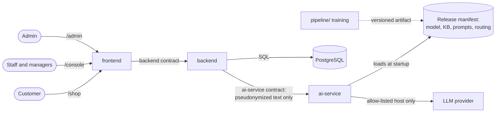
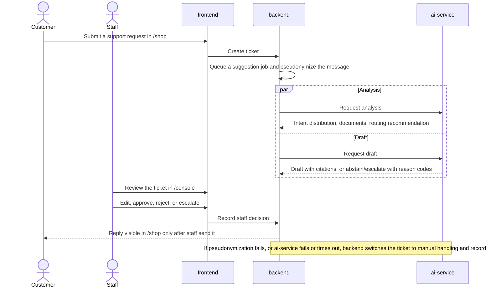

# SupportIQ

SupportIQ is an AI copilot that helps e-commerce customer support staff handle tickets faster and more consistently. The AI only suggests. Staff review every draft and decide what is sent.

> Course project for *Machine Learning in Production* (VNU-UET). Prototype with simulated data only.

## What it does

- Classifies each customer message into one of 46 intents with a self-trained ML model and shows a calibrated confidence.
- Retrieves versioned policy documents from a knowledge base (KB) and drafts a reply with citations.
- Lets staff edit, approve, reject, or escalate. Managers decide refunds, disputes, and policy exceptions. Nothing reaches a customer without a staff action.
- Replaces personal data with pseudonyms before any text leaves `backend`.
- Records staff decisions, source versions, and an insert-only audit log for evaluation, reports, and monitoring.

Full scope and requirements: [docs/product/requirements.md](docs/product/requirements.md).

## Architecture

Three components talk only through versioned contracts ([ADR-0001](docs/decisions/0001-system-architecture.md)). `backend` replicas keep no state between requests, and all shared state lives in PostgreSQL, on any hosting platform ([ADR-0011](docs/decisions/0011-deployment-and-runtime-topology.md)). The demo runs on free plans: `frontend` on Cloudflare Pages behind a same-origin proxy, `backend` on Render, and PostgreSQL on Supabase ([ADR-0016](docs/decisions/0016-hosting-on-free-tiers.md)).



| Component | Responsibility |
|---|---|
| `frontend` | Shop demo with a read-only catalog for simulated customers; review console for staff and managers; admin area for accounts and versions |
| `backend` | Ticket lifecycle, AI orchestration through a job queue, pseudonymization of personal data, permissions, the only path that sends replies, decision records and the audit log, reports, simulated commerce data |
| `ai-service` | Intent classification, retrieval, routing recommendation, drafts with citations, on pseudonymized text. Suggests only |

## Main flow



`backend` requests the analysis and the draft when a ticket is created ([contracts v1 design](docs/design/contracts-v1.md#suggestion-lifecycle)). Pipeline details: [ADR-0005](docs/decisions/0005-intent-independent-retrieval.md).

## Project status

The parts of `main` are kept at their paths, byte for byte, next to the components ([ADR-0028](docs/decisions/0028-repository-layout-for-the-pull-request-into-main.md)). Decisions are recorded in [docs/decisions/](docs/decisions/README.md), and contract changes in the [contracts changelog](contracts/CHANGELOG.md).

- `frontend`, `backend`, `ai-service`, `ml/`, `eval/`, `contracts/`, and `deploy/` exist, each with its README ([Repository layout](#repository-layout)).
- The first release of `ai-service`, `release-2026-11-18-02`, passed the offline evaluation gate. Its gate run record and its manifest are in [eval/releases/release-2026-11-18-02/](eval/releases/release-2026-11-18-02/). It serves no KB document, so no request gets a draft yet ([ai-service README, Known limits](ai-service/README.md#known-limits)).
- No release of `ai-service` is deployed: its Modal app and the download script of a release wait for [#41](https://github.com/ml-system-design-nhom-5/SupportIQ/issues/41) ([ADR-0018, Deploy](docs/decisions/0018-hosting-of-ai-service-on-modal.md#deploy)).
- Follow-ups are the [open issues labeled `tech-debt`](https://github.com/ml-system-design-nhom-5/SupportIQ/issues?q=is%3Aissue%20is%3Aopen%20label%3Atech-debt).

## Repository layout

| Path | Holds |
|---|---|
| `README.md` | This file |
| [`AGENTS.md`](AGENTS.md) | Instructions for AI coding agents |
| [`docs/`](docs/README.md) | Requirements, decisions, designs, rules, guides, templates, and the glossary |
| `.github/` | The CI workflows ([repository checks](docs/guides/repository-checks.md)) |
| [`contracts/`](contracts/README.md) | The API and data contracts between `frontend`, `backend`, and `ai-service`, with their examples, their changelog, and the tooling that checks them and serves them as mocks |
| [`frontend/`](frontend/README.md) | The web app: sign-in, the demo shop at `/shop`, the console at `/console`, and the admin area at `/admin`, with the Pages Function that is the ingress of the demo deployment |
| [`backend/`](backend/README.md) | Sign-in, the read-only shop, the ticket workflow behind `/console`, internal accounts, the simulated commerce data, the pseudonym maps, and the audit log |
| [`ai-service/`](ai-service/README.md) | The AI pipeline for `backend`: intent classification, retrieval of KB document versions, the routing recommendation, and LLM drafting with citations |
| [`ml/`](ml/README.md) | The run records of the intent model that `ai-service` serves, in `ml/runs/` |
| [`eval/`](eval/README.md) | The release command, the gate run records and published manifests of the releases in `eval/releases/`, and the output of KB ingestion |
| [`deploy/`](deploy/README.md) | The setup of the demo on free plans: the setup order, the settings of each platform, and the checks before and after the first deploy; and, in `deploy/local/`, the local run of the whole system ([local run guide](docs/guides/local-run.md)) |
| `data/` | Data committed unchanged: the KB versions in `data/raw/kb/<kb_version>/`, the interim escalation cases in `data/benchmarks/escalation/`, and the data of `main`: its other test and scenario sets in `data/benchmarks/`, and `data/business/`, `data/datasets/`, `data/intent/`, and `data/knowledge/`. Downloaded datasets, such as Bitext, are not committed ([DATA-06 to DATA-08](docs/rules/data-and-ml.md#data-layout)) |
| [`pipeline/`](pipeline/README.md) | The independent ML pipeline: data preparation, preprocessing, training, offline model evaluation, and artifact generation. Completely decoupled from the serving path |
| `artifacts/` | The outputs of model training, offline evaluation, and model artifacts |
| [`tests/`](tests/README.md), `pytest.ini` | Unit tests for `pipeline/` (data preparation, preprocessing, training, and offline evaluation) |
| `scripts/` | Maintenance and test cache cleaning scripts |

## Run and test on your machine

### Quick start (local run)

The entire system runs locally via Docker on Linux, macOS, and WSL2 on Windows. This includes PostgreSQL 17, `backend` with simulated commerce data, `frontend`, and optionally `ai-service` and the local observability stack.

#### 1. Prerequisites
- **Docker**: Docker Engine 25+ (API 1.44+) and Docker Compose v2.20.2+ with BuildKit enabled (`docker compose`, not `docker-compose`).
- **Hardware**: At least 4 GB RAM (8 GB recommended when running with AI or observability).
- **Ports**: `5173` (frontend), `8000` (backend), `5434` (PostgreSQL), and optionally `8001` (ai-service) and `3000` (Grafana).

#### 2. Start the system (standard mode without AI)

Start the whole system from the repository root:

```bash
deploy/local/local-run.sh start
```
*(Tip: pass `--yes` to accept first-run setup prompts automatically: `deploy/local/local-run.sh start --yes`)*

On the first start, the script:
- Generates `.local-run/secrets.env` with random local passwords (kept on your machine, git-ignored).
- Builds Docker images for `backend` and `frontend`.
- Initializes PostgreSQL on port `5434`, runs migrations, and loads demo seed data.
- Starts `backend` on <http://127.0.0.1:8000> and `frontend` on <http://127.0.0.1:5173>.

#### 3. Access URLs and demo accounts

Open your browser:
- **Frontend**: <http://localhost:5173>
  - `/shop`: Simulated customer store to browse orders and submit support tickets.
  - `/console`: Staff review console to inspect, edit, approve, or reject suggestions.
  - `/admin`: Admin console for system settings and audit oversight.
- **Backend API Docs**: <http://localhost:8000/docs> (Swagger / OpenAPI)
- **PostgreSQL**: `127.0.0.1:5434` (database `supportiq`, user `supportiq_owner`)

Demo passwords are generated into `.local-run/secrets.env`. Inspect them with:
```bash
grep '^SEED_PASSWORD_' .local-run/secrets.env
```

| Login name | Role | Password key in `.local-run/secrets.env` |
|---|---|---|
| `customer-1`, `customer-2`, `customer-3` | Customer | `SEED_PASSWORD_CUSTOMER` |
| `staff-1`, `staff-2` | Staff | `SEED_PASSWORD_STAFF` |
| `manager-1`, `manager-2` | Manager | `SEED_PASSWORD_MANAGER` |
| `admin-1`, `admin-2` | Admin | `SEED_PASSWORD_ADMIN` |

#### 4. Running with the AI Service (`--with-ai`)

In standard mode (without AI), the backend and frontend run normally and suggestions default to manual handling without requiring any downloaded model weights.

To enable automated intent classification, semantic KB policy retrieval, and LLM drafting:

##### Step 4.1 — Download model weights and release assets

Model weights, archives, and release binaries (~400 MB total) are excluded from git ([ADR-0021](docs/decisions/0021-repository-layout-and-ai-ml-migration.md)). The repository's `.gitignore` automatically ignores downloaded archives (`*.tar.gz`, `*.tgz`, `*.zip`), model weights (`*.safetensors`, `*.pt`, `*.bin`), extracted release assets (`eval/releases/*/*/`), and the runtime directory `/.local-run/`.

Assets are hosted on [GitHub Releases](https://github.com/ml-system-design-nhom-5/SupportIQ/releases):

- **For local AI runtime (`.local-run/release/`)**:
  Extract the verified release bundle directly into `.local-run/release/` (which is git-ignored):
  ```bash
  mkdir -p .local-run/release

  # Option A: via GitHub CLI
  gh release download release-2026-11-18-02 --repo ml-system-design-nhom-5/SupportIQ --pattern "release-2026-11-18-02.tar.gz"
  tar -xzf release-2026-11-18-02.tar.gz -C .local-run/release/
  rm -f release-2026-11-18-02.tar.gz

  # Option B: via curl (stream extract directly without saving archive)
  curl -L "https://github.com/ml-system-design-nhom-5/SupportIQ/releases/download/release-2026-11-18-02/release-2026-11-18-02.tar.gz" | tar -xz -C .local-run/release/
  ```
  *(This extracts `release-manifest.json`, `model/`, `index/`, `kb/`, `mapping/`, `prompts/`, and `routing/` directly into `.local-run/release`. `ai-service` strictly validates every file hash against `release-manifest.json` on startup).*

- **For offline ML pipeline training & evaluation (`v2.0.0-model`)**:
  If retraining models or running offline benchmarks in `pipeline/`, download the standalone model weights from GitHub Release [`v2.0.0-model`](https://github.com/ml-system-design-nhom-5/SupportIQ/releases/tag/v2.0.0-model):
  - `distilbert-supportiq.zip`: DistilBERT baseline classifier weights and tokenizer
  - `bge-small-en-v1.5-hf-cache.zip`: Offline Hugging Face cache for `BAAI/bge-small-en-v1.5` embeddings
  - `reconstructed-fit2-supcon-20261113.zip`: Calibrated Fit2 DistilBERT classifier
  ```bash
  gh release download v2.0.0-model --repo ml-system-design-nhom-5/SupportIQ
  ```
  *(Both the `.zip` archives and the extracted model directories are ignored by `.gitignore`, preventing accidental commits).*

##### Step 4.2 — Configure credentials in `.env`

1. Create a `.env` file from `.env.example`:
   ```bash
   cp .env.example .env
   ```
2. Set your Gemini API key and token price rates in `.env`:
   ```env
   GEMINI_API_KEY="your-gemini-api-key"
   LLM_INPUT_PRICE_MICRO_USD_PER_MILLION_TOKENS="150"
   LLM_OUTPUT_PRICE_MICRO_USD_PER_MILLION_TOKENS="600"
   ```

##### Step 4.3 — Start the system with AI

Export the variables and start with the release folder:
```bash
set -a && source .env && set +a
deploy/local/local-run.sh start --with-ai .local-run/release
```
*`ai-service` will listen on <http://127.0.0.1:8001> and verify its model and KB assets against its release manifest before starting `backend` and `frontend`.*

#### 5. Developer workflow and container logs

Because `.env` configures Compose project defaults, standard `docker compose` commands work directly from the repository root:

```bash
docker compose ps                     # Check container status
docker compose logs -f                # Follow logs of all services
docker compose logs -f backend        # Follow backend logs
docker compose logs -f ai-service     # Follow AI service logs
docker compose logs -f frontend       # Follow frontend logs
docker compose restart backend        # Restart a single service
```

Alternatively, use the helper script:
```bash
deploy/local/local-run.sh status      # Check health and ports of each part
deploy/local/local-run.sh logs        # Follow logs (or `logs <part>`)
deploy/local/local-run.sh stop        # Stop containers while preserving data
```

Full details on troubleshooting, observability with Grafana (`--observability`), and resetting database state are in the [local run guide](docs/guides/local-run.md).

### Run individual components standalone

- **`frontend`** ([Set up](frontend/README.md#set-up), [Run](frontend/README.md#run), [Test](frontend/README.md#test)): `pnpm run dev:mock` serves the app at <http://localhost:5173> against the Prism mock of the `backend` contract, on Linux, macOS, and WSL2 on Windows. The mock answers every sign-in with the customer of the examples, so a browser reaches the shop but not the console or the admin area. `pnpm run dev` proxies to the `backend` that `SUPPORTIQ_BACKEND_URL` names instead ([Settings](frontend/README.md#settings)). `pnpm test` runs every test.
- **`contracts/`** ([Set up](contracts/README.md#set-up), [Commands](contracts/README.md#commands)): `pnpm run check` checks both contracts. `pnpm run mock` serves the `backend` contract as a mock at `http://127.0.0.1:4010`, and `pnpm run mock:ai-service` serves the `ai-service` contract at `http://127.0.0.1:4012`, which `backend` can call during development ([The `ai-service` mock](contracts/README.md#the-ai-service-mock)).
- **`backend`** ([Set up](backend/README.md#set-up), [Run and test](backend/README.md#run-and-test)): one replica and every test run against PostgreSQL 17, with the settings of `backend/.env`, made from `.env.example`. The README sets up PostgreSQL 17 with Homebrew. The unit tests need no database: `uv run pytest tests/unit`.
- **`ai-service`** ([Set up](ai-service/README.md#set-up), [Run and test](ai-service/README.md#run-and-test)): `uv run pytest` runs the tests on Linux, macOS, and Windows; without torch, the tests that need it are skipped. `ai-service serve` loads the real model, so it runs only on Linux, because torch is locked for Linux only ([ADR-0021, Python and dependencies](docs/decisions/0021-repository-layout-and-ai-ml-migration.md#python-and-dependencies)). It also needs the files of a published release on the machine; without them it does not start.
- **The release command in `eval/release/`** ([Set up](eval/release/README.md#set-up), [Run and test](eval/release/README.md#run-and-test)): `uv run --project eval/release pytest eval/release` runs its tests from the repository root. The offline evaluation gate runs in Docker.
- **`pipeline/` and its `tests/`**: independent ML pipeline for data preparation, preprocessing, training, and offline evaluation. Requirements are defined in `pipeline/requirements.txt` and `pipeline/requirements-transformers.txt`. Run pipeline tests with `python -m pytest tests/`.

## Documentation

Start with [docs/README.md](docs/README.md): where every document lives and how to write one.

| Need | Go to |
|---|---|
| What we build and why | [Requirements](docs/product/requirements.md) |
| Why we chose what we chose | [Architecture decisions](docs/decisions/README.md) |
| How we write code | [Engineering rules](docs/rules/README.md) |
| What a term means | [Glossary](docs/glossary.md) |
| API contracts and the mock | [contracts/README.md](contracts/README.md) |
| How to run the whole system on your machine | [Local run](docs/guides/local-run.md) |
| How to run the repository checks | [Repository checks and CI](docs/guides/repository-checks.md) |
| Instructions for AI coding agents | [AGENTS.md](AGENTS.md) |

## Non-negotiable rules

1. Staff approve every reply. The system never sends replies or performs transactions on its own.
2. Every draft cites verifiable sources: a document ID and version for policy, and an order field for facts about the order. Without enough evidence, the AI abstains.
3. Simulated data only. Personal data is pseudonymized before it leaves `backend`. No secrets in the repository.
4. Design before code. Contracts before implementation.

Details: [docs/rules/](docs/rules/README.md). Team roles and ownership: [ADR-0001](docs/decisions/0001-system-architecture.md#team-allocation).
