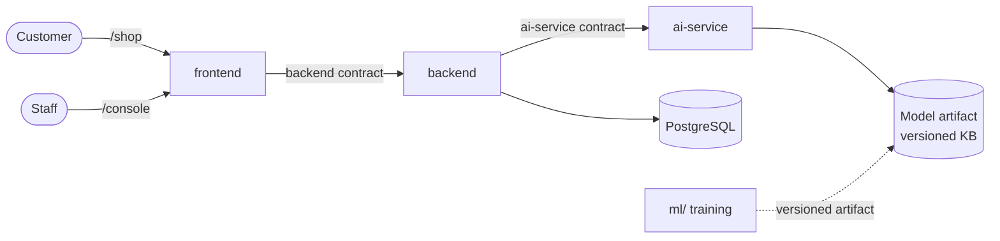
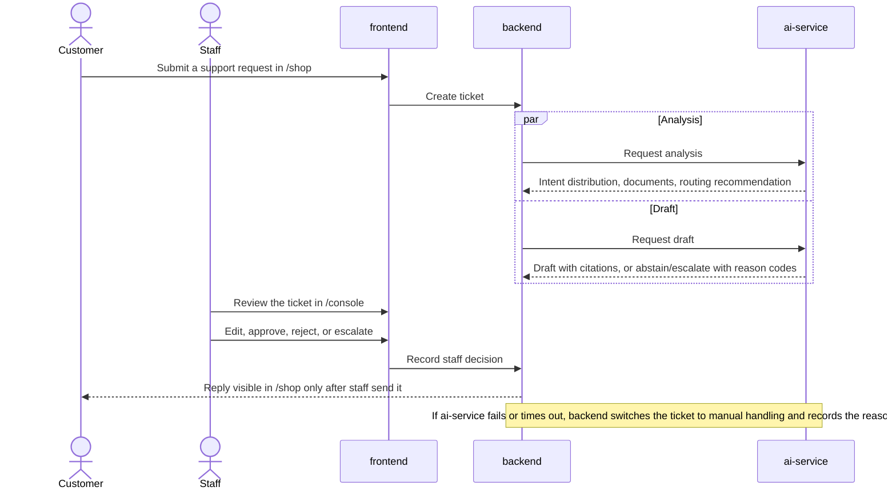

# SupportIQ

SupportIQ is an AI copilot that helps e-commerce customer support staff handle tickets faster and more consistently. The AI only suggests. Staff review every draft and decide what is sent.

> Course project for *Machine Learning in Production* (VNU-UET). Prototype with simulated data only.

## What it does

- Classifies each customer message into one of 46 intents with a self-trained ML model and shows a calibrated confidence.
- Retrieves versioned policy documents from a knowledge base (KB) and drafts a reply with citations.
- Lets staff edit, approve, reject, or escalate. Nothing reaches a customer without a staff action.
- Records staff decisions and source versions for evaluation and monitoring.

Full scope and requirements: [docs/product/requirements.md](docs/product/requirements.md).

## Architecture

Three components talk only through versioned contracts ([ADR-0001](docs/decisions/0001-system-architecture.md)).



| Component | Responsibility |
|---|---|
| `frontend` | Minimal shop demo for simulated customers; review console for staff |
| `backend` | Ticket lifecycle, AI orchestration, permissions, the only path that sends replies, decision records, simulated commerce data |
| `ai-service` | Intent classification, retrieval, routing recommendation, drafts with citations. Suggests only |

## Main flow



When `backend` requests the analysis and draft (at ticket creation or when staff open the ticket) is decided during contract design. Pipeline details: [ADR-0005](docs/decisions/0005-intent-independent-retrieval.md).

## Project status

Design phase. Decisions are recorded in [docs/decisions/](docs/decisions/README.md). The design of contracts v1 is approved ([docs/design/contracts-v1.md](docs/design/contracts-v1.md)); writing the contracts is the next step. There is no runnable code yet; setup instructions are added here when the first component is scaffolded.

## Target repository layout

```text
supportiq-ecom/
├── README.md        # This file
├── AGENTS.md        # Instructions for AI coding agents
├── docs/            # Requirements, decisions, rules, glossary
├── contracts/       # API and data contracts (created during contract design)
├── frontend/        # /shop and /console (created at scaffold)
├── backend/         # Created at scaffold
├── ai-service/      # Created at scaffold
├── ml/              # Training and offline evaluation (created at scaffold)
├── eval/            # Shared test sets and evaluation runs (created at scaffold)
└── data/            # Local datasets; large files are not committed
```

## Documentation

Start with [docs/README.md](docs/README.md): where every document lives and how to write one.

| Need | Go to |
|---|---|
| What we build and why | [Requirements](docs/product/requirements.md) |
| Why we chose what we chose | [Architecture decisions](docs/decisions/README.md) |
| How we write code | [Engineering rules](docs/rules/README.md) |
| What a term means | [Glossary](docs/glossary.md) |
| Instructions for AI coding agents | [AGENTS.md](AGENTS.md) |

## Non-negotiable rules

1. Staff approve every reply. The system never sends replies or performs transactions on its own.
2. Every draft cites verifiable sources (document ID and version). Without enough evidence, the AI abstains.
3. Simulated data only. No secrets in the repository.
4. Design before code. Contracts before implementation.

Details: [docs/rules/](docs/rules/README.md). Team roles and ownership: [ADR-0001](docs/decisions/0001-system-architecture.md#team-allocation).
