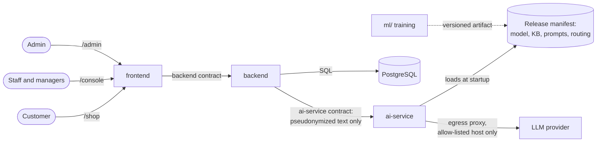
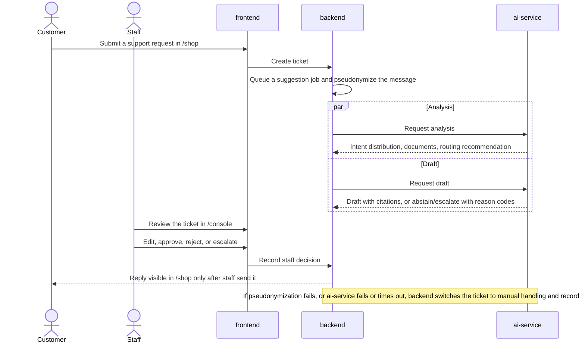

# SupportIQ

SupportIQ is an AI copilot that helps e-commerce customer support staff handle tickets faster and more consistently. The AI only suggests. Staff review every draft and decide what is sent.

> Course project for *Machine Learning in Production* (VNU-UET). Prototype with simulated data only.

## What it does

- Classifies each customer message into one of 46 intents with a self-trained ML model and shows a calibrated confidence.
- Retrieves versioned policy documents from a knowledge base (KB) and drafts a reply with citations.
- Lets staff edit, approve, reject, or escalate. Managers decide refunds, disputes, and policy exceptions. Nothing reaches a customer without a staff action.
- Replaces personal data with pseudonyms before any text leaves `backend`.
- Records staff decisions, source versions, and an insert-only audit log for evaluation, reports, and monitoring.

Full scope and requirements: [docs/product/requirements.md](docs/product/requirements.md).

## Architecture

Three components talk only through versioned contracts ([ADR-0001](docs/decisions/0001-system-architecture.md)). They run as one Docker Compose project behind an Nginx ingress, with two replicas of `backend` and of `ai-service` ([ADR-0011](docs/decisions/0011-deployment-and-runtime-topology.md)).



| Component | Responsibility |
|---|---|
| `frontend` | Shop demo with a read-only catalog for simulated customers; review console for staff and managers; admin area for accounts and versions |
| `backend` | Ticket lifecycle, AI orchestration through a job queue, pseudonymization of personal data, permissions, the only path that sends replies, decision records and the audit log, reports, simulated commerce data |
| `ai-service` | Intent classification, retrieval, routing recommendation, drafts with citations, on pseudonymized text. Suggests only |

## Main flow



`backend` requests the analysis and the draft when a ticket is created ([contracts v1 design](docs/design/contracts-v1.md#suggestion-lifecycle)). Pipeline details: [ADR-0005](docs/decisions/0005-intent-independent-retrieval.md).

## Project status

`frontend` and the `backend` foundation are implemented; the ticket workflow and `ai-service` come next. Decisions are recorded in [docs/decisions/](docs/decisions/README.md).

- Revision 2 of the contracts v1 design ([docs/design/contracts-v1.md](docs/design/contracts-v1.md)) aligns the design with the team's specification and is in review, together with ADR-0010, ADR-0011, and ADR-0014. ADR-0012 and ADR-0013 were accepted on 2026-11-05.
- On 2026-11-05 the project lead approved the `frontend` ↔ `backend` part of revision 2 for contract PR 2. Contract PR 2 adds [`contracts/backend.openapi.yaml`](contracts/backend.openapi.yaml) 1.0.0 with an example for every outcome, a Prism mock, and the contract checks ([contracts/README.md](contracts/README.md)).
- Version 1.0.1 of `contracts/backend.openapi.yaml` (2026-11-08) clarifies the reuse of an `Idempotency-Key`, the responses from the ingress, and the products of an order ([CHANGELOG](contracts/CHANGELOG.md)). The [backend foundation design](docs/design/backend-foundation.md) is in review again for the revision that the implementation brought, and the frontend engineer and the contracts gatekeeper approve it.
- Repository checks run with pre-commit locally and with GitHub Actions in CI ([docs/guides/repository-checks.md](docs/guides/repository-checks.md)).
- `backend` is scaffolded: [backend/README.md](backend/README.md) gives setup, commands, and demo accounts.
- `frontend` is scaffolded and runs against the Prism mock: sign-in, the shop, and the Accounts screen of the admin area ([frontend/README.md](frontend/README.md)). `ai-service` is not scaffolded yet.
- [ADR-0015](docs/decisions/0015-account-creation-and-password-changes.md), accepted on 2026-11-11 by the project lead, adds account creation, password changes, and password resets. The project lead also approved the [account management design](docs/design/account-management.md) and the admin, shop, and console UI designs with their revisions. `backend` contract 1.1.0 and the implementation come next.

## Target repository layout

```text
supportiq-ecom/
├── README.md        # This file
├── AGENTS.md        # Instructions for AI coding agents
├── docs/            # Requirements, decisions, rules, glossary
├── .github/         # CI workflows (docs/guides/repository-checks.md)
├── contracts/       # API and data contracts, their examples, and their tooling
├── frontend/        # /shop, /console, and /admin; see frontend/README.md
├── backend/         # See backend/README.md
├── ai-service/      # Created at scaffold
├── ml/              # Training and offline evaluation (created at scaffold)
├── eval/            # Shared test sets and evaluation runs (created at scaffold)
├── deploy/          # Docker Compose, Nginx, egress proxy, observability (created once ADR-0011 or the hosting ADR is accepted)
└── data/            # Local datasets; large files are not committed
```

## Documentation

Start with [docs/README.md](docs/README.md): where every document lives and how to write one.

| Need | Go to |
|---|---|
| What we build and why | [Requirements](docs/product/requirements.md) |
| Why we chose what we chose | [Architecture decisions](docs/decisions/README.md) |
| How we write code | [Engineering rules](docs/rules/README.md) |
| What a term means | [Glossary](docs/glossary.md) |
| API contracts and the mock | [contracts/README.md](contracts/README.md) |
| How to run the repository checks | [Repository checks and CI](docs/guides/repository-checks.md) |
| Instructions for AI coding agents | [AGENTS.md](AGENTS.md) |

## Non-negotiable rules

1. Staff approve every reply. The system never sends replies or performs transactions on its own.
2. Every draft cites verifiable sources: a document ID and version for policy, and an order field for facts about the order. Without enough evidence, the AI abstains.
3. Simulated data only. Personal data is pseudonymized before it leaves `backend`. No secrets in the repository.
4. Design before code. Contracts before implementation.

Details: [docs/rules/](docs/rules/README.md). Team roles and ownership: [ADR-0001](docs/decisions/0001-system-architecture.md#team-allocation).
