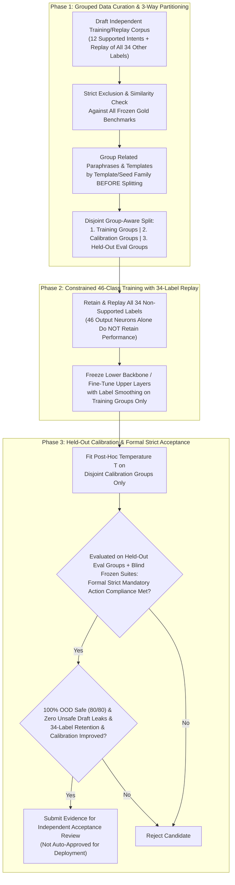

# SupportIQ Intent Classifier Candidate Comparison & Intent Coverage Diagnostic Report (Reviewed & Corrected)

**Evaluation Date:** 2026-11-13 (UTC)  
**Evaluator:** Worker A (Topic 1: Current-Model Robustness & Safe Routing)  
**Plan Reference:** `docs/superpowers/plans/2026-11-12-acceptance-next-pass.md` (Task A) & `docs/CHỦ ĐỀ 1.md`  
**Execution Scope:** Offline intent classification and routing evaluation via `Engine._analyse` with `OfflineSpyLLM` (zero live provider or external LLM calls).  
**Branch HEAD:** `MINHDZVODICH/supportiq-final-routing`  

---

## 1. Executive Summary & Candidate Recommendation

### Formal Decision: RETAIN `distilbert-supportiq` AS ACTIVE SERVING MODEL; REJECT PROMOTION OF `supportpilot-distilbert`

An offline, zero-leakage comparative evaluation was conducted between the active serving model (`distilbert-supportiq`) and the alternative candidate model (`supportpilot-distilbert`) across all frozen benchmark suites under identical policy boundaries (`intent_policy.v2.json`, `approved_kb.v2.json`, and `Engine` v2.0.0).

> [!IMPORTANT]
> **Evaluation Boundary Clarification:** The evaluation harness exercises offline intent prediction and deterministic policy routing via `Engine._analyse`. It evaluates **routing decisions** (`retrieve_draft`, `manual_fallback`, `escalate`, `clarify`), **not generated text**. No LLM generation was invoked, and no generated-answer evidence was produced. Terms such as "draftability" refer strictly to whether queries route to a *draft-eligible* state.

While `supportpilot-distilbert` produces more draft-eligible routings on answerable queries (26/34 = 76.47% vs 21/34 = 61.76% on product acceptance answerable; and 8/12 = 66.67% vs 5/12 = 41.67% on final acceptance answerable), **empirical calibration metrics reveal that `supportpilot-distilbert` exhibits substantially higher uncalibrated confidence across all evaluated suites** (ECE = 0.1418 on `ml_noise` [N=420] vs 0.0920 for serving; ECE = 0.1802 on `system_acceptance` labeled cases [N=153] vs 0.1157 for serving; average confidence 81.33%–82.73% vs 70.24%–73.32%). This elevated confidence produces critical routing regressions:

1. **Out-of-Distribution (OOD) Routing Leak:** In `ml_oos.jsonl`, `supportpilot-distilbert` routes an ambiguous multi-intent case (`oos-multi_intent-09`) to a draft-eligible state instead of safely abstaining or escalating (flagged safe rate drops from 100.00% to 98.75%). Serving model `distilbert-supportiq` maintains a **100.00% safe abstention/escalation rate (80/80)** with 0 draft-eligible leaks.
2. **Mandatory Escalation Degradation:** On the 63 mandatory escalation cases in `system/v2/acceptance/cases.jsonl`, `supportpilot-distilbert` routes 3 cases to draft-eligible state (2 real routing leaks on out-of-scope queries + 1 uninjected fault), whereas `distilbert-supportiq` routes only 1 case (the uninjected synthetic fault `unc-return_policy-04`, marked `NOT_EXECUTED`).
3. **Draft-Eligible Routing on Wrong Intent for Financial Discrepancy:** On final acceptance query `final-case-12` (*"My bank account was debited but my order status on Tiki still shows Awaiting Payment"*), `supportpilot-distilbert` predicted `track_order` with high confidence (**0.8216**), routing it to a draft-eligible state on parcel tracking for an order payment failure. Serving model `distilbert-supportiq` predicted `track_order` at lower confidence (**0.5636 < 0.65**), safely triggering fail-closed routing (`clarify` with reason `low_confidence`).

**Recommendation:** Retain `distilbert-supportiq` in production. Do not swap active weights. Any future mitigation (such as restoring and evaluating verified traditional baselines, threshold/calibration analysis, or a controlled held-out experiment like the unexecuted proposal in Section 5) remains unapproved until formally evaluated against strict acceptance gates.

---

## 2. Model Inventory & Provenance Verification

All candidate artifacts in the workspace and repository history were cataloged and audited:

| Model Identity | Weights Path / File | Format & Size | SHA-256 Checksum | 46-Label Bijection | Provenance & Lineage Status |
| :--- | :--- | :--- | :--- | :--- | :--- |
| **`distilbert-supportiq`** *(Serving)* | `artifacts/models/trained/distilbert-supportiq/model.safetensors` | safetensors (267,967,920 B) | `dc7af8cffb19fe7711ed5a5d0137ffff3d7d1a1f43bad5a35edff8c8de4c1302` | **VERIFIED** (0..45 strict bijection) | Active serving release v1.0.0; matches pinned release manifest in `apps/ml_inference/app.py`. Documented training lineage on Bitext dataset. |
| **`supportpilot-distilbert`** *(Candidate)* | `artifacts/models/finetuned/supportpilot-distilbert/model.safetensors` | safetensors (267,967,920 B) | `66daf66ab6c5b55cc7d2dccf6b1dc69ef5f5512b513e4d77ab2476b15dc198dc` | **VERIFIED** (0..45 strict bijection) | **Artifact identity verified; training provenance UNKNOWN.** Copied from external folder `F:/Năm 3/SD/project/SupportIQ/artifacts/models/finetuned/`. Training lineage, dataset, split availability, and benchmark contamination are **UNVERIFIED / UNKNOWN**. |
| **`linear_svm`** *(Traditional Baseline)* | `artifacts/training/03-11-2026-00/models/linear_svm/bundle.joblib` | joblib bundle (missing) | Expected: `BB20C4CEAA8C44D4D58C208BF24FD8DDFB72E41209C4E3114BC973B8FBE924F0` | Manifest record only | 10-Fold CV Macro-F1: 0.9903. **Physical file absent across searched paths.** |
| **`logistic_regression`** *(Traditional Baseline)* | `artifacts/training/03-11-2026-00/models/logistic_regression/bundle.joblib` | joblib bundle (missing) | Expected: `23152C26BD402F772DFB4CDE64EFD8D838194C0E5FE69818EFCEA169512CE207` | Manifest record only | 10-Fold CV Macro-F1: 0.9889. **Physical file absent across searched paths.** |
| **`multinomial_nb`** *(Traditional Baseline)* | `artifacts/training/03-11-2026-00/models/multinomial_nb/bundle.joblib` | joblib bundle (missing) | Expected: `62280C15A7CFE182E6A53A512159E3ABAFA3744144C4774E3BB99D52357CB3E5` | Manifest record only | 10-Fold CV Macro-F1: 0.9836. **Physical file absent across searched paths.** |

> [!NOTE]
> **Identity vs Provenance:** Checksums and label bijection verify artifact integrity and schema compatibility, but do **NOT** establish training lineage, data hygiene, or zero benchmark leakage for `supportpilot-distilbert`.
> **Historical Baseline Inventory (Snapshot `2026-11-12T19:19:55Z`):** At evaluation snapshot time, searches across `artifacts/training/03-11-2026-00/models/`, `artifacts/training/03-11-2026-01/models/`, `artifacts/models/`, and root project `F:/Năm 3/SD/project/SupportIQ/artifacts/` recorded that `bundle.joblib` files were physically absent. While `.gitignore:79` specifies `/artifacts/**/*.joblib`, this report records that absence strictly as a historical evaluation-time inventory observation without asserting sole causal attribution or requiring those ignored files to remain absent if valid baselines are restored later.

---

## 3. Reproduction & Observed Failure Diagnostic of the 7 Uncertain Cases

In `data/benchmarks/final_acceptance/cases.jsonl`, exactly **12 queries are in-scope answerable customer inquiries** (`final-case-01` to `final-case-12`).

Under active serving model `distilbert-supportiq`, exactly **5 cases route to draft-eligible state** (`final-case-01`, `02`, `08`, `09`, `11`), while **7 cases do not route to draft** and are held for human review.

The table below reproduces these 7 cases with exact model scores, thresholds, reason codes, and routing actions:

### Detailed Diagnostic Matrix (The 7 Uncertain Cases)

| Case ID & Query Excerpt | Expected Intent | Serving Model (`distilbert-supportiq`) | | | Candidate (`supportpilot-distilbert`) | | | Safety & Root Cause Analysis |
| :--- | :--- | :--- | :--- | :--- | :--- | :--- | :--- | :--- |
| | | **Predicted (Conf / Margin)** | **Action & Reason** | **Draft-Eligible?** | **Predicted (Conf / Margin)** | **Action & Reason** | **Draft-Eligible?** | |
| **`final-case-03`** *"What are the requirements for refund approval and are shipping fees refunded if I return due to personal preference?"* | `refund_policy` (thresh: 0.65 conf, 0.10 margin) | `payment_issue` (conf: **0.4416**, margin: 0.2770) | `clarify` `['low_confidence']` | **NO** | `refund_policy` (conf: **0.8119**, margin: 0.7493) | `retrieve_draft` `[]` | **YES** | **Serving Underconfidence:** Query combines refund approval with shipping fee policy. Serving model predicts `payment_issue` below threshold (0.4416 < 0.75), safely failing closed to `clarify`. Candidate correctly identifies `refund_policy` with 0.8119 confidence. |
| **`final-case-04`** *"How many business days does it take to receive a refund back to my linked e-wallet or bank card?"* | `request_refund` (thresh: 0.80 conf, 0.15 margin) | `return_policy` (conf: **0.2747**, margin: 0.0427) | `clarify` `['low_confidence', 'low_margin']` | **NO** | `refund_status` (conf: **0.5022**, margin: 0.0906) | `clarify` `['low_confidence', 'low_margin']` | **NO** | **Semantic Overlap:** Query asks about refund processing timeline. Both models struggle with fine distinction between `request_refund`, `refund_status`, and `return_policy`. Both safely fail closed to `clarify` due to low confidence and low margin. |
| **`final-case-05`** *"Where can I check my refund tracking status and transaction tracing code on Tiki?"* | `refund_status` (thresh: 0.65 conf, 0.10 margin) | `refund_status` (conf: **0.5797**, margin: 0.3437) | `clarify` `['low_confidence']` | **NO** | `refund_status` (conf: **0.8024**, margin: 0.7433) | `retrieve_draft` `[]` | **YES** | **Borderline Confidence:** Serving model correctly identifies `refund_status` but scores 0.5797, below the 0.65 policy threshold. Candidate scores 0.8024 and routes to draft. Serving model's decision is conservative safe abstention. |
| **`final-case-06`** *"Can I cancel my order directly on the app while it is still in Awaiting Packing status?"* | `cancel_order` (thresh: 0.80 conf, 0.15 margin) | `cancel_order` (conf: **0.4581**, margin: 0.3532) | `clarify` `['low_confidence']` | **NO** | `cancel_order` (conf: **0.7398**, margin: 0.6363) | `clarify` `['low_confidence']` | **NO** | **High Policy Threshold for Sensitive Action:** Because `cancel_order` is a sensitive action intent, `intent_policy.v2.json` requires confidence >= 0.80. Serving model scored 0.4581; candidate scored 0.7398. Both correctly identify the intent, and BOTH safely fail closed to `clarify` because neither meets the 0.80 sensitive gate. |
| **`final-case-07`** *"How do I track the transit hubs my parcel has passed through using the tracking code?"* | `track_order` (thresh: 0.65 conf, 0.10 margin) | `store_location` (conf: **0.2938**, margin: 0.1170) | `escalate` `['recognized_outside_product_scope']` | **NO** | `store_location` (conf: **0.8996**, margin: 0.8428) | `escalate` `['recognized_outside_product_scope']` | **NO** | **Hypothesized Domain-Term Mismatch (Unverified):** Both models predict `store_location` for a parcel transit-hub query. Because `store_location` is an escalated intent outside product scope, Gate 2c immediately routes to `escalate` (candidate with 0.8996 confidence). Unfamiliarity with *"transit hubs"* phrasing is a plausible hypothesis, not an established root cause (no training-corpus attribution was performed). |
| **`final-case-10`** *"The app shows my order was delivered but I never received the package from the courier."* | `delivery_issue` (thresh: 0.70 conf, 0.10 margin) | `delivery_issue` (conf: **0.2618**, margin: 0.0006) | `clarify` `['low_confidence', 'low_margin']` | **NO** | `technical_issue` (conf: **0.6123**, margin: 0.5183) | `escalate` `['recognized_outside_product_scope']` | **NO** | **Correct vs Misdirected Queue:** Serving model correctly identifies `delivery_issue` (top1), but with narrow margin over `damaged_delivery`, safely routing to `clarify`. Candidate misclassifies the delivery issue as an IT `technical_issue` (0.6123), escalating to the wrong department (`technical_support`). |
| **`final-case-12`** *"My bank account was debited but my order status on Tiki still shows Awaiting Payment."* | `payment_issue` (thresh: 0.75 conf, 0.10 margin) | `track_order` (conf: **0.5636**, margin: 0.3590) | `clarify` `['low_confidence']` | **NO** | `track_order` (conf: **0.8216**, margin: 0.7683) | `retrieve_draft` `[]` | **CRITICAL REGRESSION (Draft-Eligible on Wrong Intent)** | **ROUTING FAILURE IN CANDIDATE:** Serving model has low confidence (0.5636 < 0.65) and safely fails closed to `clarify`. Candidate is overconfident (0.8216 >= 0.65) and **routes to draft-eligible state on `track_order`** for a payment failure inquiry. |

### Architectural Conclusion on the 7 Cases
The 7 non-drafting cases under `distilbert-supportiq` represent **fail-closed routing behavior under uncertainty**:
- 6 cases triggered `clarify` (`low_confidence` or `low_margin`).
- 1 case triggered `escalate` (`recognized_outside_product_scope`).
- **Zero queries were routed to draft-eligible state on wrong intents.**
- In contrast, candidate `supportpilot-distilbert` routes `final-case-12` to draft-eligible state under `track_order`, demonstrating that higher draftability gained through uncalibrated probability leads to wrong-intent routing on ambiguous inputs.

---

## 4. Side-by-Side Comparative Benchmark Results

### Suite 1: ML Noise Benchmark (`ml_noise.jsonl`, N=420)

| Slice / Metric | Denominator | Active Serving (`distilbert-supportiq`) | Alternative Candidate (`supportpilot-distilbert`) | Calibration & Safety Notes |
| :--- | :--- | :--- | :--- | :--- |
| **Clean Accuracy** | 84 | **77.38%** (65/84) | 72.62% (61/84) | Serving +4.76% higher on clean inputs |
| **Clean Macro-F1** | 84 | **0.7858** | 0.7526 | Serving +0.0332 higher |
| **Casual Accuracy** | 84 | 70.24% (59/84) | **72.62%** (61/84) | Candidate +2.38% higher on casual phrasings |
| **Casual Macro-F1** | 84 | 0.7359 | **0.7439** | Candidate +0.0080 higher |
| **Typo Accuracy** | 252 | 59.92% (151/252) | **63.49%** (160/252) | Candidate +3.57% higher on corrupted text |
| **Typo Macro-F1** | 252 | 0.6267 | **0.6582** | Candidate +0.0315 higher |
| **Clean $\to$ Typo F1 Drop** | — | -0.1591 | **-0.0944** | Candidate has smaller F1 drop on typos |
| **Overall Noise Accuracy** | 420 | 65.48% (275/420) | **67.14%** (282/420) | Candidate +1.66% raw accuracy |
| **Noise Safe Routing Rate** | 420 | **91.43%** (384/420) | 90.48% (380/420) | Serving model has +4 safe routings |
| **Average Confidence** | 420 | **70.24%** (Close to 65.48% Acc) | **81.33%** (Gap of +14.19% over Acc) | Candidate exhibits large confidence-accuracy gap |
| **Expected Calibration Error (ECE)** | 420 | **0.0920** | **0.1418** (+54% error) | Candidate is significantly less calibrated |
| **Binary Top-Label Brier Score** *(top-1 only)* | 420 | **0.1828** | 0.1871 | MSE of top-1 confidence vs correctness indicator (not 46-class multiclass Brier; only top-1 confidence is retained in `raw_predictions.jsonl`) |

---

### Suite 2: ML Out-of-Scope & Ambiguity Benchmark (`ml_oos.jsonl`, N=80)

| Category / Metric | Denominator | Active Serving (`distilbert-supportiq`) | Alternative Candidate (`supportpilot-distilbert`) | Safety Evaluation |
| :--- | :--- | :--- | :--- | :--- |
| **General Out-of-Scope Safe Rate** | 20 | **100.00%** (20/20) | **100.00%** (20/20) | Both models 100% safe |
| **Other Domain Safe Rate** | 20 | **100.00%** (20/20) | **100.00%** (20/20) | Both models 100% safe |
| **E-commerce Not-in-Taxonomy** | 15 | **100.00%** (15/15) | **100.00%** (15/15) | Both models 100% safe |
| **Vague Inquiries Safe Rate** | 12 | **100.00%** (12/12) | **100.00%** (12/12) | Both models 100% safe |
| **Multi-Intent Ambiguity Safe Rate**| 13 | **100.00%** (13/13) | **92.31%** (12/13) | **Candidate leaks 1 draft on multi-intent inquiry** |
| **Overall Flagged Safe Rate** | 80 | **100.00% (80/80)** | **98.75% (79/80)** | Serving model is 100% safe; candidate leaks 1 case |
| **Low-Confidence Trigger Rate** | 80 | **76.25%** (61/80) | 71.25% (57/80) | Serving model flags 4 more OOD queries as low confidence |
| **False Draft-Eligible Routings** | 80 | **0 / 80 (0.00%)** | **1 / 80 (1.25%)** | Candidate leaks `oos-multi_intent-09` to draft-eligible state |

---

### Suite 3: System Acceptance Benchmark (`system/v2/acceptance/cases.jsonl`, N=156)

| Metric | Denominator | Active Serving (`distilbert-supportiq`) | Alternative Candidate (`supportpilot-distilbert`) | Architectural Significance |
| :--- | :--- | :--- | :--- | :--- |
| **Raw Intent Accuracy** | 156 | **66.67%** (104/156) | 64.71% (101/156) | Serving model has +1.96% higher intent accuracy |
| **Raw Intent Macro-F1** | 156 | **0.6120** | 0.5838 | Serving model has +0.0282 higher Macro-F1 |
| **Overall Action Match Rate** | 156 | 47.44% (74/156) | **54.49%** (85/156) | Candidate matches more actions due to higher drafting |
| **Supported Action Match Rate**| 148 | 47.30% (70/148) | **54.73%** (81/148) | Candidate drafts more supported queries |
| **Supported Draftability Rate**| 34 (Answerable) | 61.76% (21/34) | **76.47%** (26/34) | Candidate routes 5 more answerable queries to draft |
| **Sensitive Authority Retention**| 43–44 (Sensitive)| 86.05% (37/43) | 86.36% (38/44) | Both models preserve ~86% authority retention |
| **Expected Calibration Error (ECE)** | 153 (labeled) | **0.1157** | 0.1802 (+56% error) | Computed over the 153 cases with gold `true_intent` (excludes 3 unlabeled OOD cases `unc-ood-01..03`) |
| **Binary Top-Label Brier Score** *(top-1 only)* | 153 (labeled) | **0.1846** | 0.1891 | MSE of top-1 confidence vs correctness indicator (not 46-class multiclass Brier; only top-1 confidence is retained) |
| **Average Confidence** | 153 (labeled) | **73.32%** | 82.73% | Candidate confidence is elevated despite lower accuracy |

#### Explicit Mandatory Escalation Accounting (N=63 Cases)

> [!WARNING]
> **Strict Accounting Distinction:** A non-drafting recommendation (`abstain` / `manual_fallback`) is safe non-generation, but does **NOT** equal a contract match for `escalate` (`abstain != escalate`). There is **no 98.41% escalation acceptance gate**.

The 63 mandatory escalation cases break down as follows:

| Accounting Dimension | Active Serving (`distilbert-supportiq`) | Alternative Candidate (`supportpilot-distilbert`) | Evaluation Notes |
| :--- | :--- | :--- | :--- |
| **Total Mandatory Escalation Cases** | 63 | 63 | Cases where `expected.must_escalate == true` |
| **`escalate` Recommendation Count** | 16 | 15 | Policy triggered human queue escalation |
| **`abstain` Recommendation Count** | 46 | 45 | Policy triggered safe fallback / low confidence refusal |
| **`draft` Recommendation Count** | 1 | 3 | Queries routed to draft-eligible state |
| **Breakdown of Drafted Cases** | `unc-return_policy-04` (**NOT_EXECUTED**) | `uns-return_product_in_store-01` (**LEAK**) `uns-track_delivery-01` (**LEAK**) `unc-return_policy-04` (**NOT_EXECUTED**) | Candidate leaked 2 real out-of-scope inquiries to draft-eligible state |
| **Exact Allowed-Action Matches** | **21 / 63 (33.33%)** | **20 / 63 (31.75%)** | Matches against `expected.actions` (strict contract compliance) |
| **Non-Drafting Safe Rate** | 62 / 63 (98.41%) | 60 / 63 (95.24%) | Non-drafting rate (abstain + escalate); NOT an escalation gate |

- In serving model `distilbert-supportiq`, the single drafting case (`unc-return_policy-04`) is an uninjected synthetic fault fixture where clean policy retrieval occurred in offline static testing without fault simulation; its status is recorded as **NOT_EXECUTED**.
- In candidate `supportpilot-distilbert`, **two genuine routing leaks occurred** (`uns-return_product_in_store-01` and `uns-track_delivery-01`) because the candidate overconfidently predicted in-scope intents (`return_policy` at 0.9315, `track_order` at 0.6580) on out-of-scope customer inquiries.

---

### Suite 4: Final Acceptance Benchmark (`final_acceptance/cases.jsonl`, N=24)

| Metric | Denominator | Active Serving (`distilbert-supportiq`) | Alternative Candidate (`supportpilot-distilbert`) | Notes |
| :--- | :--- | :--- | :--- | :--- |
| **Overall Intent Accuracy** | 24 | 54.17% (13/24) | **58.33%** (14/24) | Candidate gains 1 additional intent match (`final-case-03`) |
| **Overall Action Match Rate** | 24 | 54.17% (13/24) | **66.67%** (16/24) | Candidate drafts 3 additional queries |
| **Answerable Drafted Rate** | 12 (Answerable) | 41.67% (5/12) | **66.67%** (8/12) | 3 additional drafts: 03 (correct), 05 (correct), 12 (**WRONG INTENT**) |
| **Safe Rejection on Unanswerable**| 12 (Unanswerable)| **100.00% (12/12)** | **100.00% (12/12)** | Both models reject all 12 unanswerable/out-of-scope cases |

---

## 5. Proposed Held-Out Domain Adaptation Plan (NOT EXECUTED — NOT APPROVED FOR DEPLOYMENT)

> [!WARNING]
> **Proposal Status: NOT EXECUTED & NOT APPROVED FOR DEPLOYMENT.** This section defines a candidate experimental protocol only. Model adaptation is **not** established as required, has **not** been executed, and is **not** approved for staging or production deployment.

Candidate `supportpilot-distilbert` is rejected due to OOD and mandatory-escalation routing leaks and unverified provenance, and traditional baseline `.joblib` bundles were absent at evaluation snapshot time. However, **whether weight adaptation is necessary versus alternative interventions (such as restoring verified baselines or policy/threshold tuning) remains open**.

**Working Hypothesis (Unverified):** One plausible hypothesis for underconfidence and misclassifications on several of the 7 uncertain answerable cases is domain/vocabulary mismatch between the generic Bitext training corpus and Vietnamese e-commerce phrasing (e.g., *"Awaiting Packing"*, *"transit hubs"*), alongside fine-grained semantic overlap between adjacent intents (e.g., `return_product` vs `return_policy`, `request_refund` vs `refund_status`). Vocabulary shift is **not** an established root cause — notably, `final-case-09` (*"TikiNOW"*) achieved 0.9639 confidence on `distilbert-supportiq`, showing that local terminology alone does not explain all failures without corpus-level attribution.

### Proposed Experimental Protocol (If Adaptation Is Later Authorized)

### Key Safeguards of the Proposed Plan

1. **Group-Aware Splitting Before Split & Disjoint 3-Way Separation:**
   - Synthesized or curated domain paraphrases sharing a template, scenario seed, or surface pattern **must be assigned a shared group ID and grouped before any split** (`GroupKFold` / group-aware partitioning) so near-duplicate templates never straddle training, calibration, and evaluation splits.
   - Maintain **three strictly separate group partitions**: (a) **training groups**, (b) **held-out calibration groups** (used exclusively to fit post-hoc temperature $T$ and verify calibration), and (c) **held-out evaluation groups** (plus frozen benchmark suites).
2. **Retention & Replay of All 34 Other Labels (46 Neurons Alone Are Insufficient):**
   - **Keeping 46 output neurons alone does NOT retain performance** on the 34 non-supported intents; fine-tuning solely on the 12 supported intents risks catastrophic forgetting of the 34 escalated/out-of-product-scope intents and corrupting Gate 2c escalation routing.
   - Any training mix **must include replay / rehearsal examples covering all 34 other labels** from the held-out Bitext training distribution alongside the 12 supported domain groups, and must explicitly evaluate per-class retention and confusion across all 46 intents.
3. **Strict Contamination Guard & No Gold-Case-Specific Optimization:**
   - Frozen gold benchmark queries (`system/v2/acceptance/cases.jsonl`, `final_acceptance/cases.jsonl`, `ml_noise.jsonl`, `ml_oos.jsonl`) must **never** be used as seeds, prompts, templates, hyperparameter selection targets, or per-case gating rules.
   - **No gold-case-specific optimization:** Do not craft synthetic examples, threshold overrides, or acceptance checks targeting individual gold case IDs (such as `final-case-12`).
4. **Empirical Calibration (Disjoint Calibration Partition):**
   - Post-hoc temperature scaling ($T$) must be fitted empirically on the disjoint **held-out calibration groups** via negative log-likelihood minimization. Temperature scaling preserves top-1 class rankings and cannot fix misranking on its own.
5. **Formal Strict Mandatory Action Compliance (Zero Draft Leaks Alone Is Not Acceptance):**
   - **Zero draft leaks alone does NOT constitute acceptance.** As established in Section 4 (`abstain != escalate`), any promoted candidate must pass **formal strict mandatory action compliance against `expected.actions`** across `system/v2/acceptance/cases.jsonl` and `final_acceptance/cases.jsonl`, in addition to:
     - 100.00% safe handling on `ml_oos.jsonl` (0 draft-eligible leaks).
     - Zero unsafe draft leaks on the 63 mandatory escalation cases (excluding uninjected fault fixtures).
     - Non-regression on the 34 non-supported escalated intents and verified calibration (ECE and binary top-label Brier score).

---

## 6. Reproducibility & File Artifacts

- **Executable Comparative Diagnostic:** `scripts/compare_trained_candidates.py`
- **Single-Case Inspector:** `scripts/diagnose_final_12_cases.py`
- **Accounting Verification Test Suite:** `tests/unit/test_candidate_comparison_accounting.py` (6 tests verifying raw recomputation, binary top-label Brier/ECE, fixture-based baseline audit, and historical inventory snapshot)
- **Raw Row Predictions (JSONL):** `artifacts/evaluation/candidate_comparison_20261113/raw_predictions.jsonl` (contains row-by-row outputs for all 420 noise, 80 OOD, 156 acceptance, and 24 final acceptance cases across both candidates)
- **Quantitative Summary (JSON):** `artifacts/evaluation/candidate_comparison_20261113/summary.json`
- **Asset Lock & Provenance Hashes (JSON):** `artifacts/evaluation/candidate_comparison_20261113/locked_hashes.json`
