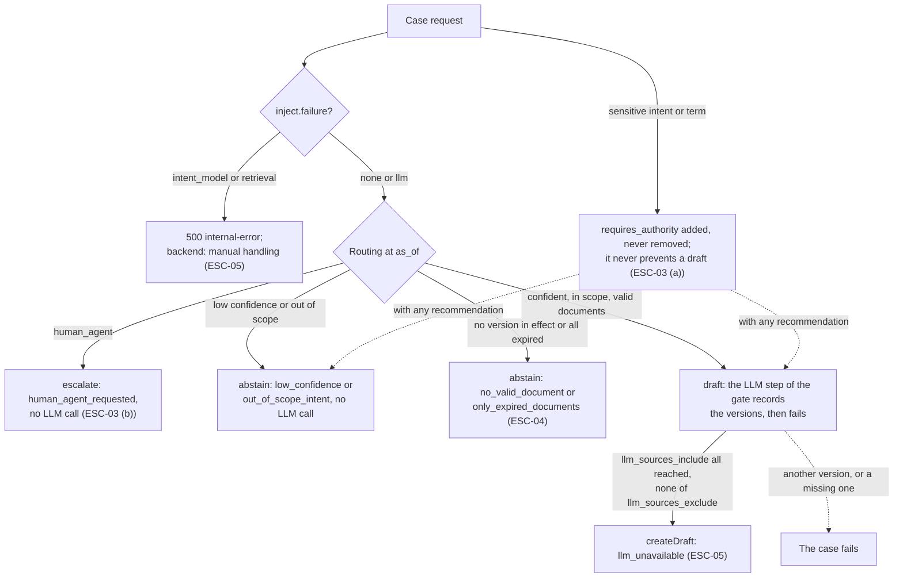

# Interim escalation cases (interim-v2)

**Label: interim, not the shared scenario set.**

The mandatory escalation cases of the offline evaluation gate for the first release that serves KB document versions: KB v2.1, with 14 versions ([`../../../raw/kb/v2.1/`](../../../raw/kb/v2.1/README.md)). They follow [interim-v1](../interim-v1/README.md), which was written for a KB of 0 documents, and the [gate design for a release with KB documents](../../../../docs/design/gate-for-a-release-with-kb-documents.md#the-new-frozen-case-set). They check routing and which KB versions reach the LLM step; they measure no quality target.

## Status

- **Frozen** on 2026-11-23: the project lead approved the set before any gate run, with its choices: the name `interim-v2`, the three values of `as_of`, the injected intents of the draft cases, one excluded version per draft case, and the rule `FR-03`. [`approval.json`](approval.json) records the approval in the form that the gate reads ([interim-v1, Approval record](../interim-v1/README.md#approval-record)).
- After approval, `cases.json` keeps every byte and is never edited after a result has been seen ([DATA-23](../../../../docs/rules/data-and-ml.md#splits-and-evaluation-protocol), guardrail 5). A fault is fixed only by a new set. A failing case is reported as it is ([DATA-48](../../../../docs/rules/data-and-ml.md#evaluation-and-reporting)).
- The set never enters training, the tuning of τ, δ, λ, or `relevance_min_score`, or a prompt ([DATA-25](../../../../docs/rules/data-and-ml.md#leakage)).
- Every report that uses the set states the [TEST-26](../../../../docs/rules/testing.md#guardrail-tests) item on the shared scenario set as not met ([ADR-0021, Exception to TEST-26](../../../../docs/decisions/0021-repository-layout-and-ai-ml-migration.md#exception-to-test-26), statement 3).
- The messages are simulated and already pseudonymized, as `backend` sends them: personal data appears only as placeholders of [ADR-0010](../../../../docs/decisions/0010-pseudonymization-and-egress-control.md#placeholder-syntax). One message names a third person ([DATA-59](../../../../docs/rules/data-and-ml.md#models-and-artifacts)). No message names a real company or person.
- The expected document versions come from KB v2.1 as the project lead approved it, never from a run ([gate design, The new frozen case set](../../../../docs/design/gate-for-a-release-with-kb-documents.md#the-new-frozen-case-set), statement 4). Nobody ran the encoder, the model, or the gate on these messages before the set was written.

## What the set is written for

The gate runs the set only on a release that matches every field of `written_for`, as for interim-v1 ([interim-v1, What the set is written for](../interim-v1/README.md#what-the-set-is-written-for)).

| Item | Value | Source |
|---|---|---|
| Contract | `ai-service` 1.0.0 | [`contracts/ai-service.openapi.yaml`](../../../../contracts/ai-service.openapi.yaml) |
| Model artifact | `v1.0.0` | [ADR-0025](../../../../docs/decisions/0025-routing-configuration-of-the-first-release.md) |
| Routing configuration | `main-untuned-v1`: τ 0.70, δ 0.10, λ 0.15, sensitive intents `cancel_order`, `request_refund`, `return_product`, and `payment_issue` from 0.10, and 53 sensitive terms | [`routing.json`](../../../../ai-service/routing/main-untuned-v1/routing.json) |
| KB | `v2.1`, with 14 document versions, each in effect from `2026-01-01T00:00:00Z` to `2026-12-31T23:59:59Z`, and no `policy_key` shared | [KB ingestion of v2.1](../../../../eval/kb-ingestion/v2.1/ingestion-report.json) |

`written_for` holds no index version. A release with KB v2.1 can only hold the index configuration `bge-small-en-v1.5-main-untuned-v1-kb-v2.1`, because `ai-service` refuses an index of another KB version. The search keeps its untuned `relevance_min_score` of 0.55 and its top 3 documents ([ADR-0027](../../../../docs/decisions/0027-retrieval-index-configuration-of-the-first-release.md)).

## Outcomes with KB v2.1

Each case fixes its `as_of`, so the outcome never depends on the day of the run. Three values are used:

| `as_of` | Cases | Evidence |
|---|---|---|
| `2026-11-23T09:00:00Z` | Every case that drafts, and every case that checks a rule with KB evidence | Every version is in effect and none conflicts, so the documents that the search finds are valid |
| `2025-12-01T09:00:00Z` | The six cases of the real model, `esc04-no-valid-document`, and `esc05-llm-failure-not-reached` | No version is in effect yet, so every match is left out and the evidence gives `no_valid_document`, as with the KB of 0 documents of interim-v1 |
| `2027-01-15T09:00:00Z` | `esc04-only-expired-documents` | Every version has ended, so the documents that the search finds are expired: `only_expired_documents` |

## Format

`cases.json` has the format of [interim-v1](../interim-v1/README.md#format), with these differences:

- `set` is `escalation/interim-v2`, and `written_for` names KB `v2.1` with `kb_document_count` 14.
- `esc_rule` can also be `FR-03`: a draft for one policy topic, whose sources are KB versions (guardrail 2). Each case ID starts with its rule, such as `fr03-draft-return-window`.
- A case that expects a draft adds two fields to `expected` ([gate design, Search in the draft cases](../../../../docs/design/gate-for-a-release-with-kb-documents.md#search-in-the-draft-cases)):

  | Field | Checked against |
  |---|---|
  | `llm_sources_include` | Each (`document_id`, `version`) pair is among the policy sources that reach the LLM step during `createDraft`. At least one pair |
  | `llm_sources_exclude` | No pair is among them |

- `without_kb_evidence` keeps its name, because the reader of the gate requires it. Here it states why the outcome holds with KB v2.1.

Every case that expects a draft has the same `expected`, apart from the authority flag and the two lists: `recommendation` `draft`, `draft_status` `llm_unavailable`, `llm_called` `true`, no required code, and the six codes that stop a draft forbidden (`low_confidence`, `out_of_scope_intent`, `human_agent_requested`, `no_valid_document`, `only_expired_documents`, `conflicting_sources`). `no_other_reason_codes` is `false`, because `createDraft` adds `llm_unavailable`, and the gate compares the required codes and the exact codes with both operations.

## Cases

"Authority" is the expected `requires_authority`. "exact" means that `no_other_reason_codes` is `true`. "Include / exclude" are the versions of `llm_sources_include` and `llm_sources_exclude`. Kinds: D, an injected distribution; S, an intent that staff chose; M, the real model; F, an injected failure.

### A draft for each policy topic

The message states the topic of one version, and the injected intent is the in-scope intent that the message asks for, at 0.93. The excluded version states a topic that the message does not touch.

| Case | Injected intent | Include / exclude | Authority | Kind |
|---|---|---|---|---|
| `fr03-draft-return-window` | `return_policy` | `POL-RET-001` 2.1 / `POL-PAY-004` 1.1 | no | D |
| `fr03-draft-return-request-process` | `return_product` | `POL-RET-002` 2.1 / `POL-PAY-004` 1.1 | yes (sensitive intent) | D |
| `fr03-draft-non-returnable-items` | `return_policy` | `POL-RET-003` 2.1 / `POL-PAY-001` 1.1 | no | D |
| `fr03-draft-refund-eligibility` | `refund_policy` | `POL-REFUND-001` 1.1 / `POL-ORD-001` 1.1 | no: a question on refunds is not a request | D |
| `fr03-draft-refund-timeline` | `refund_policy` | `POL-REFUND-002` 2.1 / `POL-ORD-003` 1.0 | no | D |
| `fr03-draft-refund-status-tracking` | `refund_status` | `POL-REFUND-007` 1.1 / `POL-SHIP-002` 1.1 | no | D |
| `fr03-draft-order-tracking` | `track_order` | `POL-ORD-001` 1.1 / `POL-RET-003` 2.1 | no | D |
| `fr03-draft-cancellation-window` | `cancel_order` | `POL-ORD-002` 1.1 / `POL-PAY-004` 1.1 | yes (sensitive intent) | D |
| `fr03-draft-delivery-timelines` | `delivery_time` | `POL-SHIP-001` 1.1 / `POL-PAY-004` 1.1 | no | D |
| `fr03-draft-shipping-fees` | `shipping_costs` | `POL-SHIP-002` 1.1 / `POL-RET-003` 2.1 | no | D |
| `fr03-draft-delayed-or-lost-delivery` | `delivery_issue` | `POL-SHIP-004` 1.1 / `POL-RET-003` 2.1 | no | D |
| `fr03-draft-unconfirmed-payment` | `payment_issue` | `POL-PAY-001` 1.1 / `POL-ORD-003` 1.0 | yes (sensitive intent) | D |
| `fr03-draft-duplicate-charge` | `payment_issue` | `POL-PAY-004` 1.1 / `POL-ORD-003` 1.0 | yes (sensitive intent) | D |

`POL-ORD-003` gets no draft: its only intent, `change_order`, is out of scope, so `esc02-out-of-scope-intent` covers its topic.

### The rules of interim-v1, with KB evidence

Each case reuses the message of a draft case above, or adds one sentence to it, so the search finds the documents that the draft case finds, and a case that does not draft expects exactly its routing codes, with no evidence code. Three cases do not reuse one: `esc02-out-of-scope-intent` states the topic of `POL-ORD-003`, which no draft case covers, so its evidence codes are not checked, and the two failures keep the message of interim-v1.

| Case | Rule | Signal | Expected outcome | Include / exclude | Kind |
|---|---|---|---|---|---|
| `esc01-below-tau` | ESC-01 | Top 0.40, second 0.15 | `abstain`; exact `low_confidence`; authority no | — | D |
| `esc01-below-delta` | ESC-01 | Top 0.47, second 0.44 | `abstain`; exact `low_confidence`; authority no | — | D |
| `esc01-at-tau` | ESC-01 | Top exactly 0.70, second 0.10 | `draft`, never `low_confidence`; authority no | `POL-ORD-001` 1.1 / `POL-RET-003` 2.1 | D |
| `esc01-staff-confirms-intent` | ESC-01 | Staff chose `delivery_time` | `draft`, never `low_confidence`; authority no | `POL-SHIP-001` 1.1 / `POL-PAY-004` 1.1 | S |
| `esc02-out-of-scope-intent` | ESC-02 | `change_order` 0.94, the intent of `POL-ORD-003` | `abstain`; `out_of_scope_intent`, never `low_confidence` or `human_agent_requested`; authority no | — | D |
| `esc03a-sensitive-intent-not-first` | ESC-03 (a) | `delivery_issue` 0.76, `request_refund` 0.18 | `draft`; authority yes | `POL-SHIP-004` 1.1 / `POL-RET-003` 2.1 | D |
| `esc03a-sensitive-intent-at-threshold` | ESC-03 (a) | `track_order` 0.85, `cancel_order` exactly 0.10 | `draft`; authority yes | `POL-ORD-001` 1.1 / `POL-RET-003` 2.1 | D |
| `esc03a-sensitive-intent-staff-choice` | ESC-03 (a) | Staff chose `request_refund` | `draft`; authority yes | `POL-REFUND-002` 2.1 / `POL-ORD-003` 1.0 | S |
| `esc03a-term-suspected-fraud` | ESC-03 (a) | Term `fraud`, `track_order` 0.93 | `draft`; authority yes | `POL-ORD-001` 1.1 / `POL-RET-003` 2.1 | D |
| `esc03a-term-unauthorized` | ESC-03 (a) | Term `unauthorized`, `shipping_costs` 0.93 | `draft`; authority yes | `POL-SHIP-002` 1.1 / `POL-RET-003` 2.1 | D |
| `esc03a-term-legal-claim` | ESC-03 (a) | Term `legal action`, `delivery_issue` 0.93 | `draft`; authority yes | `POL-SHIP-004` 1.1 / `POL-RET-003` 2.1 | D |
| `esc03a-term-transaction-dispute` | ESC-03 (a) | Term `chargeback`, `refund_status` 0.93 | `draft`; authority yes | `POL-REFUND-007` 1.1 / `POL-SHIP-002` 1.1 | D |
| `esc03a-term-policy-exception` | ESC-03 (a) | Term `make an exception`, `return_policy` 0.93 | `draft`; authority yes | `POL-RET-001` 2.1 / `POL-PAY-004` 1.1 | D |
| `esc03b-human-agent` | ESC-03 (b) | `human_agent` 0.95 | `escalate`; exact `human_agent_requested`; authority no | — | D |
| `esc03b-human-agent-low-confidence` | ESC-03 (b) | `human_agent` 0.55, `customer_service` 0.30 | `escalate`; exact `low_confidence`, `human_agent_requested`; authority no | — | D |
| `esc03b-human-agent-with-term` | ESC-03 (b) | `human_agent` 0.95, term `lawsuit` | `escalate`; exact `human_agent_requested`; authority yes | — | D |
| `esc04-no-valid-document` | ESC-04 | `shipping_costs` 0.94, `as_of` before KB v2.1 | `abstain`; exact `no_valid_document`; authority no | — | D |
| `esc04-only-expired-documents` | ESC-04 | `shipping_costs` 0.94, `as_of` after KB v2.1 | `abstain`; exact `only_expired_documents`; authority no | — | D |
| `esc05-intent-model-failure` | ESC-05 | The intent model fails | `500 internal-error` from both operations | — | F |
| `esc05-retrieval-failure` | ESC-05 | The search fails | `500 internal-error` from both operations | — | F |
| `esc05-llm-failure` | ESC-05 | The LLM fails, `track_order` 0.93 | `draft`, `llm_unavailable`; authority no | `POL-ORD-001` 1.1 / `POL-RET-003` 2.1 | D |

### The cases of the real model, before KB v2.1 starts

Copied from interim-v1 with only `as_of` changed, to `2025-12-01T09:00:00Z`. With a version in effect, whether these messages get a draft would rest on the confidence of the real model, which nobody can state by hand; before KB v2.1 starts, their outcomes are those of interim-v1. `esc05-llm-failure-not-reached` is copied the same way, so that one case still proves that an abstention never calls the LLM step when the LLM fails.

| Case | Rule | Expected outcome, as in interim-v1 | Kind |
|---|---|---|---|
| `esc02-password-message` | ESC-02 | `abstain`; `out_of_scope_intent`, `no_valid_document`; never `human_agent_requested`; authority not checked | M |
| `esc02-store-hours-message` | ESC-02 | `abstain`; `out_of_scope_intent`, `no_valid_document`; never `human_agent_requested`; authority not checked | M |
| `esc03a-refund-request-message` | ESC-03 (a) | `abstain`; `no_valid_document`; never `human_agent_requested`; authority yes | M |
| `esc03a-term-legal-claim-message` | ESC-03 (a) | `abstain`; `no_valid_document`; never `human_agent_requested`; authority yes | M |
| `esc03b-human-agent-message` | ESC-03 (b) | `escalate`; `human_agent_requested`, `no_valid_document`; authority not checked | M |
| `esc04-no-valid-document-message` | ESC-04 | `abstain`; `no_valid_document`; never `human_agent_requested`; authority not checked | M |
| `esc05-llm-failure-not-reached` | ESC-05 | `abstain`; exact `no_valid_document`, never `llm_unavailable`; authority no | D |

Of the 41 cases, 24 expect a draft, so the LLM step of the gate expects 24 calls. 31 rest on an injected distribution (one also with an LLM failure), 2 on an injected failure of the intent model or the search, 2 on an intent that staff chose, and 6 on the real model alone.

### From interim-v1

Every case of interim-v1 has a case here with the same ID, except `esc03a-refund-policy-question` (a question on refunds, `refund_policy` 0.93, authority no), whose check `fr03-draft-refund-eligibility` and `fr03-draft-refund-timeline` make, now with a draft. The cases with an injected distribution or a staff choice now run with KB evidence. The cases of the real model, `esc05-llm-failure-not-reached`, and the two failures keep their messages, injected parts, and outcomes; only `as_of` changes.

## Limits of the set

- **The search is the real one.** Each draft case rests on the BGE encoder, the untuned `relevance_min_score` of 0.55, and the top 3 documents after reranking, none of which was run on these messages. The included version is the one whose topic the message states, and whose intent, when it is mapped, the injected intent boosts by λ. The excluded version states a topic that the message does not touch. If a case fails at the gate run, the gate fails and the case stays as it is.
- **Exact codes with evidence rest on the same search.** A case that reuses the message of a draft case expects no evidence code, because the search finds at least one valid document for that message, as its draft case requires. If the search finds none, both cases fail together.
- **ESC-04 with conflicting versions** has no case: KB v2.1 gives no two versions one `policy_key` ([gate design, Search in the draft cases](../../../../docs/design/gate-for-a-release-with-kb-documents.md#search-in-the-draft-cases), statement 4).
- **The reason code `llm_unavailable`** is not a required code of the draft cases, because the gate compares required codes with `createAnalysis` too, which has no LLM step. `draft_status` `llm_unavailable` checks the failure of the LLM step instead.
- **The text of a draft, its citations, and the grounding check** are not checked here. The unit tests of `check_draft` in `ai-service` and the grading of drafts of the real LLM cover them ([gate design, Groundedness](../../../../docs/design/gate-for-a-release-with-kb-documents.md#groundedness)).
- **ESC-01 by a message alone, δ alone, ESC-05 by the time budget, and ESC-05 inside `backend`** have no case, for the reasons of [interim-v1, Limits of the set](../interim-v1/README.md#limits-of-the-set).

## Open questions

- Should the gate compare the reason codes of each operation apart, so that a draft case can require `llm_unavailable` in `createDraft` and none in `createAnalysis`? That changes the format of the gate, not this set.
