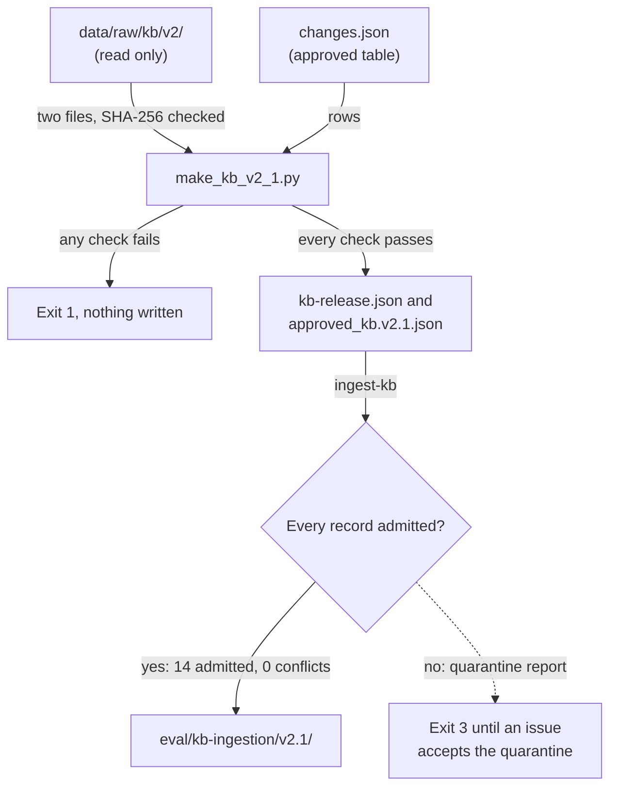

# KB v2.1

The raw KB v2.1: the 14 `POL-…` documents of [KB v2](../v2/kb-release.json), each with a `policy_key`, intents of the contract, and the name of the simulated shop, "Demo Shop". KB ingestion admits all 14 document versions ([`../../../../eval/kb-ingestion/v2.1/`](../../../../eval/kb-ingestion/v2.1/ingestion-report.json)). This README is the manifest of the folder ([DATA-08, DATA-09](../../../../docs/rules/data-and-ml.md#data-layout)).

## Status

- **Frozen** on 2026-11-23: the project lead approved the change table and its six decisions on 2026-11-23. The approval stands in for the `policy_key` values that the AI and ML team was to supply ([ADR-0021, KB ingestion](../../../../docs/decisions/0021-repository-layout-and-ai-ml-migration.md#kb-ingestion), statement 5); the AI author reviews them later.
- Every file of this folder keeps every byte ([DATA-06](../../../../docs/rules/data-and-ml.md#data-layout), [DATA-17](../../../../docs/rules/data-and-ml.md#knowledge-base)). A change is a new `kb_version` in a new folder. [`../v2/`](../v2/kb-release.json) keeps every byte too.

## Files

| File | Holds | SHA-256 |
|---|---|---|
| `kb-release.json` | The release `current-policies-v1.1`: the 14 document versions | `2c31296c3bf712ab372beac29cd3e305813aa96bc5328f71e73b00e347e9a266` |
| `approved_kb.v2.1.json` | The 14 document versions, in the fields of KB v2 | `e74786e082062e76830a7cf55b77c66ac3a15060aaa68971adf826edd57315b7` |
| `changes.json` | The approved change table, which the script applies exactly | `99d83f6277820a3e9e83a4559dfaa1469ce6836366e918d5814f4f9dc05548b2` |
| `make_kb_v2_1.py` | The script that wrote the first two files from KB v2 and `changes.json` | `18588f68fb18895f18e956249a5d8453748370515f85580cb37e4e95a160b9af` |

The source is `data/raw/kb/v2/`: `kb-release.json` with SHA-256 `33cf05b50c25384fbb208cd0c0c5cae71991d29a0f754cb1b20a1d6d7285cdaa`, and `approved_kb.v2.json` with SHA-256 `aaa924c4b48dcd53a14269045b278b66f6e5e8ae9d1b614cd59b757102b78594`. KB ingestion reads only `kb-release.json` and the KB file that its `source` names ([release command README, KB ingestion](../../../../eval/release/README.md#kb-ingestion)).

## The rules of the change

Each row of `changes.json` applies one of these rules, and nothing else changes.

1. **Scope.** KB v2.1 holds the 14 `POL-…` documents of the release `current-policies-v1`, in their order. The 3 `b1000000-…` documents are left out: they are not in that release, and their content contradicts `POL-RET-001` and `POL-REFUND-002` (ADR-0021, KB ingestion, statement 5).
2. **Brand.** Every "Tiki" becomes "Demo Shop", the shop name of the [shop UI design](../../../../docs/design/shop-ui.md#layout): "Tiki's" becomes "Demo Shop's", and "TikiPRO" becomes "Demo Shop PRO". Three names of a line or a package of Tiki become their plain name: "Tiki Trading" becomes "Demo Shop", "TikiNOW Express" becomes "Express Delivery", and "Tiki Ngon fresh groceries" becomes "fresh groceries". "via hotline 1900 6035" becomes "via the Demo Shop hotline", so that no draft gives the number of a real company. Every other number and rule stays, and so do the names of the payment methods.
3. **Key.** Each document gets one `policy_key`, the topic it states. Three topics reuse the key that the KB of `main` gave them in the `b1000000-…` documents (`return_window`, `refund_timeline`, `cancellation_window`), so a contradiction between them would show as a conflict ([DATA-19](../../../../docs/rules/data-and-ml.md#knowledge-base)). No two documents share a key.
4. **Intents.** A label outside [`IntentLabel.yaml`](../../../../contracts/schemas/IntentLabel.yaml) becomes the contract label with the same meaning, or is removed when a label already listed covers it.
5. **Version.** A document whose title or content changes goes from `x.0` to `x.1`, and its `approved_at` becomes `2026-11-23T00:00:00Z`, the date of the approval. The other document keeps its version and its whole record.
6. **Mechanical.** `content_hash` is the SHA-256 of the new content in UTF-8. `policy_key` is placed after `category`. Every other field stays, `approved_by` and the validity included. Each file keeps the final-newline style of its file in KB v2.

| Document | Version | `policy_key` | `supported_intents` |
|---|---|---|---|
| `POL-RET-001` | `2.0` → `2.1` | `return_window` | Unchanged |
| `POL-RET-002` | `2.0` → `2.1` | `return_request_process` | Unchanged |
| `POL-RET-003` | `2.0` → `2.1` | `non_returnable_items` | Unchanged |
| `POL-REFUND-001` | `1.0` → `1.1` | `refund_eligibility` | Unchanged |
| `POL-REFUND-002` | `2.0` → `2.1` | `refund_timeline` | Unchanged |
| `POL-REFUND-007` | `1.0` → `1.1` | `refund_status_tracking` | Unchanged |
| `POL-ORD-001` | `1.0` → `1.1` | `order_tracking` | Unchanged |
| `POL-ORD-002` | `1.0` → `1.1` | `cancellation_window` | Unchanged |
| `POL-ORD-003` | `1.0`, unchanged | `delivery_address_change` | `edit_order` → `change_order`; `change_shipping_address` removed |
| `POL-SHIP-001` | `1.0` → `1.1` | `delivery_timelines` | `delivery_options` removed; `delivery_time` stays |
| `POL-SHIP-002` | `1.0` → `1.1` | `shipping_fees` | Unchanged |
| `POL-SHIP-004` | `1.0` → `1.1` | `delayed_or_lost_delivery` | Unchanged |
| `POL-PAY-001` | `1.0` → `1.1` | `unconfirmed_payment` | Unchanged |
| `POL-PAY-004` | `1.0` → `1.1` | `duplicate_charge` | Unchanged |

`changes.json` lists each of the 37 replacements with its text in KB v2 and in KB v2.1, so reading it backward gives the text of KB v2, which the `content_hash` values of KB v2 confirm. In `kb-release.json`, `source` is `data/raw/kb/v2.1/approved_kb.v2.1.json`, because the file has no path on `main`.

## How the folder was made



The script stops with exit status 1 and writes nothing when a file of KB v2 has another SHA-256, a row does not match KB v2, a replacement does not occur exactly once, a text still holds "tiki", or a field outside the rules changes. To check the folder, run the script into a new folder named `v2.1` outside the repository, then compare the SHA-256 of both files with the table above:

```bash
python3 -I data/raw/kb/v2.1/make_kb_v2_1.py data/raw/kb/v2.1/changes.json data/raw/kb/v2 <new folder>/v2.1 --approved
```

## Known limits

- Every version is in effect from `2026-01-01T00:00:00Z` to `2026-12-31T23:59:59Z`, as in KB v2. At a later `as_of`, every version is expired, so no draft can cite KB v2.1 and the evidence gives `only_expired_documents` or `no_valid_document` (ESC-04), until a new KB version with a new period is served.
- `change_order`, the intent of `POL-ORD-003`, is not one of the 12 in-scope intents, so a message whose top intent is `change_order` abstains with `out_of_scope_intent` (ESC-02). The document still reaches other messages, because retrieval is by content ([ADR-0005](../../../../docs/decisions/0005-intent-independent-retrieval.md#decision), statement 1).
- The menu paths in `POL-RET-002`, `POL-REFUND-007`, `POL-ORD-001`, and `POL-ORD-002` are those of an app, not the screens of `/shop`, because rule 2 changes only the shop name.
- `owner` comes from `approved_by`, the role `lead_compliance_officer`, as ADR-0021, KB ingestion, statement 2, maps it.

## Open questions

- Which KB version replaces KB v2.1 before its versions expire on 2026-12-31? A follow-up issue is to be opened by the project lead.
