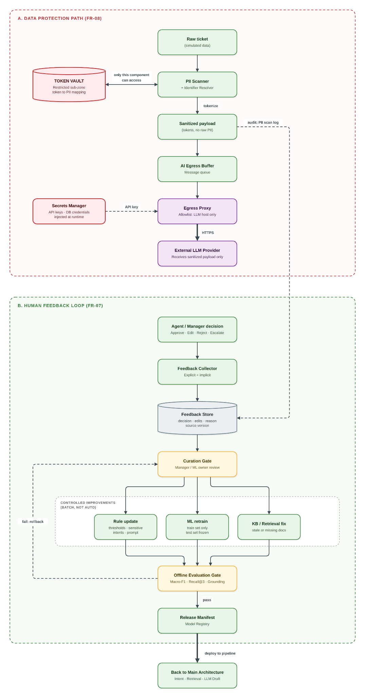
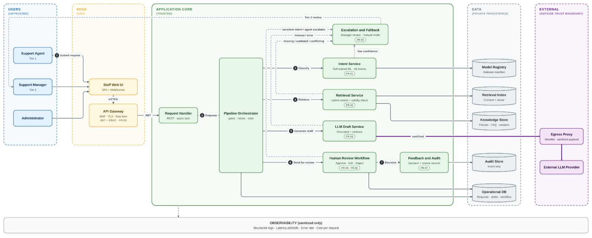

# AI Customer Support Copilot for E-commerce (SupportIQ)

## Mô tả

AI Customer Support Copilot là hệ thống hỗ trợ nhân viên chăm sóc khách hàng (CSKH) trong thương mại điện tử. Hệ thống phân loại ý định của khách hàng bằng mô hình ML tự huấn luyện, truy xuất chính sách và dữ liệu nghiệp vụ, rồi dùng LLM soạn bản nháp câu trả lời kèm nguồn tham chiếu. Nhân viên kiểm tra, chỉnh sửa, phê duyệt hoặc từ chối bản nháp; hệ thống không tự gửi câu trả lời cho khách hàng.

## Thành viên nhóm

| **Mã sinh viên** | **Tên** |
| --- | --- |
| 24021565 | Đoàn Anh Minh |
| 24021645 | An Đức Minh Trí |
| 24021598 | Nguyễn Công Phúc |
| 24021382 | Phạm Gia Bách |

**Mục lục**

**AI Customer Support Copilot for E-commerce (SupportIQ) 1**

**[Mô tả 1](#_ka9d1yv2zfkd)**

**[Thành viên nhóm 1](#_gwb4obbywdg9)**

**1. Functional Requirements 3**

**2. Non-Functional Requirements 4**

**3. Assumptions 7**

**4. Ràng buộc (Constraints) 8**

**[5. Kiến trúc 9](#_low599fvqnqr)**

**[6. Biện luận 12](#_xic92scl2680)**

## 1. Functional Requirements

| **Mã** | **Tên yêu cầu** | **Mô tả chi tiết** |
| --- | --- | --- |
| **FR-01** | **Phân loại ý định** | Tiếp nhận yêu cầu khách hàng bằng ngôn ngữ tự nhiên và dùng mô hình Non-generative ML tự huấn luyện để dự đoán intent. Hiển thị intent dự đoán kèm confidence score cho nhân viên. Cho phép nhân viên sửa intent nếu dự đoán sai. |
| **FR-02** | **Truy xuất tri thức** | Dựa trên intent và nội dung yêu cầu, truy xuất chính sách, FAQ và dữ liệu nghiệp vụ mô phỏng (trạng thái đơn hàng, giao hàng, hoàn tiền). Phát hiện và đánh dấu thông tin thiếu, hết hiệu lực hoặc mâu thuẫn. |
| **FR-03** | **Tạo bản nháp câu trả lời** | Dùng LLM tổng hợp thông tin đã truy xuất để soạn bản nháp, kèm nguồn tham chiếu kiểm tra được. Khi thiếu căn cứ, bản nháp nêu rõ thông tin còn thiếu hoặc đề xuất làm rõ thay vì khẳng định. |
| **FR-04** | **Website thương mại điện tử** | Xây dựng hoặc tái sử dụng một website thương mại điện tử truyền thống (chưa tích hợp AI) đơn giản với các chức năng thanh toán, giao vận chỉ mang tính demo. Cung cấp giao diện hỏi đáp để khách hàng nhập yêu cầu và nhận câu trả lời. |
| **FR-05** | **Ngôn ngữ hệ thống** | Sử dụng Tiếng Anh làm ngôn ngữ chung cho toàn bộ hệ thống. |
| **FR-06** | **Giao diện kiểm duyệt** | Cung cấp giao diện để nhân viên xem, phê duyệt (Approve), chỉnh sửa (Edit) hoặc từ chối (Reject) bản nháp. Hệ thống không tự động gửi câu trả lời cho khách hàng. |
| **FR-07** | **Dự phòng và chuyển cấp** | Kích hoạt fallback/escalation khi confidence thấp, không tìm thấy tài liệu, yêu cầu nhạy cảm, intent ngoài phạm vi 12 intent hỗ trợ, hoặc thành phần (ML, retrieval, LLM) bị lỗi. Ghi rõ lý do chuyển xử lý và hiển thị cho nhân viên. |
| **FR-08** | **Ghi nhận và truy vết** | Ghi lại quyết định của nhân viên (Approve/Edit/Reject/Escalate), intent dự đoán và intent cuối cùng, phiên bản nguồn tham chiếu, lý do chuyển cấp và phản hồi của nhân viên. |
| **FR-09** | **Xác thực và phân quyền** | Đăng nhập và phân quyền theo vai trò (khách hàng, nhân viên CSKH, quản lý CSKH, quản trị viên). Mỗi vai trò chỉ truy cập chức năng và dữ liệu được phép. |
| **FR-10** | **Bảo vệ thông tin nhạy cảm** | Che hoặc loại bỏ dữ liệu nhạy cảm (tên, địa chỉ, số điện thoại, mã đơn) khỏi nội dung gửi đến LLM hoặc dịch vụ ngoài và khỏi log. |
| **FR-11** | **Báo cáo và giám sát** | Cung cấp cho quản lý số liệu tổng hợp: tỷ lệ bản nháp được chấp nhận, chỉnh sửa, từ chối; số lần escalation và lý do; latency; tỷ lệ lỗi; chi phí trung bình mỗi request. |

## 2. Non-Functional Requirements

| **Mã** | **Hạng mục** | **Mô tả chi tiết và tiêu chí đo** |
| --- | --- | --- |
| NFR-01 | ML quality | Macro-F1 ≥ 0,85 trên 46 intent, đánh giá bằng 10-fold cross-validation; vượt baseline TF-IDF + LR/SVM. Báo cáo per-class F1 và confusion matrix. Train/validation/test và random seed được cố định trước thực nghiệm. |
| NFR-02 | ML robustness | Macro-F1 trên dữ liệu nhiễu (lỗi chính tả, diễn đạt lạ) giảm ≤ 10 điểm phần trăm so với dữ liệu chuẩn. ≥ 90% (\*) câu mơ hồ, nhiều ý hoặc ngoài phạm vi bị gắn cờ độ tin cậy thấp hoặc chuyển xử lý. |
| NFR-03 | Retrieval quality | Recall@3 ≥ 0,80 trên tập câu hỏi có tài liệu đáp ứng; tài liệu truy xuất phải còn hiệu lực. 100% tài liệu hết hiệu lực, thiếu hoặc mâu thuẫn trong bộ kiểm thử được phát hiện và gắn cảnh báo. |
| NFR-04 | LLM quality (grounding) | ≥ 90% thông tin thực tế và chính sách trong bản nháp được nguồn truy xuất hỗ trợ (chấm thủ công); 100% bản nháp có trích dẫn kiểm tra được. Không đưa ra kết luận khẳng định khi không có tài liệu căn cứ. |
| NFR-05 | Safety & human oversight | 100% câu trả lời qua phê duyệt của nhân viên, 0 trường hợp tự gửi cho khách, 0 giao dịch tự động. Với hoàn tiền, khiếu nại, ngoại lệ chính sách, hệ thống chỉ cung cấp thông tin hỗ trợ. 100% tình huống bắt buộc escalation được xử lý đúng và ghi lý do. |
| NFR-06 | Security & privacy | 100% test case RBAC đạt (Agent, Manager, Admin), kiểm tra ở backend. 100% payload gửi tới LLM bên ngoài đã được token hóa PII (0 PII thô, kiểm bằng PII scan test); chỉ gọi ra ngoài qua egress allowlist. Rò rỉ dữ liệu nội bộ ≤ 5% trên bộ kịch bản tấn công (prompt injection, truy cập trái quyền), riêng secret/PII là 0%. |
| NFR-07 | Reliability & availability | 100% tình huống ML uncertainty, không tìm thấy tài liệu và LLM/API failure được xử lý an toàn (abstain hoặc chuyển thủ công, UI không treo). LLM timeout ≤ 10 giây (\*), retry tối đa 2 lần (\*). Khi LLM/retrieval lỗi, đăng nhập, xem ticket và duyệt thủ công vẫn dùng được. |
| NFR-08 | Performance & scalability | End-to-end latency p50 ≤ 4 giây, p95 ≤ 12 giây. Hỗ trợ ≥ 5 phiên đồng thời với tỷ lệ lỗi ≤ 1%, p95 không quá 2 lần mức tải một người dùng. Kiểm chứng bằng script load test. Stack demo chạy được trên máy 8GB (≤ ~5 GB RAM, \*). |
| NFR-09 | Traceability & auditability | 100% quyết định (approve/edit/reject/escalate) được ghi kèm request ID, intent và confidence, phiên bản nguồn/model/prompt, lý do escalate, người duyệt, thời điểm. Audit store chỉ insert. Tái dựng được toàn bộ request từ log. |
| NFR-10 | Usability & product value | UI hiển thị intent kèm confidence, nguồn trích dẫn, cảnh báo và lý do escalate; agent sửa hoặc từ chối bản nháp trong tối đa 3 thao tác (\*). Giảm thời gian xử lý ≥ 20% (\*) so với quy trình thủ công trên ≥ 30 yêu cầu (\*). |

## 3. Assumptions

| **Mã** | **Nội dung** |
| --- | --- |
| **ASM-01** | Bộ dataset [Bitext Retail E-commerce](https://huggingface.co/datasets/bitext/Bitext-retail-ecommerce-llm-chatbot-training-dataset) đủ số lượng và độ phủ cho bài toán phân loại 46 intent. |
| **ASM-02** | Knowledge Base và dữ liệu nghiệp vụ mô phỏng có nguồn, phiên bản và trạng thái hiệu lực rõ ràng; cả hai nhóm dùng cùng phiên bản. |
| **ASM-03** | Nhân viên có đủ chuyên môn để xem xét, chỉnh sửa và quyết định các ca cần human review, và thực sự đọc kỹ bản nháp. |
| **ASM-04** | Dịch vụ LLM/API bên ngoài có sẵn trong thời gian phát triển và kiểm thử, với hạn mức (rate limit, ngân sách) đủ cho các bài test. |
| **ASM-05** | Hạ tầng triển khai (on-premise hoặc cloud) đủ tài nguyên và năng lực tính toán để đảm bảo các thuộc tính chất lượng của hệ thống |

## 4. Ràng buộc (Constraints)

* Bắt buộc có mô hình non-generative ML tự huấn luyện và LLM.
* Sử dụng dataset, bộ tình huống và quy trình đánh giá chung.
* Ưu tiên dữ liệu giả lập; không sử dụng dữ liệu cá nhân hoặc giao dịch thật; không yêu cầu tích hợp production.
* Sản phẩm phải có khả năng triển khai, chạy thử và ghi nhận kết quả kiểm thử.
* Ngân sách cho triển khai và vận hành hệ thống trên AWS là 200$ credits.

## 5. Kiến trúc

## 6. Biện luận

| **Thành phần** | **Vị trí và hoạt động** | **Biện luận** | **Đánh đổi và điều kiện** |
| --- | --- | --- | --- |
| **Load Balancer (biên, DMZ)** | Đặt giữa Ingress và Core Backend. Chia request round-robin cho ≥ 2 replica Core Backend; health check, tự loại replica lỗi khỏi vòng chia. | NFR-08 yêu cầu ≥ 5 phiên đồng thời và p95 không quá 2 lần mức tải một người dùng; một instance duy nhất sẽ nghẽn khi các request AI dài chiếm worker. NFR-07 yêu cầu đăng nhập, xem ticket, duyệt thủ công vẫn dùng được khi một phần hệ thống lỗi; replica thứ hai giữ các chức năng này sống khi replica kia chết. | Cần Core Backend stateless (state nằm ở App DB và Cache). Mỗi replica tốn thêm RAM trên máy 8GB nên chỉ chọn 2 replica. Gợi ý: Nginx hoặc Traefik trong docker compose; Ingress và LB có thể là cùng một container. |
| **ML Load Balancer (nội bộ)** | Đặt trước ML Inference (x2). Health check; nếu mọi replica lỗi thì Orchestrator coi là ML uncertainty và chuyển Fallback. | Phân loại intent nằm trên đường đi của mọi request, nên nghẽn ở đây kéo cả p50 lẫn p95. Có health check thì lỗi một replica không biến thành lỗi cả pipeline, khớp yêu cầu xử lý an toàn tình huống ML uncertainty ở NFR-07. | Nếu RAM hạn chế có thể chạy 1 replica ML nhưng giữ LB để health check và sẵn sàng scale. Số replica là tham số cấu hình, chốt sau khi đo tải (NFR-08). |
| **Cache: session / permission** | Kết quả xác thực và quyền theo vai trò của Auth / RBAC, TTL ngắn, xóa khi đổi vai trò hoặc đăng xuất. | Mỗi request đi qua Auth; tra DB mỗi lần làm tăng latency khi nhiều phiên đồng thời (NFR-08). Cache chỉ lưu kết quả; việc kiểm quyền vẫn thực hiện ở backend như NFR-06 yêu cầu. | TTL quá dài làm quyền bị thu hồi chậm; chọn TTL ngắn và invalidate chủ động. Test RBAC phải chạy cả khi cache nóng và cache lạnh. |
| **Cache: rate-limit counters** | Bộ đếm request theo người dùng/IP dùng chung cho mọi replica. | Khi có LB và nhiều replica, bộ đếm cục bộ từng replica làm hạn mức bị nhân lên theo số replica. Bộ đếm dùng chung giữ rate limit đúng và bảo vệ pipeline AI khỏi bị dồn tải (NFR-08), đồng thời chống lạm dụng (NFR-06). | Cần chốt hành vi khi cache lỗi: cho qua (fail-open) hay chặn (fail-closed). Gợi ý: fail-open cho đọc, fail-closed cho thao tác AI tốn chi phí. |
| **Cache: retrieval** | Khóa = hash(câu truy vấn đã mask + intent + phiên bản Knowledge Store + phiên bản Search Index); giá trị = danh sách tài liệu và điểm. TTL ngắn. | Câu hỏi CSKH lặp lại nhiều (đổi trả, vận chuyển, thanh toán), bỏ được bước tìm kiếm lặp để giảm latency (NFR-08). Phiên bản nằm trong khóa nên khi tài liệu hoặc index đổi thì cache tự vô hiệu; Recall@3 không bị ảnh hưởng vì cache chỉ trả lại đúng kết quả mà retrieval đã trả. | Rủi ro lớn nhất là trả tài liệu đã hết hiệu lực (vi phạm NFR-03). Giảm thiểu: version trong khóa, TTL ngắn, và Evidence vẫn kiểm tra lại hiệu lực khi dùng, không tin cache. Chỉ lưu dữ liệu đã mask, không lưu PII. |
| **Cache: intent** | Khóa = hash(văn bản đã mask + phiên bản model); giá trị = intent + confidence. | Chỉ có lợi ích nhỏ vì suy luận ML nhẹ, nhưng rẻ và giúp ổn định kết quả cho câu lặp. Phiên bản model nằm trong khóa nên không bao giờ trả kết quả của model cũ (NFR-01, NFR-09). | Có thể bỏ nếu muốn sơ đồ gọn. Câu bị gắn cờ confidence thấp vẫn phải giữ cờ khi cache (NFR-02). |
| **Cache: dashboard aggregates** | Kết quả tổng hợp của Reports (tỷ lệ approve/edit/reject/escalate, thời gian xử lý), TTL 30-60 giây. | Truy vấn tổng hợp trên Audit Store tốn tài nguyên; cache giúp dashboard không cạnh tranh với luồng xử lý chính (NFR-08). Audit Store vẫn append-only, cache chỉ phục vụ đọc (NFR-09). | Số liệu có thể trễ tối đa bằng TTL; không dùng số liệu cache làm bằng chứng kiểm toán, chỉ dùng để hiển thị. |
| **Cache: những gì KHÔNG cache (có chủ đích)** | Bản nháp LLM; Token Vault; snapshot Business Data; ghi Audit. | Bản nháp LLM phải gắn với evidence, phiên bản prompt và model của từng request và qua duyệt (NFR-04, NFR-09); tỷ lệ trúng cache thấp mà rủi ro tái dùng nội dung lỗi thời cao. Token Vault chứa ánh xạ PII và chỉ Resolver được truy cập (NFR-06). Dữ liệu đơn hàng thay đổi liên tục nên cache dễ trả sai trạng thái. | Nếu sau này cần giảm chi phí LLM, chỉ cân nhắc cache bản nháp cho nhóm câu hỏi không có dữ liệu riêng của khách và vẫn phải qua duyệt. |
| **Cache: nguyên tắc chung** | Một dịch vụ cache (gợi ý Redis, maxmemory giới hạn, chính sách LRU), chia namespace theo loại. | Mọi lần hit/miss và phiên bản khóa được ghi vào Trace của Audit để tái dựng request (NFR-09). Cache lỗi thì bỏ qua cache và đi đường gốc, UI không treo (NFR-07). Cache chỉ chứa dữ liệu đã mask hoặc không nhạy cảm (NFR-06). | Redis cũng là điểm chia sẻ state cho các replica, nên là thành phần mới duy nhất vừa phục vụ LB vừa phục vụ cache. Giới hạn bộ nhớ để nằm trong ngân sách ≤ ~5 GB (NFR-08). |

