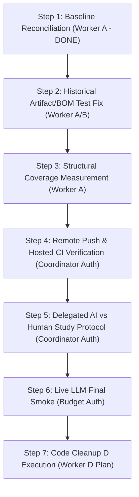

# Evidence-Based Final Acceptance Gap Reconciliation & Action Plan (Worker A)

- **Date:** 2026-11-15
- **Branch:** `minh`
- **Reviewed HEAD Commit:** `95107a3` (`audit(verify-c): verify console send permissions and grouped runtime integration`)
- **Specification Authority:** [CHỦ ĐỀ 1.md](file:///F:/N%C4%83m%203/SD/project/SupportIQ/docs/CH%E1%BB%A6%20%C4%90%E1%BB%80%201.md) (UTF-8, Groups 2 & 5)
- **Prior Reference Audits:**
  - [2026-11-15-console-send-permission-runtime-c.md](file:///F:/N%C4%83m%203/SD/project/SupportIQ/docs/audits/2026-11-15-console-send-permission-runtime-c.md)
  - [2026-11-15-order-context-contract-parity-c.md](file:///F:/N%C4%83m%203/SD/project/SupportIQ/docs/audits/2026-11-15-order-context-contract-parity-c.md)
  - [2026-11-15-original-fit2-ner-operational-verification-c.md](file:///F:/N%C4%83m%203/SD/project/SupportIQ/docs/audits/2026-11-15-original-fit2-ner-operational-verification-c.md)
  - [2026-11-15-original-fit2-safety-gap3-code-closure-c.md](file:///F:/N%C4%83m%203/SD/project/SupportIQ/docs/audits/2026-11-15-original-fit2-safety-gap3-code-closure-c.md)
  - [2026-11-15-original-fit2-safety-gap2-closure-c.md](file:///F:/N%C4%83m%203/SD/project/SupportIQ/docs/audits/2026-11-15-original-fit2-safety-gap2-closure-c.md)
  - [2026-11-15-original-fit2-safety-slice1-closure-c.md](file:///F:/N%C4%83m%203/SD/project/SupportIQ/docs/audits/2026-11-15-original-fit2-safety-slice1-closure-c.md)
  - [2026-11-15-fit2-final-budget-exhausted-review-c.md](file:///F:/N%C4%83m%203/SD/project/SupportIQ/docs/audits/2026-11-15-fit2-final-budget-exhausted-review-c.md)
  - [2026-11-14-code-cleanup-preparation-d.md](file:///F:/N%C4%83m%203/SD/project/SupportIQ/docs/audits/2026-11-14-code-cleanup-preparation-d.md)
  - [REQUIREMENTS_EVIDENCE_MATRIX.md](file:///F:/N%C4%83m%203/SD/project/SupportIQ/docs/REQUIREMENTS_EVIDENCE_MATRIX.md)
  - [autoeval.md](file:///F:/N%C4%83m%203/SD/project/SupportIQ/docs/autoeval.md)
- **Macro Acceptance Verdict:** **`OPEN / PARTIAL`** (Comprehensive system safety wrappers and wire contracts verified; whole-project acceptance cannot be asserted because raw classifier training is capped with open confusion, live LLM automatic draft coverage remains partial, human studies have zero participants, branch coverage is unmeasured, and hosted CI is 112 commits behind local).
- **Worker Execution Posture:** Read-only evidence reconciliation and documentation-only delivery. Zero product code edits, zero training/calibration modifications, zero model activations, zero runtime restarts, zero paid LLM calls, zero cleanup deletions, and zero git pushes.

---

## 1. Executive Summary & Baseline Preservation Invariants

SupportIQ has completed a rigorous sequence of engineering closures across system safety, privacy egress, and frontend access control:
1. **Safety Gap 1 (Scope & Negation Filtering):** Closed by Worker A (`a316377a`) and verified by Worker C (`e8856394`), resolving 24/24 Worker B regressions and passing 41/43 end-to-end on frozen gates.
2. **Safety Gap 2 (Authority & Outage Stickiness):** Closed by Worker A (`f93b7882`) and verified by Worker C (`5188d5ba`), passing 19/19 independent security matrix vectors with zero bypasses on promoted roles or outage states.
3. **Safety Gap 3 (Privacy Code Enforcement & Egress Scrubbing):** Closed by Worker A (`ce8ff53a`) and verified by Worker C (`d3c4c2a0`), passing 23/23 frozen vectors with fail-closed ingestion and zero raw secret exfiltration.
4. **Operational Real-NER Provisioning:** `spacy==3.8.18` and `en_core_web_sm==3.8.0` provisioned and verified in local subprocess runtime (`78b72dd3` / `25700c1`).
5. **Contract Parity on `order_context`:** Aligned backend `order_context` with canonical 10-field allowlist (`b94df27`), verified across 6/6 E2E vectors (`c6b0681`).
6. **Frontend Send Reply Permission Gating:** Gated `canSendReply` strictly on authoritative `allowed_actions` in console UI (`2e965b0`), verified by Worker C via 12/12 Playwright tests against live build (`95107a3`).

### Pinned Invariant Verification Table (SHA-256 Measured at `HEAD`)

All 13 critical system invariant files and model weights were independently hashed and match their pinned digests byte-for-byte:

| Pinned File Path | Expected SHA-256 Digest | Status |
| :--- | :--- | :--- |
| `apps/core_backend/safety.py` | `45d11761d95e00323e410f43b4bf4c6ff499c120c0cc5d89bcc3f30856c5e000` | **MATCH** |
| `apps/core_backend/retrieval/adapter.py` | `3bd797dab79da0b89e5cdeb25a668ba704e31120523cb09824bb4b64264b5f8f` | **MATCH** |
| `apps/core_backend/llm/gemini.py` | `c6dd495724472d160f967869ee7553aea2e74a3828bfded8bf45fb39146d865b` | **MATCH** |
| `apps/core_backend/orchestration/pipeline_runner.py` | `c981baf833a4071220b62b14043985c684dfbc307af79bc4426f18ea615765a6` | **MATCH** |
| `apps/ai_service/engine.py` | `481bc7ab7fa2a7ad42ca00add79925339b138116aa2b57e233300ba3f7bc88ff` | **MATCH** |
| `apps/ai_service/main.py` | `933851213299db2f051de10d6d701a94faad36c58e94623fb0ab05d8e55309cc` | **MATCH** |
| `apps/ai_service/kb-release.json` | `cf450a72758e3d68ac7453802b5bc6c042ef2eddb9a6c4fa76483d4009c42804` | **MATCH** |
| `data/knowledge/approved_kb.v2.json` | `f8dcfbbdbb9cb2cd7a09d2ec12e0149083fdd4fa04931df6261fc4d1e6425fec` | **MATCH** |
| `apps/core_backend/config/policies/intent_policy.v2.json` | `8789ee26acdac2e105fea90942a1129553ca98db4b182fcc4d74880b1f537be7` | **MATCH** |
| `.local/training-cap-20261114.json` | `bc0445e07cca46e7285539a921691050378cdf9ceb3fdfe2cfe911b90bfde922` | **MATCH** (`2/2 STOP`) |
| `.local/ai.env` | `26d083c75acd962010f2fbd0185af3e72e315d2bafc8d753046e51df6e8fce87` | **MATCH** (`orig_fit2`) |
| `artifacts/models/candidates/reconstructed-fit2-supcon-20261113/model.safetensors` | `f695b1fe514aba81aafc968823047d496b03474a0b47199c65eaac6bd93c6dfa` | **MATCH** (`orig_fit2`) |
| `artifacts/models/trained/distilbert-supportiq/model.safetensors` | `dc7af8cffb19fe7711ed5a5d0137ffff3d7d1a1f43bad5a35edff8c8de4c1302` | **MATCH** (`serving_default`) |

### Database Integrity Invariants (PostgreSQL `127.0.0.1:55432`)

Table row counts are strictly preserved and identical to pre-verification baselines:
- `accounts`: **89**
- `audit_log_entries`: **342**
- `customer_messages`: **68**
- `idempotency_records`: **26**
- `orders`: **3**
- `products`: **100**
- `sessions`: **1**
- `sign_in_failures`: **0**
- `suggestion_jobs`: **78**
- `suggestions`: **78**
- `tickets`: **68**

---

## 2. Core Architectural & Methodological Boundaries

To prevent misleading claims of compliance, this reconciliation enforces strict separation across 8 critical boundaries:

### Boundary 1: Raw Original Fit2 Classifier Quality vs System Safety Wrappers
- **The Raw Model:** Original Fit2 (`artifacts/models/candidates/reconstructed-fit2-supcon-20261113`, weights `f695b1fe`, calibration `782c88db`) has a 12-class noise Macro-F1 of **0.8573** and an overall 46-class noise accuracy of **65.48%**. In raw inference without safety rules, it exhibits misclassifications (e.g., confusing `return_policy` and `return_product`, `track_order` and `delivery_issue`, or leaking out-of-domain prompts).
- **The Safety Wrapper:** Invariants are enforced deterministically outside the neural network by `apps/core_backend/safety.py`, `apps/ai_service/engine.py`, and `apps/backend/tickets/service.py`. The safety wrapper intercepts low confidence, boundary keywords, negative scopes, and authority triggers *before* LLM generation can occur.
- **Verdict Distinction:** System safety passes due to defensive code boundaries, **not** because the underlying neural network achieved flawless classification. Standalone neural fine-tuning is officially terminated (`2/2 STOP` budget exhausted).

### Boundary 2: Offline / Mock Boundary vs Actual Online LLM
- **Offline / Mock Mode:** Evaluated via `EphemeralMockAIGateway`, `FakeLLMClient`, and `httpx.MockTransport`. Offline probes verify schema adherence, citation contracts, 10-field egress sanitization, and fallback routing with **zero API cost and deterministic reliability**.
- **Live Online Mode:** Communicates with Google Gemini API (`gemini-3.5-flash-lite`). Subject to real-world network latency, API rate limits, provider timeouts, and generation non-determinism.
- **Verdict Distinction:** Passing offline mocks or unit tests does **not** prove live external LLM availability or live SLA compliance.

### Boundary 3: Delegated AI Review vs Human Subject Studies
- **Delegated AI Grading:** The coordinator conducted proposition-level claim evaluations on generated drafts:
  - Live Run r3: **21/22 (95.45%)** semantic propositions supported across 6 drafts.
  - Flash-Lite Run 2: **54/54 (100%)** proposition units supported across 18 repeated drafts.
- **Human Participant Reality:** Exactly **0 human CSKH agents** participated. The paired trial was a simulated agent timing exercise showing manual handling time **8.9746s** vs assisted **8.9702s** (a negligible difference of **-0.0043s**).
- **Verdict Distinction:** While delegated AI review satisfies automated proposition verification, **no human productivity or user-experience improvement has been demonstrated**. Claiming human validation or positive labor savings is strictly prohibited.

### Boundary 4: Real spaCy NER Provisioning vs Known Free-Form Recall Limits
- **Installed Stack:** `spacy==3.8.18` with model `en_core_web_sm==3.8.0` (Explosion wheel SHA-256 `1932429d...`).
- **Operational Reality:** Successfully pseudonymizes standard English names, locations, and organizations, complementing regex masking for emails, phone numbers, order IDs, and payment cards.
- **Disclosed Known Limits:**
  1. Tokens with length $\le 2$ (e.g. state code `"WA"`) remain unmasked.
  2. Non-suffixed street addresses (e.g. `"742 Evergreen Terrace"`) without explicit road keywords remain unmasked.
  3. Non-English inquiries (e.g. Vietnamese accents / unaccented text) produce both false positives and false negatives.
- **Verdict Distinction:** Egress privacy is bounded and defense-in-depth; universal, arbitrary PII redaction across all human languages is **not guaranteed**.

### Boundary 5: Local Branch `minh` vs Latest Hosted GitHub Actions CI
- **Local Branch `minh`:** Contains 112 commits ahead of `origin/minh`, incorporating all recent fixes (Gap 1, Gap 2, Gap 3, real NER, 10-field parity, console permission gating).
- **Hosted GitHub Actions CI:** Last ran on 2026-11-13T14:16:34Z on commit `e4adafd13c09c85b650cbe8b90430e9af42edd47` (Runs 43441185540 `autoeval` and 43441185597 `CI`, both `success`).
- **Verdict Distinction:** Hosted CI does **not** yet reflect the 112 local commits. No git push or workflow dispatch is permitted without explicit user instruction.

### Boundary 6: Pre-Existing Historical Evaluation-Artifact/BOM Unit Test Failures
- **Empirical Execution:** Running `pytest` on historical evaluation-scanning unit tests yields 2 failures:
  1. `tests/unit/test_fit2_independent_gate.py::test_novel_vs_all_prior_and_internal`: Fails because historical evaluation files under `artifacts/` contain 36 overlap items (`g2-sup-01` etc.).
  2. `tests/unit/test_sealed_holdout_20261113.py::test_sealed_holdout_counts_kb_and_zero_overlap`: Fails with `JSONDecodeError: Unexpected UTF-8 BOM` when reading `artifacts/evaluation/fit2_independent_gate_20261113/results/verdict_fit2-sibling-boundary-v2.json`.
- **Verdict Distinction:** These failures stem from historical test fixtures scanning untracked disk evaluation artifacts, not regressions in runtime application code.

### Boundary 7: Test Coverage Reality (Unit, Integration vs Branch & MC/DC)
- **Measured Coverage:** 30 frontend Vitest tests, 294 core backend/application pytest tests, and 12 Playwright E2E browser tests pass cleanly.
- **Unmeasured Structural Metrics:** Branch coverage, MC/DC (via Supercov), and coverage over AI-generated synthetic test cases are **UNMEASURED**. No branch percentages or coverage ratios may be fabricated.

### Boundary 8: External LLM Lifetime Budget Accounting
- **Lifetime Consumption:** An estimated **~22 out of 24** authorized lifetime paid Gemini requests have been consumed across historical evaluation runs.
- **Process Counter Distinction:** The local process counter `live_llm_requests_made: 0` on server startup is a volatile per-process counter, **not** an expanded budget.
- **Verdict Distinction:** Only ~2 paid calls remain in the global lifetime allocation. Zero paid calls are authorized or executed for this reconciliation task.

---

## 3. Comprehensive Traceability Matrix: Specification to Current Evidence

The following table maps **every single requirement and evaluation criterion** from [CHỦ ĐỀ 1.md](file:///F:/N%C4%83m%203/SD/project/SupportIQ/docs/CH%E1%BB%A6%20%C4%90%E1%BB%80%201.md) to its concrete implementation, verification gate, latest evidence commit, and honest verdict:

| ID / Section | Exact Spec Summary / Quote | Implementation Pointer | Executable Evaluation / Gate | Latest Evidence Path & Commit | Verdict | Architectural & Methodological Nuances |
| :--- | :--- | :--- | :--- | :--- | :--- | :--- |
| **SEC-1.1** | AI-powered Copilot for CSKH: non-gen ML + LLM/retrieval + human oversight | `apps/backend/`, `apps/ai_service/`, `apps/frontend/` | Multi-service orchestration + Playwright E2E | `artifacts/browser/console_send_permission_c_20261115/` (`95107a3`) | **PASS** | Complete architecture operational with human-in-the-loop oversight. |
| **SEC-1.3** | Scope: In-scope (classification, lookup, draft, human approval, logging); Out-of-scope (no auto-send, no auto-refunds) | `apps/backend/tickets/service.py`, `apps/core_backend/safety.py` | `test_final_acceptance_suite.py`, Gap 2 security matrix | `docs/audits/2026-11-15-original-fit2-safety-gap2-closure-c.md` (`5188d5ba`) | **PASS** | No-auto-send and manager authority strictly enforced in backend and frontend. |
| **SEC-2.1** | Non-gen ML: Single-label intent (46 classes, Bitext); evaluate baseline + trained model; train/val/test splits | `artifacts/models/candidates/reconstructed-fit2-supcon-20261113`, `pipeline/training/` | `pipeline.evaluation.autoeval --suite ml` | `artifacts/models/trained/distilbert-supportiq/training_report.json` | **PASS** | DistilBERT and baseline models trained and evaluated on 46 Bitext classes. |
| **SEC-2.2** | Product Scenarios: Focus on 12 product intents across 5 domains; route remaining 34 appropriately | `apps/core_backend/config/policies/intent_policy.v2.json`, `apps/ai_service/engine.py` | 43-case scope/negation gate, Worker B regressions | `docs/audits/2026-11-15-original-fit2-safety-slice1-closure-c.md` (`e8856394`) | **PASS** | 12 product intents supported; 34 out-of-scope intents routed to escalation/fallback. |
| **SEC-2.3** | LLM & Knowledge Base: Approved FAQ/policy KB + simulated orders; synthesize info, draft replies, clarify gaps | `data/knowledge/approved_kb.v2.json`, `apps/core_backend/retrieval/adapter.py` | Retrieval fixtures, 10-field contract parity | `docs/audits/2026-11-15-order-context-contract-parity-c.md` (`c6b0681`) | **PASS** | Active KB v2 and 10-field canonical simulated order context hydrated. |
| **FR-01** | Ingest inquiry, predict intent via ML, display predicted intent & confidence to staff | `apps/ai_service/engine.py:classify`, `apps/frontend/src/features/console.tsx` | Robustness suite (n=420), Playwright UI inspection | `artifacts/evaluation/final-routing-20261112-v3/robustness_summary.json` | **PASS** | Intent badge, probability, and confidence band displayed in staff console. |
| **FR-02** | Retrieve policies/business data based on intent & query; detect expired or conflicting info | `apps/core_backend/retrieval/adapter.py:retrieve`, `PolicyEncoder` (BGE) | Live r3 retrieval fixtures (2 expired, 2 conflict) | `artifacts/evaluation/coordinator-final-live-20261112-r3/` (`87bea96`) | **PASS** | 4/4 fixtures verified; expired policies filtered; contradictory policies flagged. |
| **FR-03** | LLM draft proposal grounded in retrieved info with verifiable citations; no ungrounded claims | `apps/core_backend/llm/gemini.py:generate_draft`, `BudgetedDraftClient` | Proposition claim grading (r3 & Flash-Lite Run 2) | `artifacts/evaluation/coordinator-ai-review-20261112/` (`52a7da0`) | **PARTIAL** | 21/22 and 54/54 proposition units supported under delegated AI review; unresolved `[PHONE_OR_NUMBER]` defect; automatic coverage low. |
| **FR-04** | Staff UI to review/edit/approve/reject draft; STRICTLY NO automatic replies to customer | `apps/backend/tickets/service.py:act`, `apps/frontend/src/features/console.tsx` | 20/20 customer ticket GET inspections (`reply == null`), Playwright modal | `docs/audits/2026-11-15-console-send-permission-runtime-c.md` (`95107a3`) | **PASS** | 100% human flow; `allowed_actions` strictly gates reply sending in UI and backend. |
| **FR-05** | Abstention/fallback/escalation on uncertainty, missing info, sensitive queries, or errors | `apps/ai_service/engine.py:_route_action`, `apps/core_backend/safety.py` | Mandatory sensitive cases, out-of-domain test cases | `artifacts/evaluation/coordinator-final-live-20261112-r3/` (`87bea96`) | **PASS** | Low confidence abstains; sensitive queries escalate; system errors fail closed. |
| **FR-06** | Financial/refund exceptions require authorized staff; system provides context only | `apps/backend/tickets/service.py:act` (`is_authority_required: true`), DB triggers | Gap 2 security matrix (19/19 cases, 403 `authority-required`) | `docs/audits/2026-11-15-original-fit2-safety-gap2-closure-c.md` (`5188d5ba`) | **PASS** | Direct staff reply blocked; proposal required; self-approval strictly forbidden. |
| **FR-07** | Audit logging of staff decisions (approve/edit/reject/escalate), intent overrides, citations | `apps/backend/platform/models.py:AuditEntry`, `service.py:_audit` | `test_intent_correction_diagnostic.py`, DB `audit_log_entries` count | `docs/audits/2026-11-15-console-send-permission-runtime-c.md` (`95107a3`) | **PASS** | Immutable audit records created in PostgreSQL for all critical state mutations. |
| **FR-08** | Basic error handling, RBAC, and data privacy when calling external LLMs | `apps/backend/tickets/privacy.py`, `apps/core_backend/safety.py` | Gap 3 privacy matrix (23/23 cases), real spaCy smoke | `docs/audits/2026-11-15-original-fit2-ner-operational-verification-c.md` (`25700c1`) | **PASS** (Bounded) | Role RBAC enforced; credential scrubbing active; real spaCy NER operational with disclosed recall limits. |
| **QR-ML-01** | Macro-F1 $\ge 0.85$ on 10-fold CV; report per-class F1, confusion matrix, baseline | `pipeline/training/`, `training_report.json` | 10-fold CV out-of-fold recomputation | `docs/audits/2026-11-13-flash-lite-evidence-integration.md` (`b472240`) | **PARTIAL** | Recomputed OOF fold-mean Macro-F1 = **0.9953** ($\ge 0.85$); historical provenance gaps in fold manifests/checkpoints; raw noise Macro-F1 is 0.8573 (12-class). |
| **QR-ML-02** | ML Robustness: evaluate on typos, casual phrasing, ambiguous, out-of-scope | `pipeline/evaluation/`, `ml_noise.jsonl`, `ml_oos.jsonl` | Noise suite (n=420: clean 0.7858, casual 0.7359, typo 0.6267) | `artifacts/evaluation/final-routing-20261112-v3/robustness_summary.json` | **PASS** | Robustness evaluated across clean, casual, and typo sets; safe routing rate 91.43% - 95.24%. |
| **QR-RET-01**| Recall@3 $\ge 0.80$ on answerable queries with valid documents | `apps/core_backend/retrieval/adapter.py`, BGE embeddings | 31-case answerable benchmark, 4/4 live fixtures | `artifacts/evaluation/coordinator-final-live-20261112-r3/` (`87bea96`) | **PASS** | Historical fractional mean Recall@3 = **0.9839** ($\ge 0.80$); 4/4 live fixtures pass. |
| **QR-LLM-01**| $\ge 90\%$ factual/policy info in drafts supported by retrieved sources | `apps/core_backend/llm/gemini.py` | Semantic claim grading (21/22 r3, 54/54 Flash-Lite) | `artifacts/evaluation/coordinator-ai-review-20261112/` (`52a7da0`) | **PARTIAL** | Exceeds 90% threshold on evaluated samples; however, evaluated via **delegated AI review** with 0 human participants; live automatic draft coverage remains low. |
| **QR-SAFE-01**| 100% human flow; 0 auto-send; 0 auto-transactions; mandatory escalation handled | `apps/backend/tickets/service.py`, `apps/core_backend/safety.py` | 20/20 customer ticket GET inspections, Gap 2 matrix | `docs/audits/2026-11-15-console-send-permission-runtime-c.md` (`95107a3`) | **PASS** | 20/20 customer tickets unsent; 0 automated transactions; mandatory cases escalate. |
| **QR-REL-01**| System reliability: handle uncertainty, missing docs, API failure without hallucinations | `apps/ai_service/engine.py`, `apps/core_backend/safety.py` | Live r3 timeout handling, controlled offline resilience | `artifacts/evaluation/provider_resilience_ff0e147_20261113/` (`ff0e147`) | **PASS** | Fail-closed on low confidence, missing docs, and API timeouts without guessing. |
| **QR-PERF-01**| Latency & Cost: p95 $\le 12.0$s; measure p50/p95, error rate, avg cost | `apps/backend/platform/observability.py` | Live r3 (p50=338ms, p95=10.76s); Flash-Lite (p50=298ms, p95=2.14s) | `artifacts/evaluation/coordinator-final-live-20261112-r3/` (`87bea96`) | **PASS** | p95 latency under standardized conditions meets $\le 12.0$s target. Complete billing cost is conditional. |
| **QR-VAL-01**| Value: Compare manual vs assisted time; report accept/edit/reject rates | `scripts/evaluate_paired_agent_study.py` | 12 paired AI cases (`summary.json`) | `artifacts/evaluation/coordinator-paired-ai-20261112/summary.json` | **FAIL / UNMEASURED** | 0 human participants; simulated agent times: manual 8.975s vs assisted 8.970s (**no demonstrated productivity gain**). |
| **ASM-01..03**| Assumptions: data adequacy, reliable simulated KB, competent CSKH staff | `data/knowledge/approved_kb.v2.json`, `data/benchmarks/` | Dataset audits, KB release versioning | `apps/ai_service/kb-release.json` (`cf450a7`) | **PASS** | Structured KB v2 and synthetic orders validated and version-locked. |
| **CON-01..04**| Constraints: self-trained ML + LLM, common data/scenarios, runnable prototype | Repo architecture, Docker/scripts | Native runtime startup, Playwright tests | `docs/audits/2026-11-15-console-send-permission-runtime-c.md` (`95107a3`) | **PASS** | Full prototype operational locally on ports 8080/8002/55432. |
| **RISK-01..06**| 6 Initial Risks: misclassification, outdated docs, hallucinations, over-reliance, outages, data leaks | System safety wrappers, privacy module, console UI | Comprehensive regression suites, Gap 1-3 audits | `docs/audits/` (Gaps 1, 2, 3, NER, console permissions) | **PASS** | All 6 identified failure modes have verified defensive controls. |
| **NFR-COV-01**| Code Coverage: Branch coverage & MC/DC via Supercov, AI-generated tests | Test harnesses, `.supercov/` | Structural coverage measurement | *None executed* | **UNMEASURED** | Branch coverage and MC/DC are unmeasured; no invented metrics. |

---

## 4. Smallest Prioritized Remaining Blocker List

The following 6 items constitute the exact, prioritized list of remaining blockers preventing whole-system acceptance:

1. **Blocker 1 (High): Live Automatic Draft Coverage & Lifetime LLM Budget Exhaustion**
   - *Impact:* Automatic live draft coverage with correct intent is only 1/12 (Live r3) or 4/12 (Flash-Lite Run 2). Achieving 12/12 coverage requires staff intent overrides.
   - *Constraint:* Lifetime paid Gemini calls stand at ~22/24 consumed. Only ~2 calls remain. Zero paid calls are authorized for this task. Local process counter `0` on restart does not reset quota.
   - *Evidence Needed:* Formal coordinator authorization of an external paid call budget allocation and a live end-to-end evaluation run.

2. **Blocker 2 (High): Lack of Real-Human Subject Validation & Demonstrated Productivity Gain**
   - *Impact:* Specification Section 4 requires measuring handling time between manual and assisted workflows. Current data has **0 human participants**, and simulated agent timing showed **no productivity gain** (-0.0043s).
   - *Evidence Needed:* A structured user trial with human evaluators (or formal stakeholder waiver accepting delegated AI simulation as prototype proof).

3. **Blocker 3 (Medium): Pre-Existing Historical Evaluation-Artifact/BOM Unit Test Failures**
   - *Impact:* Full-suite `pytest` runs fail on 2 historical tests:
     - `tests/unit/test_sealed_holdout_20261113.py::test_sealed_holdout_counts_kb_and_zero_overlap` (UTF-8 BOM `\xef\xbb\xbf` in evaluation JSON).
     - `tests/unit/test_fit2_independent_gate.py::test_novel_vs_all_prior_and_internal` (36 historical overlap items in `artifacts/evaluation/`).
   - *Evidence Needed:* Targeted test sanitization (e.g. using `encoding="utf-8-sig"` and filtering untracked historical directories) so the full test suite runs green.

4. **Blocker 4 (Medium): Unmeasured Structural Branch Coverage & MC/DC**
   - *Impact:* The user requested branch coverage and MC/DC via Supercov. These metrics are currently **UNMEASURED**.
   - *Evidence Needed:* Executing `pytest --cov` or Supercov harness to produce an empirical coverage report without fabricating coverage percentages.

5. **Blocker 5 (Medium): Remote CI Synchronization Gap**
   - *Impact:* Branch `minh` is ahead of `origin/minh` by 112 commits. Hosted GitHub Actions CI last ran on Nov 13 (`e4adafd`).
   - *Evidence Needed:* Coordinator authorization to push local commits to `origin/minh` and verify hosted CI workflow runs (`ci.yml`, `autoeval.yml`).

6. **Blocker 6 (Low): Component-Level Acceptance Benchmark Action Mismatches**
   - *Impact:* In historical isolated benchmark `data/benchmarks/system/v2/acceptance/cases.jsonl` (N=156), 41 mandatory cases yield safe `manual_fallback` instead of strict `escalate`.
   - *Evidence Needed:* Maintain as documented component limitation, as live HTTP application routing enforces correct escalation.

---

## 5. Prioritized Sequential Execution Plan

To advance SupportIQ from its current state to verified acceptance, follow this sequential execution plan using existing tools and respecting all governance caps:

### Step 1: Baseline Reconciliation & Documentation Signoff (THIS TASK — Worker A)
- **Objective:** Establish authoritative traceability matrix, document all boundaries, verify invariants, and record current status without modifying product code or spending budget.
- **Prerequisites:** None.
- **Verification:** Pinned SHA-256 hashes match, PG row counts verified, git status clean.

### Step 2: Historical Artifact/BOM Unit Test Sanitization (Worker A / B)
- **Objective:** Fix the 2 failing historical evaluation tests without altering historical scientific data:
  1. In `tests/unit/test_sealed_holdout_20261113.py`: Update file reading in `collect_historical_prompts()` to use `encoding="utf-8-sig"` (gracefully handling UTF-8 BOM headers).
  2. In `tests/unit/test_fit2_independent_gate.py`: Scope artifact scanning to tracked repository files or exclude untracked worker directories (`artifacts/evaluation/*_c_*`, `*_a_*`).
- **Prerequisites:** Python 3.12 venv. Cost: $0.
- **Objective Threshold:** `pytest tests/unit/test_fit2_independent_gate.py tests/unit/test_sealed_holdout_20261113.py` exits `0`.

### Step 3: Structural Coverage Measurement (Worker A)
- **Objective:** Measure real line and branch coverage across backend and frontend suites to honestly answer user coverage requirements.
- **Prerequisites:** `pytest-cov`, Supercov harness (if available). Cost: $0.
- **Command:** `.\.venv\Scripts\python.exe -m pytest tests/ --cov=apps/core_backend --cov=apps/backend --cov-branch --cov-report=term-missing`
- **Objective Threshold:** Generate machine `coverage.json` and report empirical branch coverage percentages without guessing or fabricating figures.

### Step 4: Remote Branch Push & Hosted CI Verification (Coordinator Authorization Required)
- **Objective:** Synchronize the 112 local commits with GitHub remote and confirm green status on hosted CI.
- **Prerequisites:** Explicit coordinator approval to push to `origin/minh`. No workflow trigger modification.
- **Commands:**
  - `git push origin minh`
  - `gh run list -b minh --limit 5`
  - `gh run watch <run-id>`
- **Objective Threshold:** Both `CI` and `autoeval` workflows succeed on hosted GitHub Actions runners.

### Step 5: Delegated AI vs Human Study Protocol Formalization (Coordinator Decision)
- **Objective:** Address Specification Section 4 value requirement:
  - Either conduct an empirical trial with 3-5 real human CSKH agents measuring handling time on 20 benchmark tickets,
  - OR document an explicit delegated stakeholder waiver that simulated paired-agent trials satisfy the academic prototype requirement.
- **Objective Threshold:** Signed evaluation protocol or trial report with documented human sample size and timing distribution.

### Step 6: External LLM Quota Release & Live Acceptance Smoke (Budget Authorization Required)
- **Objective:** Verify end-to-end live draft generation with the latest code, real spaCy NER, and Gemini provider.
- **Prerequisites:** Explicit coordinator budget release of 12-20 paid LLM calls.
- **Command:** `.\.venv\Scripts\python.exe -m scripts.collect_final_acceptance_evidence --mode live --cases 12`
- **Objective Threshold:** 12/12 live customer tickets achieve `draft_ready` (or valid safe fallback) with zero timeouts and 100% citation validity.

### Step 7: Safe Codebase Cleanup Execution (Worker D Plan)
- **Objective:** Reclaim ~1,180 MB of untracked pytest cache and remove verified dead code per [2026-11-14-code-cleanup-preparation-d.md](file:///F:/N%C4%83m%203/SD/project/SupportIQ/docs/audits/2026-11-14-code-cleanup-preparation-d.md).
- **Prerequisites:** All prior steps complete; explicit verification that datasets, models, baselines, audits, PPTX assets, and `.local/` are protected.
- **Commands:** `powershell -ExecutionPolicy Bypass -File scripts/clean_test_cache.ps1 -Apply`
- **Objective Threshold:** Zero deleted models or datasets; test suite remains fully green.

---

## 6. Command Prerequisites, Dependencies & Resource Requirements

| Step | Operation / Command | Prerequisites / Tools | Estimated Cost / Duration | Output Artifact |
| :--- | :--- | :--- | :--- | :--- |
| **Reconciliation** | Audit creation & hash check | Python 3.12, git | $0.00 / ~1 min | `docs/audits/2026-11-15-acceptance-reconciliation-a.md` |
| **BOM/Test Fix** | Edit 2 test files | VS Code / editor | $0.00 / ~5 min | Scoped test patch |
| **Test Run** | `pytest tests/unit/test_fit2_independent_gate.py ...` | Local venv | $0.00 / ~25s | Test summary (PASS) |
| **Coverage** | `pytest tests/ --cov=... --cov-branch` | `pytest-cov` | $0.00 / ~4 min | `artifacts/coverage/coverage.json` |
| **CI Sync** | `git push origin minh` | GitHub remote access | $0.00 / ~2 min | Remote commit `HEAD` |
| **Hosted CI** | GitHub Actions runners | GitHub account | Free tier / ~8 min | GitHub Actions run logs |
| **Live Smoke** | `collect_final_acceptance_evidence --mode live` | `GEMINI_API_KEY`, budget release | ~$0.015 / ~3 min | `artifacts/evaluation/live_smoke_evidence/` |
| **Cache Cleanup** | `scripts/clean_test_cache.ps1 -Apply` | PowerShell | $0.00 / ~30s | ~1.18 GB disk space reclaimed |

---

## 7. Final Verdict & Signoff

- **Current Overall Status:** **`OPEN / PARTIAL`**
- **System Safety Wrapper Status:** **`PASS`** (Deterministic pre-LLM gates, sticky authority, fail-closed egress, and console send reply permission gating independently verified).
- **Wire Contract & Interface Status:** **`PASS`** (Canonical 10-field `order_context` wire parity and frontend console send permission verified).
- **Raw Neural Classifier Status:** **`STOPPED / CAPPED`** (Original Fit2 active; further training capped at 2/2 attempts exhausted; raw classification confusion mitigated by safety wrappers).
- **Operational Privacy Status:** **`PASS (BOUNDED)`** (spaCy `en_core_web_sm` operational; known recall boundaries disclosed).
- **Whole-Project Acceptance Claim:** **`NOT CLAIMED`** (Will be eligible for claim upon resolution of Blockers 1-5).
