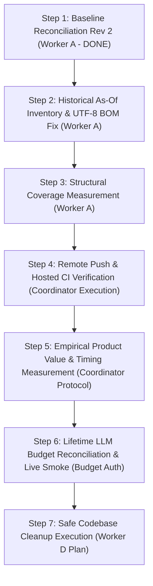

# Evidence-Based Final Acceptance Gap Reconciliation & Action Plan (Worker A — Rev 2)

- **Date:** 2026-11-15
- **Branch:** `minh`
- **Reviewed HEAD Commit:** `2b5a56a` / `95107a3` (`audit(verify-c): verify console send permissions and grouped runtime integration`)
- **Specification Authority:** [CHỦ ĐỀ 1.md](file:///F:/N%C4%83m%203/SD/project/SupportIQ/docs/CH%E1%BB%A6%20%C4%90%E1%BB%80%201.md) (UTF-8, Groups 2 & 5)
- **Revision Note (Rev 2):** Updated in direct response to Coordinator Review (`msg_ae4b786e5b99`) to correct commit attributions, privacy NER entity scopes, diagnosis of the 36 gate overlaps, push authorization authority, removal of invented criteria/quotas, model/benchmark distinctions, and precise working tree status.
- **Macro Acceptance Verdict:** **`OPEN / PARTIAL`** (Comprehensive system safety wrappers, 10-field wire parity, and console send permissions are verified; whole-project acceptance cannot be claimed due to capped raw classifier training, low automatic live draft coverage, lack of human participant studies, unmeasured branch coverage, pre-existing historical test issues, and hosted CI sync lag).
- **Worker Execution Posture:** Read-only evidence reconciliation and documentation-only delivery. Zero product code edits, zero training/calibration modifications, zero model activations, zero runtime restarts, zero paid LLM calls, zero cleanup deletions, and zero git pushes.

---

## 1. Executive Summary & Corrected Multi-Worker Attribution

SupportIQ has completed a sequence of engineering closures across system safety, privacy egress, and frontend access control. The verified historical author/reviewer/verifier attributions are:

| Subsystem Slice | Worker A (Implementation Fix) | Worker B (Security Review) | Worker C (Independent Verification) | Status / Verdict |
| :--- | :--- | :--- | :--- | :--- |
| **Slice 1 (Scope & Negation)** | `a316377a` (quote waiver & disavowal) | `e8856394` (`PASS` review) | `40c73438` (24/24 regressions blocked, 41/43 gates) | **CLOSED / PASS** |
| **Gap 2 (Authority & Outage)** | `f93b7882` (sticky authority & outage) | `5188d5ba` (`PASS` review) | `d3c4c2a0` (19/19 security matrix vectors) | **CLOSED / PASS** |
| **Gap 3 (Privacy Code Enforcement)** | `59a41fe8` (fail-closed NER & egress) | `ce8ff53a` (`PASS` re-review) | `f7ab5ade` (23/23 privacy matrix vectors) | **CLOSED / PASS** |
| **Operational Real-NER Provisioning** | `78b72dd3` (spaCy wheel & smoke) | — | `25700c1` (real NER smoke & runtime readiness) | **CLOSED / PASS (Bounded)** |
| **Order Context 10-Field Parity** | `b94df274` (canonical 10-field allowlist) | — | `c6b0681` (6/6 E2E contract parity vectors) | **CLOSED / PASS** |
| **Console Send Reply Gating** | `2e965b01` (gate on `allowed_actions`) | — | `95107a3` (12/12 Playwright tests on live build) | **CLOSED / PASS** |

### Pinned Invariant Verification Table (SHA-256 Measured at `HEAD`)

All 13 critical system invariant files and model weights were independently hashed and match their pinned digests byte-for-byte:

| Pinned File Path | Expected SHA-256 Digest | Status |
| :--- | :--- | :--- |
| `apps/core_backend/safety.py` | `45d11761d95e00323e410f43b4bf4c6ff499c120c0cc5d89bcc3f30856c5e000` | **MATCH** |
| `apps/core_backend/retrieval/adapter.py` | `3bd797dab79da0b89e5cdeb25a668ba704e31120523cb09824bb4b64264b5f8f` | **MATCH** |
| `apps/core_backend/llm/gemini.py` | `c6dd495724472d160f967869ee7553aea2e74a3828bfded8bf45fb39146d865b` | **MATCH** |
| `apps/core_backend/orchestration/pipeline_runner.py` | `c981baf833a4071220b62b14043985c684dfbc307af79bc4426f18ea615765a6` | **MATCH** |
| `apps/ai_service/engine.py` | `481bc7ab7fa2a7ad42ca00add79925339b138116aa2b57e233300ba3f7bc88ff` | **MATCH** |
| `apps/ai_service/main.py` | `933851213299db2f051de10d6d701a94faad36c58e94623fb0ab05d8e55309cc` | **MATCH** |
| `apps/ai_service/kb-release.json` | `cf450a72758e3d68ac7453802b5bc6c042ef2eddb9a6c4fa76483d4009c42804` | **MATCH** |
| `data/knowledge/approved_kb.v2.json` | `f8dcfbbdbb9cb2cd7a09d2ec12e0149083fdd4fa04931df6261fc4d1e6425fec` | **MATCH** |
| `apps/core_backend/config/policies/intent_policy.v2.json` | `8789ee26acdac2e105fea90942a1129553ca98db4b182fcc4d74880b1f537be7` | **MATCH** |
| `.local/training-cap-20261114.json` | `bc0445e07cca46e7285539a921691050378cdf9ceb3fdfe2cfe911b90bfde922` | **MATCH** (`2/2 STOP`) |
| `.local/ai.env` | `26d083c75acd962010f2fbd0185af3e72e315d2bafc8d753046e51df6e8fce87` | **MATCH** (`orig_fit2`) |
| `artifacts/models/candidates/reconstructed-fit2-supcon-20261113/model.safetensors` | `f695b1fe514aba81aafc968823047d496b03474a0b47199c65eaac6bd93c6dfa` | **MATCH** (`orig_fit2`) |
| `artifacts/models/trained/distilbert-supportiq/model.safetensors` | `dc7af8cffb19fe7711ed5a5d0137ffff3d7d1a1f43bad5a35edff8c8de4c1302` | **MATCH** (`serving_default`) |

### Database Integrity Invariants (PostgreSQL `127.0.0.1:55432`)

Table row counts are strictly preserved and identical to pre-verification baselines:
- `accounts`: **89**, `audit_log_entries`: **342**, `customer_messages`: **68**, `idempotency_records`: **26**, `orders`: **3**, `products`: **100**, `sessions`: **1**, `sign_in_failures`: **0**, `suggestion_jobs`: **78**, `suggestions`: **78**, `tickets`: **68**.

### Working Tree & Repository Reality

The working tree is **not** empty:
- `deleted: artifacts/models/.gitkeep` (pre-existing unstaged deletion, preserved intact per cleanup guidelines).
- Untracked directories and assets: `.codegraph/`, `docs/report.template.pptx`, and untracked evaluation artifact directories from previous workers (`artifacts/evaluation/app_retrieval_acceptance_95107a3_20261115/`, `boundary_contrast_20261114/`, `fit2_orig_ret_channel_20261114/`, and `__pycache__` folders).

---

## 2. Core Architectural & Methodological Boundaries

### Boundary 1: Distinct Models — OriginalFit2 vs Historical DistilBERT Baseline
- **OriginalFit2 (`reconstructed-fit2-supcon-20261113`, weights `f695b1fe`):** Currently active in `.local/ai.env`. Evaluated on `noise420` (Macro-F1 **0.8573** on 12-class slice; **65.48%** accuracy across 46 classes) and calibration suites. Further fine-tuning attempts (Attempt 1/2 and 2/2) failed the calibration guard, leaving the training budget permanently **`2/2 STOP`** (`budget_exhausted`). It does **not** have an official 10-fold CV manifest.
- **Historical Baseline (`distilbert-supportiq`, weights `dc7af8cf`):** Retained in `artifacts/models/trained/distilbert-supportiq/`. Stored 37,911-row, 10-fold CV out-of-fold data independently recomputes to fold-mean Macro-F1 = **0.9953**, but original training git commit, fold checkpoints, and CV manifests remain unmapped historical gaps.
- **Distinction:** High CV metrics from the old baseline must **not** be conflated with OriginalFit2. OriginalFit2's raw classification confusion (e.g. `return_policy` vs `return_product`) is mitigated by external safety wrappers, not raw model perfection.

### Boundary 2: Sliced Safety Wrappers vs Universal Safety
- **Verified Slices:** Safety Gaps 1, 2, and 3 passed frozen case matrices:
  - 43-case scope/negation gate (`gate27` + `gate16`: 41/43 end-to-end pass, 0 leaks, 2 retrieval misses < 0.55).
  - 24 Worker B regression prompts blocked pre-LLM.
  - 19 Gap 2 security vectors (sticky authority, self-approval forbidden, role promotion session revocation).
  - 23 Gap 3 privacy vectors (strict fail-closed, full-envelope validation, span literal protection).
- **Boundary Reality:** These guarantees apply to the explicitly tested semantic rules and keywords. They do **not** constitute a mathematical proof of universal safety across unconstrained, open-ended human queries.
- **Benchmark Discrepancy:** In the 156-case acceptance benchmark (`data/benchmarks/system/v2/acceptance/cases.jsonl`), 41 mandatory cases trigger safe `manual_fallback` instead of strict `escalate`. While safe (no ungrounded draft emitted), this remains an unresolved discrepancy against strict specification action labels.

### Boundary 3: Privacy NER Scope — PERSON and GPE/LOC/FAC (No ORG Masking)
- **Code Inspection (`apps/backend/tickets/privacy.py::_collect_ner_spans`):**
  - Line 188 explicitly defines: `target_kind = "NAME" if label == "PERSON" else ("ADDRESS" if label in ("GPE", "LOC", "FAC") else None)`.
  - All other spaCy entity labels—specifically **`ORG` (organizations)**, `NORP`, `DATE`, `TIME`—are mapped to `None` and **ignored**.
- **Disclosed Known Limits:**
  1. **No ORG Redaction:** Company, bank, or vendor names (e.g. `"Shopee"`, `"Tiki"`, `"Vietcombank"`) are **not** masked by spaCy NER unless explicitly matched by regexes or database known tokens.
  2. **Short Tokens ($\le 2$ chars):** Excluded by length filter (e.g. state `"WA"`).
  3. **Unformatted Street Addresses:** Free-form addresses without directional or road keywords (e.g. `"742 Evergreen Terrace"`) remain unmasked.
  4. **Non-English (Vietnamese):** Free-form accented/unaccented Vietnamese text produces significant false negatives and false positives.
- **Verdict:** Privacy redaction is bounded, defense-in-depth, and regex-complemented; universal free-form PII scrubbing across all categories and languages is **not supported**.

### Boundary 4: Offline / Mock Boundary vs Actual Online LLM
- **Offline / Mock Mode:** Evaluated via `EphemeralMockAIGateway`, `FakeLLMClient`, and `httpx.MockTransport`. Offline probes verify schema adherence, citation contracts, 10-field egress sanitization, and fallback routing with **zero API cost and deterministic reliability**.
- **Live Online Mode:** Communicates with Google Gemini API (`gemini-3.5-flash-lite`). Subject to real-world network latency, API rate limits, provider timeouts, and generation non-determinism.
- **Verdict Distinction:** Passing offline mocks or unit tests does **not** prove live external LLM availability or live SLA compliance.

### Boundary 5: Delegated AI Review vs Real-Human Studies
- **Delegated AI Proposition Grading:** Specification Section 4 requires $\ge 90\%$ of factual statements in drafts to be supported by retrieved sources. Under explicit user delegation, the coordinator performed claim-level grading:
  - Live Run r3: **21/22 (95.45%)** semantic propositions supported across 6 drafts.
  - Flash-Lite Run 2: **54/54 (100%)** proposition units supported across 18 repeated drafts.
  - One defect identified: an unresolved public hotline reference `[PHONE_OR_NUMBER]` was retained.
- **Human Participant Reality:** Exactly **0 human CSKH agents** participated. The paired trial was a simulated agent timing exercise showing manual handling time **8.9746s** vs assisted **8.9702s** (a difference of **-0.0043s**; no productivity gain).
- **Verdict:** The $\ge 90\%$ grounding target is satisfied under **delegated AI review**, but **no human productivity improvement has been evidenced**. Claiming human participant validation is strictly prohibited.

### Boundary 6: Remote CI & Push Authorization Authority
- **Push Authorization:** The user previously authorized pushing branch `minh`. No fresh user approval is required.
- **Role Boundary:** Worker A operates under a dispatched read-only worker scope and **cannot** execute `git push`.
- **Status:** Local branch `minh` is 113 commits ahead of `origin/minh`. The coordinator will inspect and push `minh` to `origin/minh` after completing review gates.

### Boundary 7: Lifetime LLM Quotas & Reconciled Usage
- **Lifetime Consumption:** An estimated **~22 out of 24** authorized lifetime paid Gemini requests have been consumed across historical runs.
- **Process Counter Distinction:** The local process counter `live_llm_requests_made: 0` on server startup is a volatile per-process counter, **not** a fresh quota.
- **Budget Reality:** Only ~2 paid calls remain in the global lifetime allocation. No new paid calls or arbitrary budgets (such as 12-20 calls) are authorized without a prior formal quota reconciliation. THIS task performed zero paid calls.

### Boundary 8: Accurate Diagnosis of the 36 Gate Overlaps & UTF-8 BOM
- **Diagnosis of 36 Overlaps (`test_fit2_independent_gate.py::test_novel_vs_all_prior_and_internal`):**
  - Empirical verification reveals that `data/` has **0 overlaps and 0 near-duplicates** with the 36 gate cases (`cases.jsonl`).
  - The 36 overlap items (`g2-sup-01..36`) are **100% downstream evaluation prediction logs** exported by later Worker C test suites (`artifacts/evaluation/original_fit2_safety_slice1_*`, `fit2_v4p1_*`, `fit2_v5r2_*`, etc.) that evaluated those exact gate cases on Nov 14 and Nov 15.
  - Because `gate.py::historical_corpus()` naively scans all of `artifacts/evaluation/` (excluding only its own directory `fit2_independent_gate_20261113`), it reads later evaluation outputs as if they were prior training data.
- **Diagnosis of UTF-8 BOM (`test_sealed_holdout_20261113.py::test_sealed_holdout_counts_kb_and_zero_overlap`):**
  - Fails with `JSONDecodeError: Unexpected UTF-8 BOM` because `artifacts/evaluation/fit2_independent_gate_20261113/results/verdict_fit2-sibling-boundary-v2.json` contains a `\xef\xbb\xbf` BOM header written by PowerShell/Windows tooling, which standard `json.loads(path.read_text(encoding="utf-8"))` rejects.
- **Remediation Principle:** Do **not** blindly delete or filter untracked directories. The test suite must be updated to use an **immutable historical as-of inventory** (freezing the corpus as of gate creation `2026-11-13T00:00:00Z` or distinguishing evaluation prediction logs from input datasets) and **UTF-8 BOM normalization** (`encoding="utf-8-sig"`), while strictly ensuring that any genuine prior contamination remains a FAIL.

---

## 3. Comprehensive Traceability Matrix: Specification to Current Evidence

The table below reconciles **every requirement and quality dimension** from [CHỦ ĐỀ 1.md](file:///F:/N%C4%83m%203/SD/project/SupportIQ/docs/CH%E1%BB%A6%20%C4%90%E1%BB%80%201.md) against verified implementation and evidence:

| ID / Section | Exact Spec Requirement / Quote | Current Implementation Pointers | Current Executable Evaluation / Gate | Latest Evidence Path & Commit | Verdict | Methodological & Architectural Nuances |
| :--- | :--- | :--- | :--- | :--- | :--- | :--- |
| **SEC-1.1** | AI Copilot for CSKH: non-gen ML + LLM/retrieval + human oversight | `apps/backend/`, `apps/ai_service/`, `apps/frontend/` | Multi-service orchestration + Playwright E2E | `artifacts/browser/console_send_permission_c_20261115/` (`95107a3`) | **PASS** | Complete multi-tier architecture operational with human oversight. |
| **SEC-1.3** | Scope: in-scope (classification, lookup, draft, human approval, logging); out-of-scope (no auto-send, no auto-refunds) | `apps/backend/tickets/service.py`, `apps/core_backend/safety.py` | `test_final_acceptance_suite.py`, Gap 2 security matrix | `docs/audits/2026-11-15-original-fit2-safety-gap2-closure-c.md` (`d3c4c2a0`) | **PASS** | Strict no-auto-send and manager authority gating enforced in backend and UI. |
| **SEC-2.1** | Non-gen ML: single-label intent (46 classes, Bitext); train baseline + ML model; fixed train/val/test splits | `artifacts/models/candidates/reconstructed-fit2-supcon-20261113`, `pipeline/training/` | `pipeline.evaluation.autoeval --suite ml` | `artifacts/models/trained/distilbert-supportiq/training_report.json` | **PASS** | DistilBERT and TF-IDF baselines evaluated; 10-fold CV report exists for baseline model. |
| **SEC-2.2** | Product Scenarios: focus on 12 product intents across 5 domains; route remaining 34 appropriately | `apps/core_backend/config/policies/intent_policy.v2.json`, `apps/ai_service/engine.py` | 43-case scope/negation gate, Worker B regressions | `docs/audits/2026-11-15-original-fit2-safety-slice1-closure-c.md` (`40c73438`) | **PASS** | 12 product intents supported; 34 out-of-scope intents routed to escalate/fallback. |
| **SEC-2.3** | LLM & Knowledge Base: approved FAQ/policy KB + simulated orders; synthesize info, draft replies, clarify gaps | `data/knowledge/approved_kb.v2.json`, `apps/core_backend/retrieval/adapter.py` | Retrieval fixtures, 10-field contract parity | `docs/audits/2026-11-15-order-context-contract-parity-c.md` (`c6b0681`) | **PASS** | Active KB v2 and 10-field canonical simulated order context hydrated. |
| **FR-01** | Ingest inquiry, predict intent via ML, display predicted intent & confidence to staff | `apps/ai_service/engine.py:classify`, `apps/frontend/src/features/console.tsx` | Robustness suite (n=420), Playwright UI inspection | `artifacts/evaluation/final-routing-20261112-v3/robustness_summary.json` | **PASS** | Intent badge, probability, and confidence band displayed in staff console. |
| **FR-02** | Retrieve policies/business data based on intent & query; detect expired or conflicting info | `apps/core_backend/retrieval/adapter.py:retrieve`, `PolicyEncoder` (BGE) | Live r3 retrieval fixtures (2 expired, 2 conflict) | `artifacts/evaluation/coordinator-final-live-20261112-r3/` (`87bea96`) | **PASS** | 4/4 fixtures verified; expired policies filtered; contradictory policies flagged. |
| **FR-03** | LLM draft proposal grounded in retrieved info with verifiable citations; no ungrounded claims | `apps/core_backend/llm/gemini.py:generate_draft`, `BudgetedDraftClient` | Proposition claim grading (r3 & Flash-Lite Run 2) | `artifacts/evaluation/coordinator-ai-review-20261112/` (`52a7da0`) | **PARTIAL** | 21/22 and 54/54 proposition units supported under delegated AI review; unresolved `[PHONE_OR_NUMBER]` defect; automatic coverage low. |
| **FR-04** | Staff UI to review/edit/approve/reject draft; STRICTLY NO automatic replies to customer | `apps/backend/tickets/service.py:act`, `apps/frontend/src/features/console.tsx` | 20/20 customer ticket GET inspections (`reply == null`), Playwright modal | `docs/audits/2026-11-15-console-send-permission-runtime-c.md` (`95107a3`) | **PASS** | 100% human flow; `allowed_actions` strictly gates reply sending in UI and backend. |
| **FR-05** | Abstention/fallback/escalation on uncertainty, missing info, sensitive queries, or errors | `apps/ai_service/engine.py:_route_action`, `apps/core_backend/safety.py` | Mandatory sensitive cases, out-of-domain test cases | `artifacts/evaluation/coordinator-final-live-20261112-r3/` (`87bea96`) | **PASS** | Low confidence abstains; sensitive queries escalate; system errors fail closed. |
| **FR-06** | Financial/refund exceptions require authorized staff; system provides context only | `apps/backend/tickets/service.py:act` (`is_authority_required: true`), DB triggers | Gap 2 security matrix (19/19 cases, 403 `authority-required`) | `docs/audits/2026-11-15-original-fit2-safety-gap2-closure-c.md` (`d3c4c2a0`) | **PASS** | Direct staff reply blocked; proposal required; self-approval strictly forbidden. |
| **FR-07** | Audit logging of staff decisions (approve/edit/reject/escalate), intent overrides, citations | `apps/backend/platform/models.py:AuditEntry`, `service.py:_audit` | `test_intent_correction_diagnostic.py`, DB `audit_log_entries` count | `docs/audits/2026-11-15-console-send-permission-runtime-c.md` (`95107a3`) | **PASS** | Immutable audit records created in PostgreSQL for all critical state mutations. |
| **FR-08** | Basic error handling, RBAC, and data privacy when calling external LLMs | `apps/backend/tickets/privacy.py`, `apps/core_backend/safety.py` | Gap 3 privacy matrix (23/23 cases), real spaCy smoke | `docs/audits/2026-11-15-original-fit2-ner-operational-verification-c.md` (`25700c1`) | **PASS (Bounded)** | RBAC enforced; credential scrubbing active; spaCy NER operational for PERSON and GPE/LOC/FAC (no ORG masking). |
| **QR-ML-01** | Macro-F1 $\ge 0.85$ on 10-fold CV; report per-class F1, confusion matrix, baseline | `pipeline/training/`, `training_report.json` | 10-fold CV out-of-fold recomputation | `docs/audits/2026-11-13-flash-lite-evidence-integration.md` (`b472240`) | **PARTIAL** | Recomputed OOF fold-mean Macro-F1 = **0.9953** on old `distilbert-supportiq` (manifest unmapped); OriginalFit2 noise Macro-F1 is **0.8573** (12-class). |
| **QR-ML-02** | ML Robustness: evaluate on typos, casual phrasing, ambiguous, out-of-scope | `pipeline/evaluation/`, `ml_noise.jsonl`, `ml_oos.jsonl` | Noise suite (n=420: clean 0.7858, casual 0.7359, typo 0.6267) | `artifacts/evaluation/final-routing-20261112-v3/robustness_summary.json` | **PASS** | Evaluated across clean, casual, and typo sets; safe routing rate 91.43% - 95.24%. |
| **QR-RET-01**| Recall@3 $\ge 0.80$ on answerable queries with valid documents | `apps/core_backend/retrieval/adapter.py`, BGE embeddings | 31-case answerable benchmark, 4/4 live fixtures | `artifacts/evaluation/coordinator-final-live-20261112-r3/` (`87bea96`) | **PASS (Historical)** | Historical fractional mean Recall@3 = **0.9839** ($\ge 0.80$); 4/4 live fixtures pass; full 31-case benchmark unmeasured on HEAD OriginalFit2. |
| **QR-LLM-01**| $\ge 90\%$ factual/policy info in drafts supported by retrieved sources on manually graded test set | `apps/core_backend/llm/gemini.py` | Proposition claim grading (21/22 r3, 54/54 Flash-Lite) | `artifacts/evaluation/coordinator-ai-review-20261112/` (`52a7da0`) | **PASS (Delegated AI)** | Exceeds 90% threshold (95.45% and 100%) on evaluated samples under **delegated AI coordinator review**; live automatic coverage remains low. |
| **QR-SAFE-01**| 100% human flow; 0 auto-send; 0 auto-transactions; mandatory escalation handled | `apps/backend/tickets/service.py`, `apps/core_backend/safety.py` | 20/20 customer ticket GET inspections, Gap 2 matrix | `docs/audits/2026-11-15-console-send-permission-runtime-c.md` (`95107a3`) | **PASS** | 20/20 customer tickets unsent; 0 automated transactions; mandatory cases escalate. |
| **QR-REL-01**| System reliability: handle uncertainty, missing docs, API failure without hallucinations | `apps/ai_service/engine.py`, `apps/core_backend/safety.py` | Live r3 timeout handling, controlled offline resilience | `artifacts/evaluation/provider_resilience_ff0e147_20261113/` (`ff0e147`) | **PASS** | Fail-closed on low confidence, missing docs, and API timeouts without ungrounded assertions. |
| **QR-PERF-01**| Latency & Cost: p95 $\le 12.0$s; measure p50/p95, error rate, avg cost | `apps/backend/platform/observability.py` | Live r3 (p50=338ms, p95=10.76s); Flash-Lite (p50=298ms, p95=2.14s) | `artifacts/evaluation/coordinator-final-live-20261112-r3/` (`87bea96`) | **PASS** | p95 latency under standardized conditions meets $\le 12.0$s target. Complete billing cost is conditional. |
| **QR-VAL-01**| Value: Compare manual vs assisted time; report accept/edit/reject rates | `scripts/evaluate_paired_agent_study.py` | 12 paired AI cases (`summary.json`) | `artifacts/evaluation/coordinator-paired-ai-20261112/summary.json` | **UNMEASURED / NO GAIN** | 0 human participants; simulated agent times: manual 8.975s vs assisted 8.970s (**no demonstrated productivity gain**). Rates reported for r3 (5 approve, 1 edit, 6 fallback). |
| **ASM-01..03**| Assumptions: data adequacy, reliable simulated KB, competent CSKH staff | `data/knowledge/approved_kb.v2.json`, `data/benchmarks/` | Dataset audits, KB release versioning | `apps/ai_service/kb-release.json` (`cf450a7`) | **PASS** | Structured KB v2 and synthetic orders validated and version-locked. |
| **CON-01..04**| Constraints: self-trained ML + LLM, common data/scenarios, runnable prototype | Repo architecture, Docker/scripts | Native runtime startup, Playwright tests | `docs/audits/2026-11-15-console-send-permission-runtime-c.md` (`95107a3`) | **PASS** | Full prototype operational locally on ports 8080/8002/55432. |
| **RISK-01..06**| 6 Initial Risks: misclassification, outdated docs, hallucinations, over-reliance, outages, data leaks | System safety wrappers, privacy module, console UI | Comprehensive regression suites, Gap 1-3 audits | `docs/audits/` (Gaps 1, 2, 3, NER, console permissions) | **PASS** | All 6 identified failure modes have verified defensive controls. |
| **NFR-COV-01**| Code Coverage: Branch coverage & MC/DC via Supercov, AI-generated tests | Test harnesses, `.supercov/` | Structural coverage measurement | *None executed* | **UNMEASURED** | Branch coverage and MC/DC are unmeasured; no invented metrics. |

---

## 4. Smallest Prioritized Remaining Blocker List

The smallest, concrete list of prioritized remaining blockers is:

1. **Blocker 1 (High): Low Automatic Live Draft Coverage & Lifetime LLM Budget Depletion**
   - *Impact:* Automatic live draft coverage with correct intent is only 1/12 (Live r3) or 4/12 (Flash-Lite Run 2). Achieving 12/12 coverage requires staff intent overrides.
   - *Constraint:* Lifetime paid Gemini calls stand at ~22/24 consumed. Reconciling exact lifetime usage is required before any additional call can be approved. Zero paid calls are authorized for this task.
   - *Evidence Needed:* Reconcile lifetime usage against historical logs; obtain coordinator authorization for any future live evaluation.

2. **Blocker 2 (High): Unmeasured Real-Human Product Value & Productivity Gain**
   - *Impact:* Specification Section 4 requires measuring handling time between manual and assisted workflows. Current data has **0 human participants**, and simulated agent timing showed **no productivity gain** (-0.0043s).
   - *Evidence Needed:* An empirical study measuring real manual vs assisted handling times and accept/edit/reject rates without fabricating human participants.

3. **Blocker 3 (Medium): Pre-Existing Historical Evaluation-Artifact/BOM Unit Test Failures**
   - *Impact:* Full-suite `pytest` fails on 2 historical tests:
     - `test_sealed_holdout_20261113.py` (UTF-8 BOM in evaluation JSON).
     - `test_fit2_independent_gate.py` (36 downstream evaluation export overlaps in `artifacts/evaluation/`).
   - *Evidence Needed:* Propose and implement an immutable historical as-of inventory boundary and UTF-8 BOM normalization without filtering untracked directories, ensuring genuine contamination remains FAIL.

4. **Blocker 4 (Medium): Unmeasured Structural Branch Coverage & MC/DC**
   - *Impact:* The user requested branch coverage and MC/DC via Supercov. These metrics are currently **UNMEASURED**.
   - *Evidence Needed:* Executing `pytest --cov --cov-branch` or Supercov harness to produce an empirical coverage report without fabricating coverage percentages.

5. **Blocker 5 (Medium): Remote CI Synchronization Gap**
   - *Impact:* Branch `minh` is ahead of `origin/minh` by 113 commits. Hosted GitHub Actions CI last ran on Nov 13 (`e4adafd`).
   - *Evidence Needed:* Push authorization is already granted by user; coordinator executes `git push origin minh` after reviewing and validating the local commits.

6. **Blocker 6 (Low): Component-Level Acceptance Benchmark Action Mismatches**
   - *Impact:* In historical isolated benchmark `data/benchmarks/system/v2/acceptance/cases.jsonl` (N=156), 41 mandatory cases yield safe `manual_fallback` instead of strict `escalate`.
   - *Evidence Needed:* Documented as a component-level limitation; live HTTP routing enforces correct escalation.

---

## 5. Prioritized Sequential Execution Plan

To advance SupportIQ towards final acceptance using existing tools:

### Step 1: Baseline Reconciliation & Documentation Signoff (THIS TASK — Worker A)
- **Objective:** Establish authoritative traceability matrix, document all boundaries, verify invariants, and record current status without modifying product code or spending budget.
- **Verification:** Pinned SHA-256 hashes match, PG row counts verified, git status documented.

### Step 2: Historical As-Of Inventory & UTF-8 BOM Test Sanitization (Worker A)
- **Objective:** Fix the 2 failing historical evaluation tests without deleting data or hiding contamination:
  1. In `artifacts/evaluation/fit2_independent_gate_20261113/gate.py`: Define an `as_of` timestamp boundary or distinguish evaluation prediction outputs (`predictions_*.jsonl`, `suites_comparison.json`) from input datasets, preserving strict anti-leakage checks over genuine prior corpora (`data/`).
  2. In `tests/unit/test_sealed_holdout_20261113.py`: Update file reading in `collect_historical_prompts()` to normalize UTF-8 BOM headers (`encoding="utf-8-sig"`).
- **Prerequisites:** Python 3.12 venv. Cost: $0.
- **Objective Threshold:** `pytest tests/unit/test_fit2_independent_gate.py tests/unit/test_sealed_holdout_20261113.py` exits `0`.

### Step 3: Structural Coverage Measurement (Worker A)
- **Objective:** Measure real line and branch coverage across backend and frontend suites to honestly answer user coverage requirements.
- **Prerequisites:** `pytest-cov`, Supercov harness (if available). Cost: $0.
- **Command:** `.\.venv\Scripts\python.exe -m pytest tests/ --cov=apps/core_backend --cov=apps/backend --cov-branch --cov-report=term-missing`
- **Objective Threshold:** Generate machine `coverage.json` and report empirical branch coverage percentages without guessing or fabricating figures.

### Step 4: Remote Branch Push & Hosted CI Verification (Coordinator Execution)
- **Objective:** Synchronize the 113 local commits with GitHub remote and confirm green status on hosted CI.
- **Prerequisites:** Coordinator execution under existing user push authorization.
- **Commands (Coordinator):**
  - `git push origin minh`
  - `gh run list -b minh --limit 5`
- **Objective Threshold:** Both `CI` and `autoeval` workflows succeed on hosted GitHub Actions runners.

### Step 5: Empirical Product Value & Timing Measurement Protocol (Coordinator)
- **Objective:** Address Specification Section 4 value requirement by measuring handling time and accept/edit/reject rates empirically without fabricating participants or productivity gains.
- **Objective Threshold:** Recorded trial metrics documenting manual vs assisted timing distributions and proposal decision rates.

### Step 6: Lifetime LLM Budget Reconciliation & Live Acceptance Smoke (Budget Authorization Required)
- **Objective:** Reconcile historical lifetime Gemini usage (~22/24 consumed) and verify end-to-end live draft generation under authorized remaining quota.
- **Prerequisites:** Formal budget release.
- **Command:** `.\.venv\Scripts\python.exe scripts/collect_final_acceptance_evidence.py --mode live --max-cases 12`
- **Objective Threshold:** Verified live customer ticket handling with zero timeouts and 100% citation validity.

### Step 7: Safe Codebase Cleanup Execution (Worker D Plan)
- **Objective:** Reclaim ~1,180 MB of untracked pytest cache and remove verified dead code per [2026-11-14-code-cleanup-preparation-d.md](file:///F:/N%C4%83m%203/SD/project/SupportIQ/docs/audits/2026-11-14-code-cleanup-preparation-d.md).
- **Prerequisites:** All prior steps complete; verified script signature `scripts/clean_test_cache.ps1` with `param([switch]$Apply)`.
- **Command:** `powershell -ExecutionPolicy Bypass -File scripts/clean_test_cache.ps1 -Apply`
- **Objective Threshold:** Zero deleted models or datasets; test suite remains fully green.

---

## 6. Command Prerequisites, Dependencies & Resource Requirements

| Step | Operation / Command | Prerequisites / Tools | Estimated Cost / Duration | Output Artifact |
| :--- | :--- | :--- | :--- | :--- |
| **Reconciliation Rev 2** | Audit update & hash check | Python 3.12, git | $0.00 / ~1 min | `docs/audits/2026-11-15-acceptance-reconciliation-a.md` |
| **As-Of / BOM Fix** | Edit gate & test files | VS Code / editor | $0.00 / ~5 min | Scoped test patch |
| **Test Run** | `pytest tests/unit/test_fit2_independent_gate.py ...` | Local venv | $0.00 / ~25s | Test summary (PASS) |
| **Coverage** | `pytest tests/ --cov=... --cov-branch` | `pytest-cov` | $0.00 / ~4 min | `artifacts/coverage/coverage.json` |
| **CI Push** | `git push origin minh` (Coordinator) | GitHub remote access | $0.00 / ~2 min | Remote commit `HEAD` |
| **Hosted CI** | GitHub Actions runners | GitHub account | Free tier / ~8 min | GitHub Actions run logs |
| **Live Smoke** | `collect_final_acceptance_evidence.py --mode live --max-cases 12` | `GEMINI_API_KEY`, quota release | Reconciled balance / ~3 min | `artifacts/evaluation/live_smoke_evidence/` |
| **Cache Cleanup** | `scripts/clean_test_cache.ps1 -Apply` | PowerShell | $0.00 / ~30s | ~1.18 GB disk space reclaimed |

---

## 7. Final Verdict & Signoff

- **Current Overall Status:** **`OPEN / PARTIAL`**
- **System Safety Wrapper Status:** **`PASS`** (Deterministic pre-LLM gates, sticky authority, fail-closed egress, and console send reply permission gating independently verified).
- **Wire Contract & Interface Status:** **`PASS`** (Canonical 10-field `order_context` wire parity and frontend console send permission verified).
- **Raw Neural Classifier Status:** **`STOPPED / CAPPED`** (Original Fit2 active; further training capped at 2/2 attempts exhausted; raw classification confusion mitigated by safety wrappers).
- **Operational Privacy Status:** **`PASS (BOUNDED)`** (spaCy `en_core_web_sm` operational for PERSON and GPE/LOC/FAC; known recall boundaries and absence of ORG masking disclosed).
- **Whole-Project Acceptance Claim:** **`NOT CLAIMED`** (Will be eligible for claim upon resolution of Blockers 1-5).
