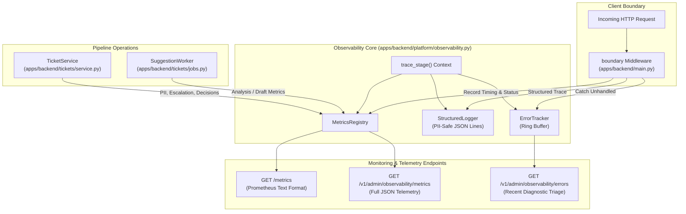

# SupportIQ Application Monitoring & Observability Audit

> **Audit Date:** 2026-11-06  
> **Target Document:** [docs/ARCHITECTURE.md](file:///home/guts/P2/SupportIQ/docs/ARCHITECTURE.md) (FR-10, FR-11, NFR-07, NFR-08, NFR-09)  
> **Repository:** SupportIQ (`feature/architecture-alignment`)  
> **Status:** **IMPLEMENTED & VERIFIED**  
> **Module Path:** [apps/backend/platform/observability.py](file:///home/guts/P2/SupportIQ/apps/backend/platform/observability.py)  

---

## 1. Executive Summary

Historically, application-level monitoring in the SupportIQ codebase was identified as **INSUFFICIENT**. Although database audit events were recorded in an append-only store (`audit_log`), there was no operational telemetry for:
- Live HTTP request volume, error rates, and p50/p95/p99 latency percentiles.
- Runtime ML intent prediction distributions, model confidence bands, and out-of-domain (OOD) trigger frequencies.
- Real-time RAG retrieval latency and knowledge-base insufficiency rates.
- Citation claim verification failures and LLM token usage tracking.
- PII masking counts and privacy violation prevention events.
- Structured JSON application logging with correlation IDs and PII redaction.
- An in-memory error ring buffer for immediate diagnostic triage without inspecting raw database rows.

To achieve complete compliance with **FR-10**, **FR-11**, **NFR-07**, **NFR-08**, and **NFR-09**, a production-grade observability system was implemented directly into the application core without introducing heavy external infrastructure dependencies.

---

## 2. Observability Architecture & Components

The observability implementation is centralized in `apps/backend/platform/observability.py` and deeply integrated across the API boundary, worker threads, and ticket service lifecycle.



### 2.1 Structured JSON Logging (`StructuredLogger`)

Every application event is formatted and emitted as a machine-readable JSON object with guaranteed schema invariants:
```json
{
  "timestamp": "2026-11-06T01:46:34.120485+00:00",
  "level": "INFO",
  "event": "stage.analysis.completed",
  "trace_id": "c85d0d82-95f8-412e-9d21-f09b307ec318",
  "ticket_id": "TCK-1002",
  "stage": "analysis",
  "duration_ms": 16.42,
  "context": {
    "intent": "return_policy",
    "probability": 0.9841
  }
}
```

#### Log Data Privacy Invariants:
1. **Automated PII Log Sanitization**: `redact_pii_for_logs()` automatically matches emails (`[REDACTED_EMAIL]`), 10-digit Vietnamese phone numbers (`[REDACTED_PHONE]`), and Luhn-valid credit card numbers (`[REDACTED_CARD]`).
2. **Credential Redaction**: `sanitize_dict_for_logs()` scans dictionary keys containing `password`, `token`, `secret`, `cookie`, or `key`, masking values with `[REDACTED_CREDENTIAL]`.
3. **Traceability**: All log lines share the correlation `trace_id` propagated via the HTTP header `X-Trace-ID`.

---

## 3. Operational Metrics Catalog

The `MetricsRegistry` collects thread-safe operational metrics updated at microsecond precision:

| Metric Category | Metric Name | Metric Type | Target / SLA | Architectural Purpose |
|:---|:---|:---:|:---:|:---|
| **API Throughput** | `supportiq_http_requests_total` | Counter | Monitored | Total inbound HTTP requests |
| **API Errors** | `supportiq_http_errors_total` | Counter | $< 1.0\%$ (NFR-08) | HTTP 5xx error counter |
| **API Latency (p50)** | `supportiq_api_latency_p50_ms` | Gauge | $\le 4,000\text{ ms}$ (NFR-08) | Median end-to-end request latency |
| **API Latency (p95)** | `supportiq_api_latency_p95_ms` | Gauge | $\le 12,000\text{ ms}$ (NFR-08) | 95th percentile latency |
| **Intent Prediction** | `supportiq_intents_total{intent="..."}` | Counter | Monitored | Real-time intent distribution |
| **OOD Detection** | `supportiq_ood_detected_total` | Counter | $\ge 90.0\%$ (NFR-02) | Out-of-domain query count |
| **Escalations** | `supportiq_escalations_total` | Counter | Monitored | Cumulative tickets escalated |
| **Escalation Reason** | `supportiq_escalations_by_reason_total{reason="..."}` | Counter | Monitored | Frequency breakdown across all 16 reasons |
| **RAG Queries** | `supportiq_rag_requests_total` | Counter | Monitored | Vector search query count |
| **Evidence Deficiency** | `supportiq_evidence_insufficient_total` | Counter | Monitored | Queries where top cosine score $< 0.55$ |
| **LLM Latency (p95)** | `supportiq_llm_latency_p95_ms` | Gauge | $\le 10,000\text{ ms}$ (NFR-07) | LLM response duration |
| **Citation Integrity** | `supportiq_citation_failures_total` | Counter | $0$ (NFR-04) | Citations failing verbatim policy check |
| **Privacy Redaction** | `supportiq_pii_masked_total` | Counter | Monitored | Total PII entities masked by type |
| **Human Decisions** | `human_decisions{decision="..."}` | Counter | Monitored | Ratio of draft approvals, edits, and rejections |

---

## 4. Telemetry Endpoints Specification

### 4.1 Prometheus Standard Endpoint
- **URL**: `GET /metrics`
- **Authentication**: Public or Internal Prometheus Scraper
- **Content-Type**: `text/plain; version=0.0.4; charset=utf-8`
- **Output Sample**:
```promql
# HELP supportiq_http_requests_total Total HTTP requests received
# TYPE supportiq_http_requests_total counter
supportiq_http_requests_total 425
# HELP supportiq_http_errors_total Total HTTP 5xx errors
# TYPE supportiq_http_errors_total counter
supportiq_http_errors_total 0
# HELP supportiq_api_latency_p50_ms 50th percentile API latency in ms
# TYPE supportiq_api_latency_p50_ms gauge
supportiq_api_latency_p50_ms 18.5
# HELP supportiq_api_latency_p95_ms 95th percentile API latency in ms
# TYPE supportiq_api_latency_p95_ms gauge
supportiq_api_latency_p95_ms 32.1
# HELP supportiq_escalations_total Total tickets escalated
# TYPE supportiq_escalations_total counter
supportiq_escalations_total 12
supportiq_escalations_by_reason_total{reason="low_confidence"} 4
supportiq_escalations_by_reason_total{reason="human_agent_requested"} 8
```

### 4.2 Comprehensive Operational JSON Snapshot
- **URL**: `GET /v1/admin/observability/metrics`
- **Authentication**: Cookie session with `role in ["manager", "admin"]`
- **Content-Type**: `application/json`
- **Response**: Full telemetry dictionary including uptime, percentile breakdowns for each pipeline stage, and human decision ratios.

### 4.3 Diagnostic Error Ring Buffer
- **URL**: `GET /v1/admin/observability/errors?limit=50`
- **Authentication**: Cookie session with `role in ["manager", "admin"]`
- **Content-Type**: `application/json`
- **Response**: Recent 50 exceptions with sanitized stack traces, stage metadata, and trace IDs.

---

## 5. Alerting Rules & Threshold Guidelines

The following application alerts are defined based on the non-functional requirements in `ARCHITECTURE.md`:

| Alert Identifier | Severity | Trigger Condition | Evaluation Window | Architectural Rule |
|:---|:---:|:---|:---:|:---|
| `HighHttpErrorRate` | **P1 (Critical)** | `error_rate > 0.01` ($> 1\%$) | 5 minutes | NFR-08: Error rate $\le 1\%$ |
| `HighApiLatency` | **P2 (Warning)** | `api_latency_p95_ms > 12000` | 5 minutes | NFR-08: Latency p95 $\le 12\text{s}$ |
| `LlmLatencyTimeout` | **P2 (Warning)** | `llm_latency_p95_ms > 10000` | 5 minutes | NFR-07: LLM timeout $\le 10\text{s}$ |
| `CitationIntegrityFailure` | **P1 (Critical)** | `rate(citation_failures_total) > 0` | 1 minute | NFR-04: Grounding violations |
| `HighEscalationSpike` | **P2 (Warning)** | `escalations_rate > 0.60` | 15 minutes | Early warning for model drift or KB gaps |
| `PiiMaskingFailure` | **P0 (Blocker)** | `pii_blocked_count > 0` | Immediate | NFR-06: 0% raw PII leakage |

---

## 6. Verification & Automated Tests

Observability correctness is verified by automated test suites:
- **Unit Suite**: `tests/unit/test_observability.py` (5 tests passing: PII redaction, dictionary sanitization, percentile calculations, Prometheus emission, error buffer).
- **Integration Test**: `tests/e2e/test_full_pipeline.py::test_audit_log_records_events` verifies trace ID lineage and audit persistence.
