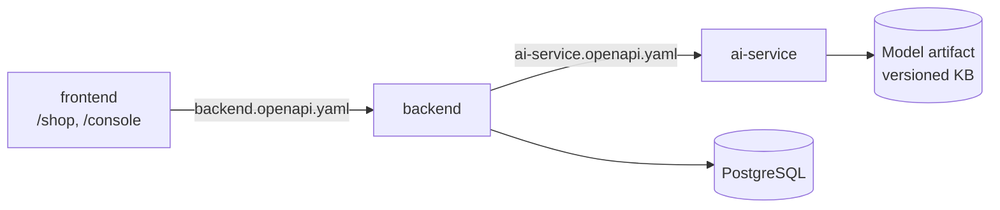

# ADR-0001: System architecture and component boundaries

- **Status:** Accepted
- **Date:** 2026-10-23
- **Deciders:** Team
- **Related:** [Requirements](../product/requirements.md), [ADR-0002](0002-shop-demo-scope.md), [ADR-0003](0003-tech-stack.md), [ADR-0004](0004-api-conventions.md), [architecture rules](../rules/architecture.md)

## Context

- The team has four members and wants to work in parallel without waiting on each other. It accepts a slower start in exchange for well-designed contracts.
- In this project, "scalable" means code that stays readable and easy to extend: new intents, a different LLM provider, more contributors. It does not mean high load or microservices.
- The requirements demand a self-trained ML model and an LLM, staff approval for every reply (FR-04), recorded provenance (FR-07), and role-based access with data protection (FR-08).
- The team wants a minimal shop demo next to the staff console ([ADR-0002](0002-shop-demo-scope.md)).

## Decision drivers

1. Safety: exactly one path can send a reply, and it sits behind a staff action and permission checks.
2. Traceability: every suggestion and decision is recorded in one place.
3. Four parallel work streams with minimal blocking.
4. Long-term readability and extensibility.
5. Delivery cost for a course prototype.

## Considered options

1. Modular monolith.
2. Two components: one application (UI and business logic) plus `ai-service`.
3. Three components (`frontend`, `backend`, `ai-service`) behind two contracts.

## Decision

We will build three components that communicate only through two versioned HTTP contracts.

### Responsibilities

| Component | Does | Never does |
|---|---|---|
| `frontend` | Shop demo for simulated customers; console where staff view, edit, approve, reject, and escalate | Business logic, AI logic, permission enforcement |
| `backend` | Ticket lifecycle; calls `ai-service` in parallel with timeouts and falls back to manual handling; business rules and permissions; the only path that sends replies; stores decisions and suggestion snapshots; owns simulated commerce data; records handling-time telemetry | Classify intents, choose documents, write drafts |
| `ai-service` | Classifies intent, retrieves and reranks documents, recommends routing (draft, abstain, escalate), drafts replies with citations. Stateless | Send anything to customers, perform transactions, read `backend` data |

### Who decides what

- `ai-service` **recommends**: a status and reason codes (low confidence, missing evidence, sensitive request, LLM failure).
- `backend` **enforces**: ticket state, permissions (for example, refund decisions need authorized staff, FR-06), and manual handling when `ai-service` fails or times out.
- Staff **decide**.

### Data ownership

| Data | Owner |
|---|---|
| Tickets and messages | `backend` |
| Simulated orders, shipments, and refunds | `backend`, behind the `CommerceGateway` port |
| Staff decisions, sent replies, suggestion snapshots | `backend`, the record of truth for FR-07 |
| KB, retrieval index, model artifacts | `ai-service` (artifacts produced by `ml/`) |
| AI operational telemetry (latency, tokens, errors) | `ai-service` |

The boundary rules are in [architecture rules](../rules/architecture.md#component-boundaries).

### Team allocation

| Role | Owns |
|---|---|
| ML engineer | `ai-service` classification; `ml/` (baseline, cross-validation, calibration) |
| RAG engineer | `ai-service` KB ingestion, retrieval, reranking, drafting, grounding check |
| Backend engineer | `backend` |
| Frontend engineer | `frontend` |

One member is the **contracts gatekeeper** and approves every change to `contracts/`.

## Consequences

### Positive

- Four streams work in parallel against mocks generated from the contracts.
- Clear boundaries keep each part readable and replaceable.
- LLM keys and the send path each live in exactly one component.

### Negative

- Slower start: contracts, mocks, and contract tests come before features.
- Two contracts to maintain.
- One extra network hop, negligible next to LLM latency.

### Follow-ups

- Contracts are the first deliverable.
- CI runs contract tests for both contracts.

## Pros and cons of the options

### Modular monolith

- Good, because it is the cheapest to build and run, with one deployment.
- Bad, because parallel work relies on discipline instead of enforced boundaries, and UI, workflow, and AI changes collide.

### Two components

- Good, because there is one contract fewer.
- Bad, because the frontend and backend engineers block each other unless they agree on an internal contract anyway, which is option 3 without its guarantees.

### Three components behind two contracts

- Good, because it matches the four roles and enforces boundaries through HTTP and contract tests.
- Bad, because of the costs listed under Negative.

Two variants of option 3 were rejected:

- `frontend` calling `ai-service` directly: exposes the AI boundary to the browser and lets decisions bypass the component that records them.
- A separate commerce service: a third contract without a current need. A module behind a port can be extracted later.

## Validation

- Each component runs and passes its tests against mocks of its neighbors.
- Revisit if most PRs need contract changes, which would mean the boundaries are in the wrong place.
