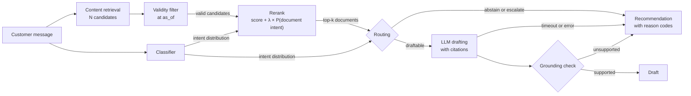
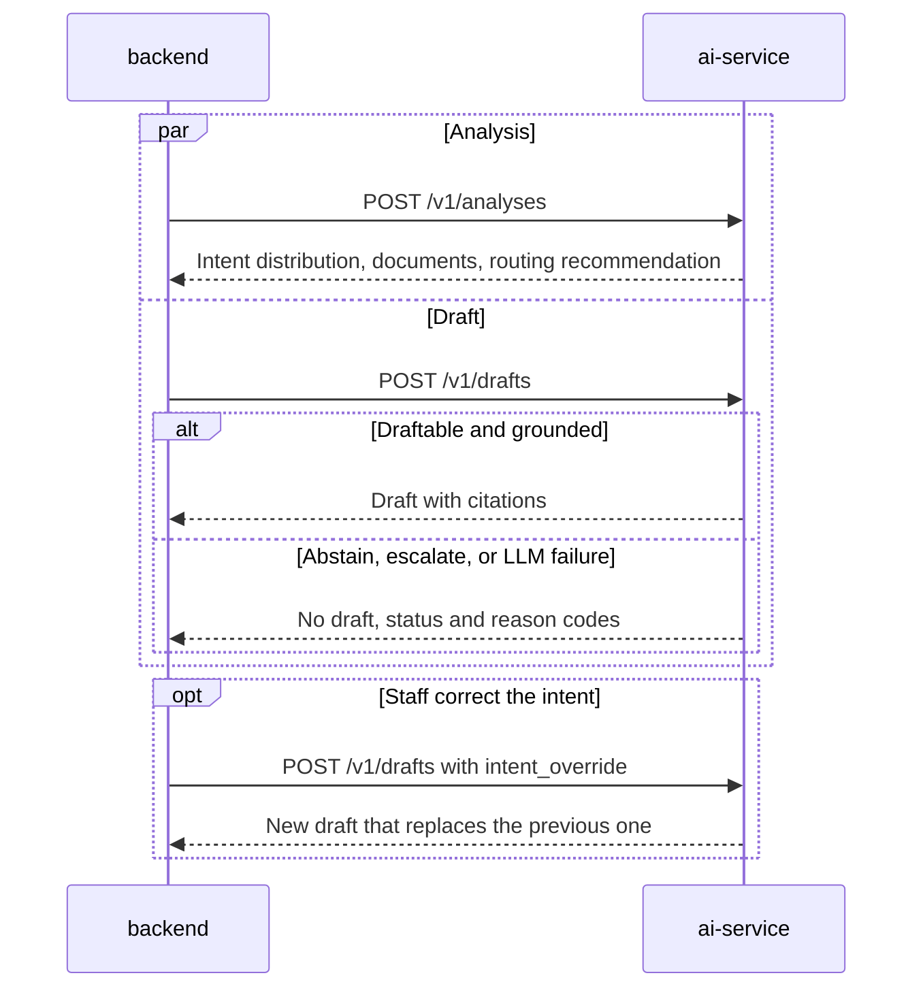

# ADR-0005: Intent-independent retrieval with intent-aware reranking

- **Status:** Accepted
- **Date:** 2026-10-23
- **Deciders:** Team
- **Related:** [Requirements](../product/requirements.md) (FR-01, FR-02, FR-05), [ADR-0004](0004-api-conventions.md), [ADR-0006](0006-staff-feedback-and-reason-codes.md), [data and ML rules](../rules/data-and-ml.md)

## Context

- If retrieval filters documents by the predicted intent, a wrong intent causes wrong retrieval, and every later step fails: a single point of failure. The team proposed separating the two.
- FR-02 requires retrieval "based on the intent and the request content".
- Several intents outside the 12 in-scope intents are close to in-scope ones, for example `track_order` and `track_delivery`, or `delivery_issue` and `damaged_delivery`. Wrong intents will happen.
- Staff must see the intent quickly and be able to correct it ([requirements §7](../product/requirements.md#7-risks-and-required-controls)).

## Decision drivers

1. Correctness: one wrong prediction must not break the whole pipeline.
2. Safety: sensitive and mandatory-escalation cases are not missed.
3. Measurability: retrieval and classification can be evaluated separately.
4. Staff control: fast intent display and cheap intent correction.
5. Latency within the p95 target.

## Considered options

1. Filter retrieval by the predicted intent.
2. Retrieve by content only and ignore the intent.
3. Retrieve by content, then rerank with the intent distribution.

## Decision

We adopt option 3.

1. **Retrieval uses message content only.** It does not depend on the predicted intent.
2. **Validity filtering comes before reranking.** Documents not in effect at `as_of` are removed or flagged before the top-k is chosen.
3. **Reranking uses the calibrated intent distribution, not the top-1 label.** Final score = retrieval score + λ × P(intent of the document). λ is tuned on validation data only.
4. **Disagreement is an uncertainty signal.** When the predicted intent and the top documents point to different topics, confidence is lowered and staff see a warning.
5. **Routing is conservative.** A sensitive intent (for example `request_refund`) with a significant probability in the top-k is handled as sensitive even when it is not first. Thresholds are tuned on validation data and stored in versioned configuration.
6. **The document-to-intent mapping is a separate versioned file.** The KB is not modified.
7. **Staff corrections are explicit.** An `intent_override` replaces the distribution with the intent staff chose, and its source is recorded as `staff`.

### Endpoints

- `/v1/analyses` runs the pipeline up to routing, without the LLM. It is fast and deterministic.
- `/v1/drafts` runs the whole pipeline and does not depend on a prior analysis call.
- `backend` calls both at the same time. Staff see the intent and documents first; the draft arrives later and is the authoritative record. After an intent override, the newest draft wins.

## Consequences

### Positive

- A wrong intent no longer breaks retrieval.
- Recall@3 can be measured for retrieval alone.
- If the LLM fails, `/v1/analyses` still gives staff the intent and documents for manual handling.
- Routing logic is separate from the LLM and can be tested deterministically.

### Negative

- Calibration becomes a functional requirement, not only a report item.
- More parameters to tune (λ and thresholds).
- Classification and retrieval run twice when both endpoints are called in parallel. This is cheap next to the LLM, and parallel calls save only the analysis time.

### Follow-ups

- Define the format of the document-to-intent mapping in the KB data contract.
- Write the `ai-service` pipeline design doc: step budgets, thresholds, and the grounding check.

## Pros and cons of the options

### Filter retrieval by intent

- Good, because it is simple and the candidate set is small.
- Bad, because a wrong intent means wrong documents: a single point of failure.

### Content only

- Good, because it is independent of the classifier.
- Bad, because it ignores a strong signal and does not meet FR-02's "based on the intent".

### Content retrieval with intent-aware reranking

- Good, because it uses both signals, is robust to wrong intents, and turns disagreement into a warning.
- Bad, because of the costs listed under Negative.

## Validation

- Ablation: Recall@3 for retrieval only versus retrieval with reranking, on regular questions and on hard slices (typos, ambiguous, out-of-scope).
- Classifier calibration is reported, because reranking and routing use probabilities.
- Routing accuracy (in-scope versus out-of-scope, mandatory escalation) is reported next to Macro-F1.
- Revisit if reranking does not improve Recall@3 over retrieval alone.
