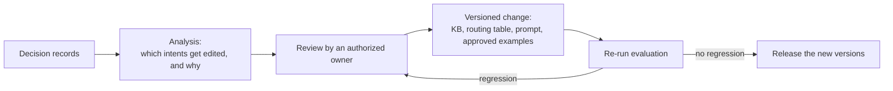

# ADR-0006: Staff feedback capture and reason codes

- **Status:** Accepted
- **Date:** 2026-10-23
- **Deciders:** Team
- **Related:** [Requirements](../product/requirements.md) (FR-07), [ADR-0001](0001-system-architecture.md), [data and ML rules](../rules/data-and-ml.md#feedback)

## Context

- FR-07 requires recording staff decisions, the versions of referenced sources, and feedback.
- The team wants to use the replies staff actually send to make the AI better.
- Feedback is not ground truth (Lecture 4). An approval does not prove a draft was correct. Feeding staff replies directly into the system creates a feedback loop and turns staff text into a second, unversioned policy source, the same trap as the Bitext `response` column.

## Decision drivers

1. Correctness: policy truth stays in the KB.
2. Traceability: every suggestion and decision can be reconstructed.
3. Actionable feedback: each problem reaches the person who can fix it.
4. Low friction for staff, because handling time is a product metric.

## Considered options

1. Record only the staff decision (approve, edit, reject, escalate).
2. Record full context and structured reasons; improve the AI only through reviewed, versioned changes.
3. Record full context and feed staff replies automatically into prompts or training data.

## Decision

We adopt option 2.

### What `backend` records for each ticket

- A snapshot of the suggestion exactly as staff saw it: intent distribution, documents, citations, `model_version`, `kb_version`, `prompt_version`, and trace ID.
- The reply staff actually sent.
- The staff decision, staff reason codes, final intent, and handling time.

### The decision type comes from data, not only from the button

`backend` compares the draft with the sent reply to classify the decision as approve or edit, and stores how much was changed. An "Approve" click after substantial changes counts as an edit.

### Staff reason codes

More than one code may apply to one decision.

| Code | Meaning | Owner of the fix |
|---|---|---|
| `wrong_intent` | The predicted intent was wrong | ML engineer |
| `wrong_source` | The KB has the right document, but retrieval missed it or chose the wrong one | RAG engineer |
| `unsupported_claim` | The draft states something its sources do not say | RAG engineer (prompt, grounding check) |
| `kb_gap` | The KB itself is missing, outdated, or wrong | Policy owner |
| `missing_case_info` | Order or customer information was missing | Backend engineer |
| `tone_or_clarity` | The content was right, but the wording needed work | RAG engineer (prompt) |
| `case_exception` | Staff deliberately made an exception for this case | Nobody: not an AI error |
| `other` | Anything else, with a required note | Reviewed manually |

Staff select codes with quick-select chips. Codes are required for reject and escalate, and optional for edit.

### Improvement path

### Never

- Feed decision records directly into prompts, training data, or rules.
- Treat an approval as proof of correctness.
- Turn a `case_exception` into a rule.
- Mix feedback data with evaluation sets.

## Consequences

### Positive

- Each feedback item points to the part that needs fixing.
- Policies, prompts, and training data are never silently contaminated.
- Every improvement is traceable and re-measured.

### Negative

- Improvement is slower than automatic learning and needs reviewer time.
- Staff spend a few seconds selecting reasons.

### Follow-ups

- `backend` provides an export of decision records for the AI engineers.
- Staff reason codes are an enum in the backend contract. Adding a code is compatible; changing a meaning is breaking.

## Pros and cons of the options

### Decision only

- Good, because it needs minimal effort.
- Bad, because nobody can tell which part failed, so edit rates are not actionable.

### Full context with reviewed improvements

- Good, because feedback is actionable, traceable, and safe.
- Bad, because it is slower and needs reviewers.

### Automatic feedback loop

- Good, because the system adapts quickly.
- Bad, because it amplifies staff mistakes and one-off exceptions, and creates an unversioned policy source that cannot be verified.

## Validation

- Every decision record can reconstruct the suggestion that staff saw.
- Reports break down edits and rejections by reason code and intent.
- Revisit the code list when `other` becomes one of the most frequent codes.
