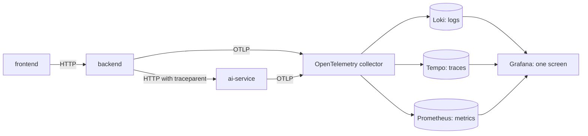

# ADR-0007: Observability stack

- **Status:** Accepted
- **Date:** 2026-10-24
- **Deciders:** Team
- **Related:** [Requirements §5](../product/requirements.md#5-quality-requirements), [ADR-0003](0003-tech-stack.md), [ADR-0004](0004-api-conventions.md), [logging and observability rules](../rules/logging-and-observability.md)

## Context

- The team wants logs that are easy to read, collected in one place, and viewed on one developer-friendly screen.
- The requirements ask for end-to-end p50 and p95 latency, error rate, and cost per request, and FR-07 asks for traceability.
- A request crosses up to three processes (`frontend`, `backend`, `ai-service`). Without correlation, debugging means searching several log streams by hand.
- The system runs locally with Docker Compose ([ADR-0003](0003-tech-stack.md)).
- Telemetry must never carry confidential data ([security rules](../rules/security-and-privacy.md#data-classification)).

## Decision drivers

1. Trace one ticket across all components from one screen.
2. Produce the required latency and cost metrics without custom tooling.
3. Vendor-neutral instrumentation, so the backend can change without touching code.
4. Low setup cost for a four-person team.
5. Privacy: telemetry stays local and free of confidential data.

## Considered options

1. JSON logs on stdout only, read with `docker compose logs`.
2. JSON logs plus a container log viewer (for example Dozzle).
3. OpenTelemetry instrumentation exporting logs, traces, and metrics over OTLP to a Grafana stack (Loki, Tempo, Prometheus), run locally as the all-in-one `grafana/otel-lgtm` image.
4. A hosted observability service.

## Decision

We adopt option 3.

1. `backend` and `ai-service` use the OpenTelemetry SDK: automatic instrumentation for FastAPI, httpx, and SQLAlchemy, plus manual spans for each pipeline step.
2. Logs are written to stdout as JSON lines and exported over OTLP. Every log record carries the trace and span IDs.
3. `frontend` is not instrumented in v1. Traces start at the `backend` HTTP entry point.
4. Locally, one `grafana/otel-lgtm` container in Docker Compose provides the collector and the stores. Grafana is the single screen for logs, traces, and metrics.
5. Dashboards are provisioned from files in the repository.
6. Moving to another backend changes only the collector configuration.

## Consequences

### Positive

- One place and one screen for all telemetry, linked by trace ID.
- The required latency and cost metrics come from standard instruments.
- Instrumentation is vendor-neutral.
- Telemetry stays on the developer's machine.

### Negative

- One more container, with its memory use.
- OpenTelemetry setup in each Python component.
- The team learns Grafana and its query languages.

### Follow-ups

- Implement the logging setup module, redaction, and event catalog per the [logging and observability rules](../rules/logging-and-observability.md).
- Commit the required dashboards.

## Pros and cons of the options

### Stdout only

- Good, because there is nothing to install.
- Bad, because there is no correlation, no metrics, and no single view.

### Log viewer

- Good, because it gives one screen for logs with minimal setup.
- Bad, because it shows logs only: no traces, no metrics, no latency percentiles.

### OpenTelemetry with a local Grafana stack

- Good, because it covers all three signals on one screen with standard, vendor-neutral tools.
- Bad, because of the costs listed under Negative.

### Hosted service

- Good, because there is no infrastructure to run.
- Bad, because telemetry leaves the machine, and it needs accounts, possibly costs money, and depends on the network.

## Validation

- From Grafana, a developer finds every log line and the full trace of one ticket across `backend` and `ai-service` by ticket ID or trace ID.
- The system overview dashboard shows p50 and p95 against the 12 s target, the error rate, and the cost per request.
- Revisit if the stack cannot run on team laptops alongside the system.
