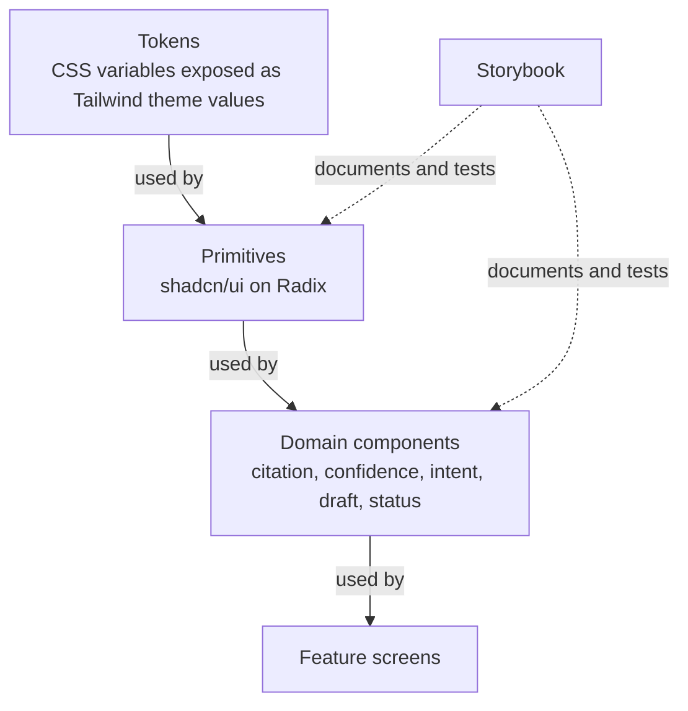

# ADR-0008: UI design system

- **Status:** Accepted
- **Date:** 2026-10-24
- **Deciders:** Team
- **Related:** [ADR-0002](0002-shop-demo-scope.md), [ADR-0003](0003-tech-stack.md), [UI rules](../rules/ui.md), [TypeScript rules](../rules/typescript.md)

## Context

- The team wants a strict design system, so the UI is consistent, friendly for staff, and friendly for developers.
- `/console` is the product; `/shop` is a minimal demo that shares the same look ([ADR-0002](0002-shop-demo-scope.md)).
- [ADR-0003](0003-tech-stack.md) chose React, Tailwind CSS, and shadcn/ui (components built on Radix primitives and copied into the repository).
- Without structure, utility classes spread through feature code, and screens drift apart in spacing, color, and behavior.

## Decision drivers

1. Consistency across screens and contributors, enforced by tools rather than memory.
2. Accessibility by default.
3. Speed of building screens.
4. Ownership: components can be changed without fighting a library.
5. Components can be reviewed in isolation, in every state.

## Considered options

1. A layered design system on shadcn/ui primitives, with a strict token layer and a Storybook catalog.
2. A complete component library used as-is (for example MUI or Mantine).
3. Tailwind utility classes directly in feature code, without a design-system layer.

## Decision

We adopt option 1.

1. Design tokens (color roles, typography, spacing, radius, elevation, motion) are CSS variables exposed through the Tailwind theme. Feature code uses only token-backed classes; lint rules forbid literals and arbitrary values.
2. Primitives come from shadcn/ui and live in `design-system/primitives/`. They are owned code.
3. Domain components (citation marker, confidence badge, intent picker, draft editor, staff note panel, status banner, reason code chips) live in `design-system/components/` and are the only building blocks of feature screens.
4. Storybook is the catalog and the developer screen for UI: every primitive and domain component has stories for every variant and state, with automated accessibility checks.
5. The visual and interaction rules are in the [UI rules](../rules/ui.md).

## Consequences

### Positive

- Consistency is enforced by structure and lint rules.
- Radix provides accessible behavior for complex widgets.
- Components are owned code that the team can adapt.
- Storybook gives developers and reviewers a living catalog of every state.

### Negative

- Upfront time to build tokens and domain components before screens.
- Storybook is one more tool to maintain.

### Follow-ups

- Define token values and the console layout in a design doc before building screens.
- Configure lint rules that forbid literals and arbitrary values.

## Pros and cons of the options

### Layered design system on shadcn/ui

- Good, because it combines owned code, accessible primitives, and enforced consistency.
- Bad, because of the upfront work listed under Negative.

### Complete component library

- Good, because many components are ready on day one.
- Bad, because customizing it means fighting its theme system, its look is generic, and it overlaps with the stack chosen in ADR-0003.

### Utility classes in feature code

- Good, because it is the fastest way to start.
- Bad, because consistency depends on memory, and screens drift apart as the team grows.

## Validation

- No feature file contains color literals, pixel values, or arbitrary Tailwind values (lint).
- Every design-system component has stories for all its states, and axe checks pass.
- Revisit if building domain components blocks feature work for more than one milestone.
