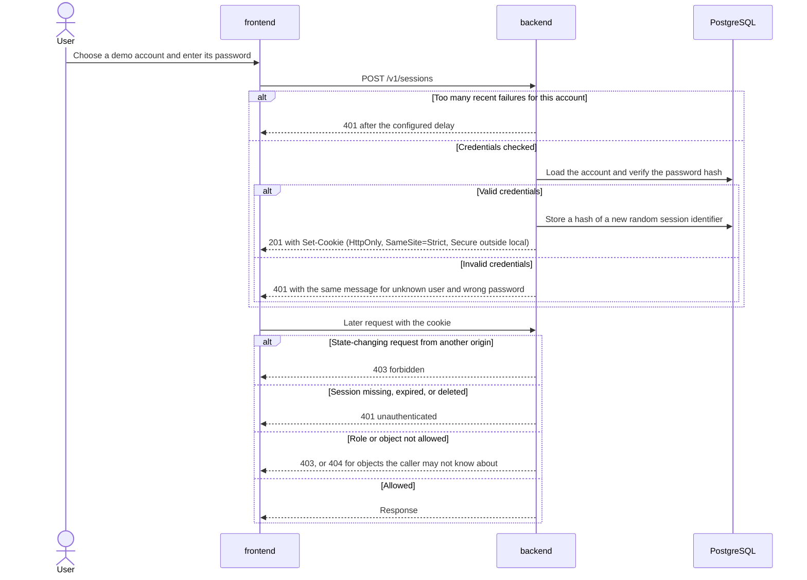

# ADR-0009: Demo accounts with server-side cookie sessions for v1

- **Status:** Accepted
- **Date:** 2026-10-24
- **Deciders:** Team
- **Related:** [Requirements](../product/requirements.md) (FR-06, FR-08), [ADR-0001](0001-system-architecture.md), [ADR-0002](0002-shop-demo-scope.md), [ADR-0003](0003-tech-stack.md), [ADR-0004](0004-api-conventions.md), [security rules](../rules/security-and-privacy.md#authentication-and-authorization), [Design: contracts v1](../design/contracts-v1.md)

## Context

- FR-08 requires suitable role-based access. FR-06 requires that refund decisions, transaction disputes, and policy exceptions are decided by authorized staff. The v1 roles are `customer`, `staff`, and `supervisor` ([SEC-15](../rules/security-and-privacy.md#authentication-and-authorization)).
- All users are simulated. The team accepts demo accounts for the first phase and plans production-grade authentication later.
- [ADR-0002](0002-shop-demo-scope.md) lets the demo user choose a simulated customer, with no real sign-up. [ADR-0003](0003-tech-stack.md) deferred the session mechanism to its own ADR.
- Session tokens are never stored in `localStorage` or `sessionStorage` (SEC-19). Secret data is never stored outside secret settings (SEC-01). `backend` is the only enforcement point (SEC-20). Secrets never enter the repository (SEC-09).
- `frontend` is a single-page application that calls only `backend` ([ADR-0001](0001-system-architecture.md)).
- The authentication choice must stay out of the contracts of other operations, so it can change later without touching them.

## Decision drivers

1. Safety: permissions are real, enforced by `backend`, and testable, so FR-06 and FR-08 can be demonstrated and proven.
2. Replaceability: a production identity provider later changes authentication only, not other operations or the domain.
3. Security hygiene, even with simulated users.
4. Low setup cost for v1.

## Considered options

1. Seeded demo accounts with passwords, and server-side sessions referenced by an `HttpOnly` cookie.
2. A role or persona picker without passwords.
3. Bearer tokens (for example JWT) stored by the browser.
4. An external OpenID Connect identity provider from the start.

## Decision

We adopt option 1 for v1.

1. The `backend` seed script creates the demo accounts: customer personas, staff, and supervisor. Their passwords come from settings, never from the repository; `.env.example` holds placeholders.
2. The shop's "choose a simulated customer" from [ADR-0002](0002-shop-demo-scope.md) is implemented as signing in to one of the seeded customer accounts. There is still no sign-up.
3. Passwords are stored only as Argon2id hashes.
4. A session identifier is a random value. `backend` stores only its SHA-256 hash, with the user, role, creation time, and expiry, in PostgreSQL. The raw identifier exists only in the cookie: `HttpOnly`, `SameSite=Strict`, `Path=/`, and `Secure` outside local development.
5. Data classes: passwords and raw session identifiers are Secret and are never stored or logged. Password hashes and session identifier hashes are Confidential, stored only in the `backend` database, and never exported.
6. Sessions expire after an idle timeout and after an absolute lifetime, both from settings. Signing out deletes the session.
7. Cross-site request forgery is prevented by `SameSite=Strict` plus verification of the `Origin` header on every state-changing request. A request from another origin is rejected with `403`.
8. Sign-in failures return the same `401` for an unknown user and a wrong password. Repeated failures for one account are slowed down, with limits from settings.
9. Authentication sits behind an `Authenticator` port in `backend`. Authorization (roles, object-level checks, the authority rule) is separate application logic that receives an authenticated principal: user ID and role.
10. The backend contract declares cookie authentication as a security scheme. Every operation except the health checks and `createSession` requires it.
11. `frontend` never reads or stores the session identifier. It learns the current user from `GET /v1/sessions/current`.

## Consequences

### Positive

- Permissions are real and testable for FR-06 and FR-08.
- No session token is readable by JavaScript, and a database copy does not reveal usable session identifiers.
- Authentication can be replaced through one adapter and the session operations.
- No external service is needed.

### Negative

- `backend` owns session storage and expiry handling.
- Demo passwords must be shared with team members outside the repository.
- No single sign-on, multi-factor authentication, or account recovery. This is not production-grade.

### Follow-ups

- Before any real user or real data, write an ADR that chooses production authentication, for example an OpenID Connect provider.
- Add the session settings (idle timeout, absolute lifetime, sign-in limits) and demo password placeholders to `.env.example` at scaffold.

## Pros and cons of the options

### Demo accounts with server-side cookie sessions

- Good, because permissions are real, the token is hidden from scripts, and setup is small.
- Bad, because `backend` handles sessions itself, and it is not production-grade.

### Role or persona picker without passwords

- Good, because it is the fastest to build.
- Bad, because anyone can act as any role, so permission tests prove little and FR-08 is only illustrated.

### Bearer tokens stored by the browser

- Good, because `backend` stays stateless.
- Bad, because tokens readable by JavaScript violate SEC-19, and revoking them is hard.

### External OpenID Connect provider now

- Good, because it is production-grade, with single sign-on and multi-factor authentication.
- Bad, because it adds a service and configuration that a prototype with simulated users does not need yet, and it slows the start.

## Validation

- Permission tests: every protected operation rejects unauthenticated requests; customers cannot reach other customers' orders or tickets; staff cannot send a reply on a ticket where authority is required ([TEST-26](../rules/testing.md#guardrail-tests)).
- A test confirms that the sessions table holds only hashes.
- An end-to-end test checks that the session identifier is not readable from frontend JavaScript.
- Revisit before any real user or real data, or when a production identity provider is required.
