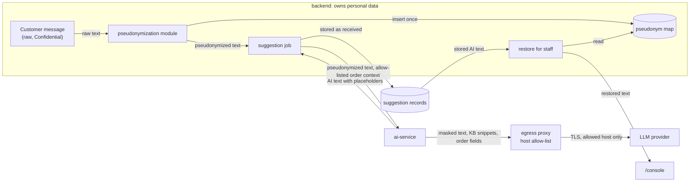
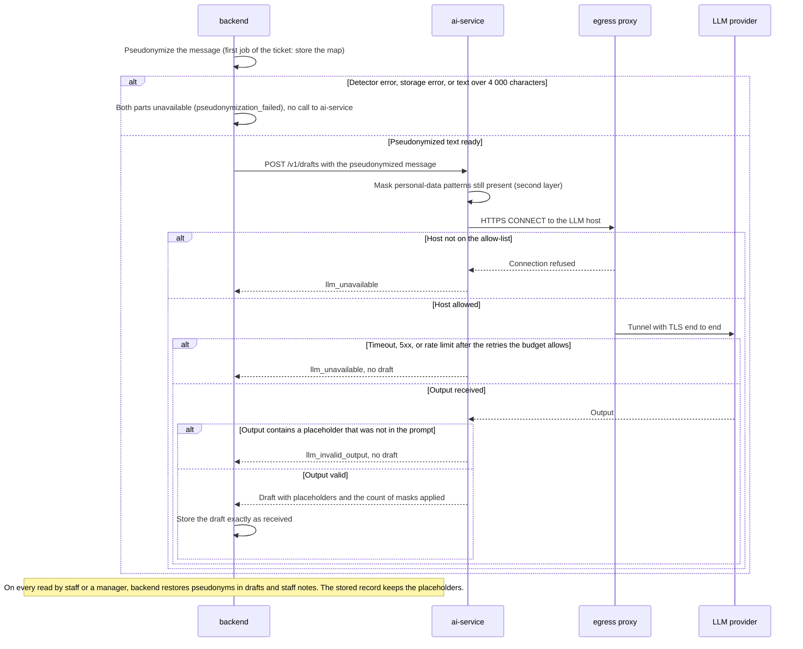

# ADR-0010: Pseudonymization of personal data and egress control

- **Status:** Proposed
- **Date:** 2026-10-28
- **Deciders:** Team
- **Related:** [Requirements](../product/requirements.md) (FR-09, NFR-06), [ADR-0001](0001-system-architecture.md), [ADR-0005](0005-intent-independent-retrieval.md), [ADR-0006](0006-staff-feedback-and-reason-codes.md), [ADR-0011](0011-deployment-and-runtime-topology.md), [security rules](../rules/security-and-privacy.md#pseudonymization), [Design: contracts v1](../design/contracts-v1.md)

## Context

- FR-09 (Must) requires that personal data (name, address, phone number, email, order ID) is detected and replaced before any text is sent to the LLM or another external service, and before it is logged. API keys are managed centrally, and outbound calls go only through an egress allow-list.
- NFR-06 requires that no payload sent to the external LLM contains raw personal data, and that leakage of secrets or personal data is 0%.
- Before this decision, `backend` sent the raw customer message to `ai-service`. `ai-service` replaced personal-data patterns with one-way placeholders such as `[EMAIL]` before each LLM call (SEC-06). This approach has two weaknesses:
  - One-way placeholders cannot be restored, so a draft cannot repeat an order ID or a name that the customer wrote.
  - `ai-service` holds raw personal data in memory, where a logging mistake can leak it.
- The team's specification places a scanner at the entry of the pipeline, a vault that only a resolver can read, and an egress proxy in front of the LLM provider (sections 5.2 and 5.3 of the specification).
- `backend` owns customer and order data ([ADR-0001](0001-system-architecture.md)), so it knows the exact values to look for. `ai-service` never reads `backend` data ([ARCH-04](../rules/architecture.md#component-boundaries)) and keeps no per-ticket state ([ARCH-09](../rules/architecture.md#component-boundaries)).
- Intent classification, retrieval, and drafting all run on the text that `ai-service` receives ([ADR-0005](0005-intent-independent-retrieval.md)).
- All data is simulated but handled as if it were real ([SEC-02](../rules/security-and-privacy.md#data-classification)).

## Decision drivers

1. **Safety:** no raw personal data leaves `backend`, and a failure blocks the AI call instead of letting raw data through.
2. **Useful drafts:** a draft can repeat a reference that the customer wrote, such as an order ID or a name, and staff see the real value.
3. **Traceability:** what was sent to `ai-service` is recorded and can be reproduced.
4. **Low complexity:** no new service for a four-person team.

## Considered options

1. Keep one-way masking in `ai-service` (the former SEC-06).
2. Reversible pseudonymization inside `ai-service`.
3. Reversible pseudonymization in `backend` before it calls `ai-service`, with masking in `ai-service` kept as a second layer.
4. A separate pseudonymization service with its own vault.

## Decision

We adopt option 3. The statements below are normative. MUST, MUST NOT, and SHOULD follow [RFC 2119](https://www.rfc-editor.org/rfc/rfc2119), as in the [engineering rules](../rules/README.md#how-to-read-the-rules).

### Overview





### Placeholder syntax

A **placeholder** is text that stands in for a personal-data value. There are two kinds:

| Kind | Form | Produced by | Restorable |
|---|---|---|---|
| Pseudonym | `[TYPE_N]`, for example `[ORDER_ID_1]` | `backend`, before the text leaves it | Yes, by `backend` only |
| Mask | `[TYPE]`, for example `[EMAIL]` | `ai-service`, as the second layer | No |

1. `TYPE` MUST be one of:

   | Type | Covers |
   |---|---|
   | `NAME` | A person's name |
   | `EMAIL` | An email address |
   | `PHONE` | A phone number |
   | `CARD` | A payment card number |
   | `ADDRESS` | A postal address |
   | `ORDER_ID` | An order identifier of the simulated commerce data |
   | `TRACKING_ID` | A shipment tracking code of the simulated commerce data |
   | `TRANSACTION_ID` | A payment transaction ID of the simulated commerce data |
   | `LITERAL` | Text in the customer's message that already looks like a placeholder (pseudonyms only) |

2. Every placeholder matches this regular expression, and nothing else may match it:

   ```text
   \[(NAME|EMAIL|PHONE|CARD|ADDRESS|ORDER_ID|TRACKING_ID|TRANSACTION_ID|LITERAL)(_[1-9][0-9]{0,2})?\]
   ```

3. `N` MUST count from 1 per type within one ticket, in order of first appearance in the message, up to 999.
4. Each distinct original value MUST get exactly one pseudonym within a ticket, and the same value MUST always get the same pseudonym. Values are compared after normalization: lowercase without diacritics for `NAME` and `ADDRESS`; lowercase for `EMAIL`; digits only for `PHONE` and `CARD`; exact for `ORDER_ID`, `TRACKING_ID`, `TRANSACTION_ID`, and `LITERAL`.
5. Pseudonymization MUST be deterministic: the same message, the same known values, and the same detector version always produce the same text and the same map.

### Detection

`backend` detects values in this order. A character that is already part of a detected value is never detected again.

1. **Literal placeholders.** Any text that matches the placeholder expression in the raw message becomes a `LITERAL` pseudonym. This keeps customer-written text from colliding with real pseudonyms and blocks attempts to inject placeholders. A restored `LITERAL` is the customer's own text and still matches the expression, so it can never be sent as written ([Restoring and sending](#restoring-and-sending)).
2. **Known values of the ticket.** Whole-word matches of the values `backend` holds for the ticket, ignoring case and diacritics, so "Bui Thi An" matches "Bùi Thị An":
   - `NAME`: the customer's display name, and each space-separated part of it that has at least 3 characters;
   - `EMAIL`, `PHONE`: the customer's email and phone number;
   - `ORDER_ID`: the ID of the ticket's order;
   - `TRACKING_ID`, `TRANSACTION_ID`: the tracking code and the transaction ID of the ticket's order;
   - `ADDRESS`: the shipping address of the ticket's order.
3. **Patterns.** Values that `backend` does not know:
   - `EMAIL`: a local part, `@`, and a domain with at least one dot;
   - `PHONE`: 9 to 15 digits, optionally with a leading `+` and with spaces, dots, or hyphens between digit groups;
   - `CARD`: 13 to 19 digits, optionally grouped by spaces or hyphens, that pass the Luhn check;
   - `ORDER_ID`, `TRACKING_ID`, `TRANSACTION_ID`: the formats of the simulated commerce data.
4. **Unknown names and addresses.** A named-entity detector in the `pseudonymization` module finds person names and postal addresses that the earlier steps did not find, such as a third person in "ship to my sister Jane at 12 Main St". Product names from the catalog are excluded, so "Apple Watch" stays as written. The detector version is pinned.
5. **Overlaps.** When two detections overlap, the longer span wins. For spans of equal length, a known value wins over a pattern, and a pattern wins over the named-entity detector.

- `ADDRESS` has no regular-expression pattern, because address patterns produce too many false positives and false negatives. Unknown addresses are left to the named-entity detector.
- No detector is complete. A value that every detector misses is not a failure, so it does not fail closed, and it reaches `ai-service`. The second layer catches only patterns.
- The NFR-06 target stays as written. Its suite includes messages that name third persons and unknown addresses, and every miss counts against the target and is reported. Over-detection is reported next to it, because a wrongly replaced term can weaken retrieval and classification.
- The `backend` ticket workflow design chooses the detector library after a trial on English messages with Vietnamese and English names, within the memory budget (NFR-08) and the dependency rules ([WF-27](../rules/workflow.md#dependencies)).
- Each detector MUST have unit tests with at least five positive and five negative examples, including the boundary formats listed above.

### Storage and lifecycle

1. Pseudonymization runs as the first step of every suggestion job, so only `assisted` tickets are pseudonymized. Ticket creation never waits for it.
2. The first successful run for a ticket creates its pseudonym map. Later runs for the same ticket (intent override, KB version change) MUST reuse the stored map and produce the same pseudonymized text.
3. The map is stored in the `backend` table `pseudonym_map_entries` with the columns `ticket_id`, `pseudonym`, `pseudonym_type`, `original_value`, and `created_at`, and a unique constraint on (`ticket_id`, `pseudonym`). Rows MUST be inserted in the same transaction and MUST NOT be updated afterwards. They are deleted only together with their ticket, by the reset script ([SEC-32](../rules/security-and-privacy.md#retention-and-exports)).
4. `original_value` is Confidential. Pseudonymized text is also Confidential, because it still contains the customer's own words: pseudonymization is not anonymization.
5. Each run records the outcome and the number of pseudonyms by type, never the values, in the audit log (event `message.pseudonymized`). This is the evidence for NFR-06 that the specification asks for (section 5.3).
6. Only the `pseudonymization` feature module in `backend` reads or writes the table. Its public API has exactly two functions: one that returns the pseudonymized text of a ticket's message, and one that restores the pseudonyms of a ticket in a given text. An import-linter contract enforces that no other module imports its internals or queries the table.

### What crosses each boundary

| From → to | Allowed content |
|---|---|
| `backend` → `ai-service` | The pseudonymized message (at most 4 000 characters), allow-listed order context fields without identifiers, `as_of`, `kb_version`, `intent_override` |
| `ai-service` → LLM provider | The pseudonymized message after masking, KB snippets, the order context fields the prompt needs ([SEC-04](../rules/security-and-privacy.md#data-sent-to-llm-providers)) |
| `ai-service` → `backend` | AI text that may contain placeholders |
| `backend` → `/console` | AI text with pseudonyms restored, for `staff` and `manager` only |
| `backend` → `/shop` | No AI output at all |

The limit of 4 000 characters is twice the `MessageText` limit. Only a message made almost entirely of short personal values can grow past it, and such a message fails closed.

### AI output

1. Prompts MUST instruct the LLM to copy placeholders exactly as they appear and never to create new ones.
2. `ai-service` MUST check every LLM output: each placeholder in the output MUST appear in the prompt that produced it. Otherwise the output is rejected with the outcome `llm_invalid_output`.
3. `ai-service` MUST NOT restore, guess, or rewrite placeholders.
4. Every draft outcome reports `masks_applied`: the number of masks that the second layer applied, by type. `backend` records it in the audit log, because a mask means that pseudonymization missed a value (NFR-06).

### Restoring and sending

1. `backend` stores AI output exactly as received, with placeholders, as the provenance record.
2. When `backend` builds the ticket workspace for `staff` or a `manager`, it MUST replace every pseudonym found in the ticket's map with its original value, in draft segments and staff notes. The stored record is never changed.
3. A mask, or a pseudonym that is missing from the map, MUST stay visible as written. The console highlights it ([UI-43](../rules/ui.md#console-interaction)). A restored `LITERAL` is shown as the customer wrote it, highlighted with its own label, and staff rephrase it before sending, because item 4 applies to it too.
4. `sendReply` and `createReplyProposal` MUST reject a body that contains any text matching the placeholder expression, with `422 invalid-request`. A placeholder can therefore never reach a customer.
5. The staff decision ([ADR-0006](0006-staff-feedback-and-reason-codes.md)) is derived by comparing the sent body with the draft after restoration.
6. Evaluation exports that contain message or draft text MUST use the pseudonymized form, never restored text, and MUST NOT contain the map ([SEC-33](../rules/security-and-privacy.md#retention-and-exports)). Tickets that have no pseudonym map (manual mode, or failed pseudonymization) are exported without message text.

### Failure handling

| Failure | Required behavior | Signal |
|---|---|---|
| A detector raises an error, or the map cannot be stored | No call to `ai-service`. Both suggestion parts are `unavailable` with `pseudonymization_failed`. The ticket is handled manually. This is a defect | Event `pseudonymization.failed` at `error` |
| The pseudonymized text is longer than 4 000 characters | Same behavior. This is handled input, not a defect | Event `pseudonymization.failed` at `warning` |
| `ai-service` finds a personal-data pattern outside any placeholder | The value is masked and the request continues | Event `personal_data.masked` at `warning`, with the type only |
| The LLM output contains a placeholder that was not in the prompt | No draft; outcome `llm_invalid_output` | Event `llm.call_failed` |
| The egress proxy refuses the connection | No draft; outcome `llm_unavailable`; the attempt counts toward the circuit breaker ([ERR-14](../rules/errors-and-reliability.md#retries)) | Event `llm.call_failed` |
| A pseudonym in stored AI text is missing from the map | The pseudonym stays visible and highlighted. This is a defect | Event `pseudonym.restore_failed` at `error` |
| A reply or proposal body contains a placeholder | `422 invalid-request` | Handler test |

### Egress control

1. When the full stack runs in Docker Compose, `ai-service` MUST be attached only to the `internal` and `llm-egress` networks, neither of which has an internet route ([ADR-0011](0011-deployment-and-runtime-topology.md#topology)). The `llm-egress` network has exactly two members: `ai-service` and `egress-proxy`.
2. The only route out is the egress proxy: a forward proxy for HTTPS `CONNECT` with a host allow-list. The proxy MUST refuse every host that is not on the list. It tunnels TLS end to end, so it never sees request bodies or API keys.
3. The allow-list is a versioned configuration file in the repository. It contains only the LLM provider host names. Changing it is a security change that needs two approvals ([SEC-35](../rules/security-and-privacy.md#security-review)).
4. `ai-service` uses the proxy only for LLM calls, through the setting `llm_proxy_url`. It makes no other outbound call.
5. `backend`, `backend-migrate`, PostgreSQL, and the observability stack MUST have no outbound internet access, directly or through the egress proxy: they share no network with it.

### Secrets

1. The LLM API key exists only in the secret settings of `ai-service` ([SEC-10](../rules/security-and-privacy.md#secrets)). It is injected at runtime, from `.env` locally and from the AWS secret store on the shared test host ([ADR-0011](0011-deployment-and-runtime-topology.md)).
2. The key is never given to the egress proxy. The specification's Figure 3 shows the proxy receiving the key; this decision keeps TLS end to end instead, so the proxy cannot read traffic.

## Consequences

### Positive

- `ai-service` and the LLM provider never receive the values that `backend` detects, so `ai-service` logs cannot leak them.
- Drafts can repeat the references that the customer wrote, by pseudonym, and staff see the real values. A draft cannot name an order or a customer that the message does not mention, because the order context holds no identifiers; staff add such a reference themselves.
- One component owns personal data and its map, consistent with ADR-0001.
- NFR-06 is measurable: seeded personal values are searched for in every request to `ai-service`, every LLM payload, and every log line.
- A prompt injection cannot reach an unknown host or read the API key through the proxy.

### Negative

- Detection stays incomplete: the named-entity detector can miss values, and it can replace terms that are not personal data. Both are measured.
- The named-entity detector adds a dependency and memory use in both `backend` replicas (NFR-08).
- The LLM can alter a placeholder. Such output is rejected, which can lower the share of tickets that get a draft.
- `backend` gains a feature module and a table. `ai-service` gains an output check and a proxy setting. Docker Compose gains a proxy container.
- The classifier receives placeholders that the training text may not contain.

### Follow-ups

- Contracts v1 design: the `PseudonymizedText` schema, the reason code `pseudonymization_failed`, the reply-body check, and the simulated `phone` and `shipping_address` fields that make known-value detection possible.
- `backend` ticket workflow design: the detector implementations, the named-entity library and its exclusion list, and the identifier formats of the shared commerce data.
- `ai-service` pipeline design: prompt instructions for placeholders and the output check.
- The DATA-11 loading report states whether Bitext instructions contain identifiers. The classifier's handling of placeholders follows [DATA-59](../rules/data-and-ml.md#models-and-artifacts).
- The egress proxy image and its configuration are added at scaffold, as part of [ADR-0011](0011-deployment-and-runtime-topology.md).

## Pros and cons of the options

### One-way masking in `ai-service`

- Good, because it already existed in the rules and needs no storage.
- Bad, because drafts cannot keep the references the customer wrote, and `ai-service` still handles raw personal data.

### Reversible pseudonymization inside `ai-service`

- Good, because drafts keep useful references.
- Bad, because `ai-service` must keep a map per ticket, which breaks its statelessness, and it still receives raw data.

### Reversible pseudonymization in `backend`, masking kept in `ai-service`

- Good, because raw values never leave the component that owns them, drafts stay useful, and two independent layers protect the LLM payload.
- Bad, because of the costs listed under Negative.

### Separate pseudonymization service

- Good, because the vault is isolated in its own process.
- Bad, because it adds a third contract, a deployment, and memory use, without a stronger guarantee than a restricted module in `backend`.

## Validation

- Guardrail tests ([TEST-26](../rules/testing.md#guardrail-tests)): seeded personal values of the ticket never appear in requests to `ai-service`, in LLM payloads captured by a fake LLM adapter, or in log output.
- Property-based tests: pseudonymization is deterministic, and restoring a pseudonymized text gives back the original message exactly.
- The NFR-06 suite includes messages that name third persons and unknown addresses, and it reports misses and over-detection separately.
- A reply body that contains a placeholder is rejected with `422`.
- A pseudonymizer that raises an error results in no call to `ai-service` and the reason `pseudonymization_failed`.
- From inside the `ai-service` container, a connection to a host that is not on the allow-list fails, and a direct connection without the proxy fails.
- From inside the `backend` container, no internet host is reachable, directly or through the egress proxy.
- Revisit if the NFR-06 suite finds personal data that the detectors miss, if over-detection lowers the NFR-01 or NFR-03 results, or if outputs rejected for altered placeholders noticeably lower the draft rate in evaluation.
