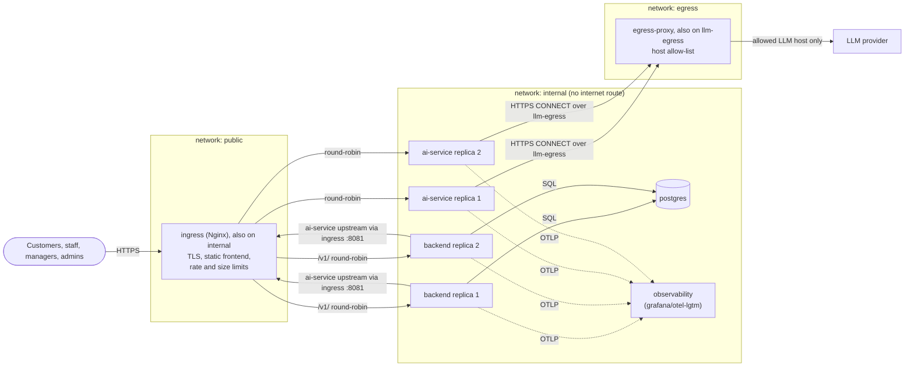
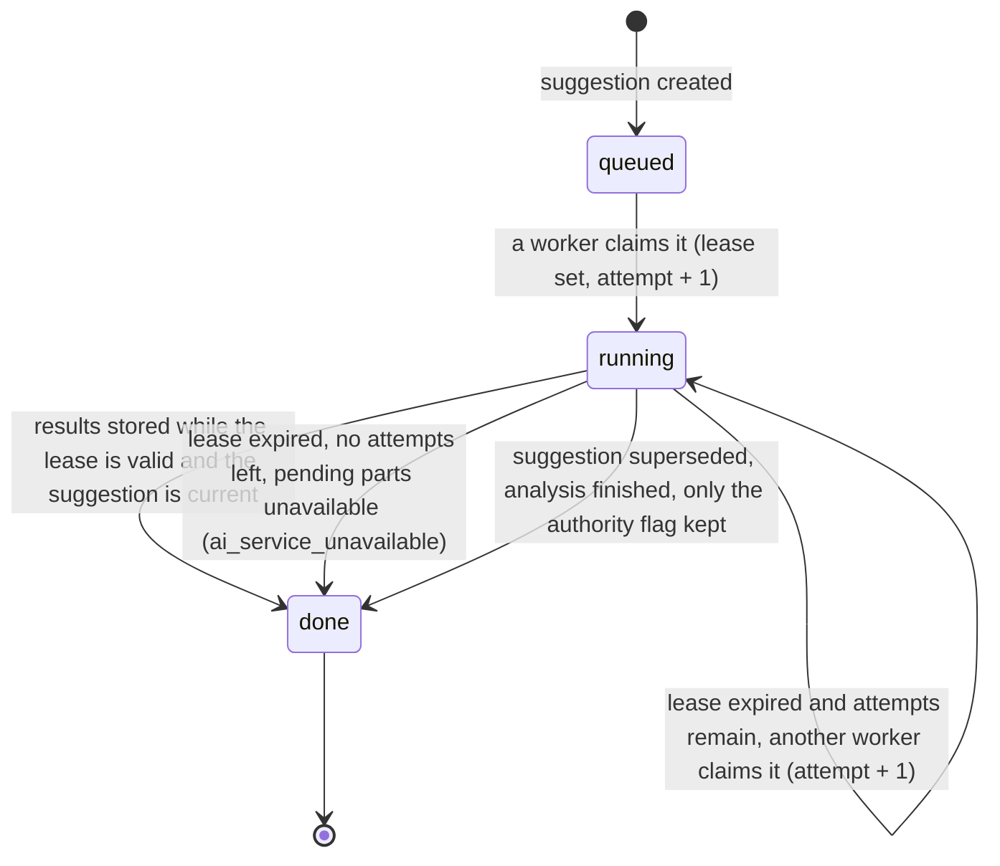

# ADR-0011: Deployment and runtime topology

- **Status:** Proposed
- **Date:** 2026-10-28
- **Deciders:** Team
- **Related:** [Requirements](../product/requirements.md) (NFR-07, NFR-08, NFR-10, ASM-06, CST-05, CST-07), [ADR-0001](0001-system-architecture.md), [ADR-0003](0003-tech-stack.md), [ADR-0007](0007-observability-stack.md), [ADR-0009](0009-demo-accounts-and-cookie-sessions.md), [ADR-0010](0010-pseudonymization-and-egress-control.md), [Design: contracts v1](../design/contracts-v1.md), [errors and reliability rules](../rules/errors-and-reliability.md)

## Context

- The team's specification (sections 5 and 6) describes a logical architecture of about twenty blocks:
  - an edge zone with an ingress, a load balancer, and an API gateway (JWT, rate limit, WAF);
  - a stateless core backend in two replicas;
  - intent inference in two replicas behind an internal load balancer;
  - separate retrieval, evidence validation, PII, and drafting services;
  - Redis for sessions, rate limits, and caches;
  - an append-only audit store, a model registry, a token vault, an egress proxy, and a secrets manager.
- In the specification, everything runs with Docker Compose on one 8 GB machine, and the shared EC2 instance runs only during tests and demos.
- The requirements this decision serves:
  - **NFR-07:** sign-in, ticket viewing, and manual replies keep working when AI parts fail.
  - **NFR-08:** at least 5 concurrent sessions with an error rate of at most 1%; p95 at that load at most twice the single-user p95; the whole stack within about 5 GB of RAM.
  - **NFR-10 and CST-05:** at most 200 USD of AWS credits.
  - **CST-07 and ASM-06:** one machine with 8 GB of RAM.
- Accepted decisions constrain the options:
  - [ADR-0001](0001-system-architecture.md): three components, with `backend` as the only record of truth.
  - [ADR-0003](0003-tech-stack.md): Docker Compose, PostgreSQL, and a stateless `ai-service`.
  - [ADR-0007](0007-observability-stack.md): the `grafana/otel-lgtm` container.
  - [ADR-0009](0009-demo-accounts-and-cookie-sessions.md): cookie sessions stored in PostgreSQL.
- [ADR-0001](0001-system-architecture.md) defines "scalable" as readable and extensible, not high load. The load target is five sessions.
- The contracts v1 design runs suggestion jobs in an in-process runner and re-queues pending suggestions at startup. With two `backend` replicas, that runner could process one job twice or lose one.

## Decision drivers

1. **Correctness and safety:** no suggestion is processed twice or lost, no reply is sent twice, and guardrails hold whichever replica answers.
2. **Traceability:** one record of truth that every replica shares.
3. **Reliability and latency:** NFR-07 and NFR-08.
4. **Cost and memory:** CST-05 and CST-07.
5. **Simplicity:** every added service must earn its place for a four-person team.

## Considered options

1. One container per component, without a load balancer.
2. One host with Docker Compose: Nginx as the ingress, two replicas of `backend` and of `ai-service`, PostgreSQL for all shared state, and no cache store in v1.
3. The full topology of the specification: an API gateway with JWT and WAF, Redis, separate services for intent, retrieval, validation, and drafting, a message broker, and WebSocket.
4. Managed AWS services: a container service, a managed database, and a managed cache.

## Decision

We adopt option 2. The statements below are normative.

### Topology

1. **One Compose project.** The system runs as one Docker Compose project, defined in `deploy/compose.yaml`. The same file runs locally and on the shared test host. Local runs MAY set the replica counts to 1.
2. **Services.** The project has exactly these services:

   | Service | Replicas | Role |
   |---|---|---|
   | `ingress` | 1 | Nginx: TLS, the built `frontend` files, the `/v1/` proxy to `backend`, the internal `ai-service` upstream, and the local Grafana port |
   | `backend` | 2 | The `backend` component |
   | `backend-migrate` | One-off | Runs database migrations, then exits |
   | `ai-service` | 2 | The `ai-service` component |
   | `postgres` | 1 | The `backend` database |
   | `egress-proxy` | 1 | The only route to the internet for `ai-service` ([ADR-0010](0010-pseudonymization-and-egress-control.md)) |
   | `observability` | 1 | The `grafana/otel-lgtm` container ([ADR-0007](0007-observability-stack.md)) |

3. **Configuration location.** Deployment configuration lives in `deploy/`: `compose.yaml`, `nginx/`, `egress-proxy/`, and `observability/`. Each component keeps its own Dockerfile ([ARCH-10](../rules/architecture.md#component-boundaries)). The `ingress` image is built from `deploy/nginx/` and includes the static files produced by the `frontend` build. The backend engineer owns `deploy/`.
4. **Networks.** The project has four networks:

   | Network | Members | Internet access |
   |---|---|---|
   | `public` | `ingress` | Inbound on the published ports only. `ingress` connects only to its upstreams |
   | `internal` | `ingress`, `backend`, `backend-migrate`, `ai-service`, `postgres`, `observability` | None: a Compose network with `internal: true` |
   | `llm-egress` | `ai-service`, `egress-proxy` | None: a Compose network with `internal: true` |
   | `egress` | `egress-proxy` | Outbound, restricted by the proxy's allow-list |

   `egress-proxy` shares a network only with `ai-service`, so no other container can reach the internet, directly or through the proxy ([ADR-0010](0010-pseudonymization-and-egress-control.md#egress-control)).

5. **Published ports.** Only `ingress` publishes ports:

   | Environment | Ports |
   |---|---|
   | Shared test host | `443`, plus `80`, which only redirects to `443` |
   | Local | `8080` for the system |
   | Both | Grafana on `127.0.0.1:3000`, the host loopback interface only. On the shared test host it is reached through an SSH tunnel |

### Ingress

1. `ingress` terminates TLS for every connection from outside the host. Traffic between containers stays on the host's internal Docker networks ([SEC-28](../rules/security-and-privacy.md#transport-and-runtime)).
2. `ingress` serves the built `frontend` files and proxies `/v1/` to the `backend` replicas, round-robin with passive failover. It retries the next replica only for idempotent methods. A write in flight on a failed replica fails with `502`, and the client retries it with the same `Idempotency-Key` ([ERR-15](../rules/errors-and-reliability.md#idempotency)).
3. `ingress` limits the request rate per client IP address, with a stricter limit on `POST /v1/sessions`. It limits request bodies to 64 KiB. One `ingress` instance means one set of rate-limit counters for all replicas. The initial limits are set in the deployment guide and tuned with the NFR-08 load test.
4. `ingress` also listens on port `8081`, on the internal network only, as the `ai-service` upstream: round-robin over the `ai-service` replicas with passive failover. The `backend` setting `ai_service_base_url` points to it. `POST /v1/analyses` and `POST /v1/drafts` have no side effects, so `ingress` retries them once on the other replica after a connection error or a `502` or `503` response ([ERR-12](../rules/errors-and-reliability.md#retries)). It never retries after a timeout, so a retry never extends the `backend` timeouts.
5. There is no API gateway, no JWT, and no WAF. Authentication stays as in [ADR-0009](0009-demo-accounts-and-cookie-sessions.md), and every input is validated against the contracts ([SEC-21](../rules/security-and-privacy.md#input-and-output-handling)).

### `backend` replicas

1. `backend` runs two replicas. A replica MUST keep no state between requests. Sessions, sign-in failure counters, idempotency records, suggestion jobs, the audit log, and the pseudonym map are all stored in PostgreSQL.
2. Replicas MUST NOT run migrations. `backend-migrate` runs them once, before the replicas start. Compose starts the replicas only after it exits successfully.
3. The seed script and the reset script ([SEC-32](../rules/security-and-privacy.md#retention-and-exports)) run as one-off commands, never at replica startup.

### Suggestion job queue

This replaces the in-process job runner and the restart re-queue of the contracts v1 design.

1. A PostgreSQL table holds one job per suggestion, with its state (`queued`, `running`, `done`), lease expiry, and attempt number.
2. Each `backend` replica runs a fixed number of workers. A worker claims one job in a single statement that selects the oldest claimable job with `FOR UPDATE SKIP LOCKED`. A job is claimable when it is `queued`, or `running` with an expired lease. Claiming sets the state to `running`, sets the lease expiry, and increments the attempt number. Two workers can never hold the same job. When the claimed job has an expired lease and no attempts left, the worker finalizes it as in item 6 instead of calling `ai-service`, so no separate scheduler is needed ([ARCH-41](../rules/architecture.md#state-time-and-side-effects)).
3. The lease MUST be longer than `ai_service_draft_timeout_ms`. `backend` checks this at startup ([ERR-17](../rules/errors-and-reliability.md#startup-and-health)).
4. A worker stores results only if its attempt number still matches the job and the suggestion is still current. Otherwise it discards them. A late or duplicate result can therefore never overwrite a newer one.
5. When a suggestion is superseded, the worker cancels its `POST /v1/drafts` call and the draft part becomes `cancelled`. Cancelling is best effort: a call that cannot be stopped finishes, and its result is discarded. The analysis call still completes, and a job that was still `queued` runs only that call. If the analysis carries `requires_authority`, the worker sets the ticket's authority flag even though the rest of the result is discarded. This is the only exception to item 4, and it is safe under any attempt because it can only set the flag to true.
6. When a job's lease expires and its attempts are used up, both suggestion parts that are still `pending` become `unavailable` with `ai_service_unavailable`, and the ticket is handled manually.
7. The settings `suggestion_workers_per_replica`, `suggestion_job_lease_ms`, `suggestion_job_max_attempts`, and `suggestion_queue_poll_ms` control the queue. Their initial values are set in the `backend` ticket workflow design doc.
8. End-to-end latency starts at ticket creation (NFR-08). The queue wait (at most `suggestion_queue_poll_ms` when a worker is free), claiming, pseudonymization, and `ai_service_draft_timeout_ms` together MUST fit within the 12 s p95 target ([ERR-10](../rules/errors-and-reliability.md#timeouts-and-latency-budget)). If they do not fit, the draft timeout is lowered.

### `ai-service` replicas

1. `ai-service` runs two replicas behind the internal upstream. Both MUST load the same release manifest ([DATA-56](../rules/data-and-ml.md#models-and-artifacts)). A replica that is not ready returns `503` and receives no traffic ([ERR-18](../rules/errors-and-reliability.md#startup-and-health)).
2. If the memory budget is exceeded, `ai-service` runs one replica first (ASM-06).

### Caching and updates

1. There is no cache store in v1: no Redis and no in-process cache of permissions, intents, or retrieval results. A cache is added only after a measurement shows that a target is missed, through a new ADR that chooses the store and its invalidation.
2. `frontend` polls, as in the contracts v1 design. WebSocket and server-sent events are not used, because they would need a shared publish-subscribe channel across `backend` replicas.

### Shared test host on AWS

1. The shared test environment is one Amazon EC2 instance with 8 GB of RAM. Its region, instance type, host name, and TLS certificate are chosen at setup and recorded in the deployment guide.
2. The instance runs only during shared tests and demos, and is stopped afterwards. The deployment guide has a start and stop checklist.
3. AWS Budgets alerts at 50% and 80% of the 200 USD budget (NFR-10).
4. Inbound traffic is limited to `443` and `80`. SSH (`22`) is allowed only from the team's addresses and only with key pairs.
5. Secrets come from a managed AWS secret store, either AWS Systems Manager Parameter Store or AWS Secrets Manager, chosen at setup. They are injected as environment variables when containers start. Locally, they come from `.env` ([SEC-10](../rules/security-and-privacy.md#secrets)). Images never contain secrets ([SEC-29](../rules/security-and-privacy.md#transport-and-runtime)).
6. PostgreSQL data lives on a named volume that survives instance stops. There are no backups: the seed and reset scripts can rebuild every simulated record. Records of evaluation runs are exported before the instance is terminated.

### Resource limits

1. Every service has a memory limit in `deploy/compose.yaml`, set from measurements. The sum of the limits MUST stay within 5 GB (NFR-08).
2. RAM is measured with `docker stats` during the NFR-08 load test, starting at scaffold. If the stack does not fit, first run one `ai-service` replica, then revisit the observability footprint ([ADR-0007](0007-observability-stack.md)).
3. Every service rotates its container logs (`json-file` driver with a maximum size and file count), so the disk never fills.

### Mapping from the specification

| Block in the specification | Where it lives |
|---|---|
| Storefront Web, Staff Web UI | `frontend` (`/shop`, `/console`), served by `ingress` |
| Ingress and load balancer | `ingress` |
| API gateway (JWT, rate limit, WAF) | `ingress` (rate and size limits) and `backend` (cookie sessions, contract validation) |
| Auth and RBAC, request handler, pipeline orchestrator, escalation and fallback, human review workflow, reports | `backend` feature modules |
| Intent inference, retrieval service, evidence validator, LLM draft service | `ai-service` feature modules ([ADR-0005](0005-intent-independent-retrieval.md)) |
| ML load balancer | The internal `ai-service` upstream of `ingress` |
| PII scanner, token vault, identifier resolver | The `backend` pseudonymization module and pseudonym map ([ADR-0010](0010-pseudonymization-and-egress-control.md)) |
| Egress proxy | `egress-proxy` |
| Secrets manager | The AWS secret store on the shared host; `.env` locally |
| App DB, audit store, business data, feedback store | PostgreSQL, owned by `backend` |
| Knowledge store, search index, model registry | Versioned KB files, index, and artifacts that `ai-service` loads through the release manifest |
| Curation gate and offline evaluation gate | [DATA-50](../rules/data-and-ml.md#feedback) and [DATA-57](../rules/data-and-ml.md#models-and-artifacts) |
| Redis cache | Not in v1 |
| Observability | `observability` ([ADR-0007](0007-observability-stack.md)) |

### Deviations from the specification

| Specification | This decision | Reason |
|---|---|---|
| API gateway with JWT and WAF | Nginx limits and cookie sessions checked by `backend` | Server-side sessions can be revoked at once and are invisible to JavaScript ([SEC-19](../rules/security-and-privacy.md#authentication-and-authorization)). Contract validation replaces a generic WAF |
| Redis for sessions, permissions, rate limits, and caches | PostgreSQL for state; rate limits in the single `ingress`; no cache in v1 | Fewer moving parts. No measurement yet shows that a cache is needed, and a permission cache would delay revocation |
| Intent inference in two replicas behind its own load balancer | Two `ai-service` replicas behind the internal upstream | `ai-service` is stateless, so replicating the whole component gives the same failover without three more contracts |
| Separate retrieval, evidence validation, and drafting services | Feature modules inside `ai-service` | The same language and lifecycle; module boundaries are enforced by import rules |
| Knowledge store inside the application database | Versioned KB files loaded by `ai-service` | KB versions stay immutable and reproducible ([DATA-08](../rules/data-and-ml.md#data-layout), [DATA-17](../rules/data-and-ml.md#knowledge-base)), and `ai-service` never reads `backend` data |
| Message queue in front of the LLM ("AI egress buffer") | The suggestion job queue in PostgreSQL | No broker to run; the lease gives at-least-once processing with discard of stale results |
| Staff Web UI with WebSocket | Polling | No shared publish-subscribe channel is needed across replicas |
| Secrets manager injects the API key into the egress proxy | The key stays in `ai-service`; the proxy only tunnels TLS | The proxy can never read traffic ([ADR-0010](0010-pseudonymization-and-egress-control.md)) |

## Consequences

### Positive

- NFR-07 and NFR-08 are addressed with two extra containers (`ingress`, `egress-proxy`) and one extra table.
- PostgreSQL is the single record of truth, so any replica can answer any request.
- There is no broker and no cache to operate, monitor, and keep consistent.
- The suggestion job queue survives replica crashes without duplicated or lost results.

### Negative

- `ingress` and `postgres` are single instances, so each is a single point of failure. This is accepted for a prototype.
- Workers poll the job table, which adds a small, constant database load.
- Two `ai-service` replicas double the memory used by models and indexes.
- The deviations from the specification must be explained in its next revision.

### Follow-ups

- Update the contracts v1 design: the job queue, the replicas, and the removal of the startup re-queue.
- `backend` ticket workflow design: the job table schema and the initial queue settings.
- A deployment guide in `docs/guides/` when the stack is first deployed: region, instance type, host name, TLS certificate, rate limits, start and stop checklist, and SSH access.
- The NFR-08 load-test script in `eval/`.
- Add `deploy/` to the repository layout in the root README.

## Pros and cons of the options

### One container per component

- Good, because it is the simplest to run and uses the least memory.
- Bad, because a crashed `backend` stops sign-in and manual replies (NFR-07), and nothing shows that five sessions fit one process.

### Compose with Nginx, two replicas, and PostgreSQL for shared state

- Good, because it meets NFR-07 and NFR-08 with few extra parts, and every shared state has one owner.
- Bad, because of the costs listed under Negative.

### Full topology of the specification

- Good, because it matches the submitted architecture block for block.
- Bad, because Redis, a broker, a gateway, and four AI services add memory, configuration, and failure modes that the 8 GB budget and four people cannot carry, without a measured need.

### Managed AWS services

- Good, because AWS operates the database, the cache, and scaling.
- Bad, because the always-on costs of a managed database and cache threaten the 200 USD budget, and the local and shared environments would differ.

## Validation

- The NFR-08 load test runs 5 concurrent sessions and checks an error rate of at most 1% and a p95 of at most twice the single-user p95.
- Fault tests during the load test:
  - stop one `backend` replica: only requests in flight on it fail, and their retries succeed;
  - stop one `ai-service` replica: suggestions still complete through the other replica;
  - stop both `ai-service` replicas: tickets move to manual handling;
  - kill a replica that holds a job: the job is claimed again after its lease expires, and its results are recorded once.
- `docker stats` stays within 5 GB under load.
- From the `backend` container, no internet host is reachable, directly or through the egress proxy. From the `ai-service` container, only allow-listed hosts are reachable, and only through the proxy.
- The AWS cost report at each milestone stays within the budget.
- Revisit if a load target is missed (a cache ADR), if memory exceeds the budget after reducing `ai-service` to one replica, or if contention on the job table appears in traces.
