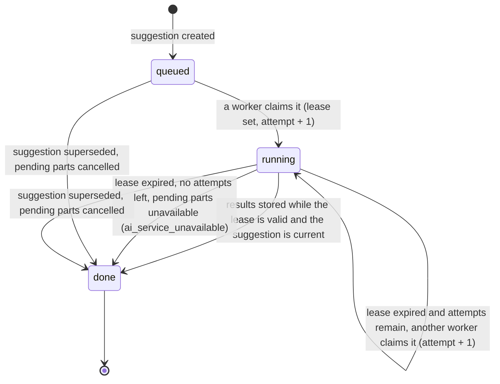

# ADR-0011: Runtime rules independent of the hosting platform

- **Status:** Accepted
- **Date:** 2026-11-12
- **Deciders:** Team
- **Related:** [Requirements](../product/requirements.md) (NFR-07, NFR-08), [ADR-0001](0001-system-architecture.md), [ADR-0003](0003-tech-stack.md), [ADR-0007](0007-observability-stack.md), [ADR-0009](0009-demo-accounts-and-cookie-sessions.md), [ADR-0010](0010-pseudonymization-and-egress-control.md), [ADR-0016](0016-hosting-on-free-tiers.md), [Design: contracts v1](../design/contracts-v1.md), [errors and reliability rules](../rules/errors-and-reliability.md)

## Context

- The team's specification (sections 5 and 6) describes a logical architecture of about twenty blocks:
  - an edge zone with an ingress, a load balancer, and an API gateway (JWT, rate limit, WAF);
  - a stateless core backend in two replicas;
  - intent inference in two replicas behind an internal load balancer;
  - separate retrieval, evidence validation, PII, and drafting services;
  - Redis for sessions, rate limits, and caches;
  - an append-only audit store, a model registry, a token vault, an egress proxy, and a secrets manager.
- The requirements this decision serves:
  - **NFR-07:** sign-in, ticket viewing, and manual replies keep working when AI parts fail.
  - **NFR-08:** at least 5 concurrent sessions with an error rate of at most 1%, and p95 at that load at most twice the single-user p95.
- Accepted decisions constrain the options:
  - [ADR-0001](0001-system-architecture.md): three components, with `backend` as the only record of truth.
  - [ADR-0003](0003-tech-stack.md): PostgreSQL and a stateless `ai-service`.
  - [ADR-0009](0009-demo-accounts-and-cookie-sessions.md): cookie sessions stored in PostgreSQL.
- [ADR-0001](0001-system-architecture.md) defines "scalable" as readable and extensible, not high load. The load target is five sessions.
- The contracts v1 design runs suggestion jobs in an in-process runner and re-queues pending suggestions at startup. With more than one `backend` replica, that runner could process one job twice or lose one.
- Revised on 2026-11-12, while Proposed: this decision keeps only the rules that hold on any hosting platform. The Compose topology, Nginx, the fixed replica counts, the shared test host on AWS, and the resource limits moved to [ADR-0016](0016-hosting-on-free-tiers.md), which decides where each part runs and how each rule below is enforced.

## Decision drivers

1. **Correctness and safety:** no suggestion is processed twice or lost, no reply is sent twice, and guardrails hold whichever replica answers.
2. **Traceability:** one record of truth that every replica shares.
3. **Reliability and latency:** NFR-07 and NFR-08.
4. **Portability:** the rules hold on any hosting platform, so a change of host changes only [ADR-0016](0016-hosting-on-free-tiers.md).
5. **Simplicity:** every added service must earn its place for a four-person team.

## Considered options

1. Stateful `backend` processes: an in-process job runner, and state kept in memory between requests.
2. Stateless replicas of `backend` with all shared state in PostgreSQL, a job queue in PostgreSQL, and no cache store in v1.
3. The full topology of the specification: an API gateway with JWT and WAF, Redis, separate services for intent, retrieval, validation, and drafting, a message broker, and WebSocket.

## Decision

We adopt option 2. The statements below are normative and hold on every hosting platform. A replica is one running instance of a component. [ADR-0016](0016-hosting-on-free-tiers.md) decides the platforms, the number of replicas, and where each limit is enforced.

### Ingress

The ingress is the first part of the system that receives requests for `/v1/` and `/health/` from outside. [ADR-0016](0016-hosting-on-free-tiers.md) names it.

1. Outside local development, every connection from outside the system uses TLS ([SEC-28](../rules/security-and-privacy.md#transport-and-runtime)).
2. The ingress limits request bodies to 64 KiB and answers a larger body with `413`. It limits the request rate per client, with a stricter limit on `POST /v1/sessions`, and answers a request over the limit with `429`. The initial limits are set in `deploy/README.md` ([ADR-0016](0016-hosting-on-free-tiers.md)) and tuned with the NFR-08 load test.
3. When more than one `backend` replica runs, the ingress retries another replica only for idempotent methods. A write in flight that fails returns `502`, or `504` when `backend` does not answer in time, and the client retries it with the same `Idempotency-Key` ([ERR-15](../rules/errors-and-reliability.md#idempotency)).
4. There is no API gateway, no JWT, and no WAF. Authentication stays as in [ADR-0009](0009-demo-accounts-and-cookie-sessions.md), and every input is validated against the contracts ([SEC-21](../rules/security-and-privacy.md#input-and-output-handling)).

### `backend` replicas

1. `backend` runs one or more replicas. A replica MUST keep no state between requests. Sessions, sign-in failure counters, idempotency records, suggestion jobs, the audit log, and the pseudonym map are all stored in PostgreSQL.
2. Replicas MUST NOT run migrations. Migrations run once, as a one-off command, before the replicas of a new release start.
3. The seed script and the reset script ([SEC-32](../rules/security-and-privacy.md#retention-and-exports)) run as one-off commands, never at replica startup.

### Suggestion job queue

This replaces the in-process job runner and the restart re-queue of the contracts v1 design.

1. A PostgreSQL table holds one job per suggestion, with its state (`queued`, `running`, `done`), lease expiry, and attempt number.
2. Each `backend` replica runs a fixed number of workers. A worker claims one job in a single statement that selects the oldest claimable job with `FOR UPDATE SKIP LOCKED`. A job is claimable when it is `queued`, or `running` with an expired lease. Claiming sets the state to `running`, sets the lease expiry, and increments the attempt number. Two workers can never hold the same job. When the claimed job has an expired lease and no attempts left, the worker finalizes it as in item 6 instead of calling `ai-service`, so no separate scheduler is needed ([ARCH-41](../rules/architecture.md#state-time-and-side-effects)).
3. The lease MUST be longer than `ai_service_draft_timeout_ms`. `backend` checks this at startup ([ERR-17](../rules/errors-and-reliability.md#startup-and-health)).
4. A worker stores results only if its attempt number still matches the job and the suggestion is still current. Otherwise it discards them. A late or duplicate result can therefore never overwrite a newer one.
5. When a suggestion is superseded, the worker cancels its calls to `ai-service`, and every part that is still `pending` becomes `cancelled`. A job that is still `queued` ends without calling `ai-service`. Cancelling is best effort: a call that cannot be stopped finishes, and item 4 discards its result. No authority flag is lost, because `backend` accepts an intent override only after an intent is known and sets the flag in the transaction that stores the analysis ([authority rule](../design/contracts-v1.md#authority-rule-fr-06)).
6. When a job's lease expires and its attempts are used up, both suggestion parts that are still `pending` become `unavailable` with `ai_service_unavailable`, and the ticket is handled manually.
7. The settings `suggestion_workers_per_replica`, `suggestion_job_lease_ms`, `suggestion_job_max_attempts`, and `suggestion_queue_poll_ms` control the queue. Their initial values are set in the `backend` ticket workflow design doc.
8. End-to-end latency starts at ticket creation (NFR-08). The queue wait (at most `suggestion_queue_poll_ms` when a worker is free), claiming, pseudonymization, and `ai_service_draft_timeout_ms` together MUST fit within the 12 s p95 target ([ERR-10](../rules/errors-and-reliability.md#timeouts-and-latency-budget)). If they do not fit, the draft timeout is lowered.

### `ai-service` replicas

1. Every `ai-service` replica MUST load the same release manifest ([DATA-56](../rules/data-and-ml.md#models-and-artifacts)). A replica that is not ready returns `503` and receives no traffic ([ERR-18](../rules/errors-and-reliability.md#startup-and-health)).
2. No ingress sits between `backend` and `ai-service`. `POST /v1/analyses` and `POST /v1/drafts` have no side effects, so `backend` itself retries each of them once after a connection error or a `502` or `503` response ([ERR-12](../rules/errors-and-reliability.md#retries)). It never retries after a timeout, so a retry never extends the `backend` timeouts.

### Caching and updates

1. There is no cache store in v1: no Redis and no in-process cache of permissions, intents, or retrieval results. A cache is added only after a measurement shows that a target is missed, through a new ADR that chooses the store and its invalidation.
2. `frontend` polls, as in the contracts v1 design. WebSocket and server-sent events are not used, because they would need a shared publish-subscribe channel across `backend` replicas.

### Mapping from the specification

| Block in the specification | Where it lives |
|---|---|
| Storefront Web, Staff Web UI | `frontend` (`/shop`, `/console`) |
| Ingress and load balancer | The ingress ([ADR-0016](0016-hosting-on-free-tiers.md) names it) |
| API gateway (JWT, rate limit, WAF) | The ingress (rate and size limits) and `backend` (cookie sessions, contract validation) |
| Auth and RBAC, request handler, pipeline orchestrator, escalation and fallback, human review workflow, reports | `backend` feature modules |
| Intent inference, retrieval service, evidence validator, LLM draft service | `ai-service` feature modules ([ADR-0005](0005-intent-independent-retrieval.md)) |
| ML load balancer | The platform that runs the `ai-service` replicas ([ADR-0016](0016-hosting-on-free-tiers.md)), with the retry of `backend` (`ai-service` replicas, item 2) |
| PII scanner, token vault, identifier resolver | The `backend` pseudonymization module and pseudonym map ([ADR-0010](0010-pseudonymization-and-egress-control.md)) |
| Egress proxy | The egress control of [ADR-0010](0010-pseudonymization-and-egress-control.md#egress-control), enforced as [ADR-0016](0016-hosting-on-free-tiers.md) decides |
| Secrets manager | The settings of each hosting platform ([ADR-0016](0016-hosting-on-free-tiers.md)); `.env` locally |
| App DB, audit store, business data, feedback store | PostgreSQL, owned by `backend` |
| Knowledge store, search index, model registry | Versioned KB files, index, and artifacts that `ai-service` loads through the release manifest |
| Curation gate and offline evaluation gate | [DATA-50](../rules/data-and-ml.md#feedback) and [DATA-57](../rules/data-and-ml.md#models-and-artifacts) |
| Redis cache | Not in v1 |
| Observability | [ADR-0007](0007-observability-stack.md), with the hosted telemetry of [ADR-0016](0016-hosting-on-free-tiers.md) |

### Deviations from the specification

| Specification | This decision | Reason |
|---|---|---|
| API gateway with JWT and WAF | Ingress limits and cookie sessions checked by `backend` | Server-side sessions can be revoked at once and are invisible to JavaScript ([SEC-19](../rules/security-and-privacy.md#authentication-and-authorization)). Contract validation replaces a generic WAF |
| Redis for sessions, permissions, rate limits, and caches | PostgreSQL for state; rate limits in the ingress; no cache in v1 | Fewer moving parts. No measurement yet shows that a cache is needed, and a permission cache would delay revocation |
| Intent inference in two replicas behind its own load balancer | `ai-service` replicas that load one release manifest | `ai-service` is stateless, so replicating the whole component gives the same failover without three more contracts |
| Separate retrieval, evidence validation, and drafting services | Feature modules inside `ai-service` | The same language and lifecycle; module boundaries are enforced by import rules |
| Knowledge store inside the application database | Versioned KB files loaded by `ai-service` | KB versions stay immutable and reproducible ([DATA-08](../rules/data-and-ml.md#data-layout), [DATA-17](../rules/data-and-ml.md#knowledge-base)), and `ai-service` never reads `backend` data |
| Message queue in front of the LLM ("AI egress buffer") | The suggestion job queue in PostgreSQL | No broker to run; the lease gives at-least-once processing with discard of stale results |
| Staff Web UI with WebSocket | Polling | No shared publish-subscribe channel is needed across replicas |
| Secrets manager injects the API key into the egress proxy | The key stays in the settings of `ai-service` | No other part of the system can read the key ([ADR-0010](0010-pseudonymization-and-egress-control.md#secrets)) |
| Docker Compose on one 8 GB machine, on an EC2 instance during tests and demos | The hosting of [ADR-0016](0016-hosting-on-free-tiers.md) | The project lead chose free plans on 2026-11-11 |

## Consequences

### Positive

- PostgreSQL is the single record of truth, so any replica can answer any request.
- There is no broker and no cache to operate, monitor, and keep consistent.
- The suggestion job queue survives replica crashes and restarts without duplicated or lost results.
- A change of hosting platform changes [ADR-0016](0016-hosting-on-free-tiers.md), not these rules.

### Negative

- PostgreSQL is a single point of failure. This is accepted for a prototype.
- Workers poll the job table, which adds a small, constant database load.
- The deviations from the specification must be explained in its next revision.

### Follow-ups

- Update the contracts v1 design: the job queue, the replicas, and the removal of the startup re-queue.
- `backend` ticket workflow design: the job table schema and the initial queue settings.
- The NFR-08 load-test script in `eval/`.

## Pros and cons of the options

### Stateful `backend` processes

- Good, because it is the simplest to write and needs no job table.
- Bad, because a restart loses the jobs and the sessions in memory, and a second replica could process one job twice.

### Stateless replicas with PostgreSQL for shared state

- Good, because every shared state has one owner, and the rules hold with one replica or several, on any platform.
- Bad, because of the costs listed under Negative.

### Full topology of the specification

- Good, because it matches the submitted architecture block for block.
- Bad, because Redis, a broker, a gateway, and four AI services add memory, configuration, and failure modes that four people cannot carry, without a measured need.

## Validation

- The NFR-08 load test runs 5 concurrent sessions and checks an error rate of at most 1% and a p95 of at most twice the single-user p95.
- Fault tests:
  - kill a replica that holds a job: the job is claimed again after its lease expires, and its results are recorded once;
  - make `ai-service` unreachable: the suggestion parts become `unavailable` with `ai_service_unavailable`, the tickets stay open, and staff handle them manually;
  - with two `backend` replicas, stop one: only requests in flight on it fail, and their retries succeed.
- Revisit if a load target is missed (a cache ADR), or if contention on the job table appears in traces.
