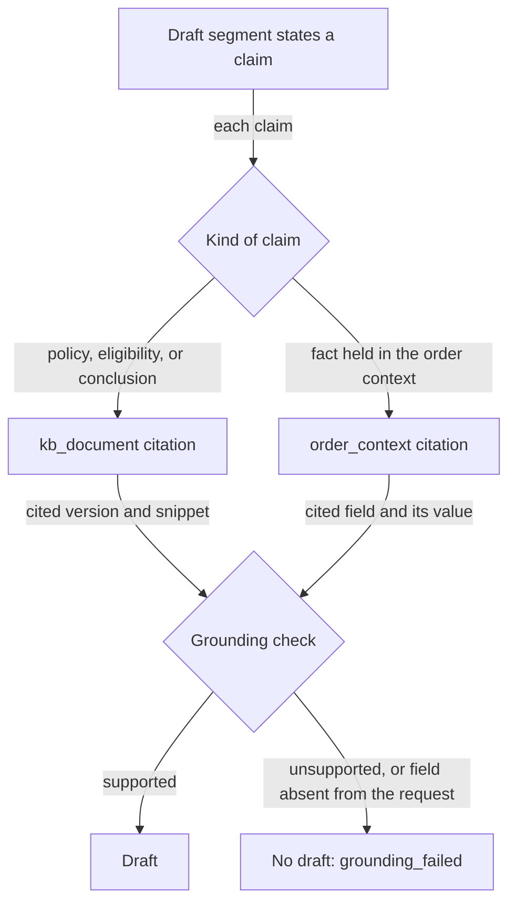

# ADR-0014: Citations to the order context

- **Status:** Proposed
- **Date:** 2026-11-04
- **Deciders:** Team
- **Related:** [Requirements](../product/requirements.md) (FR-03, FR-04, FR-05, NFR-04, ESC-04), [ADR-0001](0001-system-architecture.md), [ADR-0005](0005-intent-independent-retrieval.md), [contracts v1 design](../design/contracts-v1.md), [console UI design](../design/console-ui.md), [TEST-26](../rules/testing.md#guardrail-tests)

## Context

- Drafts state facts about the customer's order, for example "your refund is under review". These facts come from the order context that `backend` sends with each request ([contracts v1 design](../design/contracts-v1.md#data-and-contracts)). They are not in the KB, which holds approved policy and FAQ documents.
- The specification's FR-03 says every claim cites a specific document and version ([requirements appendix](../product/requirements.md#appendix-clarifications-of-the-submitted-specification), row 22). Before this ADR, [TEST-26](../rules/testing.md#guardrail-tests) required a citation to a valid KB document version on every draft segment that states a fact or a policy. A draft that states an order fact cannot meet either one, and weakening a TEST-26 item requires an ADR.
- The [product description](../product/requirements.md#1-product) already names simulated business data as a source of drafts, with verifiable citations.
- `ai-service` is stateless and reads no `backend` data ([ADR-0001](0001-system-architecture.md)). The order context contains no identifiers, so a citation cannot carry an order ID.
- Staff review every draft (FR-04). They can check an order fact quickly only if the draft shows which facts came from the order.

## Decision drivers

1. Correctness and safety: order data never counts as policy evidence, and no guardrail gets weaker.
2. Traceability and human control: every claim in a draft has a source that staff can check.
3. Privacy: the `ai-service` contract gains no identifier and no personal value.
4. Cost: a small change to the contract and the console.

## Considered options

1. Keep citations to KB document versions only, and exempt order facts from TEST-26.
2. Keep citations to KB document versions only, and forbid order facts in drafts.
3. Allow a citation to point to one field of the order context.

## Decision

We adopt option 3.

1. **`Citation` is a union discriminated by `source_type`.** A `kb_document` citation carries `citation_id`, `document_id`, `version`, and `snippet`. An `order_context` citation carries `citation_id` and `field`, a closed enum of the `OrderContext` field names.
2. **An order citation supports only a fact held in that field.** A policy, an eligibility, or a conclusion needs a `kb_document` citation, even when it is about the customer's order.
3. **An order citation is not evidence for routing.** ESC-04 still depends on KB document versions alone. With no valid document, the pipeline abstains or drafts a reply that states the missing information, whatever the order context holds.
4. **The grounding check covers order citations.** `field` MUST be present in the request's `order_context`, and the segment MUST agree with its value. Otherwise the draft fails with `grounding_failed`.
5. **`ai-service` returns a field name, never a value.** `Citation` and `OrderContextField` are shared schemas, and neither has a `value`. Only the `backend` view model `CitationView`, which references them, adds `value` to an order citation, taken from the stored request of that suggestion, so staff see what the draft was written from.
6. **NFR-04 counts order facts.** A fact about the order is supported when it has a valid order citation. A firm conclusion still needs a supporting document.

## Consequences

### Positive

- Every claim in a draft has a source that staff can check, including facts about the order.
- TEST-26 keeps its check on policy claims and gains a check on order facts.
- No identifier or personal value crosses the boundary to or from `ai-service`.

### Negative

- `Citation` becomes a union, so `ai-service`, `backend`, and `frontend` each handle two cases.
- The grounding check needs a second path that compares a segment with a structured value.
- A question that needs only order data still needs a valid KB document, or it follows ESC-04. The KB therefore has to cover every in-scope intent that drafts replies, including `track_order`.

### Follow-ups

- Define `Citation` in contract PR 1, and `CitationView` in contract PR 2.
- The `ai-service` pipeline design defines how the prompt exposes field names and how the grounding check compares values.
- The NFR-04 grading rubric includes order citations.

## Pros and cons of the options

### Exempt order facts from TEST-26

- Good, because neither the contract nor the grounding check changes.
- Bad, because a wrong order fact passes every automated check.
- Bad, because it weakens a guardrail test to make a draft pass.

### Forbid order facts in drafts

- Good, because citations stay simple.
- Bad, because a reply to `track_order` or `refund_status` cannot state the order's status, which is what the customer asked for.

### Citations to the order context

- Good, because every claim has a source, and the contract stays free of identifiers.
- Good, because staff see which sentences came from the order.
- Bad, because of the union and the second grounding path.

## Validation

- A TEST-26 guardrail test checks that every segment that states a fact or a policy has a citation of the right kind.
- A provider test with a fake LLM checks that a citation to a field absent from `order_context`, a segment that disagrees with the value of its cited field, and a policy supported only by an order citation each produce no draft.
- Manual grading for NFR-04 covers order facts.
- Revisit statement 3 in a new ADR if the evaluation shows that many order-only questions abstain because the KB has no document for them.
