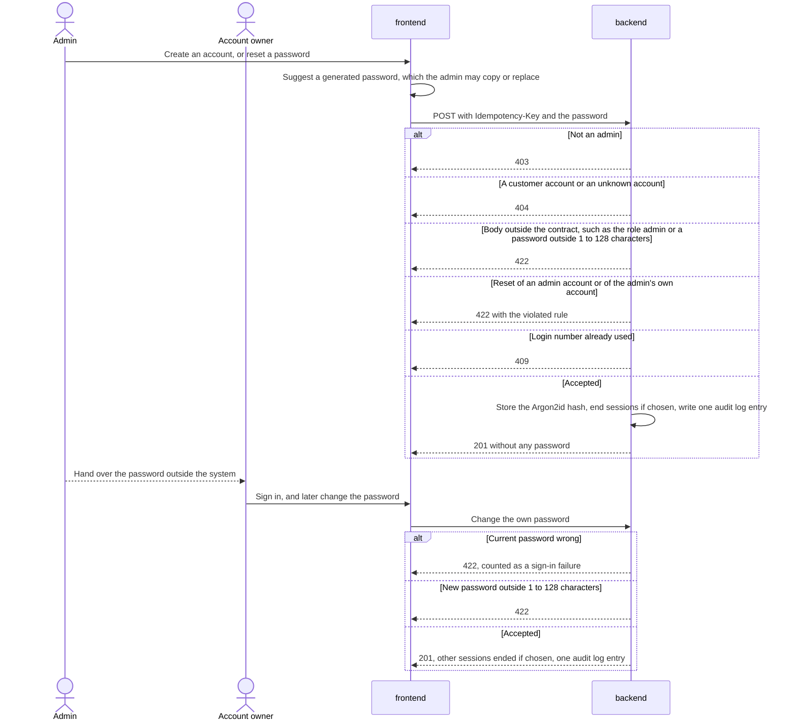

# ADR-0015: Account creation, password changes, and password resets

- **Status:** Proposed
- **Date:** 2026-11-11
- **Deciders:** Team
- **Related:** [Requirements](../product/requirements.md) (FR-08), [ADR-0009](0009-demo-accounts-and-cookie-sessions.md), [ADR-0012](0012-roles-v1.md), [ADR-0013](0013-shop-demo-with-read-only-catalog.md), [security rules](../rules/security-and-privacy.md#authentication-and-authorization), [ERR-15](../rules/errors-and-reliability.md#idempotency), [account management design](../design/account-management.md)

## Context

- Every account is created by the seed, with one password per role from secret settings ([ADR-0009](0009-demo-accounts-and-cookie-sessions.md), statement 1). Nobody can change a password, and an admin cannot add a staff member or recover a forgotten password.
- The project lead asked on 2026-11-11 for three account functions, in `backend` contract 1.1.0, in their simplest form: every account can change its own password, an admin can create `staff` and `manager` accounts, and an admin can reset the password of such an account.
- The admin manages internal accounts and never sees customer data ([ADR-0012](0012-roles-v1.md), [SEC-41](../rules/security-and-privacy.md#authentication-and-authorization)). Admin accounts exist only through the seed.
- Passwords are Secret: never stored, logged, or returned ([SEC-01](../rules/security-and-privacy.md#data-classification)). They are stored only as Argon2id hashes (ADR-0009, statement 3).
- Every write takes an `Idempotency-Key`, and `idempotency_records` keeps a hash of the request and the full response body ([ERR-15](../rules/errors-and-reliability.md#idempotency)).
- `backend` slows repeated sign-in failures per login name (ADR-0009, statement 8). A role change or a deactivation deletes the account's sessions in the same transaction ([SEC-42](../rules/security-and-privacy.md#authentication-and-authorization)).
- No email or messaging service exists. A password that an admin sets reaches its owner only through the admin, outside the system.

## Decision drivers

1. **Credential safety:** no password is stored in plain text, logged, returned by `backend`, or kept in an idempotency record.
2. **Traceability:** every account creation, password change, and password reset is attributable in the audit log.
3. **A complete account lifecycle for the demo:** onboard staff, recover a forgotten password, and change a password, without a developer.
4. **Simplicity:** no external service, no password rules, and no password state that the demo does not need.

## Considered options

1. Keep seed-only passwords.
2. Self-service password change only. Developers create accounts and reset passwords with a `backend` command.
3. The admin sets a password at creation and at reset; it does not expire, and its owner changes it whenever they want.
4. As option 3, but the password that the admin sets expires and must be changed at the first sign-in.
5. An external OpenID Connect identity provider with email recovery.

## Decision

We adopt option 3. The statements below are normative.

### Passwords

1. Every new password, a changed own password and every password that an admin sets, has 1 to 128 characters: the limits of sign-in, so every password that can be set can sign in. The `backend` contract fixes them. No other rule applies.
2. A password that an admin sets does not expire, and nothing forces its owner to change it.

### Own password

1. Every account, whatever its role, can change its own password whenever its owner wants. The request carries the current password and the new password.
2. A wrong current password counts as a sign-in failure for that login name and is slowed down by the same throttle (ADR-0009, statement 8).
3. The person who changes the password chooses whether their other sessions end. The default is to end them. The current session stays.

### Account creation and password reset

1. An admin can create a `staff` or `manager` account with a login name, a display name, a role, and a password. The new account is active.
2. The login name of a new account follows the pattern `<role>-<number>`, such as `staff-3`. The request carries the role and, optionally, the number. Without a number, `backend` takes the next free number in the transaction that creates the account. With a number, `backend` composes the name and rejects it with `409` when it is already used. A login name never contains a person's name, so it stays Internal data.
3. An admin can reset the password of a `staff` or `manager` account, active or deactivated. When resetting, the admin chooses whether the account's sessions end. The default is to end them. A reset also forgets the sign-in failures of the account's login name, so its owner can sign in at once.
4. An admin cannot create or reset an `admin` account or a customer account, and cannot reset their own password through the admin operation. A request about a customer account returns `404` (SEC-41). The contract refuses the role `admin` at creation with `422`, and a reset of an `admin` account or of the admin's own account returns `422` with the violated rule, as the admin limits of ADR-0012 do. An admin changes their own password like any other account.
5. `frontend` suggests a generated password with a copy action. The admin may use it or type another. `backend` never generates or returns a password.

### Records and secrets

1. No password reaches an idempotency record: the request hash leaves out password fields ([ERR-15](../rules/errors-and-reliability.md#idempotency)), and no response contains a password.
2. Every successful account creation, password reset, and own password change writes exactly one audit log entry with the actor, the target account, the action, whether sessions ended, and the time. No entry holds a password or a password hash.
3. The admin account list also shows each login name. This replaces ADR-0012, admin limit 9.

### Relation to earlier ADRs

1. [ADR-0009](0009-demo-accounts-and-cookie-sessions.md) stays accepted. This ADR replaces only its statement 1 in part: the seed still sets the first passwords from settings, and passwords can later change through the operations above.
2. [ADR-0012](0012-roles-v1.md) stays accepted. This ADR extends the "Can" cell of the `admin` row with the creation and reset of `staff` and `manager` accounts, and replaces admin limit 9. Admin limit 8 asks each admin change to record the old and new values. A creation or a reset records what "Records and secrets", statement 2, lists instead, because the changed value is a password.
3. [ADR-0013](0013-shop-demo-with-read-only-catalog.md) stays accepted. This ADR adds one item to the list of what `/shop` includes: a customer changes their own password from the account menu, as every role does. Profile editing and real accounts stay excluded.

## Consequences

### Positive

- Staff can be onboarded and a forgotten password recovered without a developer and without an external service.
- Every account can replace the shared demo password from the seed with its own.
- Passwords never pass through `backend` responses, idempotency records, logs, or the audit log.

### Negative

- The admin knows a password that they set until its owner changes it, so the admin can sign in as that account until then. The audit log records every reset.
- The password policy is deliberately minimal for the demo: short or common passwords are accepted, and only the sign-in throttle limits guessing.

### Follow-ups

- The [account management design](../design/account-management.md): data model, operations, problem types, the idempotency exception, audit actions, screens, and tests.
- `backend` contract 1.1.0 with the new operations ([contract-first process](../rules/contracts.md#contract-first-process)).
- UI designs: an account menu with "Change password" for every role, the admin create and reset dialogs, and a show and hide toggle on every password field.
- Rules: ERR-15 (password fields in idempotency records), SEC-41 (the admin's new operations and the login name in the list), SEC-42 (sessions ended by a password change or reset), TEST-26 (no password in any record, response, log, span, or audit log entry), UI-38 (the own password change in the shop), UI-45 (the new actions of the accounts screen), and a new UI-46 (the show and hide toggle).
- Glossary: the audit log definition.
- The note under the ADR index that records the replaced parts of ADR-0009, ADR-0012, and ADR-0013.

## Pros and cons of the options

### Keep seed-only passwords

- Good, because nothing changes.
- Bad, because every account shares its role's password, and nobody can be onboarded or recovered without a developer.

### Self-service change, developer command for creation and reset

- Good, because the admin never knows another account's password.
- Bad, because onboarding and recovery need a developer.

### Admin sets a password that does not expire

- Good, because the account lifecycle is complete inside the system with no password state.
- Bad, because of the risks listed under Negative.

### Admin sets a password that expires and must be changed

- Good, because the admin knows a usable password only until its first use or its expiry.
- Bad, because it adds a password state, an expiry, a restricted session, and a forced-change screen that the demo does not need.

### External identity provider with email recovery

- Good, because it is production-grade, with recovery and multi-factor authentication.
- Bad, because it adds an external service that receives staff identities, and a prototype with simulated users does not need it yet (ADR-0009, follow-up).

## Validation

- Permission tests: every role can change its own password; only `admin` can create accounts and reset passwords; creating an `admin` account returns `422` from the contract, resetting an `admin` account or the admin's own password returns `422` with the violated rule, and a customer account returns `404`.
- Tests prove that a wrong current password counts as a sign-in failure.
- Tests prove that ending sessions on a change or a reset makes the other sessions fail with `401` on their next request, and that keeping them does not.
- A test sends a password through every new operation and asserts that it appears in no idempotency record, response body, log line, or audit log entry.
- Every successful creation, reset, and own password change produces exactly one audit log entry.
- Revisit when production authentication replaces demo accounts, when an email service is accepted, or if the audit log shows a reset that its owner did not request.
