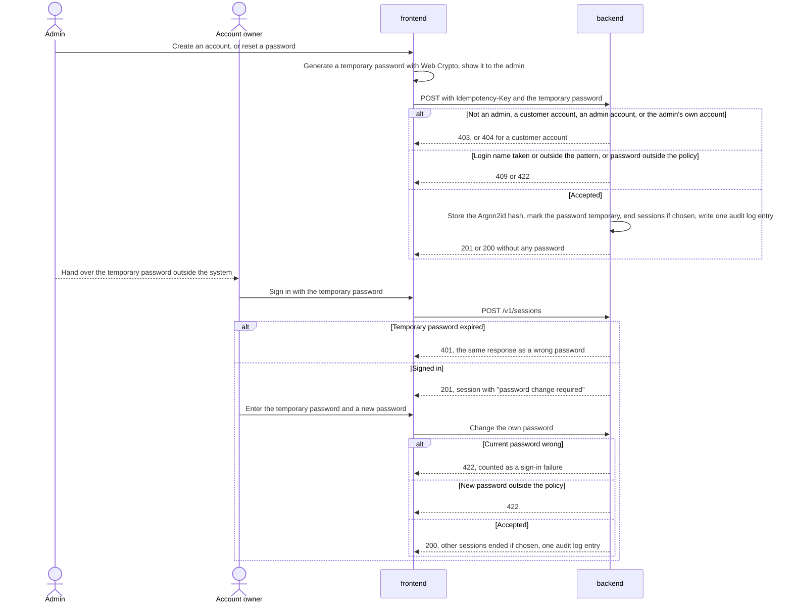

# ADR-0015: Account creation, password changes, and password resets

- **Status:** Proposed
- **Date:** 2026-11-11
- **Deciders:** Team
- **Related:** [Requirements](../product/requirements.md) (FR-08), [ADR-0009](0009-demo-accounts-and-cookie-sessions.md), [ADR-0012](0012-roles-v1.md), [security rules](../rules/security-and-privacy.md#authentication-and-authorization), [ERR-15](../rules/errors-and-reliability.md#idempotency), [backend foundation design](../design/backend-foundation.md), [admin UI design](../design/admin-ui.md)

## Context

- Every account is created by the seed, with one password per role from secret settings ([ADR-0009](0009-demo-accounts-and-cookie-sessions.md), statement 1; [ADR-0012](0012-roles-v1.md), Seed and authentication). Nobody can change a password, and an admin cannot add a staff member or recover a forgotten password. ADR-0009 lists "no account recovery" as a negative consequence.
- The project lead asked on 2026-11-11 for three account functions, decided in `backend` contract 1.1.0: every account can change its own password, an admin can create `staff` and `manager` accounts, and an admin can reset the password of such an account.
- The admin manages internal accounts and never sees customer data ([ADR-0012](0012-roles-v1.md), [SEC-41](../rules/security-and-privacy.md#authentication-and-authorization)). Admin accounts exist only through the seed, and no account can be given the `admin` role (ADR-0012, admin limit 3).
- Passwords are Secret: never stored, logged, or returned ([SEC-01](../rules/security-and-privacy.md#data-classification); ADR-0009, statement 5). They are stored only as Argon2id hashes (ADR-0009, statement 3).
- Every write takes an `Idempotency-Key` ([ERR-15](../rules/errors-and-reliability.md#idempotency)). `idempotency_records` keeps a SHA-256 hash of the request body and the full response body ([backend foundation design](../design/backend-foundation.md#tables)). A password inside either one would be kept in the database.
- `backend` slows repeated sign-in failures per login name (ADR-0009, statement 8). Changing a role or deactivating an account deletes the account's sessions in the same transaction ([SEC-42](../rules/security-and-privacy.md#authentication-and-authorization)).
- No email or messaging service exists, and adding one would send data to an external service. A temporary password can reach its owner only through the admin, outside the system.
- Authentication sits behind the `Authenticator` port, so an identity provider can replace it later (ADR-0009, statement 9).

## Decision drivers

1. **Credential safety:** no password, temporary or permanent, is stored in plain text, logged, returned by `backend`, or kept in an idempotency record.
2. **Separation of duties and traceability:** the admin gains no new role and no access to customer data, and every account creation, password change, and password reset is attributable in the audit log.
3. **A complete account lifecycle for the demo:** onboard staff, recover a forgotten password, and change a password, without a developer.
4. **Small scope and replaceability:** no external service, and no change outside authentication and the admin area.

## Considered options

1. Keep seed-only passwords (do nothing).
2. Self-service password change only. Developers create accounts and reset passwords with a `backend` command.
3. Self-service password change, plus admin account creation and password reset with a temporary password that must be changed at the first sign-in.
4. As option 3, but the admin sets a permanent password, with no forced change.
5. An external OpenID Connect identity provider with email recovery.

## Decision

We adopt option 3. The statements below are normative.

### Own password

1. Every account, whatever its role, can change its own password. The request carries the current password and the new password.
2. A wrong current password counts as a sign-in failure for that login name and is slowed down by the same throttle (ADR-0009, statement 8).
3. The new password follows one password policy for every account: a minimum and a maximum length from settings, and different from the current password and from the login name. The design doc sets the default lengths.
4. The person who changes the password chooses whether their other sessions end. The default is to end them. The current session stays.

### Account creation and password reset

1. An admin can create a `staff` or `manager` account with a login name, a display name, a role, and a temporary password. The new account is active.
2. The login name of a new account follows the pattern `<role>-<number>`, such as `staff-3`. `frontend` proposes the next free number, the admin may change the number, and `backend` rejects a name outside the pattern or already used. A login name never contains a person's name, so it stays Internal data.
3. An admin can reset the password of a `staff` or `manager` account to a new temporary password. When resetting, the admin chooses whether the account's sessions end. The default is to end them.
4. An admin cannot create or reset an `admin` account or a customer account, and cannot reset their own password through the admin operation. A request about a customer account returns `404` (SEC-41). An admin changes their own password like any other account.
5. `frontend` generates each temporary password with the Web Crypto API and shows it to the admin once, with a copy action. The admin may replace it. `backend` checks it against the password policy and never returns it.
6. A temporary password expires after a lifetime from settings. Sign-in with an expired temporary password returns the same `401` as a wrong password.
7. While an account's password is temporary, every session of the account can only read the current session, change the own password, and sign out. Every other operation returns `403` with a problem type that names the reason. `getCurrentSession` says that a password change is required.

### Records and secrets

1. No password value reaches an idempotency record: the request hash excludes password fields, and no response body contains a password. The design doc defines the change to ERR-15.
2. Every successful account creation, password reset, and own password change writes exactly one audit log entry with the actor, the target account, the action, whether sessions ended, and the time. No entry holds a password or a password hash.
3. The admin account list also shows each login name. This replaces ADR-0012, admin limit 9, which listed the display name, role, and active status only.

### Relation to earlier ADRs

1. [ADR-0009](0009-demo-accounts-and-cookie-sessions.md) stays accepted. This ADR replaces only its statement 1 in part: the seed still sets the first passwords from settings, and passwords can later change through the operations above.
2. [ADR-0012](0012-roles-v1.md) stays accepted. This ADR extends the "Can" cell of the `admin` row with the creation and reset of `staff` and `manager` accounts, and replaces admin limit 9.

## Consequences

### Positive

- Staff can be onboarded and a forgotten password recovered without a developer and without an external service.
- Every account can replace the shared demo password from the seed with its own.
- Temporary passwords never pass through `backend` responses, idempotency records, logs, or telemetry.
- The admin's role limits stay: no admin accounts, no customer accounts, no access to tickets or reports.

### Negative

- An admin can reset a manager's password and sign in as that manager before the owner does, which weakens the separation of duties of ADR-0012 (driver 1). The audit log records the reset, and the owner notices because their password no longer works. Option 2 avoids this, at the cost of driver 3.
- Temporary passwords are handed over outside the system, for example by voice.
- Customers still have no password recovery. Only the `backend reset` command restores their seed passwords.
- `backend` gains a temporary-password state, a password policy, three operations, and new audit actions. ERR-15, SEC-41, and SEC-42 change.
- This is still not production-grade: no multi-factor authentication and no email recovery.

### Follow-ups

- A design doc for account management: data model, operations, problem types, the password policy defaults, the temporary password lifetime, the idempotency exception, audit actions, and tests.
- `backend` contract 1.1.0 with the new operations and the `getCurrentSession` field ([contract-first process](../rules/contracts.md#contract-first-process)).
- UI designs: an account menu with "Change password" for every role, the admin create and reset dialogs, and a show and hide toggle on every password field ([admin UI](../design/admin-ui.md), [shop UI](../design/shop-ui.md), [console UI](../design/console-ui.md)).
- Rules: ERR-15 (password fields in idempotency records), SEC-41 (the admin's new operations and the login name in the list), and SEC-42 (sessions ended by a password change or reset).
- Glossary: "Temporary password", and the audit log definition.
- The note under the ADR index that records the replaced parts of ADR-0009 and ADR-0012.

## Pros and cons of the options

### Keep seed-only passwords

- Good, because nothing changes.
- Bad, because every account shares its role's password, and nobody can be onboarded or recovered without a developer.

### Self-service change, developer command for creation and reset

- Good, because the admin can never sign in as another account, so ADR-0012's separation of duties holds fully.
- Bad, because onboarding and recovery need a developer, which does not show a complete admin area in the demo.

### Self-service change, admin creation and reset with a temporary password

- Good, because the account lifecycle is complete inside the system, and the forced change limits how long the admin knows a usable password.
- Bad, because of the risks listed under Negative.

### Admin sets a permanent password

- Good, because there is no temporary state to build.
- Bad, because the admin keeps knowing the password of another account, and nothing makes the owner replace it.

### External identity provider with email recovery

- Good, because it is production-grade, with recovery and multi-factor authentication.
- Bad, because it adds an external service that receives staff identities, and a prototype with simulated users does not need it yet (ADR-0009, follow-up).

## Validation

- Permission tests: every role can change its own password; only `admin` can create accounts and reset passwords; creating or resetting an `admin` account returns `403`, and a customer account returns `404`; an admin cannot reset their own password through the admin operation.
- Tests prove that a session with a temporary password gets `403` on every operation except reading the current session, changing the own password, and signing out.
- Tests prove that an expired temporary password returns the same `401` as a wrong password, and that a wrong current password counts as a sign-in failure.
- Tests prove that ending sessions on a change or a reset makes the other sessions fail with `401` on their next request, and that keeping them does not.
- A test sends a password through every new operation and asserts that it appears in no idempotency record, response body, log line, or audit log entry.
- Every successful creation, reset, and own password change produces exactly one audit log entry.
- Revisit when production authentication replaces demo accounts, when an email service is accepted, or if the audit log shows a reset that its owner did not request.
