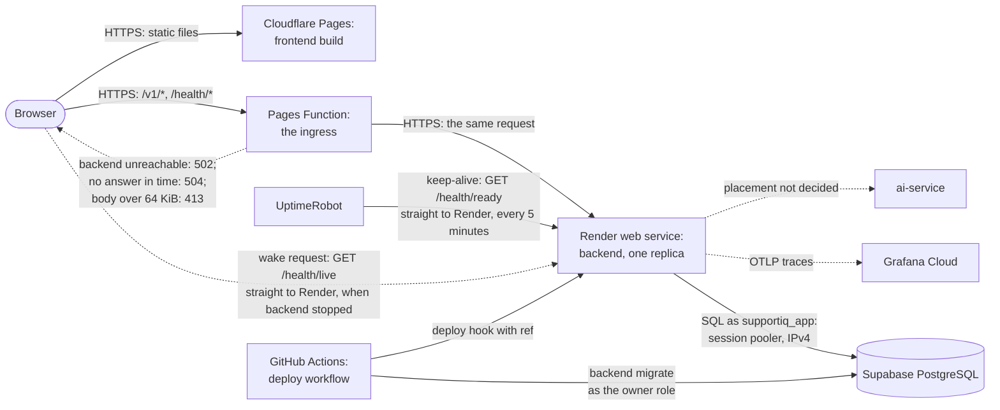
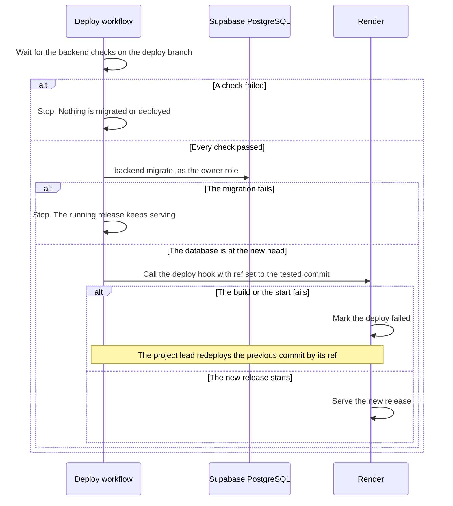

# ADR-0016: Hosting of the demo on free tiers

- **Status:** Accepted
- **Date:** 2026-11-12
- **Deciders:** Project lead
- **Related:** [Requirements](../product/requirements.md) (NFR-07, NFR-08, NFR-10, CST-04, CST-05, CST-07), [ADR-0007](0007-observability-stack.md), [ADR-0009](0009-demo-accounts-and-cookie-sessions.md), [ADR-0010](0010-pseudonymization-and-egress-control.md), [ADR-0011](0011-deployment-and-runtime-topology.md), [backend foundation design](../design/backend-foundation.md), [backend wake-up design](../design/backend-wake-up.md), [security rules](../rules/security-and-privacy.md), [logging rules](../rules/logging-and-observability.md)

## Context

- CST-04 requires a product that can be deployed and run. The requirements assume AWS: CST-05 (200 USD of AWS credits), CST-07 (one machine with 8 GB of RAM), and NFR-10 (at most 200 USD of AWS cost, with budget alerts).
- [ADR-0011](0011-deployment-and-runtime-topology.md) states the runtime rules that hold on any platform: stateless `backend` replicas, migrations and the seed as one-off commands, the suggestion job queue in PostgreSQL, one release manifest for every `ai-service` replica, no cache store, and the limits of the ingress. It leaves open where each part runs and how each limit is enforced.
- [ADR-0010](0010-pseudonymization-and-egress-control.md#egress-control) names the hosts outside the system that each component may call, and leaves the enforcement to this decision.
- The session cookie has `SameSite=Strict`, so the browser must reach `backend` on the same site as `frontend` ([ADR-0009](0009-demo-accounts-and-cookie-sessions.md)). `frontend` calls the relative path `/v1`. In development, the Vite server proxies `/v1` and `/health` to `backend` or to the Prism mock ([frontend/vite.config.ts](../../frontend/vite.config.ts)).
- The state-changing operations of the `backend` contract check the `Origin` header against the setting `allowed_origins` before anything else, and refuse a missing or unknown origin with `403 forbidden` ([backend contract](../../contracts/backend.openapi.yaml)).
- `backend serve` connects only as `supportiq_app`, which can neither change nor delete audit log entries ([SEC-39](../rules/security-and-privacy.md#audit-log)). `create-app-role`, `migrate`, `seed`, and `reset` connect as the owner role ([backend commands](../../backend/README.md#commands)). CI builds [backend/Dockerfile](../../backend/Dockerfile), whose command is `backend serve --host 0.0.0.0 --port 8000`.
- [ADR-0007](0007-observability-stack.md) runs Grafana locally. It rejected a hosted service, because telemetry would leave the developer's machine. Telemetry holds no Confidential data ([LOG-29](../rules/logging-and-observability.md#privacy-in-telemetry)), and each component redacts it in its own setup module ([LOG-03](../rules/logging-and-observability.md#setup)). So far `backend` exports only traces, to the setting `otlp_traces_endpoint`, and has no setting for an authorization header ([backend known limits](../../backend/README.md#known-limits)).
- On 2026-11-11 and 2026-11-12 the project lead chose free plans in Singapore: Render for `backend`, Supabase for PostgreSQL through the session pooler over IPv4, Cloudflare Pages for `frontend`, UptimeRobot to keep `backend` awake, and Grafana Cloud for telemetry. Where `ai-service` runs is decided at the join with the AI and ML code ([Open questions](#open-questions)).
- A measurement on 2026-11-12, on the project lead's trial deployment after 17 minutes without traffic. That deployment runs the AI and ML team's code. Its Pages Function, `apps/frontend/functions/` on `org/main`, sends each request to Render with one `fetch`; the Function of this decision is not written yet. 16 requests through that Function, one every 15 s for 4 minutes, each got `502` in less than 1 s with the header `x-render-routing: no-deploy`, and the Render service did not start. One request straight to Render got `200` after 42.6 s, and the service then ran. This is a measured result, not documented behavior: Render's documentation does not describe that header ([backend wake-up design, Background](../design/backend-wake-up.md#background)).
- The platform facts below come from the official pages, read on 2026-11-12. A fact that a page does not state is marked as not stated.

| Platform | Fact | Source |
|---|---|---|
| Render | Each workspace gets 750 free instance hours per calendar month. A spun-down service uses none. When the hours run out, Render suspends every free web service of the workspace until the next month | [Render: Free instances](https://render.com/docs/free) |
| Render | A free web service spins down after 15 minutes without inbound traffic. The next HTTP request spins it up, which takes about one minute | [Render: Free instances](https://render.com/docs/free) |
| Render | A free web service runs one instance, without one-off jobs, shell access, or persistent disks. Render may restart it at any time, and its filesystem is lost on each restart. Render says not to use free instances for production applications | [Render: Free instances](https://render.com/docs/free) |
| Render | Of the service types that run code, only web services have free instances; background workers do not. The free types are web services, Render Postgres, Render Key Value, and static sites, and "Other service types don't support Free instances". The plans for background workers start at 0.5 CPU, with no free row | [Render: Free instances](https://render.com/docs/free), [Render: Compute plans](https://render.com/docs/compute-plans) |
| Render | The pre-deploy command is available for paid web services, private services, and background workers | [Render: Deploys](https://render.com/docs/deploys) |
| Render | A deploy hook is a secret URL. A `GET` or `POST` to it starts a deploy, and the query parameter `ref` deploys one commit. Auto-deploy on a Git push can be set to Off. Neither page states a plan restriction | [Render: Deploy hooks](https://render.com/docs/deploy-hooks), [Render: Deploys](https://render.com/docs/deploys) |
| Render | The free plan has 0.1 CPU and 512 MB of RAM | [Render: Compute plans](https://render.com/docs/compute-plans) |
| Render | A web service binds to `0.0.0.0` on the port in its `PORT` environment variable, 10000 by default. Singapore is a Render region; whether it offers free instances is not stated. Outbound IPv6 is not stated | [Render: Port binding](https://render.com/docs/web-services#port-binding), [Render: Regions](https://render.com/docs/regions) |
| Supabase | The free plan has a 500 MB database and 2 active projects. A free project is paused after 1 week of inactivity | [Supabase: Pricing](https://supabase.com/pricing) |
| Supabase | Direct connections use IPv6 unless the project has the IPv4 add-on, which needs the Pro plan or above. The shared pooler is IPv4-only. Its session mode uses port 5432 and is the method for a persistent backend on an IPv4-only network. Its transaction mode does not support prepared statements | [Supabase: Connect to your database](https://supabase.com/docs/guides/database/connecting-to-postgres) |
| Supabase | A custom role connects through the shared pooler with the user name `[ROLE].[PROJECT-REF]` | [Supabase: Connect to your database](https://supabase.com/docs/guides/database/connecting-to-postgres) |
| Supabase | The free compute size (Nano) allows 60 direct connections and 200 pooler clients. The default pool size is 15 per database role | [Supabase: Compute and disk](https://supabase.com/docs/guides/platform/compute-and-disk), [Supabase: Connection management](https://supabase.com/docs/guides/database/connection-management) |
| Supabase | Singapore is the region `ap-southeast-1`. The PostgreSQL major version of a new project is not stated | [Supabase: Regions](https://supabase.com/docs/guides/platform/regions) |
| Cloudflare | Pages Functions requests count toward the Workers Free limit of 100,000 requests per day, reset at midnight UTC. Requests for static assets are free and unlimited | [Cloudflare: Pages Functions pricing](https://developers.cloudflare.com/pages/functions/pricing/), [Cloudflare: Workers limits](https://developers.cloudflare.com/workers/platform/limits/) |
| Cloudflare | `_routes.json` lists the routes that invoke Functions, with at most 100 rules; an excluded route does not invoke them. When the daily limit is used up, a project fails open (static assets are still served) or fails closed (an error page), as its settings choose. The default is not stated | [Cloudflare: Functions routing](https://developers.cloudflare.com/pages/functions/routing/) |
| Cloudflare | On the Workers Free plan, a request gets 10 ms of CPU time and 50 subrequests | [Cloudflare: Workers limits](https://developers.cloudflare.com/workers/platform/limits/) |
| Cloudflare | The `NODE_VERSION` environment variable sets the Node.js version of a build. The free plan allows 500 builds per month | [Cloudflare: Build image](https://developers.cloudflare.com/pages/configuration/build-image/), [Cloudflare: Pages limits](https://developers.cloudflare.com/pages/platform/limits/) |
| Grafana Cloud | The free tier allows 3 active users per month, 10,000 active metric series, 50 GB of logs and 50 GB of traces per month, and 14 days of retention | [Grafana: Pricing](https://grafana.com/pricing/) |
| Grafana Cloud | Singapore is the AWS region `ap-southeast-1`, and a stack cannot move to another region. Whether the free tier is offered there is not stated | [Grafana Cloud: Regional availability](https://grafana.com/docs/grafana-cloud/security-and-account-management/regional-availability/) |
| Grafana Cloud | SDKs can send OTLP straight to the stack's endpoint, for non-production use or when no collector can run. For production, Grafana recommends its Alloy collector, because the direct path handles transport issues less reliably | [Grafana Cloud: Send data with OTLP](https://grafana.com/docs/grafana-cloud/send-data/otlp/send-data-otlp/) |
| Grafana | A Viewer can view dashboards and query data sources. An Editor can also edit dashboards | [Grafana: Roles and permissions](https://grafana.com/docs/grafana/latest/administration/roles-and-permissions/) |
| UptimeRobot | The free plan has 50 monitors with a 5-minute interval and allows commercial use | [UptimeRobot: Pricing](https://uptimerobot.com/pricing/), [UptimeRobot: Terms](https://uptimerobot.com/terms/) |
| GitHub | On GitHub Free, environment secrets are available only in public repositories. Organizations on GitHub Team can use environments in private repositories | [GitHub: Deployments and environments](https://docs.github.com/en/actions/reference/workflows-and-actions/deployments-and-environments), [GitHub: Managing environments](https://docs.github.com/en/actions/how-tos/deploy/configure-and-manage-deployments/manage-environments) |

## Decision drivers

1. **Safety:** the process that serves requests never holds the owner role, so the audit log stays insert-only for it ([SEC-39](../rules/security-and-privacy.md#audit-log)). The session cookie keeps `SameSite=Strict`. No secret enters the repository ([SEC-09](../rules/security-and-privacy.md#secrets)).
2. **Traceability:** every deploy step is a versioned file in the repository, and the telemetry of the demo reaches one screen ([ADR-0007](0007-observability-stack.md)).
3. **Reliability and latency:** sign-in, tickets, and manual replies keep working (NFR-07), and no request waits for a spin-up (NFR-08).
4. **Cost:** no spending; every part stays on a free plan.
5. **Simplicity:** few manual steps for a four-person team.

## Considered options

1. Free plans with a same-origin proxy in a Pages Function, and migrations run by a GitHub Actions deploy workflow.
2. The same platforms, with migrations in the Render start command (`migrate`, then `serve`).
3. The same platforms, with the browser calling the Render URL directly, using CORS instead of a proxy.
4. One AWS EC2 host with Docker Compose, Nginx, and an egress proxy, the earlier topology of ADR-0011.

## Decision

We adopt option 1. The statements below are normative.

### Overview

### Platforms

| Part | Platform and plan | Region |
|---|---|---|
| `frontend` and the ingress | Cloudflare Pages, free plan, with one Pages Function | No region setting |
| `backend` | Render, one free web service | Singapore |
| PostgreSQL | Supabase, free plan | Singapore (`ap-southeast-1`) |
| Telemetry | Grafana Cloud, free tier | Singapore (`ap-southeast-1`), if the free tier offers it at sign-up |
| Uptime ping | UptimeRobot, free plan | No region setting |
| `ai-service` | Not decided ([Open questions](#open-questions)) | Not decided |

### `frontend` and the ingress on Cloudflare Pages

1. A Pages project builds `frontend/` (root directory `frontend`) with `NODE_VERSION` set to 24.22.2, the lowest version that [frontend/package.json](../../frontend/package.json) accepts. It publishes production from the deploy branch: `main`, from the join with the AI and ML code on. Preview deployments are off, because a preview has its own origin, which the `Origin` check of `backend` refuses.
2. A Pages Function in `frontend/` is the ingress of [ADR-0011](0011-deployment-and-runtime-topology.md#ingress) for `/v1/*` and `/health/*`. `_routes.json` includes exactly these two patterns, so static files never invoke the Function.
3. The Function forwards each request to the `backend` URL in its settings, with the method, path, query, body, and request headers unchanged, among them `Origin`, `Cookie`, `Idempotency-Key`, and `traceparent`. It returns the status, the body, and the response headers of `backend` unchanged, every `Set-Cookie` included. It adds no CORS header.
4. The Function never retries a request. It returns `502` when `backend` cannot be reached, and `504` when `backend` does not answer within the caller's timeout of the contract, 10 000 ms. A client retries a write with the same `Idempotency-Key` ([ERR-15](../rules/errors-and-reliability.md#idempotency)).
5. The Function refuses a request body larger than 64 KiB with `413`, before it forwards anything.
6. The Function logs nothing about a request: no header, body, path, or query ([LOG-29](../rules/logging-and-observability.md#privacy-in-telemetry), [SEC-09](../rules/security-and-privacy.md#secrets)).
7. Unit tests in `frontend/` cover statements 3 to 6 ([TEST-01](../rules/testing.md#required-tests-per-change)).
8. The Pages project fails closed when the daily Functions limit is used up, so a `/v1` request never receives a static file in place of a `backend` response.
9. The setting `allowed_origins` of `backend` holds only the production origin of the Pages project. The browser stays on that one origin, so `backend` sends no CORS headers, and the session cookie keeps `SameSite=Strict` ([ADR-0009](0009-demo-accounts-and-cookie-sessions.md)). If the demo gets its own domain, CORS is reconsidered in a new ADR.
10. The per-client rate limit of [ADR-0011](0011-deployment-and-runtime-topology.md#ingress) is not enforced yet ([Open questions](#open-questions)). Until it is, the sign-in throttle of `backend` limits password guessing per login name.
11. In the measurement on the trial deployment's Function, a request through the Function did not start a stopped Render service (Context). The Function of this decision is measured again after its first deploy ([Validation](#validation)). When the keep-alive fails or the service has already stopped, `frontend` sends a wake request straight to the Render origin, as the [backend wake-up design](../design/backend-wake-up.md) specifies. When the setting of that origin has a value, the `connect-src` directive of the Content Security Policy adds exactly that origin ([SEC-23](../rules/security-and-privacy.md#input-and-output-handling)).

### `backend` on Render

1. `backend` runs as one free Render web service in Singapore, built from `backend/Dockerfile`. Its `PORT` environment variable is `8000`, the port of the Dockerfile command.
2. Auto-deploy is Off. Only the deploy workflow starts a deploy, through the deploy hook.
3. The service settings hold `DATABASE_URL_APP` (the session pooler, user `supportiq_app.<project-ref>`), `ALLOWED_ORIGINS`, the telemetry settings, and settings without secrets. They never hold the owner URL.
4. The workers of the suggestion job queue run inside the web process, because background workers have no free instances. A restart or a spin-down loses no job: jobs are rows in PostgreSQL, and a job whose lease expires can be claimed again ([ADR-0011](0011-deployment-and-runtime-topology.md#suggestion-job-queue)).
5. The keep-alive: an UptimeRobot monitor sends `GET /health/ready` straight to the Render URL every 5 minutes, within the 15 minutes after which Render spins the service down. It does not go through the Pages Function, because a request through the trial deployment's Function did not start a stopped service in the measurement of 2026-11-12 (Context). A service that never sleeps uses at most 744 hours in a 31-day month, within the 750 free hours, so the workspace runs no second free service that stays awake.
6. `/health/ready` runs `SELECT 1` on the database ([readiness probe](../../backend/src/supportiq_backend/platform/adapters/database.py)), so the keep-alive may also keep Supabase from pausing the project. Supabase does not state what counts as activity, so the check in the PostgreSQL section stays.
7. A request sent to the Render URL directly skips the Function and its body limit. Whether `backend` accepts only requests that come through the Function is an open question. The `Origin` check, the sessions, and the sign-in throttle apply to every request.

### PostgreSQL on Supabase

1. One free Supabase project in `ap-southeast-1` holds the `backend` database. `backend` connects through the shared pooler in session mode, on port 5432, over IPv4. Transaction mode is not used, because asyncpg uses prepared statements.
2. `supportiq_owner` owns the schema, and `supportiq_app` serves requests, as in the [backend foundation design](../design/backend-foundation.md). Both log in through the pooler as `<role>.<project-ref>`.
3. These checks are made when the project is created, before the first deploy, and their results are recorded in `deploy/README.md`:
   - both roles log in through the session pooler;
   - the connection pool of `backend` stays within the pool size of `supportiq_app`, 15 by default. `backend` uses the default pool of SQLAlchemy, 5 connections plus 10 overflow, and runs one replica;
   - the PostgreSQL major version is 17, the version that CI tests. If it is not, the difference is recorded, and the version of CI is reconsidered;
   - whether the keep-alive keeps the project out of the pause after 1 week of inactivity, because Supabase does not state what counts as activity.
4. There are no backups. `backend seed` rebuilds every simulated record. Records of evaluation runs are exported before a project is deleted.

### Migrations and one-off commands

1. `create-app-role` and `seed` run once from a developer machine when the project is set up, and `reset` runs from there when it is needed. They use the owner URL from that person's own settings ([SEC-10](../rules/security-and-privacy.md#secrets)).
2. `migrate` runs in a GitHub Actions deploy workflow, after the checks of `backend` pass on the deploy branch and before the Render deploy. If it fails, nothing is deployed.
3. The workflow then calls the deploy hook with `ref` set to the commit that it migrated, so Render deploys exactly that commit.
4. The owner URL and the deploy hook URL are repository secrets of GitHub Actions, and only the deploy workflow uses them. The organization is on GitHub Free, where environment secrets are available only in public repositories, and the repository is private.
5. Each migration keeps the previous release working, because that release still serves between the migration and the end of the deploy. A change that removes or renames a column or a table is split: one release stops using it, and a later release removes it.

### Telemetry on Grafana Cloud

1. One free Grafana Cloud stack receives the telemetry of the deployed demo. `backend` sends OTLP straight to the OTLP endpoint of the stack, and no collector runs. Local development keeps the `grafana/otel-lgtm` container of [ADR-0007](0007-observability-stack.md).
2. This replaces one part of [ADR-0007](0007-observability-stack.md): for the deployed demo, telemetry leaves the developer's machine for a hosted service, the option that ADR-0007 rejected. Telemetry holds no Confidential data and is redacted before export, so it may leave. The rest of ADR-0007 holds.
3. The stack has 2 named Editors and 1 shared Viewer, within the 3 active users of the free tier. The shared Viewer's password is kept in the team's password manager, never in the repository or in a chat.
4. The OTLP endpoint is a setting of `backend`, and the authorization header is a secret setting.

### Secrets

Each secret lives only in the settings of the platform that uses it, never in the repository ([SEC-09](../rules/security-and-privacy.md#secrets), [SEC-10](../rules/security-and-privacy.md#secrets)).

| Secret | Where it lives |
|---|---|
| `DATABASE_URL_APP` | The settings of the Render service |
| `DATABASE_URL_OWNER` | The secrets of the deploy workflow, and the local `.env` of the person who runs a one-off command |
| The deploy hook URL | The secrets of the deploy workflow |
| The OTLP authorization header | The settings of the Render service |
| `SEED_PASSWORD_CUSTOMER`, `SEED_PASSWORD_STAFF`, `SEED_PASSWORD_MANAGER`, `SEED_PASSWORD_ADMIN` | The local `.env` of the person who runs `seed` or `reset` |

### Outbound connections

1. This deployment uses no network-level filter for outbound connections. The list of [ADR-0010](0010-pseudonymization-and-egress-control.md#egress-control) for `backend` (its database, `ai-service`, and the telemetry destination) is enforced in code: the settings of `backend` name these destinations, `backend` has no other outbound client, and a guardrail test checks both ([TEST-26](../rules/testing.md#guardrail-tests)).
2. How the list is enforced for `ai-service` is decided with its placement.

### Deviations from the requirements

| Requirement | This decision | Reason |
|---|---|---|
| CST-05 and NFR-10: at most 200 USD of AWS credits, with AWS budget alerts | Free plans and no AWS account. The infrastructure cost of NFR-10 is the price of the plans: 0 USD while every part stays on a free plan | The project lead chose free plans on 2026-11-11 |
| CST-07: the demo stack runs on one machine with 8 GB of RAM | Each part runs on its own platform, within that platform's limits. `backend` has 0.1 CPU and 512 MB of RAM | Same |
| ASM-06 and the RAM target of NFR-08: one 8 GB machine runs the whole stack with Docker Compose, within about 5 GB, measured with `docker stats` | No single machine and no Compose file. Each part stays within the memory of its own plan, and the NFR-08 load test runs against the deployed demo ([Validation](#validation)) | The simpler of two choices. A single-machine figure would measure a setup that nobody runs, and producing it would need a Compose file and a measuring method that no decision keeps |

NFR-10 still measures the LLM tokens of each suggestion. NFR-08 keeps its latency, concurrency, and error-rate targets.

## Consequences

### Positive

- The demo costs nothing, and every deploy step is a file in the repository.
- The serving process never holds the owner role, so a compromised `backend` cannot change or delete audit log entries.
- The browser stays on one origin: no CORS, and the session cookie works as ADR-0009 decides.
- The Function applies the body limit of the ingress at the edge, before a request reaches `backend`.
- Telemetry needs no server of the team's own.
- Two independent ways start `backend`: the keep-alive keeps it running, and the wake request of `frontend` starts it again when the keep-alive failed.

### Negative

- Render says not to use free instances for production, and it may restart the instance at any time. Requests in flight then fail with `502`, and clients retry writes with the same `Idempotency-Key`.
- One instance gives no failover. While it restarts, sign-in and manual replies are unavailable (NFR-07).
- 0.1 CPU and 512 MB of RAM must carry password hashing at sign-in, 5 concurrent sessions (NFR-08), the job workers, and later the named-entity detector. Only the load test shows whether they fit.
- If the keep-alive stops for more than 15 minutes, Render stops the service. The wake request starts it again, which takes about one minute, and until it runs, the first requests through the Function still fail with `502`, beyond the caller's timeout of 10 000 ms and the 12 s p95 target. The person sends the action again.
- The Render URL is public, so a request can skip the Function and its body limit, and no per-client rate limit applies yet.
- Cloudflare and Render terminate TLS, so they handle request bodies and session cookies in clear text. Supabase stores the `backend` database, Confidential data included. All data is simulated (CST-03), and these platforms are trusted as the hosts of the demo.
- Supabase may pause the project after a week without activity.
- `frontend` and `backend` deploy separately. For a short time a new `frontend` can meet the previous `backend`, and operations that only the new `backend` has fail until its deploy ends.
- The deploy secrets are repository secrets, so they are not limited to one environment or branch. Review of every workflow change is the only control on who can use the owner URL.

### Follow-ups

- `deploy/README.md`: the setup order, the settings of each platform, the checks of the PostgreSQL section, and the first-deploy checklist.
- The deploy workflow in `.github/workflows/`. A workflow that the `workflow_run` trigger starts runs only when its file is on the default branch, so such a trigger takes effect with the join.
- The Pages Function, `_routes.json`, and their tests in `frontend/`.
- The wake request of the [backend wake-up design](../design/backend-wake-up.md) in `frontend/`, with its setting and the Content Security Policy.
- `backend`: a secret setting for the OTLP authorization header, logs and metrics over OTLP (issue #2), and the guardrail test for outbound destinations.
- The cutover at the join: a new Supabase project for this `backend`. The trial deployment of the AI and ML code is retired only after the whole flow passes on the new one.
- The deviations from the requirements are explained in the next revision of the team's specification.

## Pros and cons of the options

### Free plans with a same-origin Function and a deploy workflow

- Good, because it costs nothing, the owner role never reaches the serving process, the browser stays on one origin, and every step is versioned.
- Bad, because of the costs listed under Negative.

### Migrations in the Render start command

- Good, because there is no workflow to write, and every deploy migrates by itself.
- Bad, because the serving process holds the owner URL, which can change and delete audit log entries ([SEC-39](../rules/security-and-privacy.md#audit-log)), and because `migrate` then runs at every start, against [ADR-0011](0011-deployment-and-runtime-topology.md#backend-replicas). Running it in the Docker build instead puts a secret into the image build ([SEC-29](../rules/security-and-privacy.md#transport-and-runtime)).

### Direct calls with CORS

- Good, because there is no Function to write and no Functions quota.
- Bad, because the Render domain is another site, so the browser does not send a `SameSite=Strict` cookie to it. Sessions would need `SameSite=None` and CORS with credentials, which weakens [ADR-0009](0009-demo-accounts-and-cookie-sessions.md).

### One AWS EC2 host with Compose

- Good, because it matches the requirements as written, filters outbound connections at the network level, and runs the same way locally and on the shared host.
- Bad, because it spends AWS credits and needs someone to run, start, and stop the host. The project lead chose free plans instead.

## Validation

- The checks of the PostgreSQL section pass before the first deploy, and `deploy/README.md` records their results.
- A release with a migration: the workflow migrates before it calls the deploy hook, and Render shows the migrated commit as deployed. A failed migration deploys nothing.
- The unit tests of the Function cover the forwarded headers, every `Set-Cookie`, no retry, `413` above 64 KiB, and `502` and `504`.
- On the deployed demo, sign-in sets the cookie on the Pages origin, and a write with another `Origin` returns `403`.
- The NFR-08 load test runs against the deployed demo and measures sign-in latency on the free instance.
- A trace of one request is visible in Grafana Cloud.
- After the first deploy, the measurement of Context is repeated with the Function of this decision, and the result is recorded in `deploy/README.md`.
- With the keep-alive paused for 17 minutes, opening the app sends the wake request, and sign-in succeeds once `backend` runs, as the manual check of the [backend wake-up design](../design/backend-wake-up.md#testing-and-evaluation) describes.
- Each month, the Render free hours, the Functions requests, the database size, and the Grafana Cloud usage stay within the free limits.
- Revisit when a free limit is reached or its terms change, when `ai-service` is placed at the join, when the demo gets its own domain, or before any production use.

## Open questions

- Where `ai-service` runs (GitHub Releases for the model files and Modal for serving were proposed), which hosts outside the system receive text from it, and how the allow-list of ADR-0010 is enforced there. Decided at the join with the AI and ML code.
- Whether `backend` accepts only requests that come through the Function, for example with a secret header that the Function adds and `backend` checks. Whatever is decided, `/health/ready` (the keep-alive) and `/health/live` (the wake request) stay callable straight on Render.
- How the per-client rate limit of ADR-0011 is enforced on these plans.
