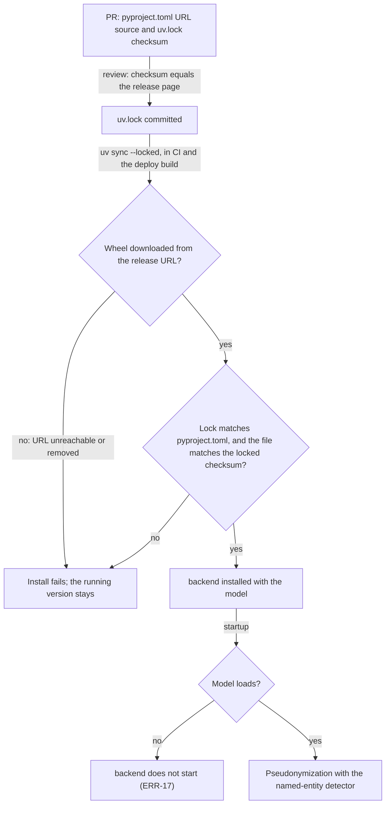

# ADR-0017: The named-entity model from its release URL

- **Status:** Accepted
- **Date:** 2026-11-12
- **Deciders:** Project lead
- **Related:** [Requirements](../product/requirements.md) (FR-09, NFR-06), [ADR-0003](0003-tech-stack.md), [ADR-0010](0010-pseudonymization-and-egress-control.md#detection), [ADR-0016](0016-hosting-on-free-tiers.md), [backend ticket workflow design](../design/backend-ticket-workflow.md#choice-1-the-named-entity-library), [security rules](../rules/security-and-privacy.md#dependencies) (SEC-30, SEC-31), [workflow rules](../rules/workflow.md#dependencies) (WF-27 to WF-31)

## Context

- `backend` must detect person names and postal addresses that its other detectors miss, with a named-entity detector whose version is pinned ([ADR-0010, Detection](0010-pseudonymization-and-egress-control.md#detection), step 4). Pseudonymization fails closed: if the detector cannot run, nothing leaves `backend` (FR-09, SEC-36).
- On 2026-11-12 the project lead chose spaCy 3.8.18 with the pipeline `en_core_web_sm` ([backend ticket workflow design, Choice 1](../design/backend-ticket-workflow.md#choice-1-the-named-entity-library)). spaCy is on PyPI. The pipeline is not: on 2026-11-12 the [PyPI index page](https://pypi.org/simple/en-core-web-sm/) of the name `en-core-web-sm` listed no file, and the PyPI JSON API answered 404. The name exists on PyPI, so a package uploaded under it later could be taken for the model.
- The release [`en_core_web_sm-3.8.0`](https://github.com/explosion/spacy-models/releases/tag/en_core_web_sm-3.8.0) on GitHub, read on 2026-11-12, states the license MIT, the compatible spaCy versions `>=3.8.0,<3.9.0`, a model size of 12 MB, and the training sources OntoNotes 5, ClearNLP Constituent-to-Dependency Conversion, and WordNet 3.0. It offers the wheel `en_core_web_sm-3.8.0-py3-none-any.whl` and publishes its SHA-256 checksum, `1932429db727d4bff3deed6b34cfc05df17794f4a52eeb26cf8928f7c1a0fb85`. No later `en_core_web_sm` release was listed on that day.
- spaCy's [model documentation](https://spacy.io/usage/models) recommends "using pip with a direct link, instead of relying on spaCy's download command", and says that a requirements file can hold that direct link.
- uv declares a dependency from a wheel URL as a URL source in `[tool.uv.sources]` ([uv: Managing dependencies](https://docs.astral.sh/uv/concepts/projects/dependencies/)). A trial on 2026-11-12 with uv 0.11.11, in a scratch project with `spacy==3.8.18` and this URL source, showed that `uv lock` records the wheel in `uv.lock` with the SHA-256 of the release page, and that `uv sync --locked` refuses the wheel when the recorded hash differs.
- SEC-31 allows dependencies only from PyPI and npm, and requires an ADR for any install from a URL. SEC-30 and WF-28 require every dependency to be pinned through a lockfile. CI audits the locked `backend` dependencies with `pip-audit --strict --disable-pip --require-hashes` on the output of `uv export` (WF-31). In the same trial, pip-audit 2.10.1 failed with that command on the URL requirement ("URL requirements cannot be pinned to a specific package version"), and passed when `uv export --no-emit-package en-core-web-sm` left only that package out.
- The pre-commit hook `check-added-large-files` refuses files over 500 KB, so the 12 MB model cannot be committed.
- The qualities at stake are the integrity of what runs inside the pseudonymization step, the reproducibility of builds, and the availability of the build.

## Decision drivers

1. Correctness and safety: the model that runs is exactly the reviewed one, and `backend` never runs without it (SEC-36, ERR-17).
2. Traceability: the version and the checksum are in the repository and change only in a reviewed PR (SEC-30, WF-28).
3. Reliability: no download at startup or at run time, so a restart of the free instance does not depend on GitHub ([ADR-0016](0016-hosting-on-free-tiers.md)).
4. Cost: no paid registry or storage.

## Considered options

1. The release wheel as a uv URL source, pinned by version and checksum.
2. `python -m spacy download en_core_web_sm` in the build or at startup.
3. The wheel committed to the repository.
4. A detector whose model comes from PyPI only.

## Decision

1. We will install `en_core_web_sm` 3.8.0 from exactly one URL, `https://github.com/explosion/spacy-models/releases/download/en_core_web_sm-3.8.0/en_core_web_sm-3.8.0-py3-none-any.whl`, as a URL source in `backend/pyproject.toml`, next to `spacy==3.8.18` from PyPI. It is the only dependency of `backend` that does not come from PyPI, and this ADR covers no other URL. The URL source is the only source of `en-core-web-sm`, so a package on PyPI under that name is never installed.
2. We will commit `uv.lock` with the checksum of that wheel, and the reviewer of the PR that adds it checks that the checksum equals the one on the release page. Every install of `backend`, in CI and in the deploy build, uses `uv sync --locked`, so a lockfile that does not match `pyproject.toml` fails the install, and so does a wheel whose hash differs from the lock.
3. The CI audit step exports the lock with `--no-emit-package en-core-web-sm`, so pip-audit keeps `--strict` for every other dependency, spaCy included. The model wheel is protected by its checksum alone: pip-audit cannot audit a URL requirement, and PyPI holds no advisory data for it.
4. `backend` loads the model from the installed package at startup and never downloads it at run time. If the model cannot load, `backend` does not start ([ERR-17](../rules/errors-and-reliability.md#startup-and-health)).
5. A change of the model version, or of spaCy beyond 3.8, comes in its own PR with the new URL and checksum, and re-runs the pseudonymization trial and the NFR-06 suite before it merges.
6. This ADR decides only how the model is installed. Whether spaCy is adopted is decided by the trial of [ADR-0010](0010-pseudonymization-and-egress-control.md#detection) in the [backend ticket workflow design](../design/backend-ticket-workflow.md#choice-1-the-named-entity-library). If the trial rejects spaCy, this ADR is marked Rejected, or Deprecated if it was already accepted.

## Consequences

### Positive

- The model that runs is the one reviewed, by version and checksum, and the lockfile records it like every other dependency.
- No network access to GitHub at startup or at run time, so restarts of the free instance depend only on what is installed.
- A missing or changed model fails the build or the startup loudly, never the pseudonymization step silently.

### Negative

- Builds of `backend` depend on github.com as well as PyPI. If the release becomes unreachable, a build fails until it is back; the deployed version keeps running.
- The model wheel gets no vulnerability audit: the audit step leaves it out, so only its checksum protects it.
- Upgrades of the model are manual: a new release needs a new URL, a new checksum, and a new trial.
- The image of `backend` grows by the model and spaCy, which the trial measures against the 512 MB of the free instance ([ADR-0016](0016-hosting-on-free-tiers.md)).

### Follow-ups

- The PR that adds the dependency shows the lock entry with the checksum and gives the WF-27 justification. It changes the audit step of `.github/workflows/backend.yml` as statement 3 says, updates the audit row of the [repository checks guide](../guides/repository-checks.md#what-runs-where), and adds spaCy and the model to the dependency table of the `backend` README with their licenses (WF-30).
- If the lock entry carries no checksum, or the audit step fails with only `en-core-web-sm` left out, the PR stops and this ADR is revisited before the dependency merges.

## Pros and cons of the options

### The release wheel as a uv URL source, pinned by version and checksum

- Good, because the version and the checksum are reviewed and locked, as spaCy recommends a direct link.
- Good, because nothing is downloaded at run time.
- Bad, because the build depends on GitHub and the wheel is not audited by pip-audit.

### `spacy download` in the build or at startup

- Good, because it is spaCy's own command and puts no URL in the repository.
- Bad, because it installs the model outside `uv.lock`, so no lockfile pins its version or checksum, which breaks SEC-30 and WF-28.
- Bad, because a download at startup makes every restart depend on GitHub, and spaCy's documentation recommends a direct link instead.

### The wheel committed to the repository

- Good, because the build needs no host other than PyPI.
- Bad, because the 12 MB file breaks the 500 KB limit of `check-added-large-files`, and every clone carries it.

### A detector whose model comes from PyPI only

- Good, because SEC-31 would need no exception.
- Bad, because none of the candidates of the design offers that: Presidio loads a spaCy model by default, and GLiNER loads its weights from the Hugging Face Hub ([backend ticket workflow design, Choice 1](../design/backend-ticket-workflow.md#choice-1-the-named-entity-library)).

## Validation

- The PR that adds the dependency: the lock entry carries the release checksum, `uv sync --locked` passes in CI, and the audit step passes with `--strict` and only `en-core-web-sm` left out.
- The startup test of the design: with the model missing, `backend` does not start.
- The pseudonymization trial and the NFR-06 suite pass with this version before adoption.
- Revisit when the model appears on PyPI, when spaCy moves beyond 3.8, when the release URL changes or disappears, or when the trial rejects spaCy.
