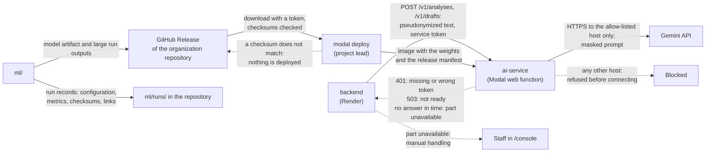
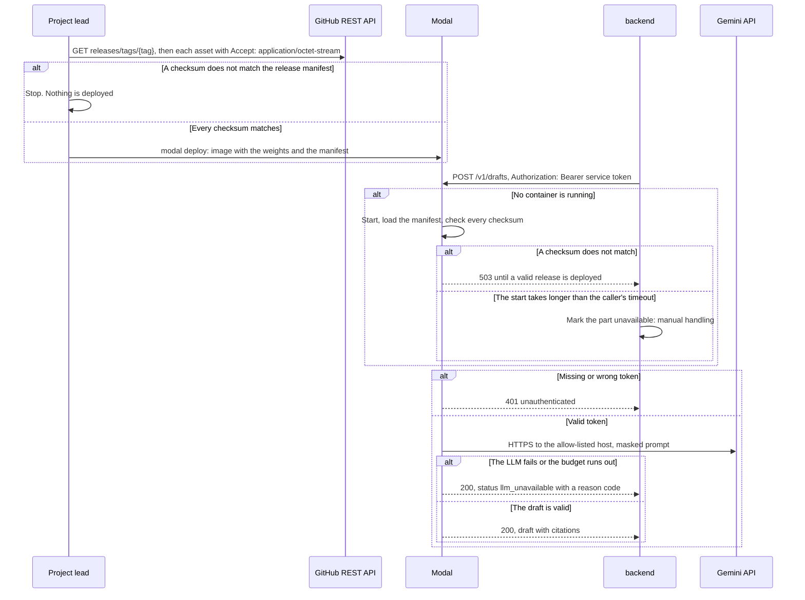

# ADR-0018: Hosting of `ai-service` on Modal

- **Status:** Accepted
- **Date:** 2026-11-12
- **Deciders:** Project lead
- **Related:** [Requirements](../product/requirements.md) (NFR-07, NFR-08, NFR-10, CST-03), [ADR-0003](0003-tech-stack.md), [ADR-0010](0010-pseudonymization-and-egress-control.md), [ADR-0011](0011-deployment-and-runtime-topology.md), [ADR-0016](0016-hosting-on-free-tiers.md), [ADR-0021](0021-repository-layout-and-ai-ml-migration.md), [contracts v1 design](../design/contracts-v1.md), [`ai-service` contract](../../contracts/ai-service.openapi.yaml), [data and ML rules](../rules/data-and-ml.md), [security rules](../rules/security-and-privacy.md)

## Context

- [ADR-0016](0016-hosting-on-free-tiers.md#open-questions) leaves open where `ai-service` runs, which hosts outside the system receive text from it, and how the egress allow-list of [ADR-0010](0010-pseudonymization-and-egress-control.md#egress-control) is enforced there. Statement 1 of ADR-0010, Egress control, leaves the same question open for a host that serves the model.
- [ADR-0003](0003-tech-stack.md) defers the artifact store to its own ADR, and [DATA-36](../rules/data-and-ml.md#models-and-artifacts) requires that decision before the first artifact is shared. The join of [ADR-0021](0021-repository-layout-and-ai-ml-migration.md) shares the first model artifact.
- The code of `main` that `ai-service` takes over loads DistilBERT with torch, downloads the encoder `BAAI/bge-small-en-v1.5` from Hugging Face at startup, and calls Gemini through `AllowListedTransport`, which allows only HTTPS on `generativelanguage.googleapis.com` ([ADR-0021, What `main` holds](0021-repository-layout-and-ai-ml-migration.md#what-main-holds)). No weights are committed.
- On the project lead's trial deployment, that code with torch ran out of memory on the Render free plan, at about 550 MB against the limit of 512 MB. The trial Modal app has a public, unauthenticated endpoint ([ADR-0021, Secrets scan of `main`](0021-repository-layout-and-ai-ml-migration.md#secrets-scan-of-main)).
- torch for Python 3.14 installs on Linux; on the project lead's Intel Mac it does not ([ADR-0021, Python on the project lead's machine](0021-repository-layout-and-ai-ml-migration.md#python-on-the-project-leads-machine)).
- The `backend` timeouts for `ai-service` are 3,000 ms for an analysis and 11,000 ms for a draft ([contracts v1 design](../design/contracts-v1.md)). Every operation of the `ai-service` contract except the two health checks requires the service token as `Authorization: Bearer <token>`, and the health checks answer `204`.
- The project lead has no `gh` command on the machine that deploys.

The platform facts below come from the official pages, read on 2026-11-12.

| Platform | Fact | Source |
|---|---|---|
| Modal | An idle container stops after 60 seconds by default. The idle time can be set between 2 seconds and 20 minutes. `min_containers` keeps containers running, so the function does not scale to zero | [Modal: Cold start performance](https://modal.com/docs/guide/cold-start) |
| Modal | CPU costs $0.0000131 per core per second and memory $0.00000222 per GiB per second. The Starter plan includes $30 of credit per month and offers region selection at 1.15 to 1.75 times the base prices | [Modal: Pricing](https://modal.com/pricing) |
| Modal | A broad region such as `ap` costs 1.15 times the base price, a narrow region such as `ap-southeast` 1.75 times | [Modal: Region selection](https://modal.com/docs/guide/region-selection) |
| Modal | Endpoints and Servers require authentication by default; Web Functions are public by default. With `requires_proxy_auth=True`, a client sends a Modal token either as the two headers `Modal-Key` and `Modal-Secret`, or joined with a period as one `Authorization: Bearer <token-id>.<token-secret>` header. The page states no way to exempt a single route | [Modal: Proxy auth](https://modal.com/docs/guide/webhook-proxy-auth) |
| Modal | `outbound_cidr_allowlist` and `outbound_domain_allowlist` are documented only for `Sandbox.create`. `App.function` has `block_network` and no parameter for an outbound allow-list | [Modal: Sandbox](https://modal.com/docs/sdk/py/latest/Sandbox), [Modal: Sandbox networking](https://modal.com/docs/guide/sandbox-networking), [Modal: App.function](https://modal.com/docs/sdk/py/latest/App#function) |
| Modal | A Secret is created in the dashboard or the command line and used with `modal.Secret.from_name` | [Modal: Secrets](https://modal.com/docs/guide/secrets) |
| Modal | `add_local_dir` adds a local folder to the container when it starts; with `copy=True` the folder becomes part of the built image | [Modal: Images](https://modal.com/docs/guide/images) |
| Modal | Python SDK 1.3.0 (2025-12-19): "Modal now supports Python 3.14." It calls the free-threaded build 3.14t "a work in progress". SDK 1.3.1 (2026-01-22): "3.14t support is available only on the 2025.06 Image Builder Version", and "Support is still experimental". `debian_slim(python_version=...)` takes a Python series or a full version. Which Python versions each Image Builder Version offers is not stated | [Modal: SDK release notes](https://modal.com/docs/sdk/py/releases), [Modal: Image](https://modal.com/docs/sdk/py/latest/Image) |
| GitHub | A client downloads the content of a release asset with `GET /repos/{owner}/{repo}/releases/assets/{asset_id}` and the header `Accept: application/octet-stream`. The API redirects or streams the file, so a client handles both `200` and `302`. `GET /repos/{owner}/{repo}/releases/tags/{tag}` returns a release with its assets and their IDs | [GitHub: Release assets](https://docs.github.com/en/rest/releases/assets), [GitHub: Releases](https://docs.github.com/en/rest/releases/releases) |
| GitHub | Both endpoints are listed under the repository permission Contents (read) for fine-grained personal access tokens. Such a token is limited to one resource owner. An organization may require approval of fine-grained tokens; until approval a token reads only public resources | [GitHub: Permissions for fine-grained tokens](https://docs.github.com/en/rest/authentication/permissions-required-for-fine-grained-personal-access-tokens), [GitHub: Managing personal access tokens](https://docs.github.com/en/authentication/keeping-your-account-and-data-secure/managing-your-personal-access-tokens) |
| GitHub | In the browser, binary files are attached to a release in its binaries box. With immutable releases, GitHub recommends creating the release as a draft, attaching every asset, and then publishing it | [GitHub: Managing releases](https://docs.github.com/en/repositories/releasing-projects-on-github/managing-releases-in-a-repository) |
| GitHub | Each file in a release must be under 2 GiB, and a release holds up to 1,000 assets | [GitHub: About releases](https://docs.github.com/en/repositories/releasing-projects-on-github/about-releases) |

## Decision drivers

1. **Safety:** only pseudonymized text reaches `ai-service`, `ai-service` sends text only to the LLM host on the egress allow-list, every call except the health checks carries the service token, and no secret enters the repository ([SEC-09](../rules/security-and-privacy.md#secrets)).
2. **Traceability:** every served file matches a checksum in the release manifest, and artifact versions are immutable ([DATA-36](../rules/data-and-ml.md#models-and-artifacts), [DATA-56](../rules/data-and-ml.md#models-and-artifacts)).
3. **Reliability and latency:** the model fits in memory, and when `ai-service` is cold or down, `backend` falls back to manual handling (NFR-07). The latency targets of NFR-08 are measured on the deployed demo.
4. **Cost:** within the Modal Starter credit and free plans.
5. **Effort:** the project lead deploys from an Intel Mac without `gh`.

## Considered options

1. Modal Starter, with the contract's service token and the egress allow-list enforced in code, and the model files as assets of GitHub Releases.
2. Modal Starter with Modal proxy auth instead of the contract's service token.
3. A second Render free web service.

## Decision

We adopt option 1. The statements below are normative.

### Overview

### Platform and scaling

1. `ai-service` runs on Modal Starter as one web function in the image that `modal deploy` builds. Its region is not pinned. Latency from `backend` is measured, and the region moves to `ap` only if the p95 target of NFR-08 is missed.
2. The function scales to zero and stays warm for 20 minutes after its last request. The cold start is measured after the first deploy. On demo days `min_containers=1` keeps one container running when the measured cold start requires it. An estimate from the price list, not measured: one container with 2 GiB of memory running all month costs about $16 in the base region and about $28 in `ap-southeast`.
3. The function starts with 2 GiB of memory, the size of the trial deployment. The memory measured after the first deploy sets the final size.

### Access

1. Every operation except `/health/live` and `/health/ready` checks the service token of contract 1.0.0 in code. The health checks stay open.
2. Modal proxy auth is not used. Its credential is a Modal token, separate from the contract's service token. Its Bearer form uses the same `Authorization` header that the contract gives to the service token. The page states no way to exempt a route, so the health checks would need the Modal token too.

### Egress

1. Egress is enforced in code, because `App.function` has no outbound allow-list. The LLM client uses `AllowListedTransport` with a versioned allow-list file that holds only the Gemini host ([ADR-0010](0010-pseudonymization-and-egress-control.md#egress-control)). The guardrail test of [SEC-40](../rules/security-and-privacy.md#transport-and-runtime) covers it.
2. The BGE encoder ships with each release like the intent model, and Hugging Face runs offline at runtime, so `ai-service` downloads nothing when it starts.
3. No host outside the system other than the Gemini host receives text from `ai-service`.

### Artifact store

1. Model weights, the encoder, and large run outputs are stored as assets of GitHub Releases of the organization repository. The repository keeps the small run records in `ml/runs/<run_id>/`: configuration, metrics, checksums, and the asset links ([DATA-30](../rules/data-and-ml.md#experiments-and-reproducibility)). Git LFS is not used.
2. An asset is never replaced; a new version is a new asset ([DATA-36](../rules/data-and-ml.md#models-and-artifacts)).
3. This closes the artifact store that [ADR-0003](0003-tech-stack.md) deferred to its own ADR.

### Deploy

1. The project lead downloads the release assets into a local folder with the GitHub REST API: `GET /repos/{owner}/{repo}/releases/tags/{tag}` for the asset IDs, then each asset with `Accept: application/octet-stream`, following a `302`. No `gh` command is needed. Assets are uploaded in the browser.
2. The download uses a fine-grained personal access token whose resource owner is the organization, limited to the organization repository with Contents (read). The token lives only in that person's environment ([SEC-10](../rules/security-and-privacy.md#secrets)).
3. The download script checks each checksum against the release manifest before `modal deploy`. The weights and the manifest are added to the image with `add_local_dir` and `copy=True`, and `ai-service` checks every checksum again at startup ([DATA-56](../rules/data-and-ml.md#models-and-artifacts)).

### Trust

This answers the open question of [ADR-0016](0016-hosting-on-free-tiers.md#open-questions) and the open part of statement 1 of [ADR-0010, Egress control](0010-pseudonymization-and-egress-control.md#egress-control): Modal hosts `ai-service` and receives pseudonymized text. Like Render and Cloudflare, it is trusted as a host of the demo, because all data is simulated (CST-03).

### Secrets

| Secret | Where it lives |
|---|---|
| The Gemini API key | A Modal Secret of the `ai-service` app, read with `modal.Secret.from_name` |
| The service token | A Modal Secret of the `ai-service` app, and the settings of the Render service of `backend` |
| The token that downloads release assets | The environment of the person who runs the download |

## Consequences

### Positive

- The model runs where it fits in memory, within the Starter credit.
- `ai-service` refuses unauthenticated calls and sends text only to the LLM host, without a network filter.
- A container downloads nothing at start, so a Hugging Face outage cannot leave it with an empty index.
- Model files stay out of git, and each version keeps a fixed checksum.

### Negative

- A cold start loads torch, DistilBERT, and BGE; its duration is not measured yet. If it takes longer than the 3,000 ms analysis timeout, the first suggestion after 20 minutes without traffic is marked unavailable, and staff handle the ticket manually or retry (ESC-05).
- The endpoint is public, and only the service token protects it.
- Egress control depends on code and its test, not on a network filter. A dependency that opens its own connection is caught only by that test.
- Modal and Gemini receive pseudonymized text and masked prompts, and Modal terminates TLS.
- The token that downloads release assets can read the whole organization repository.
- Deploys run from the project lead's machine, not from CI.

### Follow-ups

- `deploy/README.md`: the Modal setup, the download of release assets, and the measured cold start, latency from `backend`, and memory in use.
- A telemetry export for `ai-service` would add a second host outside the system that receives data from `ai-service`, its telemetry destination. Statement 1 of [ADR-0010, Egress control](0010-pseudonymization-and-egress-control.md#egress-control) allows only the LLM provider hosts, so a decision that changes that statement comes before that work.
- Check whether the organization repository can enable immutable releases ([DATA-36](../rules/data-and-ml.md#models-and-artifacts)).
- If the GitHub variable `SUPPORTIQ_MODEL_URL` still exists, the project lead deletes it after the join.

## Pros and cons of the options

### Modal Starter with the service token and egress in code

- Good, because the model fits in memory, the credit covers the expected use, scale to zero keeps the cost near 0 outside demos, and the contract stays as written.
- Bad, because of the cold start, the public endpoint that only the token protects, and egress control in code only.

### Modal Starter with proxy auth

- Good, because Modal refuses unauthenticated requests before they reach the code.
- Bad, because it adds a second credential next to the contract's service token, its Bearer form uses the same `Authorization` header, and the health checks would need the Modal token as well.

### A second Render free web service

- Good, because it uses a platform the team already runs.
- Bad, because torch with the model did not fit in 512 MB on the trial deployment, and a second service that stays awake would exceed the 750 free hours of the workspace ([ADR-0016](0016-hosting-on-free-tiers.md#backend-on-render)).

## Validation

- After the first deploy, the cold start, the latency from `backend`, and the memory in use are measured and recorded in `deploy/README.md`.
- A call without the service token gets `401`, and both health checks answer `204` without it.
- The guardrail test of SEC-40 fails when the allow-list file holds another host or when code opens a connection to one.
- With one wrong checksum, the download script deploys nothing, and `ai-service` refuses to start.
- Revisit when the Starter credit runs out, when the measured cold start or p95 latency misses NFR-08, or when Modal adds an outbound allow-list for functions.
