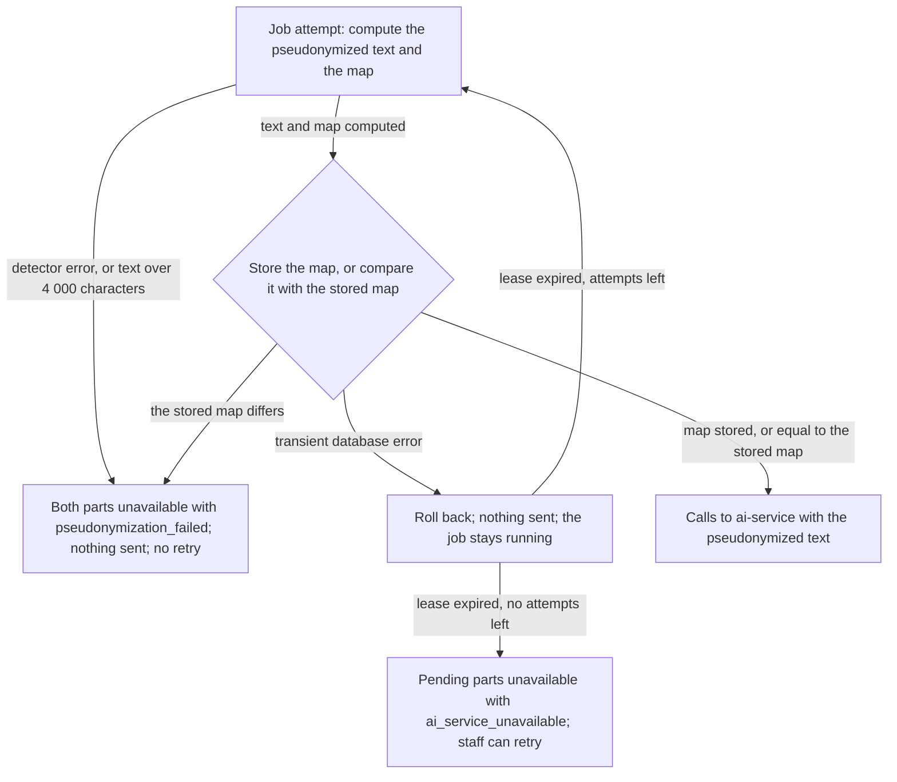

# ADR-0018: One placeholder label and retried map storage errors

- **Status:** Proposed
- **Date:** 2026-11-12
- **Deciders:** Project lead
- **Related:** [Requirements](../product/requirements.md) (FR-04, FR-09, NFR-06, NFR-07), [ADR-0010](0010-pseudonymization-and-egress-control.md) ([Restoring and sending](0010-pseudonymization-and-egress-control.md#restoring-and-sending), [Failure handling](0010-pseudonymization-and-egress-control.md#failure-handling)), [ADR-0011](0011-deployment-and-runtime-topology.md#suggestion-job-queue), [UI rules](../rules/ui.md#console-interaction) (UI-43), [security rules](../rules/security-and-privacy.md#pseudonymization) (SEC-36, SEC-38), [console UI design](../design/console-ui.md#draft-editing-and-citations), [backend ticket workflow design](../design/backend-ticket-workflow.md#pseudonymization)

## Context

This ADR amends two parts of [ADR-0010](0010-pseudonymization-and-egress-control.md). The project lead decided both on 2026-11-12.

**The label of a restored `LITERAL`.**

- [ADR-0010, Restoring and sending](0010-pseudonymization-and-egress-control.md#restoring-and-sending), item 3, shows a restored `LITERAL` "highlighted with its own label". UI-43 names two labels: "Personal data hidden: replace before sending" for a mask or an unrestored pseudonym, and "Customer text in a reserved format: rephrase before sending" for a restored `LITERAL`.
- A `LITERAL` pseudonym replaces customer text that already matches the placeholder expression ([ADR-0010, Detection](0010-pseudonymization-and-egress-control.md#detection), step 1). After restoration, that text matches the expression again. A pseudonym missing from the map matches it too, and a customer who wrote `[EMAIL]` produces exactly the text of a mask.
- `getConsoleTicket` returns AI text with pseudonyms restored, and `backend` contract 1.2.0 has no field that marks which spans are restored `LITERAL`s. Text that staff type in the editor carries no such mark either. The console therefore cannot tell a restored `LITERAL` from an unrestored pseudonym or a mask by the text alone, so it cannot choose between the two labels correctly.
- The guardrail does not depend on the label: Send reply and Submit for approval are disabled while the editor contains text in the placeholder syntax (UI-43), and `sendReply` and `createReplyProposal` reject such a body with `422 invalid-request` ([ADR-0010, Restoring and sending](0010-pseudonymization-and-egress-control.md#restoring-and-sending), item 4; [SEC-38](../rules/security-and-privacy.md#pseudonymization)).

**A database error while the pseudonym map is stored.**

- The first row of [ADR-0010, Failure handling](0010-pseudonymization-and-egress-control.md#failure-handling) reads "A detector raises an error, or the map cannot be stored", with `pseudonymization_failed`. The first branch of its sequence diagram ([Overview](0010-pseudonymization-and-egress-control.md#overview)) names a "storage error" in the same way.
- The approved [backend ticket workflow design, Pseudonymization](../design/backend-ticket-workflow.md#pseudonymization), item 3, treats a database error while the map is inserted as a storage error: the transaction rolls back and the suggestion job is claimed again after its lease. The [contracts v1 design, Rollout](../design/contracts-v1.md#rollout), step 9, says the same. The accepted ADR and the approved designs disagree.
- A suggestion that ends with `pseudonymization_failed` is never retried, because pseudonymization is deterministic ([backend ticket workflow design, Suggestions and the job queue](../design/backend-ticket-workflow.md#suggestions-and-the-job-queue)), and a retry request after it gets `422 invalid-request` ([contracts v1 design](../design/contracts-v1.md#errors-and-guardrails)). A timeout, a lost connection, or a serialization failure is not deterministic: the same insert can succeed on the next attempt.
- When a job's lease expires and its attempts are used up, its pending parts become `unavailable` with `ai_service_unavailable` ([ADR-0011, Suggestion job queue](0011-deployment-and-runtime-topology.md#suggestion-job-queue), item 6), and a later view of the ticket creates a `retry` suggestion ([backend ticket workflow design, Views](../design/backend-ticket-workflow.md#views-and-the-triggers-of-new-suggestions), item 3).
- No text leaves `backend` before its map is stored, whatever the outcome ([SEC-36](../rules/security-and-privacy.md#pseudonymization)).

## Decision drivers

1. **Safety:** no placeholder reaches a customer, and no text leaves `backend` before pseudonymization and the map insert succeed (SEC-36, SEC-38).
2. **Correct information for staff:** a label states only what the console can know.
3. **Human control and reliability:** a transient database error does not take the AI away from a ticket for good.
4. **Low complexity:** no contract change and no new mechanism.

## Considered options

The label of a placeholder in the console:

1. Two labels, as ADR-0010 and UI-43 state.
2. Two labels, with `backend` marking each restored `LITERAL` in the ticket workspace so that the console can tell them apart.
3. One label for every text in the placeholder syntax.

A transient database error while the pseudonym map is stored:

1. `pseudonymization_failed`, as the first row of ADR-0010's Failure handling table states.
2. A rollback that leaves the job to its lease, with `pseudonymization_failed` kept for the deterministic failures.

## Decision

We adopt one label (label option 3) and the rollback under the job lease (storage option 2).

1. The console highlights every text that matches the placeholder expression ([ADR-0010, Placeholder syntax](0010-pseudonymization-and-egress-control.md#placeholder-syntax)) with one label: "Personal data or reserved text: replace before sending". This covers a mask, a pseudonym that `backend` could not restore, and a restored `LITERAL`, in the draft and in the editor. A restored `LITERAL` is still shown as the customer wrote it.
2. Send reply and Submit for approval stay disabled while the editor contains text in the placeholder syntax, and `sendReply` and `createReplyProposal` still reject such a body with `422 invalid-request` ([ADR-0010, Restoring and sending](0010-pseudonymization-and-egress-control.md#restoring-and-sending), item 4). The guardrail is unchanged.
3. A transient database error while the pseudonym map is stored (a timeout, a lost connection, a serialization failure) is not a pseudonymization failure. The transaction rolls back, nothing is sent to `ai-service`, and the job stays `running`. It is claimed again after its lease, and the next attempt computes the same map, because pseudonymization is deterministic ([ADR-0010, Placeholder syntax](0010-pseudonymization-and-egress-control.md#placeholder-syntax), item 5).
4. When the attempts run out, both parts that are still `pending` end `unavailable` with `ai_service_unavailable` ([ADR-0011](0011-deployment-and-runtime-topology.md#suggestion-job-queue), item 6), and staff can retry.
5. `pseudonymization_failed` stays for the deterministic failures: a detector error, a pseudonymized text over 4 000 characters, and a stored map that differs from the one computed now. A suggestion that ends with it is never retried. The event `pseudonymization.failed` is logged at `warning` for a text over 4 000 characters, which is handled input, and at `error` otherwise, as [ADR-0010, Failure handling](0010-pseudonymization-and-egress-control.md#failure-handling) states.
6. This ADR replaces exactly these parts of ADR-0010:
   - in [Restoring and sending](0010-pseudonymization-and-egress-control.md#restoring-and-sending), item 3, the words "highlighted with its own label": a restored `LITERAL` carries the label of statement 1;
   - in the first row of [Failure handling](0010-pseudonymization-and-egress-control.md#failure-handling), the words "or the map cannot be stored", which become "or the stored map differs from the computed one";
   - in the first branch of the sequence diagram of the [Overview](0010-pseudonymization-and-egress-control.md#overview), the words "storage error".

   The rest of ADR-0010 still holds.

## Consequences

### Positive

- The label never claims more than the console knows, and staff get one instruction for every case. In each case they replace the text before sending, as before.
- `backend` contract 1.2.0 stays as it is.
- A transient database error delays a suggestion instead of ending it for good, so the AI can still help with the ticket once the database answers again.
- The accepted ADR agrees with the approved `backend` ticket workflow design and the contracts v1 design.
- `pseudonymization_failed` and `pseudonymization.failed` count only pseudonymization failures, so database errors do not inflate them.

### Negative

- The label no longer tells staff that a highlighted text was written by the customer. They read the customer message to see what it stood for.
- A storage error delays the suggestion until the lease expires, up to 15 000 ms with the initial value of `suggestion_job_lease_ms`, and uses one of the job's attempts. After three attempts with the initial value of `suggestion_job_max_attempts`, the ticket is handled manually until staff retry.
- ADR-0010 stays Accepted with three passages that no longer hold. Readers rely on the note under the [index](README.md#index) to find this ADR.

### Follow-ups

- [UI-43](../rules/ui.md#console-interaction) names the single label, in the same PR as this ADR ([RULE-06](../rules/README.md#changing-a-rule)).
- The [console UI design](../design/console-ui.md#summary) and the [backend ticket workflow design](../design/backend-ticket-workflow.md#summary) record this decision in a revision.
- The mockup source `mockup.js` and the mockup `state-placeholder.png` of the console UI design show the single label after they are rendered again.
- `frontend` defines the label once and uses it for every placeholder highlight.

## Pros and cons of the options

### Two labels, as ADR-0010 and UI-43 state

- Good, because staff would see that a highlighted text came from the customer.
- Bad, because the console cannot choose the label from the text alone, so it would show a wrong label for some texts, for example for a customer who wrote `[EMAIL]`.

### Two labels, with `backend` marking each restored `LITERAL`

- Good, because each label would be correct.
- Bad, because it needs a change of `backend` contract 1.2.0 and of the restore function of the `pseudonymization` module, for a label that changes nothing in what staff must do.
- Bad, because text that staff type in the editor still carries no mark.

### One label for every text in the placeholder syntax

- Good, because it is correct for every text, needs no contract change, and leaves the guardrail as it is.
- Bad, because staff lose the hint that a text came from the customer.

### `pseudonymization_failed` for a transient database error

- Good, because every failure before the call to `ai-service` would have one outcome.
- Bad, because it blocks every retry of a suggestion that the next attempt could complete, and it contradicts the approved designs.
- Bad, because it reports a database error as a pseudonymization failure, which misleads the NFR-06 evidence.

### A rollback that leaves the job to its lease

- Good, because it reuses the lease and the attempts of [ADR-0011](0011-deployment-and-runtime-topology.md#suggestion-job-queue), with no new mechanism.
- Good, because a failure that a retry can fix is retried, and a failure that a retry cannot fix is not.
- Bad, because the delay of a storage error is one lease.

## Validation

- Component test: a mask, an unrestored pseudonym, and a restored `LITERAL` in the draft and in the editor each carry the single label, and Send reply and Submit for approval are disabled in each case.
- Handler test: a reply or proposal body with each of the three still gets `422 invalid-request`.
- Integration test against PostgreSQL with a failing insert of the map: the transaction rolls back, `ai-service` receives no call, the job is claimed again after its lease, and the next attempt stores the map.
- Use-case test: when the attempts run out after storage errors, the pending parts end `unavailable` with `ai_service_unavailable`, and a later view creates a `retry` suggestion.
- Use-case tests: a detector error, a text over 4 000 characters, and a stored map that differs each end with `pseudonymization_failed` and no call, and `pseudonymization.failed` is logged at `warning` only for the text over 4 000 characters.
- Revisit if `backend` gains a reason to mark restored `LITERAL`s in a contract, if the NFR-11 usability study shows that the single label confuses staff, or if storage errors use up the attempts of jobs in the demo.
