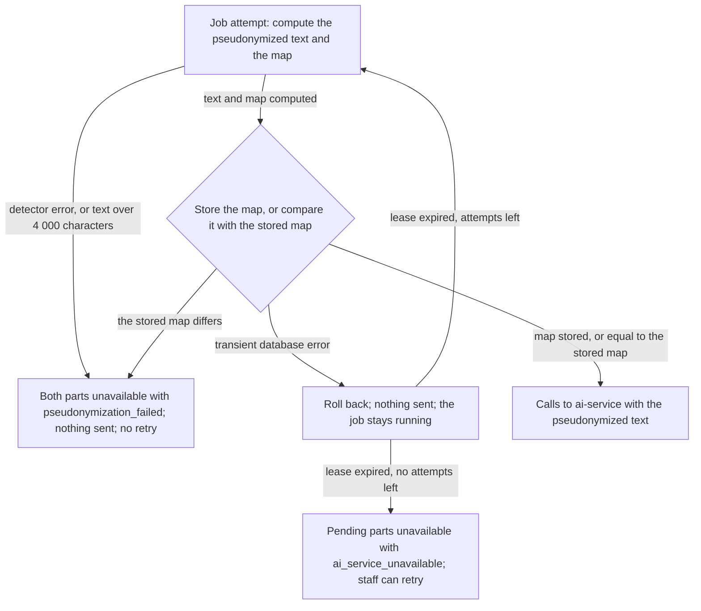

# ADR-0020: Storage errors of the pseudonym map

- **Status:** Accepted
- **Date:** 2026-11-13
- **Deciders:** Project lead
- **Related:** [Requirements](../product/requirements.md) (FR-09, NFR-06, NFR-07), [ADR-0010](0010-pseudonymization-and-egress-control.md) ([Overview](0010-pseudonymization-and-egress-control.md#overview), [Detection](0010-pseudonymization-and-egress-control.md#detection), [Storage and lifecycle](0010-pseudonymization-and-egress-control.md#storage-and-lifecycle), [Failure handling](0010-pseudonymization-and-egress-control.md#failure-handling)), [ADR-0011](0011-deployment-and-runtime-topology.md#suggestion-job-queue), [ADR-0017](0017-named-entity-model-from-its-release-url.md), [security rules](../rules/security-and-privacy.md#pseudonymization) (SEC-36), [backend ticket workflow design](../design/backend-ticket-workflow.md#pseudonymization)

## Context

This ADR amends two passages of [ADR-0010](0010-pseudonymization-and-egress-control.md). The project lead decided the retry of a transient database error on 2026-11-12, and the final failure for a stored map that differs on 2026-11-13.

- The first row of [ADR-0010, Failure handling](0010-pseudonymization-and-egress-control.md#failure-handling) reads "A detector raises an error, or the map cannot be stored", with `pseudonymization_failed`. The first branch of its sequence diagram ([Overview](0010-pseudonymization-and-egress-control.md#overview)) reads "Detector error, storage error, or text over 4 000 characters".
- The approved [backend ticket workflow design, Pseudonymization](../design/backend-ticket-workflow.md#pseudonymization), item 3, treats a database error while the map is inserted as a storage error: the transaction rolls back and the suggestion job is claimed again after its lease. The [contracts v1 design, Rollout](../design/contracts-v1.md#rollout), step 9, says the same. The accepted ADR and the approved designs disagree.
- A suggestion that ends with `pseudonymization_failed` is never retried, because pseudonymization is deterministic ([backend ticket workflow design, Suggestions and the job queue](../design/backend-ticket-workflow.md#suggestions-and-the-job-queue)), and a retry request after it gets `422 invalid-request` ([contracts v1 design](../design/contracts-v1.md#errors-and-guardrails)). A timeout, a lost connection, or a serialization failure is not deterministic: the same insert can succeed on the next attempt.
- Pseudonymization is deterministic only for "the same message, the same known values, and the same detector version" ([ADR-0010, Detection](0010-pseudonymization-and-egress-control.md#detection), item 5). The first successful run of a ticket creates its map, later runs MUST reuse it and produce the same text, and the rows of a map are inserted in one transaction and never updated ([ADR-0010, Storage and lifecycle](0010-pseudonymization-and-egress-control.md#storage-and-lifecycle), items 2 and 3). A map computed now can therefore differ from the stored one only when the detectors changed since the first run, or through a defect.
- When a job's lease expires and its attempts are used up, its pending parts become `unavailable` with `ai_service_unavailable` ([ADR-0011, Suggestion job queue](0011-deployment-and-runtime-topology.md#suggestion-job-queue), item 6), and a later view of the ticket creates a `retry` suggestion ([backend ticket workflow design, Views](../design/backend-ticket-workflow.md#views-and-the-triggers-of-new-suggestions), item 3).
- No text leaves `backend` before its map is stored, whatever the outcome ([SEC-36](../rules/security-and-privacy.md#pseudonymization)).

## Decision drivers

1. **Safety:** no text leaves `backend` before pseudonymization and the storage of its map succeed, and a pseudonym always restores to the value it replaced (SEC-36, FR-09).
2. **Traceability:** every run of a ticket sends the same pseudonymized text, so each suggestion can be reconstructed from its stored request.
3. **Human control and reliability:** a transient database error does not take the AI away from a ticket for good.
4. **Low complexity:** no contract change and no new mechanism.

## Considered options

1. `pseudonymization_failed` for every failure to store or reuse the map, as the first row of ADR-0010's Failure handling table states.
2. A rollback that leaves the job to its lease for a transient database error, and `pseudonymization_failed` without a retry for a stored map that differs.
3. A rollback that leaves the job to its lease for a transient database error, and a merge for a stored map that differs: the stored entries stay, and the entries for values that only the run of now detects are added to the map.

## Decision

We adopt the rollback under the job lease and the final failure for a map that differs (option 2).

1. A transient database error while the pseudonym map is loaded, stored, or compared (a timeout, a lost connection, a serialization failure) is not a pseudonymization failure. The transaction rolls back, no map row and no `message.pseudonymized` entry of the attempt is kept, nothing is sent to `ai-service`, and the job stays `running`. It is claimed again after its lease, and the next attempt computes the same map, because pseudonymization is deterministic ([ADR-0010, Detection](0010-pseudonymization-and-egress-control.md#detection), item 5).
2. When the attempts run out, both parts that are still `pending` end `unavailable` with `ai_service_unavailable` ([ADR-0011](0011-deployment-and-runtime-topology.md#suggestion-job-queue), item 6), and staff can retry.
3. A stored map that differs from the map computed now is a pseudonymization failure. Both parts end `unavailable` with `pseudonymization_failed`, nothing is sent to `ai-service`, the stored map is neither changed nor extended, and the suggestion is never retried. The audit log records `message.pseudonymized` with the outcome `failed` and the failure reason `stored_map_differs`, in a transaction that holds no map row.
4. `pseudonymization_failed` also stays for the other deterministic failures: a detector error and a pseudonymized text over 4 000 characters. The event `pseudonymization.failed` is logged at `warning` for a text over 4 000 characters, which is handled input, and at `error` otherwise, as [ADR-0010, Failure handling](0010-pseudonymization-and-egress-control.md#failure-handling) states.
5. This ADR replaces exactly these passages of ADR-0010:
   - in the first row of [Failure handling](0010-pseudonymization-and-egress-control.md#failure-handling), the words "or the map cannot be stored", which become "or the stored map differs from the computed one";
   - in the first branch of the sequence diagram of the [Overview](0010-pseudonymization-and-egress-control.md#overview), the words "storage error", which become "stored map that differs", so that the branch reads "Detector error, stored map that differs, or text over 4 000 characters".

   The rest of ADR-0010 still holds.

## Consequences

### Positive

- A transient database error delays a suggestion instead of ending it for good, so the AI can still help with the ticket once the database answers again.
- A pseudonym always stands for the value it replaced in the first run, and every run of a ticket sends the same text, because the map is never rewritten or extended.
- The accepted ADR agrees with the approved `backend` ticket workflow design and the contracts v1 design.
- `pseudonymization_failed` and `pseudonymization.failed` count only pseudonymization failures, so database errors do not inflate the NFR-06 evidence.

### Negative

- A storage error delays the suggestion by up to one lease plus one poll interval: the job becomes claimable when its lease expires, after up to `suggestion_job_lease_ms`, and nothing wakes a claim loop then, so it waits up to `suggestion_queue_poll_ms` more. With the initial values of the [backend ticket workflow design, Settings](../design/backend-ticket-workflow.md#settings), that is up to 15 000 ms plus 500 ms. The error also uses one of the job's attempts; after `suggestion_job_max_attempts` attempts (initial value 3, same source), the ticket is handled manually until staff retry.
- When the detectors change, for example when the named-entity detector of [ADR-0017](0017-named-entity-model-from-its-release-url.md) is added to `backend` or its pinned model changes, the map computed for a ticket pseudonymized before the change can differ from its stored map. Such a ticket then ends its next suggestion (an intent override, a KB version change, or a retry) with `pseudonymization_failed`, gets no new suggestion, and is handled manually.
- ADR-0010 stays Accepted with two passages that no longer hold. Readers rely on the note under the [index](README.md#index) to find this ADR.

### Follow-ups

- The [backend ticket workflow design](../design/backend-ticket-workflow.md#summary) records this decision in a revision.

## Pros and cons of the options

### `pseudonymization_failed` for every failure to store or reuse the map

- Good, because every failure before the call to `ai-service` would have one outcome.
- Bad, because it blocks every retry of a suggestion that the next attempt could complete, and it contradicts the approved designs.
- Bad, because it reports a database error as a pseudonymization failure, which misleads the NFR-06 evidence.

### A rollback under the lease, and a final failure for a map that differs

- Good, because it reuses the lease and the attempts of [ADR-0011](0011-deployment-and-runtime-topology.md#suggestion-job-queue), with no new mechanism.
- Good, because a failure that a retry can fix is retried, and a failure that a retry cannot fix is not.
- Good, because the map of a ticket stays as its first run stored it, as [ADR-0010, Storage and lifecycle](0010-pseudonymization-and-egress-control.md#storage-and-lifecycle) requires.
- Bad, because the delay of a storage error is one lease plus one poll interval.
- Bad, because a change of the detectors ends the AI help for the tickets pseudonymized before it.

### A rollback under the lease, and a merge for a map that differs

- Good, because a ticket pseudonymized before a change of the detectors would still get suggestions.
- Bad, because it breaks [ADR-0010, Storage and lifecycle](0010-pseudonymization-and-egress-control.md#storage-and-lifecycle), items 2 and 3: a later run would send a different text, and map rows would be added in a later transaction.
- Bad, because a new run can detect a span that overlaps a stored entry with other boundaries, for example a longer name or a phone number that ends at another digit group. The merge would have to choose one of them, and a wrong choice restores a wrong value into a reply to the customer.
- Bad, because the suggestions of one ticket would be built from different pseudonymized texts, so they no longer reconstruct from one map.
- Bad, because it needs new merge rules, new tests, and a new numbering rule for the added pseudonyms.

## Validation

- Integration test against PostgreSQL with a failing insert of the map: the transaction rolls back, no map row and no audit entry is kept, `ai-service` receives no call, the job is claimed again after its lease, and the next attempt stores the map.
- Use-case test: when the attempts run out after storage errors, the pending parts end `unavailable` with `ai_service_unavailable`, and a later view creates a `retry` suggestion.
- Integration test against PostgreSQL with a stored map that differs: the run ends with `pseudonymization_failed`, the stored map keeps its rows, and the audit log records the failure reason `stored_map_differs`.
- Use-case tests: a detector error and a text over 4 000 characters each end with `pseudonymization_failed` and no call, and `pseudonymization.failed` is logged at `warning` only for the text over 4 000 characters.
- Revisit before a change of the detectors is deployed, such as the named-entity detector of ADR-0017, if storage errors use up the attempts of jobs in the demo, or if tickets of the demo fail with `stored_map_differs`.
