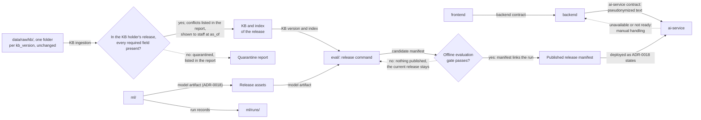
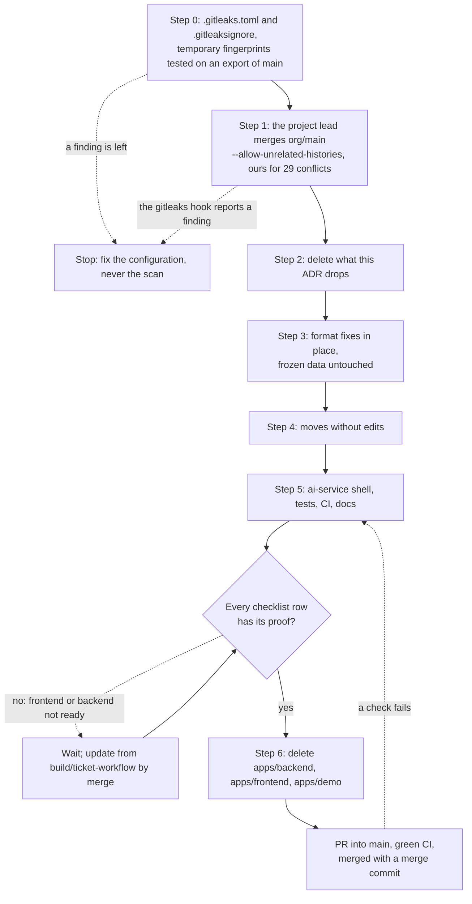
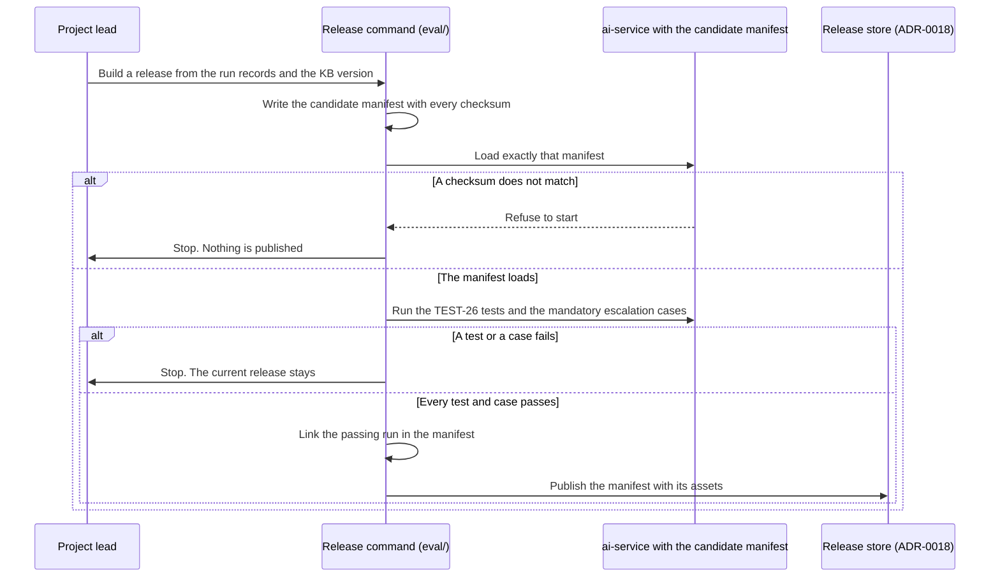

# ADR-0021: Repository layout and migration of the AI and ML code

- **Status:** Accepted
- **Date:** 2026-11-12
- **Deciders:** Project lead
- **Related:** [Requirements](../product/requirements.md) (FR-03 to FR-07, FR-09, NFR-01, NFR-05, CST-02, CST-03), [ADR-0001](0001-system-architecture.md), [ADR-0003](0003-tech-stack.md), [ADR-0005](0005-intent-independent-retrieval.md), [ADR-0010](0010-pseudonymization-and-egress-control.md), [ADR-0011](0011-deployment-and-runtime-topology.md), [ADR-0013](0013-shop-demo-with-read-only-catalog.md), [ADR-0016](0016-hosting-on-free-tiers.md), [ADR-0018](0018-hosting-of-ai-service-on-modal.md), [contracts v1 design](../design/contracts-v1.md), [`ai-service` contract](../../contracts/ai-service.openapi.yaml), [architecture rules](../rules/architecture.md), [data and ML rules](../rules/data-and-ml.md), [workflow rules](../rules/workflow.md), [testing rules](../rules/testing.md), [security rules](../rules/security-and-privacy.md)

## Context

The AI and ML team built the intent model, retrieval, and drafting on `main` of the organization repository. This repository holds `frontend`, `backend`, `contracts`, and the documents on `chore/fe-be-supportiq-ecom` and its `build/**` branches. The two must become one repository so that the whole system runs with the real AI. Where `ai-service` runs is decided in [ADR-0018](0018-hosting-of-ai-service-on-modal.md). Every fact below was checked on 2026-11-12 with read-only git commands, gitleaks, and uv, unless a source is named.

### The two histories

- `main` is at `5e0cda5`, with 129 commits, unchanged since 2026-11-06. It shares no commit with this repository.
- 32 paths exist on both sides. 29 differ in content: 27 documents that are byte-identical to this repository at `48caf66`, `README.md`, and `.gitignore`. The other 3, `docs/design/assets/{admin-ui,console-ui,shop-ui}/render.sh`, have the same content and differ only in file mode: `100755` here, `100644` on `main`.
- `main` adds 48 new files under `docs/` (45 Markdown files, 1 OpenAPI file, and 2 images), 2 of them in `docs/guides/`. It also adds `.github/workflows/autoeval.yml` and `contracts/backend.openapi.json`. [Documents of `main`](#documents-of-main) states what happens to these files, and [CI](#ci) to `autoeval.yml`.
- The four workflows of this repository run on pushes to `chore/fe-be-supportiq-ecom` and `build/**` and on pull requests (PRs) into `chore/fe-be-supportiq-ecom`, so a PR into `main` runs no check today. The hook `workflow-triggers` enforces exactly these triggers. `repository.yml` runs `pre-commit run --all-files --hook-stage manual`, so after a merge it checks every file of `main`.
- During a merge commit, pre-commit checks only the conflicted files, but the commit-stage gitleaks hook (`gitleaks git --pre-commit --staged`, `pass_filenames: false`) scans everything staged.
- `autoeval.yml` uses actions that are not pinned to a commit SHA, a `paths:` filter, `if:`, `pip install`, `ubuntu-latest`, and the triggers `schedule` and `workflow_dispatch`, which the workflow hooks of this repository reject.

### What `main` holds

| Area | Fact |
|---|---|
| Serving | `apps/ai_service` serves `/v1/analyses`, `/v1/drafts`, `/v1/asset-versions`, `/v1/kb-documents/{document_id}/versions/{version}`, `/health/live`, and `/health/ready` (`apps/ai_service/main.py`). Against [`ai-service` contract](../../contracts/ai-service.openapi.yaml) 1.0.0: errors are `{"detail": ...}`, not Problem Details; there is no service token; the health checks return `200` with a body instead of `204`; `traceparent` is not read; several field names differ (`step_latency_ms`, `effective_from` and `effective_to`, warnings as strings, the fields of `llm_usage`), and `failure_code` and `score_kind` are extra; the reason codes `budget_exceeded`, `only_expired_documents`, `signal_disagreement`, and `source_review_overdue` are missing |
| Versions | Asset versions are hashes computed at startup. There is no release manifest ([DATA-56](../rules/data-and-ml.md#models-and-artifacts)) |
| Calibration | A temperature of 1.25 is declared, but the engine calls the uncalibrated `predict`, so the intent distribution is a raw softmax |
| Routing | Two implementations. Serving uses the routing inline in `apps/ai_service/engine.py`; the autoeval and the system evaluation use `decide_route` in `apps/core_backend/intent/routing.py`. Their routing results therefore do not measure the routing that serves. `requires_authority` comes from a regular expression in the code, not from the routing configuration ([DATA-58](../rules/data-and-ml.md#models-and-artifacts)) |
| Intent model | `apps/ml_inference/app.py` loads DistilBERT weights and checks their checksum. `SUPPORTIQ_DEV_FALLBACK_MODEL` is true by default: a regular-expression fallback with fixed scores (0.94 and 0.40) then answers and reports the version and checksum of the real model. `supportiq_enable_llm` is true by default. No weights are committed; `artifacts/models` holds only `.gitkeep` |
| Egress | `AllowListedTransport` lets the LLM client call only HTTPS on `generativelanguage.googleapis.com` |
| Encoder | The encoder `BAAI/bge-small-en-v1.5` is downloaded from Hugging Face at startup. If the download fails, the index is `None`, every request returns `no_valid_document`, and `/health/ready` still reports ready |
| Dependencies | The AI code has no dependency file of its own; `pydantic-settings` is listed only in `apps/backend/requirements.txt`. CI uses Python 3.11, no version is pinned, dependencies use `>=`, and there is no lockfile |
| Offline code | `pipeline/` has about 8,000 lines of Python in `evaluation`, 2,300 in `training`, and 1,500 in `preparation`; `tests/` has about 11,700. `pipeline/` imports `apps.core_backend` in 17 places and `apps.demo` in 3 |
| Application | `apps/backend`, `apps/frontend`, and `apps/demo` are a second application, with `apps/core_backend/orchestration/` (queue and store), `apps/core_backend/commerce/`, `scripts/`, and `monitoring/` |
| Large files | 7 files above 500 KB, all in `artifacts/`: 3 `oof_predictions.csv` (up to 9.7 MB), 3 `review_candidates.csv`, and 1 `orchestration.sqlite3`. `.gitignore` ignores `*.png` |
| Personal data | `docs/ARCHITECTURE.md` and `docs/superpowers/plans/2026-10-27-core-backend-team-plan.md` list the team members with their student numbers. 5 autoeval reports contain Windows paths with the user name of a team member's machine |

### Evaluation evidence on `main`

- `scripts/run_benchmarks.py` does not run the model: when its regular expression misses, it takes the gold label, with a fixed confidence of 0.965 or 0.585. The Macro-F1 of 0.9736 in `BENCHMARK_REPORT.md`, `REGRESSION_REPORT.md`, `docs/AI_PIPELINE_METRIC_IMPROVEMENTS.md`, `docs/FINAL_CHANGE_EXPLANATION.md`, and 3 audit files comes from it, so it does not measure the model.
- The autoeval runs the real model. Its reports give a Macro-F1 of 0.611 and an expected calibration error (ECE) of 0.106 on 156 cases.
- The acceptance set `data/benchmarks/system/v2/acceptance` (156 cases) contains all 50 cases of the development set `v2/dev`, so it is contaminated and cannot serve as a test set ([DATA-23](../rules/data-and-ml.md#splits-and-evaluation-protocol)).
- The 10-fold cross-validation of DistilBERT on Bitext (`artifacts/training/distilbert_cv/fold_metrics.csv`) gives a Macro-F1 between 0.993 and 0.997 per fold.
- The system suites mark 63 of their 156 cases `must_escalate`, with a meaning that differs from the requirements: 38 of them have an out-of-scope intent (34 in the slice `unsupported`, 4 in `unanswerable`), which [ESC-02](../product/requirements.md#41-escalation-and-fallback-rules) sends to manual handling, and others are missing evidence or component failures (ESC-04, ESC-05). Only the 5 `human_agent` cases match ESC-03 (b). No case is labeled as an ESC-03 (a) request.
- The shared scenario set of Groups 2 and 5 does not exist yet ([requirements, Open questions](../product/requirements.md#8-open-questions)). [TEST-26](../rules/testing.md#guardrail-tests) and [DATA-57](../rules/data-and-ml.md#models-and-artifacts) rely on its mandatory escalation cases.

### Frozen data on `main`

- The three system suites (`data/benchmarks/system/v1`, `v2/acceptance`, `v2/dev`) use CRLF line ends. Their manifests pin the uppercase SHA-256 of every byte of their files, and of `data/knowledge/approved_kb.v1.json` (CRLF), `data/knowledge/mock_orders.json` (CRLF), and `apps/core_backend/config/policies/intent_policy.v2.json`, by their paths on `main`.
- KB v2, `data/knowledge/approved_kb.v2.json`, holds 17 documents. All 17 have the status `approved` and are in effect from `2026-01-01T00:00:00Z` to `2026-12-31T23:59:59Z`. `approved_by` is the role `lead_compliance_officer` on all 17. No document has an owner or a source field. Each document holds its `supported_intents`, against [DATA-18](../rules/data-and-ml.md#knowledge-base).
- Only the three documents `b1000000-0000-0000-0000-00000000000{1,2,3}` have a `policy_key` (`return_window`, `refund_timeline`, `cancellation_window`); they are the three documents of `approved_kb.v1.json`.
- The serving KB release of `main`, `apps/ai_service/kb-release.json` (`current-policies-v1`), lists the other 14 documents (`POL-…`), none of which has a `policy_key`. `apps/ai_service/main.py` gives the retriever only the document versions of that release, so the three `b1000000-…` documents are not served.
- The content of two `b1000000-…` documents contradicts two `POL-…` documents in effect over the same period:
  - `b1000000-…001` allows a return within 30 days for every product; `POL-RET-001` allows 30 days for products that Tiki Trading distributes and 7 days for products of marketplace partner sellers;
  - `b1000000-…002` credits a refund within 5 to 7 business days; `POL-REFUND-002` sets the time by payment method, among them 24 hours, 1 to 2 business days, and 3 to 5 business days.
- `KbDocumentVersion` of the `ai-service` contract requires `policy_key`, `owner` (a role or a team, never a person's name), and `source`. [DATA-12](../rules/data-and-ml.md#validation-at-every-boundary) requires a policy key on every document, and [DATA-19](../rules/data-and-ml.md#knowledge-base) treats two valid versions with the same policy key and different content as a conflict that is never resolved silently.
- The name Tiki, a real company, appears 36 times in 13 of the 17 documents of `approved_kb.v2.json`, and 0 times in `approved_kb.v1.json`. The requirements describe the KB as "one set of simulated e-commerce FAQ and policy documents" ([requirements, 3.3](../product/requirements.md#33-llm-and-knowledge-base)).

### Secrets scan of `main`

- Gitleaks finds 66 `generic-api-key` matches in the history of `main` and none in this repository's history. None is a real secret. 57 are SHA-256 checksums of tokenizer files: 4 distinct values, equal to the SHA-256 of the real tokenizer files. The other 9 are 2 test dummies, 1 example `Idempotency-Key` in a document, and 6 development values of 2026-10-29 (`APP_ENCRYPTION_KEY` and `JWT_SECRET_KEY`) that no code reads.
- The history of `main` never held a real `.env` file. The text in its 37 SQLite files and its 3 feature branches with commits outside `main` scan clean.
- The Gemini API key of the project lead's trial deployment was in plain text in an untracked local file that was never committed, and it was pasted into two AI chats. It counts as exposed ([SEC-12](../rules/security-and-privacy.md#secrets)). The project lead rotates it, keeps the new key only as a Modal Secret, and stops the trial Modal app, whose endpoint is public and unauthenticated. That work is outside this decision.

### Python on the project lead's machine

- torch has no wheel for Python 3.14 on Intel macOS: the last such wheel is torch 2.2.2, for Python up to 3.12. On Linux, Windows, and Apple silicon, torch 2.15.0, transformers 5.22.2, and scikit-learn 1.9.1 install on 3.14.
- On Linux, torch from PyPI pulls 19 `nvidia`, `cuda`, and `triton` packages; the CPU index gives `torch==2.15.0+cpu` without them.
- The project lead's machine is an Intel Mac with Docker and Colima. This repository pins Python 3.14.4 ([PY-01](../rules/python.md#toolchain), `.python-version`).

## Decision drivers

1. **Safety:** the guardrails hold in the joined code. No runtime fallback presents a fake model as the real one, no draft states a policy without valid evidence (FR-03, FR-05), and no secret enters the repository ([SEC-09](../rules/security-and-privacy.md#secrets)).
2. **Correct evidence:** no fabricated or contaminated number survives as a result, frozen data keep every byte ([DATA-06](../rules/data-and-ml.md#data-layout), [DATA-08](../rules/data-and-ml.md#data-layout), [DATA-23](../rules/data-and-ml.md#splits-and-evaluation-protocol)), and KB content and metadata are never invented.
3. **Traceability:** `git log --follow` finds the history of every moved file, and every release of `ai-service` is identified by a release manifest that links its gate run ([DATA-56](../rules/data-and-ml.md#models-and-artifacts)).
4. **One architecture:** three components behind contracts ([ADR-0001](0001-system-architecture.md)), one layered `ai-service` ([ARCH-11](../rules/architecture.md#layers), [ARCH-16](../rules/architecture.md#feature-modules)), and one routing.
5. **Effort:** the project lead runs every git command, and the `frontend` and `backend` work continues while the join runs.

## Considered options

1. Merge the history of `main` with `--allow-unrelated-histories`, then reshape it into this repository's layout on one join branch, step by step (moves without edits first).
2. Copy the files of `main` into this repository's layout as one snapshot, without its history.
3. Keep `main`'s layout (`apps/`, `pipeline/`, `tests/`) next to this repository's and adapt only the `ai-service` boundary.
4. Keep two repositories, joined only by the `ai-service` contract.

## Decision

We adopt option 1. The statements below are normative.

### Overview

### Target layout

| Path | Holds |
|---|---|
| `frontend/`, `backend/`, `contracts/`, `docs/` | Unchanged |
| `ai-service/` | The third component, with its own `pyproject.toml`, `uv.lock`, Dockerfile, README, settings, and tests ([ARCH-10](../rules/architecture.md#component-boundaries)) |
| `ml/` | Data preparation, training, the baseline, cross-validation, and calibration. Run records in `ml/runs/<run_id>/` ([ARCH-08](../rules/architecture.md#component-boundaries), [DATA-30](../rules/data-and-ml.md#experiments-and-reproducibility)) |
| `eval/` | Evaluation code, the test and scenario sets with their frozen inputs, the release command, and the NFR-08 load test |
| `data/` | `raw/kb/<kb_version>/` and `splits/` ([DATA-06 to DATA-08](../rules/data-and-ml.md#data-layout)) |
| `deploy/` | Platform settings without secret values, Modal included ([ARCH-42](../rules/architecture.md#component-boundaries), [ADR-0018](0018-hosting-of-ai-service-on-modal.md)) |

After the join, the tree has no `apps/`, `pipeline/`, `artifacts/`, `scripts/`, root `tests/`, `monitoring/`, `DESIGN.md`, `PRODUCT.md`, `pytest.ini`, or root `.env.example`.

### Where the code of `main` goes

| From `main` | To | How |
|---|---|---|
| `apps/ai_service/main.py`, `apps/ai_service/engine.py` (about 270 lines) | `ai-service/` | Rewritten as the composition root and the handlers of contract 1.0.0, in the layers of [ARCH-11](../rules/architecture.md#layers) and [ARCH-16](../rules/architecture.md#feature-modules). One routing, which reads the routing configuration |
| `apps/ml_inference/app.py` | `ai-service/`, intent classification adapter | Model loading, the checksum check, and prediction are kept. The regular-expression fallback and the separate `/predict` app are removed. The model runs inside the `ai-service` process ([ADR-0011](0011-deployment-and-runtime-topology.md#ai-service-replicas)) |
| `apps/core_backend/retrieval/` | `ai-service/`, retrieval | Moved nearly unchanged |
| `apps/core_backend/llm/gemini.py`, `apps/ai_service/drafting.py` | `ai-service/`, drafting | Moved nearly unchanged, `AllowListedTransport` included |
| `apps/core_backend/config/policies/intent_policy.v2.json` | `eval/`, next to the frozen suites | Kept byte for byte, like `mock_orders.json`, because the suites' manifests pin its SHA-256. The routing configuration of `ai-service` is a new versioned file derived from it ([DATA-58](../rules/data-and-ml.md#models-and-artifacts)) |
| `data/knowledge/approved_kb.v2.json`, `apps/ai_service/kb-release.json` | `data/raw/kb/<kb_version>/`, unchanged | Ingested as [KB ingestion](#kb-ingestion) states |
| `pipeline/preparation/`, `pipeline/training/`, training configuration | `ml/` | Moved as they are (step 4) |
| `pipeline/evaluation/` (the parts that still run), evaluation configuration, `data/benchmarks/` | `eval/` | Moved as they are (step 4). The frozen suites keep every byte |
| Root `tests/` | `ai-service/tests/`, `ml/tests/`, `eval/tests/` | Tests of deleted code are deleted with it |
| `apps/core_backend/orchestration/`, `apps/core_backend/commerce/`, `apps/core_backend/intent/client.py`, `apps/core_backend/intent/routing.py`, `data/business/`, `scripts/`, `monitoring/` | Deleted | The job queue, the store, and commerce data belong to `backend` ([ADR-0001](0001-system-architecture.md)). `intent/routing.py` is the second routing |
| `data/knowledge/mock_orders.json` | `eval/`, next to the frozen suites | Kept byte for byte as test data. It is not the commerce data of `backend` |

1. `ml/` and `eval/` reach `ai-service` only through its HTTP contract, the public interface of its package, or the formats of the model artifact and the release manifest. They never import the internals of `ai-service`.
2. Code in `ml/` and `eval/` that imports a deleted module is deleted with that module.
3. The release command of [Release and the offline evaluation gate](#release-and-the-offline-evaluation-gate) is new code in `eval/`. It uses only the interfaces of statement 1 and none of the moved evaluation code. [CI](#ci), statement 7, states which workflow checks it.

### Removal of the application of `main`

`apps/backend`, `apps/frontend`, and `apps/demo` are deleted in one commit (step 6), before the PR into `main`, once every row of this checklist names its proof.

| Feature of `main` | Here | Proof |
|---|---|---|
| Sign-in and sessions | `createSession`, `getCurrentSession`, `deleteCurrentSession` | Existing tests of `backend` and `frontend` |
| Shop: products, orders, customer tickets | The `/v1/shop/` operations | Existing tests of `backend` and `frontend` |
| Admin: accounts, role and status changes | The `/v1/admin/` operations | Existing tests of `backend` and `frontend` |
| Admin: versions in use | `getAdminVersions` (contract 1.2.0) | Existing tests of `backend` and `frontend` |
| Console: ticket list, ticket, views, KB | Contract 1.2.0 | Existing tests of `backend` and `frontend` |
| Reports | Contract 1.2.0 (FR-10) | Existing tests of `backend` and `frontend` |
| Suggestions and drafts in the console; `apps/demo` (running the pipeline, feedback, history) | Contract 1.2.0, the console screens | Manual end-to-end run with the real AI |
| FR-04 (staff approve every reply), FR-06 (authority), FR-07 (staff decisions and escalation), FR-09 (pseudonymization) | `backend` and the console | Manual end-to-end run with the real AI |
| Creating and cancelling orders | Not ported | [ADR-0013](0013-shop-demo-with-read-only-catalog.md) and guardrail 1: no transactions |
| Admin observability and an open `/metrics` | Not ported | Telemetry is viewed only in Grafana ([ADR-0007](0007-observability-stack.md), [ADR-0016](0016-hosting-on-free-tiers.md#telemetry-on-grafana-cloud)), and reports never come from telemetry |
| Viewing and editing `/v1/profile` | Not ported | Not in the requirements, and it edits the known values that pseudonymization uses ([ADR-0010](0010-pseudonymization-and-egress-control.md)). Added later only through the contract-first process |

1. The rows with the real AI run by hand against the Modal deployment of [ADR-0018](0018-hosting-of-ai-service-on-modal.md), because CI never calls an LLM. Each run records the date, the commit, the `release_id`, the steps, and the result in `deploy/README.md`.
2. A row with the real AI that needs a draft with a policy citation runs only after a new KB version exists, because the first release serves no KB document ([KB ingestion](#kb-ingestion)).
3. The other rows name the existing tests that cover them in the commit of step 6.

### Documents of `main`

The documents of `main` are handled as the table states, following the principle of 2026-11-11. Step 1 keeps this repository's version of the conflicting documents, step 2 makes the deletions, and step 5 folds the kept content into the new READMEs.

| Documents of `main` | Action | Reason |
|---|---|---|
| The 27 byte-identical documents | Keep this repository's version | Identical to `48caf66`; this repository's version is newer |
| `docs/ARCHITECTURE.md`, `docs/images/image1.png`, `docs/images/image2.png` | Delete | Lists team members with student numbers; only this file uses the images |
| `docs/superpowers/**` (20 files) | Delete; fold the split and cross-validation procedure into the READMEs of `ml/` and `eval/` | Lists team members; outdated plans |
| `docs/AI_PIPELINE_METRIC_IMPROVEMENTS.md`, `docs/FINAL_CHANGE_EXPLANATION.md`, `docs/audits/**` (5 files) | Delete | They state 0.9736 as verified, or build on it |
| `docs/system-evaluation-report.md`, `docs/playwright-intent-report.md`, `docs/review-eight-fixes.md`, `docs/codebase-cleanup-log.md` | Delete | Point-in-time logs of the application of `main` |
| `docs/core-backend-runbook.md`, `docs/core-backend-verification.md`, `docs/api/core-backend.openapi.yaml`, `docs/guides/application-verification.md`, `docs/guides/application-windows.md`, `docs/sequence-diagrams/**` (5 files), `contracts/backend.openapi.json` | Delete | They describe the deleted `backend` of `main` |
| `DESIGN.md`, `PRODUCT.md` | Delete | Files of a UI tool; the UI follows [ADR-0008](0008-ui-design-system.md) |
| `docs/CHỦ ĐỀ 1.md` (the course brief, no personal data) | Delete from the tree; it stays in the history | Documents are in English, and the [requirements](../product/requirements.md) are the English source. The project lead may keep the original elsewhere |
| `docs/autoeval.md` | Fold into `eval/README.md` | How to run the evaluation and the gate |
| `docs/data-quality.md` | Fold into `ml/README.md` | The data quality steps ([DATA-11](../rules/data-and-ml.md#validation-at-every-boundary)) |
| `docs/CURRENT_LIMITATIONS.md` | Fold what is still true into the known limits of the READMEs of `ai-service` and `ml/` | States the limits openly |
| `pipeline/*/README.md`, `apps/ai_service/README.md`, `data/benchmarks/*/README.md` | Fold into the new READMEs; the README of each suite stays next to it | |
| `README.md` of `main` | Its useful parts go into this repository's `README.md`, outside the join | Decided on 2026-11-11 |

### Merge procedure

1. The join runs on `build/join-main`, branched from `build/ticket-workflow` at `230eb98`. Each step is one commit, made by the project lead after the agent stops.
2. Step 0 adds the gitleaks configuration of [Secrets scanning](#secrets-scanning). Step 1 follows right after this ADR is accepted, without waiting for `frontend` and `backend`.
3. In step 1 the project lead runs `git merge --allow-unrelated-histories --no-ff org/main` and keeps this repository's version of all 29 conflicting paths. The three `render.sh` files keep the mode `100755`. Nothing else changes in that commit.
4. Steps 2 to 5 run while the `frontend` and `backend` work continues. Only step 6 and the manual end-to-end runs wait for it.
5. Step 3 fixes whitespace and final newlines in place and never touches the frozen data of [Large files and data](#large-files-and-data).
6. Step 4 only moves files, without changing their content, so `git log --follow` finds their history.
7. Updates from `build/ticket-workflow` or `org/main` come in by merge, never by rebase.
8. CI on `build/join-main` is expected to fail from step 1 to the end of step 5. The PR into `main` merges only with every check green ([WF-19](../rules/workflow.md#continuous-integration)).
9. After the merge, `main` is the only base branch. `chore/fe-be-supportiq-ecom` takes no new work. Work returns to the normal flow: branches from `main`, PRs with green CI, squash merges ([WF-05](../rules/workflow.md#branches), [WF-07](../rules/workflow.md#branches)).
10. The project lead pauses the auto-deploys before the PR, protects `main` right after it (PRs only, green CI, no force-push), and then deploys as [ADR-0016](0016-hosting-on-free-tiers.md) and [ADR-0018](0018-hosting-of-ai-service-on-modal.md) state: a new Supabase project, Render built from `backend/Dockerfile`, Pages with root `frontend`, and the new Modal app. The trial deployment is retired only after the whole flow works on the new one.

### One-time exceptions

These exceptions apply only to the join, from step 0 to the merge of its PR. Each ends with that merge.

| Rule | Exception | Reason |
|---|---|---|
| Squash merges into `main` ([design-first gate](../rules/workflow.md#design-first-gate)) | The join PR merges with "Create a merge commit" | A squash would drop the history of `main` that step 1 brings in |
| [WF-05](../rules/workflow.md#branches) | The join branch starts from `build/ticket-workflow`, not from `main` | `main` does not yet hold this repository's history |
| [WF-06](../rules/workflow.md#branches) | The join branch stays open longer than three working days | Step 6 waits for the console and reports of `frontend` and `backend` |
| [WF-11](../rules/workflow.md#pull-requests), [WF-12](../rules/workflow.md#pull-requests) | One PR carries the merge, the moves, the deletions, and the `ai-service` rewrite | Each intermediate state breaks `main`, so no smaller PR leaves it working |
| [WF-15](../rules/workflow.md#reviews), [SEC-35](../rules/security-and-privacy.md#security-review), statement 2 of [ADR-0010, Egress control](0010-pseudonymization-and-egress-control.md#egress-control) | The project lead's approval replaces the two approvals, including for the egress allow-list file | The same precedent as the [account management design, Rollout](../design/account-management.md#rollout) and the [backend ticket workflow design, Security and privacy](../design/backend-ticket-workflow.md#security-and-privacy) |

### CI

1. Each Python project has its own workflow with the jobs of `backend.yml`. `ai-service.yml` comes with the join PR and applies every rule that `backend` follows ([PY-03](../rules/python.md#toolchain), [PY-04](../rules/python.md#toolchain)). `autoeval.yml` is deleted.
2. CI never calls a real LLM. Tests use a fake LLM adapter.
3. The four existing workflows, the hook `workflow-triggers`, and [repository checks](../guides/repository-checks.md) change their triggers to pushes to `main` and `build/**` and PRs into `main`. `chore/fe-be-supportiq-ecom` is dropped.
4. CI runs the tests of `ai-service` on Linux twice: without torch, with the fakes, and with torch from the CPU index.
5. In the join PR, `ml/` and `eval/` are moved as they are. Their only changes are the deletions of [Where the code of `main` goes](#where-the-code-of-main-goes), statement 2, and the format fixes that the root hooks need.
6. The autoeval does not run between the join PR and the first PR after it: `pipeline/evaluation/autoeval/llm_suite.py` imports `apps.core_backend.orchestration`, and `ml_suite.py` imports `apps.core_backend.intent.routing`, both deleted. The gate of the first release does not depend on it.
7. Until `eval.yml` exists, `ai-service.yml` also runs the tests of the release command, at the rule level of `ai-service`. That job is removed when `eval.yml` takes it over, and the issue of `eval.yml` tracks the removal.
8. `ml.yml`, `eval.yml`, and the interim rule level for `ml/` and `eval/` come in the first PR after the join. The interim level is: `ruff format`, the ruff rule sets `E`, `W`, `F`, `I`, `B`, `S`, and `DTZ`, pyright in standard mode, one import-linter contract that forbids importing the internals of `ai-service`, green tests, and pip-audit.
9. The interim level falls short of [PY-03](../rules/python.md#toolchain), [PY-04](../rules/python.md#toolchain), [CODE-11](../rules/code.md#functions), [CODE-42](../rules/code.md#comments-and-docstrings), and [TEST-21](../rules/testing.md#coverage). Each gap is one issue labeled `tech-debt` with its removal condition ([WF-22 to WF-24](../rules/workflow.md#technical-debt)): docstrings, complete annotations, complexity limits, pyright strict, and 80% coverage. The ml.yml issue, the eval.yml issue, and the interim-level issue are opened with the join PR. This ADR stands above the rules until each issue closes ([precedence](../rules/README.md#precedence)).

### Secrets scanning

1. `.gitleaks.toml` extends the default rules with one allowlist for the rule `generic-api-key`, matched against the finding, for a tokenizer field name followed by a 64-character hexadecimal SHA-256. It removes exactly the 57 checksum findings, and a new fake key is still reported.
2. `.gitleaksignore` holds the fingerprints of the 9 other findings in the history of `main`, under a comment that states what they are. The scan of both histories then reports 0 findings.
3. `.gitleaksignore` also holds 3 temporary fingerprints in the `file:rule:line` form of the commit-stage hook, for the same findings in the current tree of `main`. Before step 1, the tree of `org/main` is exported to a scratch folder with `git archive` and scanned with `gitleaks dir` and `.gitleaks.toml`. Step 1 starts only when that scan reports exactly these 3 findings in this form. They are removed in step 2 or 5, with the files or dummy values that cause them.
4. The history is not rewritten, because the repository is private and no finding is a real secret. `APP_ENCRYPTION_KEY` and `JWT_SECRET_KEY` of `main` count as exposed and are never used ([SEC-12](../rules/security-and-privacy.md#secrets)). No system uses them, so nothing needs rotating.

### Large files and data

1. Model weights and large run outputs are stored where [ADR-0018, Artifact store](0018-hosting-of-ai-service-on-modal.md#artifact-store) states. The repository keeps their run records in `ml/runs/<run_id>/` ([DATA-30](../rules/data-and-ml.md#experiments-and-reproducibility)).
2. `artifacts/` is not moved into the new tree and stays in the history. Of it, only the evidence of the real model (the training report and the 10-fold cross-validation) is kept, as a record in `ml/runs/` with its large files stored as ADR-0018 states. The reports with 0.9736, the SQLite files, and the mock reviews are dropped.
3. The frozen data keep every byte: KB v2, the three system suites, `approved_kb.v1.json`, `mock_orders.json`, and `intent_policy.v2.json`. The last three sit next to the suites in `eval/`. The hooks that fix files skip `data/raw/` and the frozen data, and `.gitattributes` turns off line-end conversion for them ([DATA-06](../rules/data-and-ml.md#data-layout), [DATA-08](../rules/data-and-ml.md#data-layout), [DATA-23](../rules/data-and-ml.md#splits-and-evaluation-protocol)).
4. The README of each suite states that the paths in its manifest are the paths on `main` before the join. The manifests themselves are not edited.
5. `.gitignore` is this repository's version, so `main`'s rule that ignores `*.png` is dropped. It adds `*.safetensors`, `*.pt`, the Bitext download folder, and `*.sqlite3`. The hook that refuses files above 500 KB stays.
6. Personal data of team members never enters the new tree: the documents of `main` that list members are deleted ([Documents of `main`](#documents-of-main)), and the autoeval reports with a machine user name are not moved.

### Python and dependencies

1. All Python code uses Python 3.14.4 ([PY-01](../rules/python.md#toolchain)). `ai-service`, `ml/`, and `eval/` each have a `uv.lock` with exact versions ([WF-28](../rules/workflow.md#dependencies)).
2. `ai-service` takes torch from the PyTorch CPU index, in a dependency group of its own, so the rest installs on the project lead's Intel Mac.
3. On a developer machine without torch, `ai-service` is tested with fakes and through the Prism mock of its contract. A fake exists only in tests; `ai-service` has no runtime fallback. The real model is tested on the Modal deployment of [ADR-0018](0018-hosting-of-ai-service-on-modal.md). Docker is used only where nothing else works.
4. Four choices that [ADR-0003](0003-tech-stack.md) deferred to their own ADRs are not decided here: the LLM provider (Gemini), the embedding model (`BAAI/bge-small-en-v1.5`), the vector store (an in-memory index), and the second model (DistilBERT, compared with the baseline, [DATA-33](../rules/data-and-ml.md#models-and-artifacts), [DATA-55](../rules/data-and-ml.md#choosing-models)). Each is one issue labeled `tech-debt`. Each ADR states only measured numbers and says "not measured" otherwise. The fifth, the artifact store, is decided in [ADR-0018](0018-hosting-of-ai-service-on-modal.md#artifact-store).

### KB ingestion

1. KB ingestion fails closed. It admits a document version only when both hold:
   - the version is in the release file of the KB holder, `kb-release.json`, which sits next to the KB in `data/raw/kb/<kb_version>/` and keeps every byte;
   - every field that `KbDocumentVersion` requires and [DATA-12](../rules/data-and-ml.md#validation-at-every-boundary) checks is present.

   It never invents a value. A conflict between admitted versions is not removed at ingestion: the ingestion report lists it ([DATA-12](../rules/data-and-ml.md#validation-at-every-boundary)), and `ai-service` shows it to staff at `as_of` with the validity `conflicting` and the reason code `conflicting_sources` ([DATA-19](../rules/data-and-ml.md#knowledge-base)).
2. KB v2 has no owner or source field, so ingestion uses this recorded mapping: `owner` takes the value of `approved_by` unchanged (the role `lead_compliance_officer`), and `source` is the name of the KB file with its KB version. The mapping is stated here and in the ingestion script, and the raw file keeps every byte. If the AI and ML team confirms or corrects it, the result is a new `kb_version` ([DATA-17](../rules/data-and-ml.md#knowledge-base)).
3. Every document that ingestion does not admit is quarantined, and the ingestion report lists each one with its reason ([DATA-13](../rules/data-and-ml.md#validation-at-every-boundary)). One issue reviews and accepts the quarantine, so the ingestion run passes.
4. `supported_intents` is copied into the separate document-to-intent mapping file, and the KB file stays unchanged ([DATA-06](../rules/data-and-ml.md#data-layout), [DATA-18](../rules/data-and-ml.md#knowledge-base)).
5. With KB v2 as it is, the first release serves no KB document, until the AI and ML team supplies the missing `policy_key` values. The quarantine report lists all 17 documents:
   - the 14 `POL-…` documents: no `policy_key`;
   - the 3 `b1000000-…` documents: not in the release `current-policies-v1` of the KB holder, and their content contradicts `POL-RET-001` and `POL-REFUND-002`.
6. When the metadata arrives, a new `kb_version` is ingested and gets a new release manifest, which passes the gate before it is served.

### Release and the offline evaluation gate

1. One release command builds the candidate release manifest, runs the offline evaluation gate on exactly that manifest, and publishes it only when the gate passes ([DATA-57](../rules/data-and-ml.md#models-and-artifacts)). The manifest links the passing run ([DATA-56](../rules/data-and-ml.md#models-and-artifacts)).
2. CI rejects a release manifest that does not link a passing gate run or whose checksums do not match.
3. The gate of the first release is the minimum of DATA-57: every guardrail test of [TEST-26](../rules/testing.md#guardrail-tests) and every mandatory escalation case passes, with exactly that manifest loaded where a test uses `ai-service`. Item 2 of DATA-57 compares with the current release, and there is none yet.
4. The first release has three known gaps, and its records and the README of `eval/` state them:
   - the acceptance set of `main` is contaminated ([DATA-23](../rules/data-and-ml.md#splits-and-evaluation-protocol)), so no quality target is reported from it;
   - the shared scenario set of Groups 2 and 5 does not exist yet ([CST-02](../product/requirements.md#6-assumptions-and-constraints)), so interim cases replace it as [Exception to TEST-26](#exception-to-test-26) states;
   - the first release serves no KB document ([KB ingestion](#kb-ingestion)), so every policy question leads to abstention (ESC-04).
5. Groundedness is still graded by two people ([DATA-46](../rules/data-and-ml.md#evaluation-and-reporting)). The gate runs by command before each release, not on every PR, because the requirements ask for reproducible scripted numbers and a gate before each release, not a CI job.

### Exception to TEST-26

This exception does not end with the merge of the join PR.

1. This ADR weakens exactly one item of [TEST-26](../rules/testing.md#guardrail-tests): "Mandatory escalation cases from the shared scenario set are routed correctly." The shared scenario set does not exist, so that test cannot exist yet.
2. Until the shared scenario set of Groups 2 and 5 is in `eval/`, cases hand-written from ESC-01 to ESC-05 replace it, both in item 1 of [DATA-57](../rules/data-and-ml.md#models-and-artifacts) and in CI. They are fixtures in `eval/`, approved by the project lead, and labeled "interim, not the shared scenario set".
3. Every report of the gate and of CI states this TEST-26 item as not met.
4. The exception ends when the shared scenario set is in `eval/`. From then on, the gate and CI use the shared set.

## Consequences

### Positive

- One repository and one `main` hold the three components, `ml/`, and `eval/` in the layout that the rules expect.
- The moved files keep their history, and the 29 conflicts resolve to this repository's newer documents.
- One routing serves and is measured, and every suggestion reports the `release_id` of a manifest that passed the gate.
- No fake model can answer in service, and no fabricated or contaminated number is carried forward as a result.
- No draft cites a KB document that the KB holder did not release or whose metadata is missing; a conflict between released versions reaches staff as a warning ([DATA-19](../rules/data-and-ml.md#knowledge-base)).

### Negative

- The join PR is far larger than WF-11 allows, so its review relies on the step commits and on the CI of the PR.
- CI on the join branch fails from step 1 to step 5, so a regression in that window shows only in the step commits.
- `ml/` and `eval/` stay below the Python rules until the tech-debt issues close.
- The first release has no quality-target comparison, a contaminated acceptance set, interim mandatory escalation cases, and no KB document. Every policy question leads to abstention (ESC-04), and the end-to-end runs that need a cited policy wait for a new KB version.
- A TEST-26 item stays weakened, and reported as not met, until the shared scenario set arrives.
- Every KB document version expires at `2026-12-31T23:59:59Z`. After that time, without a new KB version, every policy question leads to abstention.

### Follow-ups

- Step 0: `.gitleaks.toml` and `.gitleaksignore`, after the scan of the exported tree.
- `deploy/README.md`: the records of the manual end-to-end runs. The Modal part is in [ADR-0018](0018-hosting-of-ai-service-on-modal.md#follow-ups).
- A data contract in `contracts/` for the release manifest and the model artifact format, written by the contract owners.
- The issue that accepts the KB quarantine, and tech-debt issues: `ml.yml`, `eval.yml`, the interim rule level, each later rule, and the four deferred ADRs.
- An ADR for a new acceptance set, because the current one is contaminated ([DATA-23](../rules/data-and-ml.md#splits-and-evaluation-protocol)).
- Documents outside the join: `README.md` (layout and status), `AGENTS.md` (commands and the rule table for `ai-service`, `ml/`, and `eval/`), and the next revision of the team's specification.

## Pros and cons of the options

### Merge the history, then reshape on one branch

- Good, because the history of the AI and ML team stays reachable, `git log --follow` works across the moves, and the conflicts are only documents.
- Bad, because the join PR is large, CI is red for several steps, and the history of `main` brings in the 66 gitleaks findings that the configuration must handle.

### Copy a snapshot without history

- Good, because the join is one clean commit and gitleaks sees only the current tree.
- Bad, because the authorship and history of the AI and ML code are lost from the repository that the team keeps.

### Keep the layout of `main`

- Good, because it needs the fewest moves.
- Bad, because two applications, two routings, and a fallback model would remain, against [ADR-0001](0001-system-architecture.md), [ARCH-10](../rules/architecture.md#component-boundaries), and [DATA-58](../rules/data-and-ml.md#models-and-artifacts).

### Keep two repositories

- Good, because nothing is merged now.
- Bad, because the rules, CI, contracts, and documents would split across two repositories, and the team agreed on one PR into `main`.

## Validation

- The scan of the exported tree of `main` reports exactly the 3 temporary findings, and the commit of step 1 passes the gitleaks hook.
- After step 1, the three `render.sh` files have the mode `100755`.
- After step 4, `git log --follow` on a moved file shows its commits from `main`.
- The SHA-256 values in the suites' manifests match the moved files, and the KB files keep their SHA-256.
- `ai-service` CI is green, without torch and with CPU torch, and the contract tests of `ai-service` pass against contract 1.0.0.
- The ingestion report admits 0 documents and quarantines 17, each with its reason, and the issue that accepts the quarantine is linked from it.
- The release command refuses a manifest with one wrong checksum, and the first published manifest links its passing gate run.
- Every gate and CI report states the TEST-26 item on the shared scenario set as not met while the exception holds.
- Every row of the checklist names its proof, and `deploy/README.md` records the manual end-to-end runs with the real AI.
- Revisit when the shared scenario set arrives (the exception to TEST-26 ends), when a new acceptance set arrives, or when the KB gets its metadata or a new version.

## Open questions

- **KB metadata and content.** The project lead asks the AI and ML team or the KB holder on 2026-11-13:
  - the `policy_key` of the 14 `POL-…` documents, and the owner and source of all 17, or a confirmation of the mapping in [KB ingestion](#kb-ingestion);
  - whether the three `b1000000-…` documents belong to the KB, given that they are outside `current-policies-v1` and contradict `POL-RET-001` and `POL-REFUND-002`;
  - whether the KB may name a real company: 13 of the 17 documents of `approved_kb.v2.json` name Tiki, while the requirements and the [glossary](../glossary.md) define the KB as simulated documents.
- **KB expiry.** Whether the demo or the grading happens after `2026-12-31T23:59:59Z`, and if so, who publishes the next KB version with Group 2 (CST-02).
