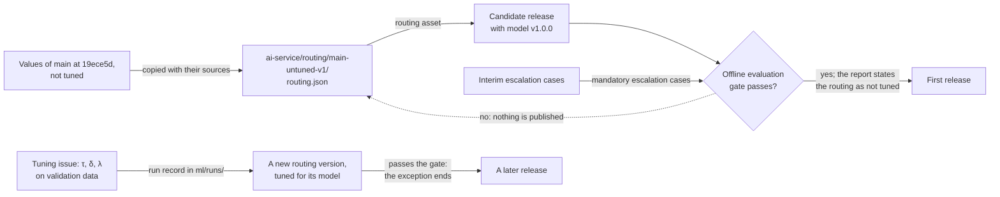

# ADR-0025: Routing configuration of the first release

- **Status:** Accepted
- **Date:** 2026-11-17
- **Deciders:** Project lead
- **Related:** [Requirements](../product/requirements.md) (FR-06, [ESC-01 to ESC-05](../product/requirements.md#41-escalation-and-fallback-rules)), [ADR-0005](0005-intent-independent-retrieval.md) (statements 3 and 5), [ADR-0021](0021-repository-layout-and-ai-ml-migration.md) ([Where the code of `main` goes](0021-repository-layout-and-ai-ml-migration.md#where-the-code-of-main-goes), [Release and the offline evaluation gate](0021-repository-layout-and-ai-ml-migration.md#release-and-the-offline-evaluation-gate), [Exception to TEST-26](0021-repository-layout-and-ai-ml-migration.md#exception-to-test-26)), [contracts v1 design, Authority rule](../design/contracts-v1.md#authority-rule-fr-06), [data and ML rules](../rules/data-and-ml.md#models-and-artifacts) (DATA-56 to DATA-58), [ARCH-36 and ARCH-40](../rules/architecture.md#versioned-assets), [WF-22 to WF-24](../rules/workflow.md#technical-debt), [`ai-service` README, Asset formats](../../ai-service/README.md#asset-formats), [interim escalation cases](../../eval/suites/escalation/interim-v1/README.md)

## Context

The first release manifest of `ai-service` needs a routing configuration asset, and none exists. This ADR records which values that first configuration holds, and the exceptions to the rules that those values need. The project lead decided its content on 2026-11-17: the values of `main`, not tuned, as an exception to DATA-58 that ends with a tuning issue; every sensitive term of `main`, the dispute and exception terms included; and model `v1.0.0`. Every fact below was checked on 2026-11-17 in the worktree of `build/join-main` and in the organization branch `main` at `19ece5d`, read with `git show`.

### What the rules ask

- [DATA-58](../rules/data-and-ml.md#models-and-artifacts): the routing configuration is a versioned file with τ, δ, the rerank weight λ, the list of sensitive intents, and the sensitive-term list. "τ, δ, and λ are tuned on validation data for one model artifact version, and the file records that version." Each entry of the sensitive-term list states its category and "is reviewed by the policy owner and the RAG engineer".
- [ADR-0005](0005-intent-independent-retrieval.md#decision), statement 3: "λ is tuned on validation data only." Statement 5: "Thresholds are tuned on validation data and stored in versioned configuration."
- [DATA-56](../rules/data-and-ml.md#models-and-artifacts): `ai-service` refuses a manifest whose routing configuration was tuned for another model artifact version than the one the manifest names.
- The [requirements](../product/requirements.md#41-escalation-and-fallback-rules), DATA-58, and the [contracts v1 design](../design/contracts-v1.md#authority-rule-fr-06) described the sensitive-term list as a signal for legal claims and suspected fraud only, and the requirements said that policy exceptions have no signal of their own.

### What the reader of `ai-service` accepts

[`suggestions/adapters/routing_file.py`](../../ai-service/src/supportiq_ai_service/suggestions/adapters/routing_file.py) reads one JSON file in the interim format `supportiq-routing-configuration/interim-1`. It needs exactly these fields: `version`, `model_version`, `min_top_probability` (τ), `min_top_two_gap` (δ), `rerank_weight` (λ), `high_band_min_probability`, `sensitive_intents`, `sensitive_intent_min_probability`, and `sensitive_terms`. The format holds one τ and one δ for every intent. Each term is lowercase whole words joined by one space, apostrophe, or hyphen, with one of the five categories of FR-06 (`refund_decision`, `transaction_dispute`, `policy_exception`, `legal_claim`, `suspected_fraud`). A list without a `legal_claim` term and a `suspected_fraud` term, or without `request_refund` among the sensitive intents, is refused.

### What `main` has

- **No tuned values.** `ml/runs/` does not exist, so no run records a tuning ([DATA-30](../rules/data-and-ml.md#experiments-and-reproducibility)). The out-of-fold predictions of `main` (`artifacts/training/distilbert_cv/oof_predictions.csv`) hold the columns `sample_id`, `fold`, `y_true`, and `y_pred`, and no probabilities, so they cannot tune a threshold. The model artifact of the join has no calibration ([`ai-service` README, Known limits](../../ai-service/README.md#known-limits)). `intent_policy.v2.json` states `approved_by` `lead_ml_engineer` and `approval_date` `2026-11-04`, and names no model version and no tuning data.
- **The model.** The only model version that the records of `main` name is `v1.0.0`: `apps/ml_inference/app.py` line 20, and `eval/configs/autoeval_baseline.json` lines 24 and 25, which pin it with the weights SHA-256 `dc7af8cffb19fe7711ed5a5d0137ffff3d7d1a1f43bad5a35edff8c8de4c1302`.
- **The values.** Serving on `main` read them from `intent_policy.v2.json`, which the join keeps byte for byte as [`eval/suites/system/inputs/intent_policy.v2.json`](../../eval/suites/system/inputs/intent_policy.v2.json), and from its code:

| Value | Value in `main` | Source in `main` | How `main` applied it |
|---|---|---|---|
| τ | `default_confidence_threshold` 0.70, and 12 per-intent values in `confidence_thresholds`, one for each in-scope intent, from 0.60 to 0.80 | `intent_policy.v2.json` lines 26 and 28 to 41 | `apps/ai_service/engine.py` line 63: the per-intent value of the label, the default otherwise |
| δ | `default_margin_threshold` 0.10, and 0.15 in `margin_thresholds` for `cancel_order`, `request_refund`, and `return_product` | `intent_policy.v2.json` lines 27 and 42 to 46 | `engine.py` line 64. The margin is the top-1 probability minus the top-2 probability (`apps/ml_inference/app.py` line 715) |
| λ | `LAMBDA_INTENT = 0.15` | `apps/core_backend/retrieval/adapter.py` line 214 | Line 223: a fixed 0.15 is added to a document whose supported intents hold the top-1 intent |
| High band | 0.9 | `engine.py` line 186 | The band is `high` from a probability of 0.9 |
| Sensitive intents | `sensitive_action_intents`: `cancel_order`, `request_refund`, `return_product`, `payment_issue` | `intent_policy.v2.json` lines 20 to 25 | `engine.py` lines 113 to 120: the label, the model's top intent, or a candidate with a probability of at least `default_margin_threshold` sets `requires_authority` |
| Minimum probability of a sensitive intent | 0.10, the value of `default_margin_threshold` | `engine.py` line 118 | As above |
| Sensitive terms | `SENSITIVE_AUTHORITY_PATTERN`, one regular expression | `apps/core_backend/safety.py` lines 21 to 34 | `has_authority_request`, lines 145 to 162, which also skips a denied dispute or exception and adds the manager escalation pattern of lines 36 to 39 |

- **The per-intent values of τ.** `track_order`, `delivery_time`, `shipping_costs`, `return_policy`, `refund_policy`, and `refund_status` have 0.65; `human_agent` 0.60; `delivery_issue` 0.70; `payment_issue` 0.75; `cancel_order`, `return_product`, and `request_refund` 0.80.

### What the first release changes

- It serves no KB document version ([ADR-0021, KB ingestion](0021-repository-layout-and-ai-ml-migration.md#kb-ingestion), statement 5). Every request therefore carries `no_valid_document` and abstains, except a `human_agent` request, which is escalated. λ reranks no document, and τ and δ change only the reason code `low_confidence` and the confidence band, never the recommendation.
- Probabilities sum to 1. With τ 0.70, a top-1 probability of at least 0.70 leaves at most 0.30 to the second intent, so the gap is at least 0.40 and δ 0.10 never decides alone. The same held in `main`, whose lowest τ was 0.60 and highest δ 0.15.
- The rewrite of `SENSITIVE_AUTHORITY_PATTERN` as whole-word terms gives the 53 terms of [Sensitive terms](#sensitive-terms). Each one is matched in full by the pattern of `main` and flagged by its `has_authority_request`, checked on 2026-11-17. 32 of them are dispute and exception terms, which the requirements text did not describe.

## Decision drivers

1. **Safety:** no authority signal of `main` is dropped without a record, and every signal can only add the authority requirement, never remove it (FR-06, guardrail 1).
2. **Correct evidence:** no value is presented as tuned, and every value names its source in `main`; nothing is invented ([DATA-48](../rules/data-and-ml.md#evaluation-and-reporting)).
3. **Traceability:** the configuration is one versioned file with its model version (DATA-56, DATA-58, [ARCH-40](../rules/architecture.md#versioned-assets)), and each exception has a removal condition ([WF-24](../rules/workflow.md#technical-debt)).
4. **Effort:** the first release can be built and gated in the join, without waiting for a tuning run that needs new model outputs.

## Considered options

1. The values of `main`, not tuned, with all 53 terms, as a recorded exception to DATA-58 that a tuning issue ends.
2. Tune τ, δ, and λ on validation data before the first release.
3. The values of `main`, not tuned, with only the 21 `legal_claim` and `suspected_fraud` terms, as the requirements text described.
4. The values of `main`, not tuned, with the strictest per-intent values of `main` for every intent: τ 0.80 and δ 0.15.

## Decision

We adopt option 1. The statements below are normative.

### The configuration

1. We will serve the routing configuration version `main-untuned-v1` in the first release. Its source is [`ai-service/routing/main-untuned-v1/routing.json`](../../ai-service/routing/main-untuned-v1/routing.json), next to the prompt sources in `ai-service/prompts/`, and the release command copies it into the routing asset. Its `model_version` is `v1.0.0`.
2. Each value comes from `main` at `19ece5d`, as this table states. None is tuned.

   | Field | Value | Source in `main` |
   |---|---|---|
   | `min_top_probability` (τ) | 0.70 | `intent_policy.v2.json`, `default_confidence_threshold` (line 26) |
   | `min_top_two_gap` (δ) | 0.10 | `intent_policy.v2.json`, `default_margin_threshold` (line 27) |
   | `rerank_weight` (λ) | 0.15 | `apps/core_backend/retrieval/adapter.py`, `LAMBDA_INTENT` (line 214) |
   | `high_band_min_probability` | 0.90 | `apps/ai_service/engine.py`, line 186 |
   | `sensitive_intents` | `cancel_order`, `request_refund`, `return_product`, `payment_issue` | `intent_policy.v2.json`, `sensitive_action_intents` (lines 20 to 25) |
   | `sensitive_intent_min_probability` | 0.10 | `apps/ai_service/engine.py`, line 118, which reads `default_margin_threshold` |
   | `sensitive_terms` | The 53 terms of [Sensitive terms](#sensitive-terms) | `apps/core_backend/safety.py`, lines 21 to 34 |

3. The format holds one τ and one δ, so the per-intent values of `main` are not served. They stay in `intent_policy.v2.json` as an input of the tuning issue.
4. The routing rules of `ai-service` apply the values as the [contracts v1 design](../design/contracts-v1.md#authority-rule-fr-06) and the [`ai-service` README, Routing](../../ai-service/README.md#routing) state, which differs from `main` in three ways:
   - λ multiplies the probability of the intents that the mapping gives a document, where `main` added a fixed 0.15;
   - a sensitive intent counts from 0.10 wherever it stands in the distribution, and a staff choice replaces the distribution, where `main` also counted the label and the model's top intent at any probability;
   - a sensitive term only adds `requires_authority`, and only `human_agent` leads to `escalate`, where `main` escalated on an authority term.

### Sensitive terms

1. We will keep all 53 terms that `SENSITIVE_AUTHORITY_PATTERN` of `main` names, rewritten as whole-word terms, in five groups:

   | Group | Lines of `safety.py` | Terms | Count | Category |
   |---|---|---|---|---|
   | Fraud | 23 | fraud, fraudulent, defraud, defrauded | 4 | `suspected_fraud` |
   | Legal claims | 24 | lawsuit, legal action, legal dispute, legal claim, attorney, lawyer, court | 7 | `legal_claim` |
   | Disputes | 25 | chargeback, dispute, disputed, disputes | 4 | `transaction_dispute` |
   | Unauthorized transactions | 26 to 28 | unauthorized; transaction, payment, charge, debit, purchase, order, and refund, each followed by "not authorized"; not authorized by me, not authorized to charge | 10 | `suspected_fraud` |
   | Exceptions | 29 to 31 | policy, refund, return, order, warranty, manager, and supervisor, each followed by "exception"; make, request, grant, approve, demand, ask for, need, want, and seek, each followed by "an exception" and by "exception"; exception request, exception to, exception clause | 28 | `policy_exception` |

2. The rewrite differs from the pattern of `main` in these points, and each is part of this decision:
   - "unauthorized" alone covers the eight phrases of line 26, such as "unauthorized payment";
   - line 27 allowed up to 20 characters between the noun and "not authorized"; a term matches only adjacent words, so "the payment was not authorized" is no longer flagged by a term;
   - `main` skipped a denied dispute ("there is no dispute") and a denied exception ("I don't need an exception"), and line 29 skipped words such as "return exception window"; the terms flag them too;
   - line 30 also matched "a exception"; those forms are left out;
   - the manager escalation pattern of lines 36 to 39 is not a term: a request for a manager or a person is ESC-03 (b), `human_agent_requested` without authority ([requirements, Appendix](../product/requirements.md#appendix-clarifications-of-the-submitted-specification), row 4).
3. The sentences of the requirements, of DATA-58, and of the contracts v1 design that limited the term list to legal claims and suspected fraud now name the dispute and exception terms and cite this ADR. They change in the same change as the routing file.

### Exception to DATA-58

This exception does not end with the merge of the join PR.

1. This ADR weakens exactly these passages, for the routing configuration `main-untuned-v1` only:
   - DATA-58: "τ, δ, and λ are tuned on validation data for one model artifact version". The file records `v1.0.0`, the model the values are served with, not a model they were tuned for;
   - DATA-58: each entry of the sensitive-term list "is reviewed by the policy owner and the RAG engineer". The project lead's approval of this ADR stands in for that review;
   - [ADR-0005](0005-intent-independent-retrieval.md#decision), statement 3, "λ is tuned on validation data only", and statement 5, "Thresholds are tuned on validation data". The rest of ADR-0005 still holds.
2. One issue labeled `tech-debt` tunes τ, δ, and λ on validation data for the model artifact of the release, with a run record in `ml/runs/<run_id>/` ([DATA-30](../rules/data-and-ml.md#experiments-and-reproducibility)), never on test data ([DATA-25](../rules/data-and-ml.md#leakage)). Its result is a new routing version with a new name, which passes the offline evaluation gate before it is served. The exception ends when that version is published.
3. Every report of the gate and every release record that uses `main-untuned-v1` states that its routing values are not tuned, with a link to this ADR.

### Passages of ADR-0021 that this ADR replaces

1. In [Where the code of `main` goes](0021-repository-layout-and-ai-ml-migration.md#where-the-code-of-main-goes), row `apps/core_backend/config/policies/intent_policy.v2.json`, the words "The routing configuration of `ai-service` is a new versioned file derived from it ([DATA-58](../rules/data-and-ml.md#models-and-artifacts))" become "The routing configuration of `ai-service` is a new versioned file derived from it and from the code of `main`, not tuned in the first release ([ADR-0025](0025-routing-configuration-of-the-first-release.md))".
2. In [Release and the offline evaluation gate](0021-repository-layout-and-ai-ml-migration.md#release-and-the-offline-evaluation-gate), statement 4, the words "three known gaps" become "four known gaps", and a fourth item follows the third: "the routing configuration is not tuned on validation data: its values are those of `main` ([ADR-0025](0025-routing-configuration-of-the-first-release.md))".
3. The rest of ADR-0021 still holds. The interim escalation cases of [Exception to TEST-26](0021-repository-layout-and-ai-ml-migration.md#exception-to-test-26), statement 2, are written for `main-untuned-v1` and are in [`eval/suites/escalation/interim-v1/`](../../eval/suites/escalation/interim-v1/README.md).

## Consequences

### Positive

- The first release has a complete routing asset, and `ai-service` can start with it.
- Every value names its source in `main`, and no report can mistake the values for tuned ones.
- No authority term of `main` is lost, and its dispute and exception terms give FR-06 a signal for transaction disputes and policy exceptions.
- In the first release, the untuned values change no recommendation: without KB documents, every request abstains or is escalated whatever τ, δ, and λ are.

### Negative

- τ, δ, and λ are not tuned, and the probabilities are not calibrated. The routing of later releases rests on them until the tuning issue closes.
- One τ replaces the 12 per-intent values of `main`: it is stricter for 7 intents (0.60 or 0.65 in `main`) and looser for 4 (0.75 or 0.80 in `main`). One δ replaces the 0.15 of three intents. With these values, δ never changes an outcome.
- `cancel_order`, `return_product`, and `payment_issue` set the authority requirement, as in `main`, although FR-06 names refunds, transaction disputes, and policy exceptions. More tickets go to managers, and the flag is never cleared ([contracts v1 design, Authority rule](../design/contracts-v1.md#authority-rule-fr-06)).
- Single common words, such as "court", "dispute", and "unauthorized", and denied disputes or exceptions set a permanent manager requirement.
- "The payment was not authorized" and "speak to a manager" no longer set the authority requirement through a term. The first can still set it through the sensitive intent `payment_issue`; how often is not measured.
- The project lead's approval replaces the review of the terms by the policy owner and the RAG engineer, and the exception stays until the tuning issue closes.

### Follow-ups

- The tuning issue of [Exception to DATA-58](#exception-to-data-58), statement 2, labeled `tech-debt`, with this ADR as its reason ([WF-22](../rules/workflow.md#technical-debt)).
- The data contract for the release manifest and its asset formats ([ADR-0021, Follow-ups](0021-repository-layout-and-ai-ml-migration.md#follow-ups)) decides whether τ and δ can be set per intent, through the [contract-first process](../rules/contracts.md#contract-first-process).

## Pros and cons of the options

### The values of `main`, not tuned, with all 53 terms

- Good, because every value exists and has a source, the first release can be gated now, and no authority term of `main` is lost.
- Bad, because it breaks DATA-58 and ADR-0005 for a time, and it sends more tickets to managers than the requirements text described.

### Tune τ, δ, and λ before the first release

- Good, because it meets DATA-58 and ADR-0005 without an exception.
- Bad, because no validation probabilities exist: the out-of-fold predictions hold only labels, so tuning needs a new run of the model first, and the join waits for it.
- Bad, because values tuned on uncalibrated probabilities need a new tuning once calibration exists.

### The values of `main` with only the legal-claim and suspected-fraud terms

- Good, because the term list follows the requirements text as it was.
- Bad, because it drops the 32 dispute and exception terms of `main`, so a transaction dispute or a policy exception that no sensitive intent catches reaches staff without the authority requirement.

### The strictest per-intent values of `main` for every intent

- Good, because no intent gets a lower τ or δ than in `main`.
- Bad, because τ 0.80 is a per-intent value of three intents, not the default of `main`, and it is stricter than `main` for 9 intents, which sends more tickets to staff for confirmation once a KB version is served.
- Bad, because it changes no outcome of the first release either, so it buys nothing until the tuning issue closes.

## Validation

- The reader of `ai-service` loads `routing.json` with model version `v1.0.0`, and the check that every sensitive intent is a label of the model passes; another model version is refused (checked on 2026-11-17).
- Each of the 53 terms is matched in full by `SENSITIVE_AUTHORITY_PATTERN` of `main` (checked on 2026-11-17).
- The [`ai-service` README](../../ai-service/README.md#asset-formats) names the routing sources in `ai-service/routing/<routing_version>/`, and `ai-service/tests/unit/suggestions/test_routing_sources.py` checks that `main-untuned-v1` is a valid routing asset with the values of [The configuration](#the-configuration) and exactly the 53 terms with their categories, as `test_prompt_sources.py` does for the prompts.
- The candidate release with `main-untuned-v1` passes `verify_candidate`, and the first gate run passes the interim escalation cases, with the report stating the routing values as not tuned.
- Revisit when the tuning issue closes, when calibration of the intent model arrives, when a KB version is served (τ, δ, and λ then change recommendations), when the shared scenario set arrives, or when the data contract of the routing format is written.

## Open questions

None. The project lead decided both questions of the draft on 2026-11-17:

- **Category of the unauthorized-transaction terms:** the ten unauthorized-transaction terms keep the category `suspected_fraud`, as [Sensitive terms](#sensitive-terms) states.
- **Review of the terms:** the project lead's approval stands in for the review of the terms by the policy owner and the RAG engineer of DATA-58, as [Exception to DATA-58](#exception-to-data-58), statement 1, states.
