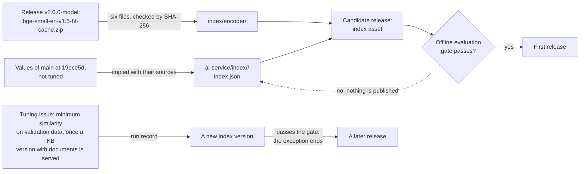

# ADR-0027: Retrieval index configuration of the first release

- **Status:** Proposed
- **Date:** 2026-11-17
- **Deciders:** Project lead
- **Related:** [ADR-0005](0005-intent-independent-retrieval.md) (statement 5), [ADR-0018](0018-hosting-of-ai-service-on-modal.md) ([Artifact store](0018-hosting-of-ai-service-on-modal.md#artifact-store)), [ADR-0021](0021-repository-layout-and-ai-ml-migration.md) ([KB ingestion](0021-repository-layout-and-ai-ml-migration.md#kb-ingestion), [Python and dependencies](0021-repository-layout-and-ai-ml-migration.md#python-and-dependencies), [Release and the offline evaluation gate](0021-repository-layout-and-ai-ml-migration.md#release-and-the-offline-evaluation-gate)), [ADR-0025](0025-routing-configuration-of-the-first-release.md), [data and ML rules](../rules/data-and-ml.md#models-and-artifacts) (DATA-56), [ARCH-40](../rules/architecture.md#versioned-assets), [WF-22 to WF-24](../rules/workflow.md#technical-debt), [`ai-service` README, Asset formats](../../ai-service/README.md#asset-formats)

## Context

The first release manifest of `ai-service` needs an index asset: `index.json` and the files of the encoder. No index configuration exists in this repository. This ADR records which values the first configuration holds, and the exception to ADR-0005 that one of them needs. The project lead decided on 2026-11-17 that the untuned values of `main` get a short ADR shaped like [ADR-0025](0025-routing-configuration-of-the-first-release.md). Every fact below was checked on 2026-11-17 in the worktree of `build/join-main` and in the organization branch `main` at `19ece5d`, read with `git show`.

### What the rules ask

- [ADR-0005](0005-intent-independent-retrieval.md#decision), statement 5: "Thresholds are tuned on validation data and stored in versioned configuration."
- [DATA-56](../rules/data-and-ml.md#models-and-artifacts) and [ARCH-40](../rules/architecture.md#versioned-assets): the index is a versioned asset of the release manifest, identified by its version and checksums.
- [ADR-0018, Artifact store](0018-hosting-of-ai-service-on-modal.md#artifact-store), and its Egress section, statement 2: the encoder is stored as an asset of the GitHub Releases of the organization repository, ships with each release, and is never downloaded at runtime.
- [ADR-0021, Python and dependencies](0021-repository-layout-and-ai-ml-migration.md#python-and-dependencies), statement 4: the choice of the embedding model, `BAAI/bge-small-en-v1.5`, is not decided there and has its own `tech-debt` issue.

### What the reader of `ai-service` accepts

[`retrieval/adapters/index_file.py`](../../ai-service/src/supportiq_ai_service/retrieval/adapters/index_file.py) reads `index.json` in `supportiq-retrieval-index/interim-1`: its `version`; the `kb_version` it indexes, which must be the KB of the release; the encoder's `name`, `directory`, `query_prefix` (at most 200 characters), and `max_length` (1 to 512); the chunking, `max_tokens` (1 to 512) and `overlap_tokens` (below `max_tokens`); and `relevance_min_score`, from 0 to 1. The folder of the encoder holds `config.json`, `model.safetensors`, `tokenizer.json`, `tokenizer_config.json`, and its other files, and no file of another asset. `ai-service` builds the index at startup from the KB of the release and cuts each document as `main` did ([`chunking.py`](../../ai-service/src/supportiq_ai_service/retrieval/adapters/chunking.py)).

### What `main` has

- **No tuned values.** No run of `main` tunes a retrieval value: the only run record, [`ml/runs/distilbert_cv/`](../../ml/runs/distilbert_cv/README.md), is of the intent model.
- **The values.** Serving on `main` took them from its code:

| Value | Value in `main` | Source in `main` |
|---|---|---|
| Encoder | `BAAI/bge-small-en-v1.5` | `apps/core_backend/retrieval/encoder.py`, line 8, `BGE_MODEL_NAME` |
| Query prefix | `"Represent this sentence for searching relevant passages: "` (with its final space) | `encoder.py`, line 9, `QUERY_PREFIX`, put before each query on line 124 |
| Tokens that the encoder reads | 512, for queries and passages | `encoder.py`, line 150 |
| Tokens of a chunk | 480 | `encoder.py`, line 20, the default of `chunk_policy` |
| Tokens that two chunks share | 40 | `encoder.py`, line 21, the default of `chunk_policy` |
| Minimum similarity of a relevant chunk | 0.55 | `apps/core_backend/retrieval/adapter.py`, line 50, the default of `RetrievalAdapter`, which `apps/ai_service/main.py`, line 133, builds without another value |

- **The encoder files.** `main` downloaded the encoder from Hugging Face at startup ([ADR-0021, What `main` holds](0021-repository-layout-and-ai-ml-migration.md#what-main-holds)). The release `v2.0.0-model` of the organization repository holds `bge-small-en-v1.5-hf-cache.zip` (SHA-256 `90b90854c719403d5c972a8889bf650f88336dd379ad15fe925b3f9ac0d6022e`): the Hugging Face snapshot `5c38ec7c405ec4b44b94cc5a9bb96e735b38267a` of the encoder, as regular files.

### What the first release changes

- It serves no KB document version ([ADR-0021, KB ingestion](0021-repository-layout-and-ai-ml-migration.md#kb-ingestion), statement 5), so its index holds no chunk. No search returns a document, every request carries `no_valid_document`, and none of these values changes an outcome yet. The encoder still loads and embeds each query.

## Decision drivers

1. **Correct evidence:** no value is presented as tuned, and every value names its source in `main`; nothing is invented ([DATA-48](../rules/data-and-ml.md#evaluation-and-reporting)).
2. **Traceability:** the configuration is one versioned file, the encoder files are pinned by checksum, and the exception has a removal condition ([WF-24](../rules/workflow.md#technical-debt)).
3. **Reliability:** `ai-service` loads the encoder from the release only, never from the network at runtime ([ADR-0018](0018-hosting-of-ai-service-on-modal.md)).
4. **Effort:** the first release can be built and gated in the join, without a tuning run that needs KB documents first.

## Considered options

1. The values of `main`, not tuned, with the encoder files of the release `v2.0.0-model`, as a recorded exception to ADR-0005 statement 5 that a tuning issue ends.
2. Tune the minimum similarity on validation data before the first release.
3. Download the encoder from Hugging Face at a pinned revision instead of the release asset.

## Decision

We adopt option 1. The statements below are normative.

### The configuration

1. We will serve the index configuration version `bge-small-en-v1.5-main-untuned-v1-kb-v2` in the first release. Its source is [`ai-service/index/bge-small-en-v1.5-main-untuned-v1-kb-v2/index.json`](../../ai-service/index/bge-small-en-v1.5-main-untuned-v1-kb-v2/index.json), next to the routing sources in `ai-service/routing/`, and the release command copies it into the index asset at the path `index`. Its `kb_version` is `v2`.
2. Each value comes from `main` at `19ece5d`, as this table states. None is tuned.

   | Field | Value | Source in `main` |
   |---|---|---|
   | `encoder.name` | `BAAI/bge-small-en-v1.5` | `encoder.py`, line 8 |
   | `encoder.query_prefix` | `"Represent this sentence for searching relevant passages: "` (with its final space) | `encoder.py`, line 9 |
   | `encoder.max_length` | 512 | `encoder.py`, line 150 |
   | `chunking.max_tokens` | 480 | `encoder.py`, line 20 |
   | `chunking.overlap_tokens` | 40 | `encoder.py`, line 21 |
   | `relevance_min_score` | 0.55 | `adapter.py`, line 50 |

3. The encoder files of the index asset are the six files of the snapshot `5c38ec7c405ec4b44b94cc5a9bb96e735b38267a` in `bge-small-en-v1.5-hf-cache.zip` of the release `v2.0.0-model`: `config.json`, `model.safetensors`, `special_tokens_map.json`, `tokenizer.json`, `tokenizer_config.json`, and `vocab.txt`, with the checksums that the [README of the source](../../ai-service/index/bge-small-en-v1.5-main-untuned-v1-kb-v2/README.md) lists. They go into `index/encoder/` of the release; the rest of the archive belongs to the cache layout.
4. This ADR does not choose the embedding model. That choice stays with the `tech-debt` issue of [ADR-0021, Python and dependencies](0021-repository-layout-and-ai-ml-migration.md#python-and-dependencies), statement 4.

### Exception to ADR-0005

This exception does not end with the merge of the join PR.

1. This ADR weakens exactly one passage, for the index configuration `bge-small-en-v1.5-main-untuned-v1-kb-v2` only: [ADR-0005](0005-intent-independent-retrieval.md#decision), statement 5, "Thresholds are tuned on validation data", for the minimum similarity `relevance_min_score`. The rest of ADR-0005 still holds.
2. One issue labeled `tech-debt` tunes `relevance_min_score` on validation data, once a KB version with document versions is served, with a run record of its own ([DATA-30](../rules/data-and-ml.md#experiments-and-reproducibility)), never on test data ([DATA-25](../rules/data-and-ml.md#leakage)). Its result is a new index version with a new name, which passes the offline evaluation gate before it is served. The exception ends when that version is published.
3. The README of the source and the Known limits of the [`ai-service` README](../../ai-service/README.md#known-limits) state that the index values are not tuned, with a link to this ADR.

## Consequences

### Positive

- The first release has a complete index asset, and `ai-service` starts without any download.
- Every value names its source in `main`, and the encoder files are pinned by checksum, so no report can mistake the values for tuned ones.
- In the first release, the untuned values change no outcome: without KB documents, the index holds no chunk.

### Negative

- The minimum similarity is not tuned. The first release that serves KB documents uses 0.55 until the tuning issue closes, so relevant documents can be dropped or weak ones kept.
- The chunk length and the overlap are not measured against retrieval quality either; only the minimum similarity is a threshold of ADR-0005, but none of the values has evidence behind it.
- The encoder files come from a cache archive of `main`, not from a download that this repository can repeat. The snapshot ID names the revision of Hugging Face, but nothing here downloads it again.

### Follow-ups

- The tuning issue of [Exception to ADR-0005](#exception-to-adr-0005), statement 2, labeled `tech-debt`, with this ADR as its reason ([WF-22](../rules/workflow.md#technical-debt)).
- A new index version for each new KB version, since the version names its KB.

## Pros and cons of the options

### The values of `main`, not tuned, with the encoder files of the release

- Good, because every value and every file exists and has a source, the encoder ships with the release as ADR-0018 asks, and the first release can be gated now.
- Bad, because it breaks ADR-0005 statement 5 for a time.

### Tune the minimum similarity before the first release

- Good, because it meets ADR-0005 without an exception.
- Bad, because the KB of the first release holds no document, so no validation query can be scored against it, and the join waits for a KB version.

### Download the encoder from Hugging Face at a pinned revision

- Good, because the download can be repeated from a public source.
- Bad, because it adds a second source for the same files, while ADR-0018 stores the encoder as a release asset, and the archive of the release already pins the revision and every checksum.

## Validation

- [`ai-service/tests/unit/retrieval/test_index_sources.py`](../../ai-service/tests/unit/retrieval/test_index_sources.py) checks that the source is a valid index asset for the KB version `v2`, with the values of [The configuration](#the-configuration).
- The candidate release with this index passes `verify_candidate`, and `ai-service` loads the encoder from `index/encoder/` offline during the first gate run.
- Revisit when the tuning issue closes, when a KB version with documents is served, or when the issue on the embedding model decides another encoder.

## Open questions

- **A known gap of the gate.** Whether the record of each gate run names the untuned index as a fifth known gap, as it names the untuned routing ([ADR-0021, Release and the offline evaluation gate](0021-repository-layout-and-ai-ml-migration.md#release-and-the-offline-evaluation-gate), statement 4). Recommended default: not while the release serves no KB document, because no index value changes an outcome; the first release that serves one adds it, in the same change as the KB version.
