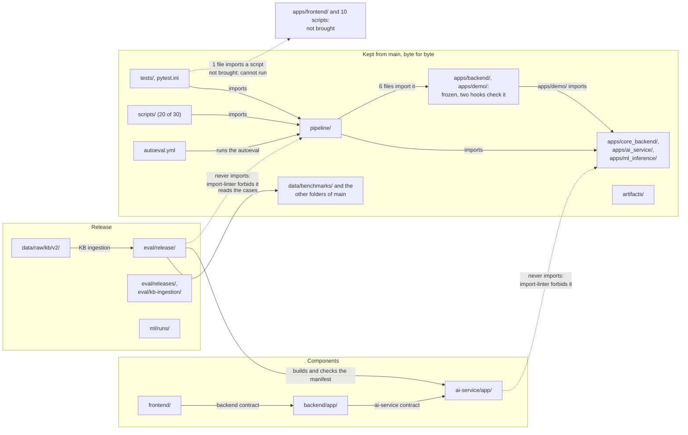
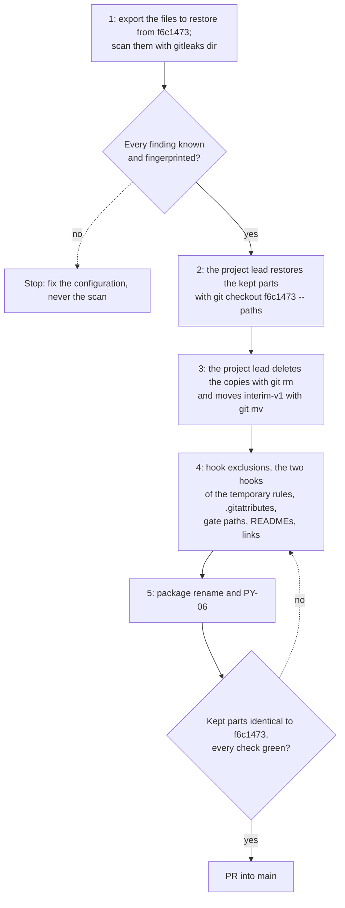

# ADR-0028: Repository layout for the pull request into `main`

- **Status:** Accepted
- **Date:** 2026-11-20
- **Deciders:** Project lead
- **Related:** [ADR-0001](0001-system-architecture.md), [ADR-0003](0003-tech-stack.md), [ADR-0018](0018-hosting-of-ai-service-on-modal.md), [ADR-0021](0021-repository-layout-and-ai-ml-migration.md), [ADR-0025](0025-routing-configuration-of-the-first-release.md), [ADR-0026](0026-frozen-intent-scenario-set.md), [architecture rules](../rules/architecture.md) (ARCH-07, ARCH-08), [Python rules](../rules/python.md) (PY-06, PY-07), [data and ML rules](../rules/data-and-ml.md) (DATA-06, DATA-08, DATA-30, DATA-59), [security and privacy rules](../rules/security-and-privacy.md) (SEC-02, SEC-04, SEC-07, SEC-08), [workflow rules](../rules/workflow.md) (WF-19, WF-22 to WF-24), [engineering rules](../rules/README.md#enforcement) (RULE-03), [repository checks](../guides/repository-checks.md)

## Context

[ADR-0021](0021-repository-layout-and-ai-ml-migration.md) moved the AI and ML code of `main` into `ml/` and `eval/` on `build/join-main`. On 2026-11-20 the project lead set a new goal for the pull request (PR) into `main`: open it soon, change no part that another member owns, and keep every file of `main` byte for byte at its path, unless this ADR names the file. Every fact below was checked on 2026-11-20 with read-only git commands on `org/main` at `f6c1473` and `build/join-main` at `b48649b`, unless a source is named.

### The two sides

- The merge base of the two branches is `e677f77` (2026-11-14). `main` has one commit after it, `f6c1473` (2026-11-19): it deletes 63 documents, changes 7, adds 1, changes `README.md`, and deletes 2 root files (`git diff --name-status e677f77 org/main`).
- `main` holds these parts (`git ls-tree -r --name-only org/main -- <path> | wc -l`):

| Part of `main` | Files |
|---|---|
| `pipeline/` | 88 |
| `artifacts/` | 1,136 |
| `tests/`, and `pytest.ini` at the root | 108 and 1 |
| `data/`: `benchmarks/`, `business/`, `datasets/`, `intent/`, `knowledge/` | 60: 38, 2, 1, 12, 7 |
| `apps/__init__.py`, `apps/core_backend/`, `apps/ai_service/`, `apps/ml_inference/`, `apps/demo/`, `apps/backend/` | 1, 21, 6, 4, 9, 27 |
| `apps/frontend/` | 47 |
| `scripts/` | 30 |
| `docs/` | 76 |
| `contracts/backend.openapi.json`, `.github/workflows/autoeval.yml`, `monitoring/`, `DESIGN.md`, `PRODUCT.md`, `TODO`, `.env.example` | 1 each |

- On `build/join-main`, most files of `ml/`, `eval/`, and `data/` have the same blob as a file of `main` (`git ls-tree -r` of both branches, blob IDs compared):

| Folder of `build/join-main` | Files | Same blob as a file of `main` | Written here |
|---|---|---|---|
| `ml/` | 28 | 21, among them `ml/runs/distilbert_cv/fold_metrics.csv` (= `artifacts/training/distilbert_cv/fold_metrics.csv`) | 7: `ml/README.md`, the other 3 of the 4 files of `ml/runs/distilbert_cv/`, and 3 changed Python files |
| `eval/src/` | 24 | 19 | 5 |
| `eval/tests/` | 19 | 16 | 3 |
| `eval/configs/` | 7 | 4 | 3 |
| `eval/suites/` | 49 | 37: 36 of `data/`, and `apps/core_backend/config/policies/intent_policy.v2.json` | 12: the 3 files of `escalation/interim-v1/`, and 9 READMEs |
| `eval/release/`, `eval/releases/`, `eval/kb-ingestion/`, `eval/README.md` | 93, 3, 3, 1 | 0 | All |
| `data/` | 7 | 7: `raw/kb/v2/approved_kb.v2.json` (= `data/knowledge/approved_kb.v2.json`), `raw/kb/v2/kb-release.json` (= `apps/ai_service/kb-release.json`), the 4 files of `raw/knowledge/`, and `datasets/.gitkeep` | 0 |

### Imports

- `apps/__init__.py`, `apps/core_backend/`, `apps/ai_service/`, and `apps/ml_inference/` import neither `apps.backend`, `apps.demo`, nor `apps.frontend`, at any depth. `apps/demo/` imports only `apps.core_backend` and itself (`app.py:10-13`, `service.py:7-9`). `apps/backend/` imports only itself: its 14 absolute and 18 relative import lines name no other module of the repository. No kept file imports `apps.frontend`.
- `apps/backend/` reads `data/knowledge/mock_orders.json` (`seed.py:39`), `.local/application.json` at the root (`manage.py:17-18`), and settings with the prefix `SUPPORTIQ_` from the root `.env` and `.local/backend.env` (`platform/config.py:5` and `:10`). It serves `apps/frontend/dist/` only when that folder exists (`main.py:324`), and otherwise answers other paths with a message (`main.py:338`). `apps/frontend/` is not in the tree, so this repository's `frontend/dist/` is never served by it.
- The system evaluation of `pipeline/` needs `apps/demo/`: `run_evaluation.py:39` imports `run_system_evaluation.py`, whose line 22 imports `system_execution.py`, whose line 26 reads `from apps.demo.app import create_app`. `create_app` creates the folder `apps/demo/static/` if it is missing and mounts it (`app.py:123-124`). `pipeline/evaluation/system_server.py` serves that app on a free loopback port during an evaluation run (line 233).
- With `apps/backend/` and `apps/demo/` kept, all 64 Python files of `pipeline/` and the 18 Python scripts that are taken ([Scripts](#scripts)) import. 3 files of `pipeline/evaluation/` import `apps.backend` directly: `application_acceptance.py`, `fault_boundary_runner.py`, and `flash_lite_acceptance.py`; `guard_corrections_verifier.py:32` imports `fault_boundary_runner`. These 4 are the acceptance runners of the application of `main` (the docstrings of `application_acceptance.py:4`, `fault_boundary_runner.py:5`, and `flash_lite_acceptance.py:9`). They start that application in their own process with `TestClient` (for example `application_acceptance.py:448-449`) and, as on `main`, need a PostgreSQL database whose owner URL comes from `SUPPORTIQ_APPLICATION_SECRETS`, a given file, or `.local/application.json` (`resolve_database_url`, `application_acceptance.py:330-369`).
- 1 of the 99 Python files of `tests/` fails at import: `tests/unit/test_isolated_browser_e2e_cleanup.py:10` imports `scripts/run_isolated_browser_e2e.py`, which is not taken ([Scripts](#scripts)). 15 files of `tests/` import `apps.backend` directly, and 5 import `apps.demo`.
- `pipeline/` imports two scripts: `scripts.native_runtime` (`application_acceptance.py:37`, `flash_lite_acceptance.py:64`) and `scripts.collect_final_acceptance_evidence` (`fault_boundary_runner.py:55`, `flash_lite_acceptance.py:57`, `guard_corrections_verifier.py:37`). `tests/` imports 9 scripts.
- `ai-service` and `eval/release/` forbid importing `apps` and `pipeline` with import-linter (`ai-service/pyproject.toml:227`, `eval/release/pyproject.toml:184`).
- Of `eval/suites/`, the offline evaluation gate reads only `escalation/interim-v1/`. Its code names that path in `gate/adapters/cases_file.py:110`, `composition_root/gate_commands.py:139`, `gate/domain/cases.py:6`, and `gate/adapters/approval_file.py:4`, and `eval/release/README.md` names it at lines 43, 49, and 60. The gate records name the case set `escalation/interim-v1`, a value read from the cases file, not from its path (`cases_file.py:128`, `gate_record.py:189`, `eval/releases/release-2026-11-18-02/gate-run.json:8`).

The import counts come from the abstract syntax tree of every Python file of `org/main`, read with `git cat-file --batch`, with `apps.frontend` and the 10 scripts that are not taken as the modules that are gone. The direct imports can be re-counted with `git grep -l -E '^[[:space:]]*(from|import)[[:space:]]+apps\.backend' org/main -- tests | wc -l`, which prints 15, and the same command with `apps\.demo`, which prints 5. `git grep -l -E 'apps[./](backend|demo)|from[[:space:]]+apps[[:space:]]+import' f6c1473 -- '*.py' ':!apps/backend' ':!apps/demo' | wc -l` prints 31: the 28 files of [Temporary rules](#temporary-rules), statement 1, and the 3 scripts `init_db.py`, `run_isolated_browser_e2e.py`, and `verify_ai_integration.py`, which are not taken.

### Documents on both sides

The 76 files of `docs/` on `main` compare with `build/join-main` as follows:

- 20 exist only on `main`.
- 33 differ in content. `main` has not changed 32 of them since the merge base. It changed `docs/README.md` in `f6c1473`: the line "Current Topic 1 work", which links to `audits/`, became a line about the tag `archive/pre-doc-pruning`. `build/join-main` had already removed that line (`git diff e677f77 org/main -- docs/README.md`).
- 3 differ only in file mode: `docs/design/assets/{admin-ui,console-ui,shop-ui}/render.sh` are `100644` on `main` and `100755` here.
- 20 are identical in content and mode.

### Checks and CI

- The file hooks of `.pre-commit-config.yaml` would change or refuse many kept files of `main` (`artifacts/`, `pipeline/`, `tests/`, `data/`, `apps/`, `scripts/`). 12 files are above 500 KB, all in `artifacts/`. Of the kept files, `apps/backend/`, `apps/demo/`, and the 20 taken scripts included, 453 text files have no final newline (432 of them in `artifacts/`, 10 in `data/`), 35 have trailing whitespace (22 in `artifacts/`, 3 in `apps/`, 2 of them in `apps/demo/`), and 287 use CRLF line ends (278 in `artifacts/`, 9 in `data/`). Every JSON file parses. `git ls-tree -r -l org/main` gives the sizes.
- `markdownlint-cli2` lints every Markdown file and checks its links; `.markdownlint-cli2.yaml` ignores only `node_modules`, `dist`, and `generated`. The kept `data/` of `main` holds 8 Markdown files: the READMEs of `data/benchmarks/{autoeval/v1,system/v1,system/v2/acceptance,system/v2/dev}/` and `data/intent/`, and the `AUTHORING.md` files of `data/benchmarks/intent/{v1,v2}/` and `data/intent/dev_independent/v1/`.
- `.gitignore` ignores `*.sqlite3`, and `artifacts/` tracks 40 SQLite files. Tracked files stay tracked.
- `.gitleaksignore` holds the fingerprints of test dummies in `tests/unit/test_intent_client_safe_errors.py`, `test_completion_grounding.py`, and `test_system_review_probes.py`, in the history form of [ADR-0021, Secrets scanning](0021-repository-layout-and-ai-ml-migration.md#secrets-scanning), statement 2. The three files are in the tree of `main`, so a commit that adds them again stages them.
- The six workflows of this repository other than `deploy.yml` already run on pushes to `main` and `build/**` and on PRs into `main`, as the hook `workflow-triggers` enforces (`.github/workflows/repository.yml:7-13`). `deploy.yml` runs only by `workflow_dispatch`.
- `.github/workflows/autoeval.yml` of `main` fails 9 hooks of `.pre-commit-config.yaml`: `workflow-triggers` (`pull_request` with `paths`, `schedule`, `workflow_dispatch`, no `push`), `workflow-no-path-filters`, `workflow-no-if` (7 lines), `workflow-pinned-actions`, `workflow-checkout-credentials`, `workflow-pinned-runner` (`ubuntu-latest`), `workflow-concurrency`, `workflow-frozen-installs` (`pip install`), and `workflow-secrets-only-in-deploy` (`secrets.GEMINI_API_KEY`). It passes `actionlint` and the other hooks that check it: it ends with a newline, uses LF line ends, and has no trailing whitespace.
- Its job `offline` runs on a PR that touches one of its paths, `data/benchmarks/**` among them (line 14), on a daily schedule, and by `workflow_dispatch`. It installs `apps/demo/requirements.txt`, `pipeline/requirements.txt`, and `pipeline/requirements-transformers.txt` without pinned versions (line 61). It runs `tests/unit/test_autoeval.py`, which imports only `pipeline.evaluation.autoeval` and `apps.core_backend`, and then the autoeval in its default mode `offline` (`pipeline/evaluation/autoeval/cli.py:131`), which calls no LLM. The ML suite runs only when the variable `SUPPORTIQ_MODEL_URL` gives a model (lines 41 and 80), because `artifacts/models/trained/distilbert-supportiq/` holds only `.gitkeep`. `ENFORCE` is `false` unless the variable `AUTOEVAL_ENFORCE` sets it (line 42). So, of the exit codes of the autoeval, only 2, an evaluation that could not run, fails its step "Run autoeval" (line 88); with `ENFORCE` set to `true`, any code other than 0 fails the step "Enforce gates" (lines 97-98). Every other step fails the job as usual: the installs (lines 57-61), the model download (lines 63-71), the unit tests of the evaluator (lines 73-74), and the copy of the report into the job summary (line 87).
- Its job `live` runs only on the schedule or by a `workflow_dispatch` that chooses `live` (line 105). Its step that calls Gemini runs only when the secret `GEMINI_API_KEY` is set; otherwise the job prints a warning and calls nothing (lines 122 and 133-134). [ADR-0021, CI](0021-repository-layout-and-ai-ml-migration.md#ci), statement 2, says that CI never calls a real LLM.
- The autoeval needs only kept parts: `llm_suite.py:252-253` imports `apps.core_backend.orchestration`, and `ml_suite.py:8` imports `apps.core_backend.intent.routing`. [ADR-0021, CI](0021-repository-layout-and-ai-ml-migration.md#ci), statement 6, expected both to be deleted.
- With `.gitleaks.toml`, `gitleaks dir` reports no finding in `autoeval.yml`, in the 9 files of `apps/demo/`, or in the 27 files of `apps/backend/` at `f6c1473`.
- The project lead checked the settings of the repository on GitHub on 2026-11-20: they hold no secret `GEMINI_API_KEY`.

### Live modes of the kept tools

Each kept tool that can call Gemini is offline, a mock, or a dry run by default, and a person turns its live mode on:

- `--profile live` of `pipeline/evaluation/run_evaluation.py:241` and `run_system_evaluation.py:300`, which builds a Gemini client at `system_execution.py:220`;
- `--llm-mode live` of the autoeval (`pipeline/evaluation/autoeval/cli.py:131`), whose function `live` loads the root `.env` and builds a Gemini client (`llm_suite.py:345` and `:359`); `scripts/run_autoeval.ps1 -Live` (line 8) and the job `live` of `autoeval.yml` run it;
- `--execute-live` of `scripts/run_flash_lite_acceptance.py:39`, whose runner takes `GEMINI_API_KEY` from the root `.env` (`flash_lite_acceptance.py:262` and `:479-486`), and of `scripts/run_live_ff0e147_verification.py:131`, which calls Gemini at `live_provider_verification.py:359`;
- `--run-live` of the root `tests/` (`tests/conftest.py:32-38`);
- `apps/ai_service/main.py:135` when `SUPPORTIQ_ENABLE_LLM` is set, and `create_app` of `apps/demo/` without a runner, which loads the root `.env` (`app.py:26-27`) and builds a Gemini client (`apps/core_backend/orchestration/pipeline_runner.py:48`).

`pipeline/evaluation/guard_corrections_verifier.py` and `provider_resilience_eval.py` give every Gemini client a mock transport or a replaced `httpx.Client.post` (lines 207 and 324; lines 594-595, 715, 847-848, and 872-873), so they make no call outside the process. In every live mode, simulated customer messages reach Gemini from `pipeline/` or `apps/`, without the pseudonymization of `backend` and the masking of `ai-service`.

### Personal data of team members

- `docs/ARCHITECTURE.md` lists 4 team members with their student numbers (lines 9 to 14).
- 44 files contain Windows paths under `C:\Users\` with 3 distinct user folder names: 42 in `artifacts/`, `scripts/run_closure_candidate_audit.py`, and one file of `tests/unit/`. 9 files hold the form `C:/Users/` with forward slashes: 7 in `artifacts/`, and `scripts/start-app.ps1` and `scripts/inspect_application.mjs`, which are not taken (`git grep -l -E 'C:/Users/' org/main`).
- Both are already in the history of `main`. [ADR-0021, Large files and data](0021-repository-layout-and-ai-ml-migration.md#large-files-and-data), statement 6, kept them out of the tree.

### Package names today

- [PY-06](../rules/python.md#project-layout) requires `src/supportiq_<component>/`. `backend` and `ai-service` each have a feature module `platform/` (`backend/src/supportiq_backend/platform/`, `ai-service/src/supportiq_ai_service/platform/`).
- uvicorn (`server.py`, `main.py`), SQLAlchemy (`util/compat.py`), and pydantic (`version.py`) import the standard module `platform` (`backend/.venv`). A feature module placed directly under `src/` would be the top-level package `platform` and would hide that module.
- `eval/release/` installs `ai-service` as an editable path dependency (`eval/release/pyproject.toml:16`, `:21`). 7 of its source files import `supportiq_ai_service`, and an eighth names it in a docstring. 351 files of the tree name `supportiq_backend`, and 171 name `supportiq_ai_service` (`git grep -l` at `b48649b`).

### A number in a kept document

`docs/AI_PIPELINE_METRIC_IMPROVEMENTS.md` states a Macro-F1 of 0.9736 for intent classification (line 41). [ADR-0021, Evaluation evidence on `main`](0021-repository-layout-and-ai-ml-migration.md#evaluation-evidence-on-main) found that the script behind it takes the gold label when its regular expression misses. The autoeval, which runs the real model, reports a Macro-F1 of 0.611 on the 151 labeled cases of the same 156-case benchmark (`5e0cda5:artifacts/evaluation/autoeval/20261106-012053-local/report.json`, `results.ml.benchmark.n_cases` and `results.ml.benchmark.n_labeled`).

## Decision drivers

1. **Safety:** the guardrails hold in the joined tree, no message reaches an LLM provider from CI or from a kept tool of `main` without `backend` and `ai-service`, gitleaks still scans every file, and no number that does not measure the model is presented without a note.
2. **Integrity of the work of others:** every kept file of `main` keeps its bytes, its mode, and its path, so its authors find their code where they left it, and the frozen data match their manifests.
3. **No new copies:** this repository adds no copy of a file of `main`, except where a rule needs one, so nobody changes one copy and forgets the other.
4. **Time to the PR:** nothing that the authors of `main` own is rewritten in this PR.

## Considered options

1. Keep the parts of `main` at their paths, byte for byte, next to the components, and delete the copies on `build/join-main`.
2. Keep the layout of ADR-0021: the code of `main` in `ml/` and `eval/`.
3. Keep both: the parts of `main` at their paths and the copies in `ml/` and `eval/`.

## Decision

We adopt option 1. The statements below are normative.

### Overview

### Kept parts of `main`

1. These parts come back from `f6c1473` at their paths, with every byte and every file mode: `pipeline/`, `artifacts/`, `tests/`, `pytest.ini`, `data/benchmarks/` (where `escalation/` is this repository's, [Copies deleted](#copies-deleted-from-buildjoin-main), statement 4), `data/business/`, `data/datasets/`, `data/intent/`, `data/knowledge/`, `apps/__init__.py`, `apps/core_backend/`, `apps/ai_service/`, `apps/ml_inference/`, `apps/demo/`, `apps/backend/`, `.github/workflows/autoeval.yml` ([CI](#ci)), the 20 scripts of [Scripts](#scripts), and the 9 documents of [Documents](#documents).
2. The five folders of `apps/` come back only so that `pipeline/`, `tests/`, and `scripts/` can import them. Nothing deploys them or runs them as a service of the system. Only an evaluation run or a test of `tests/` starts an app of `apps/backend/` or `apps/demo/`, inside its own process or on a loopback port ([Imports](#imports)). They are not on the serving path, like `ml/` and `eval/` ([ARCH-08](../rules/architecture.md#component-boundaries)). `apps/backend/` and `apps/demo/` come back whole, `apps/demo/static/` included, because a kept part comes back with every byte (statement 1). `apps/frontend/` does not come back ([What is not brought](#what-is-not-brought)).
3. `ai-service/` stays the only AI service that runs and is deployed. After the merge into `main`, the kept code moves toward this target, in the steps of [Follow-ups](#follow-ups), each with the agreement of the author of that AI part:
   - `pipeline/` stays an offline tool, not on the serving path ([ARCH-08](../rules/architecture.md#component-boundaries));
   - training and the evaluation of the model use `ai-service` through its public modules, as `eval/release/` does, and import-linter checks it;
   - the evaluation of the whole system goes through the contract of `backend`, on the system that `deploy/local/local-run.sh` starts;
   - only `ai-service` calls an LLM provider ([ARCH-07](../rules/architecture.md#component-boundaries), [SEC-08](../rules/security-and-privacy.md#data-sent-to-llm-providers));
   - `apps/` is then deleted.

   None of this happens in the PR into `main`.
4. Nothing of a kept part is edited, formatted, or moved in the PR into `main`. A kept file that a rule or a check would change is excluded from that check ([Checks](#checks)).

### What is not brought

These files of `main` stay in its history and do not enter the tree:

| File of `main` | Reason |
|---|---|
| `apps/frontend/` | `frontend/` replaces it ([ADR-0021, Removal of the application of `main`](0021-repository-layout-and-ai-ml-migration.md#removal-of-the-application-of-main)) |
| `contracts/backend.openapi.json` | The contract of `apps/backend`, which `backend/` replaces and which nothing serves. A stale contract next to `contracts/backend.openapi.yaml` would mislead readers and code generation |
| `DESIGN.md`, `PRODUCT.md`, `TODO`, `monitoring/`, `.env.example` at the root | Files of the replaced application and of a UI tool ([ADR-0021, Documents of `main`](0021-repository-layout-and-ai-ml-migration.md#documents-of-main)) |
| `docs/core-backend-runbook.md`, `docs/core-backend-verification.md`, `docs/api/core-backend.openapi.yaml`, `docs/guides/application-verification.md`, `docs/guides/application-windows.md`, `docs/sequence-diagrams/` (5 files) | They describe the replaced application |
| `docs/decisions/0016-frozen-intent-scenario-set.md` | Its number is taken by ADR-0016 here, and its content is [ADR-0026](0026-frozen-intent-scenario-set.md) |
| 10 scripts | [Scripts](#scripts) |

`README.md` and `.gitignore` stay this repository's versions, as [ADR-0021, Documents of `main`](0021-repository-layout-and-ai-ml-migration.md#documents-of-main) and [Large files and data](0021-repository-layout-and-ai-ml-migration.md#large-files-and-data), statement 5, state.

### Scripts

Every script of `main` comes back, except a script whose only purpose is to start, stop, seed, check, or inspect the replaced application, and `run_benchmarks.py`. An evaluation runner comes back even when it needs what the tree does not hold, like the acceptance runners of the application of `main`, which need a PostgreSQL database ([Imports](#imports)). No script for Windows is written to replace one that is not brought: `deploy/local/local-run.sh` starts the whole system ([local run design](../design/local-run.md)).

| Script of `main` | Taken | Reason |
|---|---|---|
| `clean_test_cache.ps1` | Yes | Lists and removes the pytest caches in the folders of `main`; `tests/README.md:34-41` names it |
| `collect_final_acceptance_evidence.py` | Yes | Evaluation evidence collector; imports `apps.backend` (line 62); `pipeline/evaluation/` imports it three times |
| `compare_trained_candidates.py` | Yes | Compares trained model candidates; `tests/unit/test_candidate_comparison_accounting.py:29` imports it |
| `diagnose_final_12_cases.py` | Yes | Diagnoses 12 acceptance cases against two DistilBERT candidates |
| `evaluate_regression.py` | Yes | Evaluation and regression runner; `tests/unit/test_evaluation_evidence.py:20` imports it |
| `freeze_and_recompute_baseline.py` | Yes | Recomputes the metrics of a frozen baseline |
| `generate_app_retrieval_gold.py` | Yes | Generates the retrieval gold cases of `data/benchmarks/` |
| `init_db.py` | No | Creates and seeds the database of `apps.backend` (lines 12-13) |
| `inspect_application.mjs` | No | Signs a browser in to the replaced application at `127.0.0.1:8080` |
| `native_runtime.py` | Yes | Prepares a PostgreSQL cluster from Windows binaries; `pipeline/evaluation/` imports it twice and `tests/unit/test_runtime_preflight.py:12` once |
| `run_app_retrieval_benchmark.py` | Yes | Retrieval benchmark; `tests/unit/test_retrieval_grounding_b2.py:562` imports it |
| `run_application_acceptance.py` | Yes | Imports `pipeline.evaluation.application_acceptance`, an acceptance runner of the application of `main` |
| `run_autoeval.ps1` | Yes | Runs the autoeval on a Windows developer machine; without `-Light` it installs `apps/demo/requirements.txt` (line 79), which comes back with `apps/demo/`. In CI, `autoeval.yml` runs the autoeval |
| `run_benchmarks.py` | No | Takes the gold label when its regular expression misses, with a fixed confidence of 0.965 or 0.585, so its numbers do not measure the model ([ADR-0021, Evaluation evidence on `main`](0021-repository-layout-and-ai-ml-migration.md#evaluation-evidence-on-main)) |
| `run_classifier_acceptance_gate.py` | Yes | Acceptance gate of the classifier |
| `run_closure_candidate_audit.py` | Yes | Compares three model candidates; imports only kept parts of `apps/` |
| `run_fault_boundary_checks.py` | Yes | Imports `pipeline.evaluation.fault_boundary_runner`, an acceptance runner of the application of `main` |
| `run_flash_lite_acceptance.py` | Yes | Imports `pipeline.evaluation.flash_lite_acceptance`, an acceptance runner of the application of `main`; a dry run unless `--execute-live` (line 39) |
| `run_guard_corrections_checks.py` | Yes | Imports `pipeline.evaluation.fault_boundary_runner` and `guard_corrections_verifier`, acceptance runners of the application of `main` (lines 40-41) |
| `run_intent_correction_diagnostic.py` | Yes | Diagnostic through the staff API of `apps.backend` (line 23) |
| `run_isolated_browser_e2e.py` | No | Runs the browser tests of the replaced application, whose `apps/frontend/` is not brought, and imports `apps.backend` (line 48). `tests/unit/test_isolated_browser_e2e_cleanup.py` imports it and cannot run |
| `run_live_ff0e147_verification.py` | Yes | Bounded live check of one model candidate; a dry run unless `--execute-live` (line 131) |
| `run_offline_robustness.py` | Yes | Offline robustness and routing evaluation; `tests/unit/test_routing_safety_regressions.py:364` imports it |
| `run_provider_resilience_eval.py` | Yes | Resilience evaluation of the LLM provider |
| `start-app.ps1`, `stop-app.ps1` | No | Start and stop the replaced application on Windows; `deploy/local/local-run.sh` replaces them |
| `start-local.sh`, `stop-local.sh` | No | Start and stop the replaced application; `deploy/local/local-run.sh` replaces them |
| `validate-local.sh` | No | Runs the tests and benchmarks of the replaced application |
| `verify_ai_integration.py` | No | Exercises the API of the replaced application and imports `apps.backend` (line 20) |

20 scripts are taken, and each of the 18 Python scripts among them imports ([Imports](#imports)). 10 are not taken.

### Documents

1. The 9 files of `docs/` that exist only on `main` and are kept stay byte for byte: `ARCHITECTURE.md` with `images/image1.png` and `images/image2.png`, `CHỦ ĐỀ 1.md`, `AI_PIPELINE_METRIC_IMPROVEMENTS.md`, `autoeval.md`, `data-quality.md`, `guides/evaluation-evidence.md`, and `design/documentation-pruning.md`. The other 11 files that exist only on `main` are not brought ([What is not brought](#what-is-not-brought)).
2. For the 33 files that differ in content, this repository's version stays: `main` changed none of them since the merge base, except the line of `docs/README.md` that this repository had already removed.
3. The 20 identical files need nothing. The three `render.sh` files keep the mode `100755`.
4. `docs/ARCHITECTURE.md` stays byte for byte, by the project lead's decision.
5. The 0.9736 in `docs/AI_PIPELINE_METRIC_IMPROVEMENTS.md` was not measured with the real model: on the same benchmark, the autoeval with the real model gives 0.611 ([A number in a kept document](#a-number-in-a-kept-document)). The file itself is not edited.

### Copies deleted from `build/join-main`

1. These copies are deleted: `ml/` except `ml/README.md` and `ml/runs/`; `eval/src/`, `eval/tests/`, and `eval/configs/`; everything in `eval/suites/` except `escalation/interim-v1/`, which is the 37 copies, `system/inputs/` included, and the 9 READMEs written for them; and `data/raw/knowledge/`.
2. `ml/runs/` stays: it is this repository's run record of the served model ([DATA-30](../rules/data-and-ml.md#experiments-and-reproducibility), [ADR-0021, Large files and data](0021-repository-layout-and-ai-ml-migration.md#large-files-and-data), statement 2), and the model artifact of `ai-service` points to it (`ai-service/src/supportiq_ai_service/intent/adapters/model_artifact.py:16`). `ml/README.md` is rewritten to describe only `ml/runs/` and to point to `pipeline/` for the training code.
3. `eval/release/`, `eval/releases/`, and `eval/kb-ingestion/` stay. `eval/README.md` is rewritten to describe them and to point to `pipeline/evaluation/` and `data/benchmarks/`.
4. The interim escalation cases move, unchanged, from `eval/suites/escalation/interim-v1/` to `data/benchmarks/escalation/interim-v1/` (3 files). The gate takes them from there. The path changes in exactly the gate files and the README lines that [Imports](#imports) lists. The recorded gate runs stay valid, because they name the case set by its value `escalation/interim-v1` and pin the hash of its cases, not its path.
5. Three files stay although they are byte copies of kept files of `main`. Both copies of each are kept on purpose, and neither is removed as a duplicate:
   - `data/raw/kb/v2/approved_kb.v2.json` and `data/raw/kb/v2/kb-release.json`, copies of `data/knowledge/approved_kb.v2.json` and `apps/ai_service/kb-release.json`: the input of KB ingestion that [DATA-08](../rules/data-and-ml.md#data-layout) requires;
   - `ml/runs/distilbert_cv/fold_metrics.csv`, a copy of `artifacts/training/distilbert_cv/fold_metrics.csv`: part of the frozen run record of the served model ([ADR-0021, Large files and data](0021-repository-layout-and-ai-ml-migration.md#large-files-and-data), statement 2; [DATA-30](../rules/data-and-ml.md#experiments-and-reproducibility)).

   The files of `main` stay as their authors left them.
6. The READMEs of the deleted suites added facts to the manifests of `main`. Those facts stay in the sources they came from: the status of the intent sets in [ADR-0026](0026-frozen-intent-scenario-set.md), the contaminated acceptance set in [ADR-0021, Evaluation evidence on `main`](0021-repository-layout-and-ai-ml-migration.md#evaluation-evidence-on-main), and the READMEs themselves in the history at `b48649b`. The manifests are again at the paths they name. 5 kept files name a file that is not in this tree, `docs/decisions/0016-frozen-intent-scenario-set.md`, the path of ADR-0026 on `main`: `data/benchmarks/intent/v1/manifest.json:3`, `data/benchmarks/intent/v2/manifest.json:3`, `data/intent/README.md:33`, `docs/autoeval.md:34`, and `pipeline/evaluation/autoeval/build_intent_set.py:71`, which writes that path into the manifests it builds. They stay unchanged, and `markdownlint-cli2` skips the two Markdown files ([Checks](#checks), statement 1). The note of [decisions/README.md](README.md) about ADR-0026 (line 52) leads a reader from ADR-0016 of `main` to ADR-0026.

### Package names

1. `backend/src/supportiq_backend/` becomes `backend/app/`, and `ai-service/src/supportiq_ai_service/` becomes `ai-service/app/`. The `src/` folder is dropped.
2. [PY-06](../rules/python.md#project-layout) and the example in [architecture rules](../rules/architecture.md) change to this layout in the same PR as the rename ([RULE-06](../rules/README.md#changing-a-rule)).
3. The feature modules are not placed directly under `src/`, because the feature module `platform/` would hide the standard module `platform` that uvicorn, SQLAlchemy, and pydantic import ([Package names today](#package-names-today)).
4. `eval/release/src/supportiq_release/` keeps its name and its `src/` folder, by the project lead's decision of 2026-11-20. `eval/release/` installs `ai-service` ([Package names today](#package-names-today)), so a package of its own named `app` would share one environment with the `app` package of `ai-service`. The new text of PY-06 names this layout for `eval/release/`.

### Contracts

The two contract files keep their names: `contracts/backend.openapi.yaml` and `contracts/ai-service.openapi.yaml`.

### Checks

1. Each hook of `.pre-commit-config.yaml` excludes the kept parts of `main`, except both gitleaks hooks and the two hooks of [Temporary rules](#temporary-rules), statement 2, which exist to check those parts. The kept parts are `artifacts/`, `pipeline/`, `apps/` (`apps/backend/` and `apps/demo/` included), `tests/`, `scripts/`, `pytest.ini`, the 9 kept documents of `main`, and the data folders of `main`: `data/benchmarks/` except `data/benchmarks/escalation/`, `data/business/`, `data/datasets/`, `data/intent/`, and `data/knowledge/`. `markdownlint-cli2` therefore skips the 8 Markdown files of those data folders.
2. The hooks that change files (`end-of-file-fixer`, `mixed-line-ending`, `trailing-whitespace`) keep their exclusion of this repository's frozen data, which moves with it: `data/raw/`, and every file of `data/benchmarks/escalation/` except its READMEs, in place of `eval/suites/`. The manifests and approvals pin the SHA-256 of every byte ([DATA-06](../rules/data-and-ml.md#data-layout)).
3. `data/raw/` and `data/benchmarks/escalation/` stay under every other check.
4. Each exclusion is written on its hook. The top-level `exclude` of `.pre-commit-config.yaml` does not change, so no check is turned off for the whole repository. Both gitleaks hooks scan every file and the whole history.
5. `.gitattributes` turns off line-end conversion for `data/**`, which replaces its line for `data/raw/**`, for `artifacts/**`, which holds 278 files with CRLF line ends, and for `apps/core_backend/config/policies/intent_policy.v2.json`, which the manifests of the system suites pin. A checkout on Windows then keeps the bytes that the hashes of `main` were computed on. Its lines for `eval/suites/` go.
6. Every gitleaks finding in a restored file gets a fingerprint in `.gitleaksignore`, in the `file:rule:line` form of the commit-stage hook and under a comment that says what it is, or it stops the restore. Before the restore commit, the files to restore are exported from `f6c1473` and scanned with `gitleaks dir` and `.gitleaks.toml`, as [ADR-0021, Secrets scanning](0021-repository-layout-and-ai-ml-migration.md#secrets-scanning), statement 3, did. These fingerprints stay as long as the files do.
7. Until issue #34 closes, 9 hooks exclude `.github/workflows/autoeval.yml`, and no other workflow: `workflow-triggers`, `workflow-no-path-filters`, `workflow-no-if`, `workflow-pinned-actions`, `workflow-checkout-credentials`, `workflow-pinned-runner`, `workflow-concurrency`, `workflow-frozen-installs`, and `workflow-secrets-only-in-deploy`. Every other hook, `actionlint` and both gitleaks hooks included, still checks it.

### CI

1. `.github/workflows/autoeval.yml` comes back from `f6c1473` byte for byte, by the project lead's decision of 2026-11-20: it is a file of `main`, and issue #34 rewrites it to the repository's workflow rules.
2. For this file only, and until issue #34 closes, this ADR replaces [ADR-0021, CI](0021-repository-layout-and-ai-ml-migration.md#ci), statement 1, which deletes `autoeval.yml`, and statement 2, which says that CI never calls a real LLM. Every other workflow still follows statement 2. [Checks](#checks), statement 7, names the 9 hooks that skip the file.
3. The file runs as [Checks and CI](#checks-and-ci) describes. When a PR starts it, only its job `offline` runs, and that job calls no LLM. Its job `live` runs on the daily schedule or by a `workflow_dispatch` that chooses `live`, and it calls nothing, because the repository has no secret `GEMINI_API_KEY` (statement 4).
4. Until issue #34 closes, the repository has no secret `GEMINI_API_KEY`. With that secret, the job `live` would send the simulated customer messages of `data/benchmarks/autoeval/v1/` to Gemini from the code of `pipeline/`, without the pseudonymization of `backend` and the masking of `ai-service`. Simulated data is classified as real ([SEC-02](../rules/security-and-privacy.md#data-classification)), so those messages are Confidential; only `ai-service` sends text to an LLM provider, and only text pseudonymized by `backend` and masked ([SEC-04](../rules/security-and-privacy.md#data-sent-to-llm-providers), [SEC-08](../rules/security-and-privacy.md#data-sent-to-llm-providers), guardrail 4). Without the secret, the job prints a warning and calls nothing (lines 133-134). The project lead found no such secret on 2026-11-20 ([Checks and CI](#checks-and-ci)).
5. The PR into `main` moves `escalation/interim-v1/` into `data/benchmarks/`, so the job `offline` runs on it. A failure of that job blocks the merge like any other check ([WF-19](../rules/workflow.md#continuous-integration); [Open questions](#open-questions)).
6. `scripts/run_autoeval.ps1` and `docs/autoeval.md` come back unchanged, and `docs/autoeval.md` describes a workflow that is in the tree.
7. The triggers of the other workflows already include `main` ([Checks and CI](#checks-and-ci)), and they do not change.
8. Apart from `autoeval.yml`, no workflow runs the code of the kept parts of `main`.
9. Issue #34 can enter `main` before the PR into `main`, in parallel with it. If it does, the PR brings the rewritten `autoeval.yml` of `main` byte for byte, and [Checks](#checks), statement 7, and statement 2 of this section are dropped.

### Temporary rules

These rules hold from the PR into `main` until step 4 of [Follow-ups](#follow-ups) ends them.

1. `apps/backend/` and `apps/demo/` are frozen: no file in them changes, none is added or removed, and no other file starts to import `apps.backend` or `apps.demo`. Only the 28 files that import them directly at `f6c1473` may do so:
   - `apps.backend`, 20 files: `pipeline/evaluation/{application_acceptance, fault_boundary_runner, flash_lite_acceptance}.py`; `scripts/{collect_final_acceptance_evidence, run_intent_correction_diagnostic}.py`; `tests/application/{test_ai_boundary, test_application, test_backend_safety_closure, test_intent_correction_diagnostic, test_workflow_privacy}.py`; `tests/e2e/test_full_pipeline.py`; and `tests/unit/{test_mandatory_routing_b, test_model_runtime_parity_b, test_observability, test_pagination_pushdown, test_privacy_pii, test_retrieval_grounding_b2, test_retry_draft, test_schema_constraints, test_typed_fault_propagation_a}.py`;
   - `apps.demo`, 8 files: `pipeline/evaluation/{system_execution, system_performance, system_server}.py`; `tests/integration/{test_completion_oversight, test_demo_flow, test_system_oversight}.py`; and `tests/unit/{test_demo_api, test_demo_lifespan}.py`.
2. Two hooks of `.pre-commit-config.yaml` check statement 1 on every commit and in CI ([RULE-03](../rules/README.md#enforcement)). Neither excludes the kept parts of `main` ([Checks](#checks), statement 1):
   - `kept-apps-frozen`, a `system` hook that always runs: it fails unless `git ls-files --stage -- apps/backend apps/demo | git hash-object --stdin` prints the value that the hook holds, taken right after step 2 of the [Procedure](#procedure). The listing holds the path, the mode, and the blob ID of every file, so a changed byte, mode, or name, and an added or removed file, each change the value. It reads only the index, so it needs no history and works in a shallow checkout;
   - `kept-apps-imports`, a `pygrep` hook on Python files: it fails on a line that matches `apps[./](backend|demo)\b` or `\bfrom\s+apps\s+import\s.*\b(backend|demo)\b`, except in the 28 files of statement 1 and in `apps/backend/` and `apps/demo/`. At `f6c1473`, no other kept Python file matches ([Imports](#imports)), and at `b48649b` no Python file of this repository does.
3. The kept tools of `main` run only in a mock or offline mode, never in the live modes of [Live modes of the kept tools](#live-modes-of-the-kept-tools). Those modes send simulated customer messages to Gemini from `pipeline/` or `apps/`, without `backend` and `ai-service`, with a key outside `ai-service` and a plan that no ADR has checked ([SEC-02](../rules/security-and-privacy.md#data-classification), [SEC-04](../rules/security-and-privacy.md#data-sent-to-llm-providers), [SEC-07](../rules/security-and-privacy.md#data-sent-to-llm-providers), [SEC-08](../rules/security-and-privacy.md#data-sent-to-llm-providers), guardrail 4). [CI](#ci), statement 4, covers the job `live` of `autoeval.yml`.
4. No tool can check statement 3, because a run by hand leaves nothing in the tree. It is a rule for people, and the project lead tells the author of the AI part of `main`.

### Technical debt

One issue labeled `tech-debt` is opened with the PR into `main` ([WF-22 to WF-24](../rules/workflow.md#technical-debt)). It states, in a few lines:

- that `pipeline/`, `tests/`, `scripts/`, `apps/`, and `artifacts/` do not follow the engineering rules, have requirements files without a lockfile, and run in no workflow except `autoeval.yml`, which skips 9 workflow hooks until issue #34 closes;
- the file of `tests/` that cannot run because the script it imports is not brought, and the acceptance runners of the application of `main`, which need a PostgreSQL database ([Imports](#imports));
- the rules of [Temporary rules](#temporary-rules);
- the condition that closes it: the four steps of [Follow-ups](#follow-ups) are done.

### Passages of other ADRs that this ADR replaces

1. In [ADR-0021](0021-repository-layout-and-ai-ml-migration.md):
   - [Target layout](0021-repository-layout-and-ai-ml-migration.md#target-layout): the rows `ml/`, `eval/`, and `data/`, and the sentence that lists what the tree has no more. `monitoring/`, `DESIGN.md`, `PRODUCT.md`, and the root `.env.example` are still not in the tree;
   - [Where the code of `main` goes](0021-repository-layout-and-ai-ml-migration.md#where-the-code-of-main-goes): the table and statement 2. The files of `main` stay at their paths, and the code that `ai-service` already took from them stays in `ai-service`. Statements 1 and 3 still hold for `eval/release/`;
   - [Documents of `main`](0021-repository-layout-and-ai-ml-migration.md#documents-of-main): every row except the last one, about `README.md`;
   - [Removal of the application of `main`](0021-repository-layout-and-ai-ml-migration.md#removal-of-the-application-of-main), its first sentence, and step 6 of the [Merge procedure](0021-repository-layout-and-ai-ml-migration.md#merge-procedure), for `apps/backend` and `apps/demo`: both stay, frozen, as libraries of `pipeline/`, `tests/`, and `scripts/` ([Kept parts of `main`](#kept-parts-of-main), statement 2; [Temporary rules](#temporary-rules)). Only `apps/frontend` is removed. The checklist still holds for the features of `apps/backend` and `apps/demo`, which `backend` and the console replace;
   - [CI](0021-repository-layout-and-ai-ml-migration.md#ci): statements 1 and 2 for `autoeval.yml` only, until issue #34 closes ([CI](#ci), statement 2); statement 6, because the autoeval imports only kept parts ([Checks and CI](#checks-and-ci)); and statements 5, 8, and 9 as they apply to the code of `main`, which [Technical debt](#technical-debt) covers instead;
   - [Large files and data](0021-repository-layout-and-ai-ml-migration.md#large-files-and-data): statement 2, because `artifacts/` comes back whole and the record in `ml/runs/` stays too; statement 3 about where the frozen files sit and which hooks skip them; statement 4; the last sentence of statement 5, for `artifacts/` only; and statement 6;
   - [Python and dependencies](0021-repository-layout-and-ai-ml-migration.md#python-and-dependencies), statement 1: only `eval/release/` has a lockfile in `eval/`, `ml/` has no code, and the kept parts of `main` pin no Python version and have no lockfile ([Technical debt](#technical-debt));
   - [Secrets scanning](0021-repository-layout-and-ai-ml-migration.md#secrets-scanning), statement 3: the fingerprints of findings in restored files are not temporary ([Checks](#checks), statement 6);
   - [Exception to TEST-26](0021-repository-layout-and-ai-ml-migration.md#exception-to-test-26), statements 2 and 4: the interim cases and the shared scenario set are in `data/benchmarks/escalation/`, not in `eval/`;
   - the node `ml/` of the [Overview](0021-repository-layout-and-ai-ml-migration.md#overview) diagram: the training code is in `pipeline/`, and the run records are in `ml/runs/`.
2. In [ADR-0025](0025-routing-configuration-of-the-first-release.md), the paths of its three links: `eval/suites/escalation/interim-v1/` becomes `data/benchmarks/escalation/interim-v1/` (lines 6 and 133), and `eval/suites/system/inputs/intent_policy.v2.json` becomes `apps/core_backend/config/policies/intent_policy.v2.json` (line 27). The links are updated in the PR that moves the files, as a broken-link fix ([documentation handbook, ADRs](../README.md#adrs)).
3. The rest of these ADRs still holds, including the removal of `apps/frontend`, KB ingestion, and the offline evaluation gate.

### Procedure

1. Each step is one commit, made by the project lead after the agent stops. Steps 2 and 3 change no byte of a kept or moved file.
2. The project lead runs every git command that changes the tree or the index: `git checkout f6c1473 -- <path>` for each kept part, which restores its bytes and modes, `git rm`, and `git mv`. The agent writes the exact commands, and afterwards verifies the result with read-only commands only ([WF-34](../rules/workflow.md#ai-agents)).
3. No agent restores a file from a git revision in any other way, such as writing the output of `git show` into the file.
4. After step 2, `git log` shows the commits of `main` for each restored file.

## Consequences

### Positive

- The authors of `main` find every kept file at its path, unchanged, with its history.
- The frozen suites, the KB files, and `intent_policy.v2.json` are again at the paths their manifests name, so the manifests check without a note.
- This repository adds no copy of a file of `main`, except the three intended copies of [Copies deleted](#copies-deleted-from-buildjoin-main), statement 5, which DATA-08 and DATA-30 need.
- The PR into `main` adds no rewrite of the code of `main`, so its review covers the components, the deletions of copies, and the checks.
- The autoeval keeps running in CI as its author set it up, and every Python file of `pipeline/` and every taken Python script imports, because `apps/backend/` and `apps/demo/` stay.
- Two hooks prove on every commit and in CI that `apps/backend/` and `apps/demo/` keep their bytes and that no new file starts to depend on them.

### Negative

- The repository holds two AI codebases for a time: `ai-service/`, which serves, and `apps/` with `pipeline/`, which only `pipeline/`, `tests/`, `scripts/`, and `autoeval.yml` use. A fix in one does not reach the other until step 3 of [Follow-ups](#follow-ups).
- Tests sit in two styles: the root `tests/` of `main` with its `pytest.ini`, and `tests/unit/`, `tests/integration/`, and `tests/contract/` inside each component ([PY-07](../rules/python.md#project-layout)). Each component keeps its own pytest configuration in its `pyproject.toml`.
- 1 file of `tests/` cannot run, because the script it imports is not brought. The acceptance runners of the application of `main` need a PostgreSQL database, as on `main`.
- `apps/backend/` and `apps/demo/` are applications in the tree that nothing serves, and a reader may take them for components. They stay frozen, with their defects, until step 4 of [Follow-ups](#follow-ups).
- Statement 3 of [Temporary rules](#temporary-rules) rests on people: no tool sees a live run made by hand.
- `pipeline/`, `tests/`, `scripts/`, `apps/`, and `artifacts/` follow no engineering rule, and most checks skip them. A defect or a style problem there is found only by review.
- The tree holds the names and student numbers of 4 team members in `docs/ARCHITECTURE.md`, and 44 files with Windows user folder names, by the project lead's decision. Both were already in the history.
- `docs/AI_PIPELINE_METRIC_IMPROVEMENTS.md` keeps a number that does not measure the model; only ADR-0021 and this ADR say so.
- `backend` and `ai-service` both name their package `app`. The import-linter entries that forbid the other component's package (`ai-service/pyproject.toml:227` and `eval/release/pyproject.toml:184` forbid `supportiq_backend`) can no longer name it, so that isolation rests on the separate environment of each project ([ARCH-10](../rules/architecture.md#component-boundaries)). The rename touches the 351 and 171 files that name the two packages.
- Until issue #34 closes, `autoeval.yml` breaks 9 workflow rules of the repository: actions without a pinned commit, installs without pinned versions, `ubuntu-latest`, a path filter, `if:`, and a secret outside `deploy.yml`. Its job `offline` installs packages without pinned versions on every PR that touches its paths, so the same commit can pass one day and fail the next.
- The job `live` stays in `autoeval.yml`. If someone adds the secret `GEMINI_API_KEY` before issue #34 closes, against [CI](#ci), statement 4, the job sends the cases of `data/benchmarks/autoeval/v1/` to Gemini every day on `main`. Only the settings of the repository show whether the secret exists; the tree cannot.

### Follow-ups

- The technical-debt issue of [Technical debt](#technical-debt).
- Issue #34: `autoeval.yml` rewritten to the repository's workflow rules. Then the exclusions of [Checks](#checks), statement 7, the exception of [CI](#ci), statement 2, and the ban on the secret of [CI](#ci), statement 4, end. [CI](#ci), statement 9, covers #34 entering `main` first.
- `AGENTS.md` (the rule table row for `ml/` and `eval/`), `README.md` (the layout table and its line about `data/raw/knowledge/`), `ml/README.md`, `eval/README.md`, [repository checks](../guides/repository-checks.md), and the note of [decisions/README.md](README.md) about ADR-0026, which names the manifests of `eval/suites/intent/v1` and `v2`, in the PR that moves the files.
- [ARCH-08](../rules/architecture.md#component-boundaries) and the rows of [ADR-0001](0001-system-architecture.md) and [ADR-0003](0003-tech-stack.md) that name `ml/` read `ml/` and `pipeline/`, because `pipeline/` stays an offline tool ([Kept parts of `main`](#kept-parts-of-main), statement 3); ARCH-08 is updated in the PR of the rename.

After the merge into `main`, one design, written with the author of the AI part of `main`, sets out these steps, in this order:

1. The acceptance runners of the application of `main` run through the contract of `backend`, or retire if their author agrees.
2. The system evaluation runs through the contract of `backend`, on the system that `deploy/local/local-run.sh` starts.
3. The AI logic of `main` is folded into `ai-service`, with `ai-service` as the base and each part that `main` does better taken in: the placeholder normalization before the model that [DATA-59](../rules/data-and-ml.md#models-and-artifacts) requires, which `ai-service` lacks (`ai-service/src/supportiq_ai_service/suggestions/application/release_pipeline.py:283-284` gives the message with its numbered pseudonyms to the classifier and to the search); the detection of several requests in one message; and the calibration of the intent model. Training then uses the preprocessing of `ai-service`.
4. `apps/` is deleted, and the rules of [Temporary rules](#temporary-rules) end.

## Pros and cons of the options

### Keep the parts of `main` at their paths

- Good, because nothing that the authors of `main` own changes, and no new copy is added except the three that rules need.
- Bad, because two AI codebases and two test styles live side by side, and the frozen application code of `main` stays in the tree until the code is folded into `ai-service`.

### Keep the layout of ADR-0021

- Good, because the tree follows the rules, with one place for training and one for evaluation.
- Bad, because it moves and edits the code of its authors, which the project lead's goal of 2026-11-20 rules out.

### Keep both

- Good, because neither side changes.
- Bad, because every file of `ml/` and `eval/` exists twice, and a fix in one copy silently misses the other.

## Validation

- `git diff --name-only f6c1473 HEAD -- <each kept path>` prints nothing, and `git ls-tree` shows the modes of `f6c1473` for them.
- The 37 copies of `eval/suites/`, `ml/` except `ml/README.md` and `ml/runs/`, `eval/src/`, `eval/tests/`, `eval/configs/`, and `data/raw/knowledge/` are absent, and `data/benchmarks/escalation/interim-v1/` holds the 3 files with their bytes of `b48649b`.
- The SHA-256 values in the manifests of the system and intent suites match the restored files at the paths they name.
- The tests of `eval/release/` pass, and a gate run with `--cases data/benchmarks/escalation/interim-v1/cases.json` reads the set `escalation/interim-v1` with the hash recorded in `approval.json`.
- `pre-commit run --all-files --hook-stage manual` passes, changes no file of the kept parts or of `data/raw/` and `data/benchmarks/escalation/`, and the gitleaks scan of the history and the tree reports 0 findings.
- `markdownlint-cli2` skips the 8 Markdown files of the data folders of `main` and lints `data/benchmarks/escalation/interim-v1/README.md`.
- `uv run pytest` in `backend/`, `ai-service/`, and `eval/release/` uses the configuration in that project's `pyproject.toml`, not the root `pytest.ini`.
- The job `offline` of `autoeval.yml` passes on the PR into `main`, and no job that a pull request or a push starts calls a real LLM.
- Until issue #34 closes, the settings of the repository list no secret `GEMINI_API_KEY`, and the job `live` of each scheduled run prints its warning and calls nothing.
- `kept-apps-frozen` and `kept-apps-imports` pass on the PR into `main`. `kept-apps-frozen` fails on a commit that changes one byte of a file of `apps/backend/`, and `kept-apps-imports` fails on a new Python file that imports `apps.demo`.
- Revisit when an author agrees to fold a part into `ai-service`, or when the technical-debt issue closes.

## Open questions

- **A failure of `autoeval.yml` on the PR into `main`.** The job `offline` runs on that PR ([CI](#ci), statement 5), and it has not run on this tree yet. If it fails, WF-19 blocks the merge, while this ADR keeps the file unchanged. Recommended: run the job once by `workflow_dispatch`, with `llm_mode` set to `offline`, on the branch of the PR before opening it, and decide then whether issue #34 comes first.
