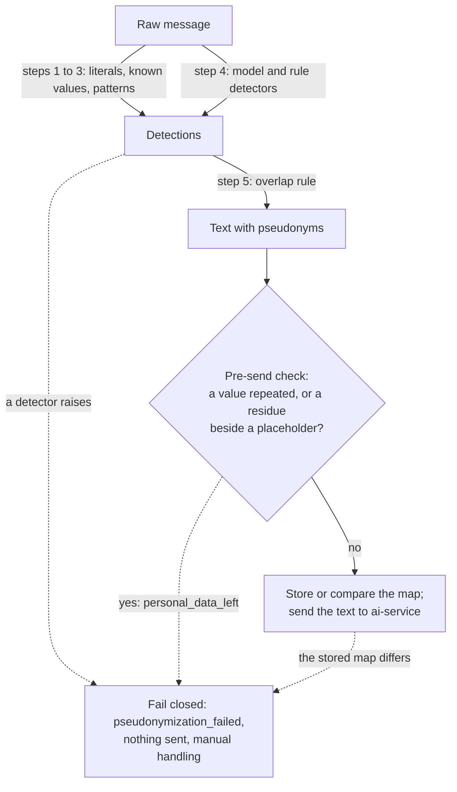

# ADR-0029: Rule-based detectors and a pre-send check in pseudonymization

- **Status:** Accepted
- **Date:** 2026-11-20
- **Deciders:** Project lead
- **Related:** [Requirements](../product/requirements.md) (FR-09, NFR-06), [ADR-0010](0010-pseudonymization-and-egress-control.md), [ADR-0017](0017-named-entity-model-from-its-release-url.md), [ADR-0020](0020-storage-errors-of-the-pseudonym-map.md), [personal-data leak fixes design](../design/personal-data-leak-fixes.md), [backend ticket workflow design](../design/backend-ticket-workflow.md#pseudonymization), [SEC-36](../rules/security-and-privacy.md#pseudonymization)

## Context

A measurement of `backend` on 2026-11-18 found raw personal data in the requests that a fake `ai-service` received: 4 of 33 names, 4 of 16 phone numbers, and 2 of 18 addresses, in 123 of 343 requests, and many more values left in part. FR-09, NFR-06 ("no raw personal data"), and [SEC-36](../rules/security-and-privacy.md#pseudonymization) forbid this. The [personal-data leak fixes design](../design/personal-data-leak-fixes.md#what-the-measurement-found) gives the source, every leak form, and its cause. In short:

- **Phone:** the pattern accepts no parentheses and no extension such as "x548", so "(00)504-5188" and "590-224-0978x548" pass whole.
- **Name:** `en_core_web_sm` labels 4 of the leaked names as an organization, a place, or nothing, and cuts 2 other `PERSON` spans one word short.
- **Address:** an address exists only around a facility that the model labels. All 18 addresses that reached the fake `ai-service` kept at least one raw part. The trial of the [backend ticket workflow design, Choice 1](../design/backend-ticket-workflow.md#choice-1-the-named-entity-library) had already found 1 of 12 addresses.
- **A check before sending that repeats the first pass:** the backend of the branch `minh` has one and still leaked 7 of 86 values in the same measurement.

Three passages of [ADR-0010, Detection](0010-pseudonymization-and-egress-control.md#detection) stand against every fix:

1. Step 3, line 138: "`PHONE`: 9 to 15 digits, optionally with a leading `+` and with spaces, dots, or hyphens between digit groups".
2. Line 144: "`ADDRESS` has no regular-expression pattern, because address patterns produce too many false positives and false negatives. Unknown addresses are left to the named-entity detector."
3. Line 145: "No detector is complete. A value that every detector misses is not a failure, so it does not fail closed, and it reaches `ai-service`. The second layer catches only patterns."

SEC-36 says the same as passage 3: "A detector can still miss a value; a miss is not a failure, and it is measured and reported against NFR-06."

## Decision drivers

1. **Safety:** no raw personal data leaves `backend` (FR-09, NFR-06, guardrail 4), and a doubt stops the call instead of letting data through.
2. **Evidence:** each change answers a cause that the measurement or the trial shows, and is proven by a test.
3. **Usefulness:** a ticket goes to manual handling only when the check has a reason, so most tickets still get AI help.
4. **Low change:** the same model ([ADR-0017](0017-named-entity-model-from-its-release-url.md)), the same placeholder syntax, the same contracts.

## Considered options

1. Keep ADR-0010 as it is: misses are measured and reported, and nothing else changes.
2. Rule-based detectors for the causes found, and a pre-send check that fails closed on what is left beside a placeholder or repeated after it.
3. A pre-send check only, as on the branch `minh`.
4. A larger or multilingual named-entity model instead of the rules.

## Decision

We adopt option 2. The statements below are normative.

1. **Phone.** Step 3 of ADR-0010 reads: "`PHONE`: 9 to 15 digits, optionally with a leading `+`, with spaces, dots, or hyphens between digit groups, with a first group of 2 to 5 digits in parentheses, and with an extension (`x`, `ext`, or `ext.` and 1 to 6 digits) that is part of the value and does not count toward the 9 to 15 digits".
2. **Names.** Step 4 has, next to the named-entity model, two rule detectors and one growth rule, with the fixed lists of the design ([Layer 1, names](../design/personal-data-leak-fixes.md#layer-1-names)):
   - a `PERSON` span of the model grows over the capitalized words right next to it, up to 4 words, titles left out;
   - 2 to 4 capitalized words whose first or last word is a Vietnamese family name of the list are a `NAME`;
   - 2 to 4 capitalized words that the model labels an organization or a place are a `NAME` right after a person cue of the list.
3. **Addresses.** Passage 2 is replaced by: "`ADDRESS` has a rule detector in step 4: a house number, then up to 5 comma-separated parts of capitalized words, address words, or a postal code, with at least one address word of a fixed list ([Layer 1, addresses](../design/personal-data-leak-fixes.md#layer-1-addresses)). The `FAC`-based address of the named-entity detector stays. Over-detection is measured and reported next to recall."
4. **Pre-send check.** Passage 3 is replaced by: "No detector is complete. After step 5, a pre-send check reads the built text. When it finds a value of the map or a known value of the ticket outside a placeholder, or a residue beside a placeholder as the design lists ([Layer 2](../design/personal-data-leak-fixes.md#layer-2-the-pre-send-check)), pseudonymization fails closed with the failure reason `personal_data_left`. It compares `PHONE` and `CARD` values by their digits alone, inside one run of digits and separators, and the values of the other types as whole words, ignoring case and diacritics. A value that every detector and the check miss is not a failure: it reaches `ai-service`, and the measurement reports it against NFR-06. The second layer in `ai-service` catches only patterns."
5. **Failure handling.** [ADR-0010, Failure handling](0010-pseudonymization-and-egress-control.md#failure-handling) gets one row: "The pre-send check finds personal data | No call to `ai-service`. Both suggestion parts are `unavailable` with `pseudonymization_failed`. The ticket is handled manually. This is a defect of a detector | Event `pseudonymization.failed` at `error`". This ADR extends [ADR-0020](0020-storage-errors-of-the-pseudonym-map.md), statement 4, which names two other deterministic failures that keep `pseudonymization_failed` (a detector error and a text over 4 000 characters), with the stop as one more: it is never retried either.
6. **No contract change.** The reason code `pseudonymization_failed` covers the stop, because pseudonymization produced no text that may leave `backend`. The failure reason `personal_data_left` lives in the audit log of `backend`.
7. **SEC-36.** The sentence "A detector can still miss a value; a miss is not a failure, and it is measured and reported against NFR-06" becomes "A detector can still miss a value. A residue that the pre-send check finds fails closed; a value that every detector and the check miss is not a failure, and it is measured and reported against NFR-06 (ADR-0029)", in the PR that implements the design ([RULE-06](../rules/README.md#changing-a-rule)).
8. Each new or changed detector, and the pre-send check, has at least five positive and five negative unit tests, as [ADR-0010, Detection](0010-pseudonymization-and-egress-control.md#detection) requires, and one test per leak form of the measurement.
9. This ADR replaces exactly passages 1 to 3 above, adds statements 2 and 5 to ADR-0010, and amends statement 4 of ADR-0020 as statement 5 states. The rest of ADR-0010, ADR-0017, and ADR-0020 still holds.

## Consequences

### Positive

- Every leak form of the measurement has a fix and a test.
- A name or a phone number that a detector finds only in part never leaves `backend`: the check stops the ticket instead.
- The model, the contracts, and the placeholder syntax stay.

### Negative

- Rule lists of family names, titles, cues, and address words must be kept up to date. A list change changes the detector version, and therefore the map of a ticket that runs again ([ADR-0020](0020-storage-errors-of-the-pseudonym-map.md), statement 3: `stored_map_differs`, manual handling).
- The address rule and the name rules replace some words that are no personal data. That can weaken classification and retrieval, and it is measured.
- The pre-send check sends some tickets to manual handling that the AI could have served.
- The rules are written from the failures of the 50 messages of the measurement, so a re-measurement on them is a regression check, not an unbiased NFR-06 figure.
- A value that no detector finds and that stands away from every placeholder still reaches `ai-service`.

### Follow-ups

- The implementation PR of the [design](../design/personal-data-leak-fixes.md), with the change of SEC-36.
- The re-measurement on the 50 messages, and the run of the named-entity trial before and after.
- The independent message set of the design's [Open questions](../design/personal-data-leak-fixes.md#open-questions).

## Pros and cons of the options

### Keep ADR-0010 as it is

- Good, because nothing changes.
- Bad, because 10 values of 86 reach `ai-service` raw, against FR-09 and NFR-06.

### Rule-based detectors and a pre-send check

- Good, because each cause found gets a fix, and partial detections stop instead of leaking.
- Bad, because the lists need care, some words are over-detected, and some tickets lose AI help.

### A pre-send check only

- Good, because it is one place in the code.
- Bad, because a check that repeats the first pass finds nothing new: the branch `minh` leaked 7 of 86 values with one.

### A larger or multilingual model

- Good, because one model may find names and addresses in more forms without lists.
- Bad, because it changes ADR-0017, needs a new trial, and must fit the memory of the free instance beside `backend` (NFR-08). No trial has measured it.

## Validation

- The unit tests of statement 8 pass in `backend` CI.
- An integration test against PostgreSQL shows that a stopped run sends nothing to a fake `ai-service`, stores no map, and audits `personal_data_left`.
- The re-measurement on the 50 messages measures every message (it reached the fake `ai-service`, or pseudonymization stopped it with a failure reason in the audit log), reports 0 raw values of each type, and states the number of tickets that the check stopped and of false stops.
- The named-entity trial reports recall and over-detection per type before and after.
- Revisit if the re-measurement still finds a raw value, if a ticket that the check stopped holds no personal data, or when an independent message set gives a new NFR-06 figure.
