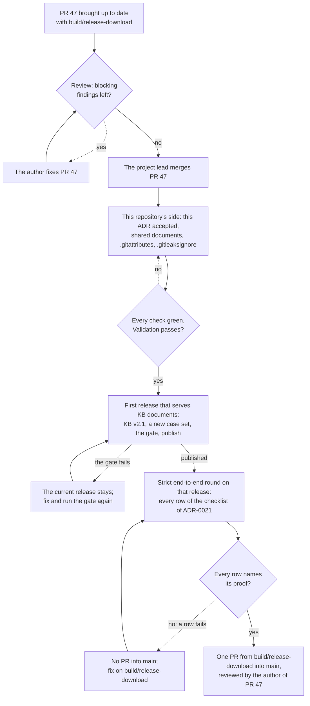

# ADR-0031: Retiring `apps/` and the evaluation runners of `main`

- **Status:** Accepted
- **Date:** 2026-11-23
- **Deciders:** Project lead, with the author of the AI part of `main`
- **Related:** [ADR-0021](0021-repository-layout-and-ai-ml-migration.md), [ADR-0025](0025-routing-configuration-of-the-first-release.md), [ADR-0028](0028-repository-layout-for-the-pull-request-into-main.md), [ADR-0030](0030-release-archives-and-the-modal-function-of-ai-service.md), [gate design for a release with KB documents](../design/gate-for-a-release-with-kb-documents.md), PR [#47](https://github.com/ml-system-design-nhom-5/SupportIQ/pull/47), issues [#34](https://github.com/ml-system-design-nhom-5/SupportIQ/issues/34) and [#42](https://github.com/ml-system-design-nhom-5/SupportIQ/issues/42), [architecture rules](../rules/architecture.md) (ARCH-07, ARCH-08), [data and ML rules](../rules/data-and-ml.md) (DATA-06, DATA-59), [security and privacy rules](../rules/security-and-privacy.md) (SEC-08), [testing rules](../rules/testing.md) (TEST-01), [workflow rules](../rules/workflow.md) (WF-19, WF-22 to WF-24)

## Context

[ADR-0028](0028-repository-layout-for-the-pull-request-into-main.md) keeps the parts of `main` at their paths, byte for byte, next to the components, for the pull request (PR) into `main`. It freezes `apps/backend/` and `apps/demo/` with two hooks, brings back `.github/workflows/autoeval.yml` with 9 hook exclusions, and plans four steps after the merge, each with the agreement of the author of the AI part of `main` ([ADR-0028, Follow-ups](0028-repository-layout-for-the-pull-request-into-main.md#follow-ups)):

1. the acceptance runners of the application of `main` run through the contract of `backend`, "or retire if their author agrees";
2. the system evaluation runs through the contract of `backend`;
3. the AI logic of `main` is folded into `ai-service`, with the placeholder normalization of [DATA-59](../rules/data-and-ml.md#models-and-artifacts) first;
4. `apps/` is deleted, and the temporary rules end.

The technical-debt issue of [ADR-0028, Technical debt](0028-repository-layout-for-the-pull-request-into-main.md#technical-debt) is [#42](https://github.com/ml-system-design-nhom-5/SupportIQ/issues/42) (`.pre-commit-config.yaml`, the comment `TODO(#42)` of the temporary-rule hooks). It closes when the four steps are done.

### PR #47

PR [#47](https://github.com/ml-system-design-nhom-5/SupportIQ/pull/47) is by the author of the AI part of `main`, from `fix-join-main` into `build/join-main` at `30ece8d`, with the commits `a05c932` and `7d39d9b`. It changes 243 files, +228 −56261. Its file list was read from the public GitHub API on 2026-11-23 and compared with the tree of `build/release-download` at `8be88bb`:

| Part | At `8be88bb` | Removed by #47 | Kept |
|---|---|---|---|
| `apps/` | 68 files | 67 | None: `apps/ml_inference/preprocessing.py` moves to `pipeline/preparation/preprocessing.py`. This ADR keeps `apps/core_backend/config/policies/intent_policy.v2.json` ([What is retired](#what-is-retired), statement 3) |
| `pipeline/` | 88 | 39: the system evaluation (`run_system_evaluation.py`, `system_*.py`, `assess_system.py`, `complete_system_report.py`, `dev_report.py`, `oversight_scenarios.py`, `mock_dependencies.py`, `isolated_call.py`), the autoeval (`autoeval/`, 12 files), the acceptance runners (`application_acceptance.py`, `fault_boundary_runner.py`, `flash_lite_acceptance.py`, `guard_corrections_verifier.py`, `classifier_acceptance_gate.py`), `independent_baseline.py`, `live_provider_verification.py`, `provider_resilience_eval.py`, `tune_routing.py`, and 5 configs of `pipeline/configs/` | 49, and the moved `preprocessing.py` |
| `scripts/` | 20 | 19 | `clean_test_cache.ps1` |
| `tests/` | 108 | 92: 61 of `tests/unit/`, 11 of `tests/application/`, 10 of `tests/integration/`, 8 of `tests/fixtures/`, 1 of `tests/e2e/`, and `tests/annotation_fixtures.py` | 16: `README.md`, `conftest.py`, `unit/.gitkeep`, and 13 test files of `tests/unit/` |
| `.github/workflows/autoeval.yml` | 1 | 1 | — |

- #47 also changes 6 kept files of `pipeline/` and 11 of `tests/`: their imports of `apps.ml_inference.preprocessing` become `pipeline.preparation.preprocessing`, `run_evaluation.py` keeps only `--mode ml`, `tests/conftest.py` loses the fixtures that import `apps.core_backend`, and several of the 13 test files get `pytest.importorskip` lines for `sklearn`, `joblib`, `matplotlib`, or `transformers`.
- In `.pre-commit-config.yaml`, #47 removes the hooks `kept-apps-frozen` and `kept-apps-imports`, the exclusion of `autoeval.yml` from the 9 workflow hooks, and `apps/` from the paths of the kept parts.
- It removes the DATA-59 test `test_serving_and_evaluation_use_the_same_function` (`tests/unit/test_placeholders.py:31`), which checks that the autoeval uses the same normalization function as training. That function stays, in `pipeline/preparation/preprocessing.py`.
- It also changes `README.md`, `.gitattributes`, `.gitignore`, `docs/guides/local-run.md`, and `docs/guides/repository-checks.md`, and adds a root `.env.example`.

### The decision of the project lead

On 2026-11-23 the project lead decided:

1. The author of #47 brings it up to date with `build/release-download` and changes its base to that branch. #47 drops the "Quick start" of `README.md`, the root `.env.example`, and the `pytest.importorskip` lines that it adds, and keeps to the code, the tests, `.gitignore`, `.pre-commit-config.yaml`, and the READMEs of `pipeline/` and `tests/`.
2. The project lead merges #47 after its review.
3. This repository's side writes the decision and the shared documents.
4. Then the strict end-to-end round runs, then one PR goes from `build/release-download` into `main`, and the author of #47 reviews it.

### What the removal touches

- **The checklist of ADR-0021.** [ADR-0021, Removal of the application of `main`](0021-repository-layout-and-ai-ml-migration.md#removal-of-the-application-of-main) deletes `apps/backend`, `apps/frontend`, and `apps/demo` in step 6 of the [Merge procedure](0021-repository-layout-and-ai-ml-migration.md#merge-procedure), "once every row of this checklist names its proof". ADR-0028 kept `apps/backend` and `apps/demo` as libraries and kept the checklist for their features. The rows with the real AI are "Not run yet" in the [deploy README](../../deploy/README.md#removal-of-the-application-of-main).
- **`intent_policy.v2.json`.** `apps/core_backend/config/policies/intent_policy.v2.json` is frozen data: the manifests of the three system suites pin it (`data/benchmarks/system/v1/suite_manifest.json`, `v2/acceptance/suite_manifest.json`, `v2/dev/suite_manifest.json`), and `.gitattributes` turns off its line-end conversion ([ADR-0028, Checks](0028-repository-layout-for-the-pull-request-into-main.md#checks), statement 5). [ADR-0025](0025-routing-configuration-of-the-first-release.md) links it (line 27) as the source of the routing configuration of the first release, and its statement 3 keeps the per-intent values in it "as an input of the tuning issue" [#15](https://github.com/ml-system-design-nhom-5/SupportIQ/issues/15). #47 deletes it with `apps/`.
- **`kb-release.json`.** `data/raw/kb/v2/kb-release.json` is a byte copy of `apps/ai_service/kb-release.json` ([ADR-0028, Copies deleted](0028-repository-layout-for-the-pull-request-into-main.md#copies-deleted-from-buildjoin-main), statement 5). After #47 it is the only copy.
- **Secrets scanning.** `.gitleaksignore` holds, in the `file:rule:line` form, the fingerprints of three test dummies in `tests/unit/test_completion_grounding.py`, `test_intent_client_safe_errors.py`, and `test_system_review_probes.py` (lines 14 to 16). "They stay as long as the files do" ([ADR-0028, Checks](0028-repository-layout-for-the-pull-request-into-main.md#checks), statement 6). #47 removes the three files. The history-form fingerprints of the same dummies (lines 2 to 4) stay, because the history keeps the files.
- **The tests of `pipeline/` in CI.** The only workflow that ran a test of the root `tests/` was `autoeval.yml`, with `tests/unit/test_autoeval.py` ([ADR-0028, Checks and CI](0028-repository-layout-for-the-pull-request-into-main.md#checks-and-ci)). #47 removes both. No workflow runs the 13 test files that stay.
- **Issue #34** has two parts in the documents: rewriting `autoeval.yml` to the workflow rules ([ADR-0028, CI](0028-repository-layout-for-the-pull-request-into-main.md#ci), statements 2 and 9; [repository checks](../guides/repository-checks.md)), and adding `eval.yml`, which takes over the checks of the release command and the step of the pinned file ([ADR-0021, CI](0021-repository-layout-and-ai-ml-migration.md#ci), statement 7; [ADR-0030, Follow-ups](0030-release-archives-and-the-modal-function-of-ai-service.md#follow-ups)). The draft [intent evaluation protocol](../design/intent-evaluation-protocol.md) says that a threshold of `main` returns to 0 "when issue #34 rewrites the autoeval" (line 133).
- **Kept documents of `main`.** `docs/autoeval.md` describes the autoeval and `autoeval.yml`, and `docs/guides/evaluation-evidence.md` names scripts that #47 removes. Both are among the 9 documents that ADR-0028 keeps byte for byte, and `markdownlint-cli2` skips them ([ADR-0028, Documents](0028-repository-layout-for-the-pull-request-into-main.md#documents); [Checks](0028-repository-layout-for-the-pull-request-into-main.md#checks), statement 1). Six Draft designs name the autoeval or code of `apps/`: the [intent evaluation protocol](../design/intent-evaluation-protocol.md), [intent model retraining](../design/intent-model-retraining.md), [intent model v1.2](../design/intent-model-v1.2.md), [multi-request detection](../design/multi-request-detection.md), [return channel guard](../design/return-channel-guard.md), and [intent label definitions](../design/intent-label-definitions.md).
- **DATA-59 in `ai-service`.** `ai-service` gives the message with its numbered pseudonyms to the classifier and to the search (`ai-service/app/suggestions/application/release_pipeline.py:283-284`), without the placeholder normalization that DATA-59 requires ([ADR-0028, Follow-ups](0028-repository-layout-for-the-pull-request-into-main.md#follow-ups), step 3).

## Decision drivers

1. **Safety:** after the removal, no file of the tree sends text to an LLM provider except `ai-service` ([ARCH-07](../rules/architecture.md#component-boundaries), [SEC-08](../rules/security-and-privacy.md#data-sent-to-llm-providers)), CI never calls a real LLM, and gitleaks still scans every file.
2. **Traceability:** the frozen data and every record that a manifest or an accepted ADR names stay valid, and every removed file stays in the history of `main` and of this repository.
3. **No lost obligation:** what the removal does not finish, the DATA-59 normalization in `ai-service` and the tests of `pipeline/` in CI, stays open as technical debt with an issue each, never dropped with the code ([WF-22 to WF-24](../rules/workflow.md#technical-debt), [TEST-01](../rules/testing.md#required-tests-per-change)).
4. **Integrity of the work of others:** the author of the AI part of `main` removes that code, with the agreement that ADR-0028 asks for.
5. **One AI codebase:** the PR into `main` carries one AI service that serves, and no frozen application next to it.

## Considered options

1. Retire `apps/`, the system evaluation, the autoeval, and the acceptance runners through #47 on `build/release-download`, before the PR into `main`.
2. Keep ADR-0028 as it is: the PR into `main` brings the kept parts, and #47 lands after the merge, in its own PR into `main`.
3. Retire only `apps/backend/` and `apps/demo/` before the PR, and keep the autoeval, the system evaluation, and `autoeval.yml`.

## Decision

We adopt option 1. The statements below are normative.

### Overview

### What is retired

1. The files that #47 removes, as its updated version lists them, do not enter the PR into `main`: `apps/`, the system evaluation, the autoeval, the acceptance runners, and the other files of `pipeline/` in [PR #47](#pr-47), 19 of the 20 scripts of `scripts/`, 92 files of `tests/`, and `.github/workflows/autoeval.yml`. They stay in the history.
2. `apps/ml_inference/preprocessing.py` moves to `pipeline/preparation/preprocessing.py`, and the files of `pipeline/` and `tests/` import it from there. It stays the reference for the DATA-59 normalization that `ai-service` takes over ([Technical debt](#technical-debt), item 1).
3. `apps/core_backend/config/policies/intent_policy.v2.json` stays at its path, byte for byte, as the only file of `apps/`, with its line in `.gitattributes`, because three manifests pin it and ADR-0025 names it as the input of #15 ([Open questions](#open-questions), item 1). The hook exclusions of the kept parts cover it.
4. The rest of the kept parts of `main` stays as ADR-0028 states: `artifacts/`, `pytest.ini`, the data folders of `main`, the 9 kept documents of `docs/`, and the files of `pipeline/`, `tests/`, and `scripts/` that #47 does not remove. Each file that #47 does not change keeps its bytes of `f6c1473`, and the files that #47 changes are changed by their author.
5. #47 is the agreement of the author of the AI part of `main` that ADR-0028, Follow-ups, steps 1, 2, and 4, ask for. Steps 1 and 2 end by retirement, and step 4 by the removal of `apps/`.

### The checklist of ADR-0021

1. The checklist of [ADR-0021, Removal of the application of `main`](0021-repository-layout-and-ai-ml-migration.md#removal-of-the-application-of-main) still holds for the features of `apps/backend` and `apps/demo`, which `backend` and the console replace. It becomes the condition of the PR into `main`, not of the commit that deletes them.
2. The PR into `main` opens only when every row names its proof, recorded in the [deploy README](../../deploy/README.md#removal-of-the-application-of-main). `release-2026-11-18-02` serves no KB document and never drafts, so the rows with the real AI run in the strict end-to-end round on the first release that serves KB documents, with the local run with AI. The PR into `main` waits for that release and its gate ([gate design](../design/gate-for-a-release-with-kb-documents.md)), as the project lead decided on 2026-11-23. The runs against Render follow the merge.
3. The deleted code stays in the history, so a row that fails can still be compared with `main`.

### Checks and CI

1. The hooks `kept-apps-frozen` and `kept-apps-imports` are removed with the temporary rules, and the 9 workflow hooks check every workflow, with no exclusion.
2. [ADR-0021, CI](0021-repository-layout-and-ai-ml-migration.md#ci), statements 1 and 2, hold again for every workflow: `autoeval.yml` is not in the tree, and CI never calls a real LLM.
3. The hooks keep excluding the kept parts that stay: `artifacts/`, `pipeline/`, `tests/`, `scripts/`, `pytest.ini`, the 9 kept documents, the data folders of `main`, and `intent_policy.v2.json` ([What is retired](#what-is-retired), statement 3).
4. The three `file:rule:line` fingerprints of `.gitleaksignore` for the removed test files go in the same change. Its history-form fingerprints stay.

### The temporary rules end

The rules of [ADR-0028, Temporary rules](0028-repository-layout-for-the-pull-request-into-main.md#temporary-rules) end when #47 merges: `apps/backend/` and `apps/demo/` are gone, and no kept file builds an LLM client ([Validation](#validation)). ADR-0028, CI, statement 4, which bans the secret `GEMINI_API_KEY` while the job `live` exists, ends with `autoeval.yml`; the hook `workflow-secrets-only-in-deploy` keeps every secret in `deploy.yml`.

### Technical debt

What the removal does not finish stays open, each item with one issue labeled `tech-debt`, opened with the PR into `main` ([WF-22 to WF-24](../rules/workflow.md#technical-debt)):

1. **The AI logic of `main` in `ai-service`** (ADR-0028, Follow-ups, step 3). First the placeholder normalization of DATA-59 before the classifier and the search, with `pipeline/preparation/preprocessing.py` as its reference and a test that training, evaluation, and serving use the same function; then the detection of several requests in one message and the calibration of the intent model. Training then uses the preprocessing of `ai-service`.
2. **The tests of `pipeline/` in no CI.** The 13 test files of `tests/unit/` run in no workflow. The target is a workflow that runs them on every push and PR, from locked dependencies, with no `pytest.importorskip` line and no skip. `pipeline/` keeps requirements files without a lockfile and follows no engineering rule.

Issue #34 and issue #42 change as [Open questions](#open-questions), items 2 and 3, decide; neither is closed before that decision.

### Passages of other ADRs that this ADR replaces

| Passage | Replaced by |
|---|---|
| ADR-0028, [Overview](0028-repository-layout-for-the-pull-request-into-main.md#overview): the nodes `APPS`, `FROZEN`, `WF`, and "scripts/ (20 of 30)", and their edges | [Overview](#overview) and [What is retired](#what-is-retired) |
| ADR-0028, [Kept parts of `main`](0028-repository-layout-for-the-pull-request-into-main.md#kept-parts-of-main), statement 1: `apps/__init__.py`, `apps/core_backend/`, `apps/ai_service/`, `apps/ml_inference/`, `apps/demo/`, `apps/backend/`, `.github/workflows/autoeval.yml`, and "the 20 scripts" | What is retired, statements 1 to 4 |
| ADR-0028, Kept parts of `main`, statement 2 | What is retired, statements 1 and 3 |
| ADR-0028, Kept parts of `main`, statement 3: the sub-items "the evaluation of the whole system goes through the contract of `backend`" and "`apps/` is then deleted", and the words "in the steps of Follow-ups" | What is retired, statement 5. The other sub-items stay as the target of [Technical debt](#technical-debt), item 1 |
| ADR-0028, Kept parts of `main`, statement 4, for the files that #47 changes or moves | What is retired, statements 2 and 4 |
| ADR-0028, [Scripts](0028-repository-layout-for-the-pull-request-into-main.md#scripts): the column "Taken" and "20 scripts are taken" | Only `clean_test_cache.ps1` stays |
| ADR-0028, [Copies deleted](0028-repository-layout-for-the-pull-request-into-main.md#copies-deleted-from-buildjoin-main), statement 5, the copy of `apps/ai_service/kb-release.json`; statement 6, `pipeline/evaluation/autoeval/build_intent_set.py:71` among the 5 files | `data/raw/kb/v2/kb-release.json` is no longer a copy; 4 kept files name the path of ADR-0026 on `main` |
| ADR-0028, [Checks](0028-repository-layout-for-the-pull-request-into-main.md#checks), statement 1: `apps/` in the kept parts, and the exception for the two hooks of the temporary rules | [Checks and CI](#checks-and-ci), statements 1 and 3 |
| ADR-0028, Checks, statement 7 | Checks and CI, statement 1 |
| ADR-0028, [CI](0028-repository-layout-for-the-pull-request-into-main.md#ci), statements 1 to 6, 8, and 9 | Checks and CI, statement 2. Statement 7 still holds |
| ADR-0028, [Temporary rules](0028-repository-layout-for-the-pull-request-into-main.md#temporary-rules) | [The temporary rules end](#the-temporary-rules-end) |
| ADR-0028, [Technical debt](0028-repository-layout-for-the-pull-request-into-main.md#technical-debt) | [Technical debt](#technical-debt) |
| ADR-0028, [Passages of other ADRs that this ADR replaces](0028-repository-layout-for-the-pull-request-into-main.md#passages-of-other-adrs-that-this-adr-replaces), item 1: the sub-item on Removal of the application of `main` and step 6 ("both stay, frozen, as libraries"), and the sub-item on CI (statements 1, 2, and 6) | [The checklist of ADR-0021](#the-checklist-of-adr-0021); Checks and CI, statement 2 |
| ADR-0028, [Follow-ups](0028-repository-layout-for-the-pull-request-into-main.md#follow-ups): the item on issue #34, and steps 1, 2, and 4 | What is retired, statement 5; [Open questions](#open-questions), item 2. Step 3 is Technical debt, item 1 |
| ADR-0021, [Removal of the application of `main`](0021-repository-layout-and-ai-ml-migration.md#removal-of-the-application-of-main), the first sentence, and [Merge procedure](0021-repository-layout-and-ai-ml-migration.md#merge-procedure), step 6: the deletion "before the PR into `main`, once every row of this checklist names its proof" | `apps/backend` and `apps/demo` are deleted when #47 merges; the checklist is the condition of the PR into `main` (The checklist of ADR-0021) |

The rest of ADR-0028 still holds: the layout, the package names, the contracts, the frozen data of this repository, `ml/runs/`, the 9 kept documents, and the exclusions of the kept parts that stay. The rest of ADR-0021 still holds, including KB ingestion, the offline evaluation gate, and the removal of `apps/frontend`. ADR-0025 does not change while `intent_policy.v2.json` stays at its path.

### Changes to approved documents

This repository's side changes these documents after #47 merges into `build/release-download`, in one commit. #47 changes `.pre-commit-config.yaml`, `.gitignore`, and the READMEs of `pipeline/` and `tests/`.

| Document | Passage | Change |
|---|---|---|
| [decisions/README.md](README.md) | Index | The row of this ADR (added with this draft); the note on acceptance |
| `README.md` | Line 71, the layout rows of `pipeline/`, `tests/`, `scripts/`, and `apps/` (lines 94 to 98), line 100, and the known limit of line 117 | `apps/` and `autoeval.yml` are gone; `pipeline/` without the system evaluation and the autoeval; `scripts/` with one script; the known limit points to the issues of [Technical debt](#technical-debt) |
| [repository checks](../guides/repository-checks.md) | The diagram (the node `autoeval.yml of main`, lines 21 and 28), the row of the frozen `apps/` (line 58), the exclusions (lines 79 to 83), and the Workflow convention (line 130) | No temporary-rule hooks and no exclusion of `autoeval.yml`; the kept parts without `apps/`, except `intent_policy.v2.json`; Last reviewed |
| [eval/README.md](../../eval/README.md) | Lines 5, 33, and 47 | The autoeval and `autoeval.yml` are gone; the live modes and the temporary rules are gone |
| [ml/README.md](../../ml/README.md) | Line 24 | The preprocessing is `pipeline/preparation/preprocessing.py` |
| [deploy README](../../deploy/README.md) | Removal of the application of `main` (line 225), and the row of `apps/demo` (line 246) | The checklist is the condition of the PR into `main` ([The checklist of ADR-0021](#the-checklist-of-adr-0021)) |
| [deploy README](../../deploy/README.md#runs-with-the-real-ai) | Runs with the real AI, the sentence "The rows run once `backend` on Render calls that deployment, after the merge" | The rows run in the strict end-to-end round on the first release that serves KB documents, with the local run with AI, before the PR into `main`; the runs against Render follow the merge ([The checklist of ADR-0021](#the-checklist-of-adr-0021), statement 2) |
| `.gitattributes` | The line of `intent_policy.v2.json` | Stays while the file stays ([Open questions](#open-questions), item 1) |
| `.gitleaksignore` | Lines 12 to 16 | The comment and the three `file:rule:line` fingerprints of the removed test files go |
| [local run design](../design/local-run.md) | Line 379, "the tree after the join has no `scripts/`" | `scripts/` holds one script of `main`; checked by the owner of the local run |
| The six Draft designs of [What the removal touches](#what-the-removal-touches), among them line 133 of the intent evaluation protocol | Their passages on the autoeval, `apps/`, and issue #34 | Updated by their owner before each design is approved ([Open questions](#open-questions), item 4) |
| `docs/autoeval.md`, `docs/guides/evaluation-evidence.md` | Whole files, kept documents of `main` | As [Open questions](#open-questions), item 4, decides |

No other shared document changes: `AGENTS.md`, the rules, the glossary, and the READMEs of the components name no retired file. `ai-service/README.md` names `apps/ml_inference` at `5e0cda5` as a record, which stays true.

## Consequences

### Positive

- The PR into `main` carries one AI service that serves, and no frozen application or second AI codebase next to it.
- The author of the AI part of `main` removes that code, and every removed file stays in the history.
- No workflow is outside the workflow rules, no hook excludes a workflow, and CI never calls a real LLM.
- `pipeline/` no longer imports `apps/`: the preprocessing is part of `pipeline/`.
- The checklist of ADR-0021 still gates the PR into `main`, so no feature of the application of `main` is dropped without its proof.

### Negative

- The system evaluation and the autoeval of `main` are gone. Until a new evaluation through the contract of `backend` exists, the end-to-end checks of the system are the manual runs of the checklist and the offline evaluation gate of each release.
- The DATA-59 test of the autoeval goes with it. Until [Technical debt](#technical-debt), item 1, closes, no test proves that training and serving use the same normalization, and `ai-service` still lacks it.
- 92 test files go. The behavior they tested belonged to the removed code, but no file maps each removed test to a test of `backend` or `ai-service`.
- The 13 test files that stay run in no CI until [Technical debt](#technical-debt), item 2, closes. A change to `pipeline/` is tested only when someone runs them by hand.
- `apps/` keeps one file, `intent_policy.v2.json`, so the folder exists while nothing in it is code.
- `docs/autoeval.md` and `docs/guides/evaluation-evidence.md` describe tools that are not in the tree, until [Open questions](#open-questions), item 4, is decided.
- The deletion lands before the strict end-to-end round, so a failing row is fixed on `build/release-download` without the old code in the tree.
- The PR into `main` waits for KB v2.1, the change of the gate, a new approved case set, and a passing gate run.

### Follow-ups

- The two issues of [Technical debt](#technical-debt).
- The decisions of [Open questions](#open-questions), items 2 and 3, on issues #34 and #42.
- The [gate design](../design/gate-for-a-release-with-kb-documents.md) and the first release that serves KB documents, before the PR into `main`.
- The documents of [Changes to approved documents](#changes-to-approved-documents), in one commit after #47 merges.

## Pros and cons of the options

### Retire through #47 before the PR into `main`

- Good, because `main` receives one AI codebase, the author of that code removes it, and the temporary rules and the 9 hook exclusions end before they reach `main`.
- Bad, because the system evaluation, the autoeval, and 92 test files go before any replacement exists, and the removal lands before the strict end-to-end round.

### Keep ADR-0028 and land #47 after the merge

- Good, because the PR into `main` follows the accepted ADR without a new decision, and the removal gets its own PR into `main`.
- Bad, because `main` first receives the frozen application, `autoeval.yml` with 9 hook exclusions, and the temporary rules, and a second large PR into `main` removes them again.

### Retire only `apps/backend/` and `apps/demo/`

- Good, because the frozen application goes and the autoeval keeps running.
- Bad, because the autoeval and the system evaluation import `apps.core_backend` and `apps.demo` ([ADR-0028, Imports](0028-repository-layout-for-the-pull-request-into-main.md#imports)), so they would need rewriting, and `autoeval.yml` keeps its 9 hook exclusions until #34.

## Validation

- `git ls-tree -r --name-only HEAD -- apps` lists only `apps/core_backend/config/policies/intent_policy.v2.json`, `.github/workflows/autoeval.yml` is absent, and `scripts/` holds only `clean_test_cache.ps1`.
- For each file of `pipeline/`, `tests/`, `artifacts/`, and the data folders of `main` that #47 does not change, `git diff --name-only f6c1473 HEAD -- <path>` prints nothing.
- `git grep -n -E '^\s*(from|import)\s+apps\b' HEAD -- pipeline tests scripts` prints nothing.
- `git grep -l -i -E 'genai|GeminiDraftClient|generativelanguage' HEAD -- pipeline tests scripts` prints nothing, so no kept file builds an LLM client.
- The SHA-256 values in the manifests of the three system suites match `intent_policy.v2.json` at its path.
- `pre-commit run --all-files --hook-stage manual` passes and changes no kept file, `.pre-commit-config.yaml` has no `kept-apps-*` hook and no exclusion in the workflow hooks, and the gitleaks scan of the history and the tree reports 0 findings with the shorter `.gitleaksignore`.
- The 13 test files of `tests/unit/` hold no `pytest.importorskip` line that #47 added, and pass on a machine with `pipeline/requirements.txt` installed, with no skip. The run is recorded in the PR into `main`.
- Every row of the checklist of ADR-0021 names its proof in the deploy README, the rows with the real AI on the first release that serves KB documents, before the PR into `main` opens.
- Revisit when an issue of [Technical debt](#technical-debt) closes, or when a new system evaluation through the contract of `backend` is designed.

## Open questions

1. **`intent_policy.v2.json`.** #47 deletes it with `apps/`. Recommended: keep it at its path, byte for byte, as [What is retired](#what-is-retired), statement 3, states, so the three manifests, the link of ADR-0025, and the input of #15 stay valid; #47 then keeps this one file. The other choices are to move it into `data/` with the path change in ADR-0025 as a link fix, or to delete it and replace ADR-0025, statement 3, in this ADR.
2. **Issue #34.** Its first part, rewriting `autoeval.yml`, ends with the file. Recommended: narrow #34 to `eval.yml`, which ADR-0021, CI, statement 7, and ADR-0030 still need, and update the documents that say "#34 rewrites `autoeval.yml`". The other choice is to close #34 and open a new issue for `eval.yml`.
3. **Issue #42.** Steps 1, 2, and 4 of its close condition end with #47. Recommended: close #42 with a comment that links this ADR and the two new issues of [Technical debt](#technical-debt). The other choice is to keep #42 open as the issue of item 1.
4. **Documents that describe retired tools.** `docs/autoeval.md` and `docs/guides/evaluation-evidence.md` are kept documents of `main`, and six Draft designs name the autoeval or `apps/`. Recommended: the author of the AI part of `main` decides, for each, whether it is removed in #47 (it stays in the history) or updated before its design is approved. Until then they stay unchanged.
5. **The removed tests.** Recommended: the review of #47 lists, for each removed test file, the removed code it tested, so the 92 removals are checked against TEST-01 rather than assumed.
