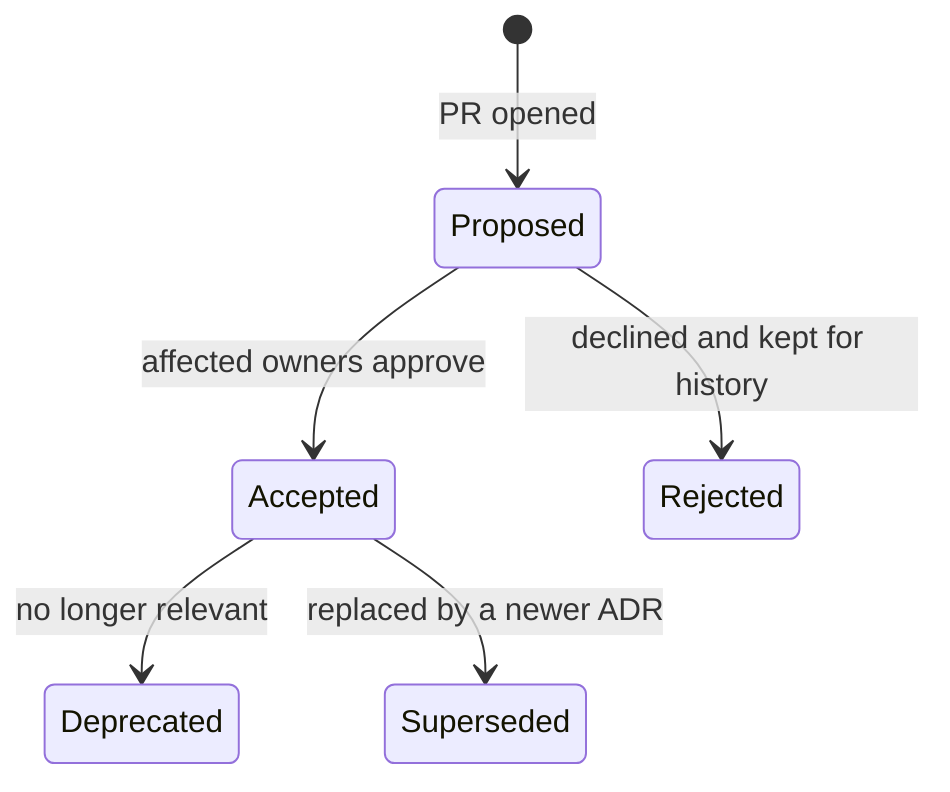

# Architecture decision records

> **Status:** Active · **Owner:** team · **Last reviewed:** 2026-11-12

An architecture decision record (ADR) captures one significant decision: its context, the options, what we chose, and what it costs. This page lists every ADR and explains the process. Writing rules are in the [documentation handbook](../README.md#adrs).

## Index

| ADR | Title | Status | Date |
|---|---|---|---|
| [0001](0001-system-architecture.md) | System architecture and component boundaries | Accepted | 2026-10-23 |
| [0002](0002-shop-demo-scope.md) | Minimal shop demo scope | Superseded by ADR-0013 | 2026-11-05 |
| [0003](0003-tech-stack.md) | Technology stack | Accepted | 2026-10-23 |
| [0004](0004-api-conventions.md) | API style and conventions | Accepted | 2026-10-23 |
| [0005](0005-intent-independent-retrieval.md) | Intent-independent retrieval with intent-aware reranking | Accepted | 2026-10-23 |
| [0006](0006-staff-feedback-and-reason-codes.md) | Staff feedback capture and reason codes | Accepted | 2026-10-23 |
| [0007](0007-observability-stack.md) | Observability stack | Accepted | 2026-10-24 |
| [0008](0008-ui-design-system.md) | UI design system | Accepted | 2026-10-24 |
| [0009](0009-demo-accounts-and-cookie-sessions.md) | Demo accounts with server-side cookie sessions for v1 | Accepted | 2026-10-24 |
| [0010](0010-pseudonymization-and-egress-control.md) | Pseudonymization of personal data and egress control | Accepted | 2026-11-12 |
| [0011](0011-deployment-and-runtime-topology.md) | Runtime rules independent of the hosting platform | Accepted | 2026-11-12 |
| [0012](0012-roles-v1.md) | Roles v1: customer, staff, manager, and admin | Accepted | 2026-11-05 |
| [0013](0013-shop-demo-with-read-only-catalog.md) | Shop demo with a read-only catalog | Accepted | 2026-11-05 |
| [0014](0014-citations-to-order-context.md) | Citations to the order context | Accepted | 2026-11-12 |
| [0015](0015-account-creation-and-password-changes.md) | Account creation, password changes, and password resets | Accepted | 2026-11-11 |
| [0016](0016-hosting-on-free-tiers.md) | Hosting of the demo on free tiers | Accepted | 2026-11-12 |

Notes on the index:

- [ADR-0012](0012-roles-v1.md) was accepted on 2026-11-05 and renames the role `supervisor` used in ADR-0009 to `manager`. ADR-0009's authentication mechanism is unchanged.
- [ADR-0013](0013-shop-demo-with-read-only-catalog.md) was accepted on 2026-11-05 and supersedes [ADR-0002](0002-shop-demo-scope.md).
- [ADR-0015](0015-account-creation-and-password-changes.md) was accepted on 2026-11-11 by the project lead and replaces part of statement 1 of ADR-0009 and admin limit 9 of ADR-0012, extends the `admin` row of ADR-0012's role table, and adds the own password change to the `/shop` list of ADR-0013. The rest of those ADRs still holds.
- [ADR-0016](0016-hosting-on-free-tiers.md) was accepted on 2026-11-12 by the project lead and replaces one part of [ADR-0007](0007-observability-stack.md): the telemetry of the deployed demo goes to a hosted service, Grafana Cloud. Local development keeps the local Grafana stack, and the rest of ADR-0007 still holds.

## Lifecycle

## Process

1. Copy the [ADR template](../templates/adr.md) to `NNNN-kebab-case-title.md` with the next free number.
2. Open a PR with status **Proposed**. Work that depends on the decision waits until it is accepted.
3. Every member whose component is affected reviews it. When all of them approve, set the status to **Accepted**, set the date, and merge.
4. Add the ADR to the index above in the same PR.
5. To change an accepted decision, write a new ADR and set the old one to **Superseded by ADR-NNNN**. Apart from this status change, typos, and broken links, accepted ADRs are not edited.
6. When a new ADR replaces one named part of an accepted ADR and the rest still holds, the old ADR stays Accepted. The new ADR names the replaced part, and a note under the index records it.
