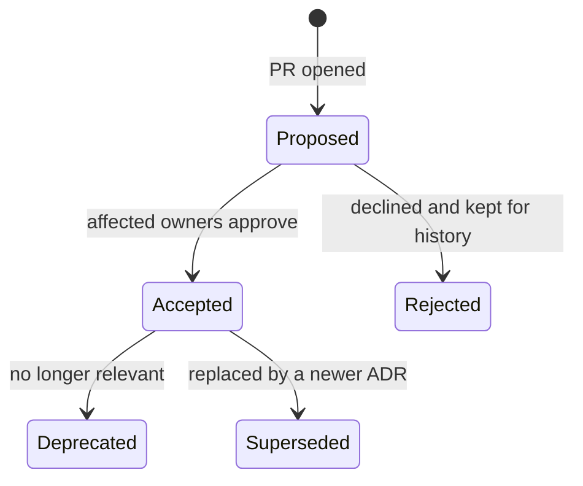

# Architecture decision records

> **Status:** Active · **Owner:** team · **Last reviewed:** 2026-10-24

An architecture decision record (ADR) captures one significant decision: its context, the options, what we chose, and what it costs. This page lists every ADR and explains the process. Writing rules are in the [documentation handbook](../README.md#adrs).

## Index

| ADR | Title | Status | Date |
|---|---|---|---|
| [0001](0001-system-architecture.md) | System architecture and component boundaries | Accepted | 2026-10-23 |
| [0002](0002-shop-demo-scope.md) | Minimal shop demo scope | Accepted | 2026-10-23 |
| [0003](0003-tech-stack.md) | Technology stack | Accepted | 2026-10-23 |
| [0004](0004-api-conventions.md) | API style and conventions | Accepted | 2026-10-23 |
| [0005](0005-intent-independent-retrieval.md) | Intent-independent retrieval with intent-aware reranking | Accepted | 2026-10-23 |
| [0006](0006-staff-feedback-and-reason-codes.md) | Staff feedback capture and reason codes | Accepted | 2026-10-23 |
| [0007](0007-observability-stack.md) | Observability stack | Accepted | 2026-10-24 |
| [0008](0008-ui-design-system.md) | UI design system | Accepted | 2026-10-24 |
| [0009](0009-demo-accounts-and-cookie-sessions.md) | Demo accounts with server-side cookie sessions for v1 | Accepted | 2026-10-24 |

## Lifecycle

## Process

1. Copy the [ADR template](../templates/adr.md) to `NNNN-kebab-case-title.md` with the next free number.
2. Open a PR with status **Proposed**. Work that depends on the decision waits until it is accepted.
3. Every member whose component is affected reviews it. When all of them approve, set the status to **Accepted**, set the date, and merge.
4. Add the ADR to the index above in the same PR.
5. To change an accepted decision, write a new ADR and set the old one to **Superseded by ADR-NNNN**. Apart from this status change, typos, and broken links, accepted ADRs are not edited.
