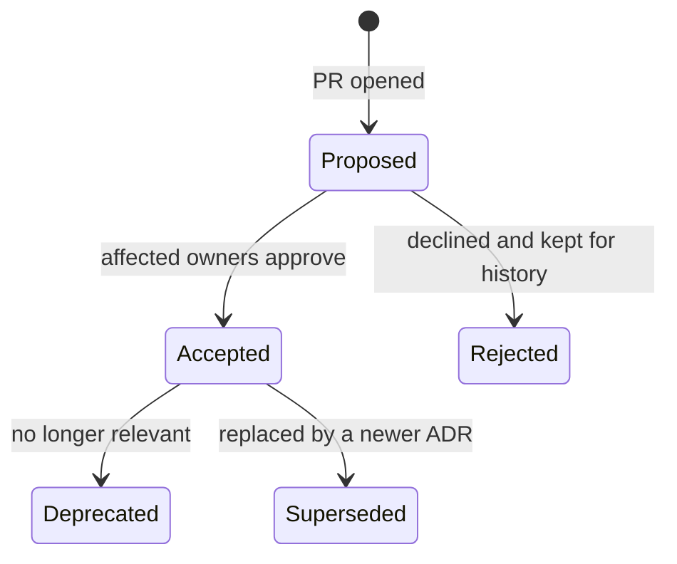

# Architecture decision records

> **Status:** Active · **Owner:** team · **Last reviewed:** 2026-11-17

An architecture decision record (ADR) captures one significant decision: its context, the options, what we chose, and what it costs. This page lists every ADR and explains the process. Writing rules are in the [documentation handbook](../README.md#adrs).

## Index

| ADR | Title | Status | Date |
|---|---|---|---|
| [0001](0001-system-architecture.md) | System architecture and component boundaries | Accepted | 2026-10-23 |
| [0002](0002-shop-demo-scope.md) | Minimal shop demo scope | Superseded by ADR-0013 | 2026-11-05 |
| [0003](0003-tech-stack.md) | Technology stack | Accepted | 2026-10-23 |
| [0004](0004-api-conventions.md) | API style and conventions | Accepted | 2026-10-23 |
| [0005](0005-intent-independent-retrieval.md) | Intent-independent retrieval with intent-aware reranking | Accepted | 2026-10-23 |
| [0006](0006-staff-feedback-and-reason-codes.md) | Staff feedback capture and reason codes | Accepted | 2026-10-23 |
| [0007](0007-observability-stack.md) | Observability stack | Accepted | 2026-10-24 |
| [0008](0008-ui-design-system.md) | UI design system | Accepted | 2026-10-24 |
| [0009](0009-demo-accounts-and-cookie-sessions.md) | Demo accounts with server-side cookie sessions for v1 | Accepted | 2026-10-24 |
| [0010](0010-pseudonymization-and-egress-control.md) | Pseudonymization of personal data and egress control | Accepted | 2026-11-12 |
| [0011](0011-deployment-and-runtime-topology.md) | Runtime rules independent of the hosting platform | Accepted | 2026-11-12 |
| [0012](0012-roles-v1.md) | Roles v1: customer, staff, manager, and admin | Accepted | 2026-11-05 |
| [0013](0013-shop-demo-with-read-only-catalog.md) | Shop demo with a read-only catalog | Accepted | 2026-11-05 |
| [0014](0014-citations-to-order-context.md) | Citations to the order context | Accepted | 2026-11-12 |
| [0015](0015-account-creation-and-password-changes.md) | Account creation, password changes, and password resets | Accepted | 2026-11-11 |
| [0016](0016-hosting-on-free-tiers.md) | Hosting of the demo on free tiers | Accepted | 2026-11-12 |
| [0017](0017-named-entity-model-from-its-release-url.md) | The named-entity model from its release URL | Accepted | 2026-11-12 |
| [0018](0018-hosting-of-ai-service-on-modal.md) | Hosting of `ai-service` on Modal | Accepted | 2026-11-12 |
| [0019](0019-one-label-for-text-in-the-placeholder-syntax.md) | One label for text in the placeholder syntax | Accepted | 2026-11-13 |
| [0020](0020-storage-errors-of-the-pseudonym-map.md) | Storage errors of the pseudonym map | Accepted | 2026-11-13 |
| [0021](0021-repository-layout-and-ai-ml-migration.md) | Repository layout and migration of the AI and ML code | Accepted | 2026-11-12 |
| [0022](0022-server-sent-events-for-suggestion-progress.md) | Server-sent events for the suggestion progress of an open ticket | Accepted | 2026-11-13 |
| [0023](0023-graceful-shutdown-of-suggestion-progress-streams.md) | Graceful shutdown of suggestion progress streams | Accepted | 2026-11-16 |
| [0024](0024-event-schema-of-the-suggestion-progress-stream.md) | Event schema of the suggestion progress stream | Accepted | 2026-11-16 |
| [0025](0025-routing-configuration-of-the-first-release.md) | Routing configuration of the first release | Accepted | 2026-11-17 |

Notes on the index:

- [ADR-0012](0012-roles-v1.md) was accepted on 2026-11-05 and renames the role `supervisor` used in ADR-0009 to `manager`. ADR-0009's authentication mechanism is unchanged.
- [ADR-0013](0013-shop-demo-with-read-only-catalog.md) was accepted on 2026-11-05 and supersedes [ADR-0002](0002-shop-demo-scope.md).
- [ADR-0015](0015-account-creation-and-password-changes.md) was accepted on 2026-11-11 by the project lead and replaces part of statement 1 of ADR-0009 and admin limit 9 of ADR-0012, extends the `admin` row of ADR-0012's role table, and adds the own password change to the `/shop` list of ADR-0013. The rest of those ADRs still holds.
- [ADR-0016](0016-hosting-on-free-tiers.md) was accepted on 2026-11-12 by the project lead and replaces one part of [ADR-0007](0007-observability-stack.md): the telemetry of the deployed demo goes to a hosted service, Grafana Cloud. Local development keeps the local Grafana stack, and the rest of ADR-0007 still holds.
- [ADR-0018](0018-hosting-of-ai-service-on-modal.md) was accepted on 2026-11-12 by the project lead and decides what [ADR-0016](0016-hosting-on-free-tiers.md) left open: `ai-service` runs on Modal, which receives its pseudonymized text, no host outside the system other than the Gemini host receives text from `ai-service`, and its egress allow-list is enforced in code. This replaces the `ai-service` row of the platform table, statement 2 of the outbound connections, and the matching open question of ADR-0016, and it settles the open part of statement 1 of the egress control of [ADR-0010](0010-pseudonymization-and-egress-control.md#egress-control). It also decides the artifact store that [ADR-0003](0003-tech-stack.md) deferred. The rest of those ADRs still holds.
- [ADR-0019](0019-one-label-for-text-in-the-placeholder-syntax.md) was accepted on 2026-11-16 by the project lead. It replaces one passage of [ADR-0010](0010-pseudonymization-and-egress-control.md): the separate label of a restored `LITERAL` in Restoring and sending, item 3. The rest of ADR-0010 still holds.
- [ADR-0020](0020-storage-errors-of-the-pseudonym-map.md) was accepted on 2026-11-16 by the project lead. It replaces two passages of [ADR-0010](0010-pseudonymization-and-egress-control.md): the words "or the map cannot be stored" in the first row of Failure handling, and the words "storage error" in the first branch of the Overview sequence diagram. The rest of ADR-0010 still holds.
- [ADR-0021](0021-repository-layout-and-ai-ml-migration.md) was accepted on 2026-11-12 by the project lead. For the join with `main` only, until the join PR is merged, it replaces the two approvals that statement 2 of the egress control of [ADR-0010](0010-pseudonymization-and-egress-control.md#egress-control) requires for a change of the egress allow-list: the project lead's approval stands in for them. The rest of ADR-0010 still holds.
- ADR-0021 was numbered ADR-0017 on the branch `build/join-main` until 2026-11-13. The branch `build/ticket-workflow` had already given 0017 to "ADR-0017: The named-entity model from its release URL", so the project lead renumbered this ADR without changing its content. Commit messages before the renumbering still say ADR-0017, because the history is not rewritten.
- [ADR-0022](0022-server-sent-events-for-suggestion-progress.md) was accepted on 2026-11-14 by the project lead, who chose its recommended option, and changes statement 4 of [ADR-0016, `frontend` and the ingress](0016-hosting-on-free-tiers.md#frontend-and-the-ingress-on-cloudflare-pages) for one route.
- [ADR-0023](0023-graceful-shutdown-of-suggestion-progress-streams.md) was accepted on 2026-11-16 by the project lead. It replaces one point of [ADR-0022](0022-server-sent-events-for-suggestion-progress.md), statement 5: "At shutdown: the lifespan ends every stream before uvicorn's graceful shutdown". The rest of ADR-0022 still holds.
- [ADR-0024](0024-event-schema-of-the-suggestion-progress-stream.md) was accepted on 2026-11-16 by the project lead. It replaces the words "with a string schema" of [ADR-0022](0022-server-sent-events-for-suggestion-progress.md), statement 9. The rest of ADR-0022 still holds.
- [ADR-0025](0025-routing-configuration-of-the-first-release.md) was accepted on 2026-11-17 by the project lead. It replaces two passages of [ADR-0021](0021-repository-layout-and-ai-ml-migration.md): the words "derived from it ([DATA-58](../rules/data-and-ml.md#models-and-artifacts))" in the row `apps/core_backend/config/policies/intent_policy.v2.json` of Where the code of `main` goes, and "three known gaps" in statement 4 of Release and the offline evaluation gate, which gets a fourth gap, the untuned routing configuration. For the routing configuration `main-untuned-v1` only, it also sets aside statement 3, "λ is tuned on validation data only", and statement 5, "Thresholds are tuned on validation data", of [ADR-0005](0005-intent-independent-retrieval.md#decision), until the tuning issue publishes a tuned version. The rest of ADR-0021 and ADR-0005 still holds.

## Lifecycle

## Process

1. Copy the [ADR template](../templates/adr.md) to `NNNN-kebab-case-title.md` with the next free number.
2. Open a PR with status **Proposed**. Work that depends on the decision waits until it is accepted.
3. Every member whose component is affected reviews it. When all of them approve, set the status to **Accepted**, set the date, and merge.
4. Add the ADR to the index above in the same PR.
5. To change an accepted decision, write a new ADR and set the old one to **Superseded by ADR-NNNN**. Apart from this status change, typos, and broken links, accepted ADRs are not edited.
6. When a new ADR replaces one named part of an accepted ADR and the rest still holds, the old ADR stays Accepted. The new ADR names the replaced part, and a note under the index records it.
