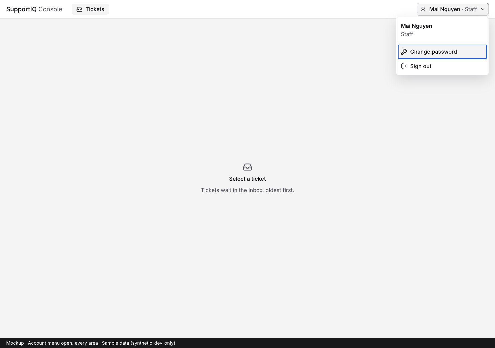
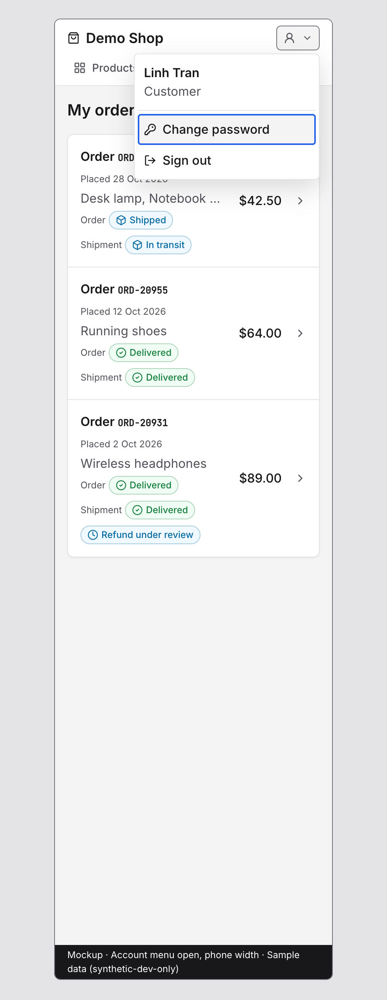
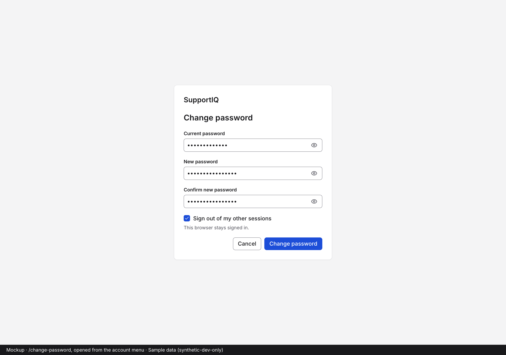
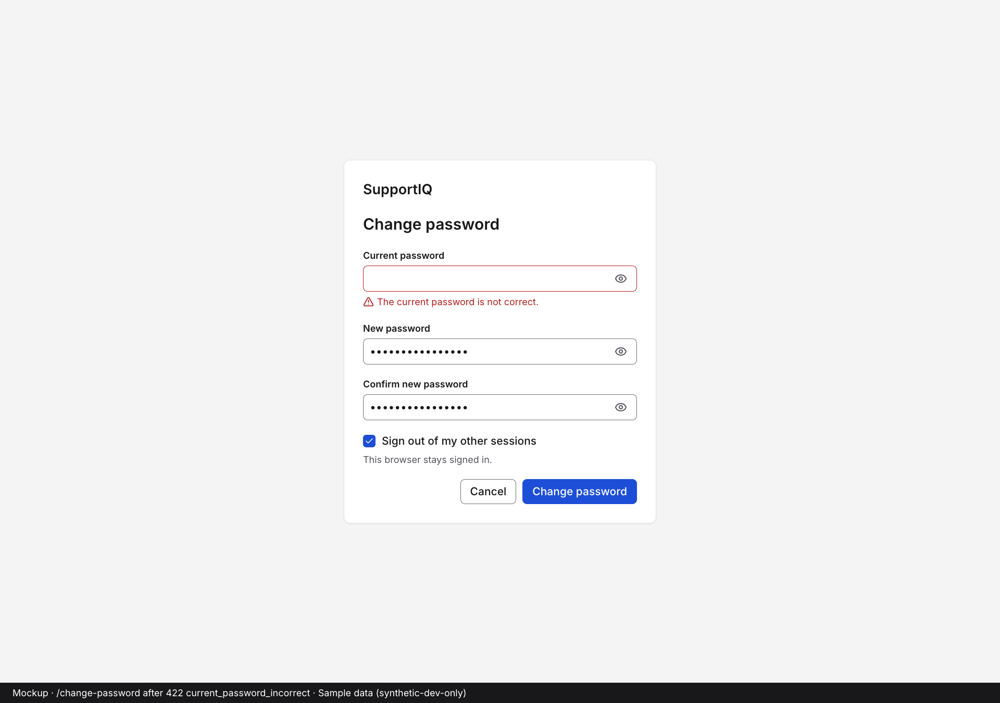
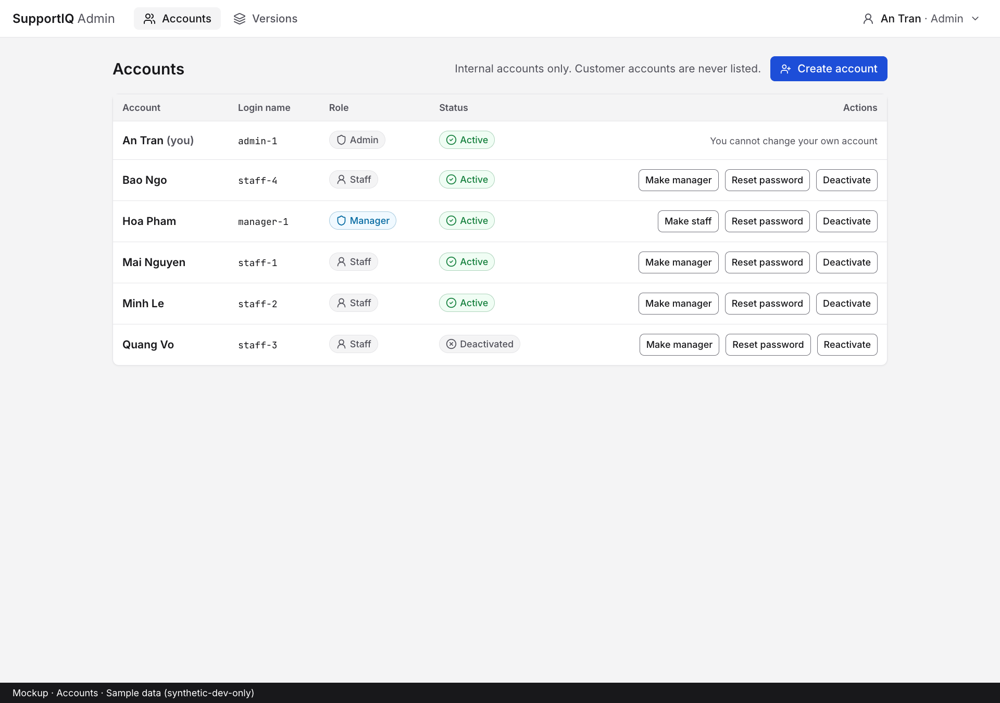
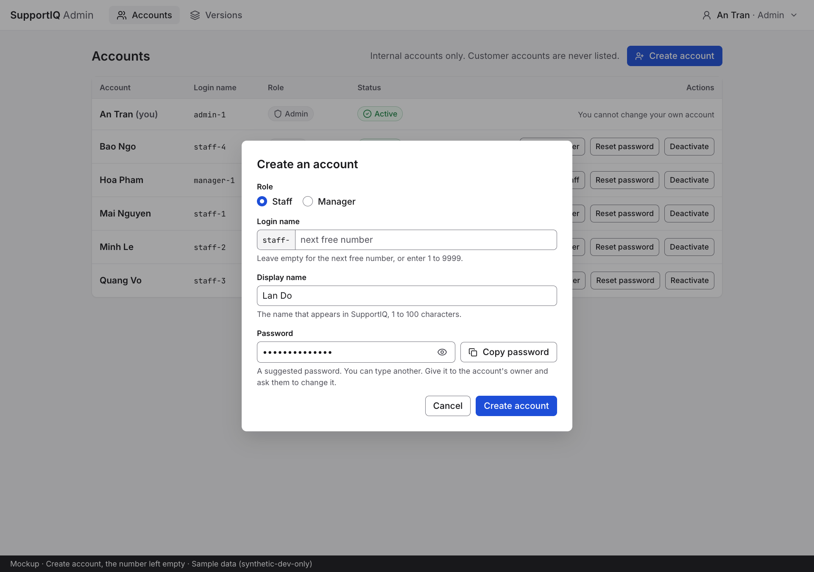
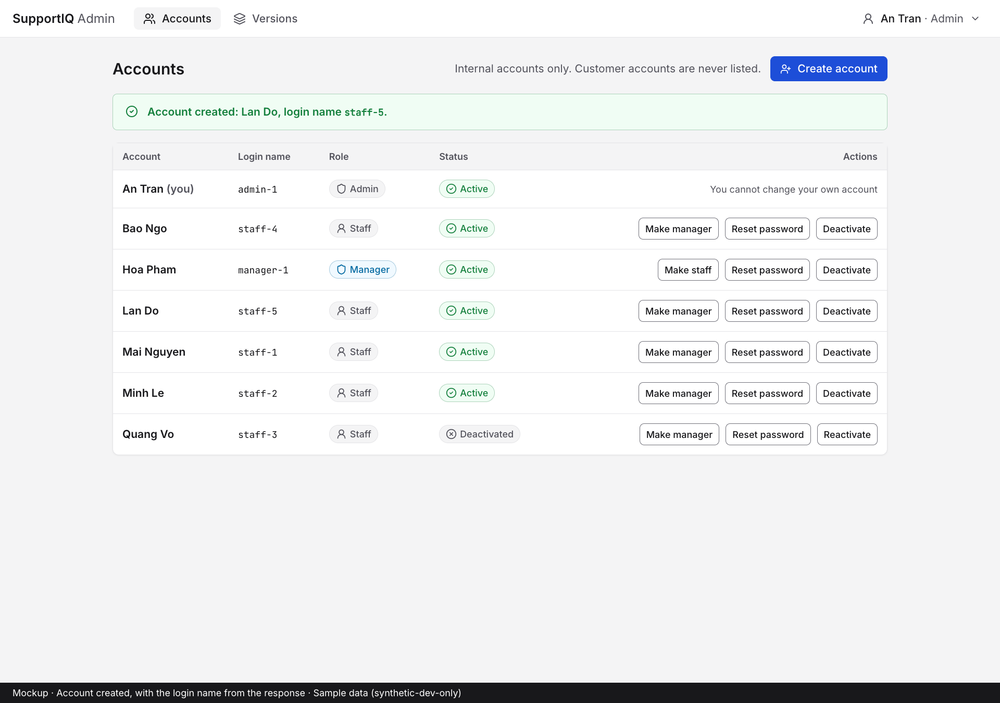
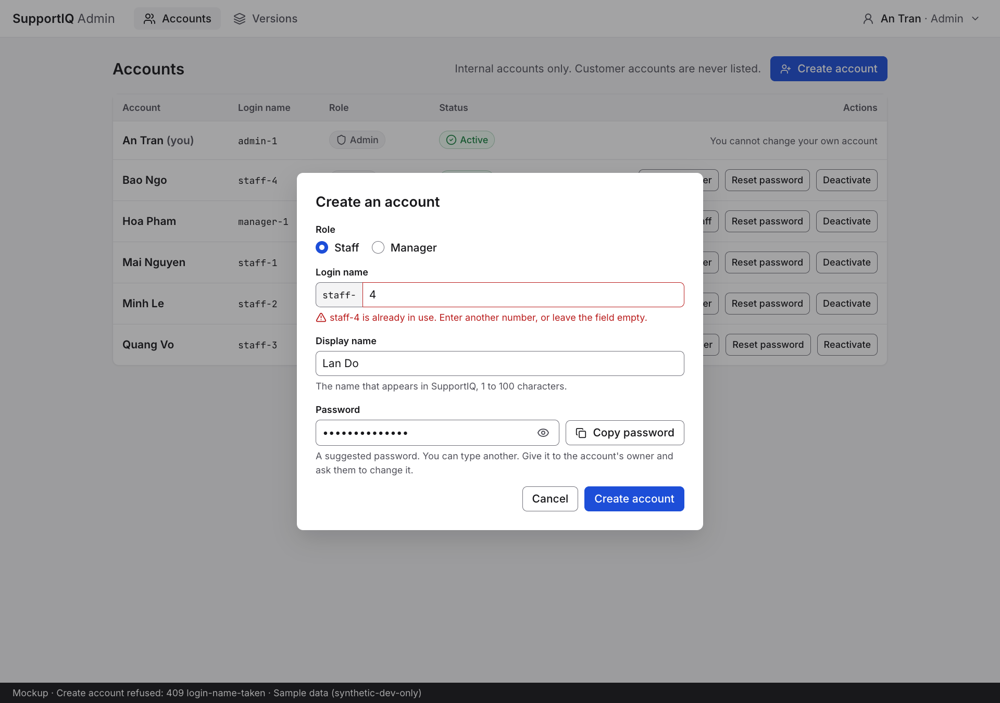
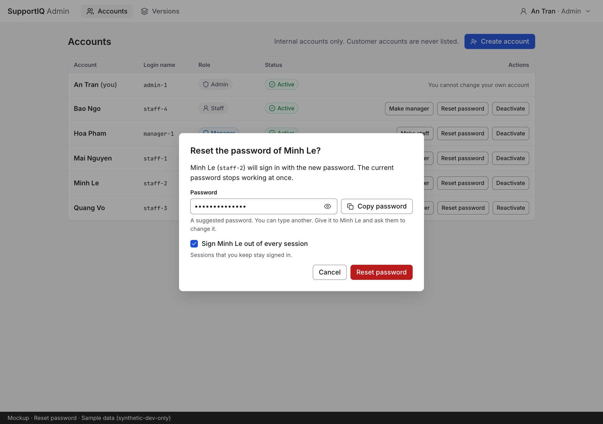

# Design: Account management

- **Status:** Approved
- **Owner:** backend engineer
- **Reviewers:** frontend engineer, contracts gatekeeper, project lead
- **Last reviewed:** 2026-11-15
- **Related:** [Requirements](../product/requirements.md) (FR-08), [ADR-0015](../decisions/0015-account-creation-and-password-changes.md), [ADR-0009](../decisions/0009-demo-accounts-and-cookie-sessions.md), [ADR-0012](../decisions/0012-roles-v1.md), [ADR-0008](../decisions/0008-ui-design-system.md), [backend foundation design](backend-foundation.md), [contracts v1 design](contracts-v1.md), [admin UI design](admin-ui.md), [shop UI design](shop-ui.md), [console UI design](console-ui.md), [security rules](../rules/security-and-privacy.md#authentication-and-authorization), [ERR-15](../rules/errors-and-reliability.md#idempotency), [UI-35](../rules/ui.md#developer-views), [UI-45](../rules/ui.md#admin)

## Summary

This design implements [ADR-0015](../decisions/0015-account-creation-and-password-changes.md) in its simplest form, as the project lead decided on 2026-11-11. An admin creates `staff` and `manager` accounts and resets their passwords; `frontend` suggests a generated password that the admin may copy or replace. Every account changes its own password whenever its owner wants. No password rule applies beyond the limits of sign-in, and no password expires.

It fixes the login names, the locks, three operations of `backend` contract 1.1.0, migration `r0002`, the exception to ERR-15, the audit actions, and the screens: the account menu of every role, `/change-password`, the admin dialogs, and the show and hide toggle of every password field. It follows the existing patterns: `changeAccountRole` and `changeAccountStatus` for admin writes, `createSession` for password checks and the throttle, and `features/admin-accounts/` for the admin screens.

**Revision of 2026-11-15, for dev mode ([UI-35](../rules/ui.md#developer-views)):** the [account menu](#account-menu) gains the checkbox item "Dev mode" between Change password and Sign out, for `staff`, `manager`, and `admin`, only where dev mode is available; customers never get it. The item follows the `frontend` code of 2026-11-15, and the project lead approved this revision on 2026-11-15. The earlier menu is kept under [Alternatives considered](#alternatives-considered).

## Goals and non-goals

### Goals

- The operations `changeOwnPassword`, `createAdminAccount`, and `resetAccountPassword` in `backend` contract 1.1.0, built and tested against PostgreSQL.
- No password reaches an idempotency record, a response body, a log line, a span, or an audit log entry.
- Every role has the account menu with "Change password" and "Sign out", every password field has a show and hide toggle, and the admin area has the create and reset dialogs.

### Non-goals

- The console operations, `getAdminVersions`, and reports. They come in `backend` contract 1.2.0.
- Password rules beyond the limits of sign-in, password expiry, and a forced change ([Alternatives considered](#alternatives-considered)).
- Password recovery for customers. Only the `backend reset` command restores the seed passwords.
- Email, multi-factor authentication, or an external identity provider.
- Changing a display name or a login name, and deleting accounts.

## Background

- Sign-in, sessions, Argon2id, the throttle, and the `Origin` check: [ADR-0009](../decisions/0009-demo-accounts-and-cookie-sessions.md) and the [backend foundation design](backend-foundation.md#sign-in-and-sessions).
- Roles, the admin limits, and the advisory lock of account changes: [ADR-0012](../decisions/0012-roles-v1.md) and the [backend foundation design](backend-foundation.md#changing-an-internal-account).
- What changes and why: [ADR-0015](../decisions/0015-account-creation-and-password-changes.md).

## Design

### Components and responsibilities

| Component | Responsibilities added by this design |
|---|---|
| `contracts` | `backend` contract 1.1.0: three operations, the field `login_name` of `AdminAccountView`, the problem type `login-name-taken`, and two `violated_rule` values |
| `backend` | The `accounts` feature: login names and three use cases. Migration `r0002`. Five events. `audit` gains three event types; `idempotency` does not change |
| `frontend` | `features/session`: the account menu and the page `/change-password`. `features/admin-accounts`: the login name column, the create and reset dialogs, and the password suggestion. `design-system`: `PasswordInput`, `AccountMenu`, `FormDialog`, `Checkbox`, and `RadioGroup` |

`backend` keeps each shared rule in one place:

| Rule | Place | Used by |
|---|---|---|
| Login names: compose `<role>-<number>`, the next free number | One domain module | `createAdminAccount` |
| Replace a password: store the hash, end sessions as chosen, forget the sign-in failures of the name, write the audit log entry | One application service | `changeOwnPassword`, `resetAccountPassword` |
| Hash a password, before any transaction opens | The existing `Argon2Passwords` adapter, behind a new `PasswordHasher` port | The three use cases and the seed |
| End sessions | The existing `SessionRevoker` port, with one more method that keeps the current session | `changeOwnPassword`, `resetAccountPassword`, and the existing changes |

The admin use cases copy the shape of `ChangeAccount`: role check before the body is parsed, then the Argon2id hash of the password, then in one transaction the advisory lock, the reload of the caller, the idempotency claim, the rules, the writes, the audit log entry, and the stored response. `changeOwnPassword` takes no advisory lock ([Locks](#locks)).

### Passwords

- Every new password, a changed own password and every password that an admin sets, has 1 to 128 characters, counted as Unicode code points: the limits of `CreateSessionRequest`, so every password that can be set can sign in. One contract schema holds them, and `backend` enforces them through the generated model. A violation returns `422 invalid-request`.
- No other rule applies (decided by the project lead on 2026-11-11). ADR-0015 records under Negative that this policy is a deliberate choice for the demo.
- A password does not expire, and nothing forces a change.
- A password is hashed exactly as typed, as sign-in does.

### Suggested passwords

1. When the create or reset dialog opens, `frontend` fills the password field with a generated password and offers Copy password next to it. The admin may use it, or clear the field and type another password.
2. The suggestion is 12 symbols in three groups of four, joined by hyphens, such as `k3m9-x7c2-q8vh`: 14 characters in all. The symbols are the digits and the lowercase letters except i, l, o, and u, so that it reads clearly. Each symbol comes from `crypto.getRandomValues`, and the hyphens are part of the password.
3. The generator is a pure function of a random source, so its tests use a fixed source.
4. `backend` never generates, returns, or logs a password.

### Login names

1. The login name of a new account is `<role>-<number>`, where `<role>` is the role of the new account (`staff` or `manager`) and `<number>` is a decimal number without leading zeros, such as `staff-4`. A login name never contains a person's name, so it stays Internal ([backend foundation design](backend-foundation.md#tables)).
2. The request carries `role` and an optional `login_number`, never a login name, so every login name that `backend` composes follows the pattern.
3. Without `login_number`, `backend` takes the next free number: one more than the largest number of any login name with the prefix `<role>-`, whatever the current role or status of that account, or 1 when there is none. With `staff-1` to `staff-3` and `staff-10`, the next free number is 11. A number is never reused, because accounts are never deleted.
4. With `login_number`, an integer from 1 to 9 999, `backend` composes the name and returns `409 login-name-taken` when an account already has it. The range is the `minimum` and `maximum` of `login_number` in the contract; `frontend` keeps it in a named constant that a unit test compares with the contract.
5. The range limits only the number that an admin enters. When the largest number in use is 9 999, the next free number is 10 000.
6. A role change does not rename an account: `staff-3` keeps its login name after it becomes a manager and still counts for the prefix `staff-`.

### Locks

| Operation | Before the transaction | In the transaction |
|---|---|---|
| `changeOwnPassword` | Hash the new password | `SELECT … FOR UPDATE` on the caller's own `accounts` row, then the idempotency claim, the throttle, the check of the current password, and the writes. No advisory lock |
| `createAdminAccount` | Hash the password | The advisory lock of account changes, which the next free number needs |
| `resetAccountPassword` | Hash the password | The advisory lock of account changes, as every admin change takes it, then the target's row, which its update locks |

1. No operation hashes a password while it holds the advisory lock, which every account change shares. A hash computed for a request that turns out to be a repeat or a refusal is discarded.
2. The check of the current password runs while `changeOwnPassword` holds only the row of the caller's own account, which blocks only changes of that same account.
3. The next free number is read under the advisory lock that `changeAccountRole` and `changeAccountStatus` already take, in the transaction that inserts the account, so two creations never get the same number. No new lock is added. The unique constraint on `login_name` is the second line of defense: a unique violation also returns `409 login-name-taken`.
4. A reset and an own change of the same account queue on that account's row. The reset holds the advisory lock and then waits for the row; the own change holds the row and never asks for the advisory lock, so they cannot deadlock.
5. Every operation that changes an account locks its row before it deletes the account's sessions, as role and status changes and sign-in already do, so session deletions cannot deadlock either.
6. Every lock wait is bounded by `database_lock_timeout_ms`; a longer wait returns `503 not-ready`.

### Flows

#### Changing the own password

```mermaid
sequenceDiagram
    actor Person as Account owner
    participant FE as frontend
    participant BE as backend
    participant DB as PostgreSQL
    Person->>FE: Enter the current password, the new password twice, and the sign-out choice
    alt A field empty or over 128 characters, or the two new entries differ
        FE-->>Person: Field message, nothing is sent
    else Fields valid
        FE->>BE: POST /v1/sessions/current/password-changes with Idempotency-Key
        alt Origin missing or not allowed
            BE-->>FE: 403 forbidden
        else Session missing or ended
            BE-->>FE: 401 unauthenticated
            FE-->>Person: Sign-in
        else Body outside the contract
            BE-->>FE: 422 invalid-request
        else Signed in
            BE->>BE: Hash the new password with Argon2id
            BE->>DB: Begin, lock and load the caller's own account row, claim the key
            alt Account gone, or no longer active
                BE->>DB: Roll back
                BE-->>FE: 401 unauthenticated
                FE-->>Person: Sign-in
            else Key used before with the same sign-out choice
                BE-->>FE: The original 201
            else Key used before with another sign-out choice
                BE-->>FE: 409 idempotency-key-reused
            else Login name at the sign-in failure limit
                BE->>DB: Roll back
                BE->>BE: Wait sign_in_failure_delay_ms
                BE-->>FE: 422 with current_password_incorrect
            else Current password wrong
                BE->>DB: Roll back, then insert a sign-in failure in its own transaction
                BE-->>FE: 422 with current_password_incorrect
            else Accepted
                BE->>DB: Store the new hash, delete the other sessions if chosen, delete the name's sign-in failures, insert the audit log entry, store the response, commit
                BE-->>FE: 201 session view
                FE-->>Person: "Your password was changed."
            else Database unavailable, timed out, or lock wait exceeded
                BE->>DB: Roll back
                BE-->>FE: 503 not-ready
            end
        else Timeout, lost connection, 502, 504, or a 2xx with an unreadable body
            FE-->>Person: The password may have been changed; submitting the same fields again is safe
        end
    end
```

1. Every role may call it. It checks no role and takes no advisory lock.
2. The key is claimed before the password check, so a repeat of a request that succeeded returns its stored `201`, although the current password in it no longer matches. Only the same account can reach the key ([ERR-15](../rules/errors-and-reliability.md#idempotency)).
3. A wrong current password counts as a sign-in failure for the account's login name ([ADR-0009](../decisions/0009-demo-accounts-and-cookie-sessions.md), statement 8). The transaction of the change rolls back first, so its idempotency record is never committed without a response, and the failure is then inserted in a transaction of its own. `createSession` has no idempotency record, so it records a failure in its only transaction.
4. At the failure limit, the request waits `sign_in_failure_delay_ms` after its transaction ended, so it holds no connection and no lock, and then returns `current_password_incorrect` without a check, even with the right password.
5. `is_signed_out_elsewhere` true deletes every other session of the account. The current session always stays.
6. A success also deletes the sign-in failures of the login name, as a successful sign-in does.
7. The account is checked under its row lock, before the key is claimed. A deactivation that committed while the request waited for the lock deleted the session of the request, so the change returns `401` and changes nothing, as an admin change does after it reloads its caller.

#### Creating an account

```mermaid
sequenceDiagram
    actor Admin
    participant FE as frontend
    participant BE as backend
    participant DB as PostgreSQL
    Admin->>FE: Open Create account
    FE->>FE: Fill the password field with a suggested password
    Admin->>FE: Choose the role, enter the display name and optionally the number, keep or replace the password
    alt A field outside its limits
        FE-->>Admin: Field message, nothing is sent
    else Fields valid
        FE->>BE: POST /v1/admin/accounts with Idempotency-Key
        alt Origin missing or not allowed, or not an admin
            BE-->>FE: 403 forbidden
        else Session missing or ended
            BE-->>FE: 401 unauthenticated
        else Body outside the contract, a role other than staff or manager included
            BE-->>FE: 422 invalid-request
        else Admin session
            BE->>BE: Hash the password with Argon2id
            BE->>DB: Begin, take the advisory lock, reload the caller, claim the key
            alt Caller no longer an active admin
                BE->>DB: Roll back
                BE-->>FE: 401 unauthenticated
            else Key used before with the same non-password fields
                BE-->>FE: The original 201
            else Key used before with other non-password fields
                BE-->>FE: 409 idempotency-key-reused
            else Number given and its login name taken, or a unique violation on insert
                BE->>DB: Roll back
                BE-->>FE: 409 login-name-taken
            else Accepted
                BE->>DB: Compose the login name, insert the active account with the hash, insert the audit log entry, store the response, commit
                BE-->>FE: 201 account view with the login name
                FE-->>Admin: Banner with the login name, list loads again
            else Database unavailable, timed out, or lock wait exceeded
                BE->>DB: Roll back
                BE-->>FE: 503 not-ready
            end
        else Timeout, lost connection, 502, 504, or a 2xx with an unreadable body
            FE-->>Admin: The account may have been created; submitting the same fields again is safe
        end
    end
```

1. The role check runs before the body is parsed, as in `changeAccountRole`. A `role` of `admin` or `customer` is outside `AssignableAccountRole`, so the contract refuses it with `422`.
2. The response holds the composed login name, so the admin learns it from `backend` even when `backend` chose the number.

#### Resetting a password

```mermaid
sequenceDiagram
    actor Admin
    participant FE as frontend
    participant BE as backend
    participant DB as PostgreSQL
    Admin->>FE: Choose Reset password on a staff or manager row
    FE->>FE: Fill the password field with a suggested password
    Admin->>FE: Keep or replace the password, choose whether every session ends
    alt Password empty or over 128 characters
        FE-->>Admin: Field message, nothing is sent
    else Fields valid
        FE->>BE: POST /v1/admin/accounts/{account_id}/password-resets with Idempotency-Key
        alt Origin, session, or role refused
            BE-->>FE: 403 forbidden, 401 unauthenticated, or 403 forbidden
        else Body outside the contract
            BE-->>FE: 422 invalid-request
        else Admin session
            BE->>BE: Hash the password with Argon2id
            BE->>DB: Begin, take the advisory lock, reload the caller, claim the key
            alt Caller no longer an active admin
                BE->>DB: Roll back
                BE-->>FE: 401 unauthenticated
            else Key used before with the same non-password fields
                BE-->>FE: The original 201
            else Key used before with other non-password fields
                BE-->>FE: 409 idempotency-key-reused
            else Target unknown or a customer account
                BE->>DB: Roll back
                BE-->>FE: 404 not-found
            else Target is the caller, or an admin account
                BE->>DB: Roll back
                BE-->>FE: 422 with own_account or admin_password_unresettable
            else Accepted
                BE->>DB: Store the hash, which locks the row, delete every session if chosen, delete the name's sign-in failures, insert the audit log entry, store the response, commit
                BE-->>FE: 201 account view
                FE-->>Admin: Banner, list loads again
            else Database unavailable, timed out, or lock wait exceeded
                BE->>DB: Roll back
                BE-->>FE: 503 not-ready
            end
        else Timeout, lost connection, 502, 504, or a 2xx with an unreadable body
            FE-->>Admin: The password may have been reset; submitting the same fields again is safe
        end
    end
```

1. The refusals follow the order of `violated_rule` in the contract: `own_account`, then `admin_password_unresettable`. An admin changes their own password with `changeOwnPassword`.
2. A deactivated account can be reset. A reset and a reactivation are two separate operations, each with its own audit log entry. After a reset alone, the account still cannot sign in until an admin reactivates it.
3. `is_signed_out_everywhere` true deletes every session of the account. False keeps them.
4. The reset also deletes the sign-in failures of the account's login name, so its owner can sign in at once even after earlier failures.

### Screens and dialogs

The mockups are review material in [assets/account-management/](assets/account-management/), [assets/admin-ui/](assets/admin-ui/), [assets/shop-ui/](assets/shop-ui/), and [assets/console-ui/](assets/console-ui/). They show one layout per screen; the team can still ask for alternatives. The other UI designs place the account menu in their shells and link here.

#### Account menu

- Every area has it in place of the display name and Sign out of the app bar: `/shop`, `/console`, and `/admin` ([shop UI](shop-ui.md#layout), [console UI](console-ui.md#layout), [admin UI](admin-ui.md#layout)).
- The trigger is a button with the person icon, the display name, the role label, and a chevron. At phone width in the shop, the text is visually hidden and only the icon shows, so the accessible name stays the same.
- The menu holds, in this order: the display name and the role label as a non-interactive heading, a separator, "Change password", the "Dev mode" item where the next point applies, and "Sign out". The roles are labeled Customer, Staff, Manager, and Admin.
- Where dev mode is available ([UI-35](../rules/ui.md#developer-views)), the menu of a `staff`, `manager`, or `admin` account holds the checkbox item "Dev mode" between Change password and Sign out, in a group of its own between two separators. It has the code icon and a check mark at its end while dev mode is on, and its state is `aria-checked`, so color is not the only signal. Choosing it switches dev mode on or off and closes the menu, as every other item does. Customers never get the item, and where dev mode is not available nobody does; the setting `VITE_DEV_MODE` makes it available ([console UI design](console-ui.md#frontend-settings)).
- The choice is a display preference of each account, kept in the browser under the account's `account_id`; it holds no Confidential data and starts off. When the browser refuses storage, the switch works until the page loads again. Dev mode never changes permissions ([UI-40](../rules/ui.md#boundaries)).
- It is the design-system component `AccountMenu`, on Radix DropdownMenu ([UI-31](../rules/ui.md#accessibility)): Enter, Space, or the down arrow opens it, the arrow keys move between items, Escape closes it, and the focus returns to the trigger.



The mockups show the menu where dev mode is not available, as in the demo deployment.



#### Password fields

Every password field, the sign-in field included, is the design-system component `PasswordInput`, as the proposed UI-46 requires ([Rule changes](#rule-changes)):

- A toggle button sits at the end of the field, with the eye icon and the fixed accessible name "Show password". `aria-pressed` is false while the password is hidden and true while it shows.
- The password is hidden on every load and again after a successful submission. The toggle never changes the value, the caret, or the focus of the field.
- The field never blocks paste or autofill, never truncates, and sets `autocomplete` to `current-password` or `new-password`.

#### Change password page

`/change-password` is a centered panel like `/sign-in`, without the app bar of an area, opened from the account menu. It works from 360 px wide.

| Element | Content |
|---|---|
| Heading | "Change password" |
| Fields | "Current password", "New password", and "Confirm new password". `frontend` alone checks that the two new entries match |
| Sessions | Checkbox "Sign out of my other sessions", checked; hint "This browser stays signed in." |
| Buttons | Change password; Cancel, back to the previous page, or to the start of the role's area when there is none |
| After success | "Your password was changed.", and "Your other sessions were signed out." when chosen. The focus moves to this message ([UI-30](../rules/ui.md#accessibility)); the button "Go back" opens the page that Cancel would open |



| Check or outcome | Shown |
|---|---|
| A field is empty | At the field: "Enter your current password.", "Enter a new password.", or "Enter the new password again." |
| New password over 128 characters | At the field: "Use at most 128 characters." |
| The two new passwords differ | At the confirmation: "The two new passwords are different." |
| Pending | Change password shows "Changing password…" and no button acts, so the request is sent once |
| `201` | The success state; the cached session is replaced with the response |
| `422` `current_password_incorrect` | At the first field: "The current password is not correct." The field is cleared and focused |
| `422` with any other `violated_rule`, an unknown one, or none | Banner: "The password was not changed. Check the fields and try again." |
| `401` | Sign-in |
| Timeout, lost connection, `502`, `504`, or a `2xx` with an unreadable body | Banner: "The password may have been changed. Select Change password again without editing the fields to find out." |
| `403 forbidden`, `409`, `5xx`, another response from the ingress | The shared failure banner of `features/backend-requests`, with the trace ID when there is one ([UI-25](../rules/ui.md#states)) |



#### Admin accounts screen

The [admin UI design](admin-ui.md#accounts) adds to the accounts table:

- the column Login name, in the monospace font, after the display name;
- the primary button "Create account" in the page header;
- the row action "Reset password" on every `staff` and `manager` row, active or deactivated.



#### Create account dialog

A modal `FormDialog` on Radix Dialog. Radix AlertDialog stays for confirmations that ask for no input.

| Element | Content |
|---|---|
| Title | "Create an account" |
| Role | Radio group: Staff (selected), Manager |
| Login name | The fixed prefix of the chosen role, such as "staff-", and a number field with the placeholder "next free number" and the hint "Leave empty for the next free number, or enter 1 to 9999." |
| Display name | Hint: "The name that appears in SupportIQ, 1 to 100 characters." |
| Password | `PasswordInput`, filled with a suggested password, and Copy password next to it. Hint: "A suggested password. You can type another. Give it to the account's owner and ask them to change it." |
| Buttons | Create account (primary), Cancel |

- Copy password announces "Password copied." or "The password could not be copied. Select it to copy it.", as the trace ID does ([UI-25](../rules/ui.md#states)).
- After `201`, the dialog closes, the focus returns to Create account, the list loads again, and a banner says "Account created: Lan Do, login name staff-5." with the login name of the response.





| Check or outcome | Shown |
|---|---|
| Number not a whole number from 1 to 9999 | At the field: "Enter a whole number from 1 to 9999, or leave it empty." |
| Display name empty, over 100 characters, with a space at the start or end, or with a control character | At the field: "Enter a display name.", "Use at most 100 characters.", "Remove the spaces at the start and the end.", or "Remove line breaks and tabs." |
| Password empty or over 128 characters | At the field: "Enter a password." or "Use at most 128 characters." |
| `409 login-name-taken` | At the number: "staff-4 is already in use. Enter another number, or leave the field empty." |
| `422` | Banner in the dialog: "The account was not created. Check the fields and try again." |
| Timeout, lost connection, `502`, `504`, or a `2xx` with an unreadable body | Banner in the dialog: "The account may have been created. Select Create account again without editing the fields to find out." The list loads again |
| `401`, `403 forbidden` | Sign-in, or the permission-denied state of the admin area |
| `409 idempotency-key-reused`, `5xx`, another response from the ingress | The shared failure banner in the dialog, with the trace ID |



#### Reset password dialog

A modal `FormDialog`, as for account creation.

| Element | Content |
|---|---|
| Title | "Reset the password of Minh Le?" |
| Text | "Minh Le (staff-2) will sign in with the new password. The current password stops working at once." For a deactivated account, also: "The account stays deactivated until an admin reactivates it." |
| Password | `PasswordInput`, filled with a suggested password, and Copy password next to it. Hint: "A suggested password. You can type another. Give it to Minh Le and ask them to change it." |
| Sessions | Checkbox "Sign Minh Le out of every session", checked; hint "Sessions that you keep stay signed in." |
| Buttons | Reset password, in the `danger` role; Cancel |

After `201`, the dialog closes, the list loads again, and a banner says "The password of Minh Le was reset.", followed by "Minh Le was signed out of every session." when chosen.



| Check or outcome | Shown |
|---|---|
| Password empty or over 128 characters | At the field: "Enter a password." or "Use at most 128 characters." |
| `404` | The dialog closes; page banner "Minh Le was not found. The list was loaded again." |
| `422` `own_account`, `admin_password_unresettable`, any other `violated_rule`, an unknown one, or none | The dialog closes; page banner "The password of Minh Le was not reset. Load the list again." The screen never offers the action on such rows, so only an outdated list reaches this |
| Timeout, lost connection, `502`, `504`, or a `2xx` with an unreadable body | Banner in the dialog: "The password may have been reset. Select Reset password again without editing the fields to find out." The list loads again |
| `401`, `403`, `409 idempotency-key-reused`, `5xx`, another response from the ingress | As in the create dialog |

#### Shared behavior of the dialogs and the page

- Cancel, Escape, and a click outside close a dialog only while nothing is pending, as `ConfirmDialog` does.
- When a dialog closes, the focus returns to the button that opened it, or to the row header when that button was replaced ([UI-30](../rules/ui.md#accessibility); [admin UI design](admin-ui.md#accounts)).
- An `Idempotency-Key` belongs to one set of field values. Submitting the same values again after a failure reuses it; any edit, a password field included, creates a new key. This is the client side of the [idempotency exception](#idempotency).
- A password exists in `frontend` only in the state of the open form and in the request. It is never stored, put in a URL, logged, or kept in a query or mutation cache after the request settles.

### Data and contracts

#### `backend` contract 1.1.0

Every change is compatible ([CON-19](../rules/contracts.md#evolution)): new operations, a new response field, a narrower response length, and new enum values in responses. `info.version` becomes 1.1.0 with a changelog entry ([CON-24](../rules/contracts.md#evolution)).

| Operation ID | Method and path | Roles | Body | Result |
|---|---|---|---|---|
| `changeOwnPassword` | `POST /v1/sessions/current/password-changes` | customer, staff, manager, admin | `current_password`, `new_password`, `is_signed_out_elsewhere` (boolean) | `201` `SessionView` |
| `createAdminAccount` | `POST /v1/admin/accounts` | admin | `role` (`AssignableAccountRole`), `login_number` (optional integer, 1 to 9 999), `display_name`, `password` | `201` `AdminAccountView` |
| `resetAccountPassword` | `POST /v1/admin/accounts/{account_id}/password-resets` | admin | `password`, `is_signed_out_everywhere` (boolean) | `201` `AdminAccountView` |

- Every password field uses one shared schema with 1 to 128 characters, `format: password`, and the data class Secret: the limits of `CreateSessionRequest`.
- `display_name` is Confidential, as staff identity ([SEC-01](../rules/security-and-privacy.md#data-classification)). In the request it has 1 to 100 characters, does not start or end with whitespace, and contains no control character (Unicode category Cc). A violation returns `422` and is never trimmed or repaired ([SEC-21](../rules/security-and-privacy.md#input-and-output-handling)). Display names need not be unique; the login name tells accounts apart.
- `201` follows the existing writes, which create a change resource. Every body has `additionalProperties: false`, and every boolean is required, so the client states the choice that the screen showed ([CON-07, CON-08](../rules/contracts.md#openapi-style)).
- The three operations check `Origin` and require `Idempotency-Key`.
- `backend` reads the bodies as JSON Schema does: an absent `login_number` stays absent, and `null` is refused with `422`, because the contract never uses null ([CON-08](../rules/contracts.md#openapi-style)); a number with a zero fraction, such as `1701.0` or `1e3`, is an integer.

| Schema or response | Change |
|---|---|
| `AdminAccountView` | New required `login_name` (Internal) |
| `display_name` in `SessionView` and `AdminAccountView` | `maxLength: 100`. It narrows only what `backend` sends; every seeded display name has at most 10 characters |
| `ProblemDetails.type` | New value `login-name-taken` (`409`) |
| `AccountChangeRule` | New values, after the existing ones: `admin_password_unresettable` (only from `resetAccountPassword`) and `current_password_incorrect` (only from `changeOwnPassword`). `AccountChangeProblemDetails` is also the `422` body of these two operations. Every `422` of `createAdminAccount` comes from validation against the contract, so it uses `InvalidRequest` |
| `SessionView`, `getCurrentSession`, `deleteCurrentSession` | No change |

- `violated_rule` keeps its rule: when several reasons apply, it holds the first value of the enum list.
- Examples ([CON-06](../rules/contracts.md#openapi-style)): one per outcome of each new operation. Example passwords are visibly fake values that gitleaks does not flag.
- Phase 2 regenerates the `backend` models and `frontend/src/api/generated/backend.ts` in the same change, because CI checks both against the contract ([CON-26](../rules/contracts.md#generated-code)).

#### Migration `r0002`

A new Alembic migration; `r0001` is not changed ([PY-40](../rules/python.md#persistence-backend)).

| Change | Why |
|---|---|
| `GRANT INSERT (account_id, login_name, display_name, role, is_active, password_hash, created_at) ON accounts TO supportiq_app` | Account creation. `customer_id` is not granted, so the existing check constraint refuses any customer row that `supportiq_app` inserts |
| `GRANT UPDATE (password_hash) ON accounts TO supportiq_app`, in addition to `role` and `is_active` | Password changes and resets |
| Trigger `BEFORE INSERT` on `accounts`: refuse a row whose `role` is `admin` unless the current role owns the table | Admin accounts exist only through the seed ([ADR-0012](../decisions/0012-roles-v1.md), admin limit 3). The seed runs as `supportiq_owner` |
| Replace the check on `audit_log_entries.event_type` with one that also allows `account.created`, `account.password_changed`, and `account.password_reset` | The audit log accepts only the event types it lists (`r0001`); without this, every creation, reset, and own change would fail with `500` |

- `supportiq_app` still cannot delete an account.
- The downgrade drops the trigger and the privileges, and puts the earlier check on `event_type` back as `NOT VALID`: no role can delete an audit log entry ([SEC-39](../rules/security-and-privacy.md#audit-log)), so entries of the three new types stay, and no new one can be written. Accounts created before the downgrade stay.
- `backend reset` truncates `accounts` and runs the seed, so created accounts and changed passwords return to the seeded state ([SEC-32](../rules/security-and-privacy.md#retention-and-exports)).
- No setting is added.

#### Idempotency

The `idempotency` feature does not change: each use case builds its own canonical request, and the three new use cases leave every password field out of it.

| Operation | Canonical request (body fields and path parameters) |
|---|---|
| `changeOwnPassword` | `is_signed_out_elsewhere` |
| `createAdminAccount` | `role`, `login_number` when present, `display_name` |
| `resetAccountPassword` | `account_id`, `is_signed_out_everywhere` |

- No password reaches `request_hash`, and no response schema has a password field, so none reaches `response_body`.
- The consequence, and the exception to [ERR-15](../rules/errors-and-reliability.md#idempotency): the same key with a different password returns the original result instead of `409`. `frontend` creates a new key whenever a field changes ([Shared behavior](#shared-behavior-of-the-dialogs-and-the-page)).
- Only a success is stored, so a refused, throttled, or failed request leaves no record.

#### Dependencies of `frontend`

Decided by the project lead on 2026-11-11 ([WF-27 to WF-30](../rules/workflow.md#dependencies)). Both are Radix primitives, the library that shadcn/ui uses under [ADR-0003](../decisions/0003-tech-stack.md) and [ADR-0008](../decisions/0008-ui-design-system.md), so no framework-level choice changes (WF-29).

| Package | Version on 2026-11-11 | License | Why |
|---|---|---|---|
| `@radix-ui/react-dropdown-menu` | 2.2.1 | MIT | The account menu: an accessible menu button with keyboard navigation and focus return. UI-31 forbids a menu built from generic elements |
| `@radix-ui/react-dialog` | 1.3.1, already in the lockfile through `@radix-ui/react-alert-dialog` | MIT | The create and reset form dialogs. AlertDialog has the `alertdialog` role, meant for confirmations, not for forms |

Phase 3 pins the versions in `package.json` and adds them to the dependency table of the `frontend` README. The checkbox and the radio group are native inputs styled with tokens, so they add no package.

### Rule changes

A rule that asks for code or a test changes in the phase that brings them, so that at the end of every phase no rule is broken by the code of that phase: TEST-26 changes with `backend` in phase 2, and UI-38, UI-45, and UI-46 change with `frontend` in phase 3. ERR-15, SEC-41, and SEC-42 only describe the new operations, which no code calls before phase 2, so they change in phase 1 ([RULE-06](../rules/README.md#changing-a-rule)).

| Rule | Phase | Change |
|---|---|---|
| [ERR-15](../rules/errors-and-reliability.md#idempotency) | 1 | Password fields are left out of the request hash ([Idempotency](#idempotency)) |
| [SEC-41](../rules/security-and-privacy.md#authentication-and-authorization) | 1 | An admin creates `staff` and `manager` accounts and resets their passwords; the list also shows login names |
| [SEC-42](../rules/security-and-privacy.md#authentication-and-authorization) | 1 | A password change or reset ends sessions as chosen |
| [TEST-26](../rules/testing.md#guardrail-tests) | 2 | A new guardrail: no password sent to `backend` appears in an idempotency record, a response body, a log line, a span, or an audit log entry. Its test covers sign-in and the three new operations |
| [UI-38](../rules/ui.md#shop) | 3 | The shop's scope also names the own password change ([ADR-0015](../decisions/0015-account-creation-and-password-changes.md), Relation to earlier ADRs) |
| [UI-45](../rules/ui.md#admin) | 3 | The accounts screen gains account creation and password resets |
| UI-46, new | 3 | Every password field has the show and hide toggle |

The new TEST-26 bullet that phase 2 adds:

> No password sent to `backend` appears in an idempotency record, a response body, a log line, a span, or an audit log entry. The test sends a known password through every operation that takes one ([ADR-0015](../decisions/0015-account-creation-and-password-changes.md), [ERR-15](../rules/errors-and-reliability.md#idempotency)).

The text that phase 3 gives the UI rules:

> **UI-38.** The shop uses the same design system and adds no components outside it. Its scope is fixed by [ADR-0013](../decisions/0013-shop-demo-with-read-only-catalog.md) and [ADR-0015](../decisions/0015-account-creation-and-password-changes.md): a read-only catalog, "My orders", the support form, sent replies, and the own password change. Every product shows the same neutral product image from the design system.
>
> **UI-45.** The admin area `/admin` has exactly two screens: accounts (list `staff`, `manager`, and `admin` accounts; create a `staff` or `manager` account; reset the password of a `staff` or `manager` account; change a role between `staff` and `manager`; deactivate; reactivate) and versions in use. Account creation and password resets are dialogs on the accounts screen. Every change asks for confirmation and names the account and the change. The area uses the design system and never shows customer accounts, tickets, messages, orders, or reports ([ADR-0012](../decisions/0012-roles-v1.md), [ADR-0015](../decisions/0015-account-creation-and-password-changes.md)).
>
> **UI-46**, in a new section "Password fields". Every password field uses the design-system `PasswordInput`. It has a show and hide toggle: a button at the end of the field with a fixed accessible name, "Show password", and `aria-pressed` for its state. The password is hidden on every load and after every successful submission, and the toggle never changes the value or the focus of the field. The field never blocks paste or autofill, never truncates, and sets `autocomplete` to `current-password` or `new-password`.

Phase 3 also adds UI-46 to the UI review checklist and to the description of `ui.md` in the [rules index](../rules/README.md#rule-files).

### Errors and guardrails

| Failure or risk | Behavior | Test |
|---|---|---|
| A password reaches an idempotency record, a response, a log line, a span, or an audit log entry | Impossible by design: no canonical request, response schema, event attribute, or audit field holds one | Guardrail test (the TEST-26 bullet of phase 2): send a known password through each new operation and sign-in, then search every idempotency record, response body, captured log line, exported span, and audit log entry |
| The current password is guessed through `changeOwnPassword` | Each wrong password is a sign-in failure of the login name; at the limit, every attempt waits `sign_in_failure_delay_ms` and is refused without a check | Integration test with a fake `Clock` that mixes sign-in and password-change failures |
| A change or a reset should end other sessions | They return `401` on their next request; kept sessions do not | Integration test for each choice of each operation |
| An admin creates an `admin` or `customer` account | The contract refuses the role with `422`; the trigger and the missing `customer_id` privilege refuse the row | Contract test; integration test as `supportiq_app` |
| An admin resets an admin account, their own password, or a customer account | `422` `admin_password_unresettable`, `422` `own_account`, or `404`; nothing changes ([SEC-41](../rules/security-and-privacy.md#authentication-and-authorization)) | Use-case tests; guardrail test that no admin operation reaches a customer account |
| Two admins create accounts without a number at the same time | The advisory lock serializes them; they get two numbers | Integration test with two concurrent transactions |
| A number is already in use | `409 login-name-taken`; nothing changes | Use-case test; integration test against the unique constraint |
| A reset and an own change of one account run at the same time | They queue on the account's row and cannot deadlock ([Locks](#locks)); one audit log entry each, and the last one decides the password | Integration test with two concurrent transactions, in both orders |
| An admin deactivates an account while its own change waits for the account's row | The change finds the account inactive under the lock, rolls back, and returns `401`; nothing changes, and no key is claimed | Use-case test, for an account that is gone and one that is deactivated |
| An own change runs while an admin changes another account | Neither waits: the own change locks only its own row, and its hash runs before its transaction | Integration test with two concurrent transactions |
| The same key arrives with other non-password fields | `409 idempotency-key-reused` | Handler test |
| The same key arrives with another password | The original result; no second change. This documents the ERR-15 exception | Handler test |
| A reset meets a login name at the failure limit | The reset deletes its failures, so the owner signs in at once | Integration test |
| A successful creation, reset, or own change | Exactly one audit log entry; none for a refused request | Integration test per operation |
| A response after the timeout hides whether a write happened | `frontend` says that it may have happened and reuses the key for the same fields | Component test; UI flow test |
| A suggested password is predictable or biased | Web Crypto source, one symbol per random value from an alphabet of equal weight | Unit test with a fixed source: length 14, alphabet, and hyphen positions |

No change touches replies, drafts, or transactions: staff still approve every reply, and nothing is sent automatically.

## Alternatives considered

- **A password that expires and must be changed at the first sign-in (a temporary password):** this design until 2026-11-11, following the first ADR draft. Replaced by the project lead: it needed a password state, a column `temporary_password_expires_at`, an expiry setting, a restricted session with `403 password-change-required`, a forced-change screen, and a deadline formatter, none of which the demo needs. The admin now knows the password until its owner changes it (ADR-0015, Negative).
- **A stronger password policy (a minimum length, a blocklist, a rule that a new password differs from the current one):** not chosen by the project lead for the demo (ADR-0015, Negative).
- **A long generated password shown once after the request:** a 23-character password in four groups, shown only in a result view. Not chosen: the suggestion is short and readable, sits in the form with Copy password, and is optional.
- **An operation that proposes the next login name (`GET /v1/admin/login-name-proposals`):** not chosen by the project lead. It adds an operation, and a proposed number can be taken before the creation.
- **`frontend` computes the next number from the account list:** not chosen. The list is paginated, and the rule is business logic, which the UI does not hold ([UI-39](../rules/ui.md#boundaries)).
- **The smallest unused number:** not chosen by the project lead. The largest number plus one is predictable, and a number never comes back.
- **A request with the full login name, checked against a pattern:** not chosen. Sending only the number makes a name outside the pattern impossible.
- **`403` for resetting an admin account or the own password:** the ADR draft. Not chosen: the refusals of ADR-0012 already use `422` with `violated_rule`, and a `role` of `admin` at creation can only be a contract violation, which is `422`.
- **Password fields in the request hash:** not chosen. `request_hash` is an unsalted SHA-256 in a column of Internal data, so a weak password could be guessed offline from it. An Argon2id hash has a random salt and could not be compared. A keyed hash would need a new secret.
- **The advisory lock and the Argon2id hash inside every transaction:** replaced by the [Locks](#locks). The advisory lock is shared by every account change, so hashing under it, or making an own change take it, would make unrelated changes wait.
- **No confirmation field on `/change-password`:** not chosen by the project lead. A typo would lock the owner out until an admin reset.
- **Radix AlertDialog for the forms:** not chosen. Its role is for confirmations; forms use Radix Dialog.
- **An account menu with only Change password and Sign out:** the menu of this design until 2026-11-15. The Dev mode item joins it, because UI-35 lets each `staff`, `manager`, and `admin` user switch dev mode for themselves, and the account menu is the one control that every area shares.

## Testing and evaluation

The tests follow the Validation of [ADR-0015](../decisions/0015-account-creation-and-password-changes.md#validation) and [TEST-01](../rules/testing.md#required-tests-per-change).

- **Unit, `backend`:**
  - login names: composition and the next free number (none, a gap, another prefix, an account whose role changed);
  - each use case with a fake for every port: every refusal in its order, the stored effects, the deleted or kept sessions, the deleted sign-in failures, exactly one audit log entry, and the event.
- **Integration, `backend` (PostgreSQL 17):**
  - migration `r0002` up and down, the audit check that accepts the three new event types included, and a downgrade after such entries exist;
  - privileges and the trigger: `supportiq_app` inserts `staff` and `manager` accounts, cannot insert an `admin` or a `customer` account, and updates only the granted columns;
  - every row of [Errors and guardrails](#errors-and-guardrails) that names an integration test;
  - the flows that need real sessions, because the repository cannot yet run `frontend` against a real `backend`: an account that an admin created signs in with the password of the creation; after a reset at the failure limit, the owner signs in with the new password at once; an own change or a reset that ends sessions makes them get `401`, and one that keeps them leaves them working.
- **Permission tests:** every role can change its own password; only `admin` can create accounts and reset passwords; the table of every operation against every role ([SEC-16](../rules/security-and-privacy.md#authentication-and-authorization)).
- **Contract:** Schemathesis over all 18 operations, one test per documented status, and the new examples ([CON-27](../rules/contracts.md#contract-tests)).
- **Guardrail (TEST-26, from phase 2):** no password in any record, response, log line, span, or audit log entry; no admin operation reaches a customer account.
- **Unit, `frontend`:** the generator; the length in code points, not UTF-16 units; the key rule (same fields reuse it, any edit creates a new one); the mapping of every `violated_rule`, an unknown one included, and of `409 login-name-taken`; and a test that the password limits and the login number range equal the contract.
- **Storybook with axe ([UI-32](../rules/ui.md#accessibility)):** `PasswordInput` hidden, shown, and with an error; `AccountMenu` closed and open for each role; `/change-password` with every state of its table; both dialogs with every state of their tables, the copy failure included.
- **End-to-end (Playwright on the Prism mock):**
  - an admin creates a `staff` account with the suggested password: the banner shows the login name, and the request sends that password with an `Idempotency-Key`;
  - an admin resets the password of a `staff` account, and a reset after a lost connection says that the password may have been reset;
  - a customer changes the password from the account menu at 360 px wide, and a wrong current password shows its message at the field, which is cleared and focused;
  - the account menu, the show and hide toggle, and the focus after a successful change, with the keyboard only.
- No model metric changes.

## Observability

| Event | Level | Attributes | When |
|---|---|---|---|
| `account.created` | info | `account_id` (the admin), `target_account_id`, `role` | An admin created an account |
| `account.password_changed` | info | `account_id`, `is_signed_out_elsewhere` | An account changed its own password |
| `account.password_reset` | info | `account_id` (the admin), `target_account_id`, `is_signed_out_everywhere` | An admin reset a password |
| `password_change.failed` | info | `account_id` | The current password was wrong |
| `password_change.throttled` | warning | `account_id` | The login name was at the sign-in failure limit |

- Phase 2 adds the five events to the event catalog, `platform/domain/events.py`, and to the Events table of `backend/README.md` ([LOG-12](../rules/logging-and-observability.md)).
- Events never carry a password, a hash, a login name, or a display name ([LOG-29](../rules/logging-and-observability.md#privacy-in-telemetry)). The new attributes join the allow-list of the logging setup.
- Request logs already exclude bodies and headers, so no password reaches a request log.
- No new span: HTTP and database spans come from auto-instrumentation ([LOG-20](../rules/logging-and-observability.md#traces)).

Audit log entries, each in the transaction of its change ([SEC-39](../rules/security-and-privacy.md#audit-log)):

| Event type | Recorded data |
|---|---|
| `account.created` | Target account, role, actor |
| `account.password_changed` | Target account (the actor's own), `is_signed_out_elsewhere`, actor |
| `account.password_reset` | Target account, `is_signed_out_everywhere`, actor |

No entry holds a password, a password hash, a login name, or a display name.

## Security and privacy

| Data | Class | Where it exists |
|---|---|---|
| Passwords | Secret | The request body, and in `frontend` only while the form is open. Never stored, logged, or returned |
| Password hashes | Confidential | `accounts.password_hash` only |
| Login names | Internal | The `backend` database and admin responses; never in events |
| Display names | Confidential | The `backend` database and responses |

- Nothing leaves `backend` or `frontend` toward any external service. The admin hands a password over outside the system.
- Copy password puts the password on the admin's clipboard, which the browser does not clear.
- The admin knows a password that they set until its owner changes it, so the admin can sign in as that account until then. ADR-0015 accepts this under Negative; the audit log records every reset.
- Brute force through `changeOwnPassword` shares the sign-in throttle of the login name.
- The project lead approved this design in place of a PR review ([Rollout](#rollout)).

## Rollout

The three phases are built on one branch, `build/account-passwords`, which is merged once into `chore/fe-be-supportiq-ecom`; CI runs on every push of the branch. On 2026-11-11 the project lead accepted ADR-0015, approved this design and the revisions of the admin, shop, and console UI designs, and decided that this approval replaces the two approvals and the contracts gatekeeper of a PR review ([WF-15](../rules/workflow.md#reviews), [SEC-35](../rules/security-and-privacy.md#security-review)).

1. Phase 1, documents only: this design; the revisions of the admin, shop, and console UI designs with their mockups; the changes to ERR-15, SEC-41, and SEC-42; the glossary; the contracts v1 design; and the edits of ADR-0015.
2. Phase 2, `backend`: `backend` contract 1.1.0, migration `r0002`, the use cases and tests, the regenerated `backend` models and `frontend` client, and the new TEST-26 bullet with its test ([Rule changes](#rule-changes)). Done on 2026-11-12, in one change with phase 3, so no version of `frontend` meets the new problem type before it handles it.
3. Phase 3, `frontend`: the design-system components with their stories, the account menu, `/change-password`, the admin dialogs, the password suggestion, the two dependencies, and the changes to UI-38, UI-45, and UI-46 ([Rule changes](#rule-changes)). Done on 2026-11-12.
4. Done on 2026-11-15: the project lead approved the revision of 2026-11-15, for dev mode.
5. Rollback after the merge: stop `backend`, downgrade the database to `r0001` with the merged code ([Migration](#migration-r0002)), revert the merge commit, and deploy. The downgrade comes first, because the reverted code no longer contains `r0002`.

### Mockup sources

The mockups are review material, not `frontend` code. [assets/account-management/](assets/account-management/) holds the account menu and `/change-password`: `mockup.js` draws each screen with the tokens and primitives of [../console-ui/mockup.css](assets/console-ui/mockup.css), and `mockup.html?screen=<name>` shows one screen. The admin dialogs are drawn by the mockup of [assets/admin-ui/](assets/admin-ui/), and the shop menu at phone width by the mockup of [assets/shop-ui/](assets/shop-ui/). To render every PNG of a folder on macOS with Google Chrome:

```bash
docs/design/assets/account-management/render.sh
docs/design/assets/admin-ui/render.sh
docs/design/assets/shop-ui/render.sh
```

## Open questions

None.
