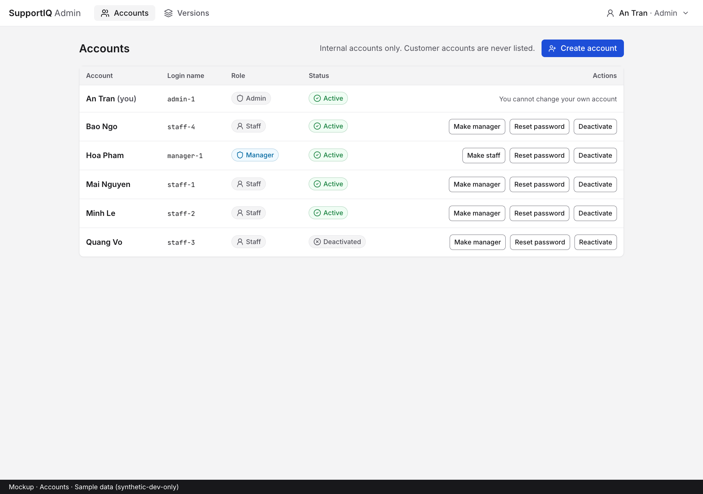
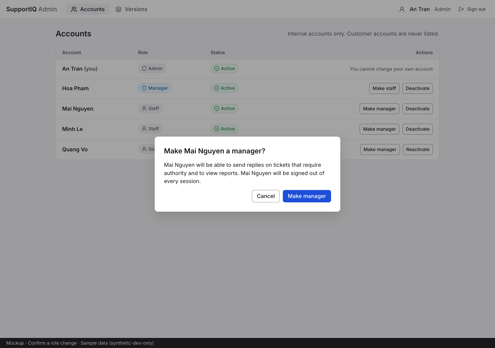
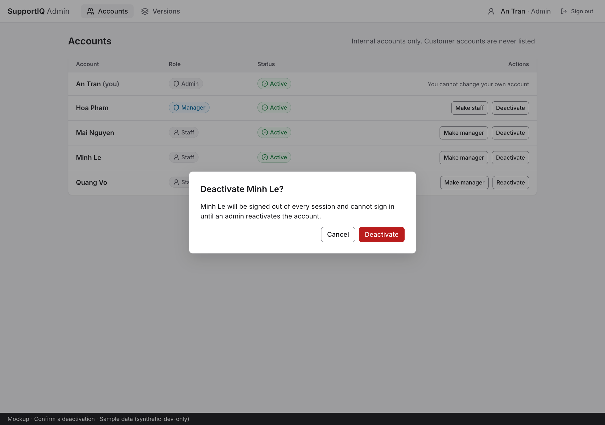
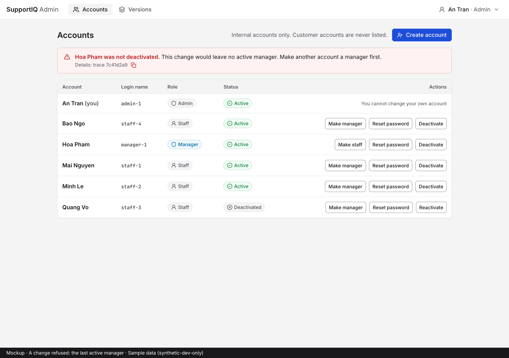
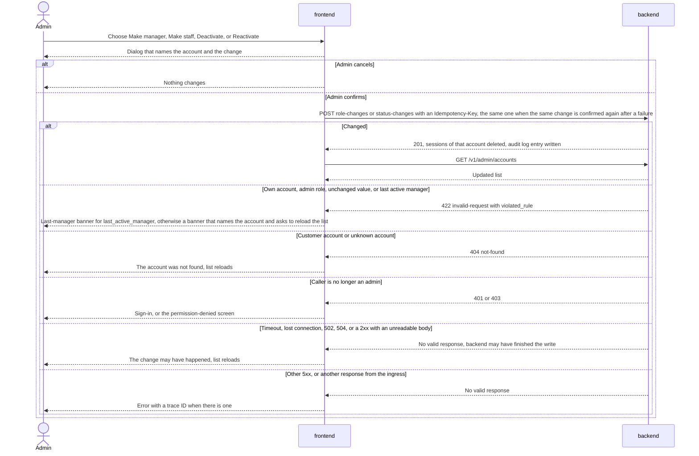

# Design: Admin UI

- **Status:** In review
- **Owner:** frontend engineer
- **Reviewers:** backend engineer, contracts gatekeeper
- **Last reviewed:** 2026-11-15
- **Related:** [Requirements](../product/requirements.md) (FR-08), [ADR-0008](../decisions/0008-ui-design-system.md), [ADR-0009](../decisions/0009-demo-accounts-and-cookie-sessions.md), [ADR-0012](../decisions/0012-roles-v1.md), [ADR-0015](../decisions/0015-account-creation-and-password-changes.md), [contracts v1 design](contracts-v1.md#admin-operations) (revision 2, in review), [account management design](account-management.md), [console UI design](console-ui.md) (tokens and app shell), [UI-35](../rules/ui.md#developer-views), [UI-45](../rules/ui.md#admin), [SEC-41](../rules/security-and-privacy.md#authentication-and-authorization)

## Summary

This design fixes the two screens of `/admin` that [UI-45](../rules/ui.md#admin) allows: the internal accounts and the versions in use. It reuses the app shell and design tokens of the [console UI design](console-ui.md#design-tokens), because the admin area also targets desktop widths ([UI-33](../rules/ui.md#layout-and-performance)).

UI-45 and the [admin operations](contracts-v1.md#admin-operations) fix what each screen holds, so the draft proposes one layout. The team can still ask for alternatives.

**Revision of 2026-11-07, decided by the project lead:** after a timeout, a lost connection, `502`, or `504`, nobody knows whether a change happened: `backend` may finish a write after `frontend` stopped waiting (`backend` contract, Timeouts), and a write in flight can fail with `502` ([ADR-0011](../decisions/0011-deployment-and-runtime-topology.md)). Version 1.0.1 of the `backend` contract states this in its text on responses from the ingress. The same holds for a `2xx` whose body cannot be read, and for a retry that fails after one of these, unless `backend` refuses it with `422` or `404`. The banner now says that the change may have happened, and the list loads again. Confirming the same change again after a failure reuses its `Idempotency-Key`, so a change that already happened is not repeated. The first decision is kept under [Alternatives considered](#alternatives-considered). The revision also records where the focus goes when a dialog closes.

**Revision of 2026-11-11, for [ADR-0015](../decisions/0015-account-creation-and-password-changes.md):** the accounts screen gains a Login name column, the button Create account, and the row action Reset password. The account menu replaces the display name and Sign out of the app bar. The dialogs, their texts, and their states are defined once, in the [account management design](account-management.md#screens-and-dialogs); this design places them. UI-45 gains the two new actions in the phase that builds them ([account management design](account-management.md#rule-changes)). The earlier non-goal that excluded account creation and password changes is kept under [Alternatives considered](#alternatives-considered).

**Revision of 2026-11-15, for dev mode ([UI-35](../rules/ui.md#developer-views)):** the project lead agreed on the content on 2026-11-14, and this revision needs the lead's approval. In dev mode, the accounts screen and the versions page add developer details, within the data that the contract already returns, and `frontend` gets three new settings: its build version and the links of two Grafana dashboards ([Developer details in the admin area](#developer-details-in-the-admin-area)). `account_id` stays hidden, also in dev mode. In the `frontend` code of 2026-11-15, the account menu of an admin already holds the Dev mode item, but no admin screen shows developer details yet. The project lead decided the open points of the draft on 2026-11-15.

## Goals and non-goals

### Goals

- Every admin operation has one place on screen: `listAdminAccounts`, `changeAccountRole`, `changeAccountStatus`, `createAdminAccount`, `resetAccountPassword`, and `getAdminVersions`.
- Every change asks for confirmation and names the account and the change (UI-45).
- An admin never sees a customer account, a ticket, a message, an order, or a report ([SEC-41](../rules/security-and-privacy.md#authentication-and-authorization)).

### Non-goals

- Deleting accounts, changing display names or login names, and managing customer accounts ([ADR-0012](../decisions/0012-roles-v1.md), [ADR-0015](../decisions/0015-account-creation-and-password-changes.md)).
- Changing a version from a screen. Versions change only through the release process ([requirements appendix](../product/requirements.md#appendix-clarifications-of-the-submitted-specification), row 11).
- An audit log viewer. The audit log is read by reports and exports, not by this area.

## Background

- Roles and what an admin may do: [ADR-0012](../decisions/0012-roles-v1.md) and [SEC-41](../rules/security-and-privacy.md#authentication-and-authorization).
- Operations, their rules, and their errors: [admin operations](contracts-v1.md#admin-operations). A role change or a deactivation deletes all sessions of that account.
- Sign-in uses the shared `/sign-in` screen ([console UI design](console-ui.md#screens)).

## Design

### Components and responsibilities

Only `frontend` changes. `backend` enforces every rule. `frontend` hides an action only when the contract makes it impossible for every caller (the admin role) or when it concerns the caller's own account, which `getCurrentSession` identifies ([UI-40](../rules/ui.md#boundaries)).

### Layout

- The console app shell with the brand "SupportIQ Admin", the navigation Accounts and Versions, and the [account menu](account-management.md#account-menu) with the admin's display name, Change password, and Sign out.
- One content column, at most 1040 px wide.
- After sign-in, `frontend` opens `/admin/accounts` for the `admin` role.

### Screens

| Screen | Route (proposed) | Content | Mockup |
|---|---|---|---|
| Accounts | `/admin/accounts` (`/admin` opens it) | The `staff`, `manager`, and `admin` accounts with login name, role, status, and actions, and Create account | [admin-accounts.png](assets/admin-ui/admin-accounts.png) |
| Versions in use | `/admin/versions` | The release ID and asset versions of `ai-service`, the `backend` build, and whether `ai-service` is reachable | [admin-versions.png](assets/admin-ui/admin-versions.png) |



### Accounts

| Row | Actions |
|---|---|
| The caller's own account | None. The row says "You cannot change your own account" |
| An `admin` account | Deactivate or Reactivate. The row says "The admin role cannot be changed" |
| A `staff` account | Make manager; Reset password; Deactivate or Reactivate |
| A `manager` account | Make staff; Reset password; Deactivate or Reactivate |

- The columns are Account (the display name), Login name in the monospace font, Role, Status, and Actions ([account management design](account-management.md#admin-accounts-screen)).
- The page header holds the primary button Create account. It and Reset password open the form dialogs of the [account management design](account-management.md#create-account-dialog), which also defines their texts, states, and focus.
- Reset password is offered on deactivated `staff` and `manager` accounts too.
- The list is ordered by display name, with 20 accounts per page, the default page size of the contract. It is paginated, so `frontend` cannot know whether an account is the last active manager. `backend` refuses that change with `422 invalid-request`, and the page shows the reason in a banner that names the account.
- The banner follows `violated_rule` of the `422` body ([admin operations](contracts-v1.md#admin-operations)). `last_active_manager` shows the banner of [admin-last-manager.png](assets/admin-ui/admin-last-manager.png). Any other value, an unknown one included, or no value, shows a banner that names the account and asks the admin to reload the list.
- When a dialog closes, the focus returns to the button that opened it. A successful change replaces that button (Make manager becomes Make staff), so the focus then moves to the row header of the account ([UI-30](../rules/ui.md#accessibility)).
- Each action opens a confirmation dialog that names the account and the change:

| Action | Dialog title | Text | Confirm button |
|---|---|---|---|
| Make manager | "Make Mai Nguyen a manager?" | "Mai Nguyen will be able to send replies on tickets that require authority and to view reports. Mai Nguyen will be signed out of every session." | Make manager |
| Make staff | "Make Hoa Pham staff?" | "Hoa Pham will no longer send replies on tickets that require authority or view reports. Hoa Pham will be signed out of every session." | Make staff |
| Deactivate | "Deactivate Minh Le?" | "Minh Le will be signed out of every session and cannot sign in until an admin reactivates the account." | Deactivate, in the `danger` role |
| Reactivate | "Reactivate Quang Vo?" | "Quang Vo will be able to sign in again with the current role." | Reactivate |







The mockups of the form dialogs are shown in the account management design: [admin-create-account.png](assets/admin-ui/admin-create-account.png), [admin-account-created.png](assets/admin-ui/admin-account-created.png), [admin-login-name-taken.png](assets/admin-ui/admin-login-name-taken.png), and [admin-reset-password.png](assets/admin-ui/admin-reset-password.png).

### Versions in use

- The page is read-only and says so.
- The asset rows follow `AssetVersions` in the release manifest ([DATA-56](../rules/data-and-ml.md#models-and-artifacts)): the release ID, the model artifact, the KB, the document-to-intent mapping, the prompts, the routing configuration, and the retrieval index, in the fields `release_id`, `model_version`, `kb_version`, `mapping_version`, `prompt_version`, `routing_version`, and `index_version` of `AssetVersions` (contract PR 1).
- When `ai_service_status` is `unavailable`, a banner in the `danger` role says so and tells the admin to reload the page later, and every `ai-service` row shows "Unknown". The `backend` build is still shown.


### Developer details in the admin area

Where dev mode is available and the admin switched it on in the [account menu](account-management.md#account-menu) ([UI-35](../rules/ui.md#developer-views)), both screens add developer details. With dev mode off, both screens stay exactly as described above.

| Screen | Developer details |
|---|---|
| Accounts | For each row, the raw values of `role` and `is_active` as `backend` sent them. `account_id` stays hidden, as [Data and contracts](#data-and-contracts) states |
| Versions in use | The raw value of `ai_service_status`, also a value that this version does not know and shows as Unavailable ([CON-22](../rules/contracts.md#evolution)); the raw value of `backend_version` and of each field of `ai_service_versions`, which the page already shows as `backend` sent them; and one button that copies the whole version block as text for a bug report: `backend_version`, `ai_service_status`, and every field of `ai_service_versions` when `ai-service` is available |
| Both | The build version of `frontend`; every setting that [frontend/README.md](../../frontend/README.md#settings) lists, with its value; and links to the Grafana dashboards System overview and AI pipeline ([LOG-27](../rules/logging-and-observability.md#dashboards)), each shown only when its setting is set |

Three new frontend settings serve these details. Like every `VITE_` setting, they are built into the page, so they never hold a secret, and an invalid value stops `frontend` at startup with the name of the setting ([ARCH-34](../rules/architecture.md#configuration)).

| Setting | Values | Not set |
|---|---|---|
| `VITE_FRONTEND_BUILD_VERSION` | The build version of `frontend`, named after the setting `BACKEND_BUILD_VERSION` of `backend` | `local` on the dev server, where `DEV` is true, the value that [backend/.env.example](../../backend/.env.example) gives `BACKEND_BUILD_VERSION`; "Not set" in a production build, so a build never shows a wrong version |
| `VITE_GRAFANA_SYSTEM_OVERVIEW_URL` | The link to the dashboard System overview. It is an https URL, or an http URL whose host is `localhost`, `127.0.0.1`, or `[::1]`, as `VITE_GRAFANA_TRACE_URL` requires ([console UI design](console-ui.md#frontend-settings)); it has no slot | No link to the dashboard |
| `VITE_GRAFANA_AI_PIPELINE_URL` | The link to the dashboard AI pipeline, checked as `VITE_GRAFANA_SYSTEM_OVERVIEW_URL`; it has no slot | No link to the dashboard |

On Cloudflare Pages:

- Cloudflare Pages sets the variable `CF_PAGES_COMMIT_SHA` to the commit SHA in its builds by default ([Cloudflare: Build configuration](https://developers.cloudflare.com/pages/configuration/build-configuration/)). Vite passes only `VITE_` variables to the page, so the build command of the Pages project sets `VITE_FRONTEND_BUILD_VERSION` from `CF_PAGES_COMMIT_SHA`. That build command is deployment configuration and is recorded in `deploy/` ([ARCH-42](../rules/architecture.md#component-boundaries)).

Limits:

- Of the data from `backend`, dev mode shows only what the contract already returns, from `listAdminAccounts` and `getAdminVersions`, and needs no change to the operations or the schemas of the contract. The build version and the settings come from `frontend` itself.
- It adds no permission and shows no customer or ticket data ([UI-35](../rules/ui.md#developer-views), [SEC-41](../rules/security-and-privacy.md#authentication-and-authorization)). `backend` enforces every rule exactly as without dev mode.
- An in-app developer screen that shows every record stays rejected, as the project lead decided on 2026-11-12 ([contracts v1, Alternatives considered](contracts-v1.md#alternatives-considered)).
- The trace ID on errors stays as it is, with or without dev mode: the error states show it under "Details" when there is one ([UI-25](../rules/ui.md#states)).

### States

| State | When | Shown |
|---|---|---|
| Loading | `listAdminAccounts` or `getAdminVersions` is pending | Skeleton rows in the place of the table or the list ([UI-24](../rules/ui.md#states)) |
| Load error | Either call fails with a network error, `5xx`, or a response from the ingress | A plain-language message, Try again, and a copyable trace ID when there is one ([UI-25](../rules/ui.md#states)) |
| Permission denied | `403`: a `customer`, `staff`, or `manager` session opens `/admin` | "The admin area is for admin accounts", with Sign out |
| Change refused | `422` on a change | With `violated_rule` `last_active_manager`: the banner of [admin-last-manager.png](assets/admin-ui/admin-last-manager.png). With any other value, or none: a banner that names the account and asks the admin to reload the list |
| Change outcome unknown | A timeout, a lost connection, `502`, `504`, or a `2xx` with an unreadable body on a change, or a retry or a repeated confirmation that fails after one of these, unless `backend` refuses it with `422` or `404`. A `403` shows the Permission denied state instead, because the caller can no longer act. | A banner names the account and says that the change may have happened and that trying again is safe if the row does not change. The list loads again. Confirming the same change again reuses its key, so it is safe |
| `ai-service` unreachable | `ai_service_status` is `unavailable` | The banner and "Unknown" rows, as in [admin-versions-unavailable.png](assets/admin-ui/admin-versions-unavailable.png) |

An admin account always exists, so the accounts list is never empty.

### Flow



### Status presentations (UI-12)

| Status | Value | Tone | Label |
|---|---|---|---|
| Role | `staff`, `manager`, `admin` | neutral, info, neutral | Staff, Manager, Admin |
| Account status | `is_active` true, false | success, neutral | Active, Deactivated |
| `ai-service` | `available`, `unavailable` | success, danger | Available, Unavailable |

### Data and contracts

- The screens use the [admin operations](contracts-v1.md#admin-operations) of contracts v1 revision 2, and the operations and fields that `backend` contract 1.1.0 adds ([account management design](account-management.md#backend-contract-110)).
- Rows show the display name, login name, role, and status only ([SEC-41](../rules/security-and-privacy.md#authentication-and-authorization)). `listAdminAccounts` returns no email, password hash, or session data. `account_id` is used for the requests and is not shown.
- To find the caller's own row, `frontend` compares the `account_id` of `getCurrentSession` with the `account_id` of each row. Contracts v1 defines them as the same identifier.

### Errors and guardrails

| Failure or risk | Behavior | Test |
|---|---|---|
| An admin sees customer data | Impossible: admin schemas cannot hold tickets, messages, orders, or reports, and customer accounts return `404` | Permission test; schema test (contracts v1) |
| An admin changes their own account | No action on that row; `422` from `backend` as the backstop | Component test; use-case test |
| A change would leave no active manager | `422`: a banner names the account and says to make another account a manager first | Component test; use-case test |
| A change is made by mistake | Every change needs a confirmation that names the account and the change | Component test |
| A timeout, a lost connection, `502`, `504`, or a `2xx` with an unreadable body hides the outcome of a change | The banner says that the change may have happened, and the list loads again | Component test; UI flow test |
| A changed account keeps its old session | Impossible: `backend` deletes its sessions in the same transaction, and the old session gets `401` | Integration test (contracts v1) |
| `ai-service` is unreachable | Versions page shows the banner and "Unknown" | Component test |
| A password is kept after its dialog closes | Impossible: it exists only in the state of the open form ([account management design](account-management.md#shared-behavior-of-the-dialogs-and-the-page)) | Component test |
| Another role opens `/admin` | `403` from `backend`: the permission-denied screen | Permission table test; component test |

## Alternatives considered

- **A role dropdown in each row:** not chosen. Only one other role is ever possible, so a button that names it ("Make manager") states the change in one word and still opens the confirmation.
- **Admin screens inside the console app:** not chosen. The admin role may not call any `/v1/console/` operation ([SEC-41](../rules/security-and-privacy.md#authentication-and-authorization)), so a separate area keeps the navigation honest.
- **A banner that says "was not changed" after every failure:** the first decision of this design, replaced on 2026-11-07. After a timeout, a lost connection, `502`, or `504`, `backend` may still finish the write, so that banner could be false.
- **`account_id` with a copy button in the developer details of the accounts screen:** the draft of 2026-11-15. Not chosen by the project lead on 2026-11-15: the `backend` contract describes `account_id` of `AdminAccountView` as an identifier that `frontend` never shows, and [SEC-41](../rules/security-and-privacy.md#authentication-and-authorization) limits admin account lists to display names, login names, roles, and statuses.
- **No account creation and no password changes in the admin area:** a non-goal of this design until 2026-11-11, following [ADR-0012](../decisions/0012-roles-v1.md). Replaced by [ADR-0015](../decisions/0015-account-creation-and-password-changes.md), so that staff can be onboarded and a forgotten password recovered without a developer.

## Testing and evaluation

- **Storybook:** the accounts table with every row type, each dialog, the versions page when `ai-service` is reachable and when it is not, and the loading, load error, and permission-denied states, with axe checks ([UI-32](../rules/ui.md#accessibility)). The stories and tests of the create and reset dialogs are listed in the [account management design](account-management.md#testing-and-evaluation).
- **Component tests:** row actions by role and for the caller's own account, dialog texts that name the account and the change, the mapping of `422` with each `violated_rule` value, an unknown one included, and of `404`, `403`, and `401` to messages, the banner and the reload after an unknown outcome, the key of a repeated confirmation, and the focus when a dialog closes.
- **Dev mode:** stories and component tests of both screens with dev mode on and off; with it off, no developer detail is in the page. The copy button of the version block is tested, and the links of the Grafana dashboards with and without their settings, an invalid value included.
- **End-to-end tests (Playwright):** an admin makes a staff account a manager; that account's old session gets `401`, and after signing in again it can open reports.
- No model metric changes.

## Observability

- `frontend` exports no telemetry in v1 ([LOG-04](../rules/logging-and-observability.md)).
- `backend` already logs `account.role_changed` and `account.status_changed` and writes one audit log entry per change. With `backend` contract 1.1.0 it also logs `account.created` and `account.password_reset`, each with its audit log entry ([account management design](account-management.md#observability)).

## Security and privacy

- The admin area shows display names, which are staff identity and Confidential ([SEC-01](../rules/security-and-privacy.md#data-classification)), and login names, roles, account status, and versions, which are Internal. `frontend` never logs or stores display names.
- A password that an admin sets is Secret. It exists only in the open dialog and is never stored ([account management design](account-management.md#security-and-privacy)).
- Authorization is enforced by `backend`. Hiding an action in `frontend` is a convenience ([SEC-20](../rules/security-and-privacy.md#authentication-and-authorization)).
- The developer details hold Internal data only: raw roles and statuses, versions, the build version of `frontend`, the frontend settings, and the links of two dashboards. `VITE_` settings are built into the page, so they never hold a secret.
- The mockups use sample data only (`synthetic-dev-only`). Their names, IDs, and version labels are stand-ins.

## Rollout

1. Done on 2026-11-05: the backend and frontend owners approved this design.
2. Implementation against Prism mocks: the accounts table and dialogs after contract PR 2, then the versions page after the contract change that adds `getAdminVersions`.
3. Done on 2026-11-11: the project lead approved the revision of 2026-11-11, in place of a PR review. Its screens are built after `backend` contract 1.1.0 ([account management design](account-management.md#rollout)).
4. After the project lead approves the revision of 2026-11-15, `frontend` builds the developer details of both screens and the three settings, and the setup in `deploy/` sets `VITE_FRONTEND_BUILD_VERSION` on Cloudflare Pages. The versions page of the `frontend` code of 2026-11-15 does not have them yet.

### Mockup sources

The mockups in [assets/admin-ui/](assets/admin-ui/) are review material, not `frontend` code. `admin.css` adds the admin layout to the tokens and app shell of [../console-ui/mockup.css](assets/console-ui/mockup.css), `mockup.js` holds the sample data and draws each screen, and `mockup.html?screen=<name>` shows one screen. To render every PNG on macOS with Google Chrome:

```bash
docs/design/assets/admin-ui/render.sh
```

## Open questions

- The version labels on the Versions page come from the release manifest, which the AI and ML engineers define. The mockups show stand-in labels.
- This design was approved on 2026-11-05 while contracts v1 revision 2 was still in review. If it changes, this design is revised.
