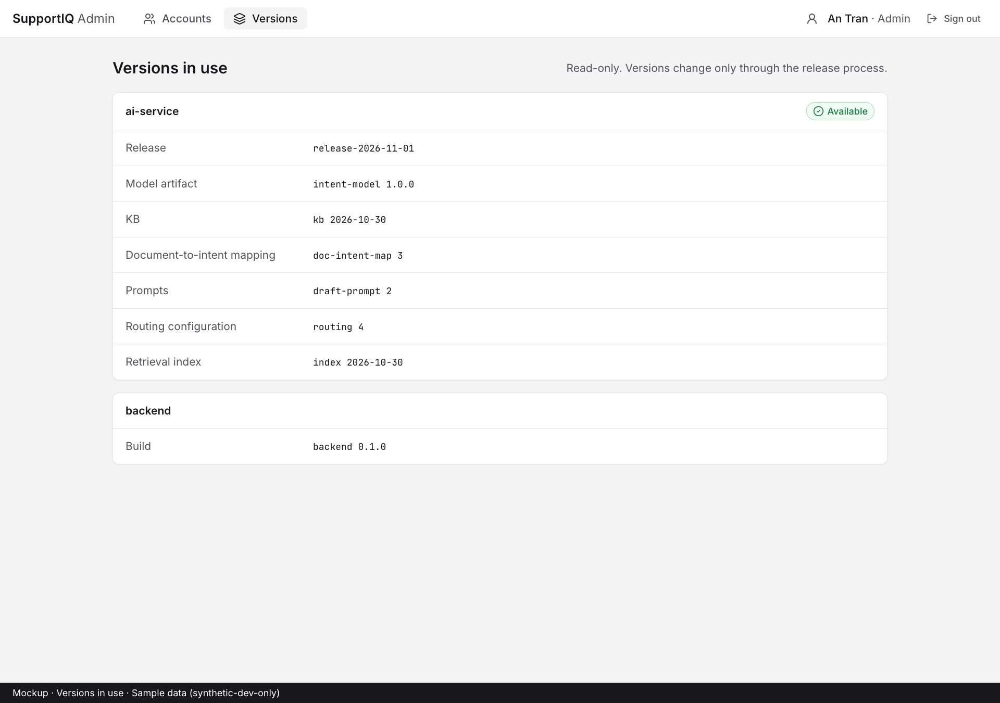
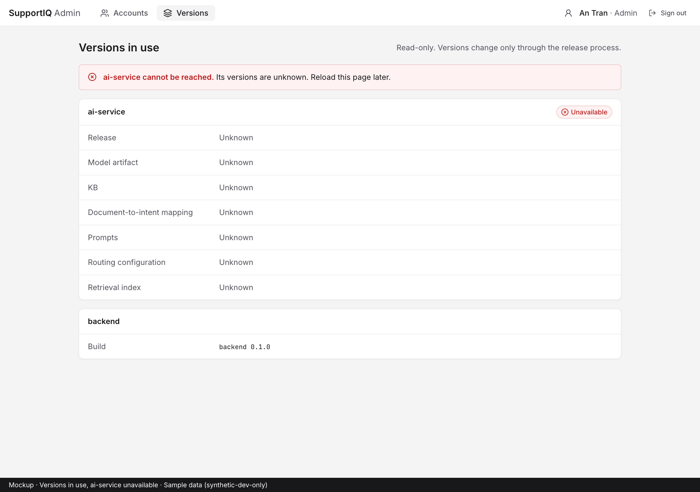
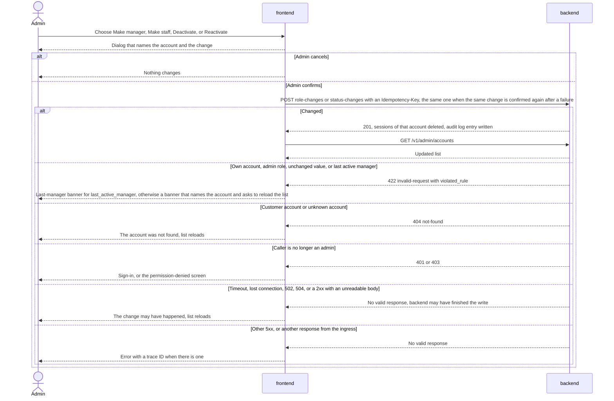

# Design: Admin UI

- **Status:** In review
- **Owner:** frontend engineer
- **Reviewers:** backend engineer, contracts gatekeeper
- **Last reviewed:** 2026-11-10
- **Related:** [Requirements](../product/requirements.md) (FR-08), [ADR-0008](../decisions/0008-ui-design-system.md), [ADR-0009](../decisions/0009-demo-accounts-and-cookie-sessions.md), [ADR-0012](../decisions/0012-roles-v1.md), [contracts v1 design](contracts-v1.md#admin-operations) (revision 2, in review), [console UI design](console-ui.md) (tokens and app shell), [UI-45](../rules/ui.md#admin), [SEC-41](../rules/security-and-privacy.md#authentication-and-authorization)

## Summary

This design fixes the two screens of `/admin` that [UI-45](../rules/ui.md#admin) allows: the internal accounts and the versions in use. It reuses the app shell and design tokens of the [console UI design](console-ui.md#design-tokens), because the admin area also targets desktop widths ([UI-33](../rules/ui.md#layout-and-performance)).

UI-45 and the [admin operations](contracts-v1.md#admin-operations) fix what each screen holds, so the draft proposes one layout. The team can still ask for alternatives.

**Revision of 2026-11-07, decided by the project lead:** after a timeout, a lost connection, `502`, or `504`, nobody knows whether a change happened: `backend` may finish a write after `frontend` stopped waiting (`backend` contract, Timeouts), and a write in flight can fail with `502` ([ADR-0011](../decisions/0011-deployment-and-runtime-topology.md), Proposed). Version 1.0.1 of the `backend` contract states this in its text on responses from the ingress. The same holds for a `2xx` whose body cannot be read, and for a retry that fails after one of these, unless `backend` refuses it with `422` or `404`. The banner now says that the change may have happened, and the list loads again. Confirming the same change again after a failure reuses its `Idempotency-Key`, so a change that already happened is not repeated. The first decision is kept under [Alternatives considered](#alternatives-considered). The revision also records where the focus goes when a dialog closes.

## Goals and non-goals

### Goals

- Every admin operation has one place on screen: `listAdminAccounts`, `changeAccountRole`, `changeAccountStatus`, and `getAdminVersions`.
- Every change asks for confirmation and names the account and the change (UI-45).
- An admin never sees a customer account, a ticket, a message, an order, or a report ([SEC-41](../rules/security-and-privacy.md#authentication-and-authorization)).

### Non-goals

- Creating or deleting accounts, changing names or passwords, and managing customer accounts ([ADR-0012](../decisions/0012-roles-v1.md)).
- Changing a version from a screen. Versions change only through the release process ([requirements appendix](../product/requirements.md#appendix-clarifications-of-the-submitted-specification), row 11).
- An audit log viewer. The audit log is read by reports and exports, not by this area.

## Background

- Roles and what an admin may do: [ADR-0012](../decisions/0012-roles-v1.md) and [SEC-41](../rules/security-and-privacy.md#authentication-and-authorization).
- Operations, their rules, and their errors: [admin operations](contracts-v1.md#admin-operations). A role change or a deactivation deletes all sessions of that account.
- Sign-in uses the shared `/sign-in` screen ([console UI design](console-ui.md#screens)).

## Design

### Components and responsibilities

Only `frontend` changes. `backend` enforces every rule. `frontend` hides an action only when the contract makes it impossible for every caller (the admin role) or when it concerns the caller's own account, which `getCurrentSession` identifies ([UI-40](../rules/ui.md#boundaries)).

### Layout

- The console app shell with the brand "SupportIQ Admin", the navigation Accounts and Versions, the admin's display name, and Sign out.
- One content column, at most 1040 px wide.
- After sign-in, `frontend` opens `/admin/accounts` for the `admin` role.

### Screens

| Screen | Route (proposed) | Content | Mockup |
|---|---|---|---|
| Accounts | `/admin/accounts` (`/admin` opens it) | The `staff`, `manager`, and `admin` accounts with role, status, and actions | [admin-accounts.png](assets/admin-ui/admin-accounts.png) |
| Versions in use | `/admin/versions` | The release ID and asset versions of `ai-service`, the `backend` build, and whether `ai-service` is reachable | [admin-versions.png](assets/admin-ui/admin-versions.png) |


### Accounts

| Row | Actions |
|---|---|
| The caller's own account | None. The row says "You cannot change your own account" |
| An `admin` account | Deactivate or Reactivate. The row says "The admin role cannot be changed" |
| A `staff` account | Make manager; Deactivate or Reactivate |
| A `manager` account | Make staff; Deactivate or Reactivate |

- The list is ordered by display name, with 20 accounts per page, the default page size of the contract. It is paginated, so `frontend` cannot know whether an account is the last active manager. `backend` refuses that change with `422 invalid-request`, and the page shows the reason in a banner that names the account.
- The banner follows `violated_rule` of the `422` body ([admin operations](contracts-v1.md#admin-operations)). `last_active_manager` shows the banner of [admin-last-manager.png](assets/admin-ui/admin-last-manager.png). Any other value, an unknown one included, or no value, shows a banner that names the account and asks the admin to reload the list.
- When a dialog closes, the focus returns to the button that opened it. A successful change replaces that button (Make manager becomes Make staff), so the focus then moves to the row header of the account ([UI-30](../rules/ui.md#accessibility)).
- Each action opens a confirmation dialog that names the account and the change:

| Action | Dialog title | Text | Confirm button |
|---|---|---|---|
| Make manager | "Make Mai Nguyen a manager?" | "Mai Nguyen will be able to send replies on tickets that require authority and to view reports. Mai Nguyen will be signed out of every session." | Make manager |
| Make staff | "Make Hoa Pham staff?" | "Hoa Pham will no longer send replies on tickets that require authority or view reports. Hoa Pham will be signed out of every session." | Make staff |
| Deactivate | "Deactivate Minh Le?" | "Minh Le will be signed out of every session and cannot sign in until an admin reactivates the account." | Deactivate, in the `danger` role |
| Reactivate | "Reactivate Quang Vo?" | "Quang Vo will be able to sign in again with the current role." | Reactivate |


### Versions in use

- The page is read-only and says so.
- The asset rows follow `AssetVersions` in the release manifest ([DATA-56](../rules/data-and-ml.md#models-and-artifacts)): the release ID, the model artifact, the KB, the document-to-intent mapping, the prompts, the routing configuration, and the retrieval index. The exact field names are set in contract PR 1.
- When `ai_service_status` is `unavailable`, a banner in the `danger` role says so and tells the admin to reload the page later, and every `ai-service` row shows "Unknown". The `backend` build is still shown.





### States

| State | When | Shown |
|---|---|---|
| Loading | `listAdminAccounts` or `getAdminVersions` is pending | Skeleton rows in the place of the table or the list ([UI-24](../rules/ui.md#states)) |
| Load error | Either call fails with a network error, `5xx`, or a response from the ingress | A plain-language message, Try again, and a copyable trace ID when there is one ([UI-25](../rules/ui.md#states)) |
| Permission denied | `403`: a `customer`, `staff`, or `manager` session opens `/admin` | "The admin area is for admin accounts", with Sign out |
| Change refused | `422` on a change | With `violated_rule` `last_active_manager`: the banner of [admin-last-manager.png](assets/admin-ui/admin-last-manager.png). With any other value, or none: a banner that names the account and asks the admin to reload the list |
| Change outcome unknown | A timeout, a lost connection, `502`, `504`, or a `2xx` with an unreadable body on a change, or a retry or a repeated confirmation that fails after one of these, unless `backend` refuses it with `422` or `404`. A `403` shows the Permission denied state instead, because the caller can no longer act. | A banner names the account and says that the change may have happened and that trying again is safe if the row does not change. The list loads again. Confirming the same change again reuses its key, so it is safe |
| `ai-service` unreachable | `ai_service_status` is `unavailable` | The banner and "Unknown" rows, as in [admin-versions-unavailable.png](assets/admin-ui/admin-versions-unavailable.png) |

An admin account always exists, so the accounts list is never empty.

### Flow



### Status presentations (UI-12)

| Status | Value | Tone | Label |
|---|---|---|---|
| Role | `staff`, `manager`, `admin` | neutral, info, neutral | Staff, Manager, Admin |
| Account status | `is_active` true, false | success, neutral | Active, Deactivated |
| `ai-service` | `available`, `unavailable` | success, danger | Available, Unavailable |

### Data and contracts

- No contract change beyond contracts v1 revision 2. The screens use its [admin operations](contracts-v1.md#admin-operations).
- Rows show the display name, role, and status only ([SEC-41](../rules/security-and-privacy.md#authentication-and-authorization)). `listAdminAccounts` returns no email, password hash, or session data. `account_id` is used for the requests and is not shown.
- To find the caller's own row, `frontend` compares the `account_id` of `getCurrentSession` with the `account_id` of each row. Contracts v1 defines them as the same identifier.

### Errors and guardrails

| Failure or risk | Behavior | Test |
|---|---|---|
| An admin sees customer data | Impossible: admin schemas cannot hold tickets, messages, orders, or reports, and customer accounts return `404` | Permission test; schema test (contracts v1) |
| An admin changes their own account | No action on that row; `422` from `backend` as the backstop | Component test; use-case test |
| A change would leave no active manager | `422`: a banner names the account and says to make another account a manager first | Component test; use-case test |
| A change is made by mistake | Every change needs a confirmation that names the account and the change | Component test |
| A timeout, a lost connection, `502`, `504`, or a `2xx` with an unreadable body hides the outcome of a change | The banner says that the change may have happened, and the list loads again | Component test; UI flow test |
| A changed account keeps its old session | Impossible: `backend` deletes its sessions in the same transaction, and the old session gets `401` | Integration test (contracts v1) |
| `ai-service` is unreachable | Versions page shows the banner and "Unknown" | Component test |
| Another role opens `/admin` | `403` from `backend`: the permission-denied screen | Permission table test; component test |

## Alternatives considered

- **A role dropdown in each row:** not chosen. Only one other role is ever possible, so a button that names it ("Make manager") states the change in one word and still opens the confirmation.
- **Admin screens inside the console app:** not chosen. The admin role may not call any `/v1/console/` operation ([SEC-41](../rules/security-and-privacy.md#authentication-and-authorization)), so a separate area keeps the navigation honest.
- **A banner that says "was not changed" after every failure:** the first decision of this design, replaced on 2026-11-07. After a timeout, a lost connection, `502`, or `504`, `backend` may still finish the write, so that banner could be false.

## Testing and evaluation

- **Storybook:** the accounts table with every row type, each dialog, the versions page when `ai-service` is reachable and when it is not, and the loading, load error, and permission-denied states, with axe checks ([UI-32](../rules/ui.md#accessibility)).
- **Component tests:** row actions by role and for the caller's own account, dialog texts that name the account and the change, the mapping of `422` with each `violated_rule` value, an unknown one included, and of `404`, `403`, and `401` to messages, the banner and the reload after an unknown outcome, the key of a repeated confirmation, and the focus when a dialog closes.
- **End-to-end tests (Playwright):** an admin makes a staff account a manager; that account's old session gets `401`, and after signing in again it can open reports.
- No model metric changes.

## Observability

- `frontend` exports no telemetry in v1 ([LOG-04](../rules/logging-and-observability.md)).
- `backend` already logs `account.role_changed` and `account.status_changed` and writes one audit log entry per change.

## Security and privacy

- The admin area shows display names, which are staff identity and Confidential ([SEC-01](../rules/security-and-privacy.md#data-classification)), and roles, account status, and versions, which are Internal. `frontend` never logs or stores display names.
- Authorization is enforced by `backend`. Hiding an action in `frontend` is a convenience ([SEC-20](../rules/security-and-privacy.md#authentication-and-authorization)).
- The mockups use sample data only (`synthetic-dev-only`). Their names, IDs, and version labels are stand-ins.

## Rollout

1. Done on 2026-11-05: the backend and frontend owners approved this design.
2. Implementation against Prism mocks: the accounts table and dialogs after contract PR 2, then the versions page after the contract change that adds `getAdminVersions`.

### Mockup sources

The mockups in [assets/admin-ui/](assets/admin-ui/) are review material, not `frontend` code. `admin.css` adds the admin layout to the tokens and app shell of [../console-ui/mockup.css](assets/console-ui/mockup.css), `mockup.js` holds the sample data and draws each screen, and `mockup.html?screen=<name>` shows one screen. To render every PNG on macOS with Google Chrome:

```bash
docs/design/assets/admin-ui/render.sh
```

## Open questions

- The version labels on the Versions page come from the release manifest, which the AI and ML engineers define. The mockups show stand-in labels.
- This design was approved on 2026-11-05 while contracts v1 revision 2 was still in review. If it changes, this design is revised.
