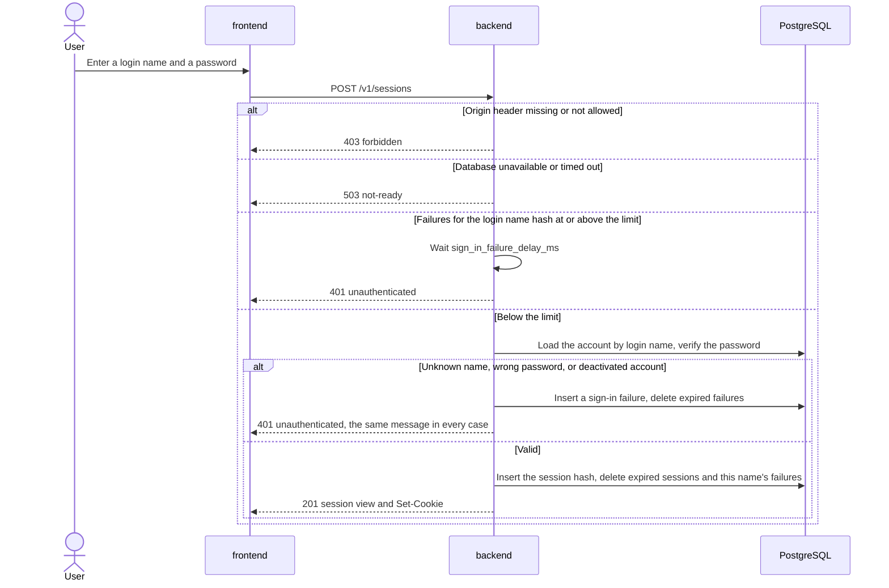
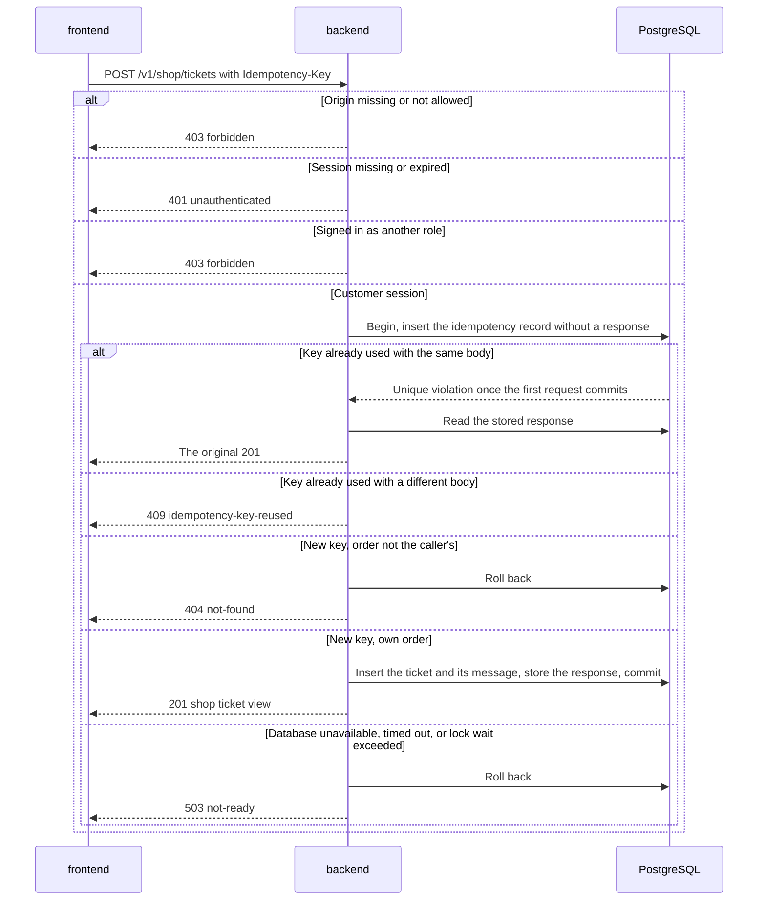
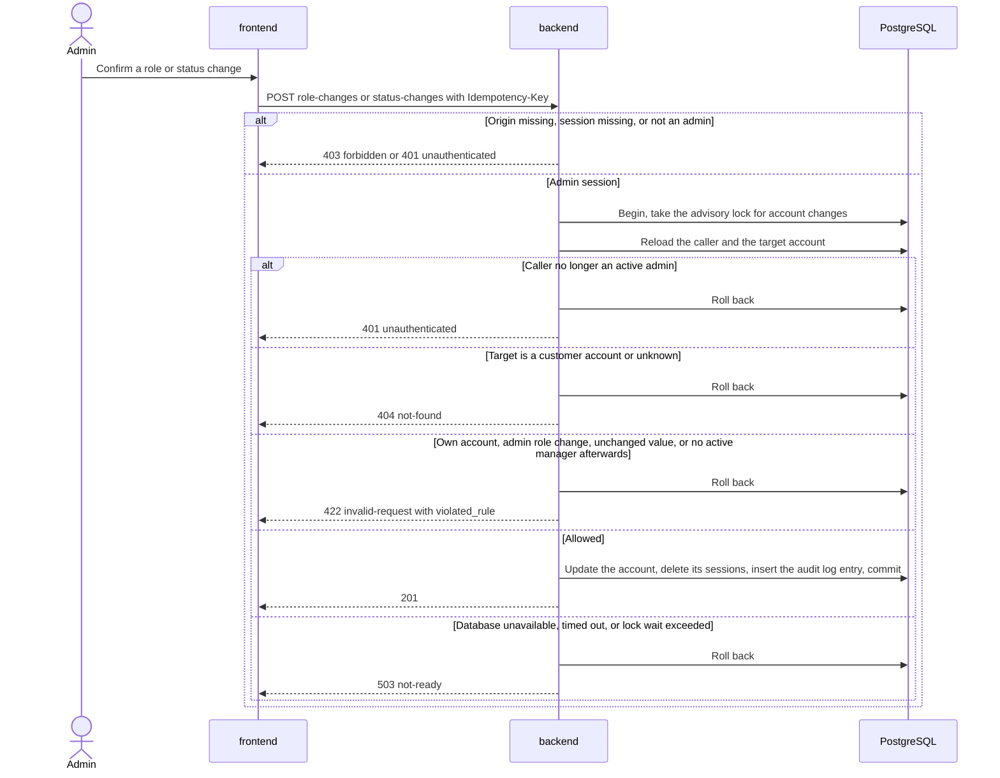

# Design: Backend foundation

- **Status:** Approved
- **Owner:** backend engineer
- **Reviewers:** frontend engineer, contracts gatekeeper
- **Last reviewed:** 2026-11-05
- **Related:** [Requirements](../product/requirements.md) (FR-08, FR-11, NFR-09), [ADR-0001](../decisions/0001-system-architecture.md), [ADR-0003](../decisions/0003-tech-stack.md), [ADR-0009](../decisions/0009-demo-accounts-and-cookie-sessions.md), [ADR-0011](../decisions/0011-deployment-and-runtime-topology.md) (Proposed), [ADR-0012](../decisions/0012-roles-v1.md), [ADR-0013](../decisions/0013-shop-demo-with-read-only-catalog.md), [contracts v1 design](contracts-v1.md) (revision 2, in review), [shop UI](shop-ui.md), [admin UI](admin-ui.md), [architecture rules](../rules/architecture.md), [security rules](../rules/security-and-privacy.md)

## Summary

This design fixes the part of `backend` that needs no AI: its feature modules, the PostgreSQL tables for accounts, sessions, idempotency, commerce data, tickets, and the audit log, the database roles, the seed and reset commands, and the settings. It lets the team build sign-in, the shop, and the account screens of the admin area before `ai-service` is ready.

The ticket workflow that involves the AI (suggestion jobs, pseudonymization, the `ai-service` client, replies, proposals, escalations, decisions, and reports) is the subject of the `backend` ticket workflow design, which extends the tables below.

## Goals and non-goals

### Goals

- The operations `createSession`, `getCurrentSession`, `deleteCurrentSession`, `listShopProducts`, `getShopProduct`, `listShopOrders`, `getShopOrder`, `createShopTicket`, `listShopTickets`, `getShopTicket`, `listAdminAccounts`, `changeAccountRole`, and `changeAccountStatus` can be built and tested against PostgreSQL.
- Every table belongs to one feature module, and every column states its data class ([SEC-03](../rules/security-and-privacy.md#data-classification)).
- The database itself enforces what must never happen: no write to commerce data ([ADR-0013](../decisions/0013-shop-demo-with-read-only-catalog.md)), no update or delete of the audit log ([SEC-39](../rules/security-and-privacy.md#audit-log)), no edit of a customer message, no role change outside `staff` and `manager`, and no authority flag that goes back to false.
- Replicas share no in-process state ([ARCH-41](../rules/architecture.md#state-time-and-side-effects)).
- Seed data is deterministic, versioned, and labeled `synthetic-dev-only` ([DATA-03, DATA-04](../rules/data-and-ml.md#sources-and-acceptable-use)).

### Non-goals

- Everything that involves `ai-service`, including `getAdminVersions`, which reads the versions that `ai-service` reports. These belong to the `backend` ticket workflow design.
- The shared commerce data of groups 2 and 5. The seed starts with `synthetic-dev-only` data ([requirements §8](../product/requirements.md#8-open-questions)).
- Exact package versions. They are pinned at scaffold ([ADR-0003](../decisions/0003-tech-stack.md)).

## Background

- Sign-in, sessions, password hashing, throttling, and the `Origin` check: [ADR-0009](../decisions/0009-demo-accounts-and-cookie-sessions.md).
- Roles and the admin limits: [ADR-0012](../decisions/0012-roles-v1.md). The permission matrix: [contracts v1](contracts-v1.md#roles-and-permissions).
- Commerce entities, the audit log events, and the ticket lifecycle: [contracts v1](contracts-v1.md#simulated-commerce-data-owned-by-backend).
- Replicas, the one-off `backend-migrate` service, and the seed and reset commands: [ADR-0011](../decisions/0011-deployment-and-runtime-topology.md).
- Layers, feature modules, ports, and settings: [architecture rules](../rules/architecture.md). Persistence: [PY-39 to PY-42](../rules/python.md#persistence-backend).

## Design

### Components and responsibilities

Only `backend` and its deployment change. `frontend` builds the shop and admin screens against Prism mocks of the same operations.

### Feature modules

| Feature | Owns | Operations |
|---|---|---|
| `accounts` | Accounts, sessions, sign-in failures; the `Authenticator` port ([ADR-0009](../decisions/0009-demo-accounts-and-cookie-sessions.md), statement 9) and the authorization checks | `createSession`, `getCurrentSession`, `deleteCurrentSession`, `listAdminAccounts`, `changeAccountRole`, `changeAccountStatus` |
| `commerce` | Customers, products, orders, order lines, shipments, refunds, read through the `CommerceGateway` port | `listShopProducts`, `getShopProduct`, `listShopOrders`, `getShopOrder` |
| `tickets` | Tickets and customer messages | `createShopTicket`, `listShopTickets`, `getShopTicket` |
| `audit` | Audit log entries, written by other features through the `AuditLog` port | None |
| `idempotency` | Idempotency records, used by every write use case through the `IdempotencyStore` port ([ERR-15](../rules/errors-and-reliability.md#idempotency)) | None |
| `platform` | Settings, logging setup, the database engine and unit of work, health checks ([ARCH-19](../rules/architecture.md#feature-modules)) | `GET /health/live`, `GET /health/ready` |

Each feature follows the layout of [ARCH-16](../rules/architecture.md#feature-modules). Authorization runs in the application layer of each use case, not only in middleware ([SEC-16](../rules/security-and-privacy.md#authentication-and-authorization)). The use case receives the authenticated principal (`account_id`, `role`, and `customer_id` for a customer) and checks object-level access from it ([SEC-17](../rules/security-and-privacy.md#authentication-and-authorization)).

### Tables

Every column is `NOT NULL` unless it says "optional". Times are `timestamptz` in UTC ([PY-26](../rules/python.md#functions-state-and-standard-library)). Money uses `amount_minor` and `currency` ([CON-16](../rules/contracts.md#api-conventions)). The data classes follow [SEC-01](../rules/security-and-privacy.md#data-classification): `account_id`, `customer_id`, `ticket_id`, and the other technical IDs are Internal. Order IDs, tracking codes, and transaction IDs are Confidential, because they identify a person's purchase (PII in the [glossary](../glossary.md#acronyms)).

| Table (feature) | Columns and data class | Notes |
|---|---|---|
| `accounts` (`accounts`) | `account_id` UUID (Internal); `login_name` unique (Internal: a role and a number such as `staff-1`, never a person's name); `display_name` (Confidential: staff identity or customer name); `role` enum `customer`, `staff`, `manager`, `admin` (Internal); `is_active` (Internal); `customer_id` optional, set only for `customer` (Internal); `password_hash` Argon2id (Confidential); `created_at` (Internal) | A check constraint requires `customer_id` exactly when `role` is `customer` |
| `sessions` (`accounts`) | `session_id_hash` SHA-256, primary key (Confidential); `account_id` (Internal); `role` at creation (Internal); `created_at`, `last_seen_at`, `expires_at` (Internal) | The raw identifier exists only in the cookie ([ADR-0009](../decisions/0009-demo-accounts-and-cookie-sessions.md), statement 4) |
| `sign_in_failures` (`accounts`) | `login_name_hash` SHA-256 of the normalized login name (Internal); `failed_at` (Internal) | Keyed by the typed name, not the account, so an unknown name is slowed down exactly like a known one |
| `idempotency_records` (`idempotency`) | `account_id`, `operation_id`, `idempotency_key` (Internal); `request_hash` SHA-256 of the canonical body (Internal); `response_status` optional (Internal); `response_body` JSON, optional (Confidential); `created_at` (Internal) | Unique on (`account_id`, `operation_id`, `idempotency_key`). No response yet means the request is in progress |
| `customers` (`commerce`) | `customer_id` (Internal); `display_name`, `email`, `phone` (Confidential, synthetic) | Seeded only |
| `products` (`commerce`) | `product_id`, `name`, `description`, `category`, `price` (Public) | Seeded only |
| `orders` (`commerce`) | `order_id` (Confidential); `customer_id` (Internal); `order_status`, `placed_at`, `order_total`, `shipping_cost`, `shipping_address` (synthetic), `transaction_id` (Confidential) | Seeded only |
| `order_lines` (`commerce`) | `order_id`, `line_number`, `product_id`, `quantity` (Confidential) | Seeded only |
| `shipments` (`commerce`) | `shipment_id` (Internal); `order_id`, `shipment_status`, `tracking_code`, `estimated_delivery_at` optional, `delivered_at` optional (Confidential) | Seeded only; at most one per order, enforced by a unique constraint on `order_id` |
| `refunds` (`commerce`) | `refund_id` (Internal); `order_id`, `refund_status`, `refund_amount`, `refund_requested_at`, `updated_at` (Confidential) | Seeded only; at most one per order, enforced by a unique constraint on `order_id` |
| `tickets` (`tickets`) | `ticket_number` from the sequence `ticket_number_seq` (Internal); `ticket_id` = `TCK-` and the number (Internal); `customer_id` (Internal); `order_id` optional, absent for imported tickets (Confidential); `status`, `handling_mode`, `is_authority_required` default false, `source` `shop` or `import` (Internal); `created_at`, `handling_started_at` optional, `closed_at` optional (Internal) | The ticket workflow design adds its own tables that point here |
| `customer_messages` (`tickets`) | `message_id`, `ticket_id` (Internal); `body` (`MessageText`, Confidential); `created_at` (Internal) | One per ticket; never updated |
| `audit_log_entries` (`audit`) | `entry_id`, `occurred_at`, `event_type`, `actor_account_id` optional, `ticket_id` optional, `trace_id` (Internal); `data` JSON with identifiers, statuses, reason codes, versions, and numbers only (Internal) | Never updated or deleted ([SEC-39](../rules/security-and-privacy.md#audit-log)). `data` never holds an order ID or any text |

- The commerce IDs of the seed follow these `synthetic-dev-only` formats, so that pseudonymization can detect them later ([contracts v1](contracts-v1.md#simulated-commerce-data-owned-by-backend)): `ORD-` and five digits for orders, `TRK-` and ten digits for tracking codes, and `TXN-` and eight digits for transaction IDs.
- Account IDs are UUIDs, because they never appear in text that pseudonymization must scan.

### Database roles and privileges

| Role | Used by |
|---|---|
| `supportiq_owner` | The migrate, seed, and reset commands. Owns the schema and every table |
| `supportiq_app` | The `backend` replicas, with the privileges below and nothing else |

| Objects | Privileges of `supportiq_app` |
|---|---|
| `customers`, `products`, `orders`, `order_lines`, `shipments`, `refunds` | `SELECT` |
| `customer_messages`, `audit_log_entries` | `SELECT`, `INSERT` |
| `accounts` | `SELECT`; `UPDATE` on `role` and `is_active` only |
| `tickets` | `SELECT`, `INSERT`; `UPDATE` on `status`, `is_authority_required`, `handling_started_at`, and `closed_at` only |
| `ticket_number_seq` | `USAGE` |
| `sessions`, `sign_in_failures`, `idempotency_records` | `SELECT`, `INSERT`, `UPDATE`, `DELETE` |

- `supportiq_app` cannot insert or delete an account, so accounts exist only through the seed ([ADR-0012](../decisions/0012-roles-v1.md), admin limits 2 and 3).
- Triggers add checks that no privilege can express:
  - on `audit_log_entries`, reject every `UPDATE` and `DELETE`, for every role. The reset command uses `TRUNCATE`, which `supportiq_app` may not run ([SEC-39](../rules/security-and-privacy.md#audit-log));
  - on `accounts`, reject a role change unless it goes from `staff` to `manager` or back ([ADR-0012](../decisions/0012-roles-v1.md), admin limit 3);
  - on `tickets`, reject a change of `is_authority_required` from true to false ([contracts v1](contracts-v1.md#authority-rule-fr-06)).
- The two connection strings are separate settings. The replicas never receive the owner's.

### Flows

#### Sign-in and sessions

1. The sign-in screen has a text field for the login name, with a hint such as `staff-1`, and lists no accounts. No operation returns accounts before sign-in.
2. Password verification runs even for an unknown login name, against a fixed dummy hash, so the response time does not reveal whether the name exists.
3. Every later request loads the session by the hash of the cookie value. A missing, expired, or idle session returns `401` and is deleted. A valid one updates `last_seen_at` at most once per `session_touch_interval_ms`, so reads do not write on every request.
4. Signing out deletes the session. `deleteCurrentSession` takes no `Idempotency-Key`: a retry after success gets `401`, which `frontend` treats as signed out.
5. Every state-changing request, `createSession` included, is checked against `allowed_origins` before anything else. A missing or unknown `Origin` returns `403 forbidden` ([ADR-0009](../decisions/0009-demo-accounts-and-cookie-sessions.md), statement 7).

#### Creating a shop ticket

- The ticket starts `open`, with `handling_mode` from `default_handling_mode`. The ticket workflow design adds the suggestion and its job to the same transaction.
- A second request with the same key waits on the unique index until the first transaction ends, at most `database_lock_timeout_ms`, so two replicas never create two tickets ([ERR-15](../rules/errors-and-reliability.md#idempotency)). If the first transaction rolled back, its record is gone and the second request runs as new.

#### Changing an internal account

1. The transaction-level advisory lock serializes every account change across replicas.
2. With the lock held, the use case reloads the caller. Its session may have been deleted by a change that committed while it waited, so an admin deactivated by another admin cannot still act.
3. The rules of [ADR-0012](../decisions/0012-roles-v1.md) apply after the reload. A customer account or an unknown target returns `404 not-found`. Every other refusal returns `422 invalid-request` with `violated_rule`, in the order that the contract fixes for that field ([contracts v1](contracts-v1.md#admin-operations)): the caller's own account, an `admin` account in a role change, a value that the account already has, and a change that leaves no active `manager`. At least one active `admin` always stays, because the caller is an active admin and cannot change their own account.
4. The audit log entry `account.role_changed` or `account.status_changed` is written in the same transaction.

### Seed and reset

- **Seed** (`backend seed`, a one-off command run as `supportiq_owner`, [ADR-0011](../decisions/0011-deployment-and-runtime-topology.md)) loads a versioned data file, `backend/seed/synthetic-dev-only-v1.json`. The same file always produces the same rows, IDs, and times, apart from `password_hash`, which Argon2id salts randomly.
- The file holds at least one account per role ([ADR-0012](../decisions/0012-roles-v1.md)); customers with orders that cover every order, shipment, and refund status; and the catalog. Login names follow the pattern `customer-1`, `staff-1`, `manager-1`, `admin-1`. They name a role, not a person, so they are Internal and the README lists them. Passwords are never written in the repository, the README, or slides ([SEC-09](../rules/security-and-privacy.md#secrets)); each person sets them in their own `.env`.
- Passwords come from one secret setting per role, never from the file ([ADR-0009](../decisions/0009-demo-accounts-and-cookie-sessions.md), statement 1). The seed hashes them with Argon2id.
- **Reset** (`backend reset`, also run as `supportiq_owner`) truncates every `backend` table in one transaction and then runs the seed, so role changes, deactivations, tickets, and audit log entries all return to the seeded state ([SEC-32](../rules/security-and-privacy.md#retention-and-exports)). It asks for confirmation unless it gets `--yes`.

### Settings

All settings live in one `pydantic-settings` class ([PY-43](../rules/python.md#settings)). The initial values are proposals for review and are tuned from use.

| Setting | Initial value | Origin |
|---|---|---|
| `database_url_app` (secret) | None; required | [ADR-0011](../decisions/0011-deployment-and-runtime-topology.md) |
| `database_url_owner` (secret) | None; required only by the migrate, seed, and reset commands | Database roles above |
| `database_connect_timeout_ms` | 3 000 | [ERR-09](../rules/errors-and-reliability.md#timeouts-and-latency-budget) |
| `database_statement_timeout_ms` | 5 000 | ERR-09 |
| `database_lock_timeout_ms` | 3 000 | ERR-09; bounds the idempotency wait and the advisory lock |
| `database_pool_timeout_ms` | 3 000 | ERR-09 |
| `session_idle_timeout_ms` | 1 800 000 (30 minutes) | [ADR-0009](../decisions/0009-demo-accounts-and-cookie-sessions.md), statement 6 |
| `session_absolute_lifetime_ms` | 28 800 000 (8 hours) | ADR-0009, statement 6 |
| `session_touch_interval_ms` | 60 000 | Sign-in and sessions, step 3 |
| `session_cookie_secure` | `true` | ADR-0009, statement 4. `false` only in local development ([ARCH-37](../rules/architecture.md#configuration)) |
| `allowed_origins` | None; required | ADR-0009, statement 7 |
| `sign_in_failure_limit` | 5 | ADR-0009, statement 8 |
| `sign_in_failure_window_ms` | 900 000 (15 minutes) | ADR-0009, statement 8 |
| `sign_in_failure_delay_ms` | 2 000 | ADR-0009, statement 8 |
| `idempotency_retention_ms` | 86 400 000 (24 hours) | [ERR-15](../rules/errors-and-reliability.md#idempotency) |
| `default_handling_mode` | `assisted` | [contracts v1](contracts-v1.md#ticket-lifecycle) |
| `seed_password_customer`, `seed_password_staff`, `seed_password_manager`, `seed_password_admin` (secret) | None; required by the seed | ADR-0009, statement 1 |

No scheduler exists outside the suggestion job queue ([ARCH-41](../rules/architecture.md#state-time-and-side-effects)), so each insert into `idempotency_records` or `sign_in_failures` also deletes the expired rows of that table, and each sign-in deletes expired sessions.

### Data and contracts

- No contract change beyond contracts v1 revision 2. Contract PR 2 needs these points from this design, and `contracts/backend.openapi.yaml` 1.0.0 contains them:
  - `createSession` takes `login_name` and `password`.
  - `deleteCurrentSession`, like `createSession`, takes no `Idempotency-Key` ([contracts v1](contracts-v1.md#common-elements)).
  - Each list operation documents its maximum `limit` ([CON-14](../rules/contracts.md#api-conventions)). The contract sets 20 by default and 100 at most.
  - The `422` body of `changeAccountRole` and `changeAccountStatus` carries `violated_rule` ([contracts v1](contracts-v1.md#admin-operations)).
- Cursors (decided by the project lead on 2026-11-05). No cursor contains a Confidential value ([SEC-01](../rules/security-and-privacy.md#data-classification)), and each one also names the operation that returned it, so a cursor of another operation returns `422`:
  - `listShopProducts`: the `name` and `product_id` of the last item, both Public, as a keyset.
  - `listShopTickets`: the `created_at` and `ticket_id` of the last item, both Internal, as a keyset. The `order_id` filter is not in the cursor.
  - `listAdminAccounts`: the `account_id` of the last item. `backend` reads that account's display name to continue the order by `display_name`.
  - `listShopOrders`: the position of the next item in the sort order. Orders have no Internal key, and `placed_at` and `order_id` are Confidential. A position is exact because orders are read-only and the seed is deterministic ([ADR-0013](../decisions/0013-shop-demo-with-read-only-catalog.md)).
- Migrations: one Alembic migration per schema change, each with a working downgrade ([PY-40](../rules/python.md#persistence-backend)). The first migration creates every table above, the privileges of `supportiq_app`, and the triggers.

### Errors and guardrails

| Failure or risk | Behavior | Test |
|---|---|---|
| Code writes to a commerce table | The database rejects it: `supportiq_app` has `SELECT` only | Integration test as `supportiq_app`; contract test that lists operations |
| Code updates or deletes an audit log entry | The trigger and the missing privilege reject it | Integration test against PostgreSQL (TEST-26) |
| A customer message is edited | `supportiq_app` has no `UPDATE` on `customer_messages` | Integration test |
| Code gives an account the `admin` or `customer` role, or clears the authority flag | The triggers reject it | Integration test |
| A customer reads another customer's order or ticket | `404 not-found` ([SEC-17](../rules/security-and-privacy.md#authentication-and-authorization)) | Permission tests for every shop operation |
| An admin lists or changes a customer account | The list never contains one; a change returns `404` and changes nothing ([SEC-41](../rules/security-and-privacy.md#authentication-and-authorization)) | Guardrail test (TEST-26) |
| A role calls an operation it may not use | `403 forbidden`, and the `permission.denied` event | Table-driven permission test over every operation and all four roles |
| Two admins remove the last two managers, or deactivate each other, at the same time | The advisory lock serializes the changes, and the reload after the lock refuses the second one | Integration test with two concurrent transactions for each case |
| A retried ticket creation runs on two replicas | One ticket; the second request returns the first result | Integration test with two concurrent requests |
| The same key arrives with a different body | `409 idempotency-key-reused` | Handler test |
| Sign-in is guessed repeatedly | After the limit, every attempt waits `sign_in_failure_delay_ms`, for known and unknown names alike | Integration test with a fake `Clock` |
| A deactivated or changed account keeps a session | Impossible: its sessions are deleted in the same transaction | Integration test |
| A session expires | `401`; the session row is deleted | Use-case test with a fake `Clock` |
| A request without an allowed `Origin` changes state | `403 forbidden` | Handler test |
| The database is unreachable or a timeout fires | `GET /health/ready` returns `503`; requests return `503 not-ready` and roll back | Integration test |
| Confidential data or a secret reaches a log | The logging setup drops attributes that are not allow-listed and masks known patterns ([LOG-30](../rules/logging-and-observability.md#privacy-in-telemetry)). Request logs never include headers, so the raw session identifier in the `Cookie` header is never logged. Request logs and traces record the route template, never the raw path or query, because an order ID in a URL is Confidential | Log-capture test with message text, display names, order IDs in URLs and elsewhere, shipping addresses, passwords, and a raw cookie value (TEST-26) |
| The seed produces different data on two runs | Prevented by design and checked | Test that seeds twice and compares every table except `password_hash`, and checks each seeded password against its hash |
| Reset leaves changed accounts or tickets behind | Impossible: every table is truncated before the seed | Test that changes a role, creates a ticket, resets, and compares with a fresh seed |

## Alternatives considered

- **UUIDs for every ID, including orders and tickets:** not chosen. Order IDs, tracking codes, and transaction IDs need a fixed text format so that pseudonymization can detect them, and readable ticket IDs help customers quote them.
- **Throttling sign-in per account only:** not chosen, because the delay would reveal which login names exist.
- **Locking all active manager and admin rows with `SELECT … FOR UPDATE` instead of an advisory lock:** possible. The advisory lock is simpler and also covers changes that add a manager.
- **Running the seed at replica startup:** rejected by [ADR-0011](../decisions/0011-deployment-and-runtime-topology.md), because two replicas would seed twice.

## Testing and evaluation

- **Unit:** the admin rules, with a property-based test that no sequence of role and status changes leaves no active manager or no active admin; session expiry with a fake `Clock`; the sign-in throttle; ID formats.
- **Integration (local PostgreSQL 17 or a CI service container):** privileges of `supportiq_app`, the triggers, idempotency under concurrency, the advisory lock with concurrent changes, session deletion on a role change, one audit log entry per successful admin change, seed determinism, and reset.
- **Contract:** Schemathesis against every operation listed in Goals and the health checks ([CON-27](../rules/contracts.md#contract-tests)).
- **Guardrail (TEST-26):** the audit log rejects `UPDATE` and `DELETE`; no Confidential data or secret in captured logs; an admin cannot call any `/v1/shop/` or `/v1/console/` operation; no admin operation returns or changes a customer account.
- No model metric changes.

## Observability

- Events from the [LOG-19 table](../rules/logging-and-observability.md): `startup.completed`, `settings.loaded`, `settings.invalid`, and `shutdown.started` from `platform`; `ticket.created`, `account.role_changed`, `account.status_changed`, and `permission.denied` from the features.
- Events carry Internal IDs (`ticket_id`, `account_id`) and roles. They never carry an order ID, a login name, a display name, or message text ([LOG-29](../rules/logging-and-observability.md#privacy-in-telemetry)).
- Every request has a trace with the database spans ([ADR-0007](../decisions/0007-observability-stack.md)).

## Security and privacy

- Passwords exist only as Argon2id hashes, and session identifiers only as SHA-256 hashes ([ADR-0009](../decisions/0009-demo-accounts-and-cookie-sessions.md), statement 5).
- Authorization is deny by default and runs in each use case ([SEC-16](../rules/security-and-privacy.md#authentication-and-authorization)). The principal of a customer carries its `customer_id`, and every commerce and ticket query filters by it.
- An admin never reaches a customer account: `listAdminAccounts` filters out `customer`, and changes to one return `404` ([SEC-41](../rules/security-and-privacy.md#authentication-and-authorization)).
- Seed data is `synthetic-dev-only`. Its names, emails, phones, and addresses are invented and are classified as if real ([SEC-02](../rules/security-and-privacy.md#data-classification)).

## Rollout

1. Done on 2026-11-05: the backend and frontend owners approved this design.
2. Done on 2026-11-05: the project lead approved the `frontend` ↔ `backend` part of contracts v1 revision 2 for contract PR 2 and its implementation: the operations listed in Goals and the health checks ([contracts v1, Rollout](contracts-v1.md#rollout)).
3. Contract PR 2 writes the operations listed in Goals and the health checks, with the points under Data and contracts.
4. Decided by the project lead on 2026-11-05: the scaffold leaves out `deploy/` and Docker Compose until ADR-0011 or the hosting ADR is accepted. Until then, migrate, seed, and reset run as `backend` commands, against Homebrew PostgreSQL 17 locally and a PostgreSQL service container in CI, and CI only builds the `backend` Docker image.
5. Scaffold `backend` (uv, ruff, pyright, pytest, import-linter, Alembic) and its CI workflow, following step 4. A SQL script, run once as the database owner, creates `supportiq_app` and its privileges, with a password from a secret setting. Migrations run as a one-off `backend` command before the `backend` instances start (step 4). The `backend-migrate` service of [ADR-0011](../decisions/0011-deployment-and-runtime-topology.md), or the pre-deploy command of a host, takes over that step once ADR-0011 or the hosting ADR is accepted. The README gets a "Demo accounts" section that lists the login names and roles and says that passwords come from each person's `.env`.
6. Implement `platform`, `audit`, and `idempotency`, then `accounts`, then `commerce` with the seed, then `tickets`. `frontend` builds the shop and admin screens against Prism mocks in parallel.
7. The `backend` ticket workflow design follows, for the console and everything that involves `ai-service`.

## Open questions

- The ID formats of the shared commerce data of groups 2 and 5. When that data is adopted, the seed formats above change to match it.
- The content of the seed file: how many products, customers, and orders. The seed PR proposes it.
- Hosting of the demo. The project lead proposes Supabase for PostgreSQL, Render for `backend` with UptimeRobot, and Vercel or Cloudflare Pages for `frontend`, instead of the single-host topology of ADR-0011. It needs an ADR, because it changes ADR-0011 and the session cookie of ADR-0009 requires the browser to reach `backend` on the same site as `frontend`.
- This design was approved on 2026-11-05 while ADR-0011 and contracts v1 revision 2 were still in review. If either changes, this design is revised.
