# Design: Backend ticket workflow

- **Status:** In review
- **Owner:** backend engineer
- **Reviewers:** project lead, frontend engineer, ML engineer
- **Last reviewed:** 2026-11-15
- **Related:** [Requirements](../product/requirements.md) (FR-04 to FR-10, NFR-06 to NFR-11, ESC-01 to ESC-05), [ADR-0005](../decisions/0005-intent-independent-retrieval.md), [ADR-0006](../decisions/0006-staff-feedback-and-reason-codes.md), [ADR-0010](../decisions/0010-pseudonymization-and-egress-control.md), [ADR-0011](../decisions/0011-deployment-and-runtime-topology.md), [ADR-0012](../decisions/0012-roles-v1.md), [ADR-0014](../decisions/0014-citations-to-order-context.md), [ADR-0016](../decisions/0016-hosting-on-free-tiers.md), [ADR-0017](../decisions/0017-named-entity-model-from-its-release-url.md), [ADR-0020](../decisions/0020-storage-errors-of-the-pseudonym-map.md), [contracts v1 design](contracts-v1.md), [backend foundation design](backend-foundation.md), [console UI design](console-ui.md), `backend` contract 1.2.0 and `ai-service` contract 1.0.0 ([CHANGELOG](../../contracts/CHANGELOG.md)), [ADR-0022](../decisions/0022-server-sent-events-for-suggestion-progress.md)

## Summary

This design describes how `backend` runs the ticket workflow behind `/console`. It covers suggestions and their job queue, pseudonymization before every call to `ai-service`, the client that calls `ai-service`, replies, reply proposals, escalations, the authority rule, manual handling, staff decisions, the audit log, reports, and two one-off commands: the ticket import and the decision-record export. It is the third follow-up design of [contracts v1, Rollout, step 9](contracts-v1.md#rollout), and it fixes what that design left to `backend`. The internals of `ai-service` (routing, the list of sensitive intents, retrieval limits) wait for the join with the AI and ML code. Three choices were the project lead's: the named-entity library, the split of handling modes for the product-value study, and the initial values of the job queue. On 2026-11-12 the project lead chose the recommended option of each, and [ADR-0017](../decisions/0017-named-entity-model-from-its-release-url.md), accepted the same day, covers the install of the named-entity model.

**Revision of 2026-11-12, for the `ai-service` service token, the log levels, and [ADR-0020](../decisions/0020-storage-errors-of-the-pseudonym-map.md):** the project lead decided these points on 2026-11-12. The new required secret setting `ai_service_token` (environment variable `AI_SERVICE_TOKEN`) holds the service token that `backend` sends as `Authorization: Bearer <token>` to `ai-service` (`ai-service` contract 1.0.0, `securitySchemes.serviceToken`); it is Secret ([SEC-10](../rules/security-and-privacy.md#secrets)), it is never logged, and startup fails when it is missing or empty ([ERR-17](../rules/errors-and-reliability.md#startup-and-health), [Settings](#settings)). The new event `ai_service.contract_violated` is logged at `error` for a `4xx` from `ai-service` or a response outside its contract, while `ai_service.call_failed` stays at `warning` for timeouts, connection errors, and `5xx` ([The `ai-service` client](#the-ai-service-client), [Observability](#observability)). `pseudonymization.failed` is logged at `warning` for a text over 4 000 characters, which is handled input, and at `error` otherwise ([ADR-0010, Failure handling](../decisions/0010-pseudonymization-and-egress-control.md#failure-handling)). `frontend` polls the inbox every 15 s while it is open, and the workspace every 2 s while a suggestion part is `pending` ([console UI design](console-ui.md#summary)). A transient database error while the pseudonym map is stored is not a pseudonymization failure ([ADR-0020](../decisions/0020-storage-errors-of-the-pseudonym-map.md)), as [Pseudonymization](#pseudonymization), item 3, already stated; item 1 now also names a stored map that differs from the computed one among the deterministic failures. On 2026-11-13 the project lead confirmed that such a run ends with `pseudonymization_failed` and is not retried, and that the stored map is never merged with the computed one ([ADR-0020](../decisions/0020-storage-errors-of-the-pseudonym-map.md)).

**Revision of 2026-11-15, for [ADR-0022](../decisions/0022-server-sent-events-for-suggestion-progress.md), `backend` contract 1.2.1, and the decisions of phase 3:** the project lead decided these points from 2026-11-13 to 2026-11-14, and this revision needs the lead's approval. `frontend` polls no view more often than every 30 s; the workspace learns the progress of a suggestion from the stream of [The suggestion progress stream](#the-suggestion-progress-stream) while one of its parts is `pending`, which replaces the 15 s and 2 s intervals of the revision of 2026-11-12. The report's end-to-end latency leaves out a ticket whose first draft part was `cancelled`, and its handling time counts only tickets whose first view came no later than their reply ([Reports](#reports); `backend` contract 1.2.1). `backend import-tickets` is postponed until the shared scenario sets and the protocol of the product-value study exist ([Handling modes for the product-value study](#handling-modes-for-the-product-value-study)). The `AiService` port names its reads `fetch_kb_document_version` and `fetch_asset_versions`, as the code does ([The `ai-service` client](#the-ai-service-client)). The earlier intervals are kept under [Alternatives considered](#alternatives-considered).

## Goals and non-goals

### Goals

- Every console operation of `backend` contract 1.2.0 has a defined use case, transaction, check order, and test.
- No reply reaches a customer without a staff action (FR-04). Once a ticket requires authority, only a manager sends its reply (FR-06).
- No text derived from a customer message leaves `backend` unless pseudonymization succeeded (SEC-36).
- Every suggestion, staff decision, reply, proposal, and escalation is recorded, and the audit log only grows (NFR-09, SEC-39).
- A crash, a restart, or a deploy loses no suggestion job and records no result twice ([ADR-0011](../decisions/0011-deployment-and-runtime-topology.md#suggestion-job-queue)).
- Reports come from `backend` records, never from telemetry (FR-10, [LOG-33](../rules/logging-and-observability.md#alerts-and-retention)).

### Non-goals

- The internals of `ai-service`: routing, thresholds, the sensitive-intent list, retrieval limits, prompts, and the grounding check. They come with the join with the AI and ML code.
- The screens of `/console`. They follow the approved [console UI design](console-ui.md).
- Push updates, ticket assignment to one staff member, and several messages per ticket ([contracts v1, Non-goals](contracts-v1.md#non-goals)).
- Any write to products, orders, shipments, or refunds ([ADR-0013](../decisions/0013-shop-demo-with-read-only-catalog.md)).

## Background

- The ticket lifecycle, the suggestion lifecycle, the authority rule, the reply bases, the reports, and the audit log events are defined in the [contracts v1 design](contracts-v1.md). This design does not repeat them; it adds how `backend` implements them.
- Pseudonymization, its detectors, and the pseudonym map are decided in [ADR-0010](../decisions/0010-pseudonymization-and-egress-control.md). The suggestion job queue is decided in [ADR-0011](../decisions/0011-deployment-and-runtime-topology.md#suggestion-job-queue). The demo runs one free Render instance with 0.1 CPU and 512 MB of RAM ([ADR-0016](../decisions/0016-hosting-on-free-tiers.md)).
- The tables `tickets` and `customer_messages`, the roles `supportiq_owner` and `supportiq_app`, idempotency, and the audit log exist since the [backend foundation design](backend-foundation.md#tables).
- The AI and ML team's `apps/backend` on `org/main` (commit 5e0cda5) already runs a version of this workflow. It was read, not merged. Its good parts are kept here under our rules: the ticket state machine with one row lock per action, the job table with a lease token and `FOR UPDATE SKIP LOCKED`, results stored only by the current attempt of the current suggestion, and the reply basis checks. Its defects are not kept: the named-entity detector fails open, the pseudonym map is a JSON column that the request code reads, the worker swallows exceptions, the claim has no order, the attempt limit is a literal, reports load every ticket into memory, and the LLM cost is never filled in.

## Design

### Components and responsibilities

| Component | Change |
|---|---|
| `backend` | New feature modules `suggestions`, `pseudonymization`, and `reports`; the console use cases in `tickets`; migration `r0003`; two one-off commands; the client of `ai-service` |
| `ai-service` | None in this design. `backend` calls it through `ai-service` contract 1.0.0 |
| `frontend` | None in this design. The console screens use `backend` contract 1.2.0 |

### Feature modules

| Feature | Owns | Operations and commands |
|---|---|---|
| `tickets` | Tickets, customer messages, reply proposals, replies, escalations, staff decisions, the state machine, `allowed_actions`, and the authority flag | `listConsoleTickets`, `getConsoleTicket`, `recordTicketView`, `createReplyProposal`, `sendReply`, `createEscalation`; `backend import-tickets` |
| `suggestions` | Suggestions, their parts, suggestion jobs, the claim loop, the suggestion progress stream, and the `AiService` port with its HTTP adapter | `createSuggestion`, `getConsoleKbDocumentVersion`, `getAdminVersions`, and the stream of [ADR-0022](../decisions/0022-server-sent-events-for-suggestion-progress.md) (`backend` contract 1.3.0) |
| `pseudonymization` | The pseudonym map and the detectors ([ADR-0010](../decisions/0010-pseudonymization-and-egress-control.md#storage-and-lifecycle), item 6) | None. Its public API has exactly two functions: pseudonymize the message of a ticket, and restore the pseudonyms of a ticket in a text |
| `reports` | The report queries | `getConsoleReport`; `backend export-decisions` |
| `audit`, `idempotency`, `commerce`, `accounts`, `platform` | As in the [backend foundation design](backend-foundation.md#feature-modules) | Unchanged |

- Dependencies point one way, without cycles ([ARCH-18](../rules/architecture.md#feature-modules)): `reports` → `tickets` → `suggestions` → `pseudonymization` → `commerce`. `tickets` asks `suggestions` to create a suggestion; `suggestions` reports a stored result back to `tickets` through the `TicketAuthority` port that `tickets` implements, so the authority flag is set in the same transaction ([Authority](#authority)).
- An import-linter contract forbids every module except `pseudonymization` to import its internals ([SEC-37](../rules/security-and-privacy.md#pseudonymization)). A second contract forbids `reports` to import any adapter of another feature.

### Tables

Migration `r0003` adds these tables, in the style of the [backend foundation tables](backend-foundation.md#tables). Every column is `NOT NULL` unless it says "optional".

| Table (feature) | Columns and data class | Notes |
|---|---|---|
| `suggestions` (`suggestions`) | `suggestion_id` UUID; `ticket_id`; `trigger` (`ticket_created`, `intent_override`, `kb_version_changed`, `retry`); `intent_override` optional; `requested_by_account_id` optional, absent for `ticket_created`; `created_at`; `trace_id` (Internal); `request` JSON, the exact `SuggestionRequest` sent to `ai-service`, optional until pseudonymization succeeds (Confidential) | Inserted once. `request` is written once, from absent to a value |
| `suggestion_parts` (`suggestions`) | `suggestion_id`, `part` (`analysis` or `draft`), `status`, `reason_codes` JSON array, `release_id` optional, `versions` JSON optional, `latency_ms` optional, `llm_input_token_count`, `llm_output_token_count`, `llm_cost_micro_usd` optional, `mask_count_by_type` JSON optional, `completed_at` optional (Internal); `result` JSON, the response of `ai-service` as received, optional (Confidential: AI text with placeholders) | Two rows per suggestion, both `pending` at creation. A trigger rejects every update of a row whose status is no longer `pending` |
| `suggestion_jobs` (`suggestions`) | `suggestion_id`, primary key; `state` (`queued`, `running`, `done`); `attempt_number`; `lease_expires_at` optional; `created_at`, `updated_at` (Internal) | A partial index on `created_at` where `state` is not `done` serves the claim |
| `pseudonym_map_entries` (`pseudonymization`) | `ticket_id`, `pseudonym`, `pseudonym_type`, `created_at` (Internal); `original_value` (Confidential) | Exactly as [ADR-0010](../decisions/0010-pseudonymization-and-egress-control.md#storage-and-lifecycle), item 3. Unique on (`ticket_id`, `pseudonym`) |
| `reply_proposals` (`tickets`) | `proposal_id`, `ticket_id`, `basis`, `suggestion_id` optional, `acknowledged_warning_ids` JSON, `staff_reason_codes` JSON, `proposed_by_account_id`, `created_at` (Internal); `body`, `note` optional (Confidential) | Inserted once, never updated |
| `replies` (`tickets`) | `reply_id`, `ticket_id` unique, `basis`, `suggestion_id` optional, `proposal_id` optional, `acknowledged_warning_ids` JSON, `staff_reason_codes` JSON, `sent_by_account_id`, `sent_at` (Internal); `body`, `note` optional (Confidential) | The unique `ticket_id` makes a second reply impossible ([ERR-16](../rules/errors-and-reliability.md#idempotency)) |
| `escalations` (`tickets`) | `escalation_id`, `ticket_id` unique, `suggestion_id` optional, `staff_reason_codes` JSON, `escalated_by_account_id`, `escalated_at` (Internal); `note` optional (Confidential) | Inserted once |
| `staff_decisions` (`tickets`) | `decision_id`, `ticket_id`, `suggestion_id` optional, `decision_type` (`approve`, `edit`, `reject`, `escalate`), `staff_reason_codes` JSON, `change_ratio` optional, `final_intent` optional, `decided_by_account_id`, `proposed_by_account_id` optional, `is_proposal_changed` optional, `decided_at` (Internal) | Inserted once. Holds no text ([ADR-0006](../decisions/0006-staff-feedback-and-reason-codes.md)) |

`r0003` also adds to `tickets` the optional columns `current_suggestion_id` (Internal) and, for imported tickets, `study_pair_id` and `study_batch` (Internal) ([Handling modes for the product-value study](#handling-modes-for-the-product-value-study)).

| Objects | Privileges of `supportiq_app` |
|---|---|
| `suggestions` | `SELECT`, `INSERT`; `UPDATE` on `request` only |
| `suggestion_parts` | `SELECT`, `INSERT`; `UPDATE` on every column except the keys |
| `suggestion_jobs` | `SELECT`, `INSERT`, `UPDATE` |
| `pseudonym_map_entries`, `reply_proposals`, `replies`, `escalations`, `staff_decisions` | `SELECT`, `INSERT` |
| `tickets` | In addition to the foundation privileges, `UPDATE` on `current_suggestion_id` |

- Triggers add the checks that no privilege can express: `suggestions.request` and every column of a final `suggestion_parts` row are written once; `tickets.status` changes only along the state machine below; and the existing trigger keeps `is_authority_required` from going back to false.
- No table holds a ticket's text twice. The pseudonymized message lives in `suggestions.request`, and the pseudonym map lives only in `pseudonym_map_entries`.

### Ticket state machine and check order

The states and transitions are those of the [contracts v1 design](contracts-v1.md#ticket-lifecycle). Every action locks the ticket row with `SELECT … FOR UPDATE` first, so two actions on one ticket run one after the other, whatever replica answers.

```mermaid
stateDiagram-v2
    [*] --> open: createShopTicket or backend import-tickets
    open --> closed: sendReply, staff or manager; manager only when authority is required
    open --> awaiting_approval: createReplyProposal, staff
    open --> escalated: createEscalation, staff
    awaiting_approval --> closed: sendReply, manager
    escalated --> closed: sendReply, manager
    closed --> [*]
```



Each use case checks in this order and stops at the first failure. The order is part of the contract, so a request that breaks two rules always gets the same answer:

1. The `Origin` header (`403 forbidden`), then the session (`401`), then the role (`403 forbidden`), as for every state-changing operation of the contract.
2. The ticket exists (`404 not-found`).
3. The `Idempotency-Key`: a repeat of an earlier success returns that result unchanged ([ERR-15](../rules/errors-and-reliability.md#idempotency)).
4. The ticket state allows the action:
   - `sendReply` returns `409 invalid-ticket-state` on a `closed` ticket, and `403 forbidden` when `staff` send on an `awaiting_approval` or `escalated` ticket. This is the only `403 forbidden` of this step;
   - `createReplyProposal` and `createEscalation` return `409 invalid-ticket-state` on a ticket that is not `open`;
   - `createSuggestion` returns `409 invalid-ticket-state` on a ticket that is not `open`, and on a ticket in `manual` handling mode, which never gets a suggestion ([Manual handling](#manual-handling));
   - `recordTicketView` is allowed in every state, so this step never refuses it.
5. For `sendReply` by `staff`: the ticket does not require authority (`403 authority-required`). This step comes before step 6, so staff get `403 authority-required` even while a part is `pending`: the flag is never cleared, and a pending part can only add it.
6. No part of the current suggestion is `pending` (`409 suggestion-pending`), for `sendReply`, `createReplyProposal`, and an intent correction when no intent is known.
7. A `suggestion_id` in the body names the current suggestion (`409 suggestion-superseded`).
8. The body rules: the basis is valid, every warning is acknowledged, the reason codes and the note are present when required, and the body contains no placeholder (`422 invalid-request`).

`allowed_actions` in the ticket workspace is computed by the same domain function, for the caller, so the console never offers an action that the check would refuse.

### Authority

- `suggestions` stores each part result in one transaction. When the stored reason codes contain `requires_authority`, in the analysis routing or in the draft outcome, the same transaction sets `tickets.is_authority_required` to true through the `TicketAuthority` port. The flag is never cleared ([contracts v1, Authority rule](contracts-v1.md#authority-rule-fr-06)).
- `requires_authority` comes only from the intent model and the sensitive-term list; the LLM never sets it (decided by the project lead on 2026-11-12). `backend` does not need to know which signal set it.
- A sensitive intent chosen by staff sets the flag through the draft outcome of the new suggestion, in the same way.

### Suggestions and the job queue

```mermaid
sequenceDiagram
    participant UC as Use case (ticket created, view, or createSuggestion)
    participant DB as PostgreSQL
    participant CL as Claim loop (each replica)
    participant PS as pseudonymization
    participant AI as ai-service
    UC->>DB: Insert the suggestion, two pending parts, and a queued job; set current_suggestion_id; mark the previous parts cancelled
    UC->>CL: Wake up (same replica only)
    CL->>DB: Claim the oldest claimable job (FOR UPDATE SKIP LOCKED), attempt + 1, lease set
    alt No attempts left on an expired lease
        CL->>DB: Pending parts unavailable (ai_service_unavailable), job done
    else Suggestion no longer current
        CL->>DB: Job done, nothing called
    else Claimed
        CL->>PS: Pseudonymized text of the ticket's message
        alt A detector raised an error, the text is over 4 000 characters, or the stored map differs
            CL->>DB: Both parts unavailable (pseudonymization_failed), job done; nothing sent
        else A transient database error while storing the map
            CL->>CL: Roll back; the job stays running and is claimed again when its lease expires
        else Pseudonymized text ready
            par Analysis, unless the suggestion carries an intent override
                CL->>AI: POST /v1/analyses
            and Draft
                CL->>AI: POST /v1/drafts
            end
            alt Valid 200 response in time
                CL->>DB: Store the part if the attempt and the suggestion are still current; set the authority flag if requires_authority
            else Timeout, 4xx, 5xx, or a response outside the contract
                CL->>DB: Part unavailable (ai_service_unavailable)
            else The suggestion was superseded meanwhile
                CL->>CL: Cancel the call; discard any late result
            end
            CL->>DB: Job done when no part is pending
        end
    end
```

1. **Creation.** The use case that creates a suggestion inserts the suggestion, its two `pending` parts, and a `queued` job, sets `tickets.current_suggestion_id`, and sets every `pending` part of the previous suggestion to `cancelled`, all in one transaction. After the commit it wakes the claim loop of its own replica, so the queue wait is close to zero in the normal case. The wake-up holds no state: if it is lost, the next poll finds the job ([ARCH-41](../rules/architecture.md#state-time-and-side-effects)).
2. **Claim.** Each replica runs one claim loop with `suggestion_workers_per_replica` slots. While a slot is free, the loop claims one job in one statement: the oldest job by `created_at` that is `queued`, or `running` with an expired lease, with `FOR UPDATE SKIP LOCKED`, setting `running`, `attempt_number + 1`, and `lease_expires_at = now + suggestion_job_lease_ms`. When nothing is claimable, it sleeps `suggestion_queue_poll_ms`. This is the single-statement claim of [ADR-0011](../decisions/0011-deployment-and-runtime-topology.md#suggestion-job-queue), item 2, with one query per poll instead of one per idle worker.
3. **Before calling.** A job whose lease expired with no attempts left is finalized without a call (ADR-0011, item 6). A job whose suggestion is no longer current ends at once.
4. **Pseudonymization** runs as the first step of every job ([Pseudonymization](#pseudonymization)). The map is inserted in its own short transaction, before any call. No transaction stays open while `backend` waits for `ai-service`.
5. **Calls.** A suggestion without an intent override calls both endpoints in parallel. A suggestion with one calls only `/v1/drafts`, whose response carries the analysis computed with the chosen intent ([contracts v1, Intent confirmation and correction](contracts-v1.md#intent-confirmation-and-correction)). A `retry` suggestion repeats the input of the failed suggestion, its intent override included, so a failure after an intent correction keeps the intent that staff chose (decided by the project lead on 2026-11-12). A `kb_version_changed` suggestion follows the same rule, so no new suggestion drops an intent that staff chose. When the analysis call fails and the draft call succeeds, the analysis comes from the draft response.
6. **Storing.** Each result is stored in its own transaction, which first checks that the job's `attempt_number` is still the claimed one and that the suggestion is still current; otherwise the result is discarded ([ADR-0011](../decisions/0011-deployment-and-runtime-topology.md#suggestion-job-queue), item 4). The same transaction writes the `suggestion.part_completed` audit entry and, when needed, sets the authority flag.
7. **Cancellation.** When a suggestion is superseded, the claim loop cancels its running calls. A call that cannot be stopped finishes, and item 6 discards its result.
8. **Crash or restart.** A job held by a stopped replica stays `running` until its lease expires, then any loop claims it again. Nothing re-queues jobs at startup.
9. **Errors.** Every exception inside the loop is logged once with the job's `suggestion_id` and the error type, and the loop continues ([LOG-17](../rules/logging-and-observability.md#levels)). A storage error leaves the job to its lease.

A suggestion that `pseudonymization_failed` is never retried, because pseudonymization is deterministic. A retry reuses the stored map.

### Pseudonymization

The detectors, their order, and the overlap rule are those of [ADR-0010](../decisions/0010-pseudonymization-and-egress-control.md#detection). The known values of a ticket come from `commerce`: the customer's display name, email, and phone, and the order ID, tracking code, transaction ID, and shipping address of the ticket's order. The patterns use the formats of the seed (`ORD-` and five digits, `TRK-` and ten digits, `TXN-` and eight digits) ([backend foundation, Tables](backend-foundation.md#tables)).

1. **Fail closed.** An exception from any detector, a text over the 4 000 characters of `PseudonymizedText`, or a stored map that differs from the one computed now ends both parts `unavailable` with `pseudonymization_failed`, and nothing leaves `backend` (SEC-36). It writes `message.pseudonymized` with the outcome `failed`, and logs `pseudonymization.failed` at `warning` for the text over 4 000 characters, which is handled input, and at `error` otherwise ([ADR-0010, Failure handling](../decisions/0010-pseudonymization-and-egress-control.md#failure-handling)).
2. **The named-entity detector loads at startup.** If its model cannot load, `backend` stops with a clear message, as a missing model artifact does ([ERR-17](../rules/errors-and-reliability.md#startup-and-health)). It never runs without that detector.
3. **A storage error is not a pseudonymization failure** ([ADR-0020](../decisions/0020-storage-errors-of-the-pseudonym-map.md)). When the insert of the map fails with a database error (a timeout, a lost connection, a serialization failure), the transaction rolls back and the job stays `running`. It is claimed again after its lease, and the next attempt computes the same map. When the attempts run out, both parts end `unavailable` with `ai_service_unavailable`, the outcome of a job without attempts left (ADR-0011, item 6), which staff can retry. This keeps `pseudonymization_failed` for the deterministic failures of item 1, which a retry cannot fix.
4. **Reuse.** The first successful run inserts the map. Later runs of the same ticket read it and produce the same text (ADR-0010, Storage and lifecycle, item 2).
5. **Restore.** `getConsoleTicket` restores pseudonyms in draft segments, the canonical draft `text`, and the staff note. A mask, or a pseudonym missing from the map, stays as written and is logged once at `error` (`pseudonym.restore_failed`).

#### Choice 1: the named-entity library

[ADR-0010](../decisions/0010-pseudonymization-and-egress-control.md#detection) requires a named-entity detector for person names and addresses that the other steps miss, chosen after a trial. The candidates, from their official pages on 2026-11-12:

| Option | Facts | Fit |
|---|---|---|
| **spaCy 3.8.18 with `en_core_web_sm` (recommended)** | MIT license; PyPI ships wheels for CPython 3.14 ([spaCy on PyPI](https://pypi.org/project/spacy/)). The model is not on PyPI: [its PyPI page](https://pypi.org/project/en-core-web-sm/) returns 404, and spaCy documents `spacy download` or a GitHub release URL | The smallest English pipeline that has named entities; no deep-learning runtime. Installing the model from a URL needs an ADR ([SEC-31](../rules/security-and-privacy.md#dependencies)) |
| Presidio Analyzer 2.2.366 | MIT license; Python 3.11 to 3.14 ([Presidio on PyPI](https://pypi.org/project/presidio-analyzer/)). It loads a spaCy model by default | The same model problem as spaCy, plus recognizers that repeat the patterns `backend` already owns |
| GLiNER 0.2.30 | Apache-2.0; Python 3.10 or later; Python 3.14 support is not stated ([GLiNER on PyPI](https://pypi.org/project/gliner/)). Its example loads a model from the Hugging Face Hub | Weights from outside PyPI as well, and a model runtime whose memory must fit beside `backend` in 512 MB |

**Recommendation, chosen by the project lead on 2026-11-12:** spaCy 3.8.18 with `en_core_web_sm`, pinned by version and hash, under [ADR-0017](../decisions/0017-named-entity-model-from-its-release-url.md) for the model's install URL (SEC-31). The trial that ADR-0010 requires decides adoption: a fixed `synthetic-dev-only` set of English messages with Vietnamese and English names and addresses, at least five positive and five negative cases per type, measuring recall and over-detection per type, the resident memory of `backend` with the model loaded, and the p95 latency of pseudonymizing one message on the free instance. With the recommended queue values, the queue wait, the claim, and pseudonymization must fit in the 1 000 ms that the draft timeout of 11 000 ms leaves inside the 12 s target ([ADR-0011](../decisions/0011-deployment-and-runtime-topology.md#suggestion-job-queue), item 8). If the trial fails, the lead chooses between another candidate and a lower draft timeout.

### The `ai-service` client

- The `AiService` port of `suggestions` has four methods: `analyze`, `draft`, `fetch_kb_document_version`, and `fetch_asset_versions`. Its adapter uses the `httpx` client that `backend` already depends on, created once at startup ([ARCH-24](../rules/architecture.md#composition-root-and-dependency-injection)).
- Timeouts come from the settings below. The adapter sends `traceparent` on every call ([LOG-05](../rules/logging-and-observability.md#correlation)).
- Every call carries `Authorization: Bearer <token>` with the value of `ai_service_token`, the service token of `ai-service` contract 1.0.0 (`securitySchemes.serviceToken`). The token never appears in a log, a span, or an error message ([SEC-09](../rules/security-and-privacy.md#secrets)).
- `backend` itself retries `analyze` and `draft` once after a connection error or a `502` or `503` response, never after a timeout ([ADR-0011](../decisions/0011-deployment-and-runtime-topology.md#ai-service-replicas), item 2; ERR-12). The two reads are not retried. A timeout, a connection error, or a `5xx` that remains after that retry makes the part `unavailable` with `ai_service_unavailable` and is logged once at `warning` as `ai_service.call_failed`, because the system behaved safely ([LOG-15](../rules/logging-and-observability.md#levels)).
- Responses are parsed with the models generated from `ai-service` contract 1.0.0, in strict mode. A response outside the contract, including an unknown status or reason code, makes the part `unavailable` with `ai_service_unavailable` and is logged once at `error` as `ai_service.contract_violated`. Treating an unknown reason code as unavailable is the safe default of [CON-22](../rules/contracts.md#evolution): an unknown code could be one that requires authority.
- A `4xx` from `ai-service` means that `backend` sent a request that `ai-service` refused, which is a defect: the part becomes `unavailable` and the call is logged once at `error` as `ai_service.contract_violated`.
- `getConsoleKbDocumentVersion` and `getAdminVersions` call `ai-service` with `ai_service_read_timeout_ms`. The first answers `503 not-ready` when `ai-service` cannot answer, and `404` when `ai-service` answers `404`. The second answers `200` with `ai_service_status: unavailable`.

### Views and the triggers of new suggestions

`recordTicketView` is the only place where a view creates a suggestion. It is allowed in every ticket state. On the first view of an `open` ticket in `assisted` mode, it reads the KB version from `ai-service` before any transaction, so no transaction waits for `ai-service`; it then records the view and creates any suggestion in one transaction:

1. The first view sets `handling_started_at`, which starts the handling clock, in every state and mode.
2. On the first view of an `open` ticket in `assisted` mode, when the current suggestion used a KB version other than the one `ai-service` reports in `getAssetVersions`, a `kb_version_changed` suggestion is created. When `ai-service` does not answer within `ai_service_read_timeout_ms`, the view is still recorded and no `kb_version_changed` suggestion is created.
3. On any view of an `open` ticket in `assisted` mode whose current suggestion has a part `unavailable` with `ai_service_unavailable` or a draft `llm_unavailable`, and no `pending` part, a `retry` suggestion is created. A pending retry blocks another one.

### The suggestion progress stream

[ADR-0022](../decisions/0022-server-sent-events-for-suggestion-progress.md) decides the stream; this section states what `backend` does. `backend` contract 1.3.0 adds the operation after the project lead approves this revision.

1. `GET /v1/console/tickets/{ticket_id}/suggestion-events` answers `text/event-stream` to `staff` and `manager`, after the checks of `getConsoleTicket`: session, role, and ticket. A refusal is `401`, `403`, or `404` with a Problem Details body, sent before the stream starts. It has no `Origin` check, like every read, because a same-origin `EventSource` sends no `Origin` header.
2. A ticket that is not `open`, a ticket in `manual` mode, and a ticket whose current suggestion has no `pending` part get `204 No Content`, which stops `EventSource`.
3. Each connection first sends the current state, then an event `suggestion` with `suggestion_id`, `analysis_status`, and `draft_status` whenever the current suggestion or one of its part statuses changes. An event holds Internal values only; the console reloads the workspace with `getConsoleTicket` for any text. The stream sends `retry: 3000`, and a ping comment when nothing was sent for 15 s ([ADR-0022](../decisions/0022-server-sent-events-for-suggestion-progress.md#decision), statement 3).
4. A stream learns of a change in two ways, as the claim loop does ([Suggestions and the job queue](#suggestions-and-the-job-queue)): an in-process wake-up after a use case of its replica commits a part result, a new suggestion, or a cancelled part, and a re-read of the part statuses every `suggestion_events_poll_ms` for a job that another replica finished. No connection is held between two reads, so the pool of [ADR-0016](../decisions/0016-hosting-on-free-tiers.md#postgresql-on-supabase) does not change.
5. A stream ends right after the event that shows no `pending` part, when the ticket leaves `open`, after at most `suggestion_events_max_ms`, and at shutdown, before uvicorn's graceful shutdown ends within Render's 30 s.
6. A way without periodic reads, such as LISTEN/NOTIFY once the Supabase pool leaves room for one held connection per replica, is a follow-up that the project lead asked for after v1 ([ADR-0022](../decisions/0022-server-sent-events-for-suggestion-progress.md), Follow-ups).

### Replies, reply proposals, and escalations

```mermaid
sequenceDiagram
    actor S as Staff or manager
    participant BE as backend
    participant DB as PostgreSQL
    S->>BE: sendReply, createReplyProposal, or createEscalation
    BE->>DB: Lock the ticket row; load the current suggestion
    alt A check of the check order fails
        BE-->>S: 401, 403, 404, 409, or 422 with the matching problem type; nothing stored
    else All checks pass
        BE->>DB: Insert the reply, proposal, or escalation
        BE->>DB: Insert the staff decision when the action decides on a draft
        BE->>DB: Change the ticket status; insert the audit entries
        BE->>DB: Store the idempotency record; commit
        BE-->>S: 201 with the created record
    end
```

1. **Reply.** `sendReply` inserts the reply and sets the ticket `closed` with `closed_at`. It is the only code that writes a reply, and only these console use cases call it, so no reply exists without a staff or manager action (FR-04). The customer sees it through `getShopTicket`.
2. **Reply proposal.** `createReplyProposal` inserts the proposal and sets the ticket `awaiting_approval`. A manager sends it with the basis `reply_proposal`, as proposed or edited.
3. **Escalation.** `createEscalation` inserts the escalation, sets the ticket `escalated`, and records the decision `escalate`.
4. **Staff decision** ([contracts v1, Recorded decision](contracts-v1.md#backend-contract-backendopenapiyaml)). The decision is recorded when the reply is sent. A reply whose basis, or whose proposal's basis, is `ai_draft` records `approve` when the sent body equals the draft's canonical `text`, and `edit` otherwise; `rejected_ai_draft` records `reject`; `no_ai_draft` records none. Both texts are compared after line endings become `\n` and outer whitespace is trimmed. `change_ratio` is `1 - SequenceMatcher(None, draft, body).ratio()` from the standard library's `difflib`, rounded to three decimals: 0 for an unchanged draft, up to 1 for a rewrite. For a reply from a proposal, the decision is recorded when the manager sends it, with both accounts and `is_proposal_changed`. `final_intent` is the intent of the current suggestion: the staff-chosen one after an override, otherwise the predicted one.
5. **Audit.** Each action writes its entries in its own transaction: `reply.sent`, `reply_proposal.submitted`, `ticket.escalated`, `decision.recorded`, and `intent.overridden` for an override ([contracts v1, Audit log](contracts-v1.md#audit-log)). Entries hold identifiers, statuses, reason codes, versions, and numbers only.

### Manual handling

- A ticket in `manual` handling mode gets no suggestion: no job, no pseudonymization, no call to `ai-service`. Its workspace has no `suggestion`, and its only reply basis is `no_ai_draft`.
- A ticket in `assisted` mode whose AI could not run is handled manually in the same way: it stays `open`, and its `handling_mode` does not change ([glossary: Manual handling](../glossary.md#terms)).
- Sign-in, ticket views, and manual replies need only PostgreSQL, so they work while `ai-service` is down (NFR-07).

### Reports

`getConsoleReport` runs one read-only query per figure over the period [`start_at`, `end_at`), start included and end excluded. Each query selects identifiers, statuses, reason codes, times, and numbers, never a text column or the pseudonym map. Percentiles use PostgreSQL `percentile_cont` and are rounded to whole milliseconds.

| Figure | Query |
|---|---|
| Tickets created and closed | Count of `tickets` by `handling_mode`, with `created_at` in the period, and with `closed_at` in the period |
| Draft decisions | Count of `staff_decisions` with `decided_at` in the period and `decision_type` `approve`, `edit`, or `reject`: one decision per reply sent from a ready draft, directly or through a proposal. Each share is its count divided by the sum of the three, and absent when the sum is 0. `edit_by_reason` and `reject_by_reason` count the same `edit` and `reject` decisions per staff reason code; a decision with two codes counts once under each |
| Escalations by reason | Count of `escalations` with `escalated_at` in the period, in total and per staff reason code; an escalation with two codes counts once in the total and once under each code |
| AI outcomes | Count of draft parts completed in the period by status, without `cancelled`, and by AI reason code |
| End-to-end latency | p50 and p95 of `completed_at` of the draft part of each ticket's first suggestion, minus the ticket's `created_at`, for drafts completed in the period. A ticket whose first draft part was `cancelled` is left out, because staff got no result from it; a first draft that ended `unavailable` or `llm_unavailable` counts |
| AI error rate | Suggestions completed in the period with a part `unavailable` or a draft `llm_unavailable`, divided by all suggestions completed in the period without a `cancelled` part; absent when there are none |
| LLM cost | Sum of `llm_cost_micro_usd` of the draft parts completed in the period, and its average per draft part that called the LLM |
| Handling time | p50 of `closed_at - handling_started_at` by `handling_mode`, for tickets closed in the period whose `handling_started_at` is no later than `closed_at`. The first view starts the clock in every state, so a ticket first viewed after its reply, such as a closed ticket that a manager opens, has no handling time instead of a negative one |

The breakdown of edits and rejections by intent, which [ADR-0006, Validation](../decisions/0006-staff-feedback-and-reason-codes.md#validation) asks for, is not a figure of the report: it comes from `backend export-decisions` ([The decision-record export](#the-decision-record-export)) and the Staff outcomes dashboard of Grafana ([LOG-27](../rules/logging-and-observability.md#dashboards)), as the project lead decided on 2026-11-12.

### The decision-record export

`backend export-decisions --start-at <timestamp> --end-at <timestamp> --output <path>` writes one JSON object per ticket closed or escalated in the period, for the evaluation and the product-value study (SEC-33). It runs as `supportiq_app`, because it only reads.

- Each record holds the ticket ID, the handling mode, the study pair and batch when present, the timestamps and the handling time, the suggestion snapshot (intent with probability and band, alternatives, documents, citations, reason codes, warnings, versions, and draft status), the staff decision with its reason codes and `change_ratio`, and the final intent.
- Message and draft text appear only in pseudonymized form, from `suggestions.request` and `suggestion_parts.result`. The sent reply body and the staff notes are never exported, because they hold restored values that the export cannot pseudonymize without a third function in the `pseudonymization` API (ADR-0010, item 6). The pseudonym map is never exported (SEC-37). A ticket without a map (manual mode, or failed pseudonymization) is exported without text.
- The output path MUST be inside the git-ignored folder `exports/`; another path stops the command with a message that names it.

### Handling modes for the product-value study

NFR-11 compares handling time with and without AI "on the same requests by the same staff, with the order counterbalanced". `backend import-tickets --file <path>` creates `open` tickets from a versioned file, with `source` = `import`, and takes `handling_mode` from each row. Shop tickets keep `default_handling_mode` from the settings.

#### Choice 2: how the study splits the modes

| Option | How | Fit |
|---|---|---|
| **Paired import, counterbalanced (recommended)** | Each study request is imported twice, once `manual` and once `assisted`, with the same `study_pair_id`. The rows carry a `study_batch`; the protocol has half of the staff handle batch A (manual) before batch B (assisted), and the other half the reverse | Matches NFR-11: the same requests, by the same staff, with the order counterbalanced. Handling time per mode comes from the report and the export |
| Random split per request | Each request is imported once, with a mode drawn at random | Simpler, but every request is handled in one mode only, so it does not measure "the same requests" |
| Mode by period | All tickets of one session are `manual`, all of the next are `assisted` | Simplest, but the order effect is not controlled |

**Recommendation, chosen by the project lead on 2026-11-12:** the paired import. Because tickets are not assigned to staff ([contracts v1, Non-goals](contracts-v1.md#non-goals)), the protocol runs one staff member at a time on a batch, and the import file decides which batch is visible by importing it just before that session. How authority-related requests are treated in both modes stays a question for the study protocol ([contracts v1, Open questions](contracts-v1.md#open-questions)).

On 2026-11-14 the project lead postponed `backend import-tickets` until the shared scenario sets of groups 2 and 5 and the study protocol exist. Its file format depends on both: each import is one batch, imported just before the session of one staff member, so the two rows of a study pair arrive in two imports, and the protocol decides how imports repeat when another staff member handles the same requests. Until then every ticket comes from the shop, with `default_handling_mode`.

### Settings

New settings of `backend`, validated at startup ([ARCH-34](../rules/architecture.md#configuration)):

| Setting | Initial value | Origin |
|---|---|---|
| `ai_service_base_url` | None; required | [ADR-0016](../decisions/0016-hosting-on-free-tiers.md), decided at the join |
| `ai_service_token` (secret), environment variable `AI_SERVICE_TOKEN` | None; required. Startup fails when it is missing or empty ([ERR-17](../rules/errors-and-reliability.md#startup-and-health)) | `ai-service` contract 1.0.0, `securitySchemes.serviceToken`. Secret ([SEC-10](../rules/security-and-privacy.md#secrets)), never logged |
| `ai_service_analysis_timeout_ms` | 3 000 | [contracts v1, Timeouts](contracts-v1.md#suggestion-lifecycle) |
| `ai_service_draft_timeout_ms` | 11 000 | [contracts v1, Timeouts](contracts-v1.md#suggestion-lifecycle) |
| `ai_service_read_timeout_ms` | 3 000 | The same bound as the analysis call, for the two reads |
| `backend_build_version` | None; required. Set by the build, for example to the commit SHA | `getAdminVersions` ([ADR-0012](../decisions/0012-roles-v1.md), the versions in use) |
| `suggestion_workers_per_replica` | 5 (Choice 3) | ADR-0011, item 7 |
| `suggestion_job_lease_ms` | 15 000 (Choice 3); startup fails unless it is longer than `ai_service_draft_timeout_ms` | ADR-0011, item 3 |
| `suggestion_job_max_attempts` | 3 (Choice 3) | ADR-0011, item 7 |
| `suggestion_queue_poll_ms` | 500 (Choice 3) | ADR-0011, item 7 |
| `suggestion_events_poll_ms` | 1 000 | [ADR-0022](../decisions/0022-server-sent-events-for-suggestion-progress.md), statement 4: how often an open stream re-reads the part statuses, in v1 |
| `suggestion_events_max_ms` | 600 000 | [ADR-0022](../decisions/0022-server-sent-events-for-suggestion-progress.md), statement 5: the longest life of one stream |

#### Choice 3: the initial values of the queue

| Setting | Recommended | Reason | Value on `org/main` |
|---|---|---|---|
| `suggestion_workers_per_replica` | 5 | NFR-08 asks for 5 concurrent sessions. With fewer slots, a burst of five new tickets waits for a free slot, and the fifth misses the 12 s target. The slots wait on HTTP, not on the CPU | 1 thread |
| `suggestion_job_lease_ms` | 15 000 | Longer than the draft timeout of 11 000 ms (ADR-0011, item 3), with 4 000 ms for the claim, pseudonymization, and storing | 20 000 |
| `suggestion_job_max_attempts` | 3 | Only a crash, a restart, or a storage error uses an attempt, because an `ai-service` failure ends the part instead of retrying the job. Three attempts cover two restarts in a row, such as a deploy right after a Render restart | 3, as a literal |
| `suggestion_queue_poll_ms` | 500 | The wake-up after a commit makes the normal wait close to zero; the poll covers jobs from another replica and expired leases. 500 ms adds two claim queries per second per idle replica | 500 |

**Recommendation, chosen by the project lead on 2026-11-12:** the values above, re-measured with the NFR-08 load test and the pseudonymization trial before the demo. If the measured queue wait, claim, and pseudonymization do not fit in 1 000 ms at p95, the draft timeout is lowered (ADR-0011, item 8).

### Data and contracts

- **`backend` contract 1.2.0** adds the console operations of the [contracts v1 design](contracts-v1.md#backend-contract-backendopenapiyaml) and `getAdminVersions`. Every change is compatible (CON-19): new operations, new schemas, and four new problem types in responses (`authority-required`, `invalid-ticket-state`, `suggestion-pending`, `suggestion-superseded`). The contract fixes what the contracts v1 design left to it:
  - the console's KB document read is `getConsoleKbDocumentVersion`, so that its example folder differs from that of `getKbDocumentVersion` in the `ai-service` contract. It returns the shared schema `KbDocumentVersion`, exactly as `ai-service` serves it;
  - `listConsoleTickets` takes a required `status`, orders `open`, `awaiting_approval`, and `escalated` tickets oldest first and `closed` tickets newest first by `closed_at`, and has no sort parameter. `TicketSummary` carries `closed_at`, present exactly when `status` is `closed`;
  - the message excerpt of a ticket summary holds at most the first 160 characters of the message;
  - latencies are integer `_ms` fields inside objects, because CON-18 makes every `_ms` name an integer: the report's `end_to_end_latency` holds `p50_ms` and `p95_ms`, its `handling_time` holds `p50_ms` per mode, and a suggestion part carries `step_latencies`, the shared schema `StepLatencies` with `total_ms`, `analysis_ms`, and `llm_ms`, which the `ai-service` contract uses too;
  - the draft and the analysis of a suggestion are unions discriminated by `draft_status` and `analysis_status`, so a draft exists only when it is ready ([CODE-29](../rules/code.md#types-and-data));
  - a reply body is a `MessageText` that does not match `Placeholder`, so the mock and `backend` both refuse a placeholder (SEC-38);
  - a reply proposal's basis is `ReplyProposalBasis`, the values of `ReplyBasis` without `reply_proposal`;
  - the report's draft decisions carry `edit_by_reason` and `reject_by_reason`, the edits and rejections by staff reason code ([Reports](#reports));
  - `createEscalation` answers `422` with the example `note-required` when `staff_reason_codes` contains `other` and the note is absent.
- **`backend` contract 1.2.1** states which tickets the report's end-to-end latency and handling time measure ([Reports](#reports)). **`backend` contract 1.3.0** adds the stream of [The suggestion progress stream](#the-suggestion-progress-stream) after the project lead approves the revision of 2026-11-15.
- **`ai-service` contract 1.0.0** is written in a separate change. `backend` consumes it through generated models; `backend` contract schemas never expose it directly ([contracts v1, Common elements](contracts-v1.md#common-elements)).
- **Migration `r0003`** adds the tables above, with a working downgrade (PY-40). `r0001` and `r0002` are not edited.

### Errors and guardrails

The guardrails of the requirements hold: no reply without a staff action (FR-04), no reply from staff once authority is required (FR-06), no firm answer without evidence (the draft comes only from `ai-service`, which abstains), and no transaction.

| Failure | Behavior | Test |
|---|---|---|
| Any code path writes a reply outside `sendReply` | Impossible: only `sendReply` inserts into `replies`, and a contract test lists every write | Contract test of the writes ([TEST-26](../rules/testing.md#guardrail-tests)) |
| Staff send a reply on a ticket that requires authority | `403 authority-required`, also while a part is `pending`; nothing stored | Guardrail test |
| The flag is set by a result that arrives while staff edit | The next send by staff gets `403 authority-required` | Use-case test with a draft outcome that carries `requires_authority` |
| A detector raises an error, the text is over 4 000 characters, or the stored map differs from the computed one | Both parts `unavailable` with `pseudonymization_failed`; no call to `ai-service`; `pseudonymization.failed` at `warning` for the long text and at `error` otherwise | Use-case tests with a failing fake detector, a long text, and a differing stored map, each asserting no call |
| The named-entity model cannot load | `backend` does not start ([ERR-17](../rules/errors-and-reliability.md#startup-and-health)) | Startup test with a missing model |
| A storage error while inserting the map | Roll back; the job is claimed again after its lease; no call before the map is stored | Integration test with a failing insert |
| The attempts run out after storage errors or crashes | Pending parts `unavailable` with `ai_service_unavailable`; staff can retry | Use-case test |
| A seeded personal value appears in a request to `ai-service` | A defect | Guardrail test over every request that the fake client receives (NFR-06) |
| `ai-service` times out, is unreachable, or answers `5xx` | The part `unavailable` with `ai_service_unavailable`; the ticket stays `open`; `ai_service.call_failed` at `warning` | Use-case test with a fake client; consumer test against the `ai-service` mock |
| `ai-service` answers `4xx`, outside the contract, or with an unknown status or reason code | The part `unavailable`; `ai_service.contract_violated` at `error` | Consumer test with a mock that returns unknown values or a `4xx` |
| `ai_service_token` is missing or empty | `backend` does not start ([ERR-17](../rules/errors-and-reliability.md#startup-and-health)) | Settings test |
| A replica crashes while it holds a job | The job is claimed again after its lease; results are stored once | Integration test with two loops and a stopped one |
| A late result for a superseded suggestion, or under an older attempt | Discarded | Use-case test |
| A retry after a failed intent correction | The `retry` suggestion keeps the intent that staff chose and calls only `/v1/drafts` | Use-case test |
| `createSuggestion` on a ticket in `manual` mode | `409 invalid-ticket-state`; no suggestion, no job | Handler test |
| `ai-service` does not answer the KB version read of a first view | The view is recorded; no `kb_version_changed` suggestion | Use-case test with a fake client that times out |
| Staff escalate with `other` and no note | `422 invalid-request`; nothing stored | Handler test |
| Two requests act on one ticket at the same time | The row lock serializes them; the second sees the new state | Integration test with two concurrent requests |
| A repeated request with the same `Idempotency-Key` | The original result, without a second effect | Idempotency test per operation |
| A reply or proposal body contains a placeholder | `422 invalid-request` ([SEC-38](../rules/security-and-privacy.md#pseudonymization)) | Handler test |
| `UPDATE` or `DELETE` on the audit log, a final suggestion part, or a decision | Rejected by the database | Integration test against PostgreSQL |
| `tickets.status` changes outside the state machine | Rejected by the trigger | Integration test |
| The export is asked to write outside `exports/` | The command stops and writes nothing | Command test |

## Alternatives considered

- **Polling the workspace every 2 s while a part is `pending`, and the inbox every 15 s** (the revision of 2026-11-12): replaced on 2026-11-15, after the project lead ruled out polling more often than every 30 s, by the stream of [ADR-0022](../decisions/0022-server-sent-events-for-suggestion-progress.md) for the workspace and a 30 s poll for the inbox.
- **One worker per job with its own polling query** (ADR-0011 read literally): replaced by one claim loop per replica with free slots, which claims with the same single statement but sends one query per poll instead of one per idle worker.
- **Pseudonymize at ticket creation:** rejected by [ADR-0010](../decisions/0010-pseudonymization-and-egress-control.md#storage-and-lifecycle), item 1. Ticket creation never waits for it, and `manual` tickets are never pseudonymized.
- **Treat a storage error of the map as `pseudonymization_failed`:** rejected. A storage error is not deterministic, and `pseudonymization_failed` blocks every retry. The first row of ADR-0010's Failure handling table said so; [ADR-0020](../decisions/0020-storage-errors-of-the-pseudonym-map.md) corrects it.
- **Skip the draft call when the analysis recommends abstaining** (as `org/main` does): rejected. The draft outcome carries the reason codes and the staff note that the console shows, and `backend` would have to build a draft outcome itself, outside the contract.
- **Compute reports in Python over every ticket** (as `org/main` does): rejected for SQL aggregates, which read only the period.
- **Keep the pseudonym map in a JSON column of the suggestion** (as `org/main` does): rejected by SEC-37, which keeps the map in one table that only `pseudonymization` reads.

## Testing and evaluation

Every rule above has a test in the failure table or below, as [TEST-01](../rules/testing.md#required-tests-per-change) requires:

| Change | Tests |
|---|---|
| Domain: the state machine, the check order, `allowed_actions`, the decision derivation, `change_ratio` | Unit tests over every state, role, and basis, with property-based tests for `change_ratio` (0 for equal texts, between 0 and 1) |
| Detectors | Unit tests with at least five positive and five negative examples per detector and the boundary formats of ADR-0010; the trial of Choice 1 |
| Use cases | Unit tests with fakes of every port, including the `AiService` port, the `TicketAuthority` port, and the clock |
| Claim loop and storing | Integration tests against PostgreSQL 17: two loops, a stopped loop, an expired lease, a superseded suggestion, the last attempt |
| Reports and the export | Integration tests on a fixed set of records with known answers |
| Provider contract | Schemathesis and the documented outcomes over every new operation ([CON-27](../rules/contracts.md#contract-tests)) |
| Consumer contract | The `ai-service` client against the `ai-service` mock and its example files ([CON-28](../rules/contracts.md#contract-tests)) |
| Guardrails | The guardrail tests of TEST-26 for FR-04, FR-06, SEC-36, SEC-38, and SEC-39 |

The NFR-08 load test and the pseudonymization trial run before the demo. No model metric changes, because this design does not change AI behavior.

## Observability

- **Events** ([LOG-11](../rules/logging-and-observability.md#event-names)): `suggestion.requested`, `suggestion_job.claimed`, `suggestion_job.lease_expired`, `suggestion_job.failed`, `pseudonymization.failed`, `pseudonym.restore_failed`, `ai_service.called`, `ai_service.call_failed`, `ai_service.contract_violated`, `suggestion.completed`, `suggestion.superseded`, `suggestion.part_cancelled`, `ticket.viewed`, `ticket.manual_handling_started`, `intent.overridden`, `reply_proposal.submitted`, `decision.recorded`, `reply.sent`, `ticket.escalated`, `report.built`, `tickets.imported`, `decisions.exported`. They are added to the catalog and the `backend` README with the code.
- **Levels** ([LOG-15](../rules/logging-and-observability.md#levels)): `ai_service.call_failed` at `warning` for a timeout, a connection error, or a `5xx`; `ai_service.contract_violated` at `error` for a `4xx` or a response outside the contract; `pseudonymization.failed` at `warning` for a text over 4 000 characters and at `error` otherwise; `pseudonym.restore_failed` at `error`.
- **Spans** ([LOG-20](../rules/logging-and-observability.md#traces)): `run_suggestion_job`, `pseudonymize_message` (with `pseudonym_count`), `call_ai_service` (with the endpoint), `save_decision`, `send_reply`, `build_report`. A job starts its own span ([LOG-06](../rules/logging-and-observability.md#correlation)) and stores its trace ID in `suggestions.trace_id`, which the developer details show ([UI-35](../rules/ui.md#developer-views)).
- **Metrics:** `supportiq.suggestion.duration` (ms, by part), `supportiq.ai_service.unavailable`, `supportiq.pseudonymization.outcomes` (by outcome), `supportiq.suggestion_job.lease_expirations`, `supportiq.suggestion_job.queue_wait` (ms), `supportiq.staff.decisions`, and `supportiq.ticket.handling.duration` (ms, by mode).
- Telemetry never holds message text, AI text, pseudonym map values, or the original values behind pseudonyms ([LOG-29](../rules/logging-and-observability.md#privacy-in-telemetry)).

## Security and privacy

| Flow | Data and class |
|---|---|
| `backend` → `ai-service` | The pseudonymized message and the allow-listed order context (Confidential, no identifiers), `as_of`, the KB version, and the intent override (Internal); the service token in the `Authorization` header (Secret). Nothing when pseudonymization failed |
| `ai-service` → `backend` | AI text with placeholders (Confidential), stored as received |
| `backend` → `/console` | AI text with pseudonyms restored (Confidential), to `staff` and `manager` only; reports (Internal), to `manager` only |
| `backend` → the export file | Pseudonymized text and Internal fields; no reply body, no notes, no map |

- Every console operation checks the role in its use case ([SEC-16](../rules/security-and-privacy.md#authentication-and-authorization)), and `admin` gets `403` on every one of them ([SEC-41](../rules/security-and-privacy.md#authentication-and-authorization)).
- The pseudonym map is read only by `pseudonymization`, enforced by import-linter ([SEC-37](../rules/security-and-privacy.md#pseudonymization)).
- This change touches pseudonymization, the audit log, and LLM inputs, so it needs the security review of [SEC-35](../rules/security-and-privacy.md#security-review), here the project lead's approval.

## Rollout

1. Done on 2026-11-12: the project lead approved this design together with `backend` contract 1.2.0, `ai-service` contract 1.0.0, and the `ai-service` part of the contracts v1 design, on the branch `build/ticket-workflow`. That approval is also the security review of SEC-35.
2. Done on 2026-11-12: the project lead accepted [ADR-0017](../decisions/0017-named-entity-model-from-its-release-url.md), the install of the named-entity model from its release URL, together with this design.
3. The `backend` implementation on the same branch: migration `r0003`, the feature modules, the commands, the provider tests, and the consumer tests against the `ai-service` mock. The provider contract tests of `backend` run over every operation of the contract, so they fail on this branch from the contract change until this step lands; the branch is merged into `chore` only after it (CON-01, step 5).
4. The `frontend` console screens, against the Prism mock of `backend` contract 1.2.0.
5. The revision of 2026-11-15 waits for the project lead's approval. `backend` contract 1.3.0 and the stream follow it.
6. Roll back by reverting the merge commit after downgrading the database to `r0002` with the merged code, as for `r0002` ([account management design, Rollout](account-management.md#rollout)).

## Open questions

- The study protocol decides how authority-related requests are treated in both handling modes ([contracts v1, Open questions](contracts-v1.md#open-questions)).
- The NFR-08 load test and the trial of Choice 1 may change the initial values of Choice 3 and the draft timeout.
- The import file format of `backend import-tickets` depends on the shared scenario sets of groups 2 and 5, which have not arrived ([requirements §8](../product/requirements.md#8-open-questions)), and on the study protocol, which decides how imports repeat for each staff member ([Handling modes for the product-value study](#handling-modes-for-the-product-value-study)).
