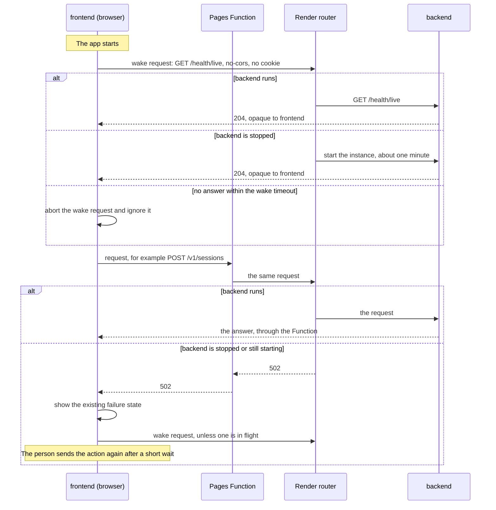

# Design: Backend wake-up

- **Status:** Approved
- **Owner:** frontend engineer
- **Reviewers:** project lead, backend engineer
- **Last reviewed:** 2026-11-12
- **Related:** [Requirements](../product/requirements.md#5-quality-requirements) (NFR-07), [ADR-0009](../decisions/0009-demo-accounts-and-cookie-sessions.md), [ADR-0016](../decisions/0016-hosting-on-free-tiers.md), [SEC-23](../rules/security-and-privacy.md#input-and-output-handling), [ERR-09](../rules/errors-and-reliability.md#timeouts-and-latency-budget), [ERR-12](../rules/errors-and-reliability.md#retries), [TS-28, TS-29](../rules/typescript.md#api-access), [ARCH-34](../rules/architecture.md#configuration), [LOG-04](../rules/logging-and-observability.md)

## Summary

`backend` runs as a free Render web service, which stops after 15 minutes without traffic. The keep-alive of [ADR-0016](../decisions/0016-hosting-on-free-tiers.md#backend-on-render), an UptimeRobot monitor that calls Render every 5 minutes, is the main way to keep it running. This design is the fallback for when the keep-alive fails or the service has already stopped. On the trial deployment, a request that reached Render through its Cloudflare Pages Function did not start it again; only a request sent straight to Render did ([Background](#background)). This design adds a **wake request**: one `GET /health/live` that `frontend` sends straight to Render when the app starts and after a retryable request failure. Every other request still goes through the Pages Function, so the session cookie stays on the page's origin and `backend` needs no CORS. Nothing else changes: `backend`, the contract, and the failure states of the UI stay as they are.

## Goals and non-goals

### Goals

- Start a stopped `backend` as soon as a person opens the app, so the start overlaps with the time the person spends on the first screen.
- Start a stopped `backend` again after a tab stayed open longer than the idle period, without a page reload.
- Keep same-origin requests, the `SameSite=Strict` session cookie ([ADR-0009](../decisions/0009-demo-accounts-and-cookie-sessions.md)), and a `backend` without CORS.

### Non-goals

- Hiding the start time. A request sent while `backend` starts fails with the existing failure state, and the person sends it again.
- Retrying a request automatically after the wake request. [ERR-12](../rules/errors-and-reliability.md) and [TS-29](../rules/typescript.md#api-access) forbid it for sign-in and for writes without an `Idempotency-Key`.
- Changing the Pages Function or the problem it returns. [ADR-0016](../decisions/0016-hosting-on-free-tiers.md#frontend-and-the-ingress-on-cloudflare-pages) defines the Function.
- Keeping `backend` running. The keep-alive of [ADR-0016](../decisions/0016-hosting-on-free-tiers.md#backend-on-render) does that. The wake request only starts `backend` again when the keep-alive failed or the service already stopped.

## Background

The browser calls relative `/v1` paths. The Vite proxy forwards them in development, and a Cloudflare Pages Function forwards them in the deployment, so the page and `backend` share one origin. A direct call from the page to Render would cross sites, and the browser would not send the `SameSite=Strict` session cookie.

[Render's documentation](https://render.com/docs/free) states that a free web service stops after 15 minutes without incoming traffic, and that starting it when it next receives a request takes about one minute.

[ADR-0016](../decisions/0016-hosting-on-free-tiers.md#backend-on-render) keeps `backend` running with an UptimeRobot monitor that sends `GET /health/ready` straight to Render every 5 minutes. When that monitor stops or fails, `backend` stops after 15 minutes, and the next person who opens the app meets a stopped service.

The project lead's trial deployment was measured on 2026-11-12 after 17 minutes without traffic. That deployment runs the AI and ML team's code. Its Pages Function, `apps/frontend/functions/` on `org/main`, sends each request to Render with one `fetch`. The Function of [ADR-0016](../decisions/0016-hosting-on-free-tiers.md#frontend-and-the-ingress-on-cloudflare-pages) is not written yet, and ADR-0016 measures it again after its first deploy. The results on the trial deployment:

| Step | Result |
|---|---|
| 16 requests through the Pages Function, one every 15 s for 4 minutes | Each answered `502` in less than 1 s, with the header `x-render-routing: no-deploy`. `backend` did not start |
| 1 request straight to Render | Answered `200` after 42.6 s. `backend` was running |
| 1 request through the Pages Function right after | Answered by `backend` in 0.4 s |

The header `x-render-routing` is not documented by Render, and this design does not depend on it.

## Design

### Components and responsibilities

| Part | Change |
|---|---|
| `frontend`: `features/backend-requests/api/` | A new function sends the wake request. It is the only code that calls Render's origin, as [TS-28](../rules/typescript.md#api-access) requires for any `fetch` |
| `frontend`: composition root | Sends one wake request when it creates the app dependencies, and one after each retryable failure of a query or a mutation |
| `frontend`: settings | Two new settings: the Render origin and the wake timeout |
| `frontend`: Content Security Policy | `connect-src` adds the Render origin when the setting has a value |
| `backend`, contract, Pages Function | No change |

### Rules

Each statement is normative. The text after it explains why.

1. **The wake request MUST be `GET <origin>/health/live`**, the operation `checkLiveness` of the `backend` contract.
   It needs no session and checks no dependency, so it is the cheapest request that makes Render start the instance. The path comes from the contract, not from this design.
2. **The wake request MUST use `mode: "no-cors"`, `credentials: "omit"`, and `referrerPolicy: "no-referrer"`, and MUST NOT carry a body or any header beyond the CORS-safelisted ones.**
   A `no-cors` request needs no CORS in `backend`. Omitting credentials keeps the session cookie off a cross-site request ([ADR-0009](../decisions/0009-demo-accounts-and-cookie-sessions.md)). Without a body, a referrer, or extra headers, no data leaves `frontend`.
3. **`frontend` MUST NOT read the wake response, act on it, or show anything about it.**
   The browser makes a `no-cors` response opaque, so `frontend` cannot read its status. Its only job is to start the instance. A failure that the person needs to see already appears through the existing failure state of the request that failed.
4. **The wake request MUST be sent only on two triggers:**
   - **the app starts:** the composition root sends it once when it creates the app dependencies;
   - **a query or a mutation fails with a retryable failure,** as `isRetryableFailure` decides: a timeout, a lost connection, `429`, `502`, `503`, `504`, or `not-ready`.

   **It MUST NOT be sent on a timer, on navigation, or after any other failure.**
   Wake requests are then sent only while people use the app, and a stopped instance is started at the first sign that it stopped. Reusing the classification of [ERR-12](../rules/errors-and-reliability.md#retries) keeps one definition of a retryable failure. A wake request sent while `backend` runs answers in under 1 s and has no effect.
5. **At most one wake request MUST be in flight.** A trigger that fires while one is in flight sends nothing.
   A wake request waits while Render starts the instance, so one request is enough. A second request adds load and starts nothing.
6. **The wake request MUST stop waiting after `VITE_BACKEND_WAKE_TIMEOUT_MS`.**
   Every call to another component has a timeout from settings ([ERR-09](../rules/errors-and-reliability.md#timeouts-and-latency-budget)). The default of 90 000 ms is Render's documented start time of about one minute plus 30 s, so the timeout does not abort a wake request before the instance runs.
7. **A wake request MUST NOT cause any request to be sent again.**
   Sign-in and writes without an `Idempotency-Key` are never retried automatically ([ERR-12](../rules/errors-and-reliability.md#retries), [TS-29](../rules/typescript.md#api-access)). The person decides when to send the action again.
8. **Only the wake function in `features/backend-requests/api/` MAY call the Render origin. Every other request MUST go to the page's origin.**
   [TS-28](../rules/typescript.md#api-access) limits `fetch` to `api/` folders. Same-origin requests keep the session cookie working ([ADR-0009](../decisions/0009-demo-accounts-and-cookie-sessions.md)).
9. **When `VITE_BACKEND_WAKE_ORIGIN` is not set, `frontend` MUST NOT send a wake request, and `connect-src` MUST stay `'self'`.**
   Development, the tests, the Prism mock, and a deployment where `backend` does not stop when idle need no wake request.
10. **The build and the app MUST read `VITE_BACKEND_WAKE_ORIGIN` with one shared parser, and an invalid value MUST stop both with the setting's name.**
    The Content Security Policy and the wake request then always name the same origin ([ARCH-34](../rules/architecture.md#configuration)). A wrong origin would otherwise be blocked by the policy without any visible error.

### Flow

1. The app starts, and the composition root sends a wake request straight to Render.
2. If `backend` runs, Render answers at once. If it is stopped, Render starts it and answers when it runs. If no answer comes within the wake timeout, `frontend` aborts the wake request and ignores it.
3. The person works in the app. Every request goes through the Pages Function, as before.
4. If a request fails with a retryable failure, for example a `502` because `backend` stopped while the tab stayed open, the screen shows its existing failure state, and the composition root sends a wake request unless one is in flight.
5. The person sends the action again once `backend` runs.

### Data and contracts

No contract change, so nothing is compatible or breaking. The wake request calls the existing operation `checkLiveness`. It cannot send `traceparent`, because a `no-cors` request carries only CORS-safelisted headers, and the contract does not require it.

The settings, with the same rules as the existing settings ([ARCH-34](../rules/architecture.md)):

| Setting | Default | Meaning |
|---|---|---|
| `VITE_BACKEND_WAKE_ORIGIN` | Not set | The Render origin, such as `https://<service>.onrender.com`: an `http` or `https` origin without a path. Not set: no wake request is sent and `connect-src` stays `'self'` |
| `VITE_BACKEND_WAKE_TIMEOUT_MS` | `90000` | How long a wake request may wait, in ms: Render's start time of about one minute plus 30 s |

The build reads `VITE_BACKEND_WAKE_ORIGIN` to write the Content Security Policy, and the app reads it to send the wake request (rule 10).

### Errors and guardrails

The change sends no message, reply, or transaction, and it changes no AI behavior, so the guardrails in the [requirements](../product/requirements.md#5-quality-requirements) are not affected.

| Failure | Behavior | Test |
|---|---|---|
| The wake request fails, is blocked, or times out | Ignored. Nothing is shown. The next trigger sends a new wake request | Unit: a rejected fetch and an aborted fetch leave no error and no failure state |
| A wake request is in flight when a trigger fires | No second wake request is sent | Unit: two triggers in a row send one request; a trigger after the first settles sends another |
| `VITE_BACKEND_WAKE_ORIGIN` is not set | No wake request. `connect-src` is `'self'` | Unit: settings and the policy builder |
| `VITE_BACKEND_WAKE_ORIGIN` is invalid | The build and the app stop with the setting's name | Unit: settings parser |
| A request fails while `backend` starts | The existing failure state of the screen. A wake request is sent | Unit: a `502` query failure and a `502` sign-in failure each send one wake request |
| A request fails with a failure that is not retryable (`4xx`, `500`, an invalid response) | No wake request | Unit: `401`, `422`, and `500` send none |

## Alternatives considered

| Option | Why it was not chosen |
|---|---|
| The Pages Function starts `backend` | Measured on 2026-11-12 on the trial deployment: 16 requests through its Function over 4 minutes did not start it (Background) |
| Every request goes straight to Render, with CORS | The browser would not send the `SameSite=Strict` cookie across sites, and a `SameSite=None` cookie is a third-party cookie that browsers often block. It would replace [ADR-0009](../decisions/0009-demo-accounts-and-cookie-sessions.md) |
| A keep-alive monitor alone | Chosen in [ADR-0016](../decisions/0016-hosting-on-free-tiers.md#backend-on-render) as the main way to keep `backend` running, so it is not an alternative to this design. Alone, it leaves `backend` stopped after the monitor stops or fails, until someone notices. The wake request covers that case |
| A paid Render instance, which does not stop | A cost decision for the team, outside this design |
| A wake request each time the tab becomes visible again | Chosen against by the project lead on 2026-11-12. The wake request after a retryable failure covers the same case with one trigger fewer |
| The Pages Function answers `503 not-ready`, and the UI shows a "starting" state | Chosen against by the project lead on 2026-11-12: the existing failure states are enough, and the Function stays unchanged |

## Testing and evaluation

Every rule in [Rules](#rules) has at least one test below or in the failure table. The tests that [TEST-01](../rules/testing.md#required-tests-per-change) requires:

| Change | Tests |
|---|---|
| New adapter: the wake function | Unit tests (Vitest) with a fake fetch: the request uses `GET`, the path `/health/live`, `mode: "no-cors"`, `credentials: "omit"`, `referrerPolicy: "no-referrer"`, and an abort signal; a timeout, a rejected fetch, and a request in flight behave as the failure table says |
| Changed composition root and settings | Unit tests for every other row of the failure table, and for the Content Security Policy builder with and without the origin |
| Changed user flow: the app start | A UI flow test (Playwright) against the production build: the page sends the wake request at start, and the browser's Content Security Policy allows it. A second test: when the wake origin does not answer, sign-in still succeeds. The UI flow build sets `VITE_BACKEND_WAKE_ORIGIN` to the Prism mock origin |

After deployment, a manual check: leave the app unused for 17 minutes, open it, and confirm in the browser's network panel that the wake request waits until `backend` runs and that sign-in then succeeds. Record the result in the pull request.

No metric changes.

## Observability

No event, span, or metric is added. `frontend` exports no telemetry in v1 ([LOG-04](../rules/logging-and-observability.md)). `backend` handles the wake request as any `GET /health/live`, under a new trace, because the request carries no `traceparent`.

## Security and privacy

- The wake request carries no cookie, no body, no referrer, and no personal data. Nothing Confidential or Secret leaves `frontend`.
- The Render origin is Internal data: a setting without secrets ([SEC-01](../rules/security-and-privacy.md#data-classification)). Like every `VITE_` setting, it is built into the page, so any visitor can read it. The origin is already reachable from the internet.
- `connect-src` gains exactly one configured origin, so the policy still blocks unknown origins ([SEC-23](../rules/security-and-privacy.md#input-and-output-handling)). `backend` still has no CORS.
- If `backend` later accepts only requests from the Pages Function, `/health/live` stays callable straight on Render, as [ADR-0016](../decisions/0016-hosting-on-free-tiers.md#open-questions) requires, so the wake request keeps working.

## Rollout

1. One `frontend` pull request: the wake function, the triggers, the settings, the policy, the tests, the Settings table of `frontend/README.md`, and `frontend/.env.example`.
2. The project lead sets `VITE_BACKEND_WAKE_ORIGIN` in the Cloudflare Pages build settings and deploys.
3. Roll back by removing the setting and deploying again: no wake request is sent and `connect-src` returns to `'self'`.

## Open questions

- Whether requests through the Pages Function restart Render's 15-minute idle period was not measured. The design does not depend on it, because the wake request after a retryable failure starts `backend` either way.
