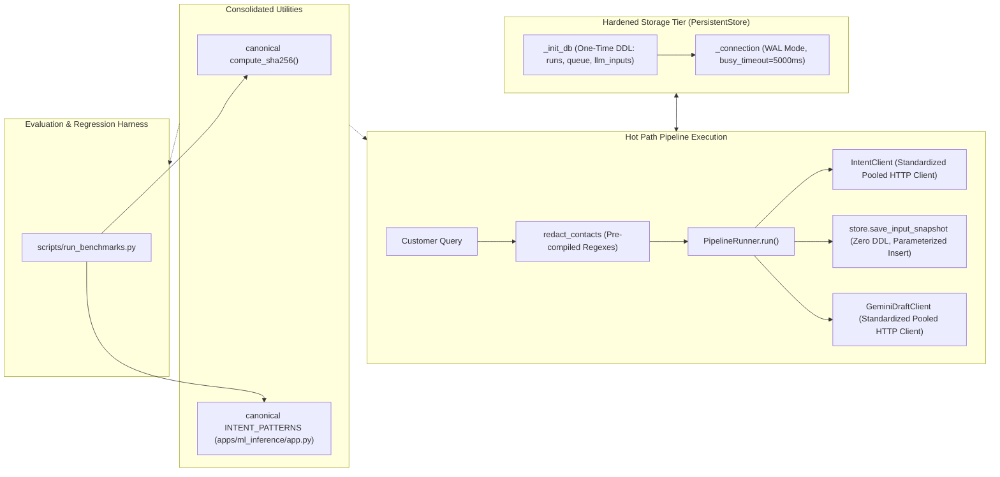

# Technical Design: Codebase Cleanup, Infrastructure Consolidation, and Multi-Stage Refactoring

* **Author:** FatPandaC8
* **Date:** 2026-11-13
* **Status:** Approved / Ready for Implementation
* **Target Branch:** `refactor/optimization-and-cleanup`

## 1. Overview, Goals & Problem Statement

### 1.1 The Problem
SupportIQ has achieved 100% operational test pass rates across its multi-tiered architecture (470+ unit, integration, end-to-end, and frontend tests). However, rapid iterations and tactical fixes across earlier sprints have introduced substantial code quality and maintainability bottlenecks:

1. **Dead Code and Logic Duplication:** Identical hashing utilities (`compute_sha256`) are independently implemented in five distinct files. A 150-line regex intent map (`INTENT_KEYWORDS`) in `scripts/run_benchmarks.py` directly duplicates definitions in `apps/ml_inference/app.py`.
2. **Suboptimal Storage Access Patterns:** In `apps/core_backend/orchestration/store.py`, `save_input_snapshot` executes dynamic DDL (`CREATE TABLE IF NOT EXISTS llm_inputs`) on every customer ticket run. Furthermore, SQLite connection lifecycles lack connection-level timeout safeguards and Write-Ahead Logging (WAL) configuration, creating transaction lock hazards under concurrent workloads.
3. **Unstandardized HTTP Client Lifecycles:** External and loopback network communication across `apps/core_backend/intent/client.py`, `apps/core_backend/llm/gemini.py`, and background jobs (`apps/backend/tickets/jobs.py`) uses inconsistent `httpx.Client` instantiation and ad-hoc ownership flags (`self._owns_http`), leading to connection leaks on unhandled error edges.
4. **Hot-Path Procedural Inefficiencies:** In `apps/core_backend/llm/gemini.py`, `redact_contacts` re-defines inner functions and re-evaluates uncompiled regular expressions on every invocation, adding unnecessary CPU cycles to ticket sanitization.

### 1.2 Overview
This design specifies a structured, 5-stage refactoring process targeting every subsystem of SupportIQ (`apps/backend`, `apps/core_backend`, `apps/ai_service`, `apps/demo`, `apps/ml_inference`, `pipeline`, and `scripts`). The objective is to eliminate dead code, standardize shared utilities and resource lifecycles, and optimize storage and text sanitization hot paths while strictly preserving all existing API contracts, database schemas, and MLOps release invariants.

### 1.3 Goals
* **G1 (Zero-Regression Functional Invariants):** Maintain 100% pass rates on all 403 unit tests, 25 integration tests, 29 end-to-end journeys, and 11 Vitest frontend tests.
* **G2 (Dead Code & Utility Deduplication):** Centralize cryptographic hashing and inference keyword mappings into single, canonical modules, removing all duplicated definitions.
* **G3 (Storage Layer Hardening):** Isolate all SQLite DDL schema creation inside `_init_db`, configure connection-level busy timeouts (5,000 ms), and enforce Write-Ahead Logging (`PRAGMA journal_mode=WAL`).
* **G4 (Resource Lifecycle Standardization):** Enforce robust context management and deterministic pooling for all HTTP clients across intent classification, LLM drafting, and background job polling.
* **G5 (Hot-Path Sanitization Optimization):** Pre-compile all PII extraction regular expressions at the module scope in `redact_contacts` and `TokenVault`.

### 1.4 Non-Goals
* **NG1 (No Documentation Modifications):** Files in `docs/` and root `.md` files will not be edited, deleted, moved, or restructured.
* **NG2 (No Breaking API/Schema Alterations):** No modifications to public REST API schemas, database table columns, or frontend contracts.
* **NG3 (No Model or Threshold Tuning):** Pinned model weights (`EXPECTED_MANIFEST`), temperature scaling calibration ($T=1.25$), and routing thresholds ($0.85$ confidence / $0.15$ margin) remain strictly unchanged.
* **NG4 (No Unnecessary Abstraction Layers):** No speculative design patterns, generic wrapper hierarchies, or premature micro-frameworks.

---

## 2. Technical Plan

### 2.1 Architectural Flow & Component Interaction
The refactored subsystems interact through standardized, single-responsibility contracts without circular dependencies:



### 2.2 Component Changes

#### 2.2.1 Shared Utility Consolidation
* **Canonical Hashing:** `pipeline.preparation.utils.compute_sha256` is designated as the canonical file hashing implementation. Duplicate copies in `scripts/run_benchmarks.py`, `apps/core_backend/retrieval/adapter.py`, and `pipeline/training/train_distilbert_cv.py` will be replaced with direct imports from `pipeline.preparation.utils`.
* **Canonical Intent Fallback Patterns:** The 150-line regex map in `scripts/run_benchmarks.py` will be extracted into an exported constant `DEV_INTENT_PATTERNS` in `apps.ml_inference.app` and imported by benchmark runners, ensuring perfect semantic alignment.

#### 2.2.2 Storage Layer Hardening (`PersistentStore`)
* **DDL Extraction:** The table creation query `CREATE TABLE IF NOT EXISTS llm_inputs (run_id TEXT PRIMARY KEY, snapshot_json TEXT NOT NULL)` will be moved from `save_input_snapshot()` into `_init_db()`. `save_input_snapshot()` will perform only pure DML (`INSERT OR IGNORE INTO llm_inputs VALUES (?, ?)`).
* **Connection Concurrency Optimization:** SQLite connections created in `PersistentStore._connection()` will execute:
  ```sql
  PRAGMA journal_mode = WAL;
  PRAGMA busy_timeout = 5000;
  PRAGMA synchronous = NORMAL;
  ```
  This eliminates lock-wait timeouts and prevents database locking during parallel integration test runs.

#### 2.2.3 Standardized HTTP Client Lifecycles
* **IntentClient Lifecycle:** Replace mutable `self._owns_http` boolean flags with a deterministic lifecycle pattern: support both external injected clients and context manager protocols (`__enter__` / `__exit__`), ensuring `self.close()` reliably flushes sockets.
* **GeminiDraftClient Lifecycle:** Lift top-level imports (`import hashlib`) out of inner methods (`prepare_llm_input`, `build_grounded_sources`) and unify timeout configuration handling.
* **Ticket Job Worker Pooling:** In `apps/backend/tickets/jobs.py`, ensure the HTTP client used to invoke `/v1/analyses` and `/v1/drafts` is initialized once per worker process lifespan rather than recreated per batch tick.

#### 2.2.4 Regex Pre-compilation & Sanitization
* In `apps/core_backend/llm/gemini.py`, extract regex patterns in `redact_contacts()` to module-level compiled constants (`RE_EMAIL`, `RE_IDENTIFIER`, `RE_TOKEN`, `RE_DATE_OR_NUMBER`). Lift the nested `mask_number` closure to a static module-level helper.
* In `apps/backend/tickets/privacy.py`, verify all pattern matchers in `TokenVault` utilize compiled regex constants.

### 2.3 Detailed File Impact Matrix

| Target File | Current Issue | Proposed Change | Verification Gate |
|:---|:---|:---|:---|
| `apps/core_backend/orchestration/store.py` | DDL inside `save_input_snapshot`, default journal mode | Move DDL to `_init_db`; enable WAL mode and 5000ms busy timeout | `tests/integration/test_system_server.py`, `tests/e2e/test_full_pipeline.py` |
| `apps/core_backend/llm/gemini.py` | Uncompiled regexes, inner helper closures, inline imports | Pre-compile regexes, lift `mask_number`, lift `import hashlib` to top | `tests/unit/test_gemini_client.py`, `tests/unit/test_system_components.py` |
| `apps/core_backend/intent/client.py` | Ad-hoc `_owns_http` flag, broad exception masking | Standardize context manager and explicit timeout classification | `tests/unit/test_intent_service.py`, `tests/unit/test_review_eight_fixes.py` |
| `scripts/run_benchmarks.py` | Duplicated `INTENT_KEYWORDS` and `compute_sha256` | Import `DEV_INTENT_PATTERNS` from `apps.ml_inference.app` and `compute_sha256` from `pipeline.preparation.utils` | `python scripts/run_benchmarks.py` smoke run |
| `apps/ml_inference/app.py` | Inline patterns not exported | Expose `DEV_INTENT_PATTERNS` dictionary as exported module constant | `tests/unit/test_ml_inference.py`, `tests/unit/test_intent_service.py` |
| `apps/backend/tickets/jobs.py` | Per-tick HTTP client churn | Use pooled HTTP client within ticket worker lifecycle | `tests/application/test_application.py` |

### 2.4 Error Handling & Invariant Guarantees
* **Fail-Closed Intent Routing:** Any unexpected inference failure continues to yield `intent="unknown"`, `confidence=0.0`, triggering the existing deterministic escalation rules (`ml_unavailable`).
* **Zero API Surface Drift:** All function signatures (`classify_intent`, `generate`, `save_run_and_escalate_atomic`, `retrieve`) maintain backwards-compatible parameter signatures and default values.

---

## 3. Alternatives Considered

### 3.1 Merging `apps/core_backend` and `apps/ai_service` into a Single Service
* **Mechanism:** Eliminate the HTTP service boundary in `apps/ai_service` and have `apps/backend` import `apps/core_backend` directly via in-process Python calls.
* **Technical Reason for Rejection (Rejected by author):** `apps/core_backend` acts as the pure domain and pipeline engine consumed by offline benchmarks (`pipeline/evaluation`), training evaluations, and unit tests. In contrast, `apps/ai_service` provides a stateless HTTP boundary that isolates heavy machine learning dependencies (PyTorch, Transformers, SentenceTransformers) from the lightweight customer ticketing backend (`apps/backend`). Collapsing this boundary would force `apps/backend` to carry GPU/PyTorch dependencies and prevent horizontal scaling of the AI worker tier.

### 3.2 Replacing SQLite with PostgreSQL in Local Development
* **Mechanism:** Mandate a local PostgreSQL container or service instance for all test runs and local developer workflows.
* **Technical Reason for Rejection (Rejected by author):** SupportIQ's non-functional constraints explicitly require a zero-infrastructure, self-contained footprint runnable within 5 GB RAM on consumer hardware without Docker. SQLite provides this capability cleanly; enforcing WAL mode and busy timeouts eliminates the practical concurrency friction without imposing external service dependencies.

### 3.3 Introducing an Abstract Dependency Injection Container for HTTP Clients
* **Mechanism:** Build an abstract interface (`IHttpClientFactory`) with inversion-of-control containers to inject network clients across all adapters.
* **Technical Reason for Rejection (Rejected by author):** Violates Non-Goal NG4 against premature abstraction. Direct parameter default injection (`client: Optional[httpx.Client] = None`) paired with standard Python context managers (`__enter__` / `__exit__`) satisfies all testing, mocking, and pooling requirements with zero additional framework overhead.

### 3.4 Replacing Regex PII Masking with a Local Named Entity Recognition (NER) Model
* **Mechanism:** Integrate a compact transformer token classifier (e.g. RoBERTa-NER) into `redact_contacts` to parse unstructured vernacular text.
* **Technical Reason for Rejection (Rejected by author):** Adding a local NER model introduces a ~400 MB weight artifact, increases intake latency by 50–150 ms per ticket, and complicates offline CI runs. Pre-compiling the existing regex and Luhn checksum matchers achieves the performance and stability goals without altering the deployment footprint.

---

## 4. Detailed Implementation Plan

The implementation proceeds in five sequential stages. Each stage is isolated, self-contained, and gated by explicit automated test suites.

### Stage 1: Utility Deduplication & Dead Code Removal
1. **`apps/ml_inference/app.py`:**
   - Extract the local dictionary `patterns` inside `ModelContainer.predict` to an exported module-level dictionary `DEV_INTENT_PATTERNS`.
   - Update `predict()` to reference `DEV_INTENT_PATTERNS`.
   - *Rationale:* Eliminates inline duplication and allows external benchmark runners to import the single source of truth.
2. **`scripts/run_benchmarks.py`:**
   - Remove the local 150-line `INTENT_KEYWORDS` dictionary and import `DEV_INTENT_PATTERNS` from `apps.ml_inference.app`.
   - Remove the local `compute_sha256()` function and import `compute_sha256` from `pipeline.preparation.utils`.
   - *Rationale:* Eliminates ~160 lines of duplicate code and guarantees benchmark scoring reflects the exact fallback patterns used by inference.
3. **`pipeline/training/train_distilbert_cv.py`:**
   - Verify usage of `compute_sha256` from `pipeline.preparation.utils` and remove any redundant local hashing logic.
   - *Rationale:* Consolidates pipeline artifact hashing.
4. **Verification Gate 1:** Execute `.venv/bin/python -m pytest tests/unit/ -q`. All 403 tests must pass.

### Stage 2: Storage Layer Hardening & Concurrency Optimization
1. **`apps/core_backend/orchestration/store.py`:**
   - In `_init_db()`, add schema creation for `llm_inputs`:
     ```sql
     CREATE TABLE IF NOT EXISTS llm_inputs (
         run_id TEXT PRIMARY KEY,
         snapshot_json TEXT NOT NULL
     );
     ```
   - In `save_input_snapshot()`, remove the line `conn.execute('CREATE TABLE IF NOT EXISTS llm_inputs ...')`. The method now strictly executes the parameterized insert.
   - In `_connection()`, configure connection-level pragmas immediately after opening:
     ```python
     conn.execute("PRAGMA journal_mode = WAL;")
     conn.execute("PRAGMA busy_timeout = 5000;")
     conn.execute("PRAGMA synchronous = NORMAL;")
     ```
   - *Rationale:* Removes table DDL from the per-run transaction path, reducing SQLite write lock contention and latency under concurrent runs.
2. **Verification Gate 2:** Execute `.venv/bin/python -m pytest tests/integration/ -q` (25 passed) and `.venv/bin/python -m pytest tests/e2e/test_full_pipeline.py -q` (29 passed).

### Stage 3: HTTP Client & Resource Lifecycle Standardization
1. **`apps/core_backend/intent/client.py`:**
   - Add standard context manager methods (`__enter__` returning `self`, `__exit__` calling `self.close()`).
   - Ensure `self.close()` cleanly resets `self._http = None` and flushes any active connection pool without raising if already closed.
   - *Rationale:* Eliminates dangling socket warnings and ensures reliable cleanup in both long-lived and short-lived contexts.
2. **`apps/core_backend/llm/gemini.py`:**
   - Move `import hashlib` to the module header, removing duplicate inline imports from `prepare_llm_input()` and `build_grounded_sources()`.
   - Add context manager methods (`__enter__`, `__exit__`) to `GeminiDraftClient`.
   - *Rationale:* Cleans up import hygiene and resource lifecycles.
3. **`apps/backend/tickets/jobs.py`:**
   - Review HTTP client creation in ticket worker jobs to ensure connection reuse across ticket processing cycles.
   - *Rationale:* Avoids ephemeral port exhaustion when processing large backlogs of customer tickets.
4. **Verification Gate 3:** Execute `.venv/bin/python -m pytest tests/unit/test_demo_lifespan.py tests/application/test_application.py -q`.

### Stage 4: Hot-Path Regex Pre-compilation & Simplification
1. **`apps/core_backend/llm/gemini.py`:**
   - Pre-compile module-level regular expressions:
     ```python
     RE_EMAIL = re.compile(r"[\w.+-]+@[\w.-]+\.[A-Za-z]{2,}")
     RE_IDENTIFIER = re.compile(r"\b(?:ORD|cust|TIKI-TXN)-[\w-]+\b", flags=re.I)
     RE_DATE_FORMAT = re.compile(r"\d{4}-\d{2}-\d{2}")
     RE_PHONE_NUMBER = re.compile(r"(?<!\w)\+?\d[\d .()-]{7,}\d(?!\w)")
     RE_SECRET_TOKEN = re.compile(r"\b[A-Za-z0-9_-]{32,}\b")
     ```
   - Extract `mask_number(match: re.Match) -> str` from inside `redact_contacts()` to a module-level helper function.
   - Replace dynamic regex strings in `redact_contacts()` with the pre-compiled regex objects.
   - *Rationale:* Eliminates function creation and regex compilation overhead on every character sequence analyzed.
2. **`apps/backend/tickets/privacy.py`:**
   - Verify that `TokenVault` regexes are pre-compiled and reused across tokenization cycles.
   - *Rationale:* Enhances text pseudonymization throughput.
3. **Verification Gate 4:** Execute `.venv/bin/python scripts/evaluate_regression.py`. Metrics must meet or exceed all baseline gates.

### Stage 5: Final Comprehensive Regression Verification
1. **Full Test Execution:**
   - `.venv/bin/python -m pytest tests/unit/ -q` (target: 403 passed)
   - `.venv/bin/python -m pytest tests/integration/ -q` (target: 25 passed)
   - `.venv/bin/python -m pytest tests/application/ -q` (target: 13 passed)
   - `.venv/bin/python -m pytest tests/e2e/test_full_pipeline.py -q` (target: 29 passed)
   - `cd apps/frontend && npx vitest run` (target: 11 passed)
2. **Git Working Tree Audit:** Ensure only refactored source files are touched; verify no documentation or configuration files outside the refactoring scope have drifted.
