# Design: Console UI

- **Status:** Approved
- **Owner:** frontend engineer
- **Reviewers:** backend engineer, ML engineer, RAG engineer, contracts gatekeeper
- **Last reviewed:** 2026-11-25
- **Related:** [Requirements](../product/requirements.md) (FR-01, FR-04 to FR-07, FR-10, NFR-08, NFR-11, ESC-01 to ESC-05), [ADR-0006](../decisions/0006-staff-feedback-and-reason-codes.md), [ADR-0008](../decisions/0008-ui-design-system.md), [ADR-0009](../decisions/0009-demo-accounts-and-cookie-sessions.md), [ADR-0010](../decisions/0010-pseudonymization-and-egress-control.md), [ADR-0012](../decisions/0012-roles-v1.md), [ADR-0014](../decisions/0014-citations-to-order-context.md), [ADR-0015](../decisions/0015-account-creation-and-password-changes.md), [ADR-0019](../decisions/0019-one-label-for-text-in-the-placeholder-syntax.md), [ADR-0022](../decisions/0022-server-sent-events-for-suggestion-progress.md), [contracts v1 design](contracts-v1.md) (revision 2), [backend ticket workflow design](backend-ticket-workflow.md), [account management design](account-management.md), [UI rules](../rules/ui.md)

## Summary

This design fixes the screens, the one workspace layout ([UI-15](../rules/ui.md#console-interaction)), the design token values (follow-up of [ADR-0008](../decisions/0008-ui-design-system.md#follow-ups)), and the interaction rules of `/console` for staff and managers. Frontend screens cannot be built before it, because UI-15 and UI-41 point to this document.

The team chose the inbox layout on 2026-11-01. It has an inbox on the left, the message, intent, and reply in the middle, and the other AI output on the right. Every screen, state, and dialog below is drawn in that layout.

This design follows ADR-0012, ADR-0010, and ADR-0014, the last two accepted on 2026-11-12, and contracts v1 revision 2, which the project lead approved in full on 2026-11-12. If the contracts change, this document changes with them.

**Revision of 2026-11-11, for [ADR-0015](../decisions/0015-account-creation-and-password-changes.md):** the app bar shows the account menu instead of the display name and Sign out, and the sign-in password field gets the show and hide toggle of the proposed UI-46 ([account management design](account-management.md#rule-changes)). The shared page `/change-password` joins the screens. All three are defined in the [account management design](account-management.md#screens-and-dialogs). The earlier app bar is kept under [Alternatives considered](#alternatives-considered).

**Revision of 2026-11-12, for `backend` contract 1.2.0** ([backend ticket workflow design](backend-ticket-workflow.md)): the Closed queue lists the newest tickets first, by `closed_at`, which `TicketSummary` now carries; the developer details read the latencies from `step_latencies`; the warning `source_review_overdue` refers to a document version that the analysis retrieved, not to one that the draft cites; and the contract settled the excerpt length and the queue order, so only the polling interval stays open. The earlier order and the earlier meaning of the warning are kept under [Alternatives considered](#alternatives-considered). The project lead approved this revision on 2026-11-12.

**Revision of 2026-11-12 (second), for [ADR-0019](../decisions/0019-one-label-for-text-in-the-placeholder-syntax.md) and the polling intervals:** every text in the placeholder syntax, whether a mask, an unrestored pseudonym, or a restored `LITERAL`, carries one label, "Personal data or reserved text: replace before sending", because the console cannot tell them apart by their text alone; Send reply and Submit for approval stay disabled exactly as before ([Draft editing and citations](#draft-editing-and-citations)). The project lead decided the polling intervals on 2026-11-12: the inbox polls every 15 s while it is open, and the workspace polls every 2 s while a suggestion part is `pending` ([Inbox](#inbox), [Flow](#flow)), so no question about polling stays open. The two earlier labels are kept under [Alternatives considered](#alternatives-considered), and since 2026-11-13 the mockup source and the mockup of the placeholder state show the new label ([Rollout](#rollout), step 6).

**Revision of 2026-11-15, for [ADR-0022](../decisions/0022-server-sent-events-for-suggestion-progress.md), the decisions of phase 3, the Reports page, and dev mode:** the project lead decided these points from 2026-11-13 to 2026-11-14 and approved this revision on 2026-11-15. Its labels and rules are those of the `frontend` code of 2026-11-15. The inbox polls every 30 s, and the workspace learns the progress of a suggestion from the stream of ADR-0022 while a part is `pending`, with a poll every 30 s as the fallback ([Inbox](#inbox), [Flow](#flow)); this replaces the 15 s and 2 s intervals of the revision of 2026-11-12 (second). An escalated ticket with a ready draft shows the escalation above the draft panel; staff see an escalated ticket read-only; a manager sees the staff reason codes and note under the staff proposal; Escalate ticket stays enabled while a part is `pending`, and a manager sees it disabled with "Only staff escalate a ticket. Managers handle escalated tickets.", or with "Only staff escalate a ticket or submit a reply for approval." on an `open` ticket in manual handling, where Submit for approval is disabled too; and on a ticket that requires authority, staff who read it while it awaits approval see Submit for approval, disabled, in the place of Send reply ([Actions](#actions), [States](#states)). The [Reports](#reports) section defines the sections, the periods, and the target of the assisted handling time, and the draft status `llm_unavailable` gets its own label on the Reports page only, as the sentence that this revision adds to UI-12 allows ([Status presentations](#status-presentations-ui-12)). The developer details and the two settings of dev mode are defined ([Workspace regions](#workspace-regions), [Frontend settings](#frontend-settings)). After a send that a colleague's escalation or proposal refused, the unsent text stays visible in a read-only block with Copy ([Flow](#flow), step 6). Seven mockups are drawn again and one is added ([Rollout](#rollout), step 7). The earlier decisions are kept under [Alternatives considered](#alternatives-considered).

**Revision of 2026-11-15, for the layout:** the inbox and the AI sidebar can be resized and collapsed, and a collapsed column keeps a narrow rail ([Column controls](#column-controls)). This answers the open question about collapsing the inbox. The project lead approved the direction and the dependency on 2026-11-15, and on the same day settled the width limits, approved the header name "AI details", and chose a mark for a hidden staff note on the rail of the AI sidebar; the lead approved this revision and the sentence that it adds to [UI-15](../rules/ui.md#console-interaction) on 2026-11-15 ([Rollout](#rollout), step 12). The fixed widths are kept under [Alternatives considered](#alternatives-considered).

## Goals and non-goals

### Goals

- One workspace layout for every ticket and both console roles. Each person may resize and collapse the inbox and the AI sidebar, and the choice holds for every ticket (UI-15).
- Every field of `TicketWorkspace` has exactly one place on screen.
- Token values that meet WCAG 2.2 AA ([UI-30](../rules/ui.md#accessibility)).
- Each status has exactly one presentation, apart from the report labels that UI-12 allows ([UI-12](../rules/ui.md#visual-semantics), [Status presentations](#status-presentations-ui-12)).
- Every flow stays within the action budget of NFR-11, and this document states each count ([UI-41](../rules/ui.md#console-interaction)).

### Non-goals

- `/shop`, designed in the [shop UI design](shop-ui.md), which reuses these tokens.
- `/admin` ([UI-45](../rules/ui.md#admin)), designed in the [admin UI design](admin-ui.md), which reuses this app shell.
- A dark theme ([UI-10](../rules/ui.md#tokens)). Tokens are named by role, not by color, so a dark theme later adds a second set of values and a second contrast check, without changing components.
- Push updates other than the suggestion progress stream of an open ticket ([ADR-0022](../decisions/0022-server-sent-events-for-suggestion-progress.md)). The inbox polls.

## Background

- What staff must see and do: FR-01 (intent with confidence and the top three candidates), FR-04 (review interface), and NFR-11 (at most three actions to edit or reject a draft) in the [requirements](../product/requirements.md#4-functional-requirements).
- When the AI drafts, abstains, or recommends escalation: [ESC-01 to ESC-05](../product/requirements.md#41-escalation-and-fallback-rules).
- Data on screen: `TicketSummary`, `TicketWorkspace`, `SuggestionView`, `allowed_actions`, and the reply `basis` in the [contracts v1 design](contracts-v1.md#backend-contract-backendopenapiyaml).
- Staff reason codes for reject and escalate: [ADR-0006](../decisions/0006-staff-feedback-and-reason-codes.md#staff-reason-codes).
- Placeholders that block sending: [ADR-0010](../decisions/0010-pseudonymization-and-egress-control.md#placeholder-syntax), [ADR-0019](../decisions/0019-one-label-for-text-in-the-placeholder-syntax.md), and [UI-43](../rules/ui.md#console-interaction).

## Design

### Components and responsibilities

Only `frontend` changes.

- It reads and writes data only through the `backend` contract ([UI-39](../rules/ui.md#boundaries)).
- It shows the actions that `backend` lists in `allowed_actions` and never decides permissions ([UI-40](../rules/ui.md#boundaries), [SEC-20](../rules/security-and-privacy.md#authentication-and-authorization)).
- It computes no confidence band, threshold, or report figure ([UI-14](../rules/ui.md#visual-semantics), [UI-44](../rules/ui.md#reports)).

### Screens

| Screen | Route (proposed) | Roles | Content | Mockup |
|---|---|---|---|---|
| Sign in | `/sign-in` | All | A text field for the login name, with a hint such as `staff-1`, and a password field with the show and hide toggle ([ADR-0009](../decisions/0009-demo-accounts-and-cookie-sessions.md); [account management design](account-management.md#password-fields)). No list of accounts is shown. A failed attempt shows the same message for an unknown name, a wrong password, and a deactivated account | [sign-in.png](assets/console-ui/sign-in.png) |
| Change password | `/change-password` | All | The shared page for a password change, opened from the account menu ([account management design](account-management.md#change-password-page)) | [change-password.png](assets/account-management/change-password.png) |
| Console, no ticket selected | `/console` | Staff, manager | The inbox, and a prompt to select a ticket | [no-ticket-selected.png](assets/console-ui/no-ticket-selected.png) |
| Ticket workspace | `/console/tickets/{ticket_id}` | Staff, manager | The regions below | [Layout](#layout) |
| KB document version | Side sheet over the workspace | Staff, manager | Full text of one KB document version ([UI-20](../rules/ui.md#console-interaction)) | [kb-document.png](assets/console-ui/kb-document.png) |
| Reports | `/console/reports` | Manager | Figures for a period ([UI-44](../rules/ui.md#reports)) | [reports.png](assets/console-ui/reports.png) |

Staff who open a route their role does not allow see [state-permission-denied.png](assets/console-ui/state-permission-denied.png).

### Layout

All mockups are rendered at 1280 × 900 px, the minimum console width ([UI-33](../rules/ui.md#layout-and-performance)).

Above the columns, the app bar holds the brand "SupportIQ Console", the navigation (Tickets, and Reports for managers), and the [account menu](account-management.md#account-menu) with the display name, the role label, Change password, Dev mode where dev mode is available, and Sign out.

| Column | Default width at 1280 px | Content |
|---|---|---|
| Left: inbox | 272 px | The tickets of the selected status: waiting tickets oldest first, closed tickets newest first |
| Middle | About 620 px | The customer message, the intent strip, and the reply area |
| Right: AI sidebar | 340 px | The recommendation with its reason codes, the staff note, the sources, and the developer details |

The ticket header spans the middle and right columns and holds the order chip.

#### Column controls

The inbox and the AI sidebar can each be resized and collapsed, so staff can give the reply area more width when they need it, for example a manager who compares the staff proposal with the AI draft ([UI-19](../rules/ui.md#console-interaction)).

- **Resizing.** A splitter sits between the inbox and the middle column, and another between the middle column and the AI sidebar. Each follows the window splitter pattern of WAI-ARIA: the role `separator`, named "Resize inbox" and "Resize AI details", with `aria-valuenow`, `aria-valuemin`, `aria-valuemax`, and `aria-controls`; it takes the focus, the left and right arrow keys move it, and Enter collapses or restores its column ([UI-30](../rules/ui.md#accessibility)).
- **Limits, settled by the project lead on 2026-11-15.** The inbox takes 200 to 400 px and the AI sidebar 280 to 480 px, and the middle column keeps at least 520 px, so a splitter stops before the middle column gets narrower. The limits are in pixels at every width; on a screen wider than 1280 px, the middle column takes the rest. The defaults are the widths of the table above.
- **Collapsing.** Each column header holds a button that collapses the column, with `aria-expanded`: "Collapse inbox" at the start of the inbox header, in the place of the inbox icon, and "Collapse AI details" at the end of a header "AI details" that the AI sidebar gets. A collapsed column keeps a rail of 48 px with a button that opens it, "Open inbox" or "Open AI details", and the icon of the column, which is decorative and hidden from assistive technology (`aria-hidden`).
- **A hidden staff note.** While the AI sidebar is collapsed and the current draft has a staff note, its rail shows the icon of "For staff only" under the open button, with the accessible name "Note for staff in AI details", so the mark does not rely on color alone ([UI-11](../rules/ui.md#visual-semantics)). The mark goes away when the current draft has no staff note. A warning such as "Missing information" says "See the note for staff.", and the mark shows where that note is ([ASM-04](../product/requirements.md#6-assumptions-and-constraints)).
- **Same for every ticket.** The widths and the collapsed state are display preferences of each account, kept in the browser under the account's `account_id`, as dev mode is ([account management design](account-management.md#account-menu)). They hold no Confidential data and stay the same when staff open another ticket, so panels never move between tickets ([UI-15](../rules/ui.md#console-interaction)). When the browser refuses storage, they last until the page loads again, and a first visit uses the defaults.
- **Dependency.** `frontend` builds the splitters with `react-resizable-panels`, the library of the Resizable component of shadcn/ui ([ADR-0008](../decisions/0008-ui-design-system.md)). The project lead approved it on 2026-11-15, and `frontend` records the reason in its dependency table ([WF-27](../rules/workflow.md#dependencies)).
- **Risk of over-trust ([ASM-04](../product/requirements.md#6-assumptions-and-constraints)).** A collapsed AI sidebar hides the recommendation, the staff note, and the Sources list, which help staff check the draft. The warnings, the lock of Send reply until each warning is acknowledged, the citation markers with their popovers, and the Authority banner stay in the reply area and the header, so no guardrail depends on the AI sidebar. Its rail stays on screen, and one click opens it.

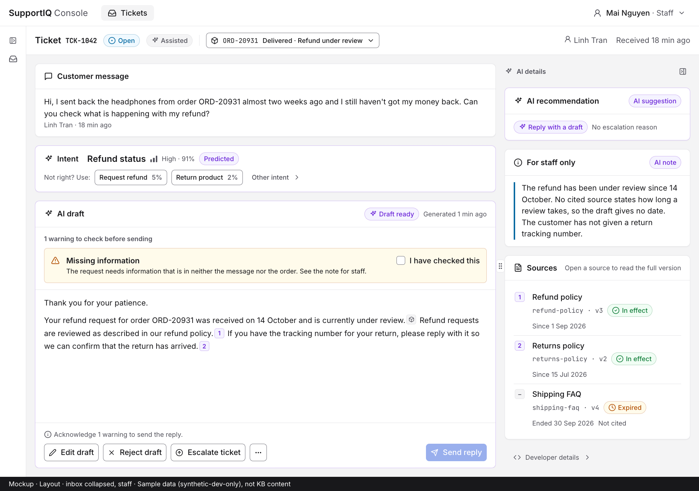

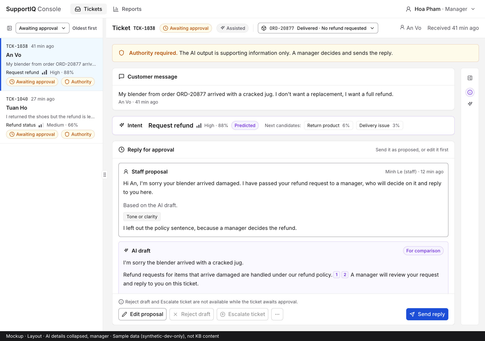

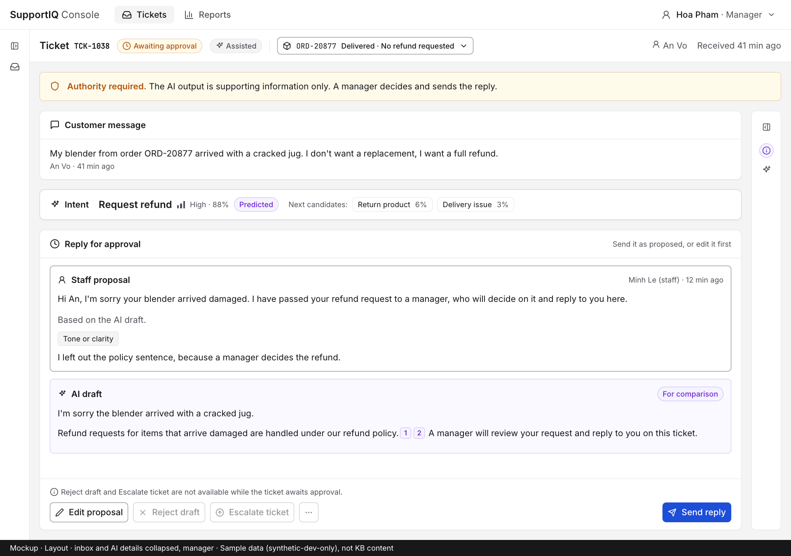


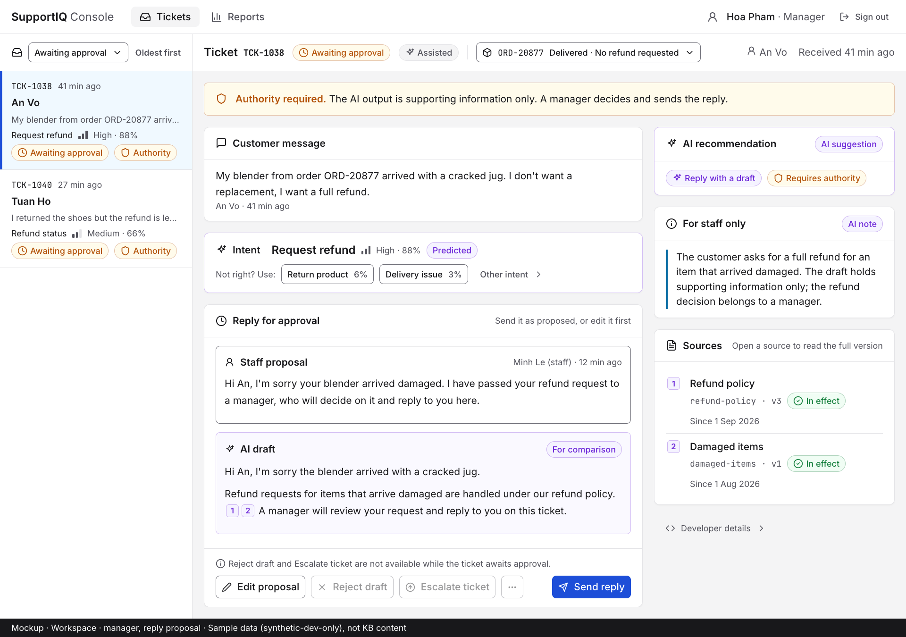

### Workspace regions

| Region | Content | Source in `TicketWorkspace` | Rules |
|---|---|---|---|
| Ticket header | Ticket ID, status, handling mode, order chip, customer name, time received | `ticket_id`, `status`, `handling_mode`, `order`, `customer.display_name`, `created_at` | UI-12 |
| Authority banner | "Authority required": the AI output is supporting information; a manager decides and sends the reply | `is_authority_required` | UI-19 |
| Customer message | The message as written, with its time | `message` | [SEC-22](../rules/security-and-privacy.md#input-and-output-handling) (plain text) |
| Order chip | The order ID and the order, shipment, and refund status. A popover holds the rest. "No order attached" when absent | `order`, `other_orders` | UI-31 (popover from the Radix primitives) |
| Intent strip | Predicted intent with band and percentage; the next two candidates; Other intent. After a correction: the chosen intent, marked Chosen by staff, and Other intent | `suggestion` → analysis `intent`, `alternatives`, `intent_override` | FR-01, UI-14, UI-22, UI-42 |
| Reply area | Warnings with acknowledgement, the AI draft with citation markers, the editor, and the action bar. For a manager: the staff proposal next to the AI draft, with what staff noted under the proposal text; or the escalation, above the draft panel when a draft is ready | `suggestion` draft and `warnings`, `proposal`, `escalation`, `reply`, `allowed_actions` | UI-16 to UI-20, UI-41, UI-43 |
| AI recommendation | The recommendation and its reason codes | `suggestion` → analysis `routing` | UI-13 |
| For staff only | The staff note, marked as AI text | `suggestion.staff_note` | UI-13, UI-21 |
| Sources | Ranked KB document versions with citation number, ID, version, validity, and effective period | analysis `documents`, draft `citations` | UI-20 |
| Developer details | A collapsed panel, "Developer details", at the bottom of the AI sidebar, only while dev mode is available and the user switched it on in the [account menu](account-management.md#account-menu). It shows the trace ID, with a link to the trace in Grafana when `VITE_GRAFANA_TRACE_URL` is set ([Frontend settings](#frontend-settings)); the suggestion and its trigger; and for the analysis and the draft: the status, the reason codes, the release and its 6 asset versions (Release, Model, KB, Mapping, Prompts, Routing, Index), and the Total time, Analysis time, and LLM time in milliseconds, or "No LLM call". The analysis adds the reason codes of its warnings. A `pending` part shows only its status, and a part without an `ai-service` call shows its status and reason codes. Every value appears as `backend` sent it, also a value that this version does not know | `suggestion.trace_id`, `suggestion_id`, `trigger`; per part `analysis_status` or `draft_status`, the reason codes of the routing or of the part, the analysis `warnings`, `versions`, `step_latencies` | UI-35 |

Placement rules:

1. Warnings sit at the top of the reply area, next to the action they block ([UI-18](../rules/ui.md#console-interaction)), not in the AI sidebar.
2. The action bar is the bottom of the reply area and never moves (UI-16). When an action is disabled, one line above the buttons says why. When several are disabled, the line gives one reason, in this order: first the reason that blocks the main action, such as "Write a reply to send it." for an empty editor; then "A manager sends the reply on this ticket." when Submit for approval is the main action; then the reason of a ticket that awaits approval, "Reject draft and Escalate ticket are not available while the ticket awaits approval."; then, for a manager, "Only staff escalate a ticket. Managers handle escalated tickets.", or "Only staff escalate a ticket or submit a reply for approval." on an `open` ticket in manual handling, where both buttons are disabled; and last, in manual handling, the reason that Submit for approval is disabled.
3. The ticket header and the banners span the full width of the workspace.
4. Each column scrolls on its own. The action bar stays visible.
5. Confidence is shown with neutral bars for `high` and `medium`, and with the `warning` role for `low` only. A green "high" would read as "correct" and add to the over-trust risk of [ASM-04](../product/requirements.md#6-assumptions-and-constraints).
6. The staff note is written by the AI, so it carries the `ai` marker ([UI-13](../rules/ui.md#visual-semantics)).
7. **Intent first.** The intent sits directly under the customer message, before the draft. A wrong intent changes which documents reach the LLM ([requirements §7](../product/requirements.md#7-risks-and-required-controls)), so staff check it first and correct it before they read the draft. The inbox also shows the intent and confidence of each ticket.
8. **Order status stays visible.** Facts that a draft takes from the order (for example "your refund is under review") carry an order citation ([ADR-0014](../decisions/0014-citations-to-order-context.md)), so staff can see which sentences to check against the order. The statuses stay visible without a click; only the details open on demand.
9. **Order data is not AI output.** It never carries the `ai` marker and never sits in the AI sidebar. The popover says "From order records, not AI". An order citation marker inside a draft uses neutral colors and says the same.

### Inbox

- A dropdown selects the status. Staff have only Open; `backend` returns `403` to staff for other statuses ([contracts v1](contracts-v1.md#roles-and-permissions)). Managers also have Awaiting approval, Escalated, and Closed.
- Open, Awaiting approval, and Escalated tickets are sorted oldest first, so no ticket waits behind newer ones. Closed tickets are sorted newest first by `closed_at`, so the latest replies come first.
- Each item shows the ticket ID, time received, customer, message excerpt, predicted intent with confidence, AI status, and the authority flag.
- When `handling_started_at` is set, the item says who is likely working on it, for example "Opened 4 min ago". v1 has no ticket assignment, so two staff can still work on one ticket. The later send gets `409 invalid-ticket-state` after a reply, or `403 forbidden` after an escalation or a proposal.
- One click opens a ticket. The inbox polls every 30 s while it is open, from its first loaded page on; a queue that failed to load is asked for again only when staff try again.

When no ticket is selected, the middle shows [no-ticket-selected.png](assets/console-ui/no-ticket-selected.png). An empty inbox shows [inbox-empty.png](assets/console-ui/inbox-empty.png).

### Order chip

A ticket belongs to one order ([ADR-0013](../decisions/0013-shop-demo-with-read-only-catalog.md)). The chip always shows that order.

**One order.** The popover shows the order, shipment, and refund status, the total, the lines, and the shipping address.

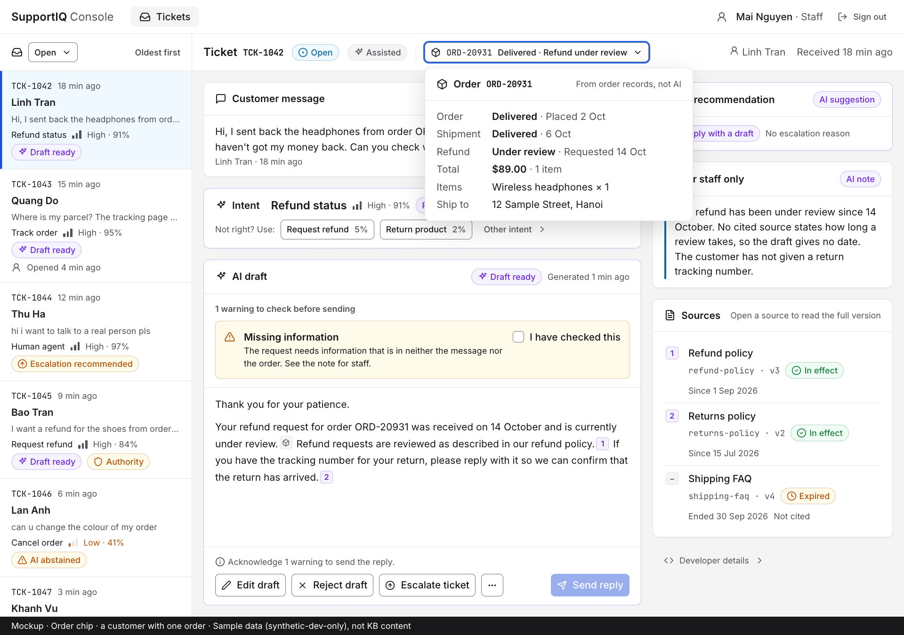

**Several orders.** When `other_orders` is present, the chip adds "+2 orders", and the popover becomes a dropdown with a preview: the customer's orders on the left, and the selected order on the right.

- The order of the ticket is first and is tagged "This ticket". It opens selected.
- The other orders never show a shipping address.
- A preview of another order says "Not the order of this ticket. The AI did not use it.", because `ai-service` receives only the ticket's order context.

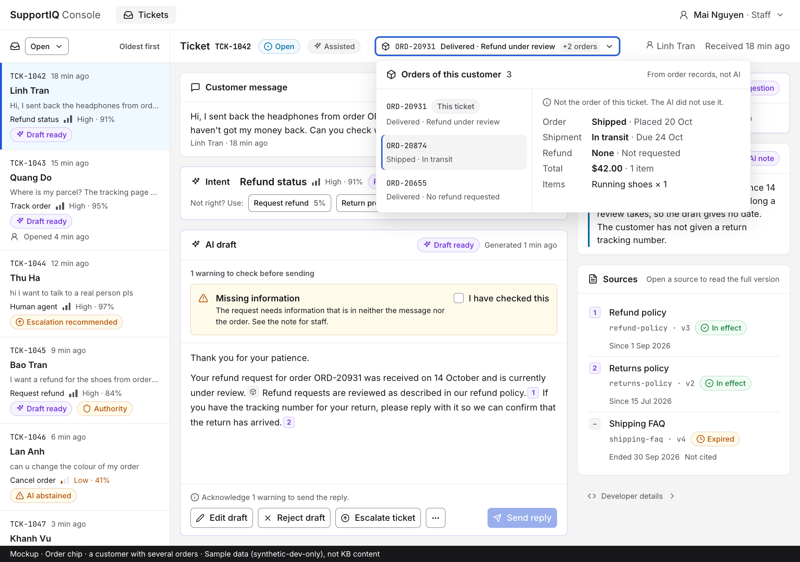

### Flow

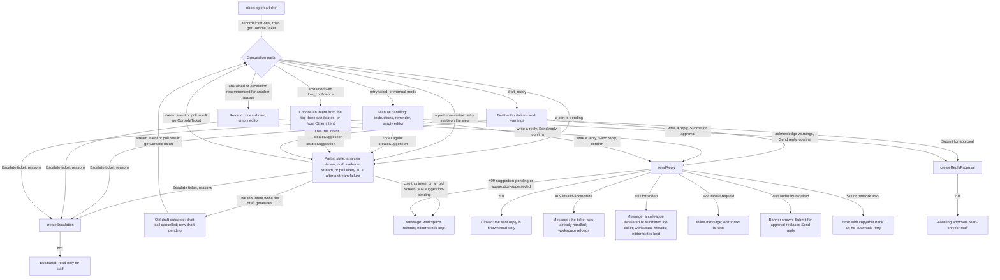

1. Staff open a ticket from the inbox. `frontend` records the view, which starts the handling clock, and loads the workspace. If the suggestion failed and can be retried, `backend` starts a retry.
2. While a suggestion part is `pending`, the analysis appears as soon as it is ready and the reply area shows a skeleton ([UI-24](../rules/ui.md#states)). `frontend` opens the suggestion progress stream of the ticket, reloads the workspace with `getConsoleTicket` after each event, and closes the stream when no part is `pending` or when staff leave the ticket. When the stream cannot start or ends with an error, `frontend` polls the workspace every 30 s while a part is `pending`, and opens a new stream after the next successful read ([ADR-0022](../decisions/0022-server-sent-events-for-suggestion-progress.md#decision), statements 6 and 7). Staff can escalate the ticket meanwhile.
3. The reply area depends on the draft status: a draft to review, a choice of intent (ESC-01), reason codes with an empty editor, or manual handling.
4. Staff can correct the intent as soon as it is shown, while the ticket is open. The predicted intent appears only when the analysis is ready, so the authority flag is already known. If a draft is still generating, it is cancelled and a new draft starts. After a correction, the chosen intent stays on the strip and staff can change it again. If a correction fails on an old screen, the workspace reloads.
5. Staff send, submit for approval, or escalate. Only actions in `allowed_actions` are enabled.
6. Every typed problem from `backend` becomes a plain-language message. Text in the editor is never lost. When Send reply gets `403 forbidden` because a colleague escalated the ticket or submitted it for approval, the reply area says "A colleague escalated this ticket or submitted it for approval. Your text is kept." and the workspace reloads into the read-only state. Under that message, the text that staff composed shows in a read-only block with a Copy action until they leave the ticket, whether the ticket is now escalated with a ready draft, escalated without one, or awaiting approval. The text stays only in the memory of the open workspace and is never written to browser storage.

### Actions

| Button | Enabled when | Request | Notes |
|---|---|---|---|
| Edit draft | The draft is `draft_ready` and `send_reply` or `submit_reply_proposal` is allowed | None | Turns the draft into the editor |
| Reject draft | Same as Edit draft | None until sending. The reply then uses `basis: rejected_ai_draft` | Shows the staff reason codes as chips. At least one is required ([ADR-0006](../decisions/0006-staff-feedback-and-reason-codes.md)) |
| Escalate ticket | `escalate` is allowed, also while a part is `pending` | `createEscalation` | Dialog with reason codes (at least one) and a note, required with `other`. The request carries the suggestion that staff saw when they opened the dialog; the dialog closes without an escalation when a new suggestion replaces it or `escalate` is no longer allowed. A manager never gets `escalate`, because only staff call `createEscalation`, so for a manager the button is disabled with "Only staff escalate a ticket. Managers handle escalated tickets." On an `open` ticket in manual handling, where Submit for approval is disabled for a manager too, one line gives the reason for both: "Only staff escalate a ticket or submit a reply for approval." |
| Send reply | `send_reply` is allowed, no suggestion is running, every warning is acknowledged, the editor is not empty and holds no placeholder | `sendReply` after a confirmation step | UI-17, UI-18, UI-43 |
| Submit for approval | `submit_reply_proposal` is allowed. For staff, it replaces Send reply when `is_authority_required` is true, also on a ticket that awaits approval, where it stays disabled. It sits in the More menu otherwise, and is a visible button in manual handling | `createReplyProposal` | UI-16 |
| Use this intent | `correct_intent` is allowed, also while a draft is generating | `createSuggestion` with `intent_override` | UI-22, UI-42 |
| Edit proposal | The caller is a manager, the ticket is `awaiting_approval`, and `send_reply` is allowed | None | Turns the proposal into the editor. Send reply then uses `basis: reply_proposal` with the edited body |
| Try AI again | `retry_suggestion` is allowed | `createSuggestion` without `intent_override` | Shown only in manual handling after an AI failure ([UI-26](../rules/ui.md#states)) |


`frontend` chooses the `basis` of a reply from what staff did:

| Situation | `basis` |
|---|---|
| A `draft_ready` draft, sent as is or edited | `ai_draft`, with every warning ID in `acknowledged_warning_ids` |
| A `draft_ready` draft that staff rejected | `rejected_ai_draft`, with the chosen reason codes |
| No current `draft_ready` draft, or `manual` mode | `no_ai_draft` |
| A manager sends a reply proposal | `reply_proposal` |

`backend` decides whether a reply with `ai_draft` counts as approve or edit ([ADR-0006](../decisions/0006-staff-feedback-and-reason-codes.md#the-decision-type-comes-from-data-not-only-from-the-button)), so there is no separate Approve button.

### Action counts (UI-41)

Typing text is not an action. Acknowledging warnings and confirming Send reply are not counted ([UI-41](../rules/ui.md#console-interaction)).

| Flow | Actions | Count |
|---|---|---|
| Send the draft as is | Send reply | 1 |
| Edit and send | Edit draft, Send reply | 2 |
| Reject and send another reply | Reject draft, choose one reason code, Send reply | 3 |
| Edit and submit for approval (authority required) | Edit draft, Submit for approval | 2 |
| Edit and submit for approval (authority not required) | Edit draft, More, Submit for approval | 3 |
| Manager sends a proposal as is | Send reply | 1 |
| Manager edits and sends a proposal | Edit proposal, Send reply | 2 |

Choosing a second reason code is optional and adds one action. Choosing an intent in ESC-01 happens before a draft exists, so it is outside the NFR-11 count.

### Draft editing and citations

- **View:** the draft shows each segment with its citation markers, and starts a new paragraph where `paragraph_index` changes. Hovering or focusing a KB marker shows the document title, version, effective dates, and snippet; activating it opens the document version (UI-20). A segment that states order facts has one order marker in neutral colors, without a number. Hovering or focusing it lists each cited field with its value and says "From order records, not AI"; activating it opens the order chip popover.
- **Edit:** one plain-text editor starts from the draft's canonical `text` that `backend` builds, because the reply `body` is plain text and `backend` compares the sent body with that same `text` to record approve or edit. `frontend` never rebuilds the text from segments. Citation markers are hidden while editing. KB citations stay listed under Sources, the order chip stays visible, and a line under the editor says that edited text is not checked against the sources.
- **Reject:** the AI draft stays visible, read-only and marked as rejected, above an empty editor.
- **Placeholders:** every text in the placeholder syntax in the draft or the editor, whether a mask, an unrestored pseudonym, or customer text that only looks like a placeholder (a restored `LITERAL`), is highlighted with one label: "Personal data or reserved text: replace before sending" ([ADR-0019](../decisions/0019-one-label-for-text-in-the-placeholder-syntax.md)). Send reply and Submit for approval stay disabled while the editor contains text in the placeholder syntax (UI-43).

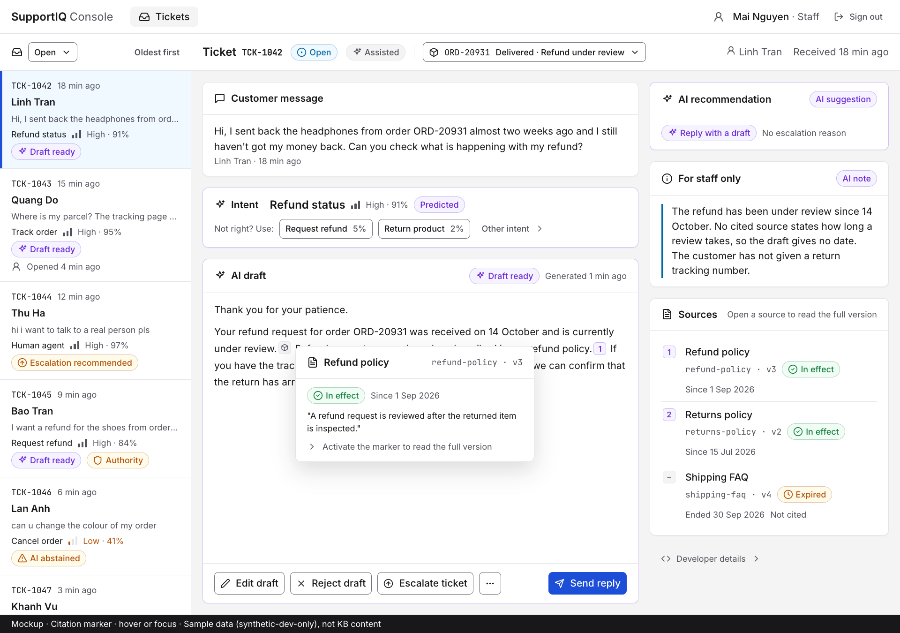

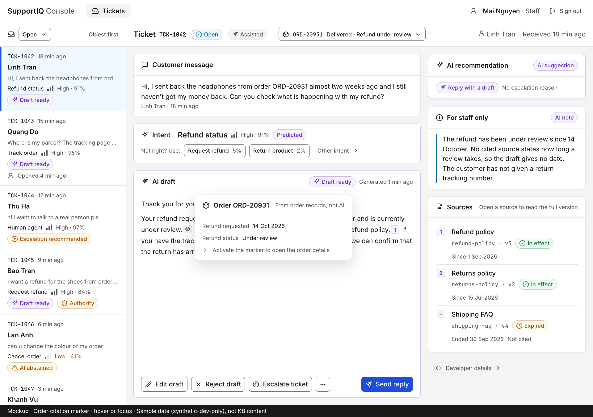


### States

Each state of [UI-23](../rules/ui.md#states) has a mockup.

| State | When | Reply area | AI sidebar | Mockup |
|---|---|---|---|---|
| Loading | First load | Skeleton | Skeleton | [state-loading.png](assets/console-ui/state-loading.png) |
| Partial | Analysis ready, draft `pending` | Skeleton labeled "Generating draft"; Send reply disabled; Escalate ticket enabled | Shown | [state-partial.png](assets/console-ui/state-partial.png) |
| Draft ready | `draft_ready`, with or without warnings | As in the workspace mockup | Shown | [workspace-staff.png](assets/console-ui/workspace-staff.png) |
| Editing | After Edit draft | The editor; citation markers hidden | Shown | [state-editing.png](assets/console-ui/state-editing.png) |
| Rejected | After Reject draft | Reason chips, the rejected draft, and an empty editor | Shown | [state-rejected.png](assets/console-ui/state-rejected.png) |
| Choose an intent | `abstained` with `low_confidence` (ESC-01) | No draft and no filler text; "No draft is created until you choose an intent" | Shown; the middle holds the top three candidates, each with "Use this intent" (UI-42), and below them one row, "None of these? Use:" with Other intent, the menu of the intent strip, for an intent that is not among the three (ESC-01). Where `correct_intent` is not allowed, the candidates have no button and the row is absent | [state-choose-intent.png](assets/console-ui/state-choose-intent.png) |
| Abstained | `abstained` for another reason (ESC-02, ESC-04) | Reason codes and an empty editor | Shown | [state-abstained.png](assets/console-ui/state-abstained.png) |
| Escalation recommended | `escalation_recommended` (ESC-03) | Reason codes, an empty editor, and Escalate ticket | Shown | [state-escalation-recommended.png](assets/console-ui/state-escalation-recommended.png) |
| Intent changed | After Use this intent | Previous draft marked as outdated; new draft pending (UI-22); Escalate ticket enabled. The Authority banner stays if the flag is set | Shown; the staff note comes with the new draft | [state-intent-changed.png](assets/console-ui/state-intent-changed.png) |
| AI unavailable | A part `unavailable` or `llm_unavailable` (ESC-05), after the retry on view | Manual handling: instructions, the reminder, an empty editor, Try AI again, and Submit for approval (UI-26) | "AI unavailable" with the reason | [state-ai-unavailable.png](assets/console-ui/state-ai-unavailable.png) |
| Manual mode | `handling_mode` is `manual` | Manual handling, without Try AI again | Replaced by the manual-handling panel; the layout does not move (UI-15) | [state-manual-mode.png](assets/console-ui/state-manual-mode.png) |
| Authority required | `is_authority_required` | Submit for approval instead of Send reply | Shown, with the reason code | [state-authority-required.png](assets/console-ui/state-authority-required.png) |
| Awaiting approval, staff | Staff read a ticket in `awaiting_approval` | The proposal and the AI draft; every action disabled with "This ticket is read-only for you. A manager sends the reply." On a ticket that requires authority, Submit for approval, disabled, holds the place of Send reply | Shown | [state-awaiting-approval-staff.png](assets/console-ui/state-awaiting-approval-staff.png) |
| Awaiting approval, manager | Manager, `awaiting_approval` | Proposal next to the AI draft. Under the proposal text, what staff noted: what the reply is based on ("Based on the AI draft.", "Written after staff rejected the AI draft.", or "Written without an AI draft."), the staff reason codes, and the note | Shown | [workspace-manager.png](assets/console-ui/workspace-manager.png) |
| Escalated, manager | Manager, `escalated` | The escalation: who escalated the ticket and when, the staff reason codes, and the note. With a ready draft, it sits above the draft panel, and the manager sends, edits, or rejects the draft; without one, it sits above the editor | Shown | [state-escalated.png](assets/console-ui/state-escalated.png) |
| Escalated, staff | Staff read a ticket in `escalated` | The escalation, and the draft when one is ready; every action disabled with "This ticket is read-only for you. A manager sends the reply." | Shown | [state-escalated-staff.png](assets/console-ui/state-escalated-staff.png) |
| Closed | `closed` | The sent reply, who sent it, and when; actions disabled with the reason | Shown, read-only | [state-closed.png](assets/console-ui/state-closed.png) |
| Placeholder present | A placeholder in the editor | Highlight; send disabled (UI-43) | Shown | [state-placeholder.png](assets/console-ui/state-placeholder.png) |
| Error | Any other problem | Message and copyable trace ID ([UI-25](../rules/ui.md#states)) | — | [state-error.png](assets/console-ui/state-error.png) |
| Permission denied | `403` or `404` when a screen opens | Message and copyable trace ID | — | [state-permission-denied.png](assets/console-ui/state-permission-denied.png) |

Where `correct_intent` is not allowed, as on every ticket that is not `open`, the intent strip is read-only: it lists the next candidates after "Next candidates:", without "Not right? Use:" and Other intent.

The reminder in manual handling reads: "Refund decision or dispute? Do not decide it here. Use Submit for approval, so a manager sends the reply." When the AI is down, nothing flags a ticket, so this reminder and staff judgment are the only control ([contracts v1](contracts-v1.md#authority-rule-fr-06)).

### Dialogs

**Confirm Send reply** ([UI-17](../rules/ui.md#console-interaction)) names the customer, shows the start of the reply, and says that a sent reply cannot be changed.


**Escalate ticket** asks for at least one staff reason code, and for a note when the code is `other`.

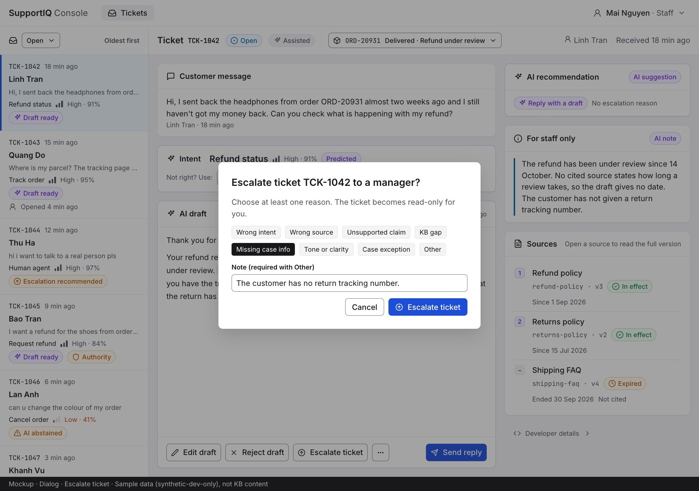

### Reports

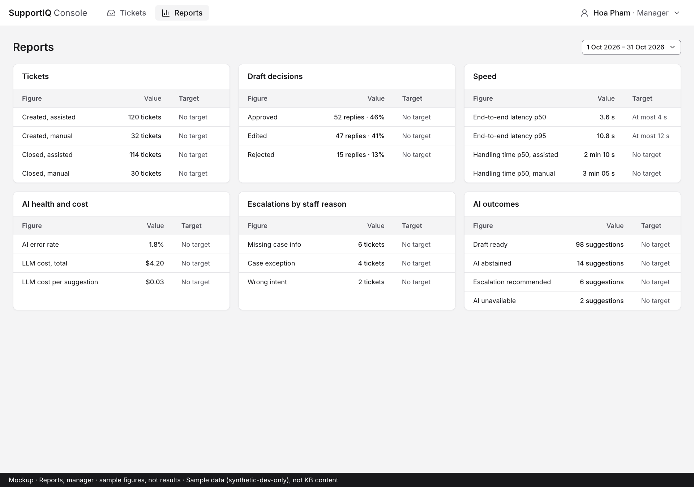

The page shows the fields of `getConsoleReport` for a chosen period ([contracts v1](contracts-v1.md#reports-fr-10)). Each figure has its unit, and its target from the [requirements](../product/requirements.md#5-quality-requirements) where one exists. Figures in the mockup are sample values, not results. Which tickets and records each figure counts is defined in the [backend ticket workflow design](backend-ticket-workflow.md#reports).

- **Period.** The menu "Report period" in the header offers Last 7 days, the default, Last 30 days, This month, and Last month. Each period starts at a midnight in the time zone of the browser. Last 7 days and Last 30 days cover today and the 6 or 29 days before it; This month runs from the first day of this month to the first day of next month; Last month runs from the first day of last month to the first day of this month. `end_at` is excluded, as `getConsoleReport` defines it. Next to the title, the page shows the dates of the period that `backend` returned, from its first day to its last, such as "9 Nov 2026 – 15 Nov 2026".
- **Sections.** Each section is a panel with a table of the columns Figure, Value, and Target, in this order:

| Section | Figures | Unit of the values |
|---|---|---|
| Tickets | Created, assisted; Created, manual; Closed, assisted; Closed, manual | Tickets |
| Draft decisions | Approved; Edited; Rejected | Replies, each with its share |
| Speed | End-to-end latency p50; End-to-end latency p95; Tickets measured for latency; Handling time p50, assisted; Handling time p50, manual; Closed tickets measured, assisted; Closed tickets measured, manual | Seconds, or minutes and seconds; tickets |
| AI health and cost | AI error rate; LLM cost, total; LLM cost per suggestion that called the LLM; Suggestions that called the LLM | A share with the failed and the counted suggestions; US dollars; suggestions |
| Escalations by staff reason | Escalations, then one row per staff reason code | Escalations |
| AI outcomes | One row per completed draft status, with `llm_unavailable` apart from `unavailable` ([Status presentations](#status-presentations-ui-12)) | Suggestions |
| Edits and rejections by staff reason | One row per staff reason code of an edit ("Edited: Tone or clarity"), then of a rejection ("Rejected: Wrong source") | Replies |
| AI reasons | One row per AI reason code | Suggestions |

- **Targets.** End-to-end latency p50 shows "At most 4 s" and p95 "At most 12 s" ([NFR-08](../product/requirements.md#5-quality-requirements)), and Handling time p50, assisted, shows "At least 20% shorter than manual" ([NFR-11](../product/requirements.md#5-quality-requirements)). NFR-11 compares both processes on the same requests, so the page states that target next to the assisted median and compares no figure with it ([UI-44](../rules/ui.md#reports)). Every other figure shows "No target". A latency is rounded up to a tenth of a second, so a latency above its target never shows as the target itself.
- **Missing values.** A share, a percentile, or an average that `backend` leaves out because nothing was counted shows "No data". A section without rows says so, for example "No edits or rejections with a reason in this period."

### Design tokens

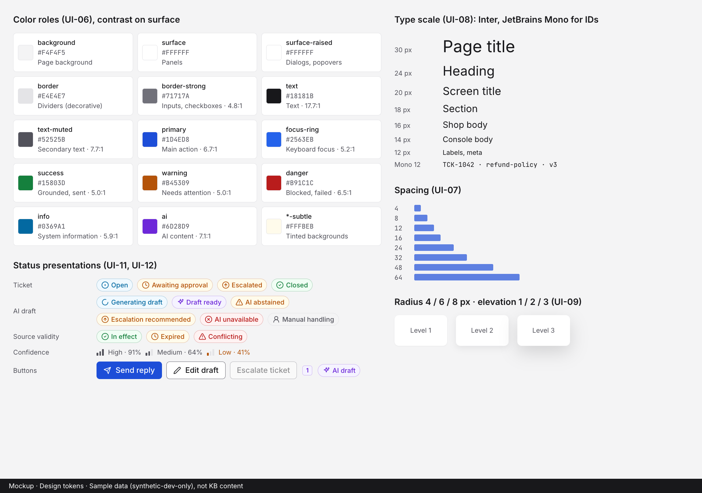

| Role | Value | Contrast on `surface` |
|---|---|---|
| `background` | `#F4F4F5` | — |
| `surface`, `surface-raised` | `#FFFFFF` | — |
| `border` | `#E4E4E7` | Decorative dividers only |
| `border-strong` | `#71717A` | 4.8:1 |
| `text` | `#18181B` | 17.7:1 |
| `text-muted` | `#52525B` | 7.7:1 |
| `text-inverse` | `#FFFFFF` | — |
| `primary` / `primary-foreground` | `#1D4ED8` / `#FFFFFF` | 6.7:1 |
| `focus-ring` | `#2563EB` | 5.2:1 |
| `success` | `#15803D` | 5.0:1 |
| `warning` | `#B45309` | 5.0:1 |
| `danger` | `#B91C1C` | 6.5:1 |
| `info` | `#0369A1` | 5.9:1 |
| `ai` | `#6D28D9` | 7.1:1 |
| `success-subtle`, `warning-subtle`, `danger-subtle`, `info-subtle`, `ai-subtle` | `#F0FDF4`, `#FFFBEB`, `#FEF2F2`, `#F0F9FF`, `#F5F3FF` | Each role color on its subtle background is at least 4.7:1 |

- Typography: Inter for UI text and JetBrains Mono for IDs and versions ([UI-08](../rules/ui.md#tokens)). Both are served from the `frontend` bundle, not from a third-party font server, so the Content Security Policy can keep blocking unknown origins ([SEC-23](../rules/security-and-privacy.md#input-and-output-handling)). Adding them follows the dependency rules ([WF-27](../rules/workflow.md#dependencies)).
- Spacing uses the steps of UI-07. Radius: 4, 6, and 8 px. Elevation: three shadow levels. Motion: 100 ms and 200 ms with `cubic-bezier(0.2, 0, 0, 1)` ([UI-09](../rules/ui.md#tokens)).

### Status presentations (UI-12)

| Status | Role | Icon | Label |
|---|---|---|---|
| Ticket `open` | `info` | Circle with dot | Open |
| Ticket `awaiting_approval` | `warning` | Clock | Awaiting approval |
| Ticket `escalated` | `warning` | Arrow up | Escalated |
| Ticket `closed` | `success` | Check | Closed |
| Draft `pending` | `info` | Spinner | Generating draft |
| Draft `draft_ready` | `ai` | Sparkles | Draft ready |
| Draft `abstained` | `warning` | Triangle | AI abstained |
| Draft `escalation_recommended` | `warning` | Arrow up | Escalation recommended |
| Part `unavailable`; draft `llm_unavailable` outside the Reports page | `danger` | Cross | AI unavailable |
| Draft `llm_unavailable` on the Reports page | `danger` | Cross | LLM unavailable |
| `handling_mode` `manual` | Neutral | Person | Manual handling |
| Document `valid` | `success` | Check | In effect |
| Document `expired` | `warning` | Clock | Expired |
| Document `conflicting` | `danger` | Triangle | Conflicting |

The status `cancelled` has no presentation, because a superseded suggestion is never shown.

**Report labels ([UI-12](../rules/ui.md#visual-semantics)), decided by the project lead on 2026-11-14 and 2026-11-15:** UI-12 lets a report that counts statuses apart give each its own label where one presentation groups them, and this design lists each such label. The only one is that of the draft status `llm_unavailable`. The workspace and the inbox show "AI unavailable" for both `unavailable` and `llm_unavailable`, and both lead to manual handling. The report counts the two statuses in two rows of AI outcomes, so on the Reports page `llm_unavailable` shows "LLM unavailable" and `unavailable` keeps "AI unavailable". The role and the icon stay the same.

### Data and contracts

- Every region maps to `TicketWorkspace`, and the inbox uses `TicketSummary`, both in the [`backend` contract section of contracts v1](contracts-v1.md#backend-contract-backendopenapiyaml) revision 2.
- The items this design needs are in that revision: `other_orders`, `handling_started_at` in `TicketSummary`, `retry_suggestion` in `allowed_actions`, `createSuggestion` without `intent_override`, `intent_override` in `SuggestionView`, and `CitationView`.
- The editor and the approve or edit decision both use the draft's canonical `text` from the same section, so a draft sent unchanged is always recorded as `approve`.
- A suggestion whose analysis retrieved a document version past its review deadline carries the warning `source_review_overdue` ([reason codes](contracts-v1.md#reason-codes)), whether or not the draft cites that version. Staff acknowledge it like any other warning.
- `backend` contract 1.2.0 adds `closed_at` to `TicketSummary`, the order of the Closed queue.
- The Reports page reads `ConsoleReport` of `backend` contract 1.2.0, `edit_by_reason` and `reject_by_reason` of the draft decisions included ([backend ticket workflow design](backend-ticket-workflow.md#reports)).
- The suggestion progress stream comes with `backend` contract 1.3.0 ([ADR-0022](../decisions/0022-server-sent-events-for-suggestion-progress.md#decision), statement 9).
- Writes send an `Idempotency-Key` created once per staff action. Sending a reply is never retried automatically ([TS-29](../rules/typescript.md#api-access)).

### Frontend settings

Two settings of `frontend` belong to dev mode in the console ([UI-35](../rules/ui.md#developer-views)); the admin area adds three ([admin UI design](admin-ui.md#developer-details-in-the-admin-area)). [frontend/README.md](../../frontend/README.md#settings) lists every setting of `frontend`.

| Setting | Values | Not set |
|---|---|---|
| `VITE_DEV_MODE` | `on` or `off`: whether dev mode is available | Follows the Vite build: on with the dev server, where `DEV` is true, and off in a production build. The demo deployment keeps it off |
| `VITE_GRAFANA_TRACE_URL` | The link to a trace in Grafana, with `{trace_id}` exactly once where the trace ID goes. It is an https URL, or an http URL whose host is `localhost`, `127.0.0.1`, or `[::1]` | The developer details show the trace ID without a link |

An invalid value stops `frontend` at startup with the name of the setting ([ARCH-34](../rules/architecture.md#configuration)). Both settings are built into the page, so they never hold a secret.

### Errors and guardrails

| Failure or risk | Behavior | Test |
|---|---|---|
| A reply is sent without a staff action | Impossible: Send reply needs a click and a confirmation step; there is no automatic send (FR-04) | End-to-end test |
| Staff send with an unacknowledged warning | Send reply disabled; `422` from `backend` as the backstop | Component test; end-to-end test |
| The editor contains a placeholder | Highlighted; Send reply and Submit for approval disabled; `422` as the backstop | Component test |
| Staff send on a ticket where authority is required | Submit for approval replaces Send reply; a `403 authority-required` shows the banner | Component test; end-to-end test |
| A suggestion is running | Send reply disabled; a `409 suggestion-pending` shows "The AI is still working on this ticket" | Component test |
| Staff change the intent while a draft is generating | Allowed; the old draft is cancelled, a new draft starts, and the flag stays set | Component test; guardrail test |
| The AI is down when staff open a ticket | Manual handling with the reminder, Try AI again, and Submit for approval; manual replies keep working (ESC-05) | Component test; end-to-end test |
| An intent correction arrives when no intent is known (an old screen) | `409 suggestion-pending` or `422 invalid-request`: message and reload | Component test |
| The draft was superseded | `409 suggestion-superseded`: the workspace reloads, the editor text is kept, and the new draft is shown | Component test |
| Another person already handled the ticket | `409 invalid-ticket-state` after a reply, or `403 forbidden` after an escalation or a proposal: message and reload, editor text kept. After `403 forbidden`, the ticket is read-only, and the unsent text shows in a read-only block with Copy until staff leave the ticket ([Flow](#flow), step 6) | Component test, for an escalated ticket with and without a ready draft and for a ticket that awaits approval |
| Staff open a ticket that is not open | Read-only workspace; every action disabled with the reason: "This ticket is read-only for you. A manager sends the reply." on a ticket that awaits approval or is escalated, and "This ticket is closed. A reply was already sent." on a closed ticket | Component test |
| Session expired | `401`: go to sign-in | Component test |
| Network error, `5xx`, or `413` or `429` from the ingress | Error with a copyable trace ID when there is one; no automatic retry of a send; editor text kept | Component test |
| AI text is mistaken for staff text | Every AI region carries the `ai` marker and label | Story with axe; component test |
| Order data is mistaken for AI output | It sits in the header popover, and inside a draft only behind a neutral order marker. Neither carries the `ai` marker, and both say "From order records, not AI" | Story; component test |
| Staff assume the AI read another order | The preview of another order says that the AI did not use it | Story |
| Staff over-trust the AI | Neutral confidence colors, visible sources with validity, warnings next to Send reply | Usability study (NFR-11) |
| Customer text contains HTML or Markdown | Rendered as plain text | Component test (SEC-22) |

## Alternatives considered

- **Option A, two columns, with a separate queue page:** rejected. It has the widest reply area, but staff go back to a queue between tickets, and the intent sits far from the message.
- **Option B, three columns, with a separate queue page:** rejected. The reply area is about 555 px wide, the action bar wraps, and the manager's proposal and AI draft stack.
- **Option C, a queue rail and two columns:** rejected. It keeps one-click movement, but the order panel pushes the draft down and the intent stays in the right column.
- **A full-page ticket queue with status tabs:** replaced by the inbox and its status dropdown, because the inbox already holds every column of that page.
- **Warnings inside the AI sidebar:** rejected, because they would sit far from the button they block.
- **Green confidence for `high`:** rejected, because color would suggest that the prediction is correct.
- **A separate Approve button:** rejected, because `backend` derives approve or edit from the sent body (ADR-0006).
- **Locking the intent until the draft is ready, or a confirmation checkbox on manual replies:** rejected ([contracts v1](contracts-v1.md#alternatives-considered)).
- **Closed tickets oldest first, like the other queues:** the inbox order until 2026-11-12. Replaced by newest first by `closed_at`, the order of `backend` contract 1.2.0, because no closed ticket waits for anyone.
- **`source_review_overdue` only for document versions that the draft cites:** the meaning until 2026-11-12. Replaced by the versions that the analysis retrieved, because warnings belong to the analysis: the warnings of a draft are those of its embedded analysis, which exists before any citation ([`ai-service` contract](../../contracts/ai-service.openapi.yaml)).
- **Two placeholder labels, "Personal data hidden: replace before sending" for a mask or an unrestored pseudonym and "Customer text in a reserved format: rephrase before sending" for a restored `LITERAL`:** the screen text until 2026-11-12. Replaced by one label ([ADR-0019](../decisions/0019-one-label-for-text-in-the-placeholder-syntax.md)), because the console cannot tell a restored `LITERAL` from an unrestored pseudonym by its text alone: both match the same expression.
- **The display name, the role, and Sign out directly in the app bar:** the app bar of the mockups until 2026-11-11. Replaced by the account menu, so that every role finds Change password in the same place ([ADR-0015](../decisions/0015-account-creation-and-password-changes.md)).
- **Polling only: the inbox every 15 s, and the workspace every 2 s while a part is `pending`:** the intervals of the revision of 2026-11-12 (second), under the non-goal "Push updates. `frontend` polls." Replaced after the project lead decided on 2026-11-13 that the console never polls more often than every 30 s: the inbox polls every 30 s, and the workspace uses the stream of [ADR-0022](../decisions/0022-server-sent-events-for-suggestion-progress.md), with a 30 s poll as the fallback.
- **The escalation above the editor on every escalated ticket:** the Escalated state until 2026-11-14. Replaced: with a ready draft, the escalation sits above the draft panel, because the reply of the manager then uses that draft as its basis.
- **"AI unavailable" for `llm_unavailable` on every screen:** the presentation until 2026-11-14. Replaced on the Reports page only, where the report counts `llm_unavailable` apart from `unavailable` ([Status presentations](#status-presentations-ui-12)).
- **No unsent text after a reload into the read-only state:** the `frontend` code of 2026-11-15 showed the text only on an escalated ticket with a ready draft, and the message "Your text is kept" was then not true for the other two cases. Not kept: the project lead chose the read-only block with Copy on 2026-11-15 over dropping the words "Your text is kept" from the message, so staff can reuse their text, for example in a note to the manager.
- **Fixed column widths, 272 px for the inbox and 340 px for the AI sidebar:** the layout until 2026-11-15. Replaced by [Column controls](#column-controls), because a fixed layout leaves the reply area no more room when staff compare a proposal with a draft or read a long message.
- **The report label of `llm_unavailable` as an exception to UI-12 in this design:** the draft of 2026-11-15. Replaced by a sentence in UI-12 itself, because a design cannot set a rule aside ([RULE-06](../rules/README.md#changing-a-rule)).

## Testing and evaluation

- **Storybook:** a story for every region in every state, with axe checks ([UI-04](../rules/ui.md#design-system-structure), [UI-32](../rules/ui.md#accessibility)).
- **Component tests:** button enablement from `allowed_actions`, warnings, and placeholders; `basis` selection; the mapping of every problem type to a message; the order chip with one and with several orders; the order citation marker and its popover; the suggestion progress stream with a fake `EventSource`, and its fallback poll ([ADR-0022](../decisions/0022-server-sent-events-for-suggestion-progress.md#decision), statement 9); the splitters with the arrow keys and Enter, their limits, and the collapse buttons; the mark of a hidden staff note on the rail, shown exactly while the AI sidebar is collapsed and the current draft has a staff note; the column state of each account, kept across tickets and reloads, and the defaults when the browser refuses storage.
- **End-to-end tests (Playwright):** the action count of each flow in [Action counts](#action-counts-ui-41), the TEST-27 scenarios, and a reply proposal sent by a manager.
- **Product value:** handling time with and without the AI (NFR-11) is measured by `backend`, as the evaluation protocol defines.
- No model metric changes.

## Observability

- `frontend` exports no telemetry in v1 ([LOG-04](../rules/logging-and-observability.md)).
- The workspace calls `recordTicketView` once each time it opens, because the first view starts the handling clock that NFR-11 measures.
- The trace ID is shown under "Details" in errors (UI-25) and in the developer details (UI-35), where it links to the trace in Grafana when `VITE_GRAFANA_TRACE_URL` is set ([Frontend settings](#frontend-settings)).

## Security and privacy

- The console shows Confidential data to staff and managers only. `backend` enforces every check; `frontend` hides actions as a convenience (SEC-20).
- Customer messages, drafts, staff notes, and KB snippets are rendered as plain text (SEC-22).
- AI text is shown exactly as `backend` returns it. `frontend` never restores or removes a placeholder (UI-43).
- `other_orders` holds only the same customer's orders and no shipping address ([SEC-17](../rules/security-and-privacy.md#authentication-and-authorization)).
- Unsent reply text is not written to browser storage, because it is Confidential.
- The mockups use sample data only (`synthetic-dev-only`). Their names, IDs, messages, documents, dates, and figures are not KB content and must not be reused as policy or evaluation data.

## Rollout

1. Done on 2026-11-01: the team chose the layout, and this document holds every screen, state, and dialog.
2. Done on 2026-11-05: the team approved this design.
3. The contract change that adds the console operations implements `TicketSummary`, `other_orders`, `CitationView`, `intent_override` in `SuggestionView`, and the draft `text` in `backend.openapi.yaml`.
4. Implementation: token files and primitives, then domain components with stories, then screens against Prism mocks.
5. Done on 2026-11-11: the project lead approved the revision of 2026-11-11, in place of a PR review. The account menu, the toggle, and `/change-password` are built after `backend` contract 1.1.0 ([account management design](account-management.md#rollout)).
6. Done on 2026-11-13, for the revision of 2026-11-12 (second): `mockup.js` and [state-placeholder.png](assets/console-ui/state-placeholder.png) show the single placeholder label of ADR-0019. Only that PNG was rendered again ([Mockup sources](#mockup-sources)).
7. Done on 2026-11-15, for the revision of 2026-11-15: `mockup.js` and `mockup.css` draw eight screens as the `frontend` code of that day shows them, one of them new, and only their PNGs were rendered ([Mockup sources](#mockup-sources)):
   - [state-escalated.png](assets/console-ui/state-escalated.png): the escalation above a ready draft, for a manager;
   - [state-escalated-staff.png](assets/console-ui/state-escalated-staff.png), new: the same ticket read-only for the staff member who escalated it;
   - [state-awaiting-approval-staff.png](assets/console-ui/state-awaiting-approval-staff.png): Submit for approval, disabled, in the place of Send reply;
   - [state-partial.png](assets/console-ui/state-partial.png) and [state-intent-changed.png](assets/console-ui/state-intent-changed.png): Escalate ticket enabled while the draft is `pending`; after the intent change, no staff note and no citation numbers in Sources until the new draft is ready;
   - [workspace-manager.png](assets/console-ui/workspace-manager.png): what staff noted under the proposal;
   - [state-closed.png](assets/console-ui/state-closed.png): the Closed queue newest first;
   - [reports.png](assets/console-ui/reports.png): every section, the period menu, the target of the assisted handling time, and escalations counted in escalations, where the earlier mockup showed "No target" and counted them in tickets. The rows of each breakdown come in the order of the codes in the contract, as `backend` returns them.

   Every mockup of a ticket that is not `open` shows the read-only intent strip.
8. After `backend` contract 1.3.0 adds the stream, `frontend` replaces its poll of the workspace every 2 s with the stream and its fallback ([ADR-0022](../decisions/0022-server-sent-events-for-suggestion-progress.md#decision), statement 9).
9. `frontend` shows the unsent text in the read-only block ([Flow](#flow), step 6). No contract change is needed.
10. Done on 2026-11-15, for the layout revision: `mockup.js` and `mockup.css` draw the column controls in three new mockups, [layout-inbox-collapsed.png](assets/console-ui/layout-inbox-collapsed.png), [layout-sidebar-collapsed.png](assets/console-ui/layout-sidebar-collapsed.png), and [layout-both-collapsed.png](assets/console-ui/layout-both-collapsed.png). The other mockups show the default widths without the splitters and the collapse buttons. After the decisions of the project lead on 2026-11-15, the two mockups with a collapsed AI sidebar were rendered again with the mark of a hidden staff note, because the draft of both holds a staff note.
11. `frontend` builds the column controls with the width limits that the lead settled on 2026-11-15 and the mark of a hidden staff note.
12. Done on 2026-11-15: the project lead approved both revisions of 2026-11-15 and the sentences that they add to [UI-12](../rules/ui.md#visual-semantics) and [UI-15](../rules/ui.md#console-interaction).

### Mockup sources

The mockups in [assets/console-ui/](assets/console-ui/) are review material, not `frontend` code. `mockup.css` holds the token values and the mockup styles, `mockup.js` holds the sample data and draws each screen, and `mockup.html?screen=<name>` shows one screen. To render every PNG on macOS with Google Chrome:

```bash
docs/design/assets/console-ui/render.sh
```

The page loads Inter and JetBrains Mono from Google Fonts.

## Open questions

- Keyboard movement through the inbox (arrow keys, or J and K). [UI-17](../rules/ui.md#console-interaction) forbids single-key shortcuts only for irreversible actions, so this is allowed.
- The text of the manual-process instructions ([UI-26](../rules/ui.md#states)). The team provides it. The mockups show a stand-in line.
