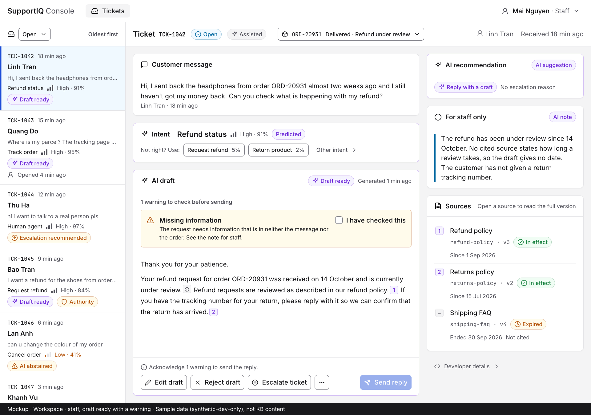
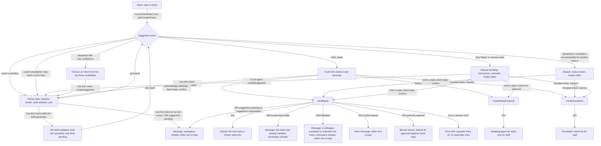
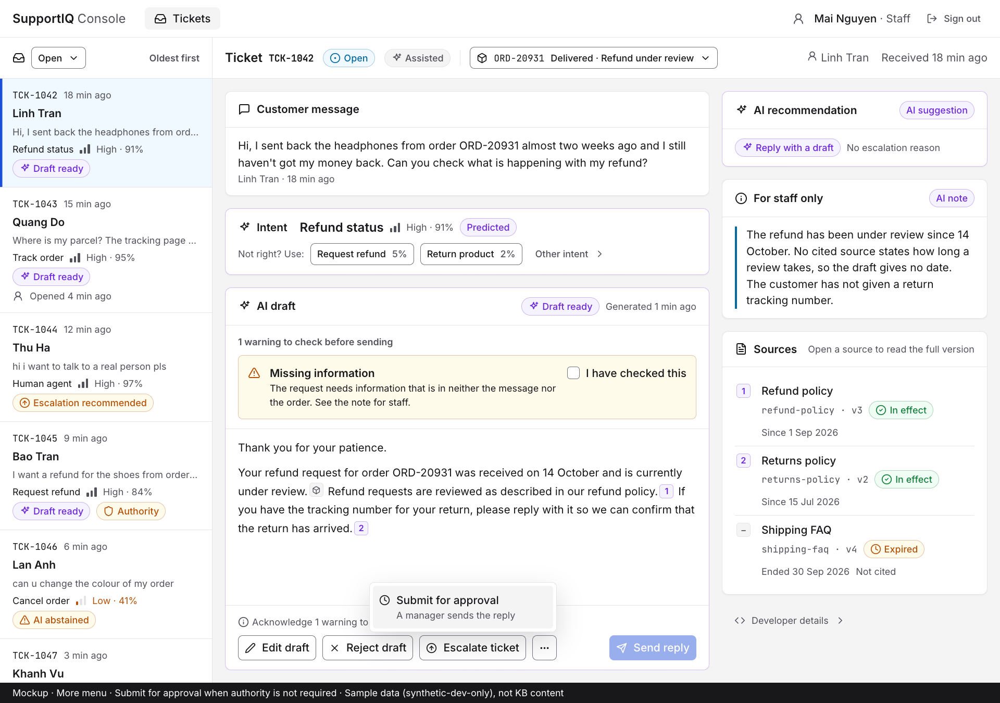
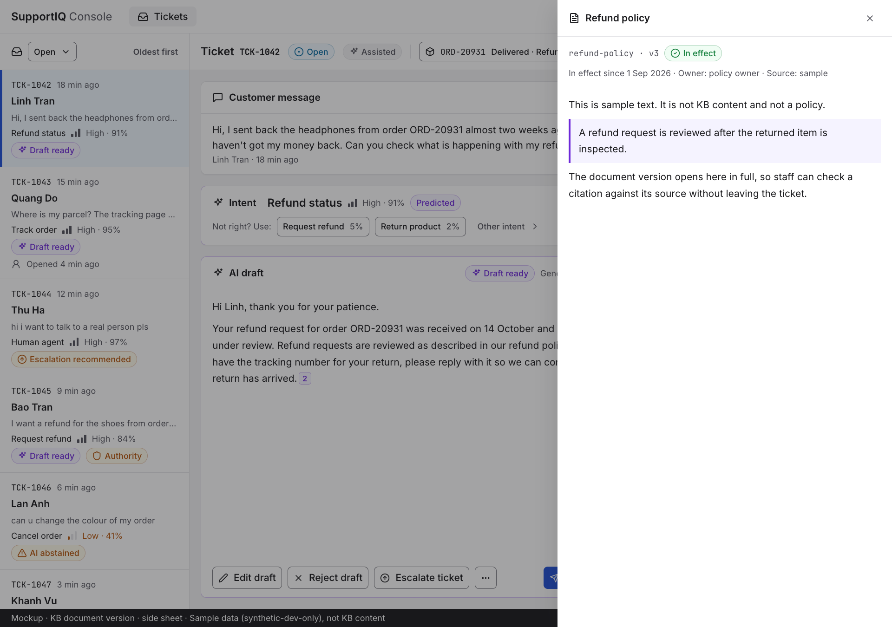
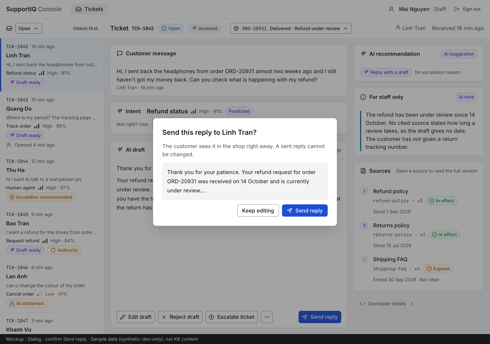

# Design: Console UI

- **Status:** Approved
- **Owner:** frontend engineer
- **Reviewers:** backend engineer, ML engineer, RAG engineer, contracts gatekeeper
- **Last reviewed:** 2026-11-05
- **Related:** [Requirements](../product/requirements.md) (FR-01, FR-04 to FR-07, FR-10, NFR-11, ESC-01 to ESC-05), [ADR-0006](../decisions/0006-staff-feedback-and-reason-codes.md), [ADR-0008](../decisions/0008-ui-design-system.md), [ADR-0009](../decisions/0009-demo-accounts-and-cookie-sessions.md), [ADR-0010](../decisions/0010-pseudonymization-and-egress-control.md) (Proposed), [ADR-0012](../decisions/0012-roles-v1.md), [ADR-0014](../decisions/0014-citations-to-order-context.md) (Proposed), [contracts v1 design](contracts-v1.md) (revision 2, in review), [UI rules](../rules/ui.md)

## Summary

This design fixes the screens, the one workspace layout ([UI-15](../rules/ui.md#console-interaction)), the design token values (follow-up of [ADR-0008](../decisions/0008-ui-design-system.md#follow-ups)), and the interaction rules of `/console` for staff and managers. Frontend screens cannot be built before it, because UI-15 and UI-41 point to this document.

The team chose the inbox layout on 2026-11-01. It has an inbox on the left, the message, intent, and reply in the middle, and the other AI output on the right. Every screen, state, and dialog below is drawn in that layout.

This design follows ADR-0012 and three documents still in review: contracts v1 revision 2, ADR-0010, and ADR-0014. If they change, this document changes with them.

## Goals and non-goals

### Goals

- One fixed workspace layout for every ticket and both console roles (UI-15).
- Every field of `TicketWorkspace` has exactly one place on screen.
- Token values that meet WCAG 2.2 AA ([UI-30](../rules/ui.md#accessibility)).
- Each status has exactly one presentation ([UI-12](../rules/ui.md#visual-semantics)).
- Every flow stays within the action budget of NFR-11, and this document states each count ([UI-41](../rules/ui.md#console-interaction)).

### Non-goals

- `/shop`, designed in the [shop UI design](shop-ui.md), which reuses these tokens.
- `/admin` ([UI-45](../rules/ui.md#admin)), designed in the [admin UI design](admin-ui.md), which reuses this app shell.
- A dark theme ([UI-10](../rules/ui.md#tokens)). Tokens are named by role, not by color, so a dark theme later adds a second set of values and a second contrast check, without changing components.
- Push updates. `frontend` polls ([contracts v1](contracts-v1.md#non-goals)).

## Background

- What staff must see and do: FR-01 (intent with confidence and the top three candidates), FR-04 (review interface), and NFR-11 (at most three actions to edit or reject a draft) in the [requirements](../product/requirements.md#4-functional-requirements).
- When the AI drafts, abstains, or recommends escalation: [ESC-01 to ESC-05](../product/requirements.md#41-escalation-and-fallback-rules).
- Data on screen: `TicketSummary`, `TicketWorkspace`, `SuggestionView`, `allowed_actions`, and the reply `basis` in the [contracts v1 design](contracts-v1.md#backend-contract-backendopenapiyaml).
- Staff reason codes for reject and escalate: [ADR-0006](../decisions/0006-staff-feedback-and-reason-codes.md#staff-reason-codes).
- Placeholders that block sending: [ADR-0010](../decisions/0010-pseudonymization-and-egress-control.md#placeholder-syntax) and [UI-43](../rules/ui.md#console-interaction).

## Design

### Components and responsibilities

Only `frontend` changes.

- It reads and writes data only through the `backend` contract ([UI-39](../rules/ui.md#boundaries)).
- It shows the actions that `backend` lists in `allowed_actions` and never decides permissions ([UI-40](../rules/ui.md#boundaries), [SEC-20](../rules/security-and-privacy.md#authentication-and-authorization)).
- It computes no confidence band, threshold, or report figure ([UI-14](../rules/ui.md#visual-semantics), [UI-44](../rules/ui.md#reports)).

### Screens

| Screen | Route (proposed) | Roles | Content | Mockup |
|---|---|---|---|---|
| Sign in | `/sign-in` | All | A text field for the login name, with a hint such as `staff-1`, and a password field ([ADR-0009](../decisions/0009-demo-accounts-and-cookie-sessions.md)). No list of accounts is shown. A failed attempt shows the same message for an unknown name, a wrong password, and a deactivated account | [sign-in.png](assets/console-ui/sign-in.png) |
| Console, no ticket selected | `/console` | Staff, manager | The inbox, and a prompt to select a ticket | [no-ticket-selected.png](assets/console-ui/no-ticket-selected.png) |
| Ticket workspace | `/console/tickets/{ticket_id}` | Staff, manager | The regions below | [Layout](#layout) |
| KB document version | Side sheet over the workspace | Staff, manager | Full text of one KB document version ([UI-20](../rules/ui.md#console-interaction)) | [kb-document.png](assets/console-ui/kb-document.png) |
| Reports | `/console/reports` | Manager | Figures for a period ([UI-44](../rules/ui.md#reports)) | [reports.png](assets/console-ui/reports.png) |

Staff who open a route their role does not allow see [state-permission-denied.png](assets/console-ui/state-permission-denied.png).

### Layout

All mockups are rendered at 1280 × 900 px, the minimum console width ([UI-33](../rules/ui.md#layout-and-performance)).

| Column | Width at 1280 px | Content |
|---|---|---|
| Left: inbox | 272 px | The tickets of the selected status, oldest first |
| Middle | About 620 px | The customer message, the intent strip, and the reply area |
| Right: AI sidebar | 340 px | The recommendation with its reason codes, the staff note, the sources, and the developer details |

The ticket header spans the middle and right columns and holds the order chip.




### Workspace regions

| Region | Content | Source in `TicketWorkspace` | Rules |
|---|---|---|---|
| Ticket header | Ticket ID, status, handling mode, order chip, customer name, time received | `ticket_id`, `status`, `handling_mode`, `order`, `customer.display_name`, `created_at` | UI-12 |
| Authority banner | "Authority required": the AI output is supporting information; a manager decides and sends the reply | `is_authority_required` | UI-19 |
| Customer message | The message as written, with its time | `message` | [SEC-22](../rules/security-and-privacy.md#input-and-output-handling) (plain text) |
| Order chip | The order ID and the order, shipment, and refund status. A popover holds the rest. "No order attached" when absent | `order`, `other_orders` | UI-31 (popover from the Radix primitives) |
| Intent strip | Predicted intent with band and percentage; the next two candidates; Other intent. After a correction: the chosen intent, marked Chosen by staff, and Other intent | `suggestion` → analysis `intent`, `alternatives`, `intent_override` | FR-01, UI-14, UI-22, UI-42 |
| Reply area | Warnings with acknowledgement, the AI draft with citation markers, the editor, and the action bar. For a manager: the staff proposal next to the AI draft, or the escalation reasons | `suggestion` draft and `warnings`, `proposal`, `escalation`, `reply`, `allowed_actions` | UI-16 to UI-20, UI-41, UI-43 |
| AI recommendation | The recommendation and its reason codes | `suggestion` → analysis `routing` | UI-13 |
| For staff only | The staff note, marked as AI text | `suggestion.staff_note` | UI-13, UI-21 |
| Sources | Ranked KB document versions with citation number, ID, version, validity, and effective period | analysis `documents`, draft `citations` | UI-20 |
| Developer details | Trace ID, release ID and asset versions, latency per step, raw statuses and reason codes. Collapsed; shown only when the setting is on | `suggestion.trace_id`, `versions`, `step_latency_ms` | UI-35 |

Placement rules:

1. Warnings sit at the top of the reply area, next to the action they block ([UI-18](../rules/ui.md#console-interaction)), not in the AI sidebar.
2. The action bar is the bottom of the reply area and never moves (UI-16). When an action is disabled, one line above the buttons says why.
3. The ticket header and the banners span the full width of the workspace.
4. Each column scrolls on its own. The action bar stays visible.
5. Confidence is shown with neutral bars for `high` and `medium`, and with the `warning` role for `low` only. A green "high" would read as "correct" and add to the over-trust risk of [ASM-04](../product/requirements.md#6-assumptions-and-constraints).
6. The staff note is written by the AI, so it carries the `ai` marker ([UI-13](../rules/ui.md#visual-semantics)).
7. **Intent first.** The intent sits directly under the customer message, before the draft. A wrong intent changes which documents reach the LLM ([requirements §7](../product/requirements.md#7-risks-and-required-controls)), so staff check it first and correct it before they read the draft. The inbox also shows the intent and confidence of each ticket.
8. **Order status stays visible.** Facts that a draft takes from the order (for example "your refund is under review") carry an order citation ([ADR-0014](../decisions/0014-citations-to-order-context.md)), so staff can see which sentences to check against the order. The statuses stay visible without a click; only the details open on demand.
9. **Order data is not AI output.** It never carries the `ai` marker and never sits in the AI sidebar. The popover says "From order records, not AI". An order citation marker inside a draft uses neutral colors and says the same.

### Inbox

- A dropdown selects the status. Staff have only Open; `backend` returns `403` to staff for other statuses ([contracts v1](contracts-v1.md#roles-and-permissions)). Managers also have Awaiting approval, Escalated, and Closed.
- Tickets are sorted oldest first, so no ticket waits behind newer ones.
- Each item shows the ticket ID, time received, customer, message excerpt, predicted intent with confidence, AI status, and the authority flag.
- When `handling_started_at` is set, the item says who is likely working on it, for example "Opened 4 min ago". v1 has no ticket assignment, so two staff can still work on one ticket. The later send gets `409 invalid-ticket-state` after a reply, or `403 forbidden` after an escalation or a proposal.
- One click opens a ticket. The inbox polls while it is open.

When no ticket is selected, the middle shows [no-ticket-selected.png](assets/console-ui/no-ticket-selected.png). An empty inbox shows [inbox-empty.png](assets/console-ui/inbox-empty.png).

### Order chip

A ticket belongs to one order ([ADR-0013](../decisions/0013-shop-demo-with-read-only-catalog.md)). The chip always shows that order.

**One order.** The popover shows the order, shipment, and refund status, the total, the lines, and the shipping address.


**Several orders.** When `other_orders` is present, the chip adds "+2 orders", and the popover becomes a dropdown with a preview: the customer's orders on the left, and the selected order on the right.

- The order of the ticket is first and is tagged "This ticket". It opens selected.
- The other orders never show a shipping address.
- A preview of another order says "Not the order of this ticket. The AI did not use it.", because `ai-service` receives only the ticket's order context.


### Flow



1. Staff open a ticket from the inbox. `frontend` records the view, which starts the handling clock, and loads the workspace. If the suggestion failed and can be retried, `backend` starts a retry.
2. While a suggestion part is `pending`, the analysis appears as soon as it is ready and the reply area shows a skeleton ([UI-24](../rules/ui.md#states)). `frontend` polls.
3. The reply area depends on the draft status: a draft to review, a choice of intent (ESC-01), reason codes with an empty editor, or manual handling.
4. Staff can correct the intent as soon as it is shown, while the ticket is open. The predicted intent appears only when the analysis is ready, so the authority flag is already known. If a draft is still generating, it is cancelled and a new draft starts. After a correction, the chosen intent stays on the strip and staff can change it again. If a correction fails on an old screen, the workspace reloads.
5. Staff send, submit for approval, or escalate. Only actions in `allowed_actions` are enabled.
6. Every typed problem from `backend` becomes a plain-language message. Text in the editor is never lost.

### Actions

| Button | Enabled when | Request | Notes |
|---|---|---|---|
| Edit draft | The draft is `draft_ready` and `send_reply` or `submit_reply_proposal` is allowed | None | Turns the draft into the editor |
| Reject draft | Same as Edit draft | None until sending. The reply then uses `basis: rejected_ai_draft` | Shows the staff reason codes as chips. At least one is required ([ADR-0006](../decisions/0006-staff-feedback-and-reason-codes.md)) |
| Escalate ticket | `escalate` is allowed | `createEscalation` | Dialog with reason codes (at least one) and a note, required with `other` |
| Send reply | `send_reply` is allowed, no suggestion is running, every warning is acknowledged, the editor is not empty and holds no placeholder | `sendReply` after a confirmation step | UI-17, UI-18, UI-43 |
| Submit for approval | `submit_reply_proposal` is allowed. It replaces Send reply when `is_authority_required` is true, sits in the More menu otherwise, and is a visible button in manual handling | `createReplyProposal` | UI-16 |
| Use this intent | `correct_intent` is allowed, also while a draft is generating | `createSuggestion` with `intent_override` | UI-22, UI-42 |
| Edit proposal | The caller is a manager, the ticket is `awaiting_approval`, and `send_reply` is allowed | None | Turns the proposal into the editor. Send reply then uses `basis: reply_proposal` with the edited body |
| Try AI again | `retry_suggestion` is allowed | `createSuggestion` without `intent_override` | Shown only in manual handling after an AI failure ([UI-26](../rules/ui.md#states)) |



`frontend` chooses the `basis` of a reply from what staff did:

| Situation | `basis` |
|---|---|
| A `draft_ready` draft, sent as is or edited | `ai_draft`, with every warning ID in `acknowledged_warning_ids` |
| A `draft_ready` draft that staff rejected | `rejected_ai_draft`, with the chosen reason codes |
| No current `draft_ready` draft, or `manual` mode | `no_ai_draft` |
| A manager sends a reply proposal | `reply_proposal` |

`backend` decides whether a reply with `ai_draft` counts as approve or edit ([ADR-0006](../decisions/0006-staff-feedback-and-reason-codes.md#the-decision-type-comes-from-data-not-only-from-the-button)), so there is no separate Approve button.

### Action counts (UI-41)

Typing text is not an action. Acknowledging warnings and confirming Send reply are not counted ([UI-41](../rules/ui.md#console-interaction)).

| Flow | Actions | Count |
|---|---|---|
| Send the draft as is | Send reply | 1 |
| Edit and send | Edit draft, Send reply | 2 |
| Reject and send another reply | Reject draft, choose one reason code, Send reply | 3 |
| Edit and submit for approval (authority required) | Edit draft, Submit for approval | 2 |
| Edit and submit for approval (authority not required) | Edit draft, More, Submit for approval | 3 |
| Manager sends a proposal as is | Send reply | 1 |
| Manager edits and sends a proposal | Edit proposal, Send reply | 2 |

Choosing a second reason code is optional and adds one action. Choosing an intent in ESC-01 happens before a draft exists, so it is outside the NFR-11 count.

### Draft editing and citations

- **View:** the draft shows each segment with its citation markers, and starts a new paragraph where `paragraph_index` changes. Hovering or focusing a KB marker shows the document title, version, effective dates, and snippet; activating it opens the document version (UI-20). A segment that states order facts has one order marker in neutral colors, without a number. Hovering or focusing it lists each cited field with its value and says "From order records, not AI"; activating it opens the order chip popover.
- **Edit:** one plain-text editor starts from the draft's canonical `text` that `backend` builds, because the reply `body` is plain text and `backend` compares the sent body with that same `text` to record approve or edit. `frontend` never rebuilds the text from segments. Citation markers are hidden while editing. KB citations stay listed under Sources, the order chip stays visible, and a line under the editor says that edited text is not checked against the sources.
- **Reject:** the AI draft stays visible, read-only and marked as rejected, above an empty editor.
- **Placeholders:** a mask or an unrestored pseudonym in the draft or the editor is highlighted with the label "Personal data hidden: replace before sending". Customer text that only looks like a placeholder (a restored `LITERAL`) is highlighted with the label "Customer text in a reserved format: rephrase before sending". Send reply and Submit for approval stay disabled while the editor contains text in the placeholder syntax (UI-43).




### States

Each state of [UI-23](../rules/ui.md#states) has a mockup.

| State | When | Reply area | AI sidebar | Mockup |
|---|---|---|---|---|
| Loading | First load | Skeleton | Skeleton | [state-loading.png](assets/console-ui/state-loading.png) |
| Partial | Analysis ready, draft `pending` | Skeleton labeled "Generating draft"; Send reply disabled | Shown | [state-partial.png](assets/console-ui/state-partial.png) |
| Draft ready | `draft_ready`, with or without warnings | As in the workspace mockup | Shown | [workspace-staff.png](assets/console-ui/workspace-staff.png) |
| Editing | After Edit draft | The editor; citation markers hidden | Shown | [state-editing.png](assets/console-ui/state-editing.png) |
| Rejected | After Reject draft | Reason chips, the rejected draft, and an empty editor | Shown | [state-rejected.png](assets/console-ui/state-rejected.png) |
| Choose an intent | `abstained` with `low_confidence` (ESC-01) | No draft and no filler text; "No draft is created until you choose an intent" | Shown; the middle holds the top three candidates, each with "Use this intent" (UI-42) | [state-choose-intent.png](assets/console-ui/state-choose-intent.png) |
| Abstained | `abstained` for another reason (ESC-02, ESC-04) | Reason codes and an empty editor | Shown | [state-abstained.png](assets/console-ui/state-abstained.png) |
| Escalation recommended | `escalation_recommended` (ESC-03) | Reason codes, an empty editor, and Escalate ticket | Shown | [state-escalation-recommended.png](assets/console-ui/state-escalation-recommended.png) |
| Intent changed | After Use this intent | Previous draft marked as outdated; new draft pending (UI-22). The Authority banner stays if the flag is set | Shown | [state-intent-changed.png](assets/console-ui/state-intent-changed.png) |
| AI unavailable | A part `unavailable` or `llm_unavailable` (ESC-05), after the retry on view | Manual handling: instructions, the reminder, an empty editor, Try AI again, and Submit for approval (UI-26) | "AI unavailable" with the reason | [state-ai-unavailable.png](assets/console-ui/state-ai-unavailable.png) |
| Manual mode | `handling_mode` is `manual` | Manual handling, without Try AI again | Replaced by the manual-handling panel; the layout does not move (UI-15) | [state-manual-mode.png](assets/console-ui/state-manual-mode.png) |
| Authority required | `is_authority_required` | Submit for approval instead of Send reply | Shown, with the reason code | [state-authority-required.png](assets/console-ui/state-authority-required.png) |
| Awaiting approval, staff | Staff read a ticket in `awaiting_approval` | The proposal and the AI draft; every action disabled | Shown | [state-awaiting-approval-staff.png](assets/console-ui/state-awaiting-approval-staff.png) |
| Awaiting approval, manager | Manager, `awaiting_approval` | Proposal next to the AI draft | Shown | [workspace-manager.png](assets/console-ui/workspace-manager.png) |
| Escalated | Manager, `escalated` | Escalation reasons and note above the editor | Shown | [state-escalated.png](assets/console-ui/state-escalated.png) |
| Closed | `closed` | The sent reply, who sent it, and when; actions disabled with the reason | Shown, read-only | [state-closed.png](assets/console-ui/state-closed.png) |
| Placeholder present | A placeholder in the editor | Highlight; send disabled (UI-43) | Shown | [state-placeholder.png](assets/console-ui/state-placeholder.png) |
| Error | Any other problem | Message and copyable trace ID ([UI-25](../rules/ui.md#states)) | — | [state-error.png](assets/console-ui/state-error.png) |
| Permission denied | `403` or `404` when a screen opens | Message and copyable trace ID | — | [state-permission-denied.png](assets/console-ui/state-permission-denied.png) |

The reminder in manual handling reads: "Refund decision or dispute? Do not decide it here. Use Submit for approval, so a manager sends the reply." When the AI is down, nothing flags a ticket, so this reminder and staff judgment are the only control ([contracts v1](contracts-v1.md#authority-rule-fr-06)).

### Dialogs

**Confirm Send reply** ([UI-17](../rules/ui.md#console-interaction)) names the customer, shows the start of the reply, and says that a sent reply cannot be changed.



**Escalate ticket** asks for at least one staff reason code, and for a note when the code is `other`.


### Reports


The page shows the fields of `getConsoleReport` for a chosen period ([contracts v1](contracts-v1.md#reports-fr-10)). Each figure has its unit, and its target from the [requirements](../product/requirements.md#5-quality-requirements) where one exists. Figures in the mockup are sample values, not results.

### Design tokens


| Role | Value | Contrast on `surface` |
|---|---|---|
| `background` | `#F4F4F5` | — |
| `surface`, `surface-raised` | `#FFFFFF` | — |
| `border` | `#E4E4E7` | Decorative dividers only |
| `border-strong` | `#71717A` | 4.8:1 |
| `text` | `#18181B` | 17.7:1 |
| `text-muted` | `#52525B` | 7.7:1 |
| `text-inverse` | `#FFFFFF` | — |
| `primary` / `primary-foreground` | `#1D4ED8` / `#FFFFFF` | 6.7:1 |
| `focus-ring` | `#2563EB` | 5.2:1 |
| `success` | `#15803D` | 5.0:1 |
| `warning` | `#B45309` | 5.0:1 |
| `danger` | `#B91C1C` | 6.5:1 |
| `info` | `#0369A1` | 5.9:1 |
| `ai` | `#6D28D9` | 7.1:1 |
| `success-subtle`, `warning-subtle`, `danger-subtle`, `info-subtle`, `ai-subtle` | `#F0FDF4`, `#FFFBEB`, `#FEF2F2`, `#F0F9FF`, `#F5F3FF` | Each role color on its subtle background is at least 4.7:1 |

- Typography: Inter for UI text and JetBrains Mono for IDs and versions ([UI-08](../rules/ui.md#tokens)). Both are served from the `frontend` bundle, not from a third-party font server, so the Content Security Policy can keep blocking unknown origins ([SEC-23](../rules/security-and-privacy.md#input-and-output-handling)). Adding them follows the dependency rules ([WF-27](../rules/workflow.md#dependencies)).
- Spacing uses the steps of UI-07. Radius: 4, 6, and 8 px. Elevation: three shadow levels. Motion: 100 ms and 200 ms with `cubic-bezier(0.2, 0, 0, 1)` ([UI-09](../rules/ui.md#tokens)).

### Status presentations (UI-12)

| Status | Role | Icon | Label |
|---|---|---|---|
| Ticket `open` | `info` | Circle with dot | Open |
| Ticket `awaiting_approval` | `warning` | Clock | Awaiting approval |
| Ticket `escalated` | `warning` | Arrow up | Escalated |
| Ticket `closed` | `success` | Check | Closed |
| Draft `pending` | `info` | Spinner | Generating draft |
| Draft `draft_ready` | `ai` | Sparkles | Draft ready |
| Draft `abstained` | `warning` | Triangle | AI abstained |
| Draft `escalation_recommended` | `warning` | Arrow up | Escalation recommended |
| Part `unavailable`, draft `llm_unavailable` | `danger` | Cross | AI unavailable |
| `handling_mode` `manual` | Neutral | Person | Manual handling |
| Document `valid` | `success` | Check | In effect |
| Document `expired` | `warning` | Clock | Expired |
| Document `conflicting` | `danger` | Triangle | Conflicting |

The status `cancelled` has no presentation, because a superseded suggestion is never shown.

### Data and contracts

- Every region maps to `TicketWorkspace`, and the inbox uses `TicketSummary`, both in the [`backend` contract section of contracts v1](contracts-v1.md#backend-contract-backendopenapiyaml) revision 2.
- The items this design needs are in that revision: `other_orders`, `handling_started_at` in `TicketSummary`, `retry_suggestion` in `allowed_actions`, `createSuggestion` without `intent_override`, `intent_override` in `SuggestionView`, and `CitationView`.
- The editor and the approve or edit decision both use the draft's canonical `text` from the same section, so a draft sent unchanged is always recorded as `approve`.
- Drafts that cite a document version past its review deadline carry the warning `source_review_overdue` ([reason codes](contracts-v1.md#reason-codes)). Staff acknowledge it like any other warning.
- Writes send an `Idempotency-Key` created once per staff action. Sending a reply is never retried automatically ([TS-29](../rules/typescript.md#api-access)).

### Errors and guardrails

| Failure or risk | Behavior | Test |
|---|---|---|
| A reply is sent without a staff action | Impossible: Send reply needs a click and a confirmation step; there is no automatic send (FR-04) | End-to-end test |
| Staff send with an unacknowledged warning | Send reply disabled; `422` from `backend` as the backstop | Component test; end-to-end test |
| The editor contains a placeholder | Highlighted; Send reply and Submit for approval disabled; `422` as the backstop | Component test |
| Staff send on a ticket where authority is required | Submit for approval replaces Send reply; a `403 authority-required` shows the banner | Component test; end-to-end test |
| A suggestion is running | Send reply disabled; a `409 suggestion-pending` shows "The AI is still working on this ticket" | Component test |
| Staff change the intent while a draft is generating | Allowed; the old draft is cancelled, a new draft starts, and the flag stays set | Component test; guardrail test |
| The AI is down when staff open a ticket | Manual handling with the reminder, Try AI again, and Submit for approval; manual replies keep working (ESC-05) | Component test; end-to-end test |
| An intent correction arrives when no intent is known (an old screen) | `409 suggestion-pending` or `422 invalid-request`: message and reload | Component test |
| The draft was superseded | `409 suggestion-superseded`: the workspace reloads, the editor text is kept, and the new draft is shown | Component test |
| Another person already handled the ticket | `409 invalid-ticket-state` after a reply, or `403 forbidden` after an escalation or a proposal: message and reload, editor text kept | Component test |
| Staff open a ticket that is not open | Read-only workspace; every action disabled with the reason | Component test |
| Session expired | `401`: go to sign-in | Component test |
| Network error, `5xx`, or `413` or `429` from the ingress | Error with a copyable trace ID when there is one; no automatic retry of a send; editor text kept | Component test |
| AI text is mistaken for staff text | Every AI region carries the `ai` marker and label | Story with axe; component test |
| Order data is mistaken for AI output | It sits in the header popover, and inside a draft only behind a neutral order marker. Neither carries the `ai` marker, and both say "From order records, not AI" | Story; component test |
| Staff assume the AI read another order | The preview of another order says that the AI did not use it | Story |
| Staff over-trust the AI | Neutral confidence colors, visible sources with validity, warnings next to Send reply | Usability study (NFR-11) |
| Customer text contains HTML or Markdown | Rendered as plain text | Component test (SEC-22) |

## Alternatives considered

- **Option A, two columns, with a separate queue page:** rejected. It has the widest reply area, but staff go back to a queue between tickets, and the intent sits far from the message.
- **Option B, three columns, with a separate queue page:** rejected. The reply area is about 555 px wide, the action bar wraps, and the manager's proposal and AI draft stack.
- **Option C, a queue rail and two columns:** rejected. It keeps one-click movement, but the order panel pushes the draft down and the intent stays in the right column.
- **A full-page ticket queue with status tabs:** replaced by the inbox and its status dropdown, because the inbox already holds every column of that page.
- **Warnings inside the AI sidebar:** rejected, because they would sit far from the button they block.
- **Green confidence for `high`:** rejected, because color would suggest that the prediction is correct.
- **A separate Approve button:** rejected, because `backend` derives approve or edit from the sent body (ADR-0006).
- **Locking the intent until the draft is ready, or a confirmation checkbox on manual replies:** rejected ([contracts v1](contracts-v1.md#alternatives-considered)).

## Testing and evaluation

- **Storybook:** a story for every region in every state, with axe checks ([UI-04](../rules/ui.md#design-system-structure), [UI-32](../rules/ui.md#accessibility)).
- **Component tests:** button enablement from `allowed_actions`, warnings, and placeholders; `basis` selection; the mapping of every problem type to a message; the order chip with one and with several orders; the order citation marker and its popover.
- **End-to-end tests (Playwright):** the action count of each flow in [Action counts](#action-counts-ui-41), the TEST-27 scenarios, and a reply proposal sent by a manager.
- **Product value:** handling time with and without the AI (NFR-11) is measured by `backend`, as the evaluation protocol defines.
- No model metric changes.

## Observability

- `frontend` exports no telemetry in v1 ([LOG-04](../rules/logging-and-observability.md)).
- The workspace calls `recordTicketView` once each time it opens, because the first view starts the handling clock that NFR-11 measures.
- The trace ID is shown under "Details" in errors (UI-25) and in the developer details (UI-35).

## Security and privacy

- The console shows Confidential data to staff and managers only. `backend` enforces every check; `frontend` hides actions as a convenience (SEC-20).
- Customer messages, drafts, staff notes, and KB snippets are rendered as plain text (SEC-22).
- AI text is shown exactly as `backend` returns it. `frontend` never restores or removes a placeholder (UI-43).
- `other_orders` holds only the same customer's orders and no shipping address ([SEC-17](../rules/security-and-privacy.md#authentication-and-authorization)).
- Unsent reply text is not written to browser storage, because it is Confidential.
- The mockups use sample data only (`synthetic-dev-only`). Their names, IDs, messages, documents, dates, and figures are not KB content and must not be reused as policy or evaluation data.

## Rollout

1. Done on 2026-11-01: the team chose the layout, and this document holds every screen, state, and dialog.
2. Done on 2026-11-05: the team approved this design.
3. Contract PR 2 implements `TicketSummary`, `other_orders`, `CitationView`, `intent_override` in `SuggestionView`, and the draft `text` in `backend.openapi.yaml`.
4. Implementation: token files and primitives, then domain components with stories, then screens against Prism mocks.

### Mockup sources

The mockups in [assets/console-ui/](assets/console-ui/) are review material, not `frontend` code. `mockup.css` holds the token values and the mockup styles, `mockup.js` holds the sample data and draws each screen, and `mockup.html?screen=<name>` shows one screen. To render every PNG on macOS with Google Chrome:

```bash
docs/design/assets/console-ui/render.sh
```

The page loads Inter and JetBrains Mono from Google Fonts.

## Open questions

- With the inbox on screen, whether staff can collapse it to give the reply area more width, for example so a manager sees the proposal next to the AI draft (UI-19). The collapsed state would stay the same for every ticket, as UI-15 requires.
- Keyboard movement through the inbox (arrow keys, or J and K). [UI-17](../rules/ui.md#console-interaction) forbids single-key shortcuts only for irreversible actions, so this is allowed.
- The excerpt length and sort parameter of `TicketSummary` (open for contract PR 2), and the polling interval of the inbox and the workspace.
- The text of the manual-process instructions ([UI-26](../rules/ui.md#states)). The team provides it. The mockups show a stand-in line.
- This design was approved on 2026-11-05 while ADR-0010, ADR-0014, and contracts v1 revision 2 were still in review. If any of them changes, this design is revised.
