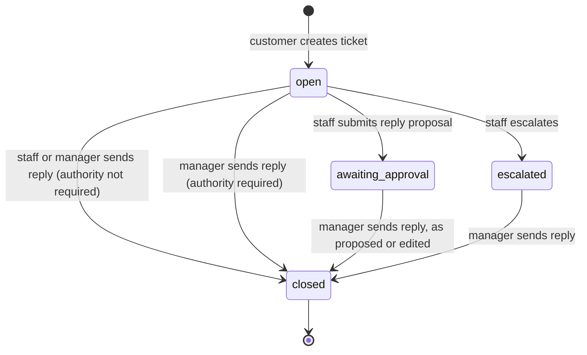
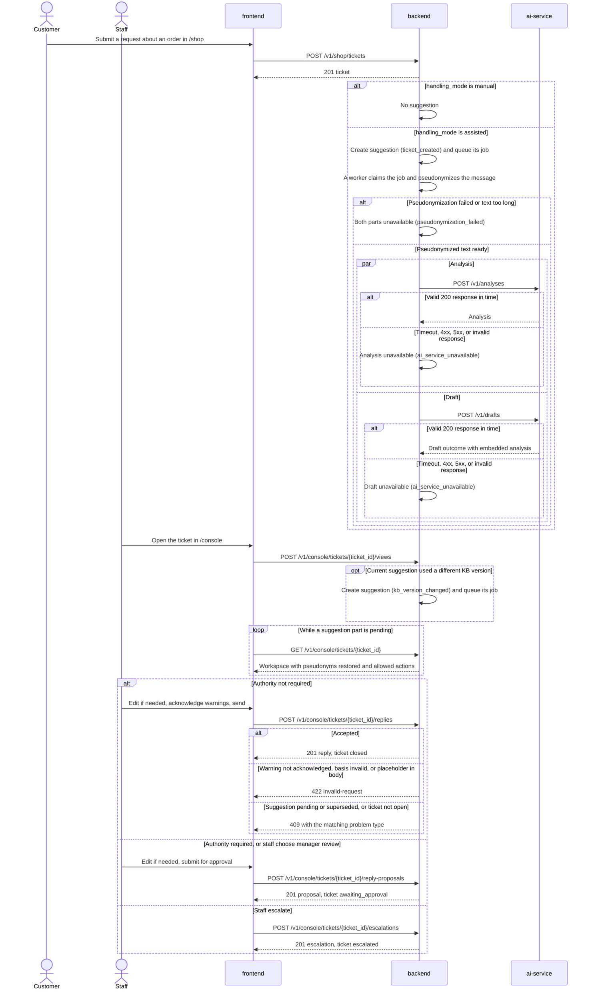
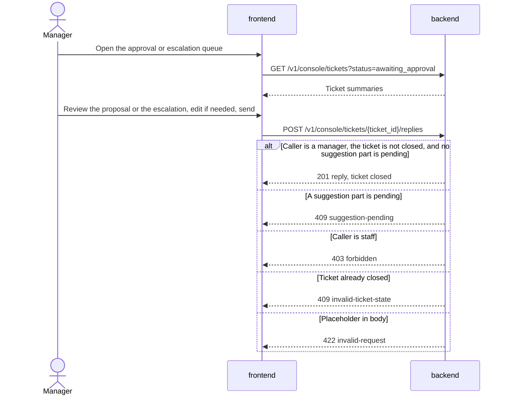
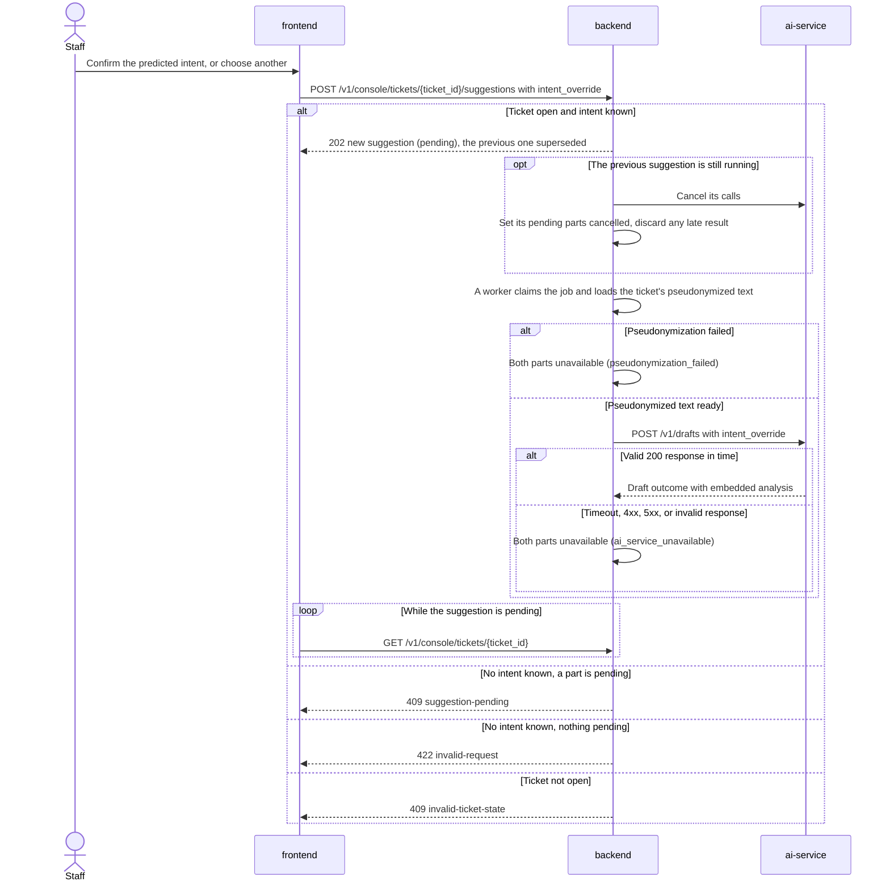
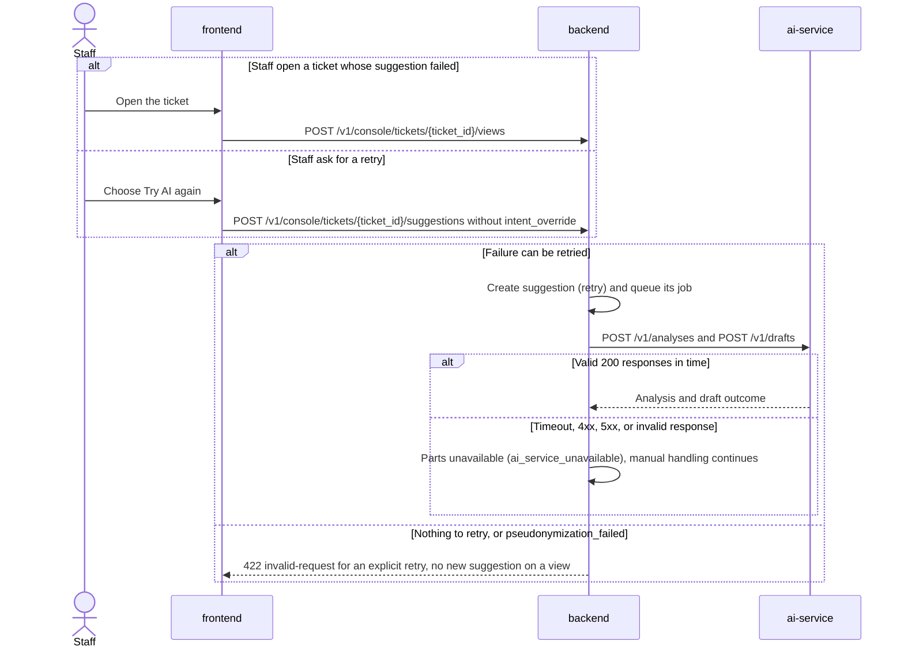

# Design: Contracts v1

- **Status:** In review
- **Owner:** contracts gatekeeper
- **Reviewers:** ML engineer, RAG engineer, backend engineer, frontend engineer
- **Last reviewed:** 2026-11-08
- **Related:** [Requirements](../product/requirements.md) (FR-01 to FR-11, ESC-01 to ESC-05), [ADR-0001](../decisions/0001-system-architecture.md), [ADR-0004](../decisions/0004-api-conventions.md), [ADR-0005](../decisions/0005-intent-independent-retrieval.md), [ADR-0006](../decisions/0006-staff-feedback-and-reason-codes.md), [ADR-0009](../decisions/0009-demo-accounts-and-cookie-sessions.md), [ADR-0010](../decisions/0010-pseudonymization-and-egress-control.md), [ADR-0011](../decisions/0011-deployment-and-runtime-topology.md), [ADR-0012](../decisions/0012-roles-v1.md), [ADR-0013](../decisions/0013-shop-demo-with-read-only-catalog.md), [ADR-0014](../decisions/0014-citations-to-order-context.md), [contract rules](../rules/contracts.md)

## Summary

This design defines version 1 of both API contracts (`frontend` ↔ `backend` and `backend` ↔ `ai-service`), the ticket lifecycle they serve, the simulated commerce data, the audit log, and the structure of the KB data contract. It is the first deliverable that lets the four work streams build in parallel against mocks.

The team agreed the product behavior:

- `backend` requests an AI suggestion when a ticket is created.
- A ticket holds one customer message and one reply.
- Tickets that require authority are prepared by staff and sent by a manager. Escalated tickets go to the manager queue.
- Personal data is pseudonymized before any text leaves `backend`.
- Sign-in follows ADR-0009, and roles follow ADR-0012.

**Revision 2 (2026-10-28, updated 2026-11-08).** Revision 1 was approved on 2026-10-24. Revision 2 aligns the design with the team's specification:

- four roles, including `manager` and `admin` ([ADR-0012](../decisions/0012-roles-v1.md));
- pseudonymization ([ADR-0010](../decisions/0010-pseudonymization-and-egress-control.md));
- the suggestion job queue and replicas ([ADR-0011](../decisions/0011-deployment-and-runtime-topology.md));
- the read-only catalog ([ADR-0013](../decisions/0013-shop-demo-with-read-only-catalog.md));
- reports for managers (FR-10) and the audit log (NFR-09);
- the release ID;
- the escalation rules ESC-01 to ESC-05;
- the update of 2026-11-01: a retry of failed suggestions, draft cancellation on an intent change, read-only staff access to tickets that are not open, and the customer's other orders in the workspace;
- the update of 2026-11-04: citations to the order context ([ADR-0014](../decisions/0014-citations-to-order-context.md)), and intent changes accepted only after an intent is known;
- the update of 2026-11-05: one pending rule for every role, responses from the ingress, shared `Citation` and `OrderContext` schemas, the shop's `order_id` filter on `listShopTickets`, the ticket status `replied`, the newest-first order of shop lists, the `account_id` of `getCurrentSession`, the data classes of commerce IDs, no `Idempotency-Key` on sign-out, and names that follow CON-18 (`start_at`, `end_at`, `handling_time_ms`, `mask_count_by_type`);
- the update of 2026-11-08, as `backend.openapi.yaml` 1.0.1 states: the problem type `idempotency-key-reused` also covers the same key with different path parameters; the ingress answers `502` or `504` also when a write in flight fails, and a retry with the same key then cannot repeat its effect; a product appears at most once in an order.

Revision 2 needs a new approval.

## Goals and non-goals

### Goals

- Every behavior in FR-01 to FR-11 that crosses a component boundary has a defined operation and schema.
- Every outcome has a schema and an example: success, abstention, escalation recommended, AI unavailable, invalid request, permission denied, invalid state.
- Guardrails are structural, not only procedural:
  - shop schemas have no field that can carry AI output;
  - only `backend` has an operation that sends a reply, and it requires a staff action and the right role;
  - once the AI flags a ticket as requiring authority, only a manager can send its reply;
  - no operation creates or changes products, orders, shipments, or refunds;
  - personal data is pseudonymized before any text crosses from `backend` to `ai-service`, a pseudonymization failure blocks the call, and no placeholder can reach a customer;
  - no admin operation can read customer data.
- Each component can be built and tested alone against mocks generated from the contracts.

### Non-goals

- Conversations with several messages per ticket.
- Production-grade authentication ([ADR-0009](../decisions/0009-demo-accounts-and-cookie-sessions.md) records the revisit).
- Admin features beyond accounts, roles, account status, and version display ([ADR-0012](../decisions/0012-roles-v1.md)).
- A cart, a checkout, or any operation that creates or changes orders ([ADR-0013](../decisions/0013-shop-demo-with-read-only-catalog.md)).
- Streaming or push updates. `frontend` polls.
- KB content. This design fixes the structure; content arrives with the approved KB files.
- Assigning tickets to individual staff members. All staff share one open queue.
- Staff creating tickets on behalf of customers. Tickets come from the shop and from the evaluation import.

## Background

- Requirements and the escalation rules: [requirements](../product/requirements.md#41-escalation-and-fallback-rules).
- Component responsibilities, data ownership, and boundary rules: [ADR-0001](../decisions/0001-system-architecture.md).
- Shop scope: [ADR-0013](../decisions/0013-shop-demo-with-read-only-catalog.md), which supersedes [ADR-0002](../decisions/0002-shop-demo-scope.md).
- API style, status codes, and headers: [ADR-0004](../decisions/0004-api-conventions.md) and the [contract rules](../rules/contracts.md).
- The AI pipeline behind `/v1/analyses` and `/v1/drafts`: [ADR-0005](../decisions/0005-intent-independent-retrieval.md).
- What is recorded for each staff decision: [ADR-0006](../decisions/0006-staff-feedback-and-reason-codes.md).
- Sign-in: [ADR-0009](../decisions/0009-demo-accounts-and-cookie-sessions.md). Roles: [ADR-0012](../decisions/0012-roles-v1.md).
- Pseudonymization and egress control: [ADR-0010](../decisions/0010-pseudonymization-and-egress-control.md).
- Replicas, the suggestion job queue, and deployment: [ADR-0011](../decisions/0011-deployment-and-runtime-topology.md).
- Citations to order data: [ADR-0014](../decisions/0014-citations-to-order-context.md).

## Design

### Components and responsibilities

| Component | Responsibilities added by this design |
|---|---|
| `frontend` | Calls only `backend`. Has three areas: `/shop` for customers, `/console` for staff and managers, and `/admin` for admins. Polls a ticket while its suggestion is pending. Shows only the actions listed in `allowed_actions`. Shows AI text exactly as `backend` returns it, and highlights any placeholder in it ([UI-43](../rules/ui.md#console-interaction)). |
| `backend` | Creates a suggestion when a ticket is created and runs it through the suggestion job queue. Pseudonymizes the message before calling `ai-service`, and restores pseudonyms for staff. Calls `/v1/analyses` and `/v1/drafts` in parallel. Stores every suggestion snapshot and writes the audit log. Enforces the ticket state machine, roles, object-level access, and the authority rule. Computes reports. Measures handling time. |
| `ai-service` | Serves `/v1/analyses` and `/v1/drafts` on pseudonymized text, without per-ticket state. Rejects LLM output that uses a placeholder absent from the prompt. Serves KB document versions, and the release ID with the versions of its loaded assets. Reaches the LLM provider only through the egress proxy. |

### Roles and permissions

The roles are `customer`, `staff`, `manager`, and `admin` ([ADR-0012](../decisions/0012-roles-v1.md), [SEC-15](../rules/security-and-privacy.md#authentication-and-authorization)). A manager is a staff member with authority for FR-06.

| Operation | `customer` | `staff` | `manager` | `admin` |
|---|---|---|---|---|
| Sign in, sign out, read the current session | Yes | Yes | Yes | Yes |
| Browse the product catalog | Yes | No | No | No |
| List and read their own orders | Yes | No | No | No |
| Create a ticket on one of their orders; read their own tickets and sent replies | Yes | No | No | No |
| List open tickets; read a ticket workspace in any state, including the customer's other orders; read a KB document version | No | Yes | Yes | No |
| List tickets awaiting approval, escalated, or closed | No | No | Yes | No |
| Confirm or correct the intent of an open ticket | No | Yes | Yes | No |
| Send a reply on an open ticket where authority is not required and no suggestion part is pending | No | Yes | Yes | No |
| Submit a reply proposal on an open ticket | No | Yes | No | No |
| Send a reply on a ticket that requires authority, awaits approval, or is escalated, when no suggestion part is pending | No | No | Yes | No |
| Escalate an open ticket | No | Yes | No | No |
| View reports | No | No | Yes | No |
| List `staff`, `manager`, and `admin` accounts; change a role between `staff` and `manager`; deactivate or reactivate one of those accounts | No | No | No | Yes |
| View the versions in use | No | No | No | Yes |

- Object-level access ([SEC-17](../rules/security-and-privacy.md#authentication-and-authorization)): a customer reaches only their own orders and tickets. A request for another customer's resource returns `404`, so its existence is not revealed.
- A role calling an operation it may not use gets `403 forbidden`. This includes staff listing tickets with a status other than `open`, staff sending a reply on an escalated ticket, and an admin calling any `/v1/shop/` or `/v1/console/` operation.
- Staff can read a ticket that is not `open` but cannot act on it: `allowed_actions` is empty for them. No operation searches orders or customers, so a customer's other orders are reachable only through a ticket of that customer.
- The limits on admin operations (no self-change, protection of the last active manager, allowed role changes) are defined in [Admin operations](#admin-operations).

### Authority rule (FR-06)

- A ticket has `is_authority_required`, a ticket-level property that `backend` sets to `true` when any suggestion of that ticket carries the reason code `requires_authority`, in its routing or in its draft outcome. `backend` sets it in the transaction that stores that result.
- `requires_authority` covers refund decisions, transaction disputes, policy exceptions, legal claims, and suspected fraud (ESC-03). The reason code `human_agent_requested` does not set the property.
- `ai-service` sets `requires_authority` from these signals, and each signal can only add it:
  - a sensitive intent, at least `request_refund`, with a significant probability in the intent distribution ([ADR-0005](../decisions/0005-intent-independent-retrieval.md), statement 5);
  - a term of the sensitive-term list, for legal claims and suspected fraud;
  - the LLM, if the `ai-service` pipeline design adopts this signal after measuring it.
- The property is never cleared in v1. Correcting the intent or re-running the suggestion cannot remove it. A sensitive intent chosen by staff sets it in the same way, because the override replaces the intent distribution. A choice that staff replace before its draft outcome arrives sets nothing, because staff withdrew it.
- While any part of the current suggestion is `pending`, staff cannot send a reply (`409 suggestion-pending`). This closes the gap where the flag is not yet known.
- Staff can correct the intent only when an intent is known: the analysis of the current suggestion is `ready`, or the current suggestion already carries an `intent_override`. Every signal of the model's analysis is therefore stored before any correction. A correction is allowed while a draft is generating: it cancels the draft call and starts a new draft ([Suggestion lifecycle](#suggestion-lifecycle)).
- Staff can always route a ticket to a manager themselves, with a reply proposal or an escalation.
- Tickets that the AI never flags (manual mode, AI unavailable, or a missed classification) rely on staff judgment ([ASM-04](../product/requirements.md#6-assumptions-and-constraints)). The guarantee is: every ticket the AI flags is sent by a manager. The manual-handling panel reminds staff to route refund decisions and disputes to a manager and offers Submit for approval, and a retry ([Suggestion lifecycle](#suggestion-lifecycle)) limits this case to the time the AI is down.

### Ticket lifecycle

| State | Meaning |
|---|---|
| `open` | Waiting for staff |
| `awaiting_approval` | Staff submitted a reply proposal; waiting for a manager |
| `escalated` | Staff escalated the ticket; waiting for a manager |
| `closed` | A reply was sent to the customer |

- An AI failure never changes the ticket state. The ticket stays `open` and is handled manually.
- A forbidden transition, for example sending a reply on a `closed` ticket, returns `409 invalid-ticket-state`. A repeated request with the same `Idempotency-Key` returns the original result instead.

**Handling mode.** Each ticket has `handling_mode`: `assisted` or `manual`. In `manual` mode, `backend` requests no suggestion and the console shows no AI output. Shop tickets use the default mode from settings. Tickets imported for the product-value study take their mode from the import file, as the study protocol decides.

**Handling time.** The clock starts at the first staff view (`recordTicketView`) and stops when the reply is sent. It is reported per mode (`supportiq.ticket.handling.duration`).

### Suggestion lifecycle

A suggestion is everything the AI produced for a ticket in one run, as recorded by `backend`: the request it sent, the analysis, the draft outcome, the release ID and asset versions, and the trace ID. It is created with one of four triggers:

| Trigger | When |
|---|---|
| `ticket_created` | A ticket is created in `assisted` mode |
| `intent_override` | Staff or a manager confirms the predicted intent or chooses another |
| `kb_version_changed` | On the first staff view, the current suggestion used a KB version different from the one `ai-service` has loaded |
| `retry` | The ticket is `open`, the current suggestion has a part `unavailable` with `ai_service_unavailable`, or a draft `llm_unavailable`, and staff open the ticket or ask for a retry |

Every suggestion of a ticket uses `as_of` = the ticket's `created_at`, the time the customer asked. The `ai-service` pipeline design confirms this choice.

A suggestion has two parts, each with its own status, because the two calls return at different times:

| Part | Statuses |
|---|---|
| Analysis | `pending`, `ready`, `unavailable`, `cancelled` |
| Draft | `pending`, `draft_ready`, `abstained`, `escalation_recommended`, `llm_unavailable`, `unavailable`, `cancelled` |

- `backend` sets both parts `unavailable` with the reason code `pseudonymization_failed` when pseudonymization fails or its output exceeds `PseudonymizedText`. `ai-service` is not called ([ADR-0010](../decisions/0010-pseudonymization-and-egress-control.md)).
- `backend` sets a part `unavailable` with the reason code `ai_service_unavailable` when `ai-service` is unreachable, times out, returns `5xx`, returns any `4xx`, or returns a response that does not match the contract. A `4xx` means `backend` sent a request `ai-service` rejected, which is a defect: it is logged at `error` level.
- The draft response embeds its own analysis. If the analysis call failed but the draft call succeeded, `backend` fills the analysis from the draft response.
- A new suggestion supersedes the previous one. The workspace shows only the current suggestion; every suggestion stays stored for provenance.
- If the superseded suggestion is still running, `backend` cancels its calls to `ai-service` and sets every part that is still `pending` to `cancelled`. `cancelled` is set only by `backend` and is never shown. Cancelling is best effort: a call that cannot be stopped finishes, and its result is discarded. The LLM usage of a cancelled call is not recorded, so cost figures can be slightly low.
- A failure with `pseudonymization_failed` is not retried, because pseudonymization is deterministic and fails the same way.
- **Low confidence (ESC-01).** When the draft outcome is `abstained` with `low_confidence`, there is no draft. Staff confirm the predicted intent or choose another. Both create a suggestion with `intent_override`, and its source is recorded as `staff`.

**Suggestion jobs.** Each suggestion has exactly one job in the suggestion job queue ([ADR-0011](../decisions/0011-deployment-and-runtime-topology.md#suggestion-job-queue)):

- A worker claims a job under a lease. An expired lease is claimed again, up to the maximum number of attempts.
- Results are stored only by the current attempt, and only while the suggestion is current.
- When the attempts run out, every part that is still `pending` becomes `unavailable` with `ai_service_unavailable`.
- There is no re-queue at startup: lease expiry recovers jobs from a crashed replica.

**Timeouts.** `backend` calls `ai-service` with two settings:

- `ai_service_analysis_timeout_ms`, initial value 3 000;
- `ai_service_draft_timeout_ms`, initial value 11 000.

The draft timeout keeps a suggestion within the p95 target of 12 s ([NFR-08](../product/requirements.md#5-quality-requirements)). Inside it, the LLM step of `ai-service` has a budget of at most 10 s, retries included (NFR-07). The job lease is longer than the draft timeout. Because end-to-end latency starts at ticket creation, the queue wait, claiming, pseudonymization, and the draft timeout together MUST fit within 12 s ([ADR-0011](../decisions/0011-deployment-and-runtime-topology.md#suggestion-job-queue), item 8). All values are tuned from measurements, and the `ai-service` pipeline design fits its step budgets inside them ([ERR-10](../rules/errors-and-reliability.md#timeouts-and-latency-budget)).

### Flows

#### Ticket creation and staff handling

1. The customer submits a request about one of their orders. `backend` creates the ticket and returns at once; the customer never waits for AI.
2. In `assisted` mode, `backend` creates a suggestion and queues its job. A worker claims the job and pseudonymizes the message. If that fails, both parts become `unavailable` and nothing is sent to `ai-service`.
3. The worker calls both `ai-service` endpoints in parallel, with the timeouts above. Each call either stores its result or marks its part `unavailable`. Neither failure changes the ticket state.
4. Staff open the ticket. `frontend` records the view, which starts the handling clock and may trigger a re-run if the KB version changed. `frontend` polls until no part is pending. `backend` restores pseudonyms in AI text on every read.
5. Staff send the reply, submit a proposal, or escalate, depending on `allowed_actions`. Invalid requests are rejected with a typed problem.

#### Manager handling

#### Intent confirmation and correction

With an override, `backend` calls only `/v1/drafts`, because its response carries the full analysis computed with the staff-chosen intent. An override equal to the predicted intent is a confirmation (ESC-01). The authority flag set by an earlier suggestion stays set.

#### Retry after an AI failure

A retry runs both endpoints, as for a new ticket, and reuses the stored pseudonym map. A pending retry blocks another one, so opening the ticket again creates no duplicate.

### Data and contracts

Both contracts are new at version `1.0.0`. No consumer exists yet, so there is no compatibility impact. Everything below follows the [contract rules](../rules/contracts.md).

#### Common elements

- **Headers:** `traceparent` on every request ([ADR-0004](../decisions/0004-api-conventions.md), decision 6). `Idempotency-Key` on every write except `createSession` and `deleteCurrentSession`.
- **Status codes:** as in [CON-11](../rules/contracts.md#api-conventions), including `202` for `createSuggestion` and `204` for operations without a response body.
- **Responses from the ingress:** `ingress` can answer `413` (body over its size limit) or `429` (rate limit) before `backend` sees the request, and `502` or `504` when `backend` is unreachable or a write in flight fails ([ADR-0011](../decisions/0011-deployment-and-runtime-topology.md)). These bodies are not Problem Details. After `502` or `504` the outcome of a write is unknown, and a retry with the same `Idempotency-Key` cannot repeat its effect ([ERR-15](../rules/errors-and-reliability.md#idempotency)). `frontend` treats all four as technical failures: a plain-language message, editor text kept, and automatic retries only as [TS-29](../rules/typescript.md#api-access) and [ERR-12](../rules/errors-and-reliability.md#retries) allow, so never for `sendReply` and never after `413`.
- **Errors:** Problem Details with a `trace_id` extension member. Problem types:

| Type (`urn:supportiq:problem:` + name) | Status | Meaning |
|---|---|---|
| `invalid-request` | `400`, `422` | Malformed body, or a body that breaks a documented rule |
| `unauthenticated` | `401` | No valid session |
| `forbidden` | `403` | The role may not perform the operation, or the `Origin` check failed |
| `authority-required` | `403` | Staff tried to send a reply on a ticket where authority is required |
| `not-found` | `404` | The resource does not exist, or the caller may not know about it |
| `invalid-ticket-state` | `409` | The operation is not allowed in the ticket's current state |
| `suggestion-pending` | `409` | A part of the current suggestion is still pending |
| `suggestion-superseded` | `409` | The request refers to a suggestion that is no longer current |
| `idempotency-key-reused` | `409` | The key was used before with a different body or different path parameters |
| `not-ready` | `503` | The component is not ready, for example assets not loaded |
| `internal-error` | `500` | Unexpected failure |

- **Shared schemas** in `contracts/schemas/`, referenced by both OpenAPI files so they never diverge. Contract PR 2 adds `MessageText`, `Money`, `Timestamp`, `ProblemDetails` (with the problem types that the `backend` contract uses), `OrderStatus`, `ShipmentStatus`, and `RefundStatus`; contract PR 1 adds the others:
  - `MessageText`: customer message and reply text, 1 to 2 000 characters.
  - `Timestamp`: an RFC 3339 time in UTC ([CON-17](../rules/contracts.md#api-conventions)).
  - `OrderStatus`, `ShipmentStatus`, `RefundStatus`: the status enums of `OrderContext`, also used by the shop view models.
  - `IntentLabel`: the 46 labels.
  - `ConfidenceBand`: `high`, `medium`, `low`.
  - `AiReasonCode`.
  - `DocumentValidity`: `valid`, `expired`, `conflicting`.
  - `Citation` (both variants, never with a `value`), `RankedDocument`, `DraftSegment`, `Warning`.
  - `OrderContext` and `OrderContextField`, the closed enum of its field names.
  - `AssetVersions`: `release_id` and the version of each asset.
  - `Placeholder`: the placeholder syntax of [ADR-0010](../decisions/0010-pseudonymization-and-egress-control.md#placeholder-syntax). Both contracts use it to describe AI text and the rule that a reply body contains no placeholder.
  - `Money`: `amount_minor`, `currency`.
  - `ProblemDetails`.
- All other `backend` schemas are its own view models, so `frontend` does not depend on the `ai-service` contract.

#### Reason codes

`AiReasonCode` values in v1. The **ESC rule** column maps each code to the escalation rule it refines ([requirements §4.1](../product/requirements.md#41-escalation-and-fallback-rules)).

| Code | Meaning | ESC rule |
|---|---|---|
| `low_confidence` | The top intent probability is below τ, or the gap between the top two probabilities is below δ | ESC-01 |
| `signal_disagreement` | The predicted intent and the top documents point to different topics | None: a warning ([ADR-0005](../decisions/0005-intent-independent-retrieval.md), statement 4) |
| `out_of_scope_intent` | The intent is outside the 12 in-scope intents | ESC-02 |
| `human_agent_requested` | The intent is `human_agent` | ESC-03 |
| `requires_authority` | A refund decision, a transaction dispute, a policy exception, a legal claim, or suspected fraud (FR-06) | ESC-03 |
| `no_valid_document` | No document in effect at `as_of` supports the request | ESC-04 |
| `only_expired_documents` | Relevant documents exist, but none is in effect at `as_of` | ESC-04 |
| `conflicting_sources` | Two valid versions with the same policy key disagree | ESC-04 |
| `missing_information` | The request needs information that is in neither the message nor the order context | ESC-04 |
| `source_review_overdue` | A cited document version is past its review deadline under the KB freshness rules | ESC-04 (`STALE`), as a warning |
| `grounding_failed` | The draft made claims its sources do not support | ESC-05: the LLM output is unusable |
| `llm_unavailable` | LLM timeout, error, rate limit, refused egress, or open circuit breaker | ESC-05 |
| `llm_invalid_output` | The LLM output failed schema validation, or it contained a placeholder that was not in the prompt | ESC-05 |
| `budget_exceeded` | The latency budget ran out before drafting | ESC-05 |
| `ai_service_unavailable` | Set only by `backend`: `ai-service` unreachable, timed out, returned `4xx` or `5xx`, returned an invalid response, or the job ran out of attempts | ESC-05 |
| `pseudonymization_failed` | Set only by `backend`: pseudonymization failed or produced text longer than `PseudonymizedText` allows; `ai-service` was not called | ESC-05 |

Which codes lead to a draft, an abstention, or an escalation recommendation is defined in the `ai-service` pipeline design doc. That design MUST follow the escalation rules, in particular:

- `low_confidence` never produces a draft;
- after an intent override, `low_confidence` is never set, because the staff-chosen intent replaces the distribution ([ADR-0005](../decisions/0005-intent-independent-retrieval.md), statement 7), so confirming an intent always leads past ESC-01;
- `signal_disagreement` is a warning, not a reason to abstain. It lowers the confidence ([ADR-0005](../decisions/0005-intent-independent-retrieval.md), statement 4), which can then fall below τ and set `low_confidence`;
- `out_of_scope_intent` never produces a detailed draft;
- `human_agent_requested` produces `escalation_recommended` without `requires_authority`;
- `requires_authority` never prevents retrieval, and any draft that carries it contains supporting information only;
- `source_review_overdue` is only a warning and never causes an abstention. It is raised only for document versions whose source provides `last_reviewed_at` ([KB data contract](#kb-data-contract-contractskb-contractmd)).

The reason code `requires_authority` is the only source of the authority flag; no separate boolean is sent.

A `Warning` is a condition that allows a draft but needs staff attention: a `warning_id` (unique within its suggestion) and an `AiReasonCode`.

Staff use the `StaffReasonCode` values from [ADR-0006](../decisions/0006-staff-feedback-and-reason-codes.md) for rejections, edits, and escalations.

#### `ai-service` contract (`ai-service.openapi.yaml`)

| Operation ID | Method and path | Purpose |
|---|---|---|
| `createAnalysis` | `POST /v1/analyses` | Run the pipeline up to routing, without the LLM |
| `createDraft` | `POST /v1/drafts` | Run the whole pipeline |
| `getKbDocumentVersion` | `GET /v1/kb-documents/{document_id}/versions/{version}` | Full text of one document version, for the citation view |
| `getAssetVersions` | `GET /v1/asset-versions` | The `release_id` and the versions of the loaded model, KB, document-to-intent mapping, prompts, routing configuration, and retrieval index ([DATA-56](../rules/data-and-ml.md#models-and-artifacts)) |
| — | `GET /health/live`, `GET /health/ready` | Liveness and readiness ([ERR-18](../rules/errors-and-reliability.md#startup-and-health)) |

`SuggestionRequest`, the body of both `createAnalysis` and `createDraft`:

| Field | Type | Required | Data class | Meaning |
|---|---|---|---|---|
| `message` | `PseudonymizedText` | Yes | Confidential | The customer's message after pseudonymization ([ADR-0010](../decisions/0010-pseudonymization-and-egress-control.md)) |
| `order_context` | `OrderContext` | No | Confidential | Allow-listed order fields; absent when the ticket has no order (imported tickets) |
| `as_of` | timestamp | Yes | Internal | Point in time for document validity: the ticket's `created_at` |
| `kb_version` | string | No | Internal | KB version to use; absent means the loaded version. An unknown version returns `422` |
| `intent_override` | `IntentLabel` | No | Internal | Intent chosen or confirmed by staff |

- `PseudonymizedText` is defined in the `ai-service` contract: 1 to 4 000 characters, which may contain pseudonyms in the `Placeholder` syntax.
- The request carries no ticket ID, no customer identity, and no staff identity, and its personal data is pseudonymized ([SEC-04](../rules/security-and-privacy.md#data-sent-to-llm-providers)). A value that every detector misses can remain ([ADR-0010](../decisions/0010-pseudonymization-and-egress-control.md#detection)). Requests are correlated by trace context.
- All AI text in responses (draft segment `text`, `staff_note`) MAY contain only placeholders that appear in the prompt: the pseudonyms of the request's `message` and the masks that `ai-service` applied. `ai-service` enforces this before responding.

`OrderContext`, the allow-list and a shared schema. Every field is optional; absence means not applicable or unknown. It contains no identifiers and no address.

| Field | Type |
|---|---|
| `order_status` | `placed`, `processing`, `shipped`, `delivered`, `cancelled` |
| `placed_at` | timestamp |
| `order_total`, `shipping_cost` | `Money` |
| `shipment_status` | `not_shipped`, `in_transit`, `delivered`, `delayed`, `lost` |
| `estimated_delivery_at`, `delivered_at` | timestamp |
| `refund_status` | `requested`, `under_review`, `approved`, `rejected`, `paid` |
| `refund_amount` | `Money` |
| `refund_requested_at` | timestamp |

`Analysis`, the `200` body of `createAnalysis`:

| Field | Meaning |
|---|---|
| `intent` | Predicted intent: `label`, calibrated `probability`, `confidence_band`, `source` (`model` or `staff`) |
| `alternatives` | Up to four next most likely intents with probabilities. The console shows the top three candidates (FR-01) |
| `is_in_scope` | Whether the intent is one of the 12 in-scope intents |
| `documents` | Ranked `RankedDocument` items: ID, version, title, policy key, effective period, `validity`, rank, snippet |
| `routing` | `recommendation` (`draft`, `abstain`, `escalate`) and `reason_codes` |
| `warnings` | `Warning` items |
| `versions` | `AssetVersions`, including `release_id` |
| `step_latency_ms` | Latency of each step and the total |

`DraftOutcome`, the `200` body of `createDraft`, is a union discriminated by `status`, so a draft exists only when it is ready ([CODE-29](../rules/code.md#types-and-data)):

| `status` | Extra fields |
|---|---|
| `draft_ready` | `draft`: `segments` (each with `segment_id`, `paragraph_index`, `text`, `citation_ids`) and `citations` |
| `abstained`, `escalation_recommended`, `llm_unavailable` | No `draft` |

`paragraph_index` is required: an integer that starts at 0 and never decreases from one segment to the next. Segments with the same index form one paragraph.

`Citation`, a shared schema, is a union discriminated by `source_type` ([ADR-0014](../decisions/0014-citations-to-order-context.md)):

| `source_type` | Fields | Supports |
|---|---|---|
| `kb_document` | `citation_id`, `document_id`, `version`, `snippet` | A policy, an eligibility, or a conclusion |
| `order_context` | `citation_id`, `field` (`OrderContextField`, a closed enum of the `OrderContext` field names) | A fact held in that field. It is never evidence for a policy or for routing |

An `order_context` citation carries the field name and never its value, so no personal value leaves `ai-service`.

Every variant also carries `reason_codes`, the embedded `analysis`, an optional `staff_note`, `versions`, `step_latency_ms`, `mask_count_by_type` (the number of masks applied, by type; Internal), and `llm_usage` (input tokens, output tokens, cost in micro-USD) when the LLM was called.

#### `backend` contract (`backend.openapi.yaml`)

Three audience namespaces keep the guardrails structural:

- `/v1/shop/` serves `customer` and has no schema that can hold AI output.
- `/v1/console/` serves `staff` and `manager`.
- `/v1/admin/` serves `admin` and has no schema that can hold tickets, messages, orders, or reports.

| Operation ID | Method and path | Roles | Result |
|---|---|---|---|
| `createSession` | `POST /v1/sessions` | Anyone | `201` session view and cookie ([ADR-0009](../decisions/0009-demo-accounts-and-cookie-sessions.md)) |
| `getCurrentSession` | `GET /v1/sessions/current` | Signed in | `account_id` (the same identifier that `listAdminAccounts` returns), display name, role |
| `deleteCurrentSession` | `DELETE /v1/sessions/current` | Signed in | `204` |
| `listShopProducts` | `GET /v1/shop/products` | customer | Catalog products, paginated |
| `getShopProduct` | `GET /v1/shop/products/{product_id}` | customer | One catalog product |
| `listShopOrders` | `GET /v1/shop/orders` | customer | Own orders, paginated |
| `getShopOrder` | `GET /v1/shop/orders/{order_id}` | customer | Own order with lines, shipment, and refund |
| `createShopTicket` | `POST /v1/shop/tickets` | customer | `201` shop ticket view |
| `listShopTickets` | `GET /v1/shop/tickets` | customer | Own tickets, paginated, optionally for one order |
| `getShopTicket` | `GET /v1/shop/tickets/{ticket_id}` | customer | Shop ticket view |
| `listConsoleTickets` | `GET /v1/console/tickets` | staff (`open` only), manager | Ticket summaries filtered by `status`, paginated |
| `getConsoleTicket` | `GET /v1/console/tickets/{ticket_id}` | staff, manager | Ticket workspace |
| `recordTicketView` | `POST /v1/console/tickets/{ticket_id}/views` | staff, manager | `204`; the first view starts the handling clock |
| `createSuggestion` | `POST /v1/console/tickets/{ticket_id}/suggestions` | staff, manager | `202` pending suggestion, with an intent override or as a retry |
| `createReplyProposal` | `POST /v1/console/tickets/{ticket_id}/reply-proposals` | staff | `201` proposal; ticket `awaiting_approval` |
| `sendReply` | `POST /v1/console/tickets/{ticket_id}/replies` | staff, manager | `201` reply; ticket `closed` |
| `createEscalation` | `POST /v1/console/tickets/{ticket_id}/escalations` | staff | `201` escalation; ticket `escalated` |
| `getKbDocumentVersion` | `GET /v1/console/kb-documents/{document_id}/versions/{version}` | staff, manager | Full document version, proxied from `ai-service` |
| `getConsoleReport` | `GET /v1/console/reports` | manager | Report for a period ([Reports](#reports-fr-10)) |
| `listAdminAccounts` | `GET /v1/admin/accounts` | admin | Accounts, paginated |
| `changeAccountRole` | `POST /v1/admin/accounts/{account_id}/role-changes` | admin | `201` role change |
| `changeAccountStatus` | `POST /v1/admin/accounts/{account_id}/status-changes` | admin | `201` status change |
| `getAdminVersions` | `GET /v1/admin/versions` | admin | Versions in use |
| `checkLiveness`, `checkReadiness` | `GET /health/live`, `GET /health/ready` | Anyone | Liveness and readiness |

`createShopTicket` takes `order_id` (required, one of the caller's orders, as [ADR-0013](../decisions/0013-shop-demo-with-read-only-catalog.md) attaches the support form to an order) and `message` (`MessageText`). Tickets imported for evaluation may have no order; they are created by a `backend` import command, not through the shop.

`listShopTickets` takes an optional `order_id` query parameter. It must name one of the caller's orders; otherwise it returns `404 not-found`. The shop's order page uses it ([shop UI design](shop-ui.md)). `listShopOrders` and `listShopTickets` return items newest first, by `placed_at` and `created_at`.

`createSuggestion` takes an optional `intent_override`. With it, the request corrects or confirms the intent, also while a draft is generating. When no intent is known ([Authority rule](#authority-rule-fr-06)), it returns `409 suggestion-pending` while a part is `pending`, and `422 invalid-request` otherwise. Without it, the request is a retry, valid only when `retry_suggestion` is allowed; otherwise it returns `422 invalid-request`.

Shop view models:

- `ShopProductView`: product ID, name, description, category, price.
- `ShopOrderView`: order ID, status, `placed_at`, totals, lines (product ID, product name, quantity), shipment, and refund. It has no shipping address field, because the shop has no screen that needs it.
- `ShopTicketView`: ticket ID, order ID, the customer's message, `created_at`, `customer_status` (`received` or `replied`), and `reply` (body and `sent_at`) only after a reply is sent. It has no state, suggestion, proposal, or escalation fields.

`TicketSummary`, the items of `listConsoleTickets`:

- `ticket_id`, `created_at`, `status`, `handling_mode`, `is_authority_required`;
- `handling_started_at`, absent until the first staff view, so the inbox shows that someone already opened the ticket;
- `customer.display_name` and an excerpt of the customer's message;
- the draft status of the current suggestion, absent in `manual` mode;
- the predicted intent with its confidence band and probability, absent when there is no analysis.

The excerpt length and the sort parameter are set in the contract change that adds the console operations.

`TicketWorkspace`, the body of `getConsoleTicket`:

| Field | Meaning |
|---|---|
| `ticket_id`, `status`, `handling_mode` | Identity, lifecycle state, assisted or manual |
| `is_authority_required` | The sticky authority flag ([Authority rule](#authority-rule-fr-06)) |
| `created_at`, `handling_started_at`, `closed_at` | Timestamps; the last two are absent until they happen |
| `customer` | `display_name` only |
| `message` | The customer's message, as written, and its `created_at` |
| `order` | Order lines, shipment, refund, and shipping address; absent when the ticket has no order |
| `other_orders` | The customer's other orders, newest first: order ID, status, shipment status, refund status, `placed_at`, total, and lines. No shipping address. Absent when there are none, and never sent to `ai-service` |
| `suggestion` | The current suggestion; absent in `manual` mode |
| `proposal` | The reply proposal, when one was submitted |
| `escalation` | Staff reason codes, note, who escalated, and when, when escalated |
| `reply` | The sent reply, who sent it, and when, when closed |
| `allowed_actions` | Subset of `send_reply`, `submit_reply_proposal`, `escalate`, `correct_intent`, `retry_suggestion`, computed by `backend` for the caller. `correct_intent` appears only when an intent is known. Empty when staff read a ticket that is not `open` |

`SuggestionView`: suggestion ID, trigger, `intent_override` when staff chose an intent, `created_at`, `analysis_status` with the analysis when ready, `draft_status` with the draft when `draft_ready` (a union discriminated by `draft_status`), draft `reason_codes`, `warnings`, `staff_note`, `versions` (including `release_id`), `step_latency_ms`, and `trace_id`. Pseudonyms in draft segments and the staff note are restored to their original values. Masks and pseudonyms missing from the map stay as written. Citations use the view model `CitationView`, which references the shared variants: a `kb_document` citation as it is, and an `order_context` citation extended with `value`, typed as that field is in `OrderContext`. `backend` takes it from the stored request of that suggestion, so staff see what the draft was written from.

The draft in `SuggestionView` also carries `text`: the canonical plain-text body, built by `backend` from the restored segments with one rule:

- segments with the same `paragraph_index` are joined by one space;
- paragraphs are joined by one blank line (`\n\n`).

The reply editor starts from `text`, and decision derivation compares the sent body against the same value. No other component joins segments.

`sendReply` and `createReplyProposal` take a body discriminated by `basis`, so each case carries exactly the fields it needs:

| `basis` | Required fields | Optional fields | Valid when | Allowed in |
|---|---|---|---|---|
| `ai_draft` | `body`, `suggestion_id`, `acknowledged_warning_ids` (every warning of that suggestion) | `staff_reason_codes`, `note` | The suggestion is current and its draft is `draft_ready` | Both |
| `rejected_ai_draft` | `body`, `suggestion_id`, `staff_reason_codes` (at least one) | `note` | The suggestion is current and its draft is `draft_ready` | Both |
| `no_ai_draft` | `body` | `suggestion_id` | No current draft is `draft_ready`, or the ticket is in `manual` mode | Both |
| `reply_proposal` | `body`, `proposal_id` | — | The ticket is `awaiting_approval` with that proposal | `sendReply` by a manager |

- `note` is required when `staff_reason_codes` contains `other`.
- `body` MUST NOT contain any text that matches the `Placeholder` syntax ([ADR-0010](../decisions/0010-pseudonymization-and-egress-control.md#restoring-and-sending)).
- A body whose basis is not valid for the ticket, or that contains a placeholder, returns `422 invalid-request`. A `suggestion_id` that is not current returns `409 suggestion-superseded`.

`createEscalation` takes `staff_reason_codes` (at least one, as [ADR-0006](../decisions/0006-staff-feedback-and-reason-codes.md) requires), `note` (required with `other`), and optional `suggestion_id`.

**Recorded decision** ([ADR-0006](../decisions/0006-staff-feedback-and-reason-codes.md)). When a reply is sent, `backend` records one decision about the AI draft. It compares the draft's canonical `text` (pseudonyms restored) with the body actually sent. Both are compared after line endings are normalized to `\n` and leading and trailing whitespace is trimmed:

| Basis of the reply (or of the proposal it came from) | Decision |
|---|---|
| `ai_draft`, final body equal to the draft's `text` | `approve` |
| `ai_draft`, final body different | `edit`, with the amount of change |
| `rejected_ai_draft` | `reject` |
| `no_ai_draft` | No draft decision; the reply and the suggestion (if any) are recorded |

An escalation records `escalate`. For a reply proposal, the record keeps both the staff member who proposed and the manager who sent, and whether the manager changed the proposed body.

#### Reports (FR-10)

`getConsoleReport` takes the query parameters `start_at` and `end_at` (timestamps, required, `start_at` earlier than `end_at`; otherwise `422 invalid-request`). `backend` computes the report on request from its own records: the audit log, suggestions, and decisions. It never uses telemetry ([LOG-33](../rules/logging-and-observability.md#alerts-and-retention)). The report contains only aggregates, so it is Internal data.

| Field | Meaning |
|---|---|
| `period` | `start_at` and `end_at` |
| `ticket_counts` | Tickets created and tickets closed in the period, by handling mode |
| `draft_decisions` | Counts and shares of `approve`, `edit`, and `reject` among replies sent in the period from a `draft_ready` draft |
| `escalations` | Escalations in the period, by staff reason code |
| `ai_outcomes` | Suggestions completed in the period, by draft status and by AI reason code, without `cancelled` drafts |
| `end_to_end_latency_ms` | p50 and p95, from ticket creation until the draft part of the ticket's first suggestion left `pending` ([NFR-08](../product/requirements.md#5-quality-requirements)) |
| `suggestion_latency_ms` | p50 and p95 per part, from suggestion creation until the part left `pending` |
| `ai_error_rate` | Share of suggestions with a part `unavailable` or a draft `llm_unavailable` |
| `llm_cost_micro_usd` | Total, and average per suggestion that called the LLM |
| `handling_time_ms` | p50 by handling mode (NFR-11) |

Infrastructure cost (NFR-10) is reported from AWS billing, not from this report.

#### Admin operations

| Operation | Body or result | Rules ([ADR-0012](../decisions/0012-roles-v1.md)) |
|---|---|---|
| `listAdminAccounts` | Items for `staff`, `manager`, and `admin` accounts only: `account_id`, `display_name`, `role`, `is_active` | Customer accounts are never listed. No emails, password hashes, or session data |
| `changeAccountRole` | Body: `role` (`staff` or `manager`) | Only on a `staff` or `manager` account, and only between those two roles. Not on the caller. Not when it would leave no active manager |
| `changeAccountStatus` | Body: `is_active` | Only on a `staff`, `manager`, or `admin` account. Not on the caller. Not when it would leave no active manager |
| `getAdminVersions` | `release_id` and asset versions from `ai-service`, the `backend` build version, and `ai_service_status` (`available` or `unavailable`) | Returns `200` with `ai_service_status: unavailable` when `ai-service` cannot be reached |

- A request that breaks a rule returns `422 invalid-request`. A request about a customer account returns `404 not-found`, as if the account did not exist.
- On 2026-11-05 the project lead decided that the `422` body of `changeAccountRole` and `changeAccountStatus` carries the extension member `violated_rule`, an enum: `own_account`, `admin_role_unchangeable`, `role_unchanged`, `status_unchanged`, or `last_active_manager`. It is present exactly when a well-formed request is refused under the admin limits 3 to 5 of [ADR-0012](../decisions/0012-roles-v1.md) or because the value is unchanged, and absent when the request fails validation against the contract ([CON-08](../rules/contracts.md#openapi-style)). When several reasons apply, it holds the first value of that list. Consumers map an unknown value to a generic refusal ([CON-22](../rules/contracts.md#evolution)). The shared `ProblemDetails` does not change.
- A role change or a deactivation deletes all sessions of the account in the same transaction.
- Every successful admin change writes one audit log entry.

#### Simulated commerce data (owned by `backend`)

| Entity | Fields | Data class |
|---|---|---|
| Customer | `customer_id`, `display_name`, `email` (synthetic), `phone` (synthetic) | Confidential, except `customer_id` (Internal) |
| Product | `product_id`, `name`, `description`, `category`, `price` | Public |
| Order | `order_id`, `customer_id`, `order_status`, `placed_at`, `order_total`, `shipping_cost`, `shipping_address` (synthetic), `transaction_id`, lines (`product_id`, `quantity`; a product appears at most once in an order) | Confidential, except `customer_id` (Internal) |
| Shipment | `shipment_id`, `order_id`, `shipment_status`, `tracking_code`, `estimated_delivery_at`, `delivered_at` | Confidential, except `shipment_id` (Internal) |
| Refund | `refund_id`, `order_id`, `refund_status`, `refund_amount`, `refund_requested_at`, `updated_at` | Confidential, except `refund_id` (Internal) |

- The data is produced by a deterministic, versioned seed script ([DATA-04](../rules/data-and-ml.md#sources-and-acceptable-use)) and read through the `CommerceGateway` port. No operation writes it.
- On 2026-11-05 the project lead decided that contract PR 2 uses this `synthetic-dev-only` model, with the status enums of `OrderContext`. Adopting the shared commerce data of groups 2 and 5 is a separate contract change ([Open questions](#open-questions)).
- Order IDs, tracking codes, and transaction IDs each follow one documented format, so that pseudonymization can detect them in free text ([ADR-0010](../decisions/0010-pseudonymization-and-egress-control.md#detection)).
- `phone` and `shipping_address` exist so that pseudonymization can detect known values and the NFR-06 suite can seed them.

#### Audit log

`backend` writes one audit log entry for each event below, in the same database transaction as the change it records.

| Event type | Recorded data |
|---|---|
| `message.pseudonymized` | Ticket ID, outcome, number of pseudonyms by type (never the values) |
| `suggestion.part_completed` | Suggestion ID, part, status, reason codes, `release_id` and asset versions, latency, LLM usage, masks applied by type |
| `intent.overridden` | Suggestion ID, chosen intent, previously predicted intent, actor |
| `reply_proposal.submitted` | Proposal ID, actor |
| `reply.sent` | Reply ID, basis, actor, proposer when there is one |
| `decision.recorded` | Decision type, staff reason codes, amount of change, suggestion ID, actor |
| `ticket.escalated` | Staff reason codes, suggestion ID when given, actor |
| `account.role_changed` | Target account, old role, new role, actor |
| `account.status_changed` | Target account, old and new `is_active`, actor |

- Every entry has an entry ID, `occurred_at`, the event type, the actor's account ID (absent for system events), the ticket ID when relevant, and the trace ID.
- Entries hold identifiers, statuses, reason codes, versions, and numbers only. Texts (messages, drafts, replies, notes) stay in their own records, which are never updated after creation.
- The audit log is insert-only. The database role that `backend` uses has no `UPDATE` or `DELETE` privilege on it, and a trigger rejects both. Only the reset script, which runs as the database owner, removes entries ([SEC-39](../rules/security-and-privacy.md#audit-log)).

#### KB data contract (`contracts/kb-contract.md`)

This design fixes the structure; the contract is completed when the approved KB files arrive.

| Element | Content |
|---|---|
| Document version | Document ID, version, title, body, policy key, `effective_from`, `effective_to` (absent means open-ended), source, owner, checksum, and `last_reviewed_at` when the source provides it ([DATA-16](../rules/data-and-ml.md#knowledge-base)) |
| KB version manifest | `kb_version`, the document versions it contains with checksums, creation date, source reference |
| Document-to-intent mapping | Separate file: `mapping_version`, `kb_version`, and for each document ID its list of `IntentLabel` values ([ADR-0005](../decisions/0005-intent-independent-retrieval.md)) |
| Freshness | For each policy area: the maximum time between reviews, the owner who reviews, and the interim action when a review is overdue. Overdue documents stay usable, and each draft citing them carries the warning `source_review_overdue`. The warning needs `last_reviewed_at` from the source. Documents without it get no freshness warning and are listed in the ingestion report; the value is never invented ([DATA-13](../rules/data-and-ml.md#validation-at-every-boundary)) |
| Violations | Who checks each rule (the ingestion script for structure, the policy owner for content), and who acts on a failure (the RAG engineer quarantines, the policy owner corrects) |
| Ingestion | Source files stay unchanged under `data/raw/kb/<kb_version>/`. A script maps them to the canonical form and validates them ([DATA-12](../rules/data-and-ml.md#validation-at-every-boundary)) |

Values missing from the source files are never invented. A document without a required field is quarantined and reported to the policy owner ([DATA-13](../rules/data-and-ml.md#validation-at-every-boundary)). The release manifest names the KB version and the mapping version that `ai-service` serves ([DATA-56](../rules/data-and-ml.md#models-and-artifacts)).

### Errors and guardrails

| Failure or risk | Behavior | Test |
|---|---|---|
| `ai-service` times out, is unreachable, or returns `5xx` on the analysis call | Analysis `unavailable` with `ai_service_unavailable`; ticket stays `open` for manual handling | Use-case test with a fake client that times out; consumer contract test |
| Same failure on the draft call | Draft `unavailable`; the analysis is still shown when ready | Use-case test; consumer contract test |
| `ai-service` returns a documented `4xx` | Part `unavailable` with `ai_service_unavailable`; logged at `error` as a defect | Use-case test with a fake client returning `422` |
| `ai-service` returns an unknown status or reason code | Treated as unavailable or as an unspecified reason ([CON-22](../rules/contracts.md#evolution)) | Consumer test with a mock returning unknown values |
| LLM fails inside `ai-service`, or the egress proxy refuses the host | Draft `llm_unavailable`; analysis present | Provider contract test with the LLM adapter faked to fail |
| Pseudonymization fails, or its output exceeds 4 000 characters | No call to `ai-service`; both parts `unavailable` with `pseudonymization_failed`; ticket stays `open` | Use-case test with a failing fake pseudonymizer that asserts no call was made |
| A personal value of the ticket appears in a request to `ai-service` | A defect: known values and detected values never leave `backend` | Guardrail test over every request the fake `ai-service` client receives (NFR-06) |
| A detector misses an unknown name or address in a message | The value reaches `ai-service`; the second layer masks only patterns. Every miss counts against NFR-06 and is reported | NFR-06 suite with messages that name third persons |
| A customer asks about another customer's order | Nothing about that order is available: the ticket holds the caller's order, `other_orders` holds only the same customer's orders, and `ai-service` receives only the ticket's order context | NFR-06 attack scenario; permission test |
| The LLM output contains a placeholder that was not in the prompt | No draft; `llm_invalid_output` | `ai-service` provider test with a fake LLM |
| A draft cites an order field that is absent from the request's `order_context`, states a value that differs from that field, or supports a policy only with an order citation | No draft; `grounding_failed` | `ai-service` provider test with a fake LLM; guardrail test (TEST-26) |
| Stored AI text contains a pseudonym missing from the map | Shown as written and highlighted; logged at `error` as a defect | Use-case test |
| A reply or proposal body contains a placeholder | `422 invalid-request` | Handler test |
| Staff send a reply on a ticket where authority is required | `403 authority-required` | Guardrail test (TEST-26) |
| Staff correct the intent on a flagged ticket, then try to send | The flag stays set: `409 suggestion-pending` while pending, `403 authority-required` after | Guardrail test (TEST-26) |
| Staff correct the intent when no intent is known and a part is `pending` | `409 suggestion-pending`; no new suggestion | Guardrail test (TEST-26) |
| Staff correct the intent when no intent is known and nothing is `pending` | `422 invalid-request`; staff use a retry when one is allowed, otherwise manual handling | Handler test |
| Staff correct the intent while a draft is generating | The draft call is cancelled, a new suggestion starts, and the flag stays set | Use-case test |
| A call is still running when its suggestion is superseded | Pending parts `cancelled`; a late result is discarded | Use-case test |
| A retry while `ai-service` is still failing | The new suggestion ends `unavailable`; manual handling continues | Use-case test |
| A retry with nothing to retry, or after `pseudonymization_failed` | `422 invalid-request` | Handler test |
| Staff send while a suggestion part is pending | `409 suggestion-pending` | Handler test |
| Reply from an AI draft without acknowledging every warning | `422 invalid-request` | Handler test |
| Reply with `no_ai_draft` while a current draft is `draft_ready` | `422 invalid-request` | Handler test |
| Reply or proposal refers to a superseded suggestion | `409 suggestion-superseded` | Handler test |
| Reply, proposal, escalation, or intent change on a ticket in the wrong state | `409 invalid-ticket-state`; the same key returns the original result | State machine unit tests; idempotency test |
| Staff list non-open tickets or send on an escalated ticket | `403 forbidden` | Permission table test |
| Staff read a ticket that is not `open` | `200` with empty `allowed_actions` | Permission table test |
| An admin calls a `/v1/shop/` or `/v1/console/` operation, or another role calls a `/v1/admin/` operation | `403 forbidden` | Permission table test |
| Staff or a customer request a report | `403 forbidden` | Permission table test |
| A report request with `start_at` not earlier than `end_at` | `422 invalid-request` | Handler test |
| An admin changes their own role or status, changes an `admin` role, or removes the last active manager | `422 invalid-request` | Use-case tests |
| An admin reads or changes a customer account | `404 not-found`; customer accounts never appear in admin lists | Permission test |
| An account whose role or status changed uses its old session | `401 unauthenticated` | Integration test |
| Customer requests another customer's order or ticket | `404 not-found` | Permission test |
| Customer creates a ticket on an order that is not theirs | `404 not-found` | Permission test |
| Customer lists tickets for an order that is not theirs | `404 not-found` | Permission test |
| Customer sees AI output before a reply is sent | Impossible: shop schemas have no AI fields | Schema test over every `/v1/shop/` response; guardrail test |
| Any operation changes commerce data or performs a transaction | Impossible: no such operation exists | Contract test that lists operations and fails on any write to products, orders, shipments, or refunds |
| A worker crashes or hangs while holding a job | The job is claimed again after its lease expires; results are recorded once | Integration test with two workers and a killed worker |
| A result arrives for a superseded suggestion or under an expired lease | Discarded | Use-case test |
| A job runs out of attempts | Pending parts `unavailable` with `ai_service_unavailable` | Use-case test |
| `UPDATE` or `DELETE` on the audit log | Rejected by the database | Integration test against PostgreSQL |
| KB version changed before the first staff view | A new suggestion with `kb_version_changed` is created | Use-case test |
| Invalid input: message too long, unknown field, malformed body | `400` or `422 invalid-request` ([CON-07](../rules/contracts.md#openapi-style)) | Handler tests; Schemathesis |

### Alternatives considered

- **One `/v1/suggestions` endpoint in `ai-service`** instead of analyses and drafts: rejected in [ADR-0005](../decisions/0005-intent-independent-retrieval.md).
- **One ticket view for every role**, with fields hidden by role: rejected, because a hidden field can leak through a bug. Separate shop, console, and admin schemas make "a customer never sees a draft" and "an admin never sees a ticket" structural.
- **Synchronous AI call during ticket creation:** rejected, because the customer would wait for the LLM and an AI failure would fail ticket creation.
- **Push updates (server-sent events or WebSockets):** deferred. Polling fits v1. With two `backend` replicas, push would also need a shared publish-subscribe channel ([ADR-0011](../decisions/0011-deployment-and-runtime-topology.md)).
- **Authority taken only from the current suggestion:** rejected after review, because an intent correction could remove the flag. The flag is sticky per ticket.
- **Staff may send authority-required replies after acknowledging a warning:** rejected by the team in favor of manager approval.
- **Reports as Grafana dashboards:** rejected. Telemetry is disposable and is not the record of truth ([LOG-33](../rules/logging-and-observability.md#alerts-and-retention)). Grafana sits outside the access control of `backend` (FR-08). The observability stack may also be reduced to fit the memory budget ([ADR-0011](../decisions/0011-deployment-and-runtime-topology.md)). Grafana stays the developer view.
- **In-process job runner with a re-queue at startup** (revision 1): replaced by the PostgreSQL job queue, because two replicas could process one job twice ([ADR-0011](../decisions/0011-deployment-and-runtime-topology.md)).
- **Blocking intent corrections until the draft is ready:** rejected. Staff would wait up to the draft timeout for a draft they already know is wrong. Only the analysis, which has no LLM step, finishes first.
- **Finishing the analysis of a superseded suggestion to keep its flag:** rejected. It needs an exception to the job rules, and it is not needed: an intent correction is accepted only after the analysis, so the flag is already stored.
- **Citations only to KB document versions:** rejected. An order fact is not in the KB, so a draft could not state it and still pass the grounding check ([ADR-0014](../decisions/0014-citations-to-order-context.md)).
- **A checkbox before a manual reply, or blocking staff replies on tickets without an AI result:** rejected. ESC-05 and NFR-07 require that manual replies keep working, a checkbox proves nothing about the reply, and a block would send every ticket to a manager during an outage.
- **A ticket attached to several orders:** rejected. It would change [ADR-0013](../decisions/0013-shop-demo-with-read-only-catalog.md) and the order context. Showing the customer's other orders read-only gives staff the context they need.
- **Masking only inside `ai-service`** (revision 1): replaced by pseudonymization in `backend` ([ADR-0010](../decisions/0010-pseudonymization-and-egress-control.md)).
- **No admin role or admin screens** (revision 1): replaced by the minimal admin area of [ADR-0012](../decisions/0012-roles-v1.md).
- **`idempotency-key-reused` for a different body only:** the rule until 2026-11-08. Replaced, because the same key and body on another account would return the result of the first account without changing the second.

## Testing and evaluation

- **Contract:** provider tests (Schemathesis) and consumer tests (Prism mocks) for both contracts, with an example for every outcome of every operation ([CON-27, CON-28](../rules/contracts.md#contract-tests)).
- **Unit:**
  - the ticket state machine, with property-based tests that a `closed` ticket never changes and that replies come only from allowed states;
  - the authority rule, with property-based tests that no sequence of suggestions, overrides, or re-runs clears the flag, and that an intent override is refused until an intent is known;
  - the permission matrix, as a table-driven test over every operation and all four roles;
  - basis validation, the placeholder check on bodies, and decision derivation on restored drafts;
  - building the canonical draft `text` from segments, with property-based tests that sending `text` unchanged always records `approve`;
  - merging suggestion parts in every arrival order;
  - pseudonymization: each detector with at least five positive and five negative examples, and property-based tests that it is deterministic and that restoring gives back the original message, apart from spellings that normalization treats as equal;
  - admin rules: self-change, allowed role changes, and the last active manager;
  - report aggregation on a fixed set of records with known answers.
- **Integration:** the suggestion job queue with two workers, lease expiry, stale results, draft cancellation, and retries; the insert-only audit log against PostgreSQL; session deletion on role and status changes.
- **Guardrail:** every TEST-26 item that this design touches, including authority after an intent correction, shop schemas without AI fields, no seeded personal value of the ticket in any request to `ai-service`, and no placeholder in any sent reply.
- **End-to-end:** the TEST-27 scenarios, plus a proposal approved and sent by a manager, an admin role change that takes effect on the next request, and a retry after `ai-service` recovers.
- **Metrics:** this design does not change AI behavior, so no model metric is re-measured. End-to-end latency is measured once both components exist.

## Observability

- **Events:** `ticket.created`, `suggestion.requested`, `suggestion_job.claimed`, `suggestion_job.lease_expired`, `pseudonymization.failed`, `pseudonym.restore_failed`, `ai_service.called`, `ai_service.call_failed`, `suggestion.completed`, `suggestion.superseded`, `suggestion.part_cancelled`, `ticket.viewed`, `ticket.manual_handling_started`, `intent.overridden`, `reply_proposal.submitted`, `decision.recorded`, `reply.sent`, `ticket.escalated`, `account.role_changed`, `account.status_changed`, `permission.denied`.
- **Spans:** `create_ticket`, `run_suggestion_job`, `pseudonymize_message`, `call_ai_service` (with the endpoint as an attribute), `save_decision`, `send_reply`, `build_report`.
- **Metrics:** `supportiq.ticket.handling.duration` by mode, `supportiq.staff.decisions`, `supportiq.ai_service.unavailable`, `supportiq.suggestion.duration` (ms, by part), `supportiq.pseudonymization.outcomes` (by outcome), and `supportiq.suggestion_job.lease_expirations`.
- The trace ID is stored with each suggestion and audit log entry, and shown in the developer details panel ([UI-35](../rules/ui.md#developer-views)).
- Telemetry never contains message text, AI text, pseudonym map values, or the original values behind pseudonyms ([LOG-29](../rules/logging-and-observability.md#privacy-in-telemetry)).

## Security and privacy

| Flow | Data and class |
|---|---|
| `frontend` → `backend` | Credentials (Secret), only to `createSession`. Messages and replies (Confidential) |
| `backend` → `ai-service` | Pseudonymized message and allow-listed order context (Confidential, without identifiers); `as_of`, KB version, intent override (Internal). Detected names, emails, phone numbers, addresses, order IDs, tracking codes, and transaction IDs are replaced; a value that every detector misses can remain ([ADR-0010](../decisions/0010-pseudonymization-and-egress-control.md#detection)). No account IDs and no `other_orders` |
| `ai-service` → LLM provider | The pseudonymized message after masking, KB snippets, and the order fields a prompt needs, through the egress proxy ([SEC-04 to SEC-06](../rules/security-and-privacy.md#data-sent-to-llm-providers), [ADR-0010](../decisions/0010-pseudonymization-and-egress-control.md)) |
| `backend` → `/shop` | Catalog products (Public); the caller's own orders and tickets, and sent replies only (Confidential) |
| `backend` → `/console` | Customer display name, message, order details, the customer's other orders without addresses, and suggestions with pseudonyms restored (Confidential), to staff and managers only. Reports (Internal), to managers only |
| `backend` → `/admin` | Display names (Confidential, staff identity), roles, and statuses (Internal) of `staff`, `manager`, and `admin` accounts; versions in use (Internal). No customer data |
| Pseudonym map | Never leaves `backend` ([SEC-37](../rules/security-and-privacy.md#pseudonymization)) |

Every schema property states its data class ([SEC-03](../rules/security-and-privacy.md#data-classification)). Sessions follow [ADR-0009](../decisions/0009-demo-accounts-and-cookie-sessions.md).

## Rollout

1. Done on 2026-10-24: revision 1 was approved and ADR-0009 accepted.
2. Done on 2026-10-24: UI-16, UI-17, and UI-19 were updated for the reply proposal flow.
3. Revision 2, dated 2026-10-28 and updated 2026-11-05, is in review together with ADR-0010, ADR-0011, and ADR-0014. ADR-0012 and ADR-0013 were accepted on 2026-11-05.
4. Done on 2026-11-05: the project lead approved the `frontend` ↔ `backend` part of revision 2 for contract PR 2 and its implementation, exactly these operations: `createSession`, `getCurrentSession`, `deleteCurrentSession`, `listShopProducts`, `getShopProduct`, `listShopOrders`, `getShopOrder`, `createShopTicket`, `listShopTickets`, `getShopTicket`, `listAdminAccounts`, `changeAccountRole`, `changeAccountStatus`, and the health checks. The rest of revision 2 stays in review with the AI and ML members: the console operations, `getAdminVersions`, and the `ai-service` contract.
5. Decided on 2026-11-05: contract PR 2 lands before contract PR 1. It adds only the shared schemas that the `backend` contract needs now ([Common elements](#common-elements)).
6. Contract PR 2: `backend.openapi.yaml` 1.0.0 with the operations of step 4, its examples, `CHANGELOG.md`, the shared schemas of step 5, and the contract tooling with its commands in `contracts/README.md`.
7. Contract PR 1: `ai-service.openapi.yaml` 1.0.0, its examples, and the remaining shared schemas. Later `backend` contract changes add the console operations and `getAdminVersions`.
8. Contract PR 3: `kb-contract.md` structure, completed when the KB files arrive.
9. Implementation starts in parallel against mocks. These follow-up design docs come first:
   - the `ai-service` pipeline: routing per the escalation rules, the list of sensitive intents, whether the LLM is a third authority signal ([SEC-26](../rules/security-and-privacy.md#prompt-injection) applies) and, if so, how that signal stays known when a correction cancels the draft that would carry it, step budgets, retrieval limits (N, k, and snippet length), the maximum output tokens, an LLM spending limit, the grounding check including order citations, placeholder instructions and the output check, and the `as_of` confirmation;
   - the `backend` foundation: tables, database roles, sessions, idempotency, the audit log schema, and the seed and reset commands, in the [backend foundation design](backend-foundation.md);
   - the `backend` ticket workflow: job queue schema and settings, pseudonymization detectors and the named-entity library, how a storage error while writing the pseudonym map is retried (it is not a `pseudonymization_failed`), report queries, and a decision-record export that keeps original values out ([SEC-37](../rules/security-and-privacy.md#pseudonymization));
   - the screens of `/console`, `/shop`, and `/admin`: the [console UI](console-ui.md), [shop UI](shop-ui.md), and [admin UI](admin-ui.md) designs;
   - the evaluation protocol ([DATA-20](../rules/data-and-ml.md#splits-and-evaluation-protocol)).

Nothing is deployed yet, so no migration or rollback is needed.

## Open questions

- Groups 2 and 5 agreed on shared files for the KB and the commerce data, but their origin and approval are not yet confirmed ([requirements §8](../product/requirements.md#8-open-questions)). The commerce model and the product catalog map to them through `CommerceGateway`, and field names in this design may change. Adopting them is a separate contract change, which needs a decision on these gaps:
  - `OrderContext` has no payment method or payment status, although `payment_issue` is in scope, refund times depend on the payment method, and [SEC-04](../rules/security-and-privacy.md#data-sent-to-llm-providers) forbids payment data in prompts unless it is narrowed to a method type without card digits.
  - `order_status` has no value for the shared statuses `Returned` and `Payment_Failed`, and `Shipping` and `In_Transit` overlap.
  - The shared orders have no `placed_at`, `shipping_address`, seller type, or product category, and customers have no email. The return period depends on the seller type, and return limits depend on the product category.
  - One shared `customer_id` holds several names, and each order has its own product ID for the same product.
  - The shared policy file needs a document-to-intent mapping and the fields of the [KB data contract](#kb-data-contract-contractskb-contractmd).
- The KB source format is unknown, so the KB data contract structure may need adjustment when the files arrive.
- The product-value study compares assisted and manual handling. In manual mode no ticket is flagged for authority, so the study protocol must decide how authority-related tickets are treated in both modes.
- Shop questions that are not about an order (for example general shipping costs) are outside ADR-0013. Allowing them needs a new ADR.
- The export of decision records for the AI engineers is proposed as a `backend` command-line export rather than an API operation. This is to be confirmed in the `backend` workflow design doc.
