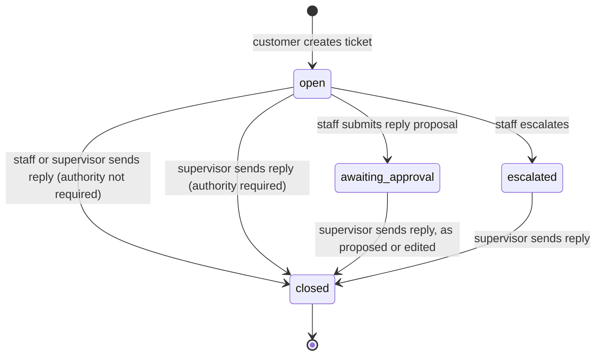
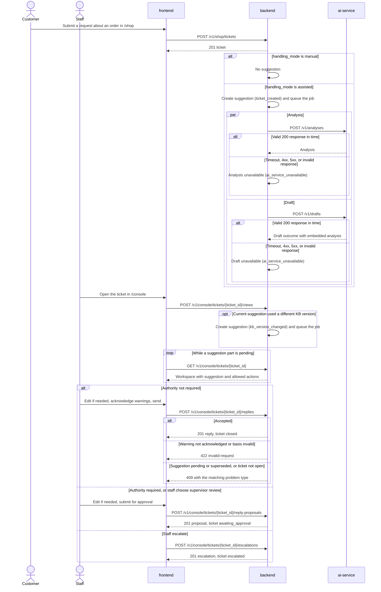
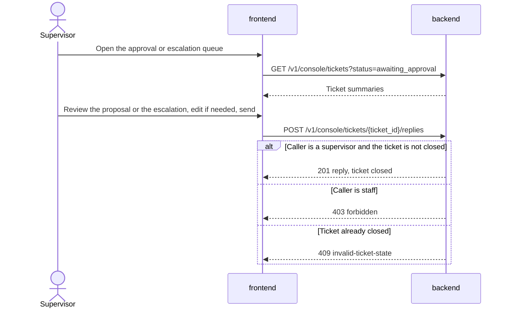

# Design: Contracts v1

- **Status:** Approved
- **Owner:** contracts gatekeeper
- **Reviewers:** ML engineer, RAG engineer, backend engineer, frontend engineer
- **Last reviewed:** 2026-10-24
- **Related:** [Requirements](../product/requirements.md) (FR-01 to FR-08), [ADR-0001](../decisions/0001-system-architecture.md), [ADR-0002](../decisions/0002-shop-demo-scope.md), [ADR-0004](../decisions/0004-api-conventions.md), [ADR-0005](../decisions/0005-intent-independent-retrieval.md), [ADR-0006](../decisions/0006-staff-feedback-and-reason-codes.md), [ADR-0009](../decisions/0009-demo-accounts-and-cookie-sessions.md), [contract rules](../rules/contracts.md)

## Summary

This design defines version 1 of both API contracts (`frontend` ↔ `backend` and `backend` ↔ `ai-service`), the ticket lifecycle they serve, the simulated commerce data, and the structure of the KB data contract. It is the first deliverable that lets the four work streams build in parallel against mocks. The team agreed the product behavior: `backend` requests an AI suggestion when a ticket is created; a ticket holds one customer message and one reply; tickets that require authority are prepared by staff and sent by a supervisor; escalated tickets go to the supervisor queue. Sign-in follows ADR-0009.

## Goals and non-goals

### Goals

- Every behavior in FR-01 to FR-08 that crosses a component boundary has a defined operation and schema.
- Every outcome has a schema and an example: success, abstention, escalation recommended, AI unavailable, invalid request, permission denied, invalid state.
- Guardrails are structural, not only procedural:
  - shop schemas have no field that can carry AI output;
  - only `backend` has an operation that sends a reply, and it requires a staff action and the right role;
  - once the AI flags a ticket as requiring authority, only a supervisor can send its reply;
  - no operation changes orders, shipments, or refunds.
- Each component can be built and tested alone against mocks generated from the contracts.

### Non-goals

- Conversations with several messages per ticket.
- Production-grade authentication ([ADR-0009](../decisions/0009-demo-accounts-and-cookie-sessions.md) records the revisit).
- An admin role or admin screens.
- Streaming or push updates. `frontend` polls.
- KB content. This design fixes the structure; content arrives with the approved KB files.
- Assigning tickets to individual staff members. All staff share one open queue.

## Background

- Component responsibilities, data ownership, and boundary rules: [ADR-0001](../decisions/0001-system-architecture.md).
- Shop scope, including the support form attached to an order: [ADR-0002](../decisions/0002-shop-demo-scope.md).
- API style, status codes, and headers: [ADR-0004](../decisions/0004-api-conventions.md) and the [contract rules](../rules/contracts.md).
- The AI pipeline behind `/v1/analyses` and `/v1/drafts`: [ADR-0005](../decisions/0005-intent-independent-retrieval.md).
- What is recorded for each staff decision: [ADR-0006](../decisions/0006-staff-feedback-and-reason-codes.md).

## Design

### Components and responsibilities

| Component | Responsibilities added by this design |
|---|---|
| `frontend` | Calls only `backend`. Polls a ticket while its suggestion is pending. Shows only the actions listed in `allowed_actions`. |
| `backend` | Creates a suggestion when a ticket is created and runs it in a supervised in-process job runner. Calls `/v1/analyses` and `/v1/drafts` in parallel. Stores every suggestion snapshot. Enforces the ticket state machine, roles, object-level access, and the authority rule. Measures handling time. |
| `ai-service` | Serves `/v1/analyses` and `/v1/drafts` without per-ticket state. Serves KB document versions and the versions of its loaded assets. |

### Roles and permissions

The roles are `customer`, `staff`, and `supervisor` ([SEC-15](../rules/security-and-privacy.md#authentication-and-authorization)). A supervisor is a staff member with authority for FR-06.

| Operation | `customer` | `staff` | `supervisor` |
|---|---|---|---|
| Sign in, sign out, read the current session | Yes | Yes | Yes |
| List and read their own orders | Yes | No | No |
| Create a ticket on one of their orders; read their own tickets and sent replies | Yes | No | No |
| List open tickets; read a ticket workspace | No | Yes | Yes |
| List tickets awaiting approval, escalated, or closed | No | No | Yes |
| Correct the intent of an open ticket | No | Yes | Yes |
| Send a reply on an open ticket where authority is not required and no suggestion part is pending | No | Yes | Yes |
| Submit a reply proposal on an open ticket | No | Yes | No |
| Send a reply on a ticket that requires authority, awaits approval, or is escalated | No | No | Yes |
| Escalate an open ticket | No | Yes | No |

- Object-level access ([SEC-17](../rules/security-and-privacy.md#authentication-and-authorization)): a customer reaches only their own orders and tickets. A request for another customer's resource returns `404`, so its existence is not revealed.
- A role calling an operation it may not use gets `403 forbidden`. This includes staff listing tickets with a status other than `open`, and staff sending a reply on an escalated ticket.

### Authority rule (FR-06)

- A ticket has `is_authority_required`, a ticket-level property that `backend` sets to `true` when any suggestion of that ticket carries the reason code `requires_authority`, in its routing or in its draft outcome.
- The property is never cleared in v1. Correcting the intent or re-running the suggestion cannot remove it.
- While any part of the current suggestion is `pending`, staff cannot send a reply (`409 suggestion-pending`). This closes the gap where an intent correction is still running and the flag is not yet known.
- Staff can always route a ticket to a supervisor themselves, with a reply proposal or an escalation.
- Tickets that the AI never flags (manual mode, AI unavailable, or a missed classification) rely on staff judgment ([ASM-03](../product/requirements.md#6-assumptions-and-constraints)). The guarantee is: every ticket the AI flags is sent by a supervisor.

### Ticket lifecycle

| State | Meaning |
|---|---|
| `open` | Waiting for staff |
| `awaiting_approval` | Staff submitted a reply proposal; waiting for a supervisor |
| `escalated` | Staff escalated the ticket; waiting for a supervisor |
| `closed` | A reply was sent to the customer |



- An AI failure never changes the ticket state. The ticket stays `open` and is handled manually.
- A forbidden transition, for example sending a reply on a `closed` ticket, returns `409 invalid-ticket-state`. A repeated request with the same `Idempotency-Key` returns the original result instead.

**Handling mode.** Each ticket has `handling_mode`: `assisted` or `manual`. In `manual` mode, `backend` requests no suggestion and the console shows no AI panel. Shop tickets use the default mode from settings. Tickets imported for the product-value study take their mode from the import file, as the study protocol decides.

**Handling time.** The clock starts at the first staff view (`recordTicketView`) and stops when the reply is sent. It is reported per mode (`supportiq.ticket.handling.duration`).

### Suggestion lifecycle

A suggestion is everything the AI produced for a ticket in one run, as recorded by `backend`: the request it sent, the analysis, the draft outcome, the asset versions, and the trace ID. It is created with one of three triggers:

| Trigger | When |
|---|---|
| `ticket_created` | A ticket is created in `assisted` mode |
| `intent_override` | Staff or a supervisor corrects the intent |
| `kb_version_changed` | On the first staff view, the current suggestion used a KB version different from the one `ai-service` has loaded |

Every suggestion of a ticket uses `as_of` = the ticket's `created_at`, the time the customer asked. The `ai-service` pipeline design confirms this choice.

A suggestion has two parts, each with its own status, because the two calls return at different times:

| Part | Statuses |
|---|---|
| Analysis | `pending`, `ready`, `unavailable` |
| Draft | `pending`, `draft_ready`, `abstained`, `escalation_recommended`, `llm_unavailable`, `unavailable` |

- `backend` sets `unavailable` with the reason code `ai_service_unavailable` when `ai-service` is unreachable, times out, returns `5xx`, returns any `4xx`, or returns a response that does not match the contract. A `4xx` means `backend` sent a request `ai-service` rejected, which is a defect: it is logged at `error` level.
- The draft response embeds its own analysis. If the analysis call failed but the draft call succeeded, `backend` fills the analysis from the draft response.
- A new suggestion supersedes the previous one. The workspace shows only the current suggestion; every suggestion stays stored for provenance.
- At startup, `backend` re-queues suggestions left `pending` by a restart.

**Timeouts.** `backend` calls `ai-service` with two settings, `ai_service_analysis_timeout_ms` (initial value 3 000) and `ai_service_draft_timeout_ms` (initial value 11 000). The draft timeout keeps a suggestion within the p95 target of 12 s ([requirements §5](../product/requirements.md#5-quality-requirements)). Both values are tuned from measurements, and the `ai-service` pipeline design fits its step budgets inside them ([ERR-10](../rules/errors-and-reliability.md#timeouts-and-latency-budget)).

### Flows

#### Ticket creation and staff handling



1. The customer submits a request about one of their orders. `backend` creates the ticket and returns at once; the customer never waits for AI.
2. In `assisted` mode, `backend` creates a suggestion and calls both `ai-service` endpoints in parallel, with the timeouts above.
3. Each call either stores its result or marks its part `unavailable`. Neither failure changes the ticket state.
4. Staff open the ticket. `frontend` records the view, which starts the handling clock and may trigger a re-run if the KB version changed. `frontend` polls until no part is pending.
5. Staff send the reply, submit a proposal, or escalate, depending on `allowed_actions`. Invalid requests are rejected with a typed problem.

#### Supervisor handling



#### Intent correction

```mermaid
sequenceDiagram
    actor Staff
    participant FE as frontend
    participant BE as backend
    participant AI as ai-service
    Staff->>FE: Choose a different intent
    FE->>BE: POST /v1/console/tickets/{ticket_id}/suggestions with intent_override
    alt Ticket open
        BE-->>FE: 202 new suggestion (pending); the previous one is superseded
        BE->>AI: POST /v1/drafts with intent_override
        alt Valid 200 response in time
            AI-->>BE: Draft outcome with embedded analysis
        else Timeout, 4xx, 5xx, or invalid response
            BE->>BE: Both parts unavailable (ai_service_unavailable)
        end
        loop While the suggestion is pending
            FE->>BE: GET /v1/console/tickets/{ticket_id}
        end
    else Ticket not open
        BE-->>FE: 409 invalid-ticket-state
    end
```

With an override, `backend` calls only `/v1/drafts`, because its response carries the full analysis computed with the staff-chosen intent. The authority flag set by an earlier suggestion stays set.

### Data and contracts

Both contracts are new at version `1.0.0`. No consumer exists yet, so there is no compatibility impact. Everything below follows the [contract rules](../rules/contracts.md).

#### Common elements

- **Headers:** `traceparent` on every request ([ADR-0004](../decisions/0004-api-conventions.md), decision 6). `Idempotency-Key` on every write except `createSession`.
- **Status codes:** as in [CON-11](../rules/contracts.md#api-conventions), including `202` for `createSuggestion` and `204` for operations without a response body.
- **Errors:** Problem Details with a `trace_id` extension member. Problem types:

| Type (`urn:supportiq:problem:` + name) | Status | Meaning |
|---|---|---|
| `invalid-request` | `400`, `422` | Malformed body, or a body that breaks a documented rule |
| `unauthenticated` | `401` | No valid session |
| `forbidden` | `403` | The role may not perform the operation, or the `Origin` check failed |
| `authority-required` | `403` | Staff tried to send a reply on a ticket where authority is required |
| `not-found` | `404` | The resource does not exist, or the caller may not know about it |
| `invalid-ticket-state` | `409` | The operation is not allowed in the ticket's current state |
| `suggestion-pending` | `409` | A part of the current suggestion is still pending |
| `suggestion-superseded` | `409` | The request refers to a suggestion that is no longer current |
| `idempotency-key-reused` | `409` | The key was used before with a different body |
| `not-ready` | `503` | The component is not ready, for example assets not loaded |
| `internal-error` | `500` | Unexpected failure |

- **Shared schemas** in `contracts/schemas/`, referenced by both OpenAPI files so they never diverge: `MessageText` (customer message and reply text, 1 to 2 000 characters), `IntentLabel` (the 46 labels), `ConfidenceBand` (`high`, `medium`, `low`), `AiReasonCode`, `DocumentValidity` (`valid`, `expired`, `conflicting`), `Citation`, `RankedDocument`, `DraftSegment`, `Warning`, `AssetVersions`, `Money` (`amount_minor`, `currency`), `ProblemDetails`. All other `backend` schemas are its own view models, so `frontend` does not depend on the `ai-service` contract.

#### Reason codes

`AiReasonCode` values in v1. Which codes lead to a draft, an abstention, or an escalation recommendation is defined in the `ai-service` pipeline design doc, not here. The reason code `requires_authority` is the only source of the authority flag; no separate boolean is sent.

| Code | Meaning |
|---|---|
| `low_confidence` | The top intent probability is below the routing threshold |
| `signal_disagreement` | The predicted intent and the top documents point to different topics |
| `out_of_scope_intent` | The intent is outside the 12 in-scope intents |
| `human_agent_requested` | The intent is `human_agent` |
| `no_valid_document` | No document in effect at `as_of` supports the request |
| `only_expired_documents` | Relevant documents exist, but none is in effect at `as_of` |
| `conflicting_sources` | Two valid versions with the same policy key disagree |
| `missing_information` | The request needs information that is in neither the message nor the order context |
| `requires_authority` | A refund decision, a transaction dispute, or a policy exception (FR-06) |
| `llm_unavailable` | LLM timeout, error, rate limit, or open circuit breaker |
| `llm_invalid_output` | The LLM output failed schema validation |
| `grounding_failed` | The draft made claims its sources do not support |
| `budget_exceeded` | The latency budget ran out before drafting |
| `ai_service_unavailable` | Set only by `backend`: `ai-service` unreachable, timed out, returned `4xx` or `5xx`, or returned an invalid response |

A `Warning` is a condition that allows a draft but needs staff attention: a `warning_id` (unique within its suggestion) and an `AiReasonCode`.

Staff use the `StaffReasonCode` values from [ADR-0006](../decisions/0006-staff-feedback-and-reason-codes.md) for rejections, edits, and escalations.

#### `ai-service` contract (`ai-service.openapi.yaml`)

| Operation ID | Method and path | Purpose |
|---|---|---|
| `createAnalysis` | `POST /v1/analyses` | Run the pipeline up to routing, without the LLM |
| `createDraft` | `POST /v1/drafts` | Run the whole pipeline |
| `getKbDocumentVersion` | `GET /v1/kb-documents/{document_id}/versions/{version}` | Full text of one document version, for the citation view |
| `getAssetVersions` | `GET /v1/asset-versions` | Versions of the loaded model, KB, prompts, routing table, and document-to-intent mapping |
| — | `GET /health/live`, `GET /health/ready` | Liveness and readiness ([ERR-18](../rules/errors-and-reliability.md#startup-and-health)) |

`SuggestionRequest`, the body of both `createAnalysis` and `createDraft`:

| Field | Type | Required | Data class | Meaning |
|---|---|---|---|---|
| `message` | `MessageText` | Yes | Confidential | The customer's message |
| `order_context` | `OrderContext` | No | Confidential | Allow-listed order fields; absent when the ticket has no order (imported tickets) |
| `as_of` | timestamp | Yes | Internal | Point in time for document validity: the ticket's `created_at` |
| `kb_version` | string | No | Internal | KB version to use; absent means the loaded version. An unknown version returns `422` |
| `intent_override` | `IntentLabel` | No | Internal | Intent chosen by staff |

The request carries no ticket ID, customer identity, or staff identity ([SEC-04](../rules/security-and-privacy.md#data-sent-to-llm-providers)). Requests are correlated by trace context.

`OrderContext`, the allow-list. Every field is optional; absence means not applicable or unknown.

| Field | Type |
|---|---|
| `order_status` | `placed`, `processing`, `shipped`, `delivered`, `cancelled` |
| `placed_at` | timestamp |
| `order_total`, `shipping_cost` | `Money` |
| `shipment_status` | `not_shipped`, `in_transit`, `delivered`, `delayed`, `lost` |
| `estimated_delivery_at`, `delivered_at` | timestamp |
| `refund_status` | `requested`, `under_review`, `approved`, `rejected`, `paid` |
| `refund_amount` | `Money` |
| `refund_requested_at` | timestamp |

`Analysis`, the `200` body of `createAnalysis`:

| Field | Meaning |
|---|---|
| `intent` | Predicted intent: `label`, calibrated `probability`, `confidence_band`, `source` (`model` or `staff`) |
| `alternatives` | Up to four next most likely intents with probabilities |
| `is_in_scope` | Whether the intent is one of the 12 in-scope intents |
| `documents` | Ranked `RankedDocument` items: ID, version, title, policy key, effective period, `validity`, rank, snippet |
| `routing` | `recommendation` (`draft`, `abstain`, `escalate`) and `reason_codes` |
| `warnings` | `Warning` items |
| `versions` | `AssetVersions` |
| `step_latency_ms` | Latency of each step and the total |

`DraftOutcome`, the `200` body of `createDraft`, is a union discriminated by `status`, so a draft exists only when it is ready ([CODE-29](../rules/code.md#types-and-data)):

| `status` | Extra fields |
|---|---|
| `draft_ready` | `draft`: `segments` (each with `segment_id`, `text`, `citation_ids`) and `citations` |
| `abstained`, `escalation_recommended`, `llm_unavailable` | No `draft` |

Every variant also carries `reason_codes`, the embedded `analysis`, an optional `staff_note`, `versions`, `step_latency_ms`, and `llm_usage` (input tokens, output tokens, cost in micro-USD) when the LLM was called.

#### `backend` contract (`backend.openapi.yaml`)

Two audience namespaces keep the guardrail structural: `/v1/shop/` serves `customer` and has no schema that can hold AI output; `/v1/console/` serves `staff` and `supervisor`.

| Operation ID | Method and path | Roles | Result |
|---|---|---|---|
| `createSession` | `POST /v1/sessions` | Anyone | `201` session view and cookie ([ADR-0009](../decisions/0009-demo-accounts-and-cookie-sessions.md)) |
| `getCurrentSession` | `GET /v1/sessions/current` | Signed in | User ID, display name, role |
| `deleteCurrentSession` | `DELETE /v1/sessions/current` | Signed in | `204` |
| `listShopOrders` | `GET /v1/shop/orders` | customer | Own orders, paginated |
| `getShopOrder` | `GET /v1/shop/orders/{order_id}` | customer | Own order with shipment and refund |
| `createShopTicket` | `POST /v1/shop/tickets` | customer | `201` shop ticket view |
| `listShopTickets` | `GET /v1/shop/tickets` | customer | Own tickets, paginated |
| `getShopTicket` | `GET /v1/shop/tickets/{ticket_id}` | customer | Shop ticket view |
| `listConsoleTickets` | `GET /v1/console/tickets` | staff (`open` only), supervisor | Ticket summaries filtered by `status`, paginated |
| `getConsoleTicket` | `GET /v1/console/tickets/{ticket_id}` | staff, supervisor | Ticket workspace |
| `recordTicketView` | `POST /v1/console/tickets/{ticket_id}/views` | staff, supervisor | `204`; the first view starts the handling clock |
| `createSuggestion` | `POST /v1/console/tickets/{ticket_id}/suggestions` | staff, supervisor | `202` pending suggestion with an intent override |
| `createReplyProposal` | `POST /v1/console/tickets/{ticket_id}/reply-proposals` | staff | `201` proposal; ticket `awaiting_approval` |
| `sendReply` | `POST /v1/console/tickets/{ticket_id}/replies` | staff, supervisor | `201` reply; ticket `closed` |
| `createEscalation` | `POST /v1/console/tickets/{ticket_id}/escalations` | staff | `201` escalation; ticket `escalated` |
| `getKbDocumentVersion` | `GET /v1/console/kb-documents/{document_id}/versions/{version}` | staff, supervisor | Full document version, proxied from `ai-service` |
| — | `GET /health/live`, `GET /health/ready` | Anyone | Liveness and readiness |

`createShopTicket` takes `order_id` (required, one of the caller's orders, as [ADR-0002](../decisions/0002-shop-demo-scope.md) attaches the support form to an order) and `message` (`MessageText`). Tickets imported for evaluation may have no order; they are created by a `backend` import command, not through the shop.

`ShopTicketView`: ticket ID, order ID, the customer's message, `created_at`, `customer_status` (`received` or `answered`), and `reply` (body and `sent_at`) only after a reply is sent. It has no state, suggestion, proposal, or escalation fields.

`TicketWorkspace`, the body of `getConsoleTicket`:

| Field | Meaning |
|---|---|
| `ticket_id`, `status`, `handling_mode` | Identity, lifecycle state, assisted or manual |
| `is_authority_required` | The sticky authority flag ([Authority rule](#authority-rule-fr-06)) |
| `created_at`, `handling_started_at`, `closed_at` | Timestamps; the last two are absent until they happen |
| `customer` | `display_name` only |
| `message` | The customer's message and its `created_at` |
| `order` | Order, shipment, and refund details; absent when the ticket has no order |
| `suggestion` | The current suggestion; absent in `manual` mode |
| `proposal` | The reply proposal, when one was submitted |
| `escalation` | Staff reason codes, note, who escalated, and when, when escalated |
| `reply` | The sent reply, who sent it, and when, when closed |
| `allowed_actions` | Subset of `send_reply`, `submit_reply_proposal`, `escalate`, `correct_intent`, computed by `backend` for the caller |

`SuggestionView`: suggestion ID, trigger, `created_at`, `analysis_status` with the analysis when ready, `draft_status` with the draft when `draft_ready` (a union discriminated by `draft_status`), draft `reason_codes`, `warnings`, `staff_note`, `versions`, `step_latency_ms`, and `trace_id`.

`sendReply` and `createReplyProposal` take a body discriminated by `basis`, so each case carries exactly the fields it needs:

| `basis` | Required fields | Optional fields | Valid when | Allowed in |
|---|---|---|---|---|
| `ai_draft` | `body`, `suggestion_id`, `acknowledged_warning_ids` (every warning of that suggestion) | `staff_reason_codes`, `note` | The suggestion is current and its draft is `draft_ready` | Both |
| `rejected_ai_draft` | `body`, `suggestion_id`, `staff_reason_codes` (at least one) | `note` | The suggestion is current and its draft is `draft_ready` | Both |
| `no_ai_draft` | `body` | `suggestion_id` | No current draft is `draft_ready`, or the ticket is in `manual` mode | Both |
| `reply_proposal` | `body`, `proposal_id` | — | The ticket is `awaiting_approval` with that proposal | `sendReply` by a supervisor |

- `note` is required when `staff_reason_codes` contains `other`.
- A body whose basis is not valid for the ticket returns `422 invalid-request`. A `suggestion_id` that is not current returns `409 suggestion-superseded`.

`createEscalation` takes `staff_reason_codes` (at least one, as [ADR-0006](../decisions/0006-staff-feedback-and-reason-codes.md) requires), `note` (required with `other`), and optional `suggestion_id`.

**Recorded decision** ([ADR-0006](../decisions/0006-staff-feedback-and-reason-codes.md)). When a reply is sent, `backend` records one decision about the AI draft, comparing the draft with the body actually sent:

| Basis of the reply (or of the proposal it came from) | Decision |
|---|---|
| `ai_draft`, final body equal to the draft text | `approve` |
| `ai_draft`, final body different | `edit`, with the amount of change |
| `rejected_ai_draft` | `reject` |
| `no_ai_draft` | No draft decision; the reply and the suggestion (if any) are recorded |

An escalation records `escalate`. For a reply proposal, the record keeps both the staff member who proposed and the supervisor who sent, and whether the supervisor changed the proposed body.

#### Simulated commerce data (owned by `backend`)

| Entity | Fields |
|---|---|
| Customer | `customer_id`, `display_name`, `email` (synthetic) |
| Order | `order_id`, `customer_id`, `order_status`, `placed_at`, `order_total`, `shipping_cost`, line items (product name, quantity) |
| Shipment | `shipment_id`, `order_id`, `shipment_status`, `estimated_delivery_at`, `delivered_at` |
| Refund | `refund_id`, `order_id`, `refund_status`, `refund_amount`, `refund_requested_at`, `updated_at` |

The data is produced by a deterministic, versioned seed script ([DATA-04](../rules/data-and-ml.md#sources-and-acceptable-use)) and read through the `CommerceGateway` port. No operation writes it.

#### KB data contract (`contracts/kb-contract.md`)

This design fixes the structure; the contract is completed when the approved KB files arrive.

| Element | Content |
|---|---|
| Document version | Document ID, version, title, body, policy key, `effective_from`, `effective_to` (absent means open-ended), source, owner, checksum ([DATA-16](../rules/data-and-ml.md#knowledge-base)) |
| KB version manifest | `kb_version`, the document versions it contains with checksums, creation date, source reference |
| Document-to-intent mapping | Separate file: `mapping_version`, `kb_version`, and for each document ID its list of `IntentLabel` values ([ADR-0005](../decisions/0005-intent-independent-retrieval.md)) |
| Freshness | For each policy area: the maximum time between reviews, the owner who reviews, and the interim action when a review is overdue (documents stay usable and each draft citing them carries a warning) |
| Violations | Who checks each rule (the ingestion script for structure, the policy owner for content), and who acts on a failure (the RAG engineer quarantines, the policy owner corrects) |
| Ingestion | Source files stay unchanged under `data/raw/kb/<kb_version>/`. A script maps them to the canonical form and validates them ([DATA-12](../rules/data-and-ml.md#validation-at-every-boundary)) |

Values missing from the source files are never invented. A document without a required field is quarantined and reported to the policy owner ([DATA-13](../rules/data-and-ml.md#validation-at-every-boundary)).

### Errors and guardrails

| Failure or risk | Behavior | Test |
|---|---|---|
| `ai-service` times out, is unreachable, or returns `5xx` on the analysis call | Analysis `unavailable` with `ai_service_unavailable`; ticket stays `open` for manual handling | Use-case test with a fake client that times out; consumer contract test |
| Same failure on the draft call | Draft `unavailable`; the analysis is still shown when ready | Use-case test; consumer contract test |
| `ai-service` returns a documented `4xx` | Part `unavailable` with `ai_service_unavailable`; logged at `error` as a defect | Use-case test with a fake client returning `422` |
| `ai-service` returns an unknown status or reason code | Treated as unavailable or as an unspecified reason ([CON-22](../rules/contracts.md#evolution)) | Consumer test with a mock returning unknown values |
| LLM fails inside `ai-service` | Draft `llm_unavailable`; analysis present | Provider contract test with the LLM adapter faked to fail |
| Staff send a reply on a ticket where authority is required | `403 authority-required` | Guardrail test (TEST-26) |
| Staff correct the intent on a flagged ticket, then try to send | The flag stays set: `409 suggestion-pending` while pending, `403 authority-required` after | Guardrail test (TEST-26) |
| Staff send while a suggestion part is pending | `409 suggestion-pending` | Handler test |
| Reply from an AI draft without acknowledging every warning | `422 invalid-request` | Handler test |
| Reply with `no_ai_draft` while a current draft is `draft_ready` | `422 invalid-request` | Handler test |
| Reply or proposal refers to a superseded suggestion | `409 suggestion-superseded` | Handler test |
| Reply, proposal, escalation, or intent correction on a ticket in the wrong state | `409 invalid-ticket-state`; the same key returns the original result | State machine unit tests; idempotency test |
| Staff list non-open tickets or send on an escalated ticket | `403 forbidden` | Permission table test |
| Customer requests another customer's order or ticket | `404 not-found` | Permission test |
| Customer creates a ticket on an order that is not theirs | `404 not-found` | Permission test |
| Customer sees AI output before a reply is sent | Impossible: shop schemas have no AI fields | Schema test over every `/v1/shop/` response; guardrail test |
| Any operation changes commerce data or performs a transaction | Impossible: no such operation exists | Contract test that lists operations and fails on any write to commerce resources |
| `backend` restarts while suggestions are pending | Pending suggestions are re-queued at startup | Integration test |
| KB version changed before the first staff view | A new suggestion with `kb_version_changed` is created | Use-case test |
| Invalid input: message too long, unknown field, malformed body | `400` or `422 invalid-request` ([CON-07](../rules/contracts.md#openapi-style)) | Handler tests; Schemathesis |

### Alternatives considered

- **One `/v1/suggestions` endpoint in `ai-service`** instead of analyses and drafts: rejected in [ADR-0005](../decisions/0005-intent-independent-retrieval.md).
- **One ticket view for every role**, with fields hidden by role: rejected, because a hidden field can leak through a bug. Separate shop and console schemas make "a customer never sees a draft" structural.
- **Synchronous AI call during ticket creation:** rejected, because the customer would wait for the LLM and an AI failure would fail ticket creation.
- **Push updates (server-sent events or WebSockets):** deferred. Polling fits v1, and streaming would be a compatible addition ([ADR-0004](../decisions/0004-api-conventions.md)).
- **Authority taken only from the current suggestion:** rejected after review, because an intent correction could remove the flag. The flag is sticky per ticket.
- **Staff may send authority-required replies after acknowledging a warning:** rejected by the team in favor of supervisor approval.

## Testing and evaluation

- **Contract:** provider tests (Schemathesis) and consumer tests (Prism mocks) for both contracts, with an example for every outcome of every operation ([CON-27, CON-28](../rules/contracts.md#contract-tests)).
- **Unit:**
  - the ticket state machine, with property-based tests that a `closed` ticket never changes and that replies come only from allowed states;
  - the authority rule, with property-based tests that no sequence of suggestions, overrides, or re-runs clears the flag;
  - the permission matrix, as a table-driven test;
  - basis validation and decision derivation;
  - merging suggestion parts in every arrival order.
- **Guardrail:** every TEST-26 item that this design touches, including authority after an intent correction and shop schemas without AI fields.
- **End-to-end:** the TEST-27 scenarios, plus a proposal approved and sent by a supervisor.
- **Metrics:** this design does not change AI behavior, so no model metric is re-measured. End-to-end latency is measured once both components exist.

## Observability

- **Events:** `ticket.created`, `suggestion.requested`, `ai_service.called`, `ai_service.call_failed`, `suggestion.completed`, `suggestion.superseded`, `ticket.viewed`, `ticket.manual_handling_started`, `reply_proposal.submitted`, `decision.recorded`, `reply.sent`, `ticket.escalated`, `permission.denied`.
- **Spans:** `create_ticket`, `run_suggestion_job`, `call_ai_service` (with the endpoint as an attribute), `save_decision`, `send_reply`.
- **Metrics:** `supportiq.ticket.handling.duration` by mode, `supportiq.staff.decisions`, `supportiq.ai_service.unavailable`, and `supportiq.suggestion.duration` (ms, by part).
- The trace ID is stored with each suggestion and shown in the developer details panel ([UI-35](../rules/ui.md#developer-views)).

## Security and privacy

| Flow | Data and class |
|---|---|
| `frontend` → `backend` | Credentials (Secret), only to `createSession`. Messages and replies (Confidential) |
| `backend` → `ai-service` | Message and allow-listed order context (Confidential); `as_of`, KB version, intent override (Internal). No names, emails, or IDs |
| `ai-service` → LLM provider | Masked message, KB snippets, and the order fields a prompt needs ([SEC-04 to SEC-06](../rules/security-and-privacy.md#data-sent-to-llm-providers)), defined in the `ai-service` pipeline design |
| `backend` → `/shop` | The caller's own orders and tickets, and sent replies only |
| `backend` → `/console` | Customer display name, message, order details, suggestions; staff and supervisors only |

Every schema property states its data class ([SEC-03](../rules/security-and-privacy.md#data-classification)). Sessions follow [ADR-0009](../decisions/0009-demo-accounts-and-cookie-sessions.md).

## Rollout

1. Done on 2026-10-24: this design was approved and ADR-0009 accepted.
2. Contract PR 1: `contracts/README.md` (tooling commands), `CHANGELOG.md`, shared schemas, `ai-service.openapi.yaml` 1.0.0, examples, mock setup.
3. Contract PR 2: `backend.openapi.yaml` 1.0.0 and examples.
4. Contract PR 3: `kb-contract.md` structure, completed when the KB files arrive.
5. Done on 2026-10-24: UI-16, UI-17, and UI-19 were updated for the reply proposal and supervisor approval flow.
6. Implementation starts in parallel against mocks. Follow-up design docs: the `ai-service` pipeline (routing table, step budgets, grounding check, `as_of` confirmation), the `backend` ticket workflow and job runner, the console layout, and the evaluation protocol ([DATA-20](../rules/data-and-ml.md#splits-and-evaluation-protocol)).

Nothing is deployed yet, so no migration or rollback is needed.

## Open questions

- If the lecturer provides shared simulated business data, the commerce model maps to it through `CommerceGateway`, and field names in this design may change before contract PR 2 ([requirements §8](../product/requirements.md#8-open-questions)).
- The KB source format is unknown, so the KB data contract structure may need adjustment when the files arrive.
- The product-value study compares assisted and manual handling. In manual mode no ticket is flagged for authority, so the study protocol must decide how authority-related tickets are treated in both modes.
- Shop questions that are not about an order (for example general shipping costs) are outside ADR-0002. Allowing them needs a new ADR.
- The export of decision records for the AI engineers is proposed as a `backend` command-line export rather than an API operation. This is to be confirmed in the `backend` workflow design doc.
