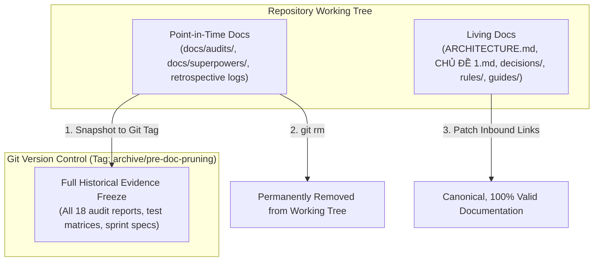

# Design: Documentation Pruning and Canonical Architecture Normalization

- **Status:** Approved
- **Owner:** FatPandaC8
- **Reviewers:** egm-zoom-out, egm-comprehension, egm-design, egm-structural, egm-style, egm-implementation-readiness
- **Last reviewed:** 2026-11-19
- **Related:** docs/README.md, docs/ARCHITECTURE.md, docs/CHỦ ĐỀ 1.md

--------------------------------------------------------------------------------

## Overview

Over multiple development milestones, the SupportIQ documentation tree accumulated point-in-time audit reports, automated swarm plans, and retrospective bugfix logs. These files served immediate development rounds but now create cognitive noise, introduce stale architectural assertions (e.g., obsolete KB recall figures and superseded test configurations), and violate the repository documentation principles ("One source of truth" and "Accurate or absent" defined in `docs/README.md`).

This design specifies the safe pruning of ~30 obsolete, historical, and point-in-time documents while preserving authoritative engineering specifications, updating living links in entrypoint files, and ensuring zero loss of required academic evaluation rubrics.

## The Problem

The current repository documentation suffers from three primary issues:

1. **Information Dilution and Stale Data:** Developers and AI assistants must search through dozens of historical files (e.g., 18 audit files in `docs/audits/`, multiple superpower plans in `docs/superpowers/`, and one-off retrospective logs) that describe past transitional states rather than current system reality.
2. **Broken and Leaky Inbound Links:** Living entrypoints (`README.md` and `docs/README.md`) link directly to temporary files (such as `docs/superpowers/specs/2026-10-27-core-backend-design.md` and `docs/audits/2026-11-12-topic-1-integration.md`). Pruning these files without an atomic link update would cause broken markdown links.
3. **Risk of Accidental Knowledge Loss:** Deleting documents without clear categorization risks deleting required academic assignment specifications (such as `docs/CHỦ ĐỀ 1.md`) or key reference benchmarks (such as `docs/AI_PIPELINE_METRIC_IMPROVEMENTS.md`).

## Goals

* **G-01:** Prune all 18 historical acceptance audit files under `docs/audits/` and all sprint files under `docs/superpowers/`.
* **G-02:** Prune obsolete one-off retrospective logs, test writeups, and superseded draft designs (`docs/codebase-cleanup-log.md`, `docs/review-eight-fixes.md`, `docs/FINAL_CHANGE_EXPLANATION.md`, `docs/CURRENT_LIMITATIONS.md`, `docs/playwright-intent-report.md`, `docs/system-evaluation-report.md`, `docs/REQUIREMENTS_EVIDENCE_MATRIX.md`, `docs/design/2026-11-12-frontend-usability-notes.md`, `docs/design/codebase-cleanup-and-refactoring.md`).
* **G-03:** Update all references in `README.md` and `docs/README.md` so that no broken relative markdown links exist.
* **G-04:** Create a git release/archive tag (`archive/pre-doc-pruning`) prior to deletion so full historical audit evidence remains instantly retrievable from version control.
* **G-05:** Verify that all active unit and integration tests pass without error and no scripts depend on deleted paths.

## Non-Goals

* **NG-01:** Deleting or altering `docs/CHỦ ĐỀ 1.md` (authoritative course project specification and rubric).
* **NG-02:** Deleting `docs/AI_PIPELINE_METRIC_IMPROVEMENTS.md` (retained for pipeline metrics reference).
* **NG-03:** Deleting or altering active architectural decision records (`docs/decisions/`), engineering rules (`docs/rules/`), domain model (`docs/glossary.md`), API contracts (`docs/api/`), sequence flows (`docs/sequence-diagrams/`), or operational runbooks (`docs/guides/`).
* **NG-04:** Modifying application code or test implementation logic.

## Open Questions

* **None:** All categorization boundaries (preserving `CHỦ ĐỀ 1.md` and `AI_PIPELINE_METRIC_IMPROVEMENTS.md`, pruning audits, superpower plans, and retrospective logs) were resolved during brainstorming.

## Critical User Journeys (CUJs)

### CUJ 1: Developer Onboarding and Documentation Navigation

* **Given:** A developer or AI coding agent exploring the SupportIQ codebase.
* **When:** The developer reads `README.md` or browses `docs/`.
* **Then:** All linked documentation points to active, accurate specifications (`ARCHITECTURE.md`, `docs/guides/`, `docs/decisions/`) with zero 404 links, zero obsolete sprint plans, and zero conflicting status assertions.

### CUJ 2: Course Evaluation or Historical Audit Verification

* **Given:** A course instructor or auditor requests the historical verification evidence from the Topic 1 milestone runs.
* **When:** The auditor inspects the project.
* **Then:** The original assignment spec (`docs/CHỦ ĐỀ 1.md`) is directly available in `docs/`, and all historical audit logs and evaluation matrices remain accessible via the `archive/pre-doc-pruning` git tag.

--------------------------------------------------------------------------------

## Technical Plan (Architecture)

### 1. Documentation Taxonomy Restructuring

The documentation directory is normalized around canonical, authoritative roles. Obsolete point-in-time and sprint directories are removed, leaving a clean, navigable structure.

```text
SupportIQ Documentation Architecture
├── README.md                          <- Main project entrypoint (updated links)
└── docs/
    ├── ARCHITECTURE.md                <- Core system architecture & FR/NFR definitions
    ├── CHỦ ĐỀ 1.md                    <- Preserved academic assignment specification
    ├── AI_PIPELINE_METRIC_IMPROVEMENTS.md <- Preserved pipeline metrics reference
    ├── glossary.md                    <- Canonical domain glossary & vocabulary
    ├── autoeval.md                    <- Evaluation suite CLI reference
    ├── core-backend-runbook.md        <- Local backend execution runbook
    ├── core-backend-verification.md   <- Operational verification steps
    ├── data-quality.md                <- Data validation criteria
    │
    ├── api/                           <- OpenAPI specifications (core-backend.openapi.yaml)
    ├── decisions/                     <- Architecture Decision Records (ADR-0001 .. ADR-0016)
    ├── design/                        <- Living component designs (console-ui, shop-ui, contracts-v1)
    ├── guides/                        <- Developer setup & verification runbooks
    ├── product/                       <- Product requirements (requirements.md)
    ├── rules/                         <- Repository engineering rules (architecture, python, testing)
    ├── sequence-diagrams/             <- System message flows & safety gates
    └── templates/                     <- Design document & ADR templates
```

### 2. File Lifecycle Management (Pruning vs. Retention)



#### Files to Permanently Delete (`git rm`):
1. **Historical Acceptance Audits (`docs/audits/`):**
   - `docs/audits/2026-11-12-final-acceptance-live.md`
   - `docs/audits/2026-11-12-retrieval-evaluation-integration.md`
   - `docs/audits/2026-11-12-task-b1-backend-safety-evidence.md`
   - `docs/audits/2026-11-12-topic-1-integration.md`
   - `docs/audits/2026-11-12-topic-1-review.md`
   - `docs/audits/2026-11-13-baseline-repro-integration.md`
   - `docs/audits/2026-11-13-closure-round-acceptance.md`
   - `docs/audits/2026-11-13-encoder-parity-integration.md`
   - `docs/audits/2026-11-13-flash-lite-evidence-integration.md`
   - `docs/audits/2026-11-13-guard-integration.md`
   - `docs/audits/2026-11-13-intent-adapter-integration.md`
   - `docs/audits/2026-11-13-mandatory-routing-integration.md`
   - `docs/audits/2026-11-13-post-guard-acceptance.md`
   - `docs/audits/2026-11-13-routing-surface-reachability.md`
   - `docs/audits/2026-11-13-selective-runtime-integration.md`
   - `docs/audits/2026-11-13-task-c-independent-evaluation.md`
   - `docs/audits/ARCHITECTURE_COMPLIANCE_AUDIT.md`
   - `docs/audits/ARCHITECTURE_REMEDIATION_PLAN.md`
   - `docs/audits/ARCHITECTURE_REQUIREMENT_MATRIX.md`
   - `docs/audits/LOCAL_VALIDATION_REPORT.md`
   - `docs/audits/MONITORING_OBSERVABILITY_AUDIT.md`
2. **Sprint Superpower Specs & Plans (`docs/superpowers/`):**
   - `docs/superpowers/plans/2026-11-12-acceptance-closure.md`
   - `docs/superpowers/plans/2026-11-12-topic-1-improvements.md`
   - `docs/superpowers/plans/2026-11-13-acceptance-closure-round.md`
   - `docs/superpowers/specs/2026-10-27-core-backend-design.md`
   - `docs/superpowers/specs/2026-11-12-acceptance-closure-design.md`
   - `docs/superpowers/specs/2026-11-12-topic-1-improvements-design.md`
3. **One-Off Retrospectives & Stale Test Reports:**
   - `docs/codebase-cleanup-log.md`
   - `docs/review-eight-fixes.md`
   - `docs/FINAL_CHANGE_EXPLANATION.md`
   - `docs/CURRENT_LIMITATIONS.md`
   - `docs/playwright-intent-report.md`
   - `docs/system-evaluation-report.md`
   - `docs/REQUIREMENTS_EVIDENCE_MATRIX.md`
4. **Obsolete Design Drafts:**
   - `docs/design/2026-11-12-frontend-usability-notes.md`
   - `docs/design/codebase-cleanup-and-refactoring.md`

### 3. Inbound Link Redirection & Normalization

To eliminate broken markdown links, entrypoint documents must be modified in the same atomic commit:

* **`README.md` Updates:**
  - *Line 40:* Replace link `docs/superpowers/specs/2026-10-27-core-backend-design.md` with `docs/ARCHITECTURE.md`.
  - *Line 46:* Replace link `docs/audits/2026-11-12-topic-1-integration.md` with `docs/guides/application-verification.md` (which documents active application verification procedures).
* **`docs/README.md` Updates:**
  - *Lines 7–8:* Remove the "Current Topic 1 work" paragraph referencing deprecated audits and superpower specs.
  - *Directory Table:* Remove rows for `audits/` and `superpowers/`. Ensure all remaining rows reflect living directories.

### 4. Verification & Validation Protocol

1. **Tagging:** Execute `git tag archive/pre-doc-pruning` prior to any deletion.
2. **Deletions:** Execute `git rm -r` on the designated paths.
3. **Relative Link Scanner:** Run an automated verification script that scans all markdown files across the repository to assert that every relative file link resolves to an existing file on disk.
4. **Regression Testing:** Run unit and application tests (`pytest tests/unit tests/application -q`) to guarantee that no test suites or fixtures depend on deleted documentation paths.

--------------------------------------------------------------------------------

## Alternatives Considered

### Alternative 1: Move Obsolete Documents to `docs/archive/`

*   **Pros**: Retains files on the active filesystem for immediate viewing without needing git commands.
*   **Cons**:
    *   Still clutters repository search (`grep`, file finders) with duplicate or conflicting definitions.
    *   Pollutes AI coding agent context windows with stale code references and superseded parameters.
    *   Requires maintaining an unindexed directory taxonomy that is prone to neglect.
*   **Reason for Rejection**: *Rejected by author*: Git version control and release tags are already the permanent, immutable archive. Keeping dead files in the working tree provides negative value.

### Alternative 2: Delete `docs/CHỦ ĐỀ 1.md`

*   **Pros**: Slightly reduces repository file count and leaves only English-language documentation.
*   **Cons**:
    *   Destroys the primary academic assignment rubric and instructor specification for the course project.
    *   Leaves developers without the original problem definition when validating whether all course requirements were satisfied.
*   **Reason for Rejection**: *Rejected by author*: The document is the authoritative assignment specification and must be preserved intact.

### Alternative 3: Retain `docs/REQUIREMENTS_EVIDENCE_MATRIX.md`

*   **Pros**: Keeps a 47 KB granular cross-reference table of old evaluation rounds on disk.
*   **Cons**:
    *   The matrix was frozen at commit `51b4997` on November 13 and describes past multi-worker test snapshots that do not track ongoing code changes.
    *   Active functional requirements (FR-01 through FR-11) and non-functional requirements (NFR-01 through NFR-10) are already authoritatively codified in `docs/product/requirements.md` and `docs/ARCHITECTURE.md`.
*   **Reason for Rejection**: *Rejected by author*: The document is a point-in-time evaluation snapshot. Permanent requirements live in `docs/product/requirements.md` and `docs/ARCHITECTURE.md`.

### Alternative 4: Delete `docs/AI_PIPELINE_METRIC_IMPROVEMENTS.md`

*   **Pros**: Further trims root `docs/` files.
*   **Cons**:
    *   Removes specific metric tracking and baseline improvement notes that the author still references during active ML evaluation and prompt tuning.
*   **Reason for Rejection**: *Rejected by author*: Explicitly retained during user review as an active reference document for pipeline metric comparisons.

--------------------------------------------------------------------------------

## Non-Functional Requirements

*   **Documentation Integrity & Link Validity**: 100% of internal relative markdown links across the repository must resolve to valid on-disk files. Zero dead links permitted.
*   **Zero Codebase Regression**: Pruning documentation must cause zero failures in unit, integration, or application test suites (`pytest tests/`).
*   **Auditability & Historical Recoverability**: 100% of deleted audit and superpower files must remain recoverable via the git tag `archive/pre-doc-pruning`.

--------------------------------------------------------------------------------

## Detailed Implementation Plan

### Sequence of Operations

1. **Pre-Deletion Git Tagging**: Tag the repository at the current HEAD commit as `archive/pre-doc-pruning` so all historical evidence is preserved.
2. **Atomic Inbound Link Rewriting**:
   - Edit `README.md` to redirect lines 40 and 46 to living documentation.
   - Edit `docs/README.md` to remove the outdated Topic 1 review paragraph and update the directory table.
3. **Atomic File Removal**: Remove all 36 obsolete markdown files using `git rm`.
4. **Link Integrity Validation**: Run a relative link validation check across all markdown files to confirm zero broken links.
5. **Test Regression Suite**: Run unit and application test suites to ensure zero test failures.

---

### Target Files to Create/Modify/Delete

#### Modified Files (Entrypoint Redirection)

1. **`README.md`** (Modify)
   * **Scope**: Top-level repository overview.
   * **Changes**:
     * Line 40: Change `docs/superpowers/specs/2026-10-27-core-backend-design.md` to point to `docs/ARCHITECTURE.md`.
     * Line 46: Change `docs/audits/2026-11-12-topic-1-integration.md` to point to `docs/guides/application-verification.md`.
   * **Rationale**: Eliminates dead inbound links pointing to deleted specs and audits.

2. **`docs/README.md`** (Modify)
   * **Scope**: Documentation hub and navigation sitemap.
   * **Changes**:
     * Remove lines 7–8 ("Current Topic 1 work" referencing deleted audit files).
     * Remove `audits/` and `superpowers/` entries from the directory table.
   * **Rationale**: Restores alignment with the "Accurate or absent" principle.

---

#### Deleted Files (36 Historical & Obsolete Files)

##### A. Historical Acceptance Audits (`docs/audits/`)
3. `docs/audits/2026-11-12-final-acceptance-live.md` (Delete) — Point-in-time test log from Nov 12.
4. `docs/audits/2026-11-12-retrieval-evaluation-integration.md` (Delete) — Point-in-time integration log.
5. `docs/audits/2026-11-12-task-b1-backend-safety-evidence.md` (Delete) — Task B1 evidence log.
6. `docs/audits/2026-11-12-topic-1-integration.md` (Delete) — Superseded integration report.
7. `docs/audits/2026-11-12-topic-1-review.md` (Delete) — Superseded Topic 1 review log.
8. `docs/audits/2026-11-13-baseline-repro-integration.md` (Delete) — Superseded TF-IDF repro log.
9. `docs/audits/2026-11-13-closure-round-acceptance.md` (Delete) — Closure round audit log.
10. `docs/audits/2026-11-13-encoder-parity-integration.md` (Delete) — Encoder parity log.
11. `docs/audits/2026-11-13-flash-lite-evidence-integration.md` (Delete) — Flash-Lite trial log.
12. `docs/audits/2026-11-13-guard-integration.md` (Delete) — Guard integration log.
13. `docs/audits/2026-11-13-intent-adapter-integration.md` (Delete) — Intent adapter audit.
14. `docs/audits/2026-11-13-mandatory-routing-integration.md` (Delete) — Mandatory routing integration audit.
15. `docs/audits/2026-11-13-post-guard-acceptance.md` (Delete) — Post-guard acceptance table.
16. `docs/audits/2026-11-13-routing-surface-reachability.md` (Delete) — Reachability audit.
17. `docs/audits/2026-11-13-selective-runtime-integration.md` (Delete) — Runtime integration log.
18. `docs/audits/2026-11-13-task-c-independent-evaluation.md` (Delete) — Task C evaluation log.
19. `docs/audits/ARCHITECTURE_COMPLIANCE_AUDIT.md` (Delete) — Nov 12 compliance audit.
20. `docs/audits/ARCHITECTURE_REMEDIATION_PLAN.md` (Delete) — Remediation plan for Nov 12 audit.
21. `docs/audits/ARCHITECTURE_REQUIREMENT_MATRIX.md` (Delete) — Intermediate requirement matrix.
22. `docs/audits/LOCAL_VALIDATION_REPORT.md` (Delete) — Local validation report.
23. `docs/audits/MONITORING_OBSERVABILITY_AUDIT.md` (Delete) — Nov 12 monitoring audit.

##### B. Sprint Superpower Specs & Plans (`docs/superpowers/`)
24. `docs/superpowers/plans/2026-11-12-acceptance-closure.md` (Delete) — Sprint plan for closure round.
25. `docs/superpowers/plans/2026-11-12-topic-1-improvements.md` (Delete) — Sprint plan for Topic 1.
26. `docs/superpowers/plans/2026-11-13-acceptance-closure-round.md` (Delete) — Sprint plan for acceptance round.
27. `docs/superpowers/specs/2026-10-27-core-backend-design.md` (Delete) — Obsolete draft spec.
28. `docs/superpowers/specs/2026-11-12-acceptance-closure-design.md` (Delete) — Sprint spec.
29. `docs/superpowers/specs/2026-11-12-topic-1-improvements-design.md` (Delete) — Sprint spec.

##### C. Obsolete Retrospectives & Stale Test Reports
30. `docs/codebase-cleanup-log.md` (Delete) — Old log from previous cleanup pass.
31. `docs/review-eight-fixes.md` (Delete) — Obsolete review of 8 specific fixes.
32. `docs/FINAL_CHANGE_EXPLANATION.md` (Delete) — 35 KB transitional explanation writeup.
33. `docs/CURRENT_LIMITATIONS.md` (Delete) — Stale limitation notes superseded by active ADRs.
34. `docs/playwright-intent-report.md` (Delete) — One-off Playwright test report.
35. `docs/system-evaluation-report.md` (Delete) — Stale test run report.
36. `docs/REQUIREMENTS_EVIDENCE_MATRIX.md` (Delete) — Frozen 47 KB validation matrix.

##### D. Superseded Design Drafts
37. `docs/design/2026-11-12-frontend-usability-notes.md` (Delete) — Usability scratchpad.
38. `docs/design/codebase-cleanup-and-refactoring.md` (Delete) — Superseded cleanup proposal.

---

### Verification Plan

*   **Step 1: Git Tag Verification**
    *   Command: `git tag -l archive/pre-doc-pruning`
    *   Expected Outcome: Tag exists and points to commit prior to file deletion.
*   **Step 2: Relative Markdown Link Verification**
    *   Execute a link validation scan across all surviving `.md` files in `docs/` and root `README.md`.
    *   Expected Outcome: 0 broken relative markdown links (`exit code 0`).
*   **Step 3: Test Suite Regression Run**
    *   Command: `pytest tests/unit tests/application -q`
    *   Expected Outcome: All existing test cases pass cleanly without errors or missing file exceptions.
*   **Step 4: Clean Git Working Tree Status**
    *   Command: `git status --porcelain`
    *   Expected Outcome: Displays staged deletions and modified files cleanly ready for commit.

--------------------------------------------------------------------------------

*Drafted with EGM*
