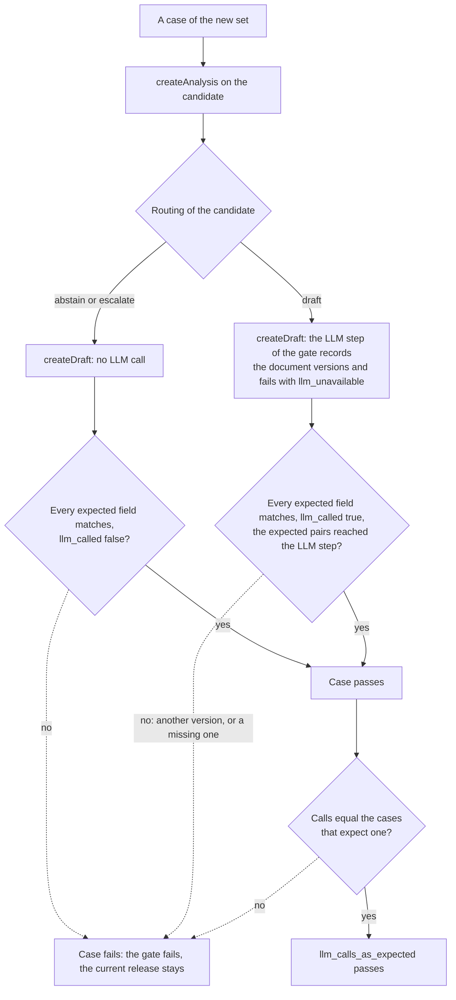

# Design: The offline evaluation gate for a release that serves KB documents

- **Status:** Approved
- **Owner:** Project lead
- **Reviewers:** Project lead, the reviewer of #41
- **Last reviewed:** 2026-11-23
- **Related:** FR-03, FR-05, FR-06, NFR-03 to NFR-07; [DATA-20](../rules/data-and-ml.md#splits-and-evaluation-protocol), [DATA-23](../rules/data-and-ml.md#splits-and-evaluation-protocol), [DATA-46](../rules/data-and-ml.md#evaluation-and-reporting), [DATA-57](../rules/data-and-ml.md#models-and-artifacts); [ADR-0021, Release and the offline evaluation gate](../decisions/0021-repository-layout-and-ai-ml-migration.md#release-and-the-offline-evaluation-gate), [ADR-0025](../decisions/0025-routing-configuration-of-the-first-release.md), [ADR-0027](../decisions/0027-retrieval-index-configuration-of-the-first-release.md), [ADR-0031](../decisions/0031-retiring-apps-and-the-evaluation-runners-of-main.md); issues [#15](https://github.com/ml-system-design-nhom-5/SupportIQ/issues/15) and [#38](https://github.com/ml-system-design-nhom-5/SupportIQ/issues/38)

## Summary

The gate of the first release cannot pass on a release that serves KB documents. Its LLM step fails every call, and its check `no_llm_call` fails on any call ([release command README, The run](../../eval/release/README.md#the-run)). Its case set is written for a KB with 0 documents ([interim-v1, What the set is written for](../../data/benchmarks/escalation/interim-v1/README.md#what-the-set-is-written-for)). The PR into `main` waits for the first release that serves KB documents ([ADR-0031, The checklist of ADR-0021](../decisions/0031-retiring-apps-and-the-evaluation-runners-of-main.md#the-checklist-of-adr-0021)). This design makes the smallest change that lets the gate check the draft path without a real LLM, sets simple tolerances for DATA-57, item 2, and sets the rules of the new frozen case set.

## Scope

On 2026-11-23 the project lead decided that the checks stay light and quick for now, so that the PR into `main` comes soon, and become stricter later. This design therefore keeps one case per path, simple tolerances, and the least new code. It drops no guardrail check:

- no real LLM in the gate or in CI ([ADR-0021, CI](../decisions/0021-repository-layout-and-ai-ml-migration.md#ci), statement 2);
- a citation names an admitted KB version (guardrail 2);
- a sensitive request sets the authority flag (ESC-03 (a), FR-06), and `human_agent` escalates (ESC-03 (b));
- no text of a case in the logs ([LOG-29](../rules/logging-and-observability.md#privacy-in-telemetry)).

Everything stricter is listed in [Later, as technical debt](#later-as-technical-debt), each item with an issue to open.

## Design

### Components and responsibilities

Only the gate of `eval/release/` changes, and `ai-service` stays as it is. The gate already gives the candidate its own LLM step through `CandidatePorts` (`eval/release/src/supportiq_release/gate/adapters/gate_ports.py:59-61`). The candidate uses that step directly, without the retries of `BudgetedDraftWriter` (`ai-service/app/composition_root/release_assets.py:300-305`), so each draft makes at most one call.

### The draft path: stop at the LLM boundary

The LLM step of the gate keeps failing every call with `llm_unavailable`. It also records, for each call, the pairs (`document_id`, `version`) of the policy sources of the `DraftRequest`, and nothing else of the request.

1. A case that expects a draft sets `expected.llm_called` to `true`. That field already exists and is compared for every case (`gate/domain/checks.py:146-147`).
2. Such a case also lists the pairs that must reach the LLM step ([Search in the draft cases](#search-in-the-draft-cases)). The pipeline sends one source per snippet, only from the valid documents of the evidence (`ai-service/app/suggestions/application/release_pipeline.py:352-370`), so a pair that comes more than once is compared once.
3. Its `createDraft` outcome is `llm_unavailable` with the reason code `llm_unavailable` (ESC-05), as in a real failure.
4. The check `no_llm_call` becomes `llm_calls_as_expected`. The LLM step receives exactly one call for each case that expects one, and no other call. On failure it names the IDs of the cases that differ ([Data and contracts](#data-and-contracts)).

### Search in the draft cases

Nobody can write by hand the exact top documents of the real search: the BGE encoder, `relevance_min_score` 0.55, and the top 3 of 14 related documents. A wrong frozen case fails the gate, and only a new set fixes it. Injecting the search result would need the documents of the KB in the gate's search port. That port gets only `search(message)` of the candidate (`gate/adapters/gate_ports.py:113-122`, `ai-service/app/retrieval/domain/search.py:40-43`), and `CandidatePorts` gives no KB. So it would need new code in `ai-service`, or a second reader of the KB in the gate. With the least new code, in line with the lead's scope:

1. A draft case keeps the real search of the candidate. It lists `llm_sources_include`, the pairs that must reach the LLM step, and `llm_sources_exclude`, the pairs that must not.
2. The check compares sets. Every included pair must be among the recorded pairs, and no excluded pair may be.
3. Both lists are set only when `llm_called` is `true`, and `llm_sources_include` holds at least one pair. The case file refuses every other combination.
4. KB v2.1 gives every version the same period and no shared `policy_key`, so it has no expired or conflicting version. `llm_sources_exclude` therefore names versions of other topics. Cases with expired or conflicting versions, exact sets, and injected search results are [Later, as technical debt](#later-as-technical-debt).

How the citation guardrail holds without a draft:

- the gate proves that only admitted versions, in effect and not in conflict, reach the LLM step (statement 2);
- `check_draft` of `ai-service` refuses a citation of any source that the request did not send (`ai-service/app/suggestions/domain/grounding.py:65-68`), and its unit tests prove it.

So a citation can only name an admitted version. The text of a draft is graded on the real LLM ([Groundedness](#groundedness)).

### DATA-57, item 2, against `release-2026-11-18-02`

The model, prompts, and routing of the candidate have the versions and SHA-256 values of the manifest of `release-2026-11-18-02`. Otherwise this design does not apply, and the change needs the evaluation protocol of DATA-20. To be approved with this design:

| Quality target | Rule for this release | Tolerance |
|---|---|---|
| NFR-01 and NFR-02, the intent metrics | Equal: the model asset has the same SHA-256, so its predictions are the same | 0, proven by the checksum; not measured again |
| NFR-05, mandatory escalation cases | Every case of the new set passes | 0 failed cases |
| NFR-06 and NFR-07 | Both folders of guardrail tests of TEST-26 pass with no skip, and every case with an injected failure passes | 0 |
| NFR-03, retrieval, and NFR-04, grounding | First baseline: `release-2026-11-18-02` serves no document | None: recorded as the first baseline, or as not measured, in `known_gaps` ([DATA-48](../rules/data-and-ml.md#evaluation-and-reporting)) |

### The new frozen case set

1. It lives in a new folder of `data/benchmarks/escalation/`, in the format of `interim-v1` with the fields of [Search in the draft cases](#search-in-the-draft-cases) added. It keeps the label "interim, not the shared scenario set" ([ADR-0021, Exception to TEST-26](../decisions/0021-repository-layout-and-ai-ml-migration.md#exception-to-test-26)).
2. `written_for` holds the five fields of `interim-v1`, with `kb_version` `v2.1` and `kb_document_count` equal to the number that ingestion admits. The check before the run does not change ([release command README, Checks before the run](../../eval/release/README.md#checks-before-the-run), item 4).
3. One case per path is enough:
   - a draft for each policy topic, as `local/main-ready/kb-v3/BRIEF.md` asks;
   - ESC-01, low confidence;
   - ESC-02, out of scope;
   - ESC-03 (a), with authority, and ESC-03 (b), `human_agent`;
   - ESC-04, no valid document;
   - each injected failure of `interim-v1`.
4. A separate session writes the set from the approved KB v2.1 before any gate run, as `local/main-ready/kb-v3/BRIEF.md` sets out. Its expected pairs come from that KB, never from a run ([DATA-23](../rules/data-and-ml.md#splits-and-evaluation-protocol), guardrail 5).
5. The project lead approves it in an `approval.json`, as for `interim-v1`. After that it is never edited, and a fault in it is fixed only by a new set.

### Groundedness

The gate writes no draft, so DATA-46 is met on the drafts of the real LLM in the strict end-to-end round, with the local run with AI. This needs two people, for example the project lead and the author of the AI part of `main`. Both grade the same drafts, one for each of the 14 policy topics of KB v2.1, so about 14 drafts each. The [deploy README, Runs with the real AI](../../deploy/README.md#runs-with-the-real-ai) records the date, the commit, the `release_id`, the number of drafts, the share of statements that each grader found supported, and the number of disagreements. It records no text of a message or a draft, because those texts are Confidential ([SEC-02](../rules/security-and-privacy.md#data-classification)).

### Untuned values

τ, δ, λ, and `relevance_min_score` 0.55 stay untuned, as a known limit, and issues #15 and #38 stay open. ADR-0025 and ADR-0027 tune them only on validation data with a run record, never on test data ([DATA-25](../rules/data-and-ml.md#leakage)). No validation set with KB documents exists yet, and tuning on the new case set would make it unfit as a test set. The gate record names both in `known_gaps`: the untuned routing, which it names already, and the untuned index, which [ADR-0027, Open questions](../decisions/0027-retrieval-index-configuration-of-the-first-release.md#open-questions) leaves open. Both ADRs are revisited when this release is served, as their Validation sections state.

### Data and contracts

- No contract changes.
- The case file gains `llm_sources_include` and `llm_sources_exclude`, in the combinations of [Search in the draft cases](#search-in-the-draft-cases). `interim-v1` has neither and loads unchanged. The change is compatible.
- The gate record moves to `supportiq-gate-run/interim-2`, because the check is renamed and the record holds the observed pairs. `publish-candidate` accepts `interim-2` for a new run. The published record of `release-2026-11-18-02` stays `interim-1` and is not read again.
- KB v2.1 needs the index version `bge-small-en-v1.5-main-untuned-v1-kb-v2.1`, because `ai-service` refuses an index whose `kb_version` is not the KB of the release (`ai-service/app/retrieval/adapters/index_file.py:112`). It holds the values of `…-kb-v2`, and [ADR-0027](../decisions/0027-retrieval-index-configuration-of-the-first-release.md#exception-to-adr-0005) names both.

### Errors and guardrails

| Failure | Behavior | Test |
|---|---|---|
| A case that must abstain or escalate reaches the LLM step | The case fails (`createDraft.llm_called`), and the gate fails | `test_checks.py` |
| More or fewer calls than the cases expect | `llm_calls_as_expected` fails and names the cases | `test_outcome.py` |
| Expected pairs missing on a case that expects a call, present on one that does not, or given both ways | The case file is refused before the run, with exit status 2 | `test_cases_file.py` |
| An excluded pair reaches the LLM step, or an included pair does not | The case fails (`createDraft.llm_sources`) | `test_checks.py` |
| A record of another format is passed to `publish-candidate` | Refused with exit status 2 | `test_publish.py` |
| The record holds text of the KB or a message | Never: it holds only the pairs and IDs | `test_gate_record.py` |

## Alternatives considered

- **A recording fake that writes a deterministic draft from the snippets.** It would run `check_draft` and return citations in the gate. It needs a writer whose text passes the grounding rules, a parser of the draft response, and expected citations in each case. It proves only that a draft built to pass the check passes it. Not chosen for now: it is [Later, as technical debt](#later-as-technical-debt), item 1.
- **Keep the name `no_llm_call`.** The name would state the opposite of the rule. Not chosen.
- **An injected search result with an exact set of pairs.** It needs the KB documents in the gate's search port, so new code in `ai-service` or in the gate. Not chosen for now: [Later, as technical debt](#later-as-technical-debt), item 2.
- **An exact set with the real search.** A set written by hand that misses the real top 3 fails the gate, and only a new frozen set fixes it. Not chosen.

## Testing and evaluation

Each changed file comes with its tests ([TEST-01](../rules/testing.md#required-tests-per-change)):

| Changed file | What changes | Tests |
|---|---|---|
| `gate/adapters/gate_ports.py` | The LLM step records the pairs of each call | `tests/unit/gate/test_gate_ports.py` |
| `gate/domain/cases.py` and `gate/adapters/cases_file.py` | `llm_sources_include` and `llm_sources_exclude` | `test_cases_file.py` |
| `gate/domain/checks.py` and `gate/adapters/candidate_run.py` | The observed pairs and the set comparison | `test_checks.py`, `test_candidate_run.py` |
| `gate/domain/outcome.py` | `llm_calls_as_expected` | `test_outcome.py` |
| `gate/adapters/gate_record.py`, `gate/adapters/publish.py`, and `composition_root/gate_commands.py` | The format `interim-2`, the check's new name, and the observed pairs | `test_gate_record.py`, `test_publish.py`, `tests/unit/composition_root/test_gate_commands.py`, `tests/unit/gate/fakes.py` |

`interim-v1` still loads and its cases still check under the new rules. `eval/release/README.md` (The run, The record) changes in the same commit.

After the KB session writes `data/raw/kb/v2.1/` and `eval/kb-ingestion/v2.1/`, one more commit adds the section "KB v2.1" to `eval/release/README.md`, with the counts of the real run, and a test like `tests/integration/test_kb_v2.py` for v2.1.

## Observability

There are no new events. The record holds the pairs and the case IDs, as it holds the other observed values.

## Security and privacy

No text leaves the process, and no provider is called. The record holds identifiers only, and the check `no_case_text_in_the_logs` stays.

## Later, as technical debt

Each item gets one issue labeled `tech-debt`, opened with this design's code ([WF-22 to WF-24](../rules/workflow.md#technical-debt)):

1. A fake LLM step that writes a deterministic draft, so the gate checks citations and `check_draft` end to end.
2. Injected search results with exact sets of pairs, and more than one case per path, including expired and conflicting versions (NFR-03).
3. A labeled question set for Recall@3 (NFR-03), a graded set for grounding (NFR-04), and their tolerances in the evaluation protocol (DATA-20).
4. Tuning τ, δ, and λ (#15) and `relevance_min_score` (#38), which already have issues.

## Rollout

1. The project lead approves this design, with its tolerances.
2. The code and tests of [Testing and evaluation](#testing-and-evaluation), in one commit.
3. KB v2.1, its ingestion and index version, and the new case set, approved by the project lead.
4. The gate run in Docker, `publish-candidate`, and the release steps of the [release command README, Publish](../../eval/release/README.md#publish).
5. The strict end-to-end round on that release, then the PR into `main`.

To roll back, revert the pinned file: the previous release stays on GitHub.
