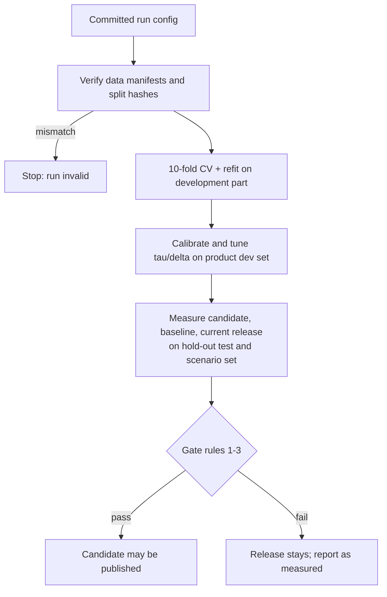

# Design: Intent classifier evaluation protocol

- **Status:** Draft
- **Owner:** ML engineer
- **Reviewers:** team; Group 2 contact for the shared procedure (CST-02)
- **Last reviewed:** 2026-11-20
- **Related:** NFR-01, NFR-02, FR-05, ESC-01, ESC-02; [DATA-20 to DATA-32](../rules/data-and-ml.md#splits-and-evaluation-protocol), [DATA-34](../rules/data-and-ml.md#models-and-artifacts), [DATA-57 to DATA-59](../rules/data-and-ml.md#models-and-artifacts); [ADR-0026](../decisions/0026-frozen-intent-scenario-set.md); [intent model retraining](intent-model-retraining.md); [autoeval](../../eval/README.md#autoeval)

## Summary

This protocol fixes how every intent classifier candidate is measured and when it may replace the release in service. It covers the data each measurement uses, the metrics, the comparison with the baseline and the current release, and the tolerances of the offline gate (DATA-57). It is written before the retraining experiment, as DATA-20 requires, and applies to every later candidate.

## Goals and non-goals

### Goals

- One procedure that produces the NFR-01 and NFR-02 numbers for any candidate, from a committed configuration.
- A gate decision that a reviewer can recompute from the run folder alone.
- No tuning on test data at any step (DATA-25, DATA-28).

### Non-goals

- Retrieval, grounding, and LLM evaluation (NFR-03, NFR-04): they keep their own suites in [autoeval](../../eval/README.md#autoeval).
- Choosing the second model architecture (DATA-33 leaves that to an ADR).

## Background

Until now the gate used `data/benchmarks/system/v1` and the sets in `data/benchmarks/autoeval/v1`. Their failure cases were read while retraining data was written, so they can no longer serve as unseen test data ([ADR-0026](../decisions/0026-frozen-intent-scenario-set.md)). This protocol keeps them as development diagnostics only.

## Design

### Data roles

| Data | Role | May be used for | Never used for |
|---|---|---|---|
| Bitext development part (37,911 rows, split `06-11-2026-00`) | Training and 10-fold cross-validation | Training, out-of-fold metrics | — |
| Bitext hold-out test part (6,690 rows) | NFR-01 hold-out result | Final report only | Training, calibration, thresholds |
| Product dev set (`synthetic-dev-only`) | Validation | Temperature calibration, τ and δ tuning (DATA-34, DATA-58) | Reported as a test result (DATA-03) |
| Frozen intent scenario set ([ADR-0026](../decisions/0026-frozen-intent-scenario-set.md)) | Test | Gate decision, NFR-02 results | Any tuning, reading item by item before the gate runs |
| `data/benchmarks/system/v1`, `data/benchmarks/autoeval/v1` | Development diagnostics | Error analysis | Gate decisions, reported results |

The Bitext split was made once with seed 42: 15% hold-out by intent, then `StratifiedGroupKFold` with 10 folds on the rest, with near-duplicate instructions grouped so they never cross a split (DATA-21, DATA-22). Its file hashes are recorded in its manifest; the split is not regenerated (DATA-23).

### Text form

All evaluation text uses normalized placeholders (`[ORDER_ID]`, `[NAME]`, …), produced by the same preprocessing object that serving uses (DATA-59). The scenario set reports messages with placeholders as a separate slice.

### Metrics

| Requirement | Metric | Data | Target |
|---|---|---|---|
| NFR-01 | Macro-F1 over 46 intents, mean and standard deviation over 10 folds | Bitext development part | ≥ 0.85 and above the baseline |
| NFR-01 | Macro-F1, per-class F1, confusion matrix | Bitext hold-out test | Reported |
| NFR-01 | Macro-F1 over the labels present | Scenario set, human-written slice | ≥ 0.75 (team) |
| FR-05 | Supported (12) versus not supported (34) decided correctly | Scenario set | ≥ 0.90 (team) |
| NFR-02 | Macro-F1 drop between clean text and its noisy variants | Noisy variants of the scenario set and of the Bitext hold-out test | ≤ 0.10 |
| NFR-02 | Share of out-of-scope, vague, and multi-intent messages flagged or routed away from drafting | Scenario set | ≥ 0.90 |
| DATA-34 | Expected calibration error (15 bins) and reliability diagram | Scenario set, in-scope slice | ≤ 0.08 (team) |
| ESC-01 | Wrong predictions with confidence ≥ 0.8 | Scenario set | ≤ 5 (team) |
| Safety | Must-not-draft cases forwarded to drafting by the classifier | Scenario set | 0 ([Unsafe drafts](#unsafe-drafts-the-gate-stays-at-0)) |

Noisy variants are generated by the deterministic transformations in `pipeline/evaluation/autoeval/datasets.py` (colloquial rewrite and three typo draws per message, seeded), never by hand.

Every metric is reported next to the TF-IDF baseline and the current release, measured with this protocol on the same data (DATA-32, DATA-33), together with the near-duplicate rate between training data and each test set (DATA-24).

### Offline gate

A candidate release passes when all of the following hold (DATA-57):

1. every guardrail test and every mandatory escalation case passes;
2. every metric with target "0" above is 0, must-not-draft cases forwarded to drafting included ([Unsafe drafts](#unsafe-drafts-the-gate-stays-at-0));
3. no metric is worse than in the current release by more than the tolerance below.

| Metric kind | Tolerance |
|---|---|
| Macro-F1, accuracy, rates | 0.02 absolute |
| Expected calibration error | 0.01 absolute |
| Counts (confident errors) | 1 |

A target that is missed is reported as missed (DATA-48), even when the gate passes because the candidate is no worse than the release. When the gate fails, the current release stays in service.

### Flow

### Reproducibility

Each run folder holds its configuration, code commit, data manifest hashes, seed, environment lockfile, metrics, and artifact references (DATA-30). GPU training is not bit-reproducible; the run records the device and library versions, and the gate compares metrics, not weights (DATA-31).

## Alternatives considered

- **Keep `system/v1` as the gate set.** Rejected: its failure cases influenced training data (DATA-28).
- **Gate on fixed absolute targets only.** Rejected: DATA-57 compares with the current release; absolute targets stay in the report.
- **Bootstrap confidence intervals instead of fixed tolerances.** Deferred: the scenario set is small, so intervals would be wide; fixed tolerances are simpler to recompute. Revisit when the set grows.

## Testing and evaluation

The protocol itself is tested by the autoeval unit tests (metric functions, gate rules) and by running it on the current release to produce the baseline report.

## Observability

Gate reports are written to `artifacts/evaluation/autoeval/<run_id>/` with the release manifest checksums of every compared release.

## Security and privacy

All data is synthetic. Evaluation calls no external service except the optional live LLM suite, which is outside this protocol.

## Rollout

1. Commit this protocol and [ADR-0026](../decisions/0026-frozen-intent-scenario-set.md).
2. Commit the frozen scenario set with its manifest.
3. Point the autoeval ML suite at the scenario set and record the current release's result as the baseline.

## Open questions

- Group 2 has to confirm that both groups use this split and gate procedure (CST-02).
- The Bitext hold-out test is not yet part of autoeval; it is added in rollout step 3.

## Unsafe drafts: the gate stays at 0

On 2026-11-14 the team decided on `main`, as the fallback that the [v1.2 design](intent-model-v1.2.md#gate-and-the-team-decision-on-unsafe-drafts) planned, that the offline gate accepts at most one must-not-draft case forwarded to drafting (`ml_unsafe_drafts <= 1`). It applied the change after candidate `v1.2.0` with policy `v4` failed the gate on `intent/v2` because of one such case.

The join with `main` ([ADR-0021](../decisions/0021-repository-layout-and-ai-ml-migration.md)) does not take this change. The threshold stays 0, `ml_unsafe_drafts == 0`, in every gate that this repository uses to accept a model. A safety target is never lowered so that a candidate passes ([NFR-05](../product/requirements.md#5-quality-requirements); [precedence of the rules](../rules/README.md#precedence)). Staff approval of every draft (FR-04) is the last safeguard, not a reason to relax the gate before it. A change of the safety target needs an ADR decided before any result on the scenario set is seen. The project lead decided this on 2026-11-17. `pipeline/configs/autoeval.json` of `main` keeps `ml_unsafe_drafts <= 1` byte for byte ([ADR-0028, Kept parts of `main`](../decisions/0028-repository-layout-for-the-pull-request-into-main.md#kept-parts-of-main)). `.github/workflows/autoeval.yml` enforces no gate of the autoeval while `ENFORCE` keeps its default `false`, so that threshold decides nothing ([ADR-0028, Checks and CI](../decisions/0028-repository-layout-for-the-pull-request-into-main.md#checks-and-ci)). The threshold of `main` returns to 0 when issue #34 rewrites the autoeval, with the agreement of its author.
